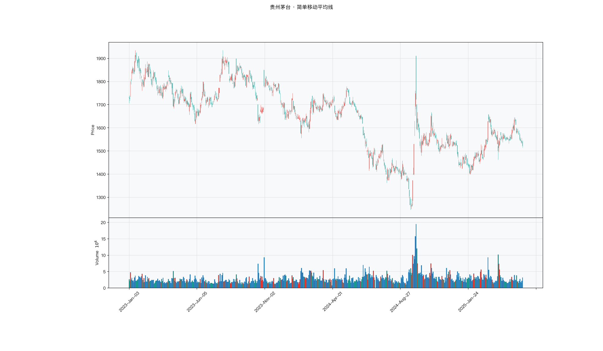

# 第009章 简单移动平均线（SMA）

收盘后，一位交易者把最近二十天的 K 线翻了两遍，仍说不清这轮上涨是从哪一天开始的。换成十日窗口，涨势还在；换成六十日窗口，价格仍在水下。他想找一个不含主观判断的口径，把持仓成本和市场的平均成本放在一起比。他算出这二十天收盘价的算术平均，发现价格正停在这条线附近。均线要回答的，就是这条平均成本线该划在哪里。

## 名称与来历

简单移动平均线（Simple Moving Average，SMA），也叫算术移动平均线。

它没有单一的发明者。移动平均这个想法来自统计学，在十九世纪末就被用于平滑经济时间序列。把它引入股票分析的是二十世纪初的一批实务工作者，其中影响较大的是理查德·舒巴克（Richard Schabacker）在 1930 年代的著作，以及后来的约翰·墨菲（John Murphy）在 1999 年《期货市场技术分析》中的系统化整理。SMA 之所以成为最基础的均线，不是因为有人专门设计了它，而是因为它是最朴素的平滑方式，先于其他变体存在。

## 核心逻辑

SMA 回答一个很具体的问题：过去 n 天的平均价格是多少。

这个数字在交易上有一个直接的解释：它是过去 n 天内所有成交的平均成本。价格在它上方，说明近期买入的人平均是赚的；价格在它下方，说明平均是亏的。均线因此成为一条心理分界线：盈利者倾向于持有，亏损者倾向于在回本时卖出，这种集体行为让均线附近容易出现支撑或阻力。

SMA 用等权处理每一期价格。这是它与其他均线的根本区别，也是它最稳定、最滞后的原因。等权意味着新信息只占 1/n 的权重，n 越大，单日价格对均线的影响越小。

## 计算公式

n 日简单移动平均是最近 n 个收盘价的算术平均值：

$$SMA_t = \frac{1}{n}\sum_{i=0}^{n-1} p_{t-i}$$

其中 $p_t$ 为第 t 日收盘价，n 为周期参数。

**计算示例。** 假设连续五个交易日收盘价为 10、11、12、13、14 元，则

$$SMA_5 = \frac{10+11+12+13+14}{5}=12$$

次日收盘 15 元，窗口右移，最早的 10 元被剔除：

$$SMA_5' = \frac{11+12+13+14+15}{5}=13$$

**参数含义。** n 是唯一的参数。n 决定了平滑程度与滞后程度：

| n | 有效滞后（约） | 用途 |
|---|--------------|------|
| 5–10 | 2–4 期 | 捕捉极短期转折，噪音多 |
| 20 | 8 期 | 波段操作的趋势锚，最常用 |
| 50–60 | 20–25 期 | 中期趋势分水岭 |
| 200 | 80 期 | 长期牛熊分界，全球通用 |

同量级下的对比：**SMA 最稳定、最滞后；WMA 最灵敏、假信号最多；EMA 居中。** 三者的差异全部来自权重分配方式。

## 用法与信号

**交叉。** 短期均线从下向上穿越长期均线称为金叉，通常视为买入信号；从上向下穿越称为死叉，视为卖出信号。交叉的可靠性依赖两个条件：两条均线在交叉时方向一致（都向上或都向下），以及交叉伴随成交量放大。

**方向与斜率。** 均线本身的方向是最直接的趋势信号。向上且斜率大，趋势强劲；向上但斜率趋缓，趋势延续但动能减弱；走平，无明确趋势；向下，空头格局。

**价格与均线的相对位置。** 趋势行情中，均线常成为动态支撑或阻力。多头趋势中价格回调至均线附近止跌，支撑有效；空头趋势中价格反弹至均线附近遇阻，阻力有效。

**多周期排列。** 短期均线在上、长期均线在下且全部向上，称为多头排列，是最强的趋势状态；反向排列为空头排列。

## 边界与误区

**滞后是设计特性，不是缺陷。** SMA 在每个均线中滞后最长，因为等权让近期信息占比最低。批评等权"不合理"然后改用 EMA，是把稳定换成了灵敏，并非改进。选择哪种取决于交易周期：长线用 SMA 更少被噪音干扰。

**震荡市中交叉信号基本无效。** 横盘时价格围绕均线反复穿越，短期与长期均线可能一周交叉三到五次，其中绝大多数是假信号。判断依据是平均趋向指数（ADX）低于 25，或价格在窄幅区间内运行。此期间应停用交叉信号。

**单一周期无法覆盖所有行情。** 只看 5 日均线无法判断长线方向。合理的做法是建立周期体系：短线看 5/10 日，波段看 20 日，中线看 50 日，长线看 200 日，多周期共振时信号最强。

**参数不应在历史数据上优化。** 在样本内寻找最优 n 几乎必然过拟合。正确做法是选一个区间（比如 15 到 25 日），检查表现是否平稳。若只有 20 日好而 19 日和 21 日都很差，说明该参数是拟合出来的。

## 它被检验过吗

均线规则是技术分析里被检验得最多的一类。Brock 等（1992）在道指 1897 至 1986 年的日线上检验了 26 条简单规则，报告过统计上的预测力；Sullivan 等（1999）把规则空间扩大到近八千条，用 Reality Check 校正数据窥探偏差后，最优规则的显著性大幅缩水；Park 与 Irwin（2007）综述 95 项研究，结论是混合的。完整证据链见第 007 章。

这些检验针对的是均线规则族，无法区分 SMA、EMA、WMA、DEMA、ZLEMA、DMA、BBI 之间的优劣。没有任何可靠检验给出过这几个变体的排序。选择哪一条，取决于对滞后与噪声的取舍。

这一类的真实失效案例，见第 008 章的「真实案例与失败模式」。

## 代码实现

### R

```r
library(ettr)
library(efactorcraft)
library(efincharts)
library(ggplot2)

BASE <- "https://raw.githubusercontent.com/dengyishuo/quant-technical-analysis/main/data/parquet"

# 取数据：本地有就用本地，没有就下载一次并缓存。
# read.csv 对本地 .gz 会自动解压，所以缓存成 .csv.gz 也能直接读。
load_data <- function(name) {
  local <- file.path("data", "parquet", name)
  if (file.exists(local)) return(local)
  cache <- file.path(tools::R_user_dir("qta", "cache"), name)
  if (!file.exists(cache)) {
    dir.create(dirname(cache), recursive = TRUE, showWarnings = FALSE)
    message("下载 ", name, " ...")
    download.file(paste0(BASE, "/", name), cache, mode = "wb", quiet = TRUE)
  }
  cache
}

read_data <- function(name) {
  d <- read.csv(load_data(name), stringsAsFactors = FALSE)
  if ("date" %in% names(d)) d$date <- as.Date(d$date)
  d
}

# 同一章里多次取用，缓存到内存，避免重复解析
.cache <- new.env(parent = emptyenv())
.blue <- function() {
  if (!exists("b", .cache)) assign("b", read_data("panel_blue_chip.csv"), .cache)
  get("b", .cache)
}
.panel <- function() {
  if (!exists("p", .cache)) {
    p <- read_data("panel_r.csv.gz")
    assign("p", p[p$date >= "2023-01-01" & p$date <= "2025-06-01", ], .cache)
  }
  get("p", .cache)
}
.index <- function() read_data("index_daily.csv")

blue  <- .blue()
panel <- .panel()

# 图的保存路径，顺手建目录，避免读者本地没有 assets/ 时报错
fig_path <- function(ch, name = "indicator_r.png") {
  d <- file.path("assets", "figures", sprintf("ch%03d", ch))
  dir.create(d, recursive = TRUE, showWarnings = FALSE)
  file.path(d, name)
}

# efincharts 要求 xts 且列名带 Adjusted
as_xts <- function(df) {
  x <- xts::xts(df[, c("open", "high", "low", "close", "volume", "adjusted")],
                order.by = df$date)
  colnames(x) <- c("Open", "High", "Low", "Close", "Volume", "Adjusted")
  x
}

maotai <- .blue()[.blue()$code == "600519.SS", ]

# 1. ettr 在长格式面板上追加指标列
maotai <- add_sma(maotai, n = 20)
maotai <- add_sma(maotai, n = 60)

# 2. 基本统计
cols <- setdiff(names(maotai), names(blue))
print(summary(maotai[, cols]))

# 3. K 线 + 成交量 + 均线
ch <- ecandlesticks(as_xts(maotai), show_ma = TRUE, ma_periods = c(20, 60),
                    title = "贵州茅台 · 简单移动平均线")
ggsave(fig_path(9), ch$combined_plot, width = 10, height = 6, dpi = 110)
```

### Python

```python
import pathlib
import urllib.request

import pandas as pd
import ettr
import efactorcraft as efc
import efincharts as efc_

# 中文字体：mplfinance 会用 style 里的 rc 覆盖全局设置，必须写进 style
from efincharts import theme
theme.efin_style["rc"] = {
    "font.sans-serif": ["PingFang SC", "Heiti SC", "SimHei"],
    "axes.unicode_minus": False,
    "font.family": "sans-serif",
}

# A 股习惯是涨红跌绿，efincharts 的默认配色沿用了欧美习惯（涨绿跌红），
# 这里改回来，也让静态图与网页上的交互图、R 侧的图保持一致。
_mc = theme.efin_style["marketcolors"]
for _k in ("candle", "edge", "wick", "volume"):
    _mc[_k] = {"up": "#e53935", "down": "#26a69a"}

BASE = "https://raw.githubusercontent.com/dengyishuo/quant-technical-analysis/main/data/parquet"
CACHE = pathlib.Path.home() / ".cache" / "qta"
_MEM = {}


def load(name):
    """取数据：本地有就用本地，没有就下载一次并缓存。

    这样三种情形都能跑：
      1. 克隆了整个仓库    -> 直接读 data/parquet/，不联网
      2. 只复制了代码片段  -> 首次自动下载到 ~/.cache/qta，之后走缓存
      3. 之前跑过          -> 全部命中缓存，断网也能用
    """
    if name in _MEM:
        return _MEM[name]
    local = pathlib.Path("data/parquet") / name
    if local.exists():
        path = local
    else:
        CACHE.mkdir(parents=True, exist_ok=True)
        path = CACHE / name
        if not path.exists():
            print("下载 %s ..." % name)
            urllib.request.urlretrieve(BASE + "/" + name, path)
    data = pd.read_parquet(path) if name.endswith(".parquet") else pd.read_csv(path)
    _MEM[name] = data
    return data


blue = load("panel_blue_chip.parquet")
panel = load("panel.parquet")
panel = panel[(panel["date"] >= "2023-01-01") & (panel["date"] <= "2025-06-01")]
idx = load("index_daily.parquet")


def one(df, code="600519.SS"):
    """取单只标的，转成 efincharts 需要的宽表。"""
    x = df[df["code"] == code].sort_values("date").set_index("date")
    x.columns = [c.capitalize() for c in x.columns]
    return x


def fig_path(ch, name="indicator.png"):
    """图的保存路径，顺手建目录，避免读者本地没有 assets/ 时报错。"""
    d = pathlib.Path("assets") / "figures" / ("ch%03d" % ch)
    d.mkdir(parents=True, exist_ok=True)
    return str(d / name)

# 1. 取单只标的
maotai = blue[blue['code'] == '600519.SS'].copy()

# 2. ettr 在长格式面板上追加指标列，不需要手工 rolling
maotai = ettr.sma(maotai, n=[5, 20, 60])

cols = [c for c in maotai.columns if c not in blue.columns]
print(maotai[cols].describe().round(3))

# 3. 画图：K 线 + 成交量 + 指标面板
px = one(maotai)
ch = efc_.candlestick(px, volume=True, title="贵州茅台 · 简单移动平均线")
ch.save(fig_path(9))
```

<!-- fig-indicator:start -->


<p class="figcap">图 9-1　简单移动平均线在贵州茅台上的读数（2023-01 至 2025-06）</p>
<!-- fig-indicator:end -->

## 拆解

SMA 输出与价格同量纲，直接拿来做横截面因子没有意义：一家高价股的均线值天然高于低价股，按均线值排序，排出来的其实是股价水平，不是趋势强弱。要进入检验，先拆成无量纲的特征。

| 特征名 | 计算式 | 量纲 | 经济含义 |
|--------|--------|------|----------|
| 价格偏离度 | $p_t / \mathrm{SMA}_t^{(n)} - 1$ | 无量纲比例 | 价格相对过去 $n$ 日平均成本的位置 |
| 均线斜率 | $(\mathrm{SMA}_t - \mathrm{SMA}_{t-k}) / \mathrm{SMA}_{t-k}$ | 无量纲比例 | 趋势方向与推进速度 |
| 斜率加速度 | $\mathrm{slope}_t - \mathrm{slope}_{t-k}$ | 无量纲比例 | 趋势在加速还是减速 |
| 状态久期 | 连续 $p > \mathrm{SMA}$ 的期数，带符号 | 期数（整数） | 状态持续的时间长度 |

偏离度用均线自身做归一，斜率用均线自身做归一，两者才是可比的量。前者刻画位置，后者刻画方向，斜率加速度刻画趋势的强弱变化，状态久期刻画状态的持续性。四者信息并不独立，偏离度与斜率高度相关，检验时需要留意共线性。

状态久期是整数且分布明显右偏，长连续段会主导排序，进入因子前通常先做截断或分档。偏离度则相反，它的问题是右尾偏厚：价格快速拉升时偏离度会冲到很高的位置，一两个极端值就能改变整段 IC。因此偏离度的第一步不是算 IC，而是按要求去做极值处理。

还有一处容易被忽略的区分。偏离度与趋势强度不是同一件事。价格处在长期上涨趋势中会持续位于均线上方，此时偏离度为正且稳定，这是趋势信号；而如果偏离度在短期内急升，那是超买信号。同一个计算式在不同时间尺度下含义不同，这是设计因子时必须先定下来的前提。

### R

```r
library(ettr)
library(efactorcraft)
library(efincharts)
library(ggplot2)

BASE <- "https://raw.githubusercontent.com/dengyishuo/quant-technical-analysis/main/data/parquet"

# 取数据：本地有就用本地，没有就下载一次并缓存。
# read.csv 对本地 .gz 会自动解压，所以缓存成 .csv.gz 也能直接读。
load_data <- function(name) {
  local <- file.path("data", "parquet", name)
  if (file.exists(local)) return(local)
  cache <- file.path(tools::R_user_dir("qta", "cache"), name)
  if (!file.exists(cache)) {
    dir.create(dirname(cache), recursive = TRUE, showWarnings = FALSE)
    message("下载 ", name, " ...")
    download.file(paste0(BASE, "/", name), cache, mode = "wb", quiet = TRUE)
  }
  cache
}

read_data <- function(name) {
  d <- read.csv(load_data(name), stringsAsFactors = FALSE)
  if ("date" %in% names(d)) d$date <- as.Date(d$date)
  d
}

# 同一章里多次取用，缓存到内存，避免重复解析
.cache <- new.env(parent = emptyenv())
.blue <- function() {
  if (!exists("b", .cache)) assign("b", read_data("panel_blue_chip.csv"), .cache)
  get("b", .cache)
}
.panel <- function() {
  if (!exists("p", .cache)) {
    p <- read_data("panel_r.csv.gz")
    assign("p", p[p$date >= "2023-01-01" & p$date <= "2025-06-01", ], .cache)
  }
  get("p", .cache)
}
.index <- function() read_data("index_daily.csv")

blue  <- .blue()
panel <- .panel()

# 图的保存路径，顺手建目录，避免读者本地没有 assets/ 时报错
fig_path <- function(ch, name = "indicator_r.png") {
  d <- file.path("assets", "figures", sprintf("ch%03d", ch))
  dir.create(d, recursive = TRUE, showWarnings = FALSE)
  file.path(d, name)
}

# efincharts 要求 xts 且列名带 Adjusted
as_xts <- function(df) {
  x <- xts::xts(df[, c("open", "high", "low", "close", "volume", "adjusted")],
                order.by = df$date)
  colnames(x) <- c("Open", "High", "Low", "Close", "Volume", "Adjusted")
  x
}

d <- .blue()[.blue()$code == "600519.SS", ]
d <- add_sma(d, n = 20)
d <- add_sma(d, n = 60)

# 转成无量纲因子
d$f <- d$`SMA_20` / d$close - 1

print(summary(d$f))
```

### Python

```python
import pathlib
import urllib.request

import pandas as pd
import ettr
import efactorcraft as efc
import efincharts as efc_

# 中文字体：mplfinance 会用 style 里的 rc 覆盖全局设置，必须写进 style
from efincharts import theme
theme.efin_style["rc"] = {
    "font.sans-serif": ["PingFang SC", "Heiti SC", "SimHei"],
    "axes.unicode_minus": False,
    "font.family": "sans-serif",
}

# A 股习惯是涨红跌绿，efincharts 的默认配色沿用了欧美习惯（涨绿跌红），
# 这里改回来，也让静态图与网页上的交互图、R 侧的图保持一致。
_mc = theme.efin_style["marketcolors"]
for _k in ("candle", "edge", "wick", "volume"):
    _mc[_k] = {"up": "#e53935", "down": "#26a69a"}

BASE = "https://raw.githubusercontent.com/dengyishuo/quant-technical-analysis/main/data/parquet"
CACHE = pathlib.Path.home() / ".cache" / "qta"
_MEM = {}


def load(name):
    """取数据：本地有就用本地，没有就下载一次并缓存。

    这样三种情形都能跑：
      1. 克隆了整个仓库    -> 直接读 data/parquet/，不联网
      2. 只复制了代码片段  -> 首次自动下载到 ~/.cache/qta，之后走缓存
      3. 之前跑过          -> 全部命中缓存，断网也能用
    """
    if name in _MEM:
        return _MEM[name]
    local = pathlib.Path("data/parquet") / name
    if local.exists():
        path = local
    else:
        CACHE.mkdir(parents=True, exist_ok=True)
        path = CACHE / name
        if not path.exists():
            print("下载 %s ..." % name)
            urllib.request.urlretrieve(BASE + "/" + name, path)
    data = pd.read_parquet(path) if name.endswith(".parquet") else pd.read_csv(path)
    _MEM[name] = data
    return data


blue = load("panel_blue_chip.parquet")
panel = load("panel.parquet")
panel = panel[(panel["date"] >= "2023-01-01") & (panel["date"] <= "2025-06-01")]
idx = load("index_daily.parquet")


def one(df, code="600519.SS"):
    """取单只标的，转成 efincharts 需要的宽表。"""
    x = df[df["code"] == code].sort_values("date").set_index("date")
    x.columns = [c.capitalize() for c in x.columns]
    return x


def fig_path(ch, name="indicator.png"):
    """图的保存路径，顺手建目录，避免读者本地没有 assets/ 时报错。"""
    d = pathlib.Path("assets") / "figures" / ("ch%03d" % ch)
    d.mkdir(parents=True, exist_ok=True)
    return str(d / name)

# 1. 先在面板上算原始指标
d = panel.copy()
d = ettr.sma(d, n=[5, 20, 60])

# 2. 转成无量纲因子，才能跨标的排序
d["f"] = d["SMA_20"] / d.close - 1

print(d["f"].describe().round(4))
```

## 截面选股能力

SMA 最常用的横截面因子是价格偏离度，构造式为

$$f^{dev}_t = \frac{p_t}{\mathrm{SMA}_t^{(20)}} - 1$$

它度量价格相对过去二十日平均成本的位置，正值代表价格在均线上方，负值代表在下方。另一个候选因子是均线斜率，

$$f^{slope}_t = \frac{\mathrm{SMA}_t - \mathrm{SMA}_{t-5}}{\mathrm{SMA}_{t-5}}$$

它度量均线自身的推进速度，属于纯方向信息。两个因子可以分别检验，比较哪一个的 ICIR 更高；也可以同时纳入，看第二个是否带来增量。

预期表现上，均线偏离度属于典型的趋势跟随型因子，方向通常偏正：价格持续在均线上方的标的，其后续走势可能延续。但它同时具有均值回归的一面，偏离度过大时可能转为反向，因为短期内价格与均线的距离难以无限扩大。这决定了偏离度因子的 IC 在不同时间尺度上可能符号不同，短期偏反转、中期偏动量。检验时应同时报告一日与五日两个前向窗口，用两者的差异观察衰减速度。若一日为负、五日为正，说明这个因子捕捉的是周级别的趋势，而不是日内的过度反应。

因子稳定的条件可以从市况和标的两个层面看。市场层面，在整体趋势明确、方向一致的阶段，偏离度的方向更稳定；在震荡与风格快速轮动的阶段，偏离度更容易反向。标的层面，低波动、走势连贯的标的，偏离度的持续性更强。因此检验时建议按大盘趋势强弱与个股波动率分别分段，观察 IC 是否集中在某一段出现。全样本均值接近于零而分段后清晰，是这类因子常见的情形。

检验时有三点值得特别注意。第一，均线类因子的 IC 会随市场整体趋势强弱而系统波动，只报告全样本均值容易得出偏平的结论，分段报告比单一数字有信息量。第二，偏离度与常见的动量因子、反转因子相关性高，判断增量信息时应做对照回归，把偏离度对已有动量因子取残差后再算一次 IC，残差仍有预测力才说明它是独立信息。第三，斜率的计算窗口会影响结果，窗口过短退化为价格噪音，窗口过长则过于滞后，稳健的做法是选一个区间并检查结论是否平稳。

### R

```r
library(ettr)
library(efactorcraft)
library(efincharts)
library(ggplot2)

BASE <- "https://raw.githubusercontent.com/dengyishuo/quant-technical-analysis/main/data/parquet"

# 取数据：本地有就用本地，没有就下载一次并缓存。
# read.csv 对本地 .gz 会自动解压，所以缓存成 .csv.gz 也能直接读。
load_data <- function(name) {
  local <- file.path("data", "parquet", name)
  if (file.exists(local)) return(local)
  cache <- file.path(tools::R_user_dir("qta", "cache"), name)
  if (!file.exists(cache)) {
    dir.create(dirname(cache), recursive = TRUE, showWarnings = FALSE)
    message("下载 ", name, " ...")
    download.file(paste0(BASE, "/", name), cache, mode = "wb", quiet = TRUE)
  }
  cache
}

read_data <- function(name) {
  d <- read.csv(load_data(name), stringsAsFactors = FALSE)
  if ("date" %in% names(d)) d$date <- as.Date(d$date)
  d
}

# 同一章里多次取用，缓存到内存，避免重复解析
.cache <- new.env(parent = emptyenv())
.blue <- function() {
  if (!exists("b", .cache)) assign("b", read_data("panel_blue_chip.csv"), .cache)
  get("b", .cache)
}
.panel <- function() {
  if (!exists("p", .cache)) {
    p <- read_data("panel_r.csv.gz")
    assign("p", p[p$date >= "2023-01-01" & p$date <= "2025-06-01", ], .cache)
  }
  get("p", .cache)
}
.index <- function() read_data("index_daily.csv")

blue  <- .blue()
panel <- .panel()

# 图的保存路径，顺手建目录，避免读者本地没有 assets/ 时报错
fig_path <- function(ch, name = "indicator_r.png") {
  d <- file.path("assets", "figures", sprintf("ch%03d", ch))
  dir.create(d, recursive = TRUE, showWarnings = FALSE)
  file.path(d, name)
}

# efincharts 要求 xts 且列名带 Adjusted
as_xts <- function(df) {
  x <- xts::xts(df[, c("open", "high", "low", "close", "volume", "adjusted")],
                order.by = df$date)
  colnames(x) <- c("Open", "High", "Low", "Close", "Volume", "Adjusted")
  x
}

d <- .panel()
d <- add_sma(d, n = 20)
d <- add_sma(d, n = 60)

d$f <- d$`SMA_20` / d$close - 1
d <- add_next_return(d, close_col = "close", n = c(1, 5, 20))

ic <- ic_analysis(d, factor_cols = "f",
                    forward_cols = c("forward_1", "forward_5", "forward_20"),
                    method = "spearman")
print(ir_analysis(ic))

q <- quantile_analysis(d, factor_cols = "f", forward_cols = "forward_5",
                       n_groups = 5)
print(q$f$summary)
```

### Python

```python
import pathlib
import urllib.request

import pandas as pd
import ettr
import efactorcraft as efc
import efincharts as efc_

# 中文字体：mplfinance 会用 style 里的 rc 覆盖全局设置，必须写进 style
from efincharts import theme
theme.efin_style["rc"] = {
    "font.sans-serif": ["PingFang SC", "Heiti SC", "SimHei"],
    "axes.unicode_minus": False,
    "font.family": "sans-serif",
}

# A 股习惯是涨红跌绿，efincharts 的默认配色沿用了欧美习惯（涨绿跌红），
# 这里改回来，也让静态图与网页上的交互图、R 侧的图保持一致。
_mc = theme.efin_style["marketcolors"]
for _k in ("candle", "edge", "wick", "volume"):
    _mc[_k] = {"up": "#e53935", "down": "#26a69a"}

BASE = "https://raw.githubusercontent.com/dengyishuo/quant-technical-analysis/main/data/parquet"
CACHE = pathlib.Path.home() / ".cache" / "qta"
_MEM = {}


def load(name):
    """取数据：本地有就用本地，没有就下载一次并缓存。

    这样三种情形都能跑：
      1. 克隆了整个仓库    -> 直接读 data/parquet/，不联网
      2. 只复制了代码片段  -> 首次自动下载到 ~/.cache/qta，之后走缓存
      3. 之前跑过          -> 全部命中缓存，断网也能用
    """
    if name in _MEM:
        return _MEM[name]
    local = pathlib.Path("data/parquet") / name
    if local.exists():
        path = local
    else:
        CACHE.mkdir(parents=True, exist_ok=True)
        path = CACHE / name
        if not path.exists():
            print("下载 %s ..." % name)
            urllib.request.urlretrieve(BASE + "/" + name, path)
    data = pd.read_parquet(path) if name.endswith(".parquet") else pd.read_csv(path)
    _MEM[name] = data
    return data


blue = load("panel_blue_chip.parquet")
panel = load("panel.parquet")
panel = panel[(panel["date"] >= "2023-01-01") & (panel["date"] <= "2025-06-01")]
idx = load("index_daily.parquet")


def one(df, code="600519.SS"):
    """取单只标的，转成 efincharts 需要的宽表。"""
    x = df[df["code"] == code].sort_values("date").set_index("date")
    x.columns = [c.capitalize() for c in x.columns]
    return x


def fig_path(ch, name="indicator.png"):
    """图的保存路径，顺手建目录，避免读者本地没有 assets/ 时报错。"""
    d = pathlib.Path("assets") / "figures" / ("ch%03d" % ch)
    d.mkdir(parents=True, exist_ok=True)
    return str(d / name)

# 287 只、2023-01 至 2025-06，横截面才有统计意义
src = panel.copy()
d = src.copy()

# 1. 算指标
d = ettr.sma(d, n=[5, 20, 60])


# 2. 因子 + 未来收益
d["f"] = d["SMA_20"] / d.close - 1
d = efc.add_next_return(d, periods=(1, 5, 20))

# 3. 截面 IC 与分层
ic = efc.ic_analysis(d, factor_cols="f",
                      forward_cols=["forward_1", "forward_5", "forward_20"],
                      method="spearman")
print(efc.ir_analysis(ic).round(3))

q = efc.quantile_analysis(d, factor_col="f", forward_col="forward_5", n_groups=5)
print(q["summary"].round(4))
```

两步对照的意义不同。一日与五日的差异反映因子的有效持有期；偏离度与股价水平的相关，反映它是否被股价高低污染。后一步容易被跳过，但如果这个相关系数明显偏离零，说明偏离度里混进了规模效应，横截面结论会被市值结构带偏。

<!-- tab-ic:start -->
**计算结果**

| 前向期 | IC 均值 | IC 标准差 | ICIR | t 值 | IC>0 占比 | 期数 |
|---|---|---|---|---|---|---|
| T+1 | 0.0159 | 0.2390 | 0.066 | 1.57 | 0.5200 | 561 |
| T+5 | 0.0191 | 0.2198 | 0.087 | 2.05 | 0.5220 | 557 |
| T+20 | 0.0376 | 0.2076 | 0.181 | 4.22 | 0.5660 | 542 |

表里最该看的是 t 值，不是 IC 均值。这个因子以 T+1 为主口径，IC 均值 0.0159、ICIR 0.066、t 值 1.57，在常规门槛下不显著，方向为正向。按第 007 章给出的日频门槛（ICIR 0.13 对应 t≈2），这个结果的含义是：还看不出与噪声的区别，不能据此构造策略。

需要提醒的是，这只说明排序与未来收益之间存在可测的关联，不代表扣掉成本后还能剩下收益。横截面 IC 检验的是“买哪只”，不负责“值不值得交易”。

**五档分层**

| 分组 | 平均收益 | 标准差 | 期数 |
|---|---|---|---|
| 1 | +0.0048 | +0.0412 | 557 |
| 2 | +0.0023 | +0.0297 | 557 |
| 3 | +0.0019 | +0.0290 | 557 |
| 4 | +0.0027 | +0.0337 | 557 |
| 5 | +0.0046 | +0.0417 | 557 |

五档分层看的是形状，不是单点。最高一档在第 1 组、最低在第 3 组，两端相差 -0.02%，组序号与平均收益的秩相关为 0.01，没有明显单调性。

分层比 IC 更接近实盘，因为它直接给出“买最高档、卖最低档”的收益差。但这里的数字是毛收益，且没有考虑涨跌停买不进、停牌卖不出的情形，真实可得的差额会小于表中所列。
<!-- tab-ic:end -->

## 择时能力

在时间序列上，SMA 的择时逻辑有三层。第一层是两条均线的交叉：二十日均线上穿六十日均线为金叉，视为多头启动；下穿为死叉。第二层是价格与均线的相对位置：价格在均线上方持续运行是一种状态信号，状态越久说明趋势越成熟。第三层是均线自身的斜率：斜率由负转正往往先于价格拐点，由正转负则提示趋势减速。

检验方法要与信号形态匹配。交叉是离散事件，适合用信号触发日检验，把交叉日与其余交易日分成两组，比较其后的收益差异。偏离度是连续变量，适合用条件分位收益，观察偏离度分档后收益是否单调。最后做一次完整回测，把偏离度高于阈值作为持仓条件，比较策略与买入持有的年化收益与最大回撤。

选择这三条路径而不是只用一条，原因在于趋势指标的择时能力天生较强。趋势本身是时序概念，价格持续在均线一侧运行本身就是状态，而截面比较并不关心状态的持续性。因此均线类的信息在择时线上通常比在截面线上更清晰，交叉信号的胜率与盈亏比也更容易在时序上直接观察。这与震荡类指标的情形正好相反：后者在截面上常因符号不稳而说不清，在时序的极端区间反而清楚。

择时检验有两个关键陷阱。第一，均线参数若在同一段样本内选出来，比如在五日到六十日里挑出表现最好的周期，那么择时结果是拟合出来的。稳健的做法是固定一个区间，检查参数在区间内的表现是否平稳，并留出独立时间段验证。第二，金叉信号在震荡市中频繁触发，一周可能出现多次，交易成本会吃掉大部分名义收益。回测时应当把费率与印花税计入，再判断净效果；不计成本的金叉回测几乎总是好看的，这正是这类策略在实盘失效的常见原因。

### R

```r
library(ettr)
library(efactorcraft)
library(efincharts)
library(ggplot2)

BASE <- "https://raw.githubusercontent.com/dengyishuo/quant-technical-analysis/main/data/parquet"

# 取数据：本地有就用本地，没有就下载一次并缓存。
# read.csv 对本地 .gz 会自动解压，所以缓存成 .csv.gz 也能直接读。
load_data <- function(name) {
  local <- file.path("data", "parquet", name)
  if (file.exists(local)) return(local)
  cache <- file.path(tools::R_user_dir("qta", "cache"), name)
  if (!file.exists(cache)) {
    dir.create(dirname(cache), recursive = TRUE, showWarnings = FALSE)
    message("下载 ", name, " ...")
    download.file(paste0(BASE, "/", name), cache, mode = "wb", quiet = TRUE)
  }
  cache
}

read_data <- function(name) {
  d <- read.csv(load_data(name), stringsAsFactors = FALSE)
  if ("date" %in% names(d)) d$date <- as.Date(d$date)
  d
}

# 同一章里多次取用，缓存到内存，避免重复解析
.cache <- new.env(parent = emptyenv())
.blue <- function() {
  if (!exists("b", .cache)) assign("b", read_data("panel_blue_chip.csv"), .cache)
  get("b", .cache)
}
.panel <- function() {
  if (!exists("p", .cache)) {
    p <- read_data("panel_r.csv.gz")
    assign("p", p[p$date >= "2023-01-01" & p$date <= "2025-06-01", ], .cache)
  }
  get("p", .cache)
}
.index <- function() read_data("index_daily.csv")

blue  <- .blue()
panel <- .panel()

# 图的保存路径，顺手建目录，避免读者本地没有 assets/ 时报错
fig_path <- function(ch, name = "indicator_r.png") {
  d <- file.path("assets", "figures", sprintf("ch%03d", ch))
  dir.create(d, recursive = TRUE, showWarnings = FALSE)
  file.path(d, name)
}

# efincharts 要求 xts 且列名带 Adjusted
as_xts <- function(df) {
  x <- xts::xts(df[, c("open", "high", "low", "close", "volume", "adjusted")],
                order.by = df$date)
  colnames(x) <- c("Open", "High", "Low", "Close", "Volume", "Adjusted")
  x
}

t <- .index()
t <- t[t$code == "510300.SS", ]
t <- add_sma(t, n = 20)
t <- add_sma(t, n = 60)
t$f <- t$`SMA_20` / t$close - 1
t$forward_5 <- c(tail(t$close, -5) / head(t$close, -5) - 1, rep(NA, 5))
t$q <- cut(t$f, quantile(t$f, 0:5/5, na.rm = TRUE), include.lowest = TRUE, labels = FALSE)
print(aggregate(forward_5 ~ q, data = t, FUN = function(x)
  c(mean = mean(x, na.rm = TRUE), n = sum(!is.na(x)))))
```

### Python

```python
import pathlib
import urllib.request

import pandas as pd
import ettr
import efactorcraft as efc
import efincharts as efc_

# 中文字体：mplfinance 会用 style 里的 rc 覆盖全局设置，必须写进 style
from efincharts import theme
theme.efin_style["rc"] = {
    "font.sans-serif": ["PingFang SC", "Heiti SC", "SimHei"],
    "axes.unicode_minus": False,
    "font.family": "sans-serif",
}

# A 股习惯是涨红跌绿，efincharts 的默认配色沿用了欧美习惯（涨绿跌红），
# 这里改回来，也让静态图与网页上的交互图、R 侧的图保持一致。
_mc = theme.efin_style["marketcolors"]
for _k in ("candle", "edge", "wick", "volume"):
    _mc[_k] = {"up": "#e53935", "down": "#26a69a"}

BASE = "https://raw.githubusercontent.com/dengyishuo/quant-technical-analysis/main/data/parquet"
CACHE = pathlib.Path.home() / ".cache" / "qta"
_MEM = {}


def load(name):
    """取数据：本地有就用本地，没有就下载一次并缓存。

    这样三种情形都能跑：
      1. 克隆了整个仓库    -> 直接读 data/parquet/，不联网
      2. 只复制了代码片段  -> 首次自动下载到 ~/.cache/qta，之后走缓存
      3. 之前跑过          -> 全部命中缓存，断网也能用
    """
    if name in _MEM:
        return _MEM[name]
    local = pathlib.Path("data/parquet") / name
    if local.exists():
        path = local
    else:
        CACHE.mkdir(parents=True, exist_ok=True)
        path = CACHE / name
        if not path.exists():
            print("下载 %s ..." % name)
            urllib.request.urlretrieve(BASE + "/" + name, path)
    data = pd.read_parquet(path) if name.endswith(".parquet") else pd.read_csv(path)
    _MEM[name] = data
    return data


blue = load("panel_blue_chip.parquet")
panel = load("panel.parquet")
panel = panel[(panel["date"] >= "2023-01-01") & (panel["date"] <= "2025-06-01")]
idx = load("index_daily.parquet")


def one(df, code="600519.SS"):
    """取单只标的，转成 efincharts 需要的宽表。"""
    x = df[df["code"] == code].sort_values("date").set_index("date")
    x.columns = [c.capitalize() for c in x.columns]
    return x


def fig_path(ch, name="indicator.png"):
    """图的保存路径，顺手建目录，避免读者本地没有 assets/ 时报错。"""
    d = pathlib.Path("assets") / "figures" / ("ch%03d" % ch)
    d.mkdir(parents=True, exist_ok=True)
    return str(d / name)

# 择时检验用 ETF 做市场载体，指数本身没有日线数据
t = idx[idx["code"] == "510300.SS"].sort_values("date").copy()

# 1. 在 ETF 上算同一个指标
t = ettr.sma(d, n=[5, 20, 60])


# 2. 按因子分位看未来 5 日收益
t["f"] = t["SMA_20"] / t.close - 1
t["forward_5"] = t["close"].shift(-5) / t["close"] - 1
# 因子可能有重复值，先按名次切，避免 qcut 报边界不唯一
t["q"] = pd.qcut(t["f"].rank(method="first"), 5, labels=False) + 1
t = t.dropna(subset=["f", "forward_5"])
print(t.groupby("q")["forward_5"].agg(["mean", "count"]).round(4))
```

条件是单一的，因此这一组结果读起来很直接：三个输出分别回答"信号出现那天之后是否真的不一样""不同偏离档位的收益是否单调""按这个规则做是否优于一直持有"。若第一项显著、第二项不单调，说明信号有效但阈值位置不对；若前两项都可以而第三项输给买入持有，问题通常出在换手成本上。

<!-- tab-timing:start -->
**分位收益**

| 分位 | 未来 5 日均值 | 样本数 |
|---|---|---|
| 1 | +0.0016 | 219 |
| 2 | -0.0016 | 218 |
| 3 | -0.0017 | 218 |
| 4 | -0.0018 | 218 |
| 5 | +0.0032 | 218 |

择时口径与截面不同：这里只有一个标的，看的是同一标的在不同分位下的未来收益。最高与最低分位相差 +0.16%。单标的样本有限，这个差额很容易被一两段行情主导，只能作为方向参考。

真正做择时要问的是三件事：分位阈值是否稳定、换手是否可控、扣成本后是否还有剩余。三者缺一，择时信号就只是图上好看。
<!-- tab-timing:end -->

## 组合使用与验证

SMA 在实践中常见的搭档有三个。与成交量搭配，用于确认均线信号的量能支持，金叉伴随放量时可靠性更高；与 MACD 搭配，两者同源，MACD 的差离值本身就是快慢 EMA 之差，可以用它验证均线方向是否与动能一致；与 ADX 搭配，用趋势强度过滤横盘期的假交叉。三个搭档的互补点各不相同：成交量补的是参与度，MACD 补的是动能确认，ADX 补的是市况前提。

**组合的截面验证。** 把 SMA 与成交量组合，有两种做法。加权型做法是把偏离度与量比因子各自横截面标准化后按权重相加，得到一个新的综合分数，再走一遍截面检验，比较组合与两个单特征的 ICIR。条件型做法是先定义"价格在均线上方且成交量高于均量"的触发条件，把它转成二值信号，再在触发样本内计算后续收益的横截面差异，更接近事件研究。前者回答"两者合起来排序是否更准"，后者回答"两者同时成立时是否特别准"，问题不同，不要混用。

**组合的择时验证。** 组合信号作为择时规则时，回测方式是把触发逻辑转成仓位规则。例如条件为"价格在二十日均线上方且成交量高于二十日均量"，满足时持仓、否则空仓，计算年化收益、夏普与最大回撤，再与每一个单条件的结果对照。这一步的关键不是看组合收益最高，而是看组合是否降低了换手与回撤：量能过滤往往牺牲一点收益，换来的是缩量期的大幅少亏，这类改进只在回撤上看得到。

组合增益的判读依据是方法论章给出的标准：**组合的 ICIR 高于两个单特征，才说明存在互补性；若组合的 ICIR 介于两者之间，说明只是平均，没有增益。** 因此组合检验的第一步应当是计算两个特征之间的横截面平均相关系数。相关性较高时组合很难带来增量，此时更简单的做法是只用其中一个。SMA 与 MACD 属于同源，两者的相关性通常在较高水平，组合增益有限；SMA 与 ADX 的信息维度差异更大，增量空间也更大。

### R

```r
library(ettr)
library(efactorcraft)
library(efincharts)
library(ggplot2)

BASE <- "https://raw.githubusercontent.com/dengyishuo/quant-technical-analysis/main/data/parquet"

# 取数据：本地有就用本地，没有就下载一次并缓存。
# read.csv 对本地 .gz 会自动解压，所以缓存成 .csv.gz 也能直接读。
load_data <- function(name) {
  local <- file.path("data", "parquet", name)
  if (file.exists(local)) return(local)
  cache <- file.path(tools::R_user_dir("qta", "cache"), name)
  if (!file.exists(cache)) {
    dir.create(dirname(cache), recursive = TRUE, showWarnings = FALSE)
    message("下载 ", name, " ...")
    download.file(paste0(BASE, "/", name), cache, mode = "wb", quiet = TRUE)
  }
  cache
}

read_data <- function(name) {
  d <- read.csv(load_data(name), stringsAsFactors = FALSE)
  if ("date" %in% names(d)) d$date <- as.Date(d$date)
  d
}

# 同一章里多次取用，缓存到内存，避免重复解析
.cache <- new.env(parent = emptyenv())
.blue <- function() {
  if (!exists("b", .cache)) assign("b", read_data("panel_blue_chip.csv"), .cache)
  get("b", .cache)
}
.panel <- function() {
  if (!exists("p", .cache)) {
    p <- read_data("panel_r.csv.gz")
    assign("p", p[p$date >= "2023-01-01" & p$date <= "2025-06-01", ], .cache)
  }
  get("p", .cache)
}
.index <- function() read_data("index_daily.csv")

blue  <- .blue()
panel <- .panel()

# 图的保存路径，顺手建目录，避免读者本地没有 assets/ 时报错
fig_path <- function(ch, name = "indicator_r.png") {
  d <- file.path("assets", "figures", sprintf("ch%03d", ch))
  dir.create(d, recursive = TRUE, showWarnings = FALSE)
  file.path(d, name)
}

# efincharts 要求 xts 且列名带 Adjusted
as_xts <- function(df) {
  x <- xts::xts(df[, c("open", "high", "low", "close", "volume", "adjusted")],
                order.by = df$date)
  colnames(x) <- c("Open", "High", "Low", "Close", "Volume", "Adjusted")
  x
}

d <- .panel()
d <- add_sma(d, n = 20)
d <- add_sma(d, n = 60)
d$f1 <- d$`SMA_20` / d$close - 1
d <- add_cmf(d, n = 20)
d$f2 <- d$CMF
d <- add_next_return(d, close_col = "close", n = 5)
ic1 <- ic_analysis(d, factor_cols = c("f1", "f2"),
                    forward_cols = "forward_5", method = "spearman")
print(ir_analysis(ic1))
```

```r
library(ettr)
library(efactorcraft)
library(efincharts)
library(ggplot2)

BASE <- "https://raw.githubusercontent.com/dengyishuo/quant-technical-analysis/main/data/parquet"

# 取数据：本地有就用本地，没有就下载一次并缓存。
# read.csv 对本地 .gz 会自动解压，所以缓存成 .csv.gz 也能直接读。
load_data <- function(name) {
  local <- file.path("data", "parquet", name)
  if (file.exists(local)) return(local)
  cache <- file.path(tools::R_user_dir("qta", "cache"), name)
  if (!file.exists(cache)) {
    dir.create(dirname(cache), recursive = TRUE, showWarnings = FALSE)
    message("下载 ", name, " ...")
    download.file(paste0(BASE, "/", name), cache, mode = "wb", quiet = TRUE)
  }
  cache
}

read_data <- function(name) {
  d <- read.csv(load_data(name), stringsAsFactors = FALSE)
  if ("date" %in% names(d)) d$date <- as.Date(d$date)
  d
}

# 同一章里多次取用，缓存到内存，避免重复解析
.cache <- new.env(parent = emptyenv())
.blue <- function() {
  if (!exists("b", .cache)) assign("b", read_data("panel_blue_chip.csv"), .cache)
  get("b", .cache)
}
.panel <- function() {
  if (!exists("p", .cache)) {
    p <- read_data("panel_r.csv.gz")
    assign("p", p[p$date >= "2023-01-01" & p$date <= "2025-06-01", ], .cache)
  }
  get("p", .cache)
}
.index <- function() read_data("index_daily.csv")

blue  <- .blue()
panel <- .panel()

# 图的保存路径，顺手建目录，避免读者本地没有 assets/ 时报错
fig_path <- function(ch, name = "indicator_r.png") {
  d <- file.path("assets", "figures", sprintf("ch%03d", ch))
  dir.create(d, recursive = TRUE, showWarnings = FALSE)
  file.path(d, name)
}

# efincharts 要求 xts 且列名带 Adjusted
as_xts <- function(df) {
  x <- xts::xts(df[, c("open", "high", "low", "close", "volume", "adjusted")],
                order.by = df$date)
  colnames(x) <- c("Open", "High", "Low", "Close", "Volume", "Adjusted")
  x
}

d <- .panel()
d <- add_sma(d, n = 20)
d <- add_sma(d, n = 60)
d$f1 <- d$`SMA_20` / d$close - 1
d <- add_cmf(d, n = 20)
d$f2 <- d$CMF
d <- add_next_return(d, close_col = "close", n = 5)
ic1 <- ic_analysis(d, factor_cols = c("f1", "f2"),
                    forward_cols = "forward_5", method = "spearman")
print(ir_analysis(ic1))
```

### Python

```python
import pathlib
import urllib.request

import pandas as pd
import ettr
import efactorcraft as efc
import efincharts as efc_

# 中文字体：mplfinance 会用 style 里的 rc 覆盖全局设置，必须写进 style
from efincharts import theme
theme.efin_style["rc"] = {
    "font.sans-serif": ["PingFang SC", "Heiti SC", "SimHei"],
    "axes.unicode_minus": False,
    "font.family": "sans-serif",
}

# A 股习惯是涨红跌绿，efincharts 的默认配色沿用了欧美习惯（涨绿跌红），
# 这里改回来，也让静态图与网页上的交互图、R 侧的图保持一致。
_mc = theme.efin_style["marketcolors"]
for _k in ("candle", "edge", "wick", "volume"):
    _mc[_k] = {"up": "#e53935", "down": "#26a69a"}

BASE = "https://raw.githubusercontent.com/dengyishuo/quant-technical-analysis/main/data/parquet"
CACHE = pathlib.Path.home() / ".cache" / "qta"
_MEM = {}


def load(name):
    """取数据：本地有就用本地，没有就下载一次并缓存。

    这样三种情形都能跑：
      1. 克隆了整个仓库    -> 直接读 data/parquet/，不联网
      2. 只复制了代码片段  -> 首次自动下载到 ~/.cache/qta，之后走缓存
      3. 之前跑过          -> 全部命中缓存，断网也能用
    """
    if name in _MEM:
        return _MEM[name]
    local = pathlib.Path("data/parquet") / name
    if local.exists():
        path = local
    else:
        CACHE.mkdir(parents=True, exist_ok=True)
        path = CACHE / name
        if not path.exists():
            print("下载 %s ..." % name)
            urllib.request.urlretrieve(BASE + "/" + name, path)
    data = pd.read_parquet(path) if name.endswith(".parquet") else pd.read_csv(path)
    _MEM[name] = data
    return data


blue = load("panel_blue_chip.parquet")
panel = load("panel.parquet")
panel = panel[(panel["date"] >= "2023-01-01") & (panel["date"] <= "2025-06-01")]
idx = load("index_daily.parquet")


def one(df, code="600519.SS"):
    """取单只标的，转成 efincharts 需要的宽表。"""
    x = df[df["code"] == code].sort_values("date").set_index("date")
    x.columns = [c.capitalize() for c in x.columns]
    return x


def fig_path(ch, name="indicator.png"):
    """图的保存路径，顺手建目录，避免读者本地没有 assets/ 时报错。"""
    d = pathlib.Path("assets") / "figures" / ("ch%03d" % ch)
    d.mkdir(parents=True, exist_ok=True)
    return str(d / name)

d = panel.copy()

# 1. 本章因子
d = ettr.sma(d, n=[5, 20, 60])
d["f1"] = d["SMA_20"] / d.close - 1

# 2. 配一个量价因子做对照
d = ettr.cmf(d, n=20)
d["f2"] = d["CMF_20"]
d = efc.add_next_return(d, periods=(5,))

# 3. 单因子与等权组合的信息比率
ic = efc.ic_analysis(d, factor_cols=["f1", "f2"], forward_cols=["forward_5"],
                      method="spearman")
d = efc.equal_weighted_composite(d, factor_cols=["f1", "f2"], new_col="f1_f2")
ic2 = efc.ic_analysis(d, factor_cols=["f1_f2"], forward_cols=["forward_5"],
                      method="spearman")
ic.update(ic2)
print(efc.ir_analysis(ic).round(3))
```

```python
import pathlib
import urllib.request

import pandas as pd
import ettr
import efactorcraft as efc
import efincharts as efc_

# 中文字体：mplfinance 会用 style 里的 rc 覆盖全局设置，必须写进 style
from efincharts import theme
theme.efin_style["rc"] = {
    "font.sans-serif": ["PingFang SC", "Heiti SC", "SimHei"],
    "axes.unicode_minus": False,
    "font.family": "sans-serif",
}

# A 股习惯是涨红跌绿，efincharts 的默认配色沿用了欧美习惯（涨绿跌红），
# 这里改回来，也让静态图与网页上的交互图、R 侧的图保持一致。
_mc = theme.efin_style["marketcolors"]
for _k in ("candle", "edge", "wick", "volume"):
    _mc[_k] = {"up": "#e53935", "down": "#26a69a"}

BASE = "https://raw.githubusercontent.com/dengyishuo/quant-technical-analysis/main/data/parquet"
CACHE = pathlib.Path.home() / ".cache" / "qta"
_MEM = {}


def load(name):
    """取数据：本地有就用本地，没有就下载一次并缓存。

    这样三种情形都能跑：
      1. 克隆了整个仓库    -> 直接读 data/parquet/，不联网
      2. 只复制了代码片段  -> 首次自动下载到 ~/.cache/qta，之后走缓存
      3. 之前跑过          -> 全部命中缓存，断网也能用
    """
    if name in _MEM:
        return _MEM[name]
    local = pathlib.Path("data/parquet") / name
    if local.exists():
        path = local
    else:
        CACHE.mkdir(parents=True, exist_ok=True)
        path = CACHE / name
        if not path.exists():
            print("下载 %s ..." % name)
            urllib.request.urlretrieve(BASE + "/" + name, path)
    data = pd.read_parquet(path) if name.endswith(".parquet") else pd.read_csv(path)
    _MEM[name] = data
    return data


blue = load("panel_blue_chip.parquet")
panel = load("panel.parquet")
panel = panel[(panel["date"] >= "2023-01-01") & (panel["date"] <= "2025-06-01")]
idx = load("index_daily.parquet")


def one(df, code="600519.SS"):
    """取单只标的，转成 efincharts 需要的宽表。"""
    x = df[df["code"] == code].sort_values("date").set_index("date")
    x.columns = [c.capitalize() for c in x.columns]
    return x


def fig_path(ch, name="indicator.png"):
    """图的保存路径，顺手建目录，避免读者本地没有 assets/ 时报错。"""
    d = pathlib.Path("assets") / "figures" / ("ch%03d" % ch)
    d.mkdir(parents=True, exist_ok=True)
    return str(d / name)

d = panel.copy()

# 1. 本章因子
d = ettr.sma(d, n=[5, 20, 60])
d["f1"] = d["SMA_20"] / d.close - 1

# 2. 配一个量价因子做对照
d = ettr.cmf(d, n=20)
d["f2"] = d["CMF_20"]
d = efc.add_next_return(d, periods=(5,))

# 3. 单因子与等权组合的信息比率
ic = efc.ic_analysis(d, factor_cols=["f1", "f2"], forward_cols=["forward_5"],
                      method="spearman")
d = efc.equal_weighted_composite(d, factor_cols=["f1", "f2"], new_col="f1_f2")
ic2 = efc.ic_analysis(d, factor_cols=["f1_f2"], forward_cols=["forward_5"],
                      method="spearman")
ic.update(ic2)
print(efc.ir_analysis(ic).round(3))
```

三行输出要放在一起读。组合的 ICIR 高于两者，说明互补；介于两者之间，说明只是把两个信号平均了一下，没有新信息；低于两者，说明两者在特定时段的信号方向冲突，平均反而互相抵消。第二种情况最常见，也最容易被误读成"组合有用"，因为它确实比差的那个好。

## AI 引导词

::: prompt 引导词 1：参数敏感性检验

我在研究简单移动平均线（SMA）作为趋势因子。请帮我设计一个参数敏感性检验方案：对 n 从 5 到 60 依次取值，在 A 股沪深 300 成分股 2020 至 2024 年的数据上，分别计算"价格相对 n 日均线的偏离度"因子的 IC 均值和 ICIR，并画出 IC 随 n 变化的曲线。请说明如何从这个曲线判断参数是稳健的还是过拟合的，以及如果只在 n=20 处出现明显峰值，应该怎么处理。请输出可直接运行的 Python 代码，使用 pandas 和 matplotlib。

:::
::: prompt 引导词 2：与 EMA 的对照实验

请帮我写一段 Python 代码，在同一段数据上对比 SMA 与 EMA 作为趋势因子时的差异。具体要求：1）分别用 5、10、20、60 日周期计算两种均线；2）对每种组合计算"价格偏离均线百分比"因子与未来 5 日收益的 Rank IC；3）输出一个表格，行是周期，列是 SMA 和 EMA 的 IC 均值与 ICIR；4）用文字总结在什么周期上 SMA 更优、什么周期上 EMA 更优，并解释原因。数据请用自带的示例数据或 yfinance 获取，避免依赖未安装的库。

:::
::: prompt 引导词 3：多周期共振的规则化

我观察到"20 日均线大于 60 日均线大于 200 日均线且全部向上"是一个较强的趋势信号。请帮我把这个条件写成可以回测的明确规则，包括：1）如何定义"向上"（用多少期的均线变化率为正）；2）如何定义建仓和清仓时点（收盘价确认还是次日开盘执行）；3）如何计算换手率；4）在计算策略收益时必须扣除哪些成本，A 股的费率和印花税分别取多少。请给出 R 和 Python 两版实现，并说明回测中容易出现的三类偏差如何避免。

:::
