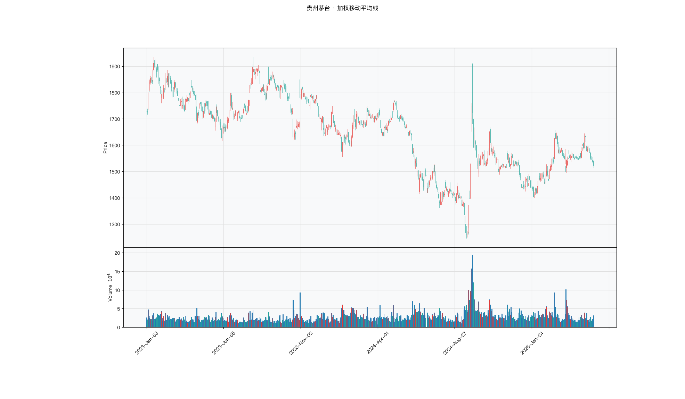

# 第011章 加权移动平均线（WMA）

一位交易者把周期固定在二十日，只把权重从等权改成线性递减，屏幕上的金叉提前了几天。他又改成指数衰减，位置再次变化。三条线的参数完全一样，拐点却落在不同的 K 线上，回测出来的交易次数也不相同。他不知道该信哪一条。加权移动平均线要回答的，是权重按什么形状分配，以及这种分配会让信号提前多少、噪声增加多少。

## 名称与来历

加权移动平均线（Weighted Moving Average，WMA），通常指线性加权移动平均线。

它没有单一的发明者。给时间序列赋予不同权重，是统计与工程领域的常规做法，二十世纪中期已在经济数据的平滑处理中广泛使用。把这一思路用于股票价格，动机很朴素：近期的成交价格更能反映当前供需，理应在平均中占更大比重。WMA 因此被归入"为灵敏度而改良的均线"这一支，与后来用指数衰减权重的 EMA 属于同一方向，区别只在权重下降的形状。

## 核心逻辑

如果交易者相信今天的大涨比五天前的大涨更能说明问题，均线能不能把这种直觉变成公式？

SMA 的回答是"不能"，它对窗口内每一天一视同仁。WMA 的回答很直接：给近期价格更大的权重，当天权重最大，每往前一天，权重就减一。于是最近的价格在平均里话语权最高，最远的那一期只有最小的权重。这样做的结果是一条对价格变化异常敏感的均线，上涨信号来得比 SMA 更早，但假信号也更多。WMA 是为偏短周期交易设计的工具，它的价值在"早"，代价在"多"。

权重从 n 线性递减到 1，是一种简单而透明的设计。它不像 EMA 那样依赖递推与初始值，也不像 SMA 那样完全抹平时间差异，而是用一条直线斜坡表达"越近越重要"。这条斜坡有多陡，直接决定了均线的灵敏程度。线性权重还有一个容易被忽略的性质：最近一期在平均里的占比固定为 $\frac{2}{n+1}$，当 n 取 5 时当日权重约占三分之一，当 n 取 20 时降到不足十分之一，灵敏度会随周期快速下降。

## 计算公式

WMA 由权重分配与加权平均两步构成。

### 权重分配

n 日 WMA 的权重按时间倒序排列为 $n,\ n-1,\ n-2,\ \dots,\ 1$，即当日权重为 n，前一日的权重为 n-1，依此类推，最早一日的权重为 1。权重总和为：

$$\sum_{i=1}^{n} i = \frac{n(n+1)}{2}$$

### 加权平均

$$\mathrm{WMA}_t = \frac{\sum_{i=0}^{n-1}(n-i)\,p_{t-i}}{\sum_{i=0}^{n-1}(n-i)} = \frac{\sum_{i=0}^{n-1}(n-i)\,p_{t-i}}{n(n+1)/2}$$

其中 $p_t$ 为第 t 日收盘价，i 越大表示越早的日期。每日更新时，最早一期的价格与其权重一起被剔除，当日价格以权重 n 进入。

**参数含义。**

| 参数 | 含义 | 常见取值 | 影响 |
|---|---|---|---|
| n | 周期，同时决定权重个数 | 3、5、10、20 | n 越大，平滑越强，但权重仍向近期倾斜 |
| 权重斜率 | 每往前一日权重递减的幅度 | 固定为 1 | 斜率越陡（n 越小），越灵敏，假信号越多 |
| 权重总和 | $n(n+1)/2$ | 由 n 决定 | 用于归一化，使 WMA 与价格同量纲 |

**计算示例。** 假设连续五个交易日收盘价为 10、11、12、13、14 元，当日为第 5 日。权重分别为 5、4、3、2、1，总和为 15。

$$\mathrm{WMA}_5 = \frac{14\times5 + 13\times4 + 12\times3 + 11\times2 + 10\times1}{15} = \frac{190}{15} \approx 12.67$$

次日收盘 15 元，窗口右移，10 元与其权重 1 被剔除：

$$\mathrm{WMA}_5' = \frac{15\times5 + 14\times4 + 13\times3 + 12\times2 + 11\times1}{15} = \frac{205}{15} \approx 13.67$$

作为对比，同一组价格下 5 日 SMA 在首日为 12.00 元，WMA 为 12.67 元，数值更高，因为近期偏高的价格得到了更大的权重。

### 参数与灵敏度

周期是 WMA 的关键参数，它同时决定权重个数与当日权重占比。下表列出常见周期间近日权重的变化，可作为选择时的参考。

| 周期 n | 权重总和 | 当日权重占比 | 典型场景 |
|---|---|---|---|
| 3 | 6 | 约 0.50 | 超短线，噪音显著 |
| 5 | 15 | 约 0.33 | 日内与短线 |
| 10 | 55 | 约 0.18 | 日线短线 |
| 20 | 210 | 约 0.10 | 短波段辅助 |
| 30 | 465 | 约 0.07 | 中期趋势辅助 |

从表中可以看到，参数越小，当日价格的话语权越大，均线越接近价格本身。WMA 的适宜周期通常比同用途的 SMA 略短，因为它的权重已经向近期倾斜。

### 与简单移动平均的对照

把 WMA 与同周期 SMA 放在一起，差异集中在权重分布。SMA 的每一项权重都是 1/n，WMA 的权重则从最大值线性降到最小值。以 5 日为例，两者的对比十分直观。

| 项目 | 5 日 SMA | 5 日 WMA |
|---|---|---|
| 权重分布 | 全部为 1/5 | 5/15、4/15、3/15、2/15、1/15 |
| 最新权重占比 | 0.20 | 0.33 |
| 最早权重占比 | 0.20 | 0.07 |
| 反应速度 | 较慢 | 较快 |

权重差异在价格跳变时集中体现。同一根大阳线，WMA 的上移幅度大于 SMA，趋势信号因此出现得更早，也更容易被随后的回落证伪。这种"早而多"的特征，是选择 WMA 时需要用信号过滤来对冲的地方。

## 用法与信号

**拐头。** WMA 的拐头比 SMA 灵敏得多。即使价格尚未突破前期高点，只要近期上涨带动 WMA 由走平转为向上，就说明短期多头动能增强，可作为早期观察信号。反向的拐头同理。因为灵敏，拐头出现频繁，通常需要结合成交量或趋势强度指标过滤。

**价格与 WMA 的贴近。** WMA 灵敏度高，价格与它的偏离通常较小，贴合速度快。多头趋势中价格回调至 WMA 附近迅速反弹而未跌破，代表短期支撑有效；空头趋势中价格反弹至 WMA 附近迅速回落而未突破，代表短期压力有效。贴合快也意味着突破更容易发生，确认时间应相应缩短。

**交叉。** 短期 WMA 上穿长期 WMA 为金叉，下穿为死叉。WMA 交叉比同周期 SMA 交叉早数个周期出现，适合追求超前入场的交易者，但需要验证价格同步性与成交量，否则假交叉的比例偏高。

**背离。** WMA 灵敏度高，能较早捕捉价格与均线的背离。价格创新高而 WMA 未创新高，提示短期多头动能不足；价格创新低而 WMA 未创新低，提示短期空头动能不足。这类信号出现早，也更容易被证伪，通常只作为止盈参考而非反手依据。

## 边界与误区

**追求极致灵敏，把参数设得过小。** 2 日或 3 日的 WMA 会因权重高度集中于最近两三天而产生碎片化信号，一天内多次拐头，假信号比例明显上升。参数应与交易周期匹配，短周期交易用较小的 n，但不宜小到让均线几乎复制价格。

**在震荡市中强行交易。** 横盘时 WMA 的交叉与拐头都频繁，一周内可能出现多次，此时任何单点信号都缺乏意义。常见做法是先用趋势强度指标过滤，在趋势明确前不使用 WMA 信号。

**见交叉就入场，不做任何验证。** WMA 的交叉需要价格同步与成交量配合。交叉时价格没有同向变动，或成交量萎缩，大概率是假交叉。把 WMA 的早期优势建立在无验证的机械化执行上，会把灵敏变成频繁止损。

**用 WMA 做长线判断。** WMA 的核心价值在于短期灵敏，用在周线或月线级别会因为短期波动而频繁调整仓位。长线更适合稳定性强的 SMA 或 EMA，让不同工具各司其职。

## 它被检验过吗

WMA 的卖点是权重形状，但权重形状本身不是证据。均线规则族的检验里，Brock 等（1992）报告过预测力，Sullivan 等（1999）扩大规则空间并校正数据窥探偏差后，显著性大幅下降，Park 与 Irwin（2007）综述 95 项研究的结论是混合的。完整证据链见第 007 章。

这些检验针对的是均线规则族，无法区分 WMA、SMA、EMA、DEMA、ZLEMA、DMA、BBI 之间的优劣。线性权重是否优于等权或指数衰减，没有任何可靠检验给出过排序。斜率更陡带来的提前量，同时也提高了信号频次，两者需要在同一段数据上一起看。

这一类的真实失效案例，见第 008 章的「真实案例与失败模式」。

## 代码实现

### R

```r
library(ettr)
library(efactorcraft)
library(efincharts)
library(ggplot2)

BASE <- "https://raw.githubusercontent.com/dengyishuo/quant-technical-analysis/main/data/parquet"

# 取数据：本地有就用本地，没有就下载一次并缓存。
# read.csv 对本地 .gz 会自动解压，所以缓存成 .csv.gz 也能直接读。
load_data <- function(name) {
  local <- file.path("data", "parquet", name)
  if (file.exists(local)) return(local)
  cache <- file.path(tools::R_user_dir("qta", "cache"), name)
  if (!file.exists(cache)) {
    dir.create(dirname(cache), recursive = TRUE, showWarnings = FALSE)
    message("下载 ", name, " ...")
    download.file(paste0(BASE, "/", name), cache, mode = "wb", quiet = TRUE)
  }
  cache
}

read_data <- function(name) {
  d <- read.csv(load_data(name), stringsAsFactors = FALSE)
  if ("date" %in% names(d)) d$date <- as.Date(d$date)
  d
}

# 同一章里多次取用，缓存到内存，避免重复解析
.cache <- new.env(parent = emptyenv())
.blue <- function() {
  if (!exists("b", .cache)) assign("b", read_data("panel_blue_chip.csv"), .cache)
  get("b", .cache)
}
.panel <- function() {
  if (!exists("p", .cache)) {
    p <- read_data("panel_r.csv.gz")
    assign("p", p[p$date >= "2023-01-01" & p$date <= "2025-06-01", ], .cache)
  }
  get("p", .cache)
}
.index <- function() read_data("index_daily.csv")

blue  <- .blue()
panel <- .panel()

# 图的保存路径，顺手建目录，避免读者本地没有 assets/ 时报错
fig_path <- function(ch, name = "indicator_r.png") {
  d <- file.path("assets", "figures", sprintf("ch%03d", ch))
  dir.create(d, recursive = TRUE, showWarnings = FALSE)
  file.path(d, name)
}

# efincharts 要求 xts 且列名带 Adjusted
as_xts <- function(df) {
  x <- xts::xts(df[, c("open", "high", "low", "close", "volume", "adjusted")],
                order.by = df$date)
  colnames(x) <- c("Open", "High", "Low", "Close", "Volume", "Adjusted")
  x
}

maotai <- .blue()[.blue()$code == "600519.SS", ]

# 1. ettr 在长格式面板上追加指标列
maotai <- add_wma(maotai, n = 10)

# 2. 基本统计
cols <- setdiff(names(maotai), names(blue))
print(summary(maotai[, cols]))

# 3. K 线 + 成交量 + 均线
ch <- ecandlesticks(as_xts(maotai), show_ma = TRUE, ma_periods = c(20, 60),
                    title = "贵州茅台 · 加权移动平均线")
ggsave(fig_path(11), ch$combined_plot, width = 10, height = 6, dpi = 110)
```

### Python

```python
import pathlib
import urllib.request

import pandas as pd
import ettr
import efactorcraft as efc
import efincharts as efc_

# 中文字体：mplfinance 会用 style 里的 rc 覆盖全局设置，必须写进 style
from efincharts import theme
theme.efin_style["rc"] = {
    "font.sans-serif": ["PingFang SC", "Heiti SC", "SimHei"],
    "axes.unicode_minus": False,
    "font.family": "sans-serif",
}

BASE = "https://raw.githubusercontent.com/dengyishuo/quant-technical-analysis/main/data/parquet"
CACHE = pathlib.Path.home() / ".cache" / "qta"
_MEM = {}


def load(name):
    """取数据：本地有就用本地，没有就下载一次并缓存。

    这样三种情形都能跑：
      1. 克隆了整个仓库    -> 直接读 data/parquet/，不联网
      2. 只复制了代码片段  -> 首次自动下载到 ~/.cache/qta，之后走缓存
      3. 之前跑过          -> 全部命中缓存，断网也能用
    """
    if name in _MEM:
        return _MEM[name]
    local = pathlib.Path("data/parquet") / name
    if local.exists():
        path = local
    else:
        CACHE.mkdir(parents=True, exist_ok=True)
        path = CACHE / name
        if not path.exists():
            print("下载 %s ..." % name)
            urllib.request.urlretrieve(BASE + "/" + name, path)
    data = pd.read_parquet(path) if name.endswith(".parquet") else pd.read_csv(path)
    _MEM[name] = data
    return data


blue = load("panel_blue_chip.parquet")
panel = load("panel.parquet")
panel = panel[(panel["date"] >= "2023-01-01") & (panel["date"] <= "2025-06-01")]
idx = load("index_daily.parquet")


def one(df, code="600519.SS"):
    """取单只标的，转成 efincharts 需要的宽表。"""
    x = df[df["code"] == code].sort_values("date").set_index("date")
    x.columns = [c.capitalize() for c in x.columns]
    return x


def fig_path(ch, name="indicator.png"):
    """图的保存路径，顺手建目录，避免读者本地没有 assets/ 时报错。"""
    d = pathlib.Path("assets") / "figures" / ("ch%03d" % ch)
    d.mkdir(parents=True, exist_ok=True)
    return str(d / name)

# 1. 取单只标的
maotai = blue[blue['code'] == '600519.SS'].copy()

# 2. ettr 在长格式面板上追加指标列，不需要手工 rolling
maotai = ettr.wma(maotai, n=10)

cols = [c for c in maotai.columns if c not in blue.columns]
print(maotai[cols].describe().round(3))

# 3. 画图：K 线 + 成交量 + 指标面板
px = one(maotai)
ch = efc_.candlestick(px, volume=True, title="贵州茅台 · 加权移动平均线")
ch.save(fig_path(11))
```

<!-- fig-indicator:start -->


<p class="figcap">图 11-1　加权移动平均线在贵州茅台上的读数（2023-01 至 2025-06）</p>
<!-- fig-indicator:end -->

## 拆解

WMA 与价格同量纲，横向排序没有意义。它的权重随 n 线性递减，拆解时要单独量出近期权重的贡献。

| 特征名 | 计算式 | 量纲 | 经济含义 |
|--------|--------|------|----------|
| 价格偏离度 | $p_t / \mathrm{WMA}_t^{(20)} - 1$ | 无量纲比例 | 价格相对线性加权成本的位置 |
| 均线斜率 | $(\mathrm{WMA}_t - \mathrm{WMA}_{t-5}) / \mathrm{WMA}_{t-5}$ | 无量纲比例 | 加权重心的推进速度 |
| 权重贡献差 | $\mathrm{WMA}_t^{(20)} / \mathrm{SMA}_t^{(20)} - 1$ | 无量纲比例 | 近期权重相对等权带来的抬升 |
| 排列强度 | $(\mathrm{WMA}_t^{(5)}/\mathrm{WMA}_t^{(10)} - 1) + (\mathrm{WMA}_t^{(10)}/\mathrm{WMA}_t^{(20)} - 1)$ | 无量纲比例 | 三条均线的同向程度 |

偏离度与斜率的关系与 EMA 章一致。WMA 的偏离度比同周期 SMA 更集中于零，排序更容易被单日价格改写，IC 的期间波动通常更大。

权重贡献差是 WMA 独有的分解量，等于加权中心与算术中心之差，符号与近期价格方向一致。它与偏离度相关但不重合：一个用 WMA 归一，一个用 SMA 归一。用它可检验近期权重是否真的带来信息。

排列强度把三线排列从离散状态变成连续值。它对参数组合敏感，5、10、20 只是惯例。

### R

```r
library(ettr)
library(efactorcraft)
library(efincharts)
library(ggplot2)

BASE <- "https://raw.githubusercontent.com/dengyishuo/quant-technical-analysis/main/data/parquet"

# 取数据：本地有就用本地，没有就下载一次并缓存。
# read.csv 对本地 .gz 会自动解压，所以缓存成 .csv.gz 也能直接读。
load_data <- function(name) {
  local <- file.path("data", "parquet", name)
  if (file.exists(local)) return(local)
  cache <- file.path(tools::R_user_dir("qta", "cache"), name)
  if (!file.exists(cache)) {
    dir.create(dirname(cache), recursive = TRUE, showWarnings = FALSE)
    message("下载 ", name, " ...")
    download.file(paste0(BASE, "/", name), cache, mode = "wb", quiet = TRUE)
  }
  cache
}

read_data <- function(name) {
  d <- read.csv(load_data(name), stringsAsFactors = FALSE)
  if ("date" %in% names(d)) d$date <- as.Date(d$date)
  d
}

# 同一章里多次取用，缓存到内存，避免重复解析
.cache <- new.env(parent = emptyenv())
.blue <- function() {
  if (!exists("b", .cache)) assign("b", read_data("panel_blue_chip.csv"), .cache)
  get("b", .cache)
}
.panel <- function() {
  if (!exists("p", .cache)) {
    p <- read_data("panel_r.csv.gz")
    assign("p", p[p$date >= "2023-01-01" & p$date <= "2025-06-01", ], .cache)
  }
  get("p", .cache)
}
.index <- function() read_data("index_daily.csv")

blue  <- .blue()
panel <- .panel()

# 图的保存路径，顺手建目录，避免读者本地没有 assets/ 时报错
fig_path <- function(ch, name = "indicator_r.png") {
  d <- file.path("assets", "figures", sprintf("ch%03d", ch))
  dir.create(d, recursive = TRUE, showWarnings = FALSE)
  file.path(d, name)
}

# efincharts 要求 xts 且列名带 Adjusted
as_xts <- function(df) {
  x <- xts::xts(df[, c("open", "high", "low", "close", "volume", "adjusted")],
                order.by = df$date)
  colnames(x) <- c("Open", "High", "Low", "Close", "Volume", "Adjusted")
  x
}

d <- .blue()[.blue()$code == "600519.SS", ]
d <- add_wma(d, n = 10)

# 转成无量纲因子
d$f <- d$`WMA_10` / d$close - 1

print(summary(d$f))
```

### Python

```python
import pathlib
import urllib.request

import pandas as pd
import ettr
import efactorcraft as efc
import efincharts as efc_

# 中文字体：mplfinance 会用 style 里的 rc 覆盖全局设置，必须写进 style
from efincharts import theme
theme.efin_style["rc"] = {
    "font.sans-serif": ["PingFang SC", "Heiti SC", "SimHei"],
    "axes.unicode_minus": False,
    "font.family": "sans-serif",
}

BASE = "https://raw.githubusercontent.com/dengyishuo/quant-technical-analysis/main/data/parquet"
CACHE = pathlib.Path.home() / ".cache" / "qta"
_MEM = {}


def load(name):
    """取数据：本地有就用本地，没有就下载一次并缓存。

    这样三种情形都能跑：
      1. 克隆了整个仓库    -> 直接读 data/parquet/，不联网
      2. 只复制了代码片段  -> 首次自动下载到 ~/.cache/qta，之后走缓存
      3. 之前跑过          -> 全部命中缓存，断网也能用
    """
    if name in _MEM:
        return _MEM[name]
    local = pathlib.Path("data/parquet") / name
    if local.exists():
        path = local
    else:
        CACHE.mkdir(parents=True, exist_ok=True)
        path = CACHE / name
        if not path.exists():
            print("下载 %s ..." % name)
            urllib.request.urlretrieve(BASE + "/" + name, path)
    data = pd.read_parquet(path) if name.endswith(".parquet") else pd.read_csv(path)
    _MEM[name] = data
    return data


blue = load("panel_blue_chip.parquet")
panel = load("panel.parquet")
panel = panel[(panel["date"] >= "2023-01-01") & (panel["date"] <= "2025-06-01")]
idx = load("index_daily.parquet")


def one(df, code="600519.SS"):
    """取单只标的，转成 efincharts 需要的宽表。"""
    x = df[df["code"] == code].sort_values("date").set_index("date")
    x.columns = [c.capitalize() for c in x.columns]
    return x


def fig_path(ch, name="indicator.png"):
    """图的保存路径，顺手建目录，避免读者本地没有 assets/ 时报错。"""
    d = pathlib.Path("assets") / "figures" / ("ch%03d" % ch)
    d.mkdir(parents=True, exist_ok=True)
    return str(d / name)

# 1. 先在面板上算原始指标
d = panel.copy()
d = ettr.wma(d, n=10)

# 2. 转成无量纲因子，才能跨标的排序
d["f"] = d["WMA_10"] / d.close - 1

print(d["f"].describe().round(4))
```

## 截面选股能力

常用构造是偏离度与权重贡献差，

$$f^{dev}_t = \frac{p_t}{\mathrm{WMA}_t^{(20)}} - 1$$

$$f^{gap}_t = \frac{\mathrm{WMA}_t^{(20)}}{\mathrm{SMA}_t^{(20)}} - 1$$

前者度量位置，后者度量近期权重带来的抬升。预期方向都偏正：价格在均线上方、近期价格高于窗口均价，后续走势可能延续。WMA 的权重集中在近期，单日冲击直接进入因子，IC 的起伏通常比等权均线更大。

检验有三点。第一，权重体系的对照不可省。等权、线性、指数在同一周期、同一窗口下比较，若 WMA 的 ICIR 落在 SMA 与 EMA 之间，只说明它是折中；若低于两者，说明线性权重既不够快也不够稳。第二，与同周期 SMA 的排序接近但不等同。第三，WMA 因子日变化大。

### R

```r
library(ettr)
library(efactorcraft)
library(efincharts)
library(ggplot2)

BASE <- "https://raw.githubusercontent.com/dengyishuo/quant-technical-analysis/main/data/parquet"

# 取数据：本地有就用本地，没有就下载一次并缓存。
# read.csv 对本地 .gz 会自动解压，所以缓存成 .csv.gz 也能直接读。
load_data <- function(name) {
  local <- file.path("data", "parquet", name)
  if (file.exists(local)) return(local)
  cache <- file.path(tools::R_user_dir("qta", "cache"), name)
  if (!file.exists(cache)) {
    dir.create(dirname(cache), recursive = TRUE, showWarnings = FALSE)
    message("下载 ", name, " ...")
    download.file(paste0(BASE, "/", name), cache, mode = "wb", quiet = TRUE)
  }
  cache
}

read_data <- function(name) {
  d <- read.csv(load_data(name), stringsAsFactors = FALSE)
  if ("date" %in% names(d)) d$date <- as.Date(d$date)
  d
}

# 同一章里多次取用，缓存到内存，避免重复解析
.cache <- new.env(parent = emptyenv())
.blue <- function() {
  if (!exists("b", .cache)) assign("b", read_data("panel_blue_chip.csv"), .cache)
  get("b", .cache)
}
.panel <- function() {
  if (!exists("p", .cache)) {
    p <- read_data("panel_r.csv.gz")
    assign("p", p[p$date >= "2023-01-01" & p$date <= "2025-06-01", ], .cache)
  }
  get("p", .cache)
}
.index <- function() read_data("index_daily.csv")

blue  <- .blue()
panel <- .panel()

# 图的保存路径，顺手建目录，避免读者本地没有 assets/ 时报错
fig_path <- function(ch, name = "indicator_r.png") {
  d <- file.path("assets", "figures", sprintf("ch%03d", ch))
  dir.create(d, recursive = TRUE, showWarnings = FALSE)
  file.path(d, name)
}

# efincharts 要求 xts 且列名带 Adjusted
as_xts <- function(df) {
  x <- xts::xts(df[, c("open", "high", "low", "close", "volume", "adjusted")],
                order.by = df$date)
  colnames(x) <- c("Open", "High", "Low", "Close", "Volume", "Adjusted")
  x
}

d <- .panel()
d <- add_wma(d, n = 10)

d$f <- d$`WMA_10` / d$close - 1
d <- add_next_return(d, close_col = "close", n = c(1, 5, 20))

ic <- ic_analysis(d, factor_cols = "f",
                    forward_cols = c("forward_1", "forward_5", "forward_20"),
                    method = "spearman")
print(ir_analysis(ic))

q <- quantile_analysis(d, factor_cols = "f", forward_cols = "forward_5",
                       n_groups = 5)
print(q$f$summary)
```

### Python

```python
import pathlib
import urllib.request

import pandas as pd
import ettr
import efactorcraft as efc
import efincharts as efc_

# 中文字体：mplfinance 会用 style 里的 rc 覆盖全局设置，必须写进 style
from efincharts import theme
theme.efin_style["rc"] = {
    "font.sans-serif": ["PingFang SC", "Heiti SC", "SimHei"],
    "axes.unicode_minus": False,
    "font.family": "sans-serif",
}

BASE = "https://raw.githubusercontent.com/dengyishuo/quant-technical-analysis/main/data/parquet"
CACHE = pathlib.Path.home() / ".cache" / "qta"
_MEM = {}


def load(name):
    """取数据：本地有就用本地，没有就下载一次并缓存。

    这样三种情形都能跑：
      1. 克隆了整个仓库    -> 直接读 data/parquet/，不联网
      2. 只复制了代码片段  -> 首次自动下载到 ~/.cache/qta，之后走缓存
      3. 之前跑过          -> 全部命中缓存，断网也能用
    """
    if name in _MEM:
        return _MEM[name]
    local = pathlib.Path("data/parquet") / name
    if local.exists():
        path = local
    else:
        CACHE.mkdir(parents=True, exist_ok=True)
        path = CACHE / name
        if not path.exists():
            print("下载 %s ..." % name)
            urllib.request.urlretrieve(BASE + "/" + name, path)
    data = pd.read_parquet(path) if name.endswith(".parquet") else pd.read_csv(path)
    _MEM[name] = data
    return data


blue = load("panel_blue_chip.parquet")
panel = load("panel.parquet")
panel = panel[(panel["date"] >= "2023-01-01") & (panel["date"] <= "2025-06-01")]
idx = load("index_daily.parquet")


def one(df, code="600519.SS"):
    """取单只标的，转成 efincharts 需要的宽表。"""
    x = df[df["code"] == code].sort_values("date").set_index("date")
    x.columns = [c.capitalize() for c in x.columns]
    return x


def fig_path(ch, name="indicator.png"):
    """图的保存路径，顺手建目录，避免读者本地没有 assets/ 时报错。"""
    d = pathlib.Path("assets") / "figures" / ("ch%03d" % ch)
    d.mkdir(parents=True, exist_ok=True)
    return str(d / name)

# 287 只、2023-01 至 2025-06，横截面才有统计意义
src = panel.copy()
d = src.copy()

# 1. 算指标
d = ettr.wma(d, n=10)


# 2. 因子 + 未来收益
d["f"] = d["WMA_10"] / d.close - 1
d = efc.add_next_return(d, periods=(1, 5, 20))

# 3. 截面 IC 与分层
ic = efc.ic_analysis(d, factor_cols="f",
                      forward_cols=["forward_1", "forward_5", "forward_20"],
                      method="spearman")
print(efc.ir_analysis(ic).round(3))

q = efc.quantile_analysis(d, factor_col="f", forward_col="forward_5", n_groups=5)
print(q["summary"].round(4))
```

<!-- tab-ic:start -->
**计算结果**

| 前向期 | IC 均值 | IC 标准差 | ICIR | t 值 | IC>0 占比 | 期数 |
|---|---|---|---|---|---|---|
| T+1 | 0.0158 | 0.2289 | 0.069 | 1.65 | 0.5170 | 571 |
| T+5 | 0.0020 | 0.2035 | 0.010 | 0.24 | 0.4920 | 567 |
| T+20 | 0.0155 | 0.2034 | 0.076 | 1.80 | 0.5140 | 552 |

表里最该看的是 t 值，不是 IC 均值。这个因子以 T+1 为主口径，IC 均值 0.0158、ICIR 0.069、t 值 1.65，在常规门槛下不显著，方向为正向。按第 007 章给出的日频门槛（ICIR 0.13 对应 t≈2），这个结果的含义是：还看不出与噪声的区别，不能据此构造策略。

需要提醒的是，这只说明排序与未来收益之间存在可测的关联，不代表扣掉成本后还能剩下收益。横截面 IC 检验的是“买哪只”，不负责“值不值得交易”。

**五档分层**

| 分组 | 平均收益 | 标准差 | 期数 |
|---|---|---|---|
| 1 | +0.0048 | +0.0376 | 567 |
| 2 | +0.0030 | +0.0297 | 567 |
| 3 | +0.0029 | +0.0314 | 567 |
| 4 | +0.0030 | +0.0340 | 567 |
| 5 | +0.0036 | +0.0405 | 567 |

五档分层看的是形状，不是单点。最高一档在第 1 组、最低在第 3 组，两端相差 -0.12%，组序号与平均收益的秩相关为 -0.49，有方向但不严格单调。

分层比 IC 更接近实盘，因为它直接给出“买最高档、卖最低档”的收益差。但这里的数字是毛收益，且没有考虑涨跌停买不进、停牌卖不出的情形，真实可得的差额会小于表中所列。
<!-- tab-ic:end -->

## 择时能力

WMA 的时序信号以拐头为核心，其次是交叉与穿越。拐头是方向翻转，比同周期 SMA 早若干期出现；交叉是短长均线的相对位置变化；穿越是价格与均线的贴合被打破。三层信号都建立在灵敏之上。

方法要与信号形态匹配。拐头是离散事件，但频次极高，直接做触发检验容易把噪声当成信号。更合适的是先把方向转成连续状态，例如取均线斜率，用条件分位看收益是否单调；再用交叉做触发检验；最后做一次回测。

两个陷阱与设计有关。一是拐头频次，震荡市中 WMA 可能两三天就改变一次方向，按拐头调仓的成本会吃掉大部分名义收益。二是参数过小，权重集中在最近两三天，均线近乎复制价格，信号碎片化，胜率与盈亏比同时下降。

### R

```r
library(ettr)
library(efactorcraft)
library(efincharts)
library(ggplot2)

BASE <- "https://raw.githubusercontent.com/dengyishuo/quant-technical-analysis/main/data/parquet"

# 取数据：本地有就用本地，没有就下载一次并缓存。
# read.csv 对本地 .gz 会自动解压，所以缓存成 .csv.gz 也能直接读。
load_data <- function(name) {
  local <- file.path("data", "parquet", name)
  if (file.exists(local)) return(local)
  cache <- file.path(tools::R_user_dir("qta", "cache"), name)
  if (!file.exists(cache)) {
    dir.create(dirname(cache), recursive = TRUE, showWarnings = FALSE)
    message("下载 ", name, " ...")
    download.file(paste0(BASE, "/", name), cache, mode = "wb", quiet = TRUE)
  }
  cache
}

read_data <- function(name) {
  d <- read.csv(load_data(name), stringsAsFactors = FALSE)
  if ("date" %in% names(d)) d$date <- as.Date(d$date)
  d
}

# 同一章里多次取用，缓存到内存，避免重复解析
.cache <- new.env(parent = emptyenv())
.blue <- function() {
  if (!exists("b", .cache)) assign("b", read_data("panel_blue_chip.csv"), .cache)
  get("b", .cache)
}
.panel <- function() {
  if (!exists("p", .cache)) {
    p <- read_data("panel_r.csv.gz")
    assign("p", p[p$date >= "2023-01-01" & p$date <= "2025-06-01", ], .cache)
  }
  get("p", .cache)
}
.index <- function() read_data("index_daily.csv")

blue  <- .blue()
panel <- .panel()

# 图的保存路径，顺手建目录，避免读者本地没有 assets/ 时报错
fig_path <- function(ch, name = "indicator_r.png") {
  d <- file.path("assets", "figures", sprintf("ch%03d", ch))
  dir.create(d, recursive = TRUE, showWarnings = FALSE)
  file.path(d, name)
}

# efincharts 要求 xts 且列名带 Adjusted
as_xts <- function(df) {
  x <- xts::xts(df[, c("open", "high", "low", "close", "volume", "adjusted")],
                order.by = df$date)
  colnames(x) <- c("Open", "High", "Low", "Close", "Volume", "Adjusted")
  x
}

t <- .index()
t <- t[t$code == "510300.SS", ]
t <- add_wma(t, n = 10)
t$f <- t$`WMA_10` / t$close - 1
t$forward_5 <- c(tail(t$close, -5) / head(t$close, -5) - 1, rep(NA, 5))
t$q <- cut(t$f, quantile(t$f, 0:5/5, na.rm = TRUE), include.lowest = TRUE, labels = FALSE)
print(aggregate(forward_5 ~ q, data = t, FUN = function(x)
  c(mean = mean(x, na.rm = TRUE), n = sum(!is.na(x)))))
```

### Python

```python
import pathlib
import urllib.request

import pandas as pd
import ettr
import efactorcraft as efc
import efincharts as efc_

# 中文字体：mplfinance 会用 style 里的 rc 覆盖全局设置，必须写进 style
from efincharts import theme
theme.efin_style["rc"] = {
    "font.sans-serif": ["PingFang SC", "Heiti SC", "SimHei"],
    "axes.unicode_minus": False,
    "font.family": "sans-serif",
}

BASE = "https://raw.githubusercontent.com/dengyishuo/quant-technical-analysis/main/data/parquet"
CACHE = pathlib.Path.home() / ".cache" / "qta"
_MEM = {}


def load(name):
    """取数据：本地有就用本地，没有就下载一次并缓存。

    这样三种情形都能跑：
      1. 克隆了整个仓库    -> 直接读 data/parquet/，不联网
      2. 只复制了代码片段  -> 首次自动下载到 ~/.cache/qta，之后走缓存
      3. 之前跑过          -> 全部命中缓存，断网也能用
    """
    if name in _MEM:
        return _MEM[name]
    local = pathlib.Path("data/parquet") / name
    if local.exists():
        path = local
    else:
        CACHE.mkdir(parents=True, exist_ok=True)
        path = CACHE / name
        if not path.exists():
            print("下载 %s ..." % name)
            urllib.request.urlretrieve(BASE + "/" + name, path)
    data = pd.read_parquet(path) if name.endswith(".parquet") else pd.read_csv(path)
    _MEM[name] = data
    return data


blue = load("panel_blue_chip.parquet")
panel = load("panel.parquet")
panel = panel[(panel["date"] >= "2023-01-01") & (panel["date"] <= "2025-06-01")]
idx = load("index_daily.parquet")


def one(df, code="600519.SS"):
    """取单只标的，转成 efincharts 需要的宽表。"""
    x = df[df["code"] == code].sort_values("date").set_index("date")
    x.columns = [c.capitalize() for c in x.columns]
    return x


def fig_path(ch, name="indicator.png"):
    """图的保存路径，顺手建目录，避免读者本地没有 assets/ 时报错。"""
    d = pathlib.Path("assets") / "figures" / ("ch%03d" % ch)
    d.mkdir(parents=True, exist_ok=True)
    return str(d / name)

# 择时检验用 ETF 做市场载体，指数本身没有日线数据
t = idx[idx["code"] == "510300.SS"].sort_values("date").copy()

# 1. 在 ETF 上算同一个指标
t = ettr.wma(d, n=10)


# 2. 按因子分位看未来 5 日收益
t["f"] = t["WMA_10"] / t.close - 1
t["forward_5"] = t["close"].shift(-5) / t["close"] - 1
# 因子可能有重复值，先按名次切，避免 qcut 报边界不唯一
t["q"] = pd.qcut(t["f"].rank(method="first"), 5, labels=False) + 1
t = t.dropna(subset=["f", "forward_5"])
print(t.groupby("q")["forward_5"].agg(["mean", "count"]).round(4))
```

<!-- tab-timing:start -->
**分位收益**

| 分位 | 未来 5 日均值 | 样本数 |
|---|---|---|
| 1 | +0.0002 | 221 |
| 2 | -0.0002 | 220 |
| 3 | -0.0014 | 220 |
| 4 | -0.0029 | 220 |
| 5 | +0.0044 | 220 |

择时口径与截面不同：这里只有一个标的，看的是同一标的在不同分位下的未来收益。最高与最低分位相差 +0.42%。单标的样本有限，这个差额很容易被一两段行情主导，只能作为方向参考。

真正做择时要问的是三件事：分位阈值是否稳定、换手是否可控、扣成本后是否还有剩余。三者缺一，择时信号就只是图上好看。
<!-- tab-timing:end -->

## 组合使用与验证

常见的搭档有三个。与成交量搭配，补的是参与度，交叉伴随放量时假信号更少。与 ADX 搭配，补的是市况前提，趋势强度不足时停用拐头信号。与一条较慢的均线搭配，补的是方向确认，WMA 的错误多来自太早。

**组合的截面验证。** 加权型做法是把 WMA 偏离度与量比因子标准化后加权相加，用 combined_signal 生成综合分数，比较组合与两个单特征的 ICIR。条件型做法是先定义"WMA 在 SMA 上方且成交量高于均量"，转成二值信号后在触发样本内比较收益。

**组合的择时验证。** 把规则写成仓位条件，例如"WMA 偏离度为正且与同周期 SMA 的差为正"时持仓，否则空仓，计算年化收益、夏普与最大回撤，再与单条件对照。WMA 的信号频次高，组合价值主要在换手与回撤。

判读依据方法论章：组合的 ICIR 高于两个单特征，才说明存在互补；介于两者之间，说明只是平均；低于两者，说明信号在特定时段冲突。相关系数高时，组合很难带来增量。WMA 与同周期 SMA 的偏离度相关通常很高，加权组合意义有限；与量比因子相关较低，空间更大。

### R

```r
library(ettr)
library(efactorcraft)
library(efincharts)
library(ggplot2)

BASE <- "https://raw.githubusercontent.com/dengyishuo/quant-technical-analysis/main/data/parquet"

# 取数据：本地有就用本地，没有就下载一次并缓存。
# read.csv 对本地 .gz 会自动解压，所以缓存成 .csv.gz 也能直接读。
load_data <- function(name) {
  local <- file.path("data", "parquet", name)
  if (file.exists(local)) return(local)
  cache <- file.path(tools::R_user_dir("qta", "cache"), name)
  if (!file.exists(cache)) {
    dir.create(dirname(cache), recursive = TRUE, showWarnings = FALSE)
    message("下载 ", name, " ...")
    download.file(paste0(BASE, "/", name), cache, mode = "wb", quiet = TRUE)
  }
  cache
}

read_data <- function(name) {
  d <- read.csv(load_data(name), stringsAsFactors = FALSE)
  if ("date" %in% names(d)) d$date <- as.Date(d$date)
  d
}

# 同一章里多次取用，缓存到内存，避免重复解析
.cache <- new.env(parent = emptyenv())
.blue <- function() {
  if (!exists("b", .cache)) assign("b", read_data("panel_blue_chip.csv"), .cache)
  get("b", .cache)
}
.panel <- function() {
  if (!exists("p", .cache)) {
    p <- read_data("panel_r.csv.gz")
    assign("p", p[p$date >= "2023-01-01" & p$date <= "2025-06-01", ], .cache)
  }
  get("p", .cache)
}
.index <- function() read_data("index_daily.csv")

blue  <- .blue()
panel <- .panel()

# 图的保存路径，顺手建目录，避免读者本地没有 assets/ 时报错
fig_path <- function(ch, name = "indicator_r.png") {
  d <- file.path("assets", "figures", sprintf("ch%03d", ch))
  dir.create(d, recursive = TRUE, showWarnings = FALSE)
  file.path(d, name)
}

# efincharts 要求 xts 且列名带 Adjusted
as_xts <- function(df) {
  x <- xts::xts(df[, c("open", "high", "low", "close", "volume", "adjusted")],
                order.by = df$date)
  colnames(x) <- c("Open", "High", "Low", "Close", "Volume", "Adjusted")
  x
}

d <- .panel()
d <- add_wma(d, n = 10)
d$f1 <- d$`WMA_10` / d$close - 1
d <- add_cmf(d, n = 20)
d$f2 <- d$CMF
d <- add_next_return(d, close_col = "close", n = 5)
ic1 <- ic_analysis(d, factor_cols = c("f1", "f2"),
                    forward_cols = "forward_5", method = "spearman")
print(ir_analysis(ic1))
```

```r
library(ettr)
library(efactorcraft)
library(efincharts)
library(ggplot2)

BASE <- "https://raw.githubusercontent.com/dengyishuo/quant-technical-analysis/main/data/parquet"

# 取数据：本地有就用本地，没有就下载一次并缓存。
# read.csv 对本地 .gz 会自动解压，所以缓存成 .csv.gz 也能直接读。
load_data <- function(name) {
  local <- file.path("data", "parquet", name)
  if (file.exists(local)) return(local)
  cache <- file.path(tools::R_user_dir("qta", "cache"), name)
  if (!file.exists(cache)) {
    dir.create(dirname(cache), recursive = TRUE, showWarnings = FALSE)
    message("下载 ", name, " ...")
    download.file(paste0(BASE, "/", name), cache, mode = "wb", quiet = TRUE)
  }
  cache
}

read_data <- function(name) {
  d <- read.csv(load_data(name), stringsAsFactors = FALSE)
  if ("date" %in% names(d)) d$date <- as.Date(d$date)
  d
}

# 同一章里多次取用，缓存到内存，避免重复解析
.cache <- new.env(parent = emptyenv())
.blue <- function() {
  if (!exists("b", .cache)) assign("b", read_data("panel_blue_chip.csv"), .cache)
  get("b", .cache)
}
.panel <- function() {
  if (!exists("p", .cache)) {
    p <- read_data("panel_r.csv.gz")
    assign("p", p[p$date >= "2023-01-01" & p$date <= "2025-06-01", ], .cache)
  }
  get("p", .cache)
}
.index <- function() read_data("index_daily.csv")

blue  <- .blue()
panel <- .panel()

# 图的保存路径，顺手建目录，避免读者本地没有 assets/ 时报错
fig_path <- function(ch, name = "indicator_r.png") {
  d <- file.path("assets", "figures", sprintf("ch%03d", ch))
  dir.create(d, recursive = TRUE, showWarnings = FALSE)
  file.path(d, name)
}

# efincharts 要求 xts 且列名带 Adjusted
as_xts <- function(df) {
  x <- xts::xts(df[, c("open", "high", "low", "close", "volume", "adjusted")],
                order.by = df$date)
  colnames(x) <- c("Open", "High", "Low", "Close", "Volume", "Adjusted")
  x
}

d <- .panel()
d <- add_wma(d, n = 10)
d$f1 <- d$`WMA_10` / d$close - 1
d <- add_cmf(d, n = 20)
d$f2 <- d$CMF
d <- add_next_return(d, close_col = "close", n = 5)
ic1 <- ic_analysis(d, factor_cols = c("f1", "f2"),
                    forward_cols = "forward_5", method = "spearman")
print(ir_analysis(ic1))
```

### Python

```python
import pathlib
import urllib.request

import pandas as pd
import ettr
import efactorcraft as efc
import efincharts as efc_

# 中文字体：mplfinance 会用 style 里的 rc 覆盖全局设置，必须写进 style
from efincharts import theme
theme.efin_style["rc"] = {
    "font.sans-serif": ["PingFang SC", "Heiti SC", "SimHei"],
    "axes.unicode_minus": False,
    "font.family": "sans-serif",
}

BASE = "https://raw.githubusercontent.com/dengyishuo/quant-technical-analysis/main/data/parquet"
CACHE = pathlib.Path.home() / ".cache" / "qta"
_MEM = {}


def load(name):
    """取数据：本地有就用本地，没有就下载一次并缓存。

    这样三种情形都能跑：
      1. 克隆了整个仓库    -> 直接读 data/parquet/，不联网
      2. 只复制了代码片段  -> 首次自动下载到 ~/.cache/qta，之后走缓存
      3. 之前跑过          -> 全部命中缓存，断网也能用
    """
    if name in _MEM:
        return _MEM[name]
    local = pathlib.Path("data/parquet") / name
    if local.exists():
        path = local
    else:
        CACHE.mkdir(parents=True, exist_ok=True)
        path = CACHE / name
        if not path.exists():
            print("下载 %s ..." % name)
            urllib.request.urlretrieve(BASE + "/" + name, path)
    data = pd.read_parquet(path) if name.endswith(".parquet") else pd.read_csv(path)
    _MEM[name] = data
    return data


blue = load("panel_blue_chip.parquet")
panel = load("panel.parquet")
panel = panel[(panel["date"] >= "2023-01-01") & (panel["date"] <= "2025-06-01")]
idx = load("index_daily.parquet")


def one(df, code="600519.SS"):
    """取单只标的，转成 efincharts 需要的宽表。"""
    x = df[df["code"] == code].sort_values("date").set_index("date")
    x.columns = [c.capitalize() for c in x.columns]
    return x


def fig_path(ch, name="indicator.png"):
    """图的保存路径，顺手建目录，避免读者本地没有 assets/ 时报错。"""
    d = pathlib.Path("assets") / "figures" / ("ch%03d" % ch)
    d.mkdir(parents=True, exist_ok=True)
    return str(d / name)

d = panel.copy()

# 1. 本章因子
d = ettr.wma(d, n=10)
d["f1"] = d["WMA_10"] / d.close - 1

# 2. 配一个量价因子做对照
d = ettr.cmf(d, n=20)
d["f2"] = d["CMF_20"]
d = efc.add_next_return(d, periods=(5,))

# 3. 单因子与等权组合的信息比率
ic = efc.ic_analysis(d, factor_cols=["f1", "f2"], forward_cols=["forward_5"],
                      method="spearman")
d = efc.equal_weighted_composite(d, factor_cols=["f1", "f2"], new_col="f1_f2")
ic2 = efc.ic_analysis(d, factor_cols=["f1_f2"], forward_cols=["forward_5"],
                      method="spearman")
ic.update(ic2)
print(efc.ir_analysis(ic).round(3))
```

```python
import pathlib
import urllib.request

import pandas as pd
import ettr
import efactorcraft as efc
import efincharts as efc_

# 中文字体：mplfinance 会用 style 里的 rc 覆盖全局设置，必须写进 style
from efincharts import theme
theme.efin_style["rc"] = {
    "font.sans-serif": ["PingFang SC", "Heiti SC", "SimHei"],
    "axes.unicode_minus": False,
    "font.family": "sans-serif",
}

BASE = "https://raw.githubusercontent.com/dengyishuo/quant-technical-analysis/main/data/parquet"
CACHE = pathlib.Path.home() / ".cache" / "qta"
_MEM = {}


def load(name):
    """取数据：本地有就用本地，没有就下载一次并缓存。

    这样三种情形都能跑：
      1. 克隆了整个仓库    -> 直接读 data/parquet/，不联网
      2. 只复制了代码片段  -> 首次自动下载到 ~/.cache/qta，之后走缓存
      3. 之前跑过          -> 全部命中缓存，断网也能用
    """
    if name in _MEM:
        return _MEM[name]
    local = pathlib.Path("data/parquet") / name
    if local.exists():
        path = local
    else:
        CACHE.mkdir(parents=True, exist_ok=True)
        path = CACHE / name
        if not path.exists():
            print("下载 %s ..." % name)
            urllib.request.urlretrieve(BASE + "/" + name, path)
    data = pd.read_parquet(path) if name.endswith(".parquet") else pd.read_csv(path)
    _MEM[name] = data
    return data


blue = load("panel_blue_chip.parquet")
panel = load("panel.parquet")
panel = panel[(panel["date"] >= "2023-01-01") & (panel["date"] <= "2025-06-01")]
idx = load("index_daily.parquet")


def one(df, code="600519.SS"):
    """取单只标的，转成 efincharts 需要的宽表。"""
    x = df[df["code"] == code].sort_values("date").set_index("date")
    x.columns = [c.capitalize() for c in x.columns]
    return x


def fig_path(ch, name="indicator.png"):
    """图的保存路径，顺手建目录，避免读者本地没有 assets/ 时报错。"""
    d = pathlib.Path("assets") / "figures" / ("ch%03d" % ch)
    d.mkdir(parents=True, exist_ok=True)
    return str(d / name)

d = panel.copy()

# 1. 本章因子
d = ettr.wma(d, n=10)
d["f1"] = d["WMA_10"] / d.close - 1

# 2. 配一个量价因子做对照
d = ettr.cmf(d, n=20)
d["f2"] = d["CMF_20"]
d = efc.add_next_return(d, periods=(5,))

# 3. 单因子与等权组合的信息比率
ic = efc.ic_analysis(d, factor_cols=["f1", "f2"], forward_cols=["forward_5"],
                      method="spearman")
d = efc.equal_weighted_composite(d, factor_cols=["f1", "f2"], new_col="f1_f2")
ic2 = efc.ic_analysis(d, factor_cols=["f1_f2"], forward_cols=["forward_5"],
                      method="spearman")
ic.update(ic2)
print(efc.ir_analysis(ic).round(3))
```

## AI 引导词

::: prompt 引导词 1：权重形状的敏感性检验

我在研究加权移动平均线（WMA）作为趋势因子。请帮我设计一个检验方案：固定周期 n=20，改变权重递减的方式（线性递减、平方递减、以及等权），在 A 股沪深 300 成分股 2020 至 2024 年的数据上，分别计算"价格相对 WMA 偏离度"因子的 IC 均值与 ICIR，并输出对比表格。请说明权重向近期倾斜到什么程度时因子表现最好，以及倾斜过度会带来什么问题。请输出可直接运行的 Python 代码，只使用 pandas、numpy、yfinance、matplotlib。

:::
::: prompt 引导词 2：与 EMA 的对照实验

请帮我写一段 Python 代码，对比 WMA 与 EMA 作为趋势因子的差异。要求：1）两种均线都取 5、10、20 三个周期；2）手写实现 WMA 的线性权重与 EMA 的指数权重，不要使用第三方指标库；3）对每种组合计算偏离度因子与未来 5 日收益的 Rank IC 与 ICIR；4）输出表格并用文字总结两者在短周期与中周期上的差异。数据用 yfinance 获取，代码需保证复制即可运行。

:::
::: prompt 引导词 3：信号验证规则的量化

WMA 的交叉信号假信号较多，我希望用成交量过滤。请帮我把"10 日 WMA 上穿 30 日 WMA，且交叉当日成交量高于前 5 日均量的 1.2 倍"写成可回测的明确规则，包括：1）成交量放大阈值的定义方式；2）建仓与清仓时点的判定；3）如何计算信号过滤前后的胜率与换手率；4）A 股回测需扣除的费率与印花税取值。请给出 R 和 Python 两版实现，并说明如何避免前视偏差与幸存者偏差。

:::
