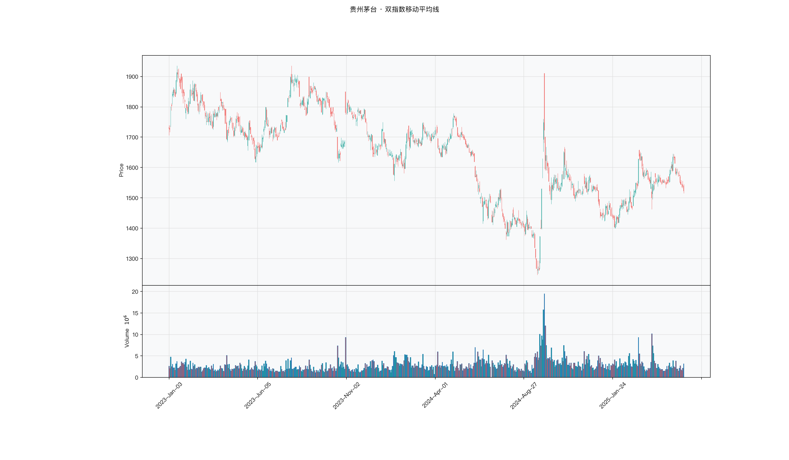

# 第012章 双指数移动平均线（DEMA）

一位交易者不愿把均线周期从二十日改到十日，短周期在震荡里会让他反复出局。他想要的是一条仍按二十日平滑、对转折却更快的线。有人告诉他，可以先估出均线自身的移动量，再把这个量提前加到今天的值上。他试着推了一步，发现均线在加速时被推得最远，走平时几乎没有变化。双指数移动平均线要回答的，就是能否在不缩短周期的前提下补回一部分滞后。

## 名称与来历

双指数移动平均线（Double Exponential Moving Average，DEMA）。

它由帕特里克·穆洛伊（Patrick Mulloy）在 1994 年的《技术分析杂志》上提出。穆洛伊观察到，均线的滞后来自对历史价格的平滑：越平滑，越滞后。既然滞后是平滑的副产品，能不能用均线自身的变化趋势去预测它未来的位置，从而把滞后抵消掉？DEMA 就是这个问题的一个答案，它承认滞后存在，然后在公式里显式地减去一个滞后估计，属于"滞后补偿"这一类改良。

## 核心逻辑

一条 EMA 在上升，意味着它明天大概率比今天更高。既然能估出这个增量，为什么不直接把它提前加到今天的均线上？

这个想法是 DEMA 的全部出发点。它把 EMA 看成一条本身带有趋势的序列，先算出 EMA，再算出 EMA 的 EMA。后者因为多平滑一次，比前者更慢。两者的差值恰好刻画了 EMA 自身的移动速度。把这部分差值再加回到 EMA 上，就得到一个位置被提前的均线。数学上就是两倍 EMA 减去二重 EMA。

结果是一条在趋势转折处响应更快的均线。EMA 上升时，DEMA 站在 EMA 上方；EMA 下降时，DEMA 站在 EMA 下方，方向感被放大。代价同样明确：外推放大的不只是趋势，也包括噪声。在横盘行情里，DEMA 的抖动会非常剧烈，频繁给出误导性的拐头。它是一种"趋势市里好用、震荡市里危险"的均线。外推的方向取决于 EMA 与二重 EMA 的相对位置，这个相对位置本质上是 EMA 的移动方向，因此 DEMA 相当于给 EMA 叠加了一阶动量，动量存在时提前量明显，动量消失时提前量归零甚至反向。

## 计算公式

DEMA 由三次计算构成：先算 EMA，再算 EMA 的 EMA，最后做外推合成。

### 基础 EMA

$$\mathrm{EMA}_t = \alpha\, p_t + (1-\alpha)\,\mathrm{EMA}_{t-1}$$

其中 $\alpha = 2/(n+1)$，$p_t$ 为收盘价，初始 EMA 取前 n 期 SMA。

### 二重 EMA

对第一步得到的 EMA 序列再做一次相同参数的指数平滑：

$$\mathrm{EMA2}_t = \alpha\,\mathrm{EMA}_t + (1-\alpha)\,\mathrm{EMA2}_{t-1}$$

### 外推合成

$$\mathrm{DEMA}_t = 2\,\mathrm{EMA}_t - \mathrm{EMA2}_t$$

核心逻辑在于最后一步。当 EMA 在上升时，$\mathrm{EMA}_t > \mathrm{EMA2}_t$，于是 $\mathrm{DEMA}_t > \mathrm{EMA}_t$，均线被向价格方向提前；当 EMA 在下降时，$\mathrm{DEMA}_t < \mathrm{EMA}_t$，同样朝着价格方向提前。外推量正好等于 $\mathrm{EMA}_t - \mathrm{EMA2}_t$。

**参数含义。**

| 参数 | 含义 | 常见取值 | 影响 |
|---|---|---|---|
| n | 周期，同时决定 α 与滞后的估计长度 | 10、20、30、50 | n 越大越平滑；n 过小外推会被放大 |
| α | 平滑系数，$\alpha=2/(n+1)$ | 由 n 决定 | α 越大，反应越快，抖动越强 |
| 外推量 | $\mathrm{EMA}_t - \mathrm{EMA2}_t$ | 动态 | 正值表示向上外推，负值表示向下外推 |

**计算示例。** 以 5 日 DEMA 为例，$\alpha = 2/6 \approx 0.333$。假设前五日 $\mathrm{EMA}_5 = 12$ 元，$\mathrm{EMA2}_5 = 11.8$ 元，说明 EMA 正在上升。第六日收盘 15 元。

第六日 EMA：

$$\mathrm{EMA}_6 = 0.333\times 15 + 0.667\times 12 \approx 13.00$$

第六日二重 EMA：

$$\mathrm{EMA2}_6 = 0.333\times 13.00 + 0.667\times 11.80 \approx 12.20$$

第六日 DEMA：

$$\mathrm{DEMA}_6 = 2\times 13.00 - 12.20 = 13.80$$

此时 DEMA（13.80）高于同周期 EMA（13.00），偏差 0.80 元，正是外推提前起作用的体现。若 EMA 转为下降，外推方向随之反向，DEMA 会低于 EMA。

### 参数与灵敏度

周期直接决定外推的强度。周期越短，α 越大，EMA 与二重 EMA 的差值越容易被放大，DEMA 的提前量越明显，抖动也越强。下表给出常见的参数取向。

| 周期 n | 提前量 | 平滑程度 | 适用场景 |
|---|---|---|---|
| 10 | 强 | 弱 | 短线追势，需趋势过滤 |
| 20 | 中 | 中 | 默认参数，趋势跟踪 |
| 30 | 中偏弱 | 中偏强 | 中期确认 |
| 50 | 弱 | 强 | 与短周期 DEMA 构成交叉体系 |

经验上不建议把 n 设到 5 以下，否则外推会被极度放大，DEMA 几乎成为价格的放大复制，失去平滑意义。

### 与单次 EMA 的对照

DEMA 与同周期 EMA 的差别，可以用外推量来量度。外推量等于 $\mathrm{EMA}_t - \mathrm{EMA2}_t$，它的大小取决于 EMA 的移动速度。

| 状态 | EMA 与 EMA2 的关系 | DEMA 相对 EMA 的位置 | 含义 |
|---|---|---|---|
| 加速上行 | EMA > EMA2 | 在 EMA 上方 | 提前反映上涨 |
| 匀速上行 | EMA 略高于 EMA2 | 略高于 EMA | 轻微提前 |
| 走平 | 两者接近 | 与 EMA 接近 | 外推量接近零 |
| 加速下行 | EMA < EMA2 | 在 EMA 下方 | 提前反映下跌 |

这张表解释了 DEMA 的行为边界：外推量只在趋势方向明确时较大，方向越模糊，DEMA 越接近普通 EMA，提前的效果也越弱。

## 用法与信号

**拐头。** DEMA 对价格变化的响应速度在均线中属于较快的一档。价格小幅上涨就可能带动 DEMA 率先转向上行，可作为早期多头信号；小幅下跌则可能率先转向下行。因为灵敏，单看拐头容易受噪声干扰，通常需要趋势强度指标确认后才作为入场依据。

**趋势跟随。** 由于滞后被大幅补偿，DEMA 在趋势行情中几乎紧贴价格运行。价格持续在 DEMA 上方且 DEMA 向上，是较强的多头状态，DEMA 本身可视为动态支撑，回调至附近可考虑加仓；价格持续在下且 DEMA 向下，为较强的空头状态。价格频繁穿越 DEMA，往往说明趋势不明或已进入震荡，此时信号意义下降。

**交叉。** 短周期 DEMA 与长周期 DEMA 的交叉比同周期 EMA 交叉来得更早。金叉时短期 DEMA 上穿长期 DEMA 且两者同步向上，视为趋势转多；死叉时反向。交叉结合方向一致性使用，可靠性会更高。

**与 EMA 的差值。** DEMA 与同周期 EMA 的差值反映趋势的加速程度。差值扩大，趋势在加速，可顺势持有；差值收窄，趋势在减速，需警惕转折；两者反复交叉，说明市场缺乏方向，DEMA 的信号应暂停使用。

## 边界与误区

**以为 DEMA 消除了滞后。** DEMA 的目标是减少滞后，不是消除滞后。它仍然是过去价格的函数，在急转弯行情中同样会有延迟，只是比同周期 EMA 小。把它当作实时指标使用，容易在转折点上被反向波动打乱节奏。

**在震荡市中强行使用。** 这是 DEMA 最典型的失效场景。横盘时 DEMA 与价格频繁交叉，一天内可能出现多次拐头，这些信号基本都是噪声。常见做法是先判断是否处于有效趋势，例如参考平均趋向指数的读数，只有趋势明确时才启用 DEMA。

**把参数设得过短。** 当 n 取到 3 至 5 时，外推效应被放到极大，DEMA 几乎变成对价格的放大复制，失去平滑的意义，假信号比例明显上升。经验上建议 n 不小于 10，默认 20 日是比较平衡的选择。

**不验证信号就直接入场。** 高灵敏度意味着 DEMA 会在许多无效波动中拐头，例如价格涨 1% 又回落。单看拐头的可靠性有限，通常需要成交量配合、趋势强度达标、价格有效突破前高或前低等条件共同确认。

## 它被检验过吗

DEMA 的提出理由是补偿滞后，这个理由在构造上成立，在绩效上没有独立证据。均线规则族的检验里，Brock 等（1992）报告过预测力，Sullivan 等（1999）扩大规则空间并校正数据窥探偏差后，显著性大幅下降，Park 与 Irwin（2007）综述 95 项研究的结论是混合的。完整证据链见第 007 章。

这些检验无法区分 DEMA 与 EMA、SMA、WMA、ZLEMA、DMA、BBI。外推减少了滞后，也放大了噪声，但没有任何可靠检验给出过这几个变体的排序。噪声更大这一点可以在信号频次上观察，不能据此推断收益更低。

这一类的真实失效案例，见第 008 章的「真实案例与失败模式」。

## 代码实现

### R

```r
library(ettr)
library(efactorcraft)
library(efincharts)
library(ggplot2)

# 本地数据由 xquant-db 导出，字段见 data/README.md
# 同一章会多次用到这两份数据，这里读一次缓存起来，避免反复解压
.cache <- new.env(parent = emptyenv())
.blue <- function() {
  if (!exists("b", .cache)) {
    b <- read.csv("data/parquet/panel_blue_chip.csv", stringsAsFactors = FALSE)
    b$date <- as.Date(b$date)
    assign("b", b, .cache)
  }
  get("b", .cache)
}
.panel <- function() {
  if (!exists("p", .cache)) {
    # 287 只的完整面板压成 gz，read.csv 支持 gz
    p <- read.csv("data/parquet/panel_r.csv.gz", stringsAsFactors = FALSE)
    p$date <- as.Date(p$date)
    p <- p[p$date >= "2023-01-01" & p$date <= "2025-06-01", ]
    assign("p", p, .cache)
  }
  get("p", .cache)
}
blue  <- .blue()
panel <- .panel()

# efincharts 要求 xts 且列名带 Adjusted
as_xts <- function(df) {
  x <- xts::xts(df[, c("open", "high", "low", "close", "volume", "adjusted")],
                order.by = df$date)
  colnames(x) <- c("Open", "High", "Low", "Close", "Volume", "Adjusted")
  x
}

maotai <- .blue()[.blue()$code == "600519.SS", ]

# 1. ettr 在长格式面板上追加指标列
maotai <- add_dema(maotai, n = 20)

# 2. 基本统计
cols <- setdiff(names(maotai), names(blue))
print(summary(maotai[, cols]))

# 3. K 线 + 成交量 + 均线
ch <- ecandlesticks(as_xts(maotai), show_ma = TRUE, ma_periods = c(20, 60),
                    title = "贵州茅台 · 双指数移动平均线")
ggsave("assets/figures/ch012/indicator_r.png", ch$combined_plot,
       width = 10, height = 6, dpi = 110)
```

### Python

```python
import pandas as pd
import ettr
import efactorcraft as efc
import efincharts as efc_

# 中文字体：mplfinance 会用 style 里的 rc 覆盖全局设置，必须写进 style
from efincharts import theme
theme.efin_style["rc"] = {
    "font.sans-serif": ["PingFang SC", "Heiti SC", "SimHei"],
    "axes.unicode_minus": False,
    "font.family": "sans-serif",
}

# 本地数据由 xquant-db 导出，字段见 data/README.md
blue = pd.read_parquet("data/parquet/panel_blue_chip.parquet")
panel = pd.read_parquet("data/parquet/panel.parquet")
panel = panel[(panel["date"] >= "2023-01-01") & (panel["date"] <= "2025-06-01")]


def one(df, code="600519.SS"):
    """取单只标的，转成 efincharts 需要的宽表。"""
    x = df[df["code"] == code].sort_values("date").set_index("date")
    x.columns = [c.capitalize() for c in x.columns]
    return x

# 1. 取单只标的
maotai = blue[blue['code'] == '600519.SS'].copy()

# 2. ettr 在长格式面板上追加指标列，不需要手工 rolling
maotai = ettr.dema(maotai, n=20)

cols = [c for c in maotai.columns if c not in blue.columns]
print(maotai[cols].describe().round(3))

# 3. 画图：K 线 + 成交量 + 指标面板
px = one(maotai)
ch = efc_.candlestick(px, volume=True, title="贵州茅台 · 双指数移动平均线")
ch.save("assets/figures/ch012/indicator.png")
```

<!-- fig-indicator:start -->


<p class="figcap">图 12-1　双指数移动平均线在贵州茅台上的读数（2023-01 至 2025-06）</p>
<!-- fig-indicator:end -->

## 拆解

DEMA 与价格同量纲，均线值本身不能横向比较。它的结构比 EMA 多一层：外推量可观测，拆解时可单独拿出来。

| 特征名 | 计算式 | 量纲 | 经济含义 |
|--------|--------|------|----------|
| 价格偏离度 | $p_t / \mathrm{DEMA}_t^{(20)} - 1$ | 无量纲比例 | 价格相对补偿后均线的位置 |
| 均线斜率 | $(\mathrm{DEMA}_t - \mathrm{DEMA}_{t-5}) / \mathrm{DEMA}_{t-5}$ | 无量纲比例 | 补偿后均线的推进速度 |
| 加速量 | $(\mathrm{DEMA}_t - \mathrm{EMA}_t) / \mathrm{EMA}_t$ | 无量纲比例 | 外推补偿的相对幅度 |
| 补偿倍数 | $(\mathrm{DEMA}_t - \mathrm{EMA}_t) / (p_t - \mathrm{EMA}_t)$ | 无量纲倍数 | 价格偏离中被补掉的比例 |

补偿倍数是 DEMA 独有的量。零到一之间表示落在 EMA 与价格之间，为部分补偿；大于一是越过价格的过冲；小于零表示外推方向与价格偏离相反，多见于趋势转向时。分母趋近零时倍数急剧放大，进因子前要先截断。

三者都由 EMA 派生，相关高。偏离度因外推放大，尾部更厚。

### R

```r
library(ettr)
library(efactorcraft)
library(efincharts)
library(ggplot2)

# 本地数据由 xquant-db 导出，字段见 data/README.md
# 同一章会多次用到这两份数据，这里读一次缓存起来，避免反复解压
.cache <- new.env(parent = emptyenv())
.blue <- function() {
  if (!exists("b", .cache)) {
    b <- read.csv("data/parquet/panel_blue_chip.csv", stringsAsFactors = FALSE)
    b$date <- as.Date(b$date)
    assign("b", b, .cache)
  }
  get("b", .cache)
}
.panel <- function() {
  if (!exists("p", .cache)) {
    # 287 只的完整面板压成 gz，read.csv 支持 gz
    p <- read.csv("data/parquet/panel_r.csv.gz", stringsAsFactors = FALSE)
    p$date <- as.Date(p$date)
    p <- p[p$date >= "2023-01-01" & p$date <= "2025-06-01", ]
    assign("p", p, .cache)
  }
  get("p", .cache)
}
blue  <- .blue()
panel <- .panel()

# efincharts 要求 xts 且列名带 Adjusted
as_xts <- function(df) {
  x <- xts::xts(df[, c("open", "high", "low", "close", "volume", "adjusted")],
                order.by = df$date)
  colnames(x) <- c("Open", "High", "Low", "Close", "Volume", "Adjusted")
  x
}

d <- .blue()[.blue()$code == "600519.SS", ]
d <- add_dema(d, n = 20)

# 转成无量纲因子
d$f <- d$`DEMA_20` / d$close - 1

print(summary(d$f))
```

### Python

```python
import pandas as pd
import ettr
import efactorcraft as efc
import efincharts as efc_

# 中文字体：mplfinance 会用 style 里的 rc 覆盖全局设置，必须写进 style
from efincharts import theme
theme.efin_style["rc"] = {
    "font.sans-serif": ["PingFang SC", "Heiti SC", "SimHei"],
    "axes.unicode_minus": False,
    "font.family": "sans-serif",
}

# 本地数据由 xquant-db 导出，字段见 data/README.md
blue = pd.read_parquet("data/parquet/panel_blue_chip.parquet")
panel = pd.read_parquet("data/parquet/panel.parquet")
panel = panel[(panel["date"] >= "2023-01-01") & (panel["date"] <= "2025-06-01")]


def one(df, code="600519.SS"):
    """取单只标的，转成 efincharts 需要的宽表。"""
    x = df[df["code"] == code].sort_values("date").set_index("date")
    x.columns = [c.capitalize() for c in x.columns]
    return x

# 1. 先在面板上算原始指标
d = panel.copy()
d = ettr.dema(d, n=20)

# 2. 转成无量纲因子，才能跨标的排序
d["f"] = d["DEMA_20"] / d.close - 1

print(d["f"].describe().round(4))
```

## 截面选股能力

常用的两个构造是偏离度与加速量，

$$f^{dev}_t = \frac{p_t}{\mathrm{DEMA}_t^{(20)}} - 1$$

$$f^{accel}_t = \frac{\mathrm{DEMA}_t}{\mathrm{EMA}_t} - 1$$

偏离度偏正。加速量刻画趋势在强化还是减弱，方向也偏正，但更像强度的确认，震荡市中符号容易翻动。检验的核心不是 DEMA 有无 IC，而是滞后补偿是否转化为预测力。若 DEMA 的 IC 均值高于 EMA 而 ICIR 不高于 EMA，说明补偿放大的是幅度而非稳定性。

检验有三点。第一，与 EMA 成对比较，同交易日、同前向窗口，看 IC 差值的均值与 t 值。第二，外推放大尾部，分层前先去极值，否则最高一组会被个别标的左右。第三，按趋势强度分段，全样本的 IC 容易被震荡段拉平；分段后若趋势段明显、震荡段接近零，说明信息确实来自外推对趋势的捕捉。

### R

```r
library(ettr)
library(efactorcraft)
library(efincharts)
library(ggplot2)

# 本地数据由 xquant-db 导出，字段见 data/README.md
# 同一章会多次用到这两份数据，这里读一次缓存起来，避免反复解压
.cache <- new.env(parent = emptyenv())
.blue <- function() {
  if (!exists("b", .cache)) {
    b <- read.csv("data/parquet/panel_blue_chip.csv", stringsAsFactors = FALSE)
    b$date <- as.Date(b$date)
    assign("b", b, .cache)
  }
  get("b", .cache)
}
.panel <- function() {
  if (!exists("p", .cache)) {
    # 287 只的完整面板压成 gz，read.csv 支持 gz
    p <- read.csv("data/parquet/panel_r.csv.gz", stringsAsFactors = FALSE)
    p$date <- as.Date(p$date)
    p <- p[p$date >= "2023-01-01" & p$date <= "2025-06-01", ]
    assign("p", p, .cache)
  }
  get("p", .cache)
}
blue  <- .blue()
panel <- .panel()

# efincharts 要求 xts 且列名带 Adjusted
as_xts <- function(df) {
  x <- xts::xts(df[, c("open", "high", "low", "close", "volume", "adjusted")],
                order.by = df$date)
  colnames(x) <- c("Open", "High", "Low", "Close", "Volume", "Adjusted")
  x
}

d <- .panel()
d <- add_dema(d, n = 20)

d$f <- d$`DEMA_20` / d$close - 1
d <- add_next_return(d, close_col = "close", n = c(1, 5, 20))

ic <- ic_analysis(d, factor_cols = "f",
                    forward_cols = c("forward_1", "forward_5", "forward_20"),
                    method = "spearman")
print(ir_analysis(ic))

q <- quantile_analysis(d, factor_cols = "f", forward_cols = "forward_5",
                       n_groups = 5)
print(q$f$summary)
```

### Python

```python
import pandas as pd
import ettr
import efactorcraft as efc
import efincharts as efc_

# 中文字体：mplfinance 会用 style 里的 rc 覆盖全局设置，必须写进 style
from efincharts import theme
theme.efin_style["rc"] = {
    "font.sans-serif": ["PingFang SC", "Heiti SC", "SimHei"],
    "axes.unicode_minus": False,
    "font.family": "sans-serif",
}

# 本地数据由 xquant-db 导出，字段见 data/README.md
blue = pd.read_parquet("data/parquet/panel_blue_chip.parquet")
panel = pd.read_parquet("data/parquet/panel.parquet")
panel = panel[(panel["date"] >= "2023-01-01") & (panel["date"] <= "2025-06-01")]


def one(df, code="600519.SS"):
    """取单只标的，转成 efincharts 需要的宽表。"""
    x = df[df["code"] == code].sort_values("date").set_index("date")
    x.columns = [c.capitalize() for c in x.columns]
    return x

# 287 只、2023-01 至 2025-06，横截面才有统计意义
src = panel.copy()
d = src.copy()

# 1. 算指标
d = ettr.dema(d, n=20)


# 2. 因子 + 未来收益
d["f"] = d["DEMA_20"] / d.close - 1
d = efc.add_next_return(d, periods=(1, 5, 20))

# 3. 截面 IC 与分层
ic = efc.ic_analysis(d, factor_cols="f",
                      forward_cols=["forward_1", "forward_5", "forward_20"],
                      method="spearman")
print(efc.ir_analysis(ic).round(3))

q = efc.quantile_analysis(d, factor_col="f", forward_col="forward_5", n_groups=5)
print(q["summary"].round(4))
```

<!-- tab-ic:start -->
**计算结果**

| 前向期 | IC 均值 | IC 标准差 | ICIR | t 值 | IC>0 占比 | 期数 |
|---|---|---|---|---|---|---|
| T+1 | 0.0117 | 0.2272 | 0.052 | 1.20 | 0.5110 | 542 |
| T+5 | -0.0038 | 0.1999 | -0.019 | -0.44 | 0.5020 | 538 |
| T+20 | 0.0019 | 0.1997 | 0.009 | 0.21 | 0.4880 | 523 |

表里最该看的是 t 值，不是 IC 均值。这个因子以 T+1 为主口径，IC 均值 0.0117、ICIR 0.052、t 值 1.20，在常规门槛下不显著，方向为正向。按第 007 章给出的日频门槛（ICIR 0.13 对应 t≈2），这个结果的含义是：还看不出与噪声的区别，不能据此构造策略。

需要提醒的是，这只说明排序与未来收益之间存在可测的关联，不代表扣掉成本后还能剩下收益。横截面 IC 检验的是“买哪只”，不负责“值不值得交易”。

**五档分层**

| 分组 | 平均收益 | 标准差 | 期数 |
|---|---|---|---|
| 1 | +0.0046 | +0.0383 | 538 |
| 2 | +0.0028 | +0.0311 | 538 |
| 3 | +0.0027 | +0.0312 | 538 |
| 4 | +0.0026 | +0.0341 | 538 |
| 5 | +0.0031 | +0.0403 | 538 |

五档分层看的是形状，不是单点。最高一档在第 1 组、最低在第 4 组，两端相差 -0.15%，组序号与平均收益的秩相关为 -0.61，有方向但不严格单调。

分层比 IC 更接近实盘，因为它直接给出“买最高档、卖最低档”的收益差。但这里的数字是毛收益，且没有考虑涨跌停买不进、停牌卖不出的情形，真实可得的差额会小于表中所列。
<!-- tab-ic:end -->

## 择时能力

DEMA 的时序信号分四层：拐头、加速量上穿零轴、价格穿越均线、短长周期 DEMA 交叉。

方法与信号形态对应。加速量是连续变量，适合条件分位收益，能看出加速到什么程度才有效。上穿零轴是离散事件，适合触发日检验。交叉在 DEMA 上最不可靠，震荡市中反复出现，不宜作主要判据。最后把加速量高于阈值作为持仓条件回测。

三个陷阱与设计有关。外推在震荡市放大噪声，DEMA 与价格频繁交叉，信号意义下降。参数过短会进一步放大外推，n 小于十时几乎失去平滑作用。提前量本身也带来成本，拐头早则试错多，回测时把费率与印花税计入，结论通常更保守。

### R

```r
library(ettr)
library(efactorcraft)
library(efincharts)
library(ggplot2)

# 本地数据由 xquant-db 导出，字段见 data/README.md
# 同一章会多次用到这两份数据，这里读一次缓存起来，避免反复解压
.cache <- new.env(parent = emptyenv())
.blue <- function() {
  if (!exists("b", .cache)) {
    b <- read.csv("data/parquet/panel_blue_chip.csv", stringsAsFactors = FALSE)
    b$date <- as.Date(b$date)
    assign("b", b, .cache)
  }
  get("b", .cache)
}
.panel <- function() {
  if (!exists("p", .cache)) {
    # 287 只的完整面板压成 gz，read.csv 支持 gz
    p <- read.csv("data/parquet/panel_r.csv.gz", stringsAsFactors = FALSE)
    p$date <- as.Date(p$date)
    p <- p[p$date >= "2023-01-01" & p$date <= "2025-06-01", ]
    assign("p", p, .cache)
  }
  get("p", .cache)
}
blue  <- .blue()
panel <- .panel()

# efincharts 要求 xts 且列名带 Adjusted
as_xts <- function(df) {
  x <- xts::xts(df[, c("open", "high", "low", "close", "volume", "adjusted")],
                order.by = df$date)
  colnames(x) <- c("Open", "High", "Low", "Close", "Volume", "Adjusted")
  x
}

idx <- read.csv("data/parquet/index_daily.csv", stringsAsFactors = FALSE)
idx$date <- as.Date(idx$date)
t <- idx[idx$code == "510300.SS", ]
t <- add_dema(t, n = 20)
t$f <- t$`DEMA_20` / t$close - 1
t$forward_5 <- c(tail(t$close, -5) / head(t$close, -5) - 1, rep(NA, 5))
t$q <- cut(t$f, quantile(t$f, 0:5/5, na.rm = TRUE), include.lowest = TRUE, labels = FALSE)
print(aggregate(forward_5 ~ q, data = t, FUN = function(x)
  c(mean = mean(x, na.rm = TRUE), n = sum(!is.na(x)))))
```

### Python

```python
import pandas as pd
import ettr
import efactorcraft as efc
import efincharts as efc_

# 中文字体：mplfinance 会用 style 里的 rc 覆盖全局设置，必须写进 style
from efincharts import theme
theme.efin_style["rc"] = {
    "font.sans-serif": ["PingFang SC", "Heiti SC", "SimHei"],
    "axes.unicode_minus": False,
    "font.family": "sans-serif",
}

# 本地数据由 xquant-db 导出，字段见 data/README.md
blue = pd.read_parquet("data/parquet/panel_blue_chip.parquet")
panel = pd.read_parquet("data/parquet/panel.parquet")
panel = panel[(panel["date"] >= "2023-01-01") & (panel["date"] <= "2025-06-01")]


def one(df, code="600519.SS"):
    """取单只标的，转成 efincharts 需要的宽表。"""
    x = df[df["code"] == code].sort_values("date").set_index("date")
    x.columns = [c.capitalize() for c in x.columns]
    return x

# 择时检验用 ETF 做市场载体，指数本身没有日线数据
idx = pd.read_parquet("data/parquet/index_daily.parquet")
idx = idx[idx["code"] == "510300.SS"].sort_values("date")
t = idx.copy()

# 1. 在 ETF 上算同一个指标
t = ettr.dema(d, n=20)


# 2. 按因子分位看未来 5 日收益
t["f"] = t["DEMA_20"] / t.close - 1
t["forward_5"] = t["close"].shift(-5) / t["close"] - 1
# 因子可能有重复值，先按名次切，避免 qcut 报边界不唯一
t["q"] = pd.qcut(t["f"].rank(method="first"), 5, labels=False) + 1
t = t.dropna(subset=["f", "forward_5"])
print(t.groupby("q")["forward_5"].agg(["mean", "count"]).round(4))
```

<!-- tab-timing:start -->
**分位收益**

| 分位 | 未来 5 日均值 | 样本数 |
|---|---|---|
| 1 | +0.0006 | 215 |
| 2 | +0.0008 | 214 |
| 3 | -0.0030 | 214 |
| 4 | -0.0016 | 214 |
| 5 | +0.0043 | 215 |

择时口径与截面不同：这里只有一个标的，看的是同一标的在不同分位下的未来收益。最高与最低分位相差 +0.37%。单标的样本有限，这个差额很容易被一两段行情主导，只能作为方向参考。

真正做择时要问的是三件事：分位阈值是否稳定、换手是否可控、扣成本后是否还有剩余。三者缺一，择时信号就只是图上好看。
<!-- tab-timing:end -->

## 组合使用与验证

常见的搭档有三个。与 ADX 搭配，补的是市况前提，是常用搭配；与成交量搭配，补的是参与度。与 EMA 搭配，同源。

**组合的截面验证。** DEMA 与 EMA 的偏离度相关性极高，加权组合的 ICIR 通常落在两者之间，属于平均，真正的互补来自市况条件：先在 ADX 较高的子样本内做截面检验，再与全样本比较。若要与量能组合，可用 combined_signal 把偏离度与量比因子加权，观察组合与两者的 ICIR 差异。

**组合的择时验证。** 把规则写成仓位条件，例如"偏离度为正且加速量为正"时持仓，否则空仓，计算年化收益、夏普与最大回撤。DEMA 信号频次高，条件过滤的贡献多在回撤与换手。

判读依据方法论章：组合的 ICIR 高于两个单特征，才说明存在互补；介于两者之间，说明只是平均；低于两者，说明信号在特定时段冲突。DEMA 与 EMA 多属后两种情形，更适合条件型。

### R

```r
library(ettr)
library(efactorcraft)
library(efincharts)
library(ggplot2)

# 本地数据由 xquant-db 导出，字段见 data/README.md
# 同一章会多次用到这两份数据，这里读一次缓存起来，避免反复解压
.cache <- new.env(parent = emptyenv())
.blue <- function() {
  if (!exists("b", .cache)) {
    b <- read.csv("data/parquet/panel_blue_chip.csv", stringsAsFactors = FALSE)
    b$date <- as.Date(b$date)
    assign("b", b, .cache)
  }
  get("b", .cache)
}
.panel <- function() {
  if (!exists("p", .cache)) {
    # 287 只的完整面板压成 gz，read.csv 支持 gz
    p <- read.csv("data/parquet/panel_r.csv.gz", stringsAsFactors = FALSE)
    p$date <- as.Date(p$date)
    p <- p[p$date >= "2023-01-01" & p$date <= "2025-06-01", ]
    assign("p", p, .cache)
  }
  get("p", .cache)
}
blue  <- .blue()
panel <- .panel()

# efincharts 要求 xts 且列名带 Adjusted
as_xts <- function(df) {
  x <- xts::xts(df[, c("open", "high", "low", "close", "volume", "adjusted")],
                order.by = df$date)
  colnames(x) <- c("Open", "High", "Low", "Close", "Volume", "Adjusted")
  x
}

d <- .panel()
d <- add_dema(d, n = 20)
d$f1 <- d$`DEMA_20` / d$close - 1
d <- add_cmf(d, n = 20)
d$f2 <- d$CMF
d <- add_next_return(d, close_col = "close", n = 5)
ic1 <- ic_analysis(d, factor_cols = c("f1", "f2"),
                    forward_cols = "forward_5", method = "spearman")
print(ir_analysis(ic1))
```

```r
library(ettr)
library(efactorcraft)
library(efincharts)
library(ggplot2)

# 本地数据由 xquant-db 导出，字段见 data/README.md
# 同一章会多次用到这两份数据，这里读一次缓存起来，避免反复解压
.cache <- new.env(parent = emptyenv())
.blue <- function() {
  if (!exists("b", .cache)) {
    b <- read.csv("data/parquet/panel_blue_chip.csv", stringsAsFactors = FALSE)
    b$date <- as.Date(b$date)
    assign("b", b, .cache)
  }
  get("b", .cache)
}
.panel <- function() {
  if (!exists("p", .cache)) {
    # 287 只的完整面板压成 gz，read.csv 支持 gz
    p <- read.csv("data/parquet/panel_r.csv.gz", stringsAsFactors = FALSE)
    p$date <- as.Date(p$date)
    p <- p[p$date >= "2023-01-01" & p$date <= "2025-06-01", ]
    assign("p", p, .cache)
  }
  get("p", .cache)
}
blue  <- .blue()
panel <- .panel()

# efincharts 要求 xts 且列名带 Adjusted
as_xts <- function(df) {
  x <- xts::xts(df[, c("open", "high", "low", "close", "volume", "adjusted")],
                order.by = df$date)
  colnames(x) <- c("Open", "High", "Low", "Close", "Volume", "Adjusted")
  x
}

d <- .panel()
d <- add_dema(d, n = 20)
d$f1 <- d$`DEMA_20` / d$close - 1
d <- add_cmf(d, n = 20)
d$f2 <- d$CMF
d <- add_next_return(d, close_col = "close", n = 5)
ic1 <- ic_analysis(d, factor_cols = c("f1", "f2"),
                    forward_cols = "forward_5", method = "spearman")
print(ir_analysis(ic1))
```

### Python

```python
import pandas as pd
import ettr
import efactorcraft as efc
import efincharts as efc_

# 中文字体：mplfinance 会用 style 里的 rc 覆盖全局设置，必须写进 style
from efincharts import theme
theme.efin_style["rc"] = {
    "font.sans-serif": ["PingFang SC", "Heiti SC", "SimHei"],
    "axes.unicode_minus": False,
    "font.family": "sans-serif",
}

# 本地数据由 xquant-db 导出，字段见 data/README.md
blue = pd.read_parquet("data/parquet/panel_blue_chip.parquet")
panel = pd.read_parquet("data/parquet/panel.parquet")
panel = panel[(panel["date"] >= "2023-01-01") & (panel["date"] <= "2025-06-01")]


def one(df, code="600519.SS"):
    """取单只标的，转成 efincharts 需要的宽表。"""
    x = df[df["code"] == code].sort_values("date").set_index("date")
    x.columns = [c.capitalize() for c in x.columns]
    return x

d = panel.copy()

# 1. 本章因子
d = ettr.dema(d, n=20)
d["f1"] = d["DEMA_20"] / d.close - 1

# 2. 配一个量价因子做对照
d = ettr.cmf(d, n=20)
d["f2"] = d["CMF_20"]
d = efc.add_next_return(d, periods=(5,))

# 3. 单因子与等权组合的信息比率
ic = efc.ic_analysis(d, factor_cols=["f1", "f2"], forward_cols=["forward_5"],
                      method="spearman")
d = efc.equal_weighted_composite(d, factor_cols=["f1", "f2"], new_col="f1_f2")
ic2 = efc.ic_analysis(d, factor_cols=["f1_f2"], forward_cols=["forward_5"],
                      method="spearman")
ic.update(ic2)
print(efc.ir_analysis(ic).round(3))
```

```python
import pandas as pd
import ettr
import efactorcraft as efc
import efincharts as efc_

# 中文字体：mplfinance 会用 style 里的 rc 覆盖全局设置，必须写进 style
from efincharts import theme
theme.efin_style["rc"] = {
    "font.sans-serif": ["PingFang SC", "Heiti SC", "SimHei"],
    "axes.unicode_minus": False,
    "font.family": "sans-serif",
}

# 本地数据由 xquant-db 导出，字段见 data/README.md
blue = pd.read_parquet("data/parquet/panel_blue_chip.parquet")
panel = pd.read_parquet("data/parquet/panel.parquet")
panel = panel[(panel["date"] >= "2023-01-01") & (panel["date"] <= "2025-06-01")]


def one(df, code="600519.SS"):
    """取单只标的，转成 efincharts 需要的宽表。"""
    x = df[df["code"] == code].sort_values("date").set_index("date")
    x.columns = [c.capitalize() for c in x.columns]
    return x

d = panel.copy()

# 1. 本章因子
d = ettr.dema(d, n=20)
d["f1"] = d["DEMA_20"] / d.close - 1

# 2. 配一个量价因子做对照
d = ettr.cmf(d, n=20)
d["f2"] = d["CMF_20"]
d = efc.add_next_return(d, periods=(5,))

# 3. 单因子与等权组合的信息比率
ic = efc.ic_analysis(d, factor_cols=["f1", "f2"], forward_cols=["forward_5"],
                      method="spearman")
d = efc.equal_weighted_composite(d, factor_cols=["f1", "f2"], new_col="f1_f2")
ic2 = efc.ic_analysis(d, factor_cols=["f1_f2"], forward_cols=["forward_5"],
                      method="spearman")
ic.update(ic2)
print(efc.ir_analysis(ic).round(3))
```

## AI 引导词

::: prompt 引导词 1：滞后补偿效果的量化对比

我在研究双指数移动平均线（DEMA）。请帮我设计一个方案，量化 DEMA 相对 EMA 的滞后减少了多少。具体要求：1）在贵州茅台 2020 至 2024 年的日线数据上，分别计算 20 日 EMA 与 20 日 DEMA；2）用一个简单指标度量滞后，例如均线穿越价格局部极值点的时间差；3）统计 DEMA 相对 EMA 平均提前多少个交易日；4）画出两者的对比曲线。请输出可直接运行的 Python 代码，只使用 pandas、numpy、yfinance、matplotlib。

:::
::: prompt 引导词 2：趋势市与震荡市的分段检验

请帮我写一段 Python 代码，检验 DEMA 偏离度因子在不同市况下的表现差异。要求：1）用 14 日 ADX 把样本划分为趋势市（ADX≥25）与震荡市（ADX<25）；2）分别计算 20 日 DEMA 偏离度因子与未来 5 日收益的 Rank IC 与 ICIR；3）输出两种市况下的对比表格；4）用文字说明 DEMA 更适合哪类市况，以及震荡市中因子失效的可能原因。数据用 yfinance 获取，代码需可直接运行。

:::
::: prompt 引导词 3：外推参数的稳健性检验

DEMA 的外推效应会随参数变化，我希望知道参数设得过短时会发生什么。请帮我在 5、10、20、30、50 五组周期上，分别计算 DEMA 偏离度因子的 IC 均值与 ICIR，并统计每个周期下 DEMA 与 EMA 的交叉次数。请输出一张表格，包含周期、IC 均值、ICIR、交叉次数四列，并用文字说明参数过短时交叉次数与因子表现的关系。请给出可直接运行的 Python 代码，只使用 pandas、numpy、yfinance、matplotlib。

:::
