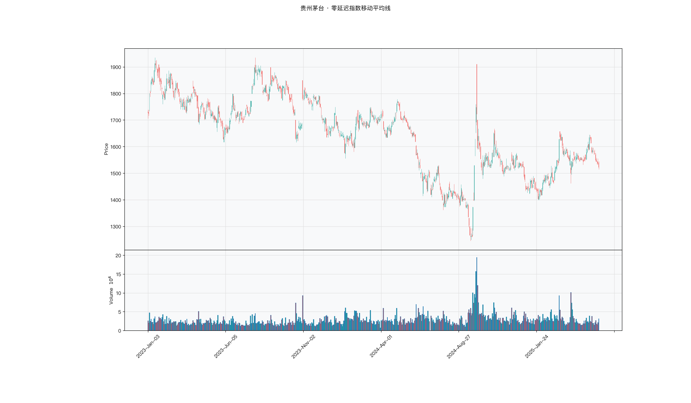

# 第013章 零延迟指数移动平均线（ZLEMA）

一位研究者看到"零延迟"三个字，先把它接到自己的均线策略上，回测曲线看起来顺了不少。他没有马上采用，而是去查这条线在什么条件下失效。他把价格切成匀速段和变速段，分别对照两条均线的偏离。去滞后总要付代价，代价可能藏在价格突然加速的那几天。零延迟指数移动平均线要回答的，是这份提前量在什么行情里成立，又在什么行情里变成过冲。

## 名称与来历

零延迟指数移动平均线（Zero-Lag Exponential Moving Average，ZLEMA）。

它由约翰·埃勒斯（John Ehlers）与里克·韦（Ric Way）在 2000 年代提出。此前的滞后补偿思路，例如双指数移动平均线，都是在算完 EMA 之后对结果做外推修正。ZLEMA 换了一个位置动手：在计算指数平滑之前，先对输入的价格做去滞后处理。它把"零延迟"写进了名字，但这个说法更接近设计目标而非严格事实，实际的延迟表现取决于行情形态。

## 核心逻辑

如果价格短期内几乎匀速地运行，那么它明天的位置，是否能从今天的位置和最近的位移推出来？

这个假设是 ZLEMA 的基础。设价格在 lag 天内上涨了 Δ，按照匀速延续的假设，当前的"应有价格"就应该是今天的实际价格再加上这段位移，也就是用今天价格的两倍减去 lag 天前的价格。这样构造出的序列天然领先于真实价格，把它送进标准的指数平滑，得到的均线就会紧紧咬住价格，比同周期 EMA 早得多。

前提假设也划定了它的适用边界。价格越接近匀速运动，ZLEMA 越光滑有效；一旦价格突然加速或减速，匀速假设被打破，ZLEMA 会产生过冲，跑得比价格还快，反而发出误导信号。它是一种在稳定趋势中表现突出、在变速行情里需要谨慎对待的均线。去滞后处理的位置很关键：DEMA 之类的方法在均线算完之后再修正结果，ZLEMA 则在价格进入平滑之前就先做修正，透明度更高，但修正后的价格可能超出合理区间，这也是过冲的来源。

## 计算公式

ZLEMA 由三步构成：确定 lag、构造去滞后价格、对去滞后价格做指数平滑。

### 确定 lag 参数

$$\mathrm{lag} = \lfloor (n-1)/2 \rfloor$$

例如 n=20 时，lag = ⌊19/2⌋ = 9，即用当前价格与 9 天前的价格计算位移。

### 构造去滞后价格

$$d_t = 2\,p_t - p_{t-\mathrm{lag}}$$

其中 $p_t$ 为当日收盘价，$p_{t-\mathrm{lag}}$ 为 lag 天前的收盘价。若价格从 lag 天前到当天上涨了 Δ，则 $d_t = p_t + \Delta$，相当于把走势延续的假设提前反映到价格上。

### 对去滞后价格做指数平滑

$$\mathrm{ZLEMA}_t = \alpha\, d_t + (1-\alpha)\,\mathrm{ZLEMA}_{t-1}, \qquad \alpha = \frac{2}{n+1}$$

初始值一般取前 n 期去滞后价格的简单平均值。

**参数含义。**

| 参数 | 含义 | 常见取值 | 影响 |
|---|---|---|---|
| n | 周期，决定平滑系数 α | 10、20、30 | n 越大越平滑，滞后仍低于同周期 EMA |
| lag | 去滞后窗口，$\lfloor (n-1)/2 \rfloor$ | n=20 时为 9 | lag 越大去滞后越强，过冲风险越大 |
| α | 平滑系数，$2/(n+1)$ | 由 n 决定 | α 越大反应越快 |

**计算示例。** 以 5 日 ZLEMA 为例，lag = ⌊4/2⌋ = 2，$\alpha = 2/6 \approx 0.333$。假设连续收盘价为 10、11、12、13、14，第六日收盘 15 元。lag=2 时 $p_{t-2}$ 为第四日收盘价 13 元。

去滞后价格：

$$d_6 = 2\times 15 - 13 = 17$$

若前一日 ZLEMA 为 14，则：

$$\mathrm{ZLEMA}_6 = 0.333\times 17 + 0.667\times 14 \approx 15.00$$

同一时点 5 日 EMA 约为 13 元，ZLEMA 恰好等于当日收盘价 15 元，这正是零延迟效果在匀速上涨中的体现。

### 参数与灵敏度

ZLEMA 有两个相互关联的参数：周期 n 与去滞后窗口 lag。lag 由 n 决定，因此实际可调的主要是 n。下表给出常见周期对应的 lag 与取向。

| 周期 n | lag | 去滞后强度 | 适用场景 |
|---|---|---|---|
| 10 | 4 | 中 | 短线，降低过冲风险 |
| 15 | 7 | 中偏强 | 高波动品种 |
| 20 | 9 | 强 | 默认参数，波段跟踪 |
| 30 | 14 | 很强 | 稳定匀速趋势 |

lag 越大，去滞后越强，对匀速的要求也越高。价格很难在十几个交易日内始终保持匀速，因此不建议单独放大 lag。若要提高灵敏度，通常应缩短 n，让 lag 随之自动调整。

### 去滞后价格的构造含义

去滞后价格 $d_t = 2p_t - p_{t-\mathrm{lag}}$ 是 ZLEMA 的核心。它等价于在当日价格上叠加 lag 窗口内的位移。

| 情形 | 位移方向 | $d_t$ 相对 $p_t$ | 效果 |
|---|---|---|---|
| 匀速上涨 | 正 | 更高 | 提前反映上涨 |
| 匀速下跌 | 负 | 更低 | 提前反映下跌 |
| 急涨后放缓 | 前期为正 | 明显更高 | 可能过冲 |
| 横盘 | 接近零 | 接近 $p_t$ | 退化为普通 EMA |

从表里可以看到，去滞后价格在匀速趋势中给出了有意义的提前量，在横盘时几乎不起作用，在急变时则可能出现失真的高估。ZLEMA 的收益与风险，都来自这一层构造。

## 用法与信号

**方向与斜率。** 因为滞后很小，ZLEMA 的方向变化几乎与价格同步。向上且斜率大，表示多头趋势较强，可作为顺势持仓的第一道动态支撑；向下且斜率大，表示空头趋势较强，可作为第一道动态阻力；走平，往往意味着趋势暂停或临近方向变化，需要提高警惕。

**拐头。** ZLEMA 的拐头信号通常比同周期 EMA 早若干根 K 线，提前量大致接近 lag。向上拐头可能是多头趋势启动的早期信号，向下拐头则可能是空头启动或离场的信号。由于提前量来自外推假设，拐头出现得越早，越需要后续价格确认。

**贴近与穿越。** ZLEMA 几乎紧贴价格运行，两者的关系具有特殊含义。价格持续在 ZLEMA 上方且 ZLEMA 向上，通常对应匀速上涨，持仓为主；价格持续在下方且 ZLEMA 向下，对应匀速下跌。若价格频繁穿越 ZLEMA，一日在上、一日在下，说明市场并非匀速运动，ZLEMA 的假设失效，此时信号意义不大。

**过冲。** 当价格急加速或急减速时，去滞后价格会大幅偏离真实价格，ZLEMA 出现过冲。过冲幅度过大且伴随超买或超卖读数时，可能提示短期见顶或见底；若只是趋势本身的加速，过冲则属正常，需要结合其他指标区分。

## 边界与误区

**认为 ZLEMA 真的没有延迟。** 零延迟是设计目标，不是既有事实。它在匀速趋势中接近零延迟，但在变速市场中，lag 窗口反而可能带来过冲，形成事实上的负延迟。更贴切的理解是"去滞后均线"，其响应速度取决于趋势的稳定程度。

**忽视跳空缺口对匀速假设的破坏。** 去滞后价格依赖 lag 天前的价格。如果恰好在 lag 天前发生跳空，例如财报次日大幅高开，位移的计算基础就被污染，ZLEMA 会产生明显失真。缺口出现后，通常需要约 lag 个交易日来消化其影响，这段时间的信号建议暂停使用。

**在震荡市中独立使用。** 震荡市中价格来回穿越 ZLEMA，会产生大量假拐头，而且过冲还会把假信号放大。这类行情通常应先判断是否处于有效趋势，趋势不清时放弃 ZLEMA，改用更偏震荡的工具。

**认为 lag 越大越好。** lag 越大，去滞后越强，信号越早，但匀速假设也越难维持。要求在十几个交易日内始终保持匀速并不现实。默认的 $\lfloor (n-1)/2 \rfloor$ 是经验折中，若想提高灵敏度，通常应缩短 n，而不是单独放大 lag。

## 它被检验过吗

ZLEMA 把"零延迟"写进名字，但名字不是检验结果。均线规则族的检验里，Brock 等（1992）报告过预测力，Sullivan 等（1999）扩大规则空间并校正数据窥探偏差后，显著性大幅下降，Park 与 Irwin（2007）综述 95 项研究的结论是混合的。完整证据链见第 007 章。

这些检验针对的是均线规则族，无法区分 ZLEMA 与 EMA、DEMA、SMA、WMA、DMA、BBI 之间的优劣。没有任何可靠检验给出过这几个变体的排序，去滞后是否带来更好的净收益也就没有独立结论。可以确认的只是构造上的差异：匀速行情中提前，变速行情中过冲。

这一类的真实失效案例，见第 008 章的「真实案例与失败模式」。

## 代码实现

### R

```r
library(ettr)
library(efactorcraft)
library(efincharts)
library(ggplot2)

BASE <- "https://raw.githubusercontent.com/dengyishuo/quant-technical-analysis/main/data/parquet"

# 取数据：本地有就用本地，没有就下载一次并缓存。
# read.csv 对本地 .gz 会自动解压，所以缓存成 .csv.gz 也能直接读。
load_data <- function(name) {
  local <- file.path("data", "parquet", name)
  if (file.exists(local)) return(local)
  cache <- file.path(tools::R_user_dir("qta", "cache"), name)
  if (!file.exists(cache)) {
    dir.create(dirname(cache), recursive = TRUE, showWarnings = FALSE)
    message("下载 ", name, " ...")
    download.file(paste0(BASE, "/", name), cache, mode = "wb", quiet = TRUE)
  }
  cache
}

read_data <- function(name) {
  d <- read.csv(load_data(name), stringsAsFactors = FALSE)
  if ("date" %in% names(d)) d$date <- as.Date(d$date)
  d
}

# 同一章里多次取用，缓存到内存，避免重复解析
.cache <- new.env(parent = emptyenv())
.blue <- function() {
  if (!exists("b", .cache)) assign("b", read_data("panel_blue_chip.csv"), .cache)
  get("b", .cache)
}
.panel <- function() {
  if (!exists("p", .cache)) {
    p <- read_data("panel_r.csv.gz")
    assign("p", p[p$date >= "2023-01-01" & p$date <= "2025-06-01", ], .cache)
  }
  get("p", .cache)
}
.index <- function() read_data("index_daily.csv")

blue  <- .blue()
panel <- .panel()

# 图的保存路径，顺手建目录，避免读者本地没有 assets/ 时报错
fig_path <- function(ch, name = "indicator_r.png") {
  d <- file.path("assets", "figures", sprintf("ch%03d", ch))
  dir.create(d, recursive = TRUE, showWarnings = FALSE)
  file.path(d, name)
}

# efincharts 要求 xts 且列名带 Adjusted
as_xts <- function(df) {
  x <- xts::xts(df[, c("open", "high", "low", "close", "volume", "adjusted")],
                order.by = df$date)
  colnames(x) <- c("Open", "High", "Low", "Close", "Volume", "Adjusted")
  x
}

maotai <- .blue()[.blue()$code == "600519.SS", ]

# 1. ettr 在长格式面板上追加指标列
maotai <- add_zlema(maotai, n = 20)

# 2. 基本统计
cols <- setdiff(names(maotai), names(blue))
print(summary(maotai[, cols]))

# 3. K 线 + 成交量 + 均线
ch <- ecandlesticks(as_xts(maotai), show_ma = TRUE, ma_periods = c(20, 60),
                    title = "贵州茅台 · 零延迟指数移动平均线")
ggsave(fig_path(13), ch$combined_plot, width = 10, height = 6, dpi = 110)
```

### Python

```python
import pathlib
import urllib.request

import pandas as pd
import ettr
import efactorcraft as efc
import efincharts as efc_

# 中文字体：mplfinance 会用 style 里的 rc 覆盖全局设置，必须写进 style
from efincharts import theme
theme.efin_style["rc"] = {
    "font.sans-serif": ["PingFang SC", "Heiti SC", "SimHei"],
    "axes.unicode_minus": False,
    "font.family": "sans-serif",
}

BASE = "https://raw.githubusercontent.com/dengyishuo/quant-technical-analysis/main/data/parquet"
CACHE = pathlib.Path.home() / ".cache" / "qta"
_MEM = {}


def load(name):
    """取数据：本地有就用本地，没有就下载一次并缓存。

    这样三种情形都能跑：
      1. 克隆了整个仓库    -> 直接读 data/parquet/，不联网
      2. 只复制了代码片段  -> 首次自动下载到 ~/.cache/qta，之后走缓存
      3. 之前跑过          -> 全部命中缓存，断网也能用
    """
    if name in _MEM:
        return _MEM[name]
    local = pathlib.Path("data/parquet") / name
    if local.exists():
        path = local
    else:
        CACHE.mkdir(parents=True, exist_ok=True)
        path = CACHE / name
        if not path.exists():
            print("下载 %s ..." % name)
            urllib.request.urlretrieve(BASE + "/" + name, path)
    data = pd.read_parquet(path) if name.endswith(".parquet") else pd.read_csv(path)
    _MEM[name] = data
    return data


blue = load("panel_blue_chip.parquet")
panel = load("panel.parquet")
panel = panel[(panel["date"] >= "2023-01-01") & (panel["date"] <= "2025-06-01")]
idx = load("index_daily.parquet")


def one(df, code="600519.SS"):
    """取单只标的，转成 efincharts 需要的宽表。"""
    x = df[df["code"] == code].sort_values("date").set_index("date")
    x.columns = [c.capitalize() for c in x.columns]
    return x


def fig_path(ch, name="indicator.png"):
    """图的保存路径，顺手建目录，避免读者本地没有 assets/ 时报错。"""
    d = pathlib.Path("assets") / "figures" / ("ch%03d" % ch)
    d.mkdir(parents=True, exist_ok=True)
    return str(d / name)

# 1. 取单只标的
maotai = blue[blue['code'] == '600519.SS'].copy()

# 2. ettr 在长格式面板上追加指标列，不需要手工 rolling
maotai = ettr.zlema(maotai, n=20)

cols = [c for c in maotai.columns if c not in blue.columns]
print(maotai[cols].describe().round(3))

# 3. 画图：K 线 + 成交量 + 指标面板
px = one(maotai)
ch = efc_.candlestick(px, volume=True, title="贵州茅台 · 零延迟指数移动平均线")
ch.save(fig_path(13))
```

<!-- fig-indicator:start -->


<p class="figcap">图 13-1　零延迟指数移动平均线在贵州茅台上的读数（2023-01 至 2025-06）</p>
<!-- fig-indicator:end -->

## 拆解

ZLEMA 与价格同量纲，均线值不能直接横向比较。它的特别之处在于输入端多了一步去滞后，拆解时要把这一步单独量化。

| 特征名 | 计算式 | 量纲 | 经济含义 |
|--------|--------|------|----------|
| 价格偏离度 | $p_t / \mathrm{ZLEMA}_t^{(20)} - 1$ | 无量纲比例 | 价格相对去滞后均线的位置 |
| 均线斜率 | $(\mathrm{ZLEMA}_t - \mathrm{ZLEMA}_{t-5}) / \mathrm{ZLEMA}_{t-5}$ | 无量纲比例 | 去滞后均线的推进速度 |
| 去滞后量 | $(\mathrm{ZLEMA}_t - \mathrm{EMA}_t) / \mathrm{EMA}_t$ | 无量纲比例 | 去滞后相对普通 EMA 的位移 |
| 窗口位移 | $(p_t - p_{t-\mathrm{lag}}) / p_{t-\mathrm{lag}}$ | 无量纲比例 | lag 窗口内的价格变化 |

窗口位移是 ZLEMA 的原料。去滞后价格等于两倍当日价格减去 lag 日前的价格，可以改写成当日价格乘以一个由窗口收益决定的系数。这意味着 ZLEMA 与 EMA 的差，大部分能被窗口位移解释。所谓去滞后带来的新信息，很可能就是 lag 窗口的动量本身。检验时应把窗口位移作为对照因子，控制之后仍有预测力，才谈得上独立。

去滞后量是平滑后的位移，与窗口位移同向，但经过指数平滑，滞后若干期。两者相关高，一个反映原料，一个反映成品。

偏离度的符号需要留意。匀速上涨时 ZLEMA 常高于价格，偏离度多为负值，横截面的均值不为零。排序仍然可用，解释时要小心：负偏离不代表弱势，可能是去滞后在起作用。急跌时去滞后价格下移更快，偏离度会出现正向的极端值，分布两侧都不对称。

### R

```r
library(ettr)
library(efactorcraft)
library(efincharts)
library(ggplot2)

BASE <- "https://raw.githubusercontent.com/dengyishuo/quant-technical-analysis/main/data/parquet"

# 取数据：本地有就用本地，没有就下载一次并缓存。
# read.csv 对本地 .gz 会自动解压，所以缓存成 .csv.gz 也能直接读。
load_data <- function(name) {
  local <- file.path("data", "parquet", name)
  if (file.exists(local)) return(local)
  cache <- file.path(tools::R_user_dir("qta", "cache"), name)
  if (!file.exists(cache)) {
    dir.create(dirname(cache), recursive = TRUE, showWarnings = FALSE)
    message("下载 ", name, " ...")
    download.file(paste0(BASE, "/", name), cache, mode = "wb", quiet = TRUE)
  }
  cache
}

read_data <- function(name) {
  d <- read.csv(load_data(name), stringsAsFactors = FALSE)
  if ("date" %in% names(d)) d$date <- as.Date(d$date)
  d
}

# 同一章里多次取用，缓存到内存，避免重复解析
.cache <- new.env(parent = emptyenv())
.blue <- function() {
  if (!exists("b", .cache)) assign("b", read_data("panel_blue_chip.csv"), .cache)
  get("b", .cache)
}
.panel <- function() {
  if (!exists("p", .cache)) {
    p <- read_data("panel_r.csv.gz")
    assign("p", p[p$date >= "2023-01-01" & p$date <= "2025-06-01", ], .cache)
  }
  get("p", .cache)
}
.index <- function() read_data("index_daily.csv")

blue  <- .blue()
panel <- .panel()

# 图的保存路径，顺手建目录，避免读者本地没有 assets/ 时报错
fig_path <- function(ch, name = "indicator_r.png") {
  d <- file.path("assets", "figures", sprintf("ch%03d", ch))
  dir.create(d, recursive = TRUE, showWarnings = FALSE)
  file.path(d, name)
}

# efincharts 要求 xts 且列名带 Adjusted
as_xts <- function(df) {
  x <- xts::xts(df[, c("open", "high", "low", "close", "volume", "adjusted")],
                order.by = df$date)
  colnames(x) <- c("Open", "High", "Low", "Close", "Volume", "Adjusted")
  x
}

d <- .blue()[.blue()$code == "600519.SS", ]
d <- add_zlema(d, n = 20)

# 转成无量纲因子
d$f <- d$`ZLEMA_20` / d$close - 1

print(summary(d$f))
```

### Python

```python
import pathlib
import urllib.request

import pandas as pd
import ettr
import efactorcraft as efc
import efincharts as efc_

# 中文字体：mplfinance 会用 style 里的 rc 覆盖全局设置，必须写进 style
from efincharts import theme
theme.efin_style["rc"] = {
    "font.sans-serif": ["PingFang SC", "Heiti SC", "SimHei"],
    "axes.unicode_minus": False,
    "font.family": "sans-serif",
}

BASE = "https://raw.githubusercontent.com/dengyishuo/quant-technical-analysis/main/data/parquet"
CACHE = pathlib.Path.home() / ".cache" / "qta"
_MEM = {}


def load(name):
    """取数据：本地有就用本地，没有就下载一次并缓存。

    这样三种情形都能跑：
      1. 克隆了整个仓库    -> 直接读 data/parquet/，不联网
      2. 只复制了代码片段  -> 首次自动下载到 ~/.cache/qta，之后走缓存
      3. 之前跑过          -> 全部命中缓存，断网也能用
    """
    if name in _MEM:
        return _MEM[name]
    local = pathlib.Path("data/parquet") / name
    if local.exists():
        path = local
    else:
        CACHE.mkdir(parents=True, exist_ok=True)
        path = CACHE / name
        if not path.exists():
            print("下载 %s ..." % name)
            urllib.request.urlretrieve(BASE + "/" + name, path)
    data = pd.read_parquet(path) if name.endswith(".parquet") else pd.read_csv(path)
    _MEM[name] = data
    return data


blue = load("panel_blue_chip.parquet")
panel = load("panel.parquet")
panel = panel[(panel["date"] >= "2023-01-01") & (panel["date"] <= "2025-06-01")]
idx = load("index_daily.parquet")


def one(df, code="600519.SS"):
    """取单只标的，转成 efincharts 需要的宽表。"""
    x = df[df["code"] == code].sort_values("date").set_index("date")
    x.columns = [c.capitalize() for c in x.columns]
    return x


def fig_path(ch, name="indicator.png"):
    """图的保存路径，顺手建目录，避免读者本地没有 assets/ 时报错。"""
    d = pathlib.Path("assets") / "figures" / ("ch%03d" % ch)
    d.mkdir(parents=True, exist_ok=True)
    return str(d / name)

# 1. 先在面板上算原始指标
d = panel.copy()
d = ettr.zlema(d, n=20)

# 2. 转成无量纲因子，才能跨标的排序
d["f"] = d["ZLEMA_20"] / d.close - 1

print(d["f"].describe().round(4))
```

## 截面选股能力

常用的两个构造是偏离度与去滞后量，

$$f^{dev}_t = \frac{p_t}{\mathrm{ZLEMA}_t^{(20)}} - 1$$

$$f^{gap}_t = \frac{\mathrm{ZLEMA}_t}{\mathrm{EMA}_t} - 1$$

预期方向偏正，但强度未必高于 EMA。ZLEMA 把匀速假设提前兑现，趋势稳定时贴合价格，趋势变速时过冲。落到截面上，常见的结果是 IC 均值与 EMA 接近，IC 标准差更高，ICIR 因此不占优势。判断去滞后是否放大噪声，看的正是标准差与 IC 大于零的比例，而不是均值。

检验有三点。第一，与 EMA 成对比较，同交易日、同前向窗口，比较 IC 差值序列，同时报告两条序列的标准差。第二，把窗口位移纳入对照，先看它自己的 IC，再看 ZLEMA 在控制它之后还剩多少。第三，按波动率与缺口频率分组，匀速假设越接近成立，因子的表现通常越稳。

### R

```r
library(ettr)
library(efactorcraft)
library(efincharts)
library(ggplot2)

BASE <- "https://raw.githubusercontent.com/dengyishuo/quant-technical-analysis/main/data/parquet"

# 取数据：本地有就用本地，没有就下载一次并缓存。
# read.csv 对本地 .gz 会自动解压，所以缓存成 .csv.gz 也能直接读。
load_data <- function(name) {
  local <- file.path("data", "parquet", name)
  if (file.exists(local)) return(local)
  cache <- file.path(tools::R_user_dir("qta", "cache"), name)
  if (!file.exists(cache)) {
    dir.create(dirname(cache), recursive = TRUE, showWarnings = FALSE)
    message("下载 ", name, " ...")
    download.file(paste0(BASE, "/", name), cache, mode = "wb", quiet = TRUE)
  }
  cache
}

read_data <- function(name) {
  d <- read.csv(load_data(name), stringsAsFactors = FALSE)
  if ("date" %in% names(d)) d$date <- as.Date(d$date)
  d
}

# 同一章里多次取用，缓存到内存，避免重复解析
.cache <- new.env(parent = emptyenv())
.blue <- function() {
  if (!exists("b", .cache)) assign("b", read_data("panel_blue_chip.csv"), .cache)
  get("b", .cache)
}
.panel <- function() {
  if (!exists("p", .cache)) {
    p <- read_data("panel_r.csv.gz")
    assign("p", p[p$date >= "2023-01-01" & p$date <= "2025-06-01", ], .cache)
  }
  get("p", .cache)
}
.index <- function() read_data("index_daily.csv")

blue  <- .blue()
panel <- .panel()

# 图的保存路径，顺手建目录，避免读者本地没有 assets/ 时报错
fig_path <- function(ch, name = "indicator_r.png") {
  d <- file.path("assets", "figures", sprintf("ch%03d", ch))
  dir.create(d, recursive = TRUE, showWarnings = FALSE)
  file.path(d, name)
}

# efincharts 要求 xts 且列名带 Adjusted
as_xts <- function(df) {
  x <- xts::xts(df[, c("open", "high", "low", "close", "volume", "adjusted")],
                order.by = df$date)
  colnames(x) <- c("Open", "High", "Low", "Close", "Volume", "Adjusted")
  x
}

d <- .panel()
d <- add_zlema(d, n = 20)

d$f <- d$`ZLEMA_20` / d$close - 1
d <- add_next_return(d, close_col = "close", n = c(1, 5, 20))

ic <- ic_analysis(d, factor_cols = "f",
                    forward_cols = c("forward_1", "forward_5", "forward_20"),
                    method = "spearman")
print(ir_analysis(ic))

q <- quantile_analysis(d, factor_cols = "f", forward_cols = "forward_5",
                       n_groups = 5)
print(q$f$summary)
```

### Python

```python
import pathlib
import urllib.request

import pandas as pd
import ettr
import efactorcraft as efc
import efincharts as efc_

# 中文字体：mplfinance 会用 style 里的 rc 覆盖全局设置，必须写进 style
from efincharts import theme
theme.efin_style["rc"] = {
    "font.sans-serif": ["PingFang SC", "Heiti SC", "SimHei"],
    "axes.unicode_minus": False,
    "font.family": "sans-serif",
}

BASE = "https://raw.githubusercontent.com/dengyishuo/quant-technical-analysis/main/data/parquet"
CACHE = pathlib.Path.home() / ".cache" / "qta"
_MEM = {}


def load(name):
    """取数据：本地有就用本地，没有就下载一次并缓存。

    这样三种情形都能跑：
      1. 克隆了整个仓库    -> 直接读 data/parquet/，不联网
      2. 只复制了代码片段  -> 首次自动下载到 ~/.cache/qta，之后走缓存
      3. 之前跑过          -> 全部命中缓存，断网也能用
    """
    if name in _MEM:
        return _MEM[name]
    local = pathlib.Path("data/parquet") / name
    if local.exists():
        path = local
    else:
        CACHE.mkdir(parents=True, exist_ok=True)
        path = CACHE / name
        if not path.exists():
            print("下载 %s ..." % name)
            urllib.request.urlretrieve(BASE + "/" + name, path)
    data = pd.read_parquet(path) if name.endswith(".parquet") else pd.read_csv(path)
    _MEM[name] = data
    return data


blue = load("panel_blue_chip.parquet")
panel = load("panel.parquet")
panel = panel[(panel["date"] >= "2023-01-01") & (panel["date"] <= "2025-06-01")]
idx = load("index_daily.parquet")


def one(df, code="600519.SS"):
    """取单只标的，转成 efincharts 需要的宽表。"""
    x = df[df["code"] == code].sort_values("date").set_index("date")
    x.columns = [c.capitalize() for c in x.columns]
    return x


def fig_path(ch, name="indicator.png"):
    """图的保存路径，顺手建目录，避免读者本地没有 assets/ 时报错。"""
    d = pathlib.Path("assets") / "figures" / ("ch%03d" % ch)
    d.mkdir(parents=True, exist_ok=True)
    return str(d / name)

# 287 只、2023-01 至 2025-06，横截面才有统计意义
src = panel.copy()
d = src.copy()

# 1. 算指标
d = ettr.zlema(d, n=20)


# 2. 因子 + 未来收益
d["f"] = d["ZLEMA_20"] / d.close - 1
d = efc.add_next_return(d, periods=(1, 5, 20))

# 3. 截面 IC 与分层
ic = efc.ic_analysis(d, factor_cols="f",
                      forward_cols=["forward_1", "forward_5", "forward_20"],
                      method="spearman")
print(efc.ir_analysis(ic).round(3))

q = efc.quantile_analysis(d, factor_col="f", forward_col="forward_5", n_groups=5)
print(q["summary"].round(4))
```

<!-- tab-ic:start -->
**计算结果**

| 前向期 | IC 均值 | IC 标准差 | ICIR | t 值 | IC>0 占比 | 期数 |
|---|---|---|---|---|---|---|
| T+1 | 0.0097 | 0.2191 | 0.044 | 1.04 | 0.5060 | 561 |
| T+5 | -0.0081 | 0.1956 | -0.041 | -0.98 | 0.4780 | 557 |
| T+20 | -0.0018 | 0.1968 | -0.009 | -0.21 | 0.5000 | 542 |

表里最该看的是 t 值，不是 IC 均值。这个因子以 T+1 为主口径，IC 均值 0.0097、ICIR 0.044、t 值 1.04，在常规门槛下不显著，方向为正向。按第 007 章给出的日频门槛（ICIR 0.13 对应 t≈2），这个结果的含义是：还看不出与噪声的区别，不能据此构造策略。

需要提醒的是，这只说明排序与未来收益之间存在可测的关联，不代表扣掉成本后还能剩下收益。横截面 IC 检验的是“买哪只”，不负责“值不值得交易”。

**五档分层**

| 分组 | 平均收益 | 标准差 | 期数 |
|---|---|---|---|
| 1 | +0.0049 | +0.0374 | 557 |
| 2 | +0.0029 | +0.0310 | 557 |
| 3 | +0.0028 | +0.0310 | 557 |
| 4 | +0.0030 | +0.0335 | 557 |
| 5 | +0.0027 | +0.0402 | 557 |

五档分层看的是形状，不是单点。最高一档在第 1 组、最低在第 5 组，两端相差 -0.22%，组序号与平均收益的秩相关为 -0.74，有方向但不严格单调。

分层比 IC 更接近实盘，因为它直接给出“买最高档、卖最低档”的收益差。但这里的数字是毛收益，且没有考虑涨跌停买不进、停牌卖不出的情形，真实可得的差额会小于表中所列。
<!-- tab-ic:end -->

## 择时能力

ZLEMA 的时序信号分三层：拐头、价格穿越、过冲。拐头比同周期 EMA 早若干期，提前量接近 lag；价格持续在一侧运行说明匀速假设成立；过冲则出现在价格急变时，去滞后价格大幅偏离真实价格。

方法与信号形态对应。拐头是离散事件，适合触发日检验，但要同时报告触发次数，频次过高时平均收益会被成本抵消。价格位置与去滞后量是连续变量，适合条件分位。过冲适合看极端分位的收益，检验偏离度最高与最低一档是否出现反转。最后做一次回测，把去滞后量高于阈值作为持仓条件。

三个陷阱。一是缺口污染，lag 天前的跳空会直接进入去滞后价格，缺口之后约 lag 个交易日的信号不宜使用。二是过冲被误读，急涨时偏离度为正的极端值更像超买，而不是更强的动量。三是成本，ZLEMA 的拐头频繁，按拐头调仓的换手高于均线类因子的平均。

### R

```r
library(ettr)
library(efactorcraft)
library(efincharts)
library(ggplot2)

BASE <- "https://raw.githubusercontent.com/dengyishuo/quant-technical-analysis/main/data/parquet"

# 取数据：本地有就用本地，没有就下载一次并缓存。
# read.csv 对本地 .gz 会自动解压，所以缓存成 .csv.gz 也能直接读。
load_data <- function(name) {
  local <- file.path("data", "parquet", name)
  if (file.exists(local)) return(local)
  cache <- file.path(tools::R_user_dir("qta", "cache"), name)
  if (!file.exists(cache)) {
    dir.create(dirname(cache), recursive = TRUE, showWarnings = FALSE)
    message("下载 ", name, " ...")
    download.file(paste0(BASE, "/", name), cache, mode = "wb", quiet = TRUE)
  }
  cache
}

read_data <- function(name) {
  d <- read.csv(load_data(name), stringsAsFactors = FALSE)
  if ("date" %in% names(d)) d$date <- as.Date(d$date)
  d
}

# 同一章里多次取用，缓存到内存，避免重复解析
.cache <- new.env(parent = emptyenv())
.blue <- function() {
  if (!exists("b", .cache)) assign("b", read_data("panel_blue_chip.csv"), .cache)
  get("b", .cache)
}
.panel <- function() {
  if (!exists("p", .cache)) {
    p <- read_data("panel_r.csv.gz")
    assign("p", p[p$date >= "2023-01-01" & p$date <= "2025-06-01", ], .cache)
  }
  get("p", .cache)
}
.index <- function() read_data("index_daily.csv")

blue  <- .blue()
panel <- .panel()

# 图的保存路径，顺手建目录，避免读者本地没有 assets/ 时报错
fig_path <- function(ch, name = "indicator_r.png") {
  d <- file.path("assets", "figures", sprintf("ch%03d", ch))
  dir.create(d, recursive = TRUE, showWarnings = FALSE)
  file.path(d, name)
}

# efincharts 要求 xts 且列名带 Adjusted
as_xts <- function(df) {
  x <- xts::xts(df[, c("open", "high", "low", "close", "volume", "adjusted")],
                order.by = df$date)
  colnames(x) <- c("Open", "High", "Low", "Close", "Volume", "Adjusted")
  x
}

t <- .index()
t <- t[t$code == "510300.SS", ]
t <- add_zlema(t, n = 20)
t$f <- t$`ZLEMA_20` / t$close - 1
t$forward_5 <- c(tail(t$close, -5) / head(t$close, -5) - 1, rep(NA, 5))
t$q <- cut(t$f, quantile(t$f, 0:5/5, na.rm = TRUE), include.lowest = TRUE, labels = FALSE)
print(aggregate(forward_5 ~ q, data = t, FUN = function(x)
  c(mean = mean(x, na.rm = TRUE), n = sum(!is.na(x)))))
```

### Python

```python
import pathlib
import urllib.request

import pandas as pd
import ettr
import efactorcraft as efc
import efincharts as efc_

# 中文字体：mplfinance 会用 style 里的 rc 覆盖全局设置，必须写进 style
from efincharts import theme
theme.efin_style["rc"] = {
    "font.sans-serif": ["PingFang SC", "Heiti SC", "SimHei"],
    "axes.unicode_minus": False,
    "font.family": "sans-serif",
}

BASE = "https://raw.githubusercontent.com/dengyishuo/quant-technical-analysis/main/data/parquet"
CACHE = pathlib.Path.home() / ".cache" / "qta"
_MEM = {}


def load(name):
    """取数据：本地有就用本地，没有就下载一次并缓存。

    这样三种情形都能跑：
      1. 克隆了整个仓库    -> 直接读 data/parquet/，不联网
      2. 只复制了代码片段  -> 首次自动下载到 ~/.cache/qta，之后走缓存
      3. 之前跑过          -> 全部命中缓存，断网也能用
    """
    if name in _MEM:
        return _MEM[name]
    local = pathlib.Path("data/parquet") / name
    if local.exists():
        path = local
    else:
        CACHE.mkdir(parents=True, exist_ok=True)
        path = CACHE / name
        if not path.exists():
            print("下载 %s ..." % name)
            urllib.request.urlretrieve(BASE + "/" + name, path)
    data = pd.read_parquet(path) if name.endswith(".parquet") else pd.read_csv(path)
    _MEM[name] = data
    return data


blue = load("panel_blue_chip.parquet")
panel = load("panel.parquet")
panel = panel[(panel["date"] >= "2023-01-01") & (panel["date"] <= "2025-06-01")]
idx = load("index_daily.parquet")


def one(df, code="600519.SS"):
    """取单只标的，转成 efincharts 需要的宽表。"""
    x = df[df["code"] == code].sort_values("date").set_index("date")
    x.columns = [c.capitalize() for c in x.columns]
    return x


def fig_path(ch, name="indicator.png"):
    """图的保存路径，顺手建目录，避免读者本地没有 assets/ 时报错。"""
    d = pathlib.Path("assets") / "figures" / ("ch%03d" % ch)
    d.mkdir(parents=True, exist_ok=True)
    return str(d / name)

# 择时检验用 ETF 做市场载体，指数本身没有日线数据
t = idx[idx["code"] == "510300.SS"].sort_values("date").copy()

# 1. 在 ETF 上算同一个指标
t = ettr.zlema(d, n=20)


# 2. 按因子分位看未来 5 日收益
t["f"] = t["ZLEMA_20"] / t.close - 1
t["forward_5"] = t["close"].shift(-5) / t["close"] - 1
# 因子可能有重复值，先按名次切，避免 qcut 报边界不唯一
t["q"] = pd.qcut(t["f"].rank(method="first"), 5, labels=False) + 1
t = t.dropna(subset=["f", "forward_5"])
print(t.groupby("q")["forward_5"].agg(["mean", "count"]).round(4))
```

<!-- tab-timing:start -->
**分位收益**

| 分位 | 未来 5 日均值 | 样本数 |
|---|---|---|
| 1 | +0.0033 | 219 |
| 2 | -0.0021 | 218 |
| 3 | -0.0037 | 218 |
| 4 | -0.0021 | 218 |
| 5 | +0.0044 | 218 |

择时口径与截面不同：这里只有一个标的，看的是同一标的在不同分位下的未来收益。最高与最低分位相差 +0.11%。单标的样本有限，这个差额很容易被一两段行情主导，只能作为方向参考。

真正做择时要问的是三件事：分位阈值是否稳定、换手是否可控、扣成本后是否还有剩余。三者缺一，择时信号就只是图上好看。
<!-- tab-timing:end -->

## 组合使用与验证

ZLEMA 的搭档有三个。与波动率搭配，用高波动过滤过冲，只在价格路径较平滑时使用。与成交量搭配，补的是参与度。与 ADX 搭配，补的是市况前提。其中波动率最贴合它的短板，因为匀速假设能否成立，与波动水平直接相关。

**组合的截面验证。** ZLEMA 偏离度与窗口位移同源，两者的加权组合通常只是平均，宜作负面对照。真正有增量空间的是与量比因子组合：用 combined_signal 生成综合分数，比较组合与两个单特征的 ICIR。若组合的 ICIR 高于两者，说明参与度带来了新信息；若介于两者之间，说明只是把两个信号平均。

**组合的择时验证。** 把规则写成仓位条件，例如"偏离度为正且去滞后量为正"时持仓，否则空仓，计算年化收益、夏普与最大回撤，再与单条件对照。叠加条件的作用通常在回撤与换手上，收益未必提升，这一点与波动率过滤类似。

判读依据方法论章：组合的 ICIR 高于两个单特征，说明存在互补；介于两者之间，说明只是平均；低于两者，说明信号在特定时段冲突。相关高时组合很难带来增量，ZLEMA 与窗口位移、与 EMA 都属于这一类。

### R

```r
library(ettr)
library(efactorcraft)
library(efincharts)
library(ggplot2)

BASE <- "https://raw.githubusercontent.com/dengyishuo/quant-technical-analysis/main/data/parquet"

# 取数据：本地有就用本地，没有就下载一次并缓存。
# read.csv 对本地 .gz 会自动解压，所以缓存成 .csv.gz 也能直接读。
load_data <- function(name) {
  local <- file.path("data", "parquet", name)
  if (file.exists(local)) return(local)
  cache <- file.path(tools::R_user_dir("qta", "cache"), name)
  if (!file.exists(cache)) {
    dir.create(dirname(cache), recursive = TRUE, showWarnings = FALSE)
    message("下载 ", name, " ...")
    download.file(paste0(BASE, "/", name), cache, mode = "wb", quiet = TRUE)
  }
  cache
}

read_data <- function(name) {
  d <- read.csv(load_data(name), stringsAsFactors = FALSE)
  if ("date" %in% names(d)) d$date <- as.Date(d$date)
  d
}

# 同一章里多次取用，缓存到内存，避免重复解析
.cache <- new.env(parent = emptyenv())
.blue <- function() {
  if (!exists("b", .cache)) assign("b", read_data("panel_blue_chip.csv"), .cache)
  get("b", .cache)
}
.panel <- function() {
  if (!exists("p", .cache)) {
    p <- read_data("panel_r.csv.gz")
    assign("p", p[p$date >= "2023-01-01" & p$date <= "2025-06-01", ], .cache)
  }
  get("p", .cache)
}
.index <- function() read_data("index_daily.csv")

blue  <- .blue()
panel <- .panel()

# 图的保存路径，顺手建目录，避免读者本地没有 assets/ 时报错
fig_path <- function(ch, name = "indicator_r.png") {
  d <- file.path("assets", "figures", sprintf("ch%03d", ch))
  dir.create(d, recursive = TRUE, showWarnings = FALSE)
  file.path(d, name)
}

# efincharts 要求 xts 且列名带 Adjusted
as_xts <- function(df) {
  x <- xts::xts(df[, c("open", "high", "low", "close", "volume", "adjusted")],
                order.by = df$date)
  colnames(x) <- c("Open", "High", "Low", "Close", "Volume", "Adjusted")
  x
}

d <- .panel()
d <- add_zlema(d, n = 20)
d$f1 <- d$`ZLEMA_20` / d$close - 1
d <- add_cmf(d, n = 20)
d$f2 <- d$CMF
d <- add_next_return(d, close_col = "close", n = 5)
ic1 <- ic_analysis(d, factor_cols = c("f1", "f2"),
                    forward_cols = "forward_5", method = "spearman")
print(ir_analysis(ic1))
```

```r
library(ettr)
library(efactorcraft)
library(efincharts)
library(ggplot2)

BASE <- "https://raw.githubusercontent.com/dengyishuo/quant-technical-analysis/main/data/parquet"

# 取数据：本地有就用本地，没有就下载一次并缓存。
# read.csv 对本地 .gz 会自动解压，所以缓存成 .csv.gz 也能直接读。
load_data <- function(name) {
  local <- file.path("data", "parquet", name)
  if (file.exists(local)) return(local)
  cache <- file.path(tools::R_user_dir("qta", "cache"), name)
  if (!file.exists(cache)) {
    dir.create(dirname(cache), recursive = TRUE, showWarnings = FALSE)
    message("下载 ", name, " ...")
    download.file(paste0(BASE, "/", name), cache, mode = "wb", quiet = TRUE)
  }
  cache
}

read_data <- function(name) {
  d <- read.csv(load_data(name), stringsAsFactors = FALSE)
  if ("date" %in% names(d)) d$date <- as.Date(d$date)
  d
}

# 同一章里多次取用，缓存到内存，避免重复解析
.cache <- new.env(parent = emptyenv())
.blue <- function() {
  if (!exists("b", .cache)) assign("b", read_data("panel_blue_chip.csv"), .cache)
  get("b", .cache)
}
.panel <- function() {
  if (!exists("p", .cache)) {
    p <- read_data("panel_r.csv.gz")
    assign("p", p[p$date >= "2023-01-01" & p$date <= "2025-06-01", ], .cache)
  }
  get("p", .cache)
}
.index <- function() read_data("index_daily.csv")

blue  <- .blue()
panel <- .panel()

# 图的保存路径，顺手建目录，避免读者本地没有 assets/ 时报错
fig_path <- function(ch, name = "indicator_r.png") {
  d <- file.path("assets", "figures", sprintf("ch%03d", ch))
  dir.create(d, recursive = TRUE, showWarnings = FALSE)
  file.path(d, name)
}

# efincharts 要求 xts 且列名带 Adjusted
as_xts <- function(df) {
  x <- xts::xts(df[, c("open", "high", "low", "close", "volume", "adjusted")],
                order.by = df$date)
  colnames(x) <- c("Open", "High", "Low", "Close", "Volume", "Adjusted")
  x
}

d <- .panel()
d <- add_zlema(d, n = 20)
d$f1 <- d$`ZLEMA_20` / d$close - 1
d <- add_cmf(d, n = 20)
d$f2 <- d$CMF
d <- add_next_return(d, close_col = "close", n = 5)
ic1 <- ic_analysis(d, factor_cols = c("f1", "f2"),
                    forward_cols = "forward_5", method = "spearman")
print(ir_analysis(ic1))
```

### Python

```python
import pathlib
import urllib.request

import pandas as pd
import ettr
import efactorcraft as efc
import efincharts as efc_

# 中文字体：mplfinance 会用 style 里的 rc 覆盖全局设置，必须写进 style
from efincharts import theme
theme.efin_style["rc"] = {
    "font.sans-serif": ["PingFang SC", "Heiti SC", "SimHei"],
    "axes.unicode_minus": False,
    "font.family": "sans-serif",
}

BASE = "https://raw.githubusercontent.com/dengyishuo/quant-technical-analysis/main/data/parquet"
CACHE = pathlib.Path.home() / ".cache" / "qta"
_MEM = {}


def load(name):
    """取数据：本地有就用本地，没有就下载一次并缓存。

    这样三种情形都能跑：
      1. 克隆了整个仓库    -> 直接读 data/parquet/，不联网
      2. 只复制了代码片段  -> 首次自动下载到 ~/.cache/qta，之后走缓存
      3. 之前跑过          -> 全部命中缓存，断网也能用
    """
    if name in _MEM:
        return _MEM[name]
    local = pathlib.Path("data/parquet") / name
    if local.exists():
        path = local
    else:
        CACHE.mkdir(parents=True, exist_ok=True)
        path = CACHE / name
        if not path.exists():
            print("下载 %s ..." % name)
            urllib.request.urlretrieve(BASE + "/" + name, path)
    data = pd.read_parquet(path) if name.endswith(".parquet") else pd.read_csv(path)
    _MEM[name] = data
    return data


blue = load("panel_blue_chip.parquet")
panel = load("panel.parquet")
panel = panel[(panel["date"] >= "2023-01-01") & (panel["date"] <= "2025-06-01")]
idx = load("index_daily.parquet")


def one(df, code="600519.SS"):
    """取单只标的，转成 efincharts 需要的宽表。"""
    x = df[df["code"] == code].sort_values("date").set_index("date")
    x.columns = [c.capitalize() for c in x.columns]
    return x


def fig_path(ch, name="indicator.png"):
    """图的保存路径，顺手建目录，避免读者本地没有 assets/ 时报错。"""
    d = pathlib.Path("assets") / "figures" / ("ch%03d" % ch)
    d.mkdir(parents=True, exist_ok=True)
    return str(d / name)

d = panel.copy()

# 1. 本章因子
d = ettr.zlema(d, n=20)
d["f1"] = d["ZLEMA_20"] / d.close - 1

# 2. 配一个量价因子做对照
d = ettr.cmf(d, n=20)
d["f2"] = d["CMF_20"]
d = efc.add_next_return(d, periods=(5,))

# 3. 单因子与等权组合的信息比率
ic = efc.ic_analysis(d, factor_cols=["f1", "f2"], forward_cols=["forward_5"],
                      method="spearman")
d = efc.equal_weighted_composite(d, factor_cols=["f1", "f2"], new_col="f1_f2")
ic2 = efc.ic_analysis(d, factor_cols=["f1_f2"], forward_cols=["forward_5"],
                      method="spearman")
ic.update(ic2)
print(efc.ir_analysis(ic).round(3))
```

```python
import pathlib
import urllib.request

import pandas as pd
import ettr
import efactorcraft as efc
import efincharts as efc_

# 中文字体：mplfinance 会用 style 里的 rc 覆盖全局设置，必须写进 style
from efincharts import theme
theme.efin_style["rc"] = {
    "font.sans-serif": ["PingFang SC", "Heiti SC", "SimHei"],
    "axes.unicode_minus": False,
    "font.family": "sans-serif",
}

BASE = "https://raw.githubusercontent.com/dengyishuo/quant-technical-analysis/main/data/parquet"
CACHE = pathlib.Path.home() / ".cache" / "qta"
_MEM = {}


def load(name):
    """取数据：本地有就用本地，没有就下载一次并缓存。

    这样三种情形都能跑：
      1. 克隆了整个仓库    -> 直接读 data/parquet/，不联网
      2. 只复制了代码片段  -> 首次自动下载到 ~/.cache/qta，之后走缓存
      3. 之前跑过          -> 全部命中缓存，断网也能用
    """
    if name in _MEM:
        return _MEM[name]
    local = pathlib.Path("data/parquet") / name
    if local.exists():
        path = local
    else:
        CACHE.mkdir(parents=True, exist_ok=True)
        path = CACHE / name
        if not path.exists():
            print("下载 %s ..." % name)
            urllib.request.urlretrieve(BASE + "/" + name, path)
    data = pd.read_parquet(path) if name.endswith(".parquet") else pd.read_csv(path)
    _MEM[name] = data
    return data


blue = load("panel_blue_chip.parquet")
panel = load("panel.parquet")
panel = panel[(panel["date"] >= "2023-01-01") & (panel["date"] <= "2025-06-01")]
idx = load("index_daily.parquet")


def one(df, code="600519.SS"):
    """取单只标的，转成 efincharts 需要的宽表。"""
    x = df[df["code"] == code].sort_values("date").set_index("date")
    x.columns = [c.capitalize() for c in x.columns]
    return x


def fig_path(ch, name="indicator.png"):
    """图的保存路径，顺手建目录，避免读者本地没有 assets/ 时报错。"""
    d = pathlib.Path("assets") / "figures" / ("ch%03d" % ch)
    d.mkdir(parents=True, exist_ok=True)
    return str(d / name)

d = panel.copy()

# 1. 本章因子
d = ettr.zlema(d, n=20)
d["f1"] = d["ZLEMA_20"] / d.close - 1

# 2. 配一个量价因子做对照
d = ettr.cmf(d, n=20)
d["f2"] = d["CMF_20"]
d = efc.add_next_return(d, periods=(5,))

# 3. 单因子与等权组合的信息比率
ic = efc.ic_analysis(d, factor_cols=["f1", "f2"], forward_cols=["forward_5"],
                      method="spearman")
d = efc.equal_weighted_composite(d, factor_cols=["f1", "f2"], new_col="f1_f2")
ic2 = efc.ic_analysis(d, factor_cols=["f1_f2"], forward_cols=["forward_5"],
                      method="spearman")
ic.update(ic2)
print(efc.ir_analysis(ic).round(3))
```

三行输出并排读：组合高于两者为互补，居中为平均，低于两者为冲突。相关高时，后两种情形更常见。

## AI 引导词

::: prompt 引导词 1：匀速假设的验证

我在研究零延迟指数移动平均线（ZLEMA），它的核心假设是价格短期内匀速运动。请帮我设计一个验证方案：1）定义"匀速程度"的度量，例如 lag 窗口内价格的变异系数或线性回归的拟合优度；2）在贵州茅台 2020 至 2024 年的日线数据上，按匀速程度把样本分成三组；3）分别计算 20 日 ZLEMA 偏离度因子与未来 5 日收益的 Rank IC；4）输出表格并说明匀速假设与因子表现的关系。请输出可直接运行的 Python 代码，只使用 pandas、numpy、yfinance、matplotlib。

:::
::: prompt 引导词 2：缺口影响的对照检验

请帮我写一段 Python 代码，检验跳空缺口对 ZLEMA 的影响。要求：1）识别跳空缺口（当日开盘价与前一日收盘价之差的绝对值超过前 10 日平均真实波幅的 1.5 倍）；2）标记缺口发生后 lag 个交易日内的样本；3）分别计算缺口期内与非缺口期内 ZLEMA 偏离度因子与未来 5 日收益的 IC 均值；4）用文字总结缺口是否显著削弱了 ZLEMA 的因子表现。数据用 yfinance 获取，代码需可直接运行。

:::
::: prompt 引导词 3：与 EMA 的提前量对照

我想量化 ZLEMA 相对 EMA 究竟提前了多少。请帮我设计一个方案：1）在沪深 300 成分股上分别计算 20 日 ZLEMA 与 20 日 EMA；2）用均线方向发生改变的时点定义拐点，统计两者拐点时间差的分布；3）计算平均提前交易日数与提前比例；4）画出提前量随周期 n 变化的曲线，n 取 10 到 50。请输出可直接运行的 Python 代码，只使用 pandas、numpy、yfinance、matplotlib。

:::
