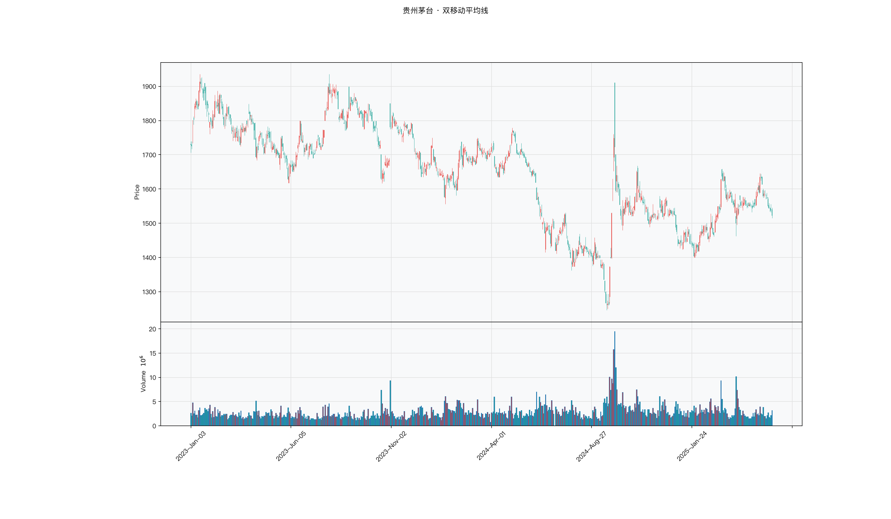

# 第014章 双移动平均线（DMA）

一位交易者把两条均线叠在图上，金叉买、死叉卖，交易记录越拉越长，手续费和止损磨掉了大半利润。他把交叉点逐个标出来，发现有些金叉发生时两条线只差一点，有些则拉得很开。同样是金叉，后面的走势也不一样。他想知道，两条线之间的距离本身有没有信息，而不只是谁在上谁在下。双移动平均线要回答的，就是这段距离能否被单独读数。

## 名称与来历

双移动平均线（Dual Moving Average，DMA），也叫平行线差指标。

它没有单一的发明者。两条不同周期均线的比较，是移动平均应用中最自然的一步，二十世纪中后期已在实务中被广泛使用。DMA 把这种比较固定成一条独立的曲线：用短期均线减去长期均线，把两条线之间的距离变化单独画出来。相比盯着两条均线各自的方向，这条差值线更直接地回答了一个问题：短期的动能，此刻比长期强还是弱。

## 核心逻辑

短期的力量此刻比长期更强，还是更弱？这个问题不用去猜均线各自的走向，只要看两条均线之间的距离就够了。

DMA 的做法就是把这个距离画成一条曲线。短期均线在长期均线之上，差值为正，说明近期买入的平均成本已经高于较长期的平均成本，短期动能占优；差值持为正并且不断扩大，说明短期动能的优势还在增强。反过来，短期均线跌到长期均线之下，差值为负，说明短期动能转弱。差值线穿过零轴的那一刻，正是多空动能完成转换的位置。

与单一均线相比，差值线有两个好处。它的转折点往往比价格和均线更早出现，因为它是两条均线的相对位置，对变化更敏感；它的正负与斜率直接对应动能的强弱与增减，判断起来比"均线向上但价格在下方"这类情形更清晰。代价是它同样继承了两条均线的滞后，在震荡市中差值线会频繁穿越零轴。差值线的量纲与价格相同，这也是一个使用限制：不同标的的价格水平不同，差值的绝对值无法直接横向比较，通常需要把差值除以长期均线，转成相对比例。

## 计算公式

DMA 由两条均线及其差值构成，默认两条均线都取简单移动平均。第一步与第二步分别计算短期均线（DMA 线）与长期均线（AMA 线），第三步做差。

### 短期均线

$$\mathrm{DMAline}_t = \mathrm{SMA}_t^{(n_1)} = \frac{1}{n_1}\sum_{i=0}^{n_1-1} p_{t-i}$$

$n_1$ 为短期周期，常用 10 日。

### 长期均线

$$\mathrm{AMAline}_t = \mathrm{SMA}_t^{(n_2)} = \frac{1}{n_2}\sum_{i=0}^{n_2-1} p_{t-i}$$

$n_2$ 为长期周期，常用 50 日，且满足 $n_2 > n_1$，确保长期窗口覆盖短期窗口。

### 差值线

$$\mathrm{DMA}_t = \mathrm{DMAline}_t - \mathrm{AMAline}_t$$

差值线可正可负，量纲与价格相同。

**参数含义。**

| 参数 | 含义 | 常见取值 | 影响 |
|---|---|---|---|
| $n_1$ | 短期周期 | 10 | 越小越灵敏，假信号越多 |
| $n_2$ | 长期周期 | 50 | 越大越稳定，信号越滞后 |
| $n_2 - n_1$ | 周期差距 | 30 至 60 | 差距过小，差值频繁穿越零轴；过大，信号滞后 |

**计算示例。** 假设 10 日 SMA 为 15.0 元，50 日 SMA 为 12.0 元。

$$\mathrm{DMA} = 15.0 - 12.0 = 3.0 \text{ 元}$$

差值为正，短期动能强于长期。次日 10 日 SMA 升至 15.5 元，50 日 SMA 升至 12.2 元：

$$\mathrm{DMA}' = 15.5 - 12.2 = 3.3 \text{ 元}$$

差值扩大，说明多头动能仍在增强。若某日短期均线回落至 11.8 元而长期均线为 12.0 元，差值转为负值，动能发生反向转换。

### 参数与灵敏度

DMA 的特点是参数成对出现，短期周期与长期周期的组合共同决定差值线的行为。真正影响信号的，往往是两者的差距而非各自的绝对值。下表给出常见的组合取向。

| 应用场景 | 短期周期 | 长期周期 | 周期差距 |
|---|---|---|---|
| 短线交易 | 10 | 50 | 40 |
| 波段交易 | 20 | 60 | 40 |
| 长线投资 | 30 | 120 | 90 |
| 高波动品种 | 8 | 40 | 32 |
| 低波动品种 | 15 | 75 | 60 |

周期差距过小，差值线会在零轴附近频繁穿越，信号碎片化；差距过大，信号则明显滞后。选择时应先确定交易周期，再让差距与之匹配。

### 与单条均线的对照

同样是判断方向，单条均线用价格与均线的关系，DMA 用两条均线之间的关系。两者的差别在于信息源。

| 方式 | 判断依据 | 优点 | 局限 |
|---|---|---|---|
| 单条均线 | 价格相对均线的位置 | 直观，便于画图 | 位置受价格波动干扰 |
| DMA | 两条均线的相对位置 | 直接度量动能差 | 同样带均线滞后 |

DMA 把价格的短期波动通过两条均线过滤掉一部分，剩下的是相对更平滑的动能信号。这也是它在趋势行情中不容易被单日噪声触发的原因。

## 用法与信号

**差值的正负。** 差值为正时，短期均线高于长期均线，市场偏多头，差值持续为正可考虑持有多头；差值为负时，市场偏空头，差值持续为负可考虑空仓或持有空头。正负本身只给出方向，不给出强度。

**差值的变化。** 差值的扩大与收窄反映动能的增减，比单一均线更直观。正差值持续扩大，说明短期动能增强的速度快于长期，趋势在强化，可考虑加仓；正差值持续收窄，说明优势在削弱，需要警惕趋势放缓。负差值的情形对称理解。

**与零轴交叉。** 差值线穿越零轴是 DMA 最核心的转折信号。由负转正，短期动能从弱于长期转为强于长期，趋势可能转多；由正转负，趋势可能转空。有效的交叉通常要求差值在交叉后持续朝同一方向扩大，而非在零轴附近来回摆动。

**背离。** 价格创新高而差值线未创新高，或价格创新低而差值线未创新低，构成背离，提示现有趋势的动能不足。这类信号适合作为减仓或止盈的参考，单独使用时可靠性有限，通常需要后续的交叉确认。

## 边界与误区

**周期差距设得过小。** 当 $n_2 - n_1$ 很小，例如 5 日与 15 日，两条均线贴得很近，差值线会在零轴附近频繁穿越，一周内可能多次反转，其中多数缺乏意义。经验上周期差距不宜低于 30。

**只看单次交叉，忽视持续性。** 差值线一次穿越零轴并不足以确认趋势。更稳妥的判据是差值在交叉后连续若干期朝同一方向运行，或者差值持续扩大。孤立的一次穿越较容易是噪声。

**用 DMA 做高频日内交易。** DMA 建立在两条均线的差值之上，本身带有滞后，用在分钟级别会因为信号滞后而失去优势。它更适合日线及更长周期。

**以为差值越大趋势越强。** 差值过大往往意味着短期价格过度偏离长期平均，反而可能对应均值回归的压力，而不是趋势的进一步走强。此时结合超买超卖类指标一起判断，比单纯依据差值大小更可靠。

## 它被检验过吗

DMA 把两条均线的距离单独画成一条线，这个形式没有被单独检验。可引用的证据仍来自均线规则族：Brock 等（1992）在道指 1897 至 1986 年的日线上报告过预测力，Sullivan 等（1999）扩大规则空间并校正数据窥探偏差后，显著性大幅下降，Park 与 Irwin（2007）综述 95 项研究的结论是混合的。完整证据链见第 007 章。

规则族检验无法把绩效归因到差值线这一构造，也无法区分 DMA 与 SMA、EMA、WMA、DEMA、ZLEMA、BBI 之间的优劣。差值穿越零轴是否比价格穿越均线更可靠，没有任何可靠检验给出过排序。

这一类的真实失效案例，见第 008 章的「真实案例与失败模式」。

## 代码实现

### R

```r
library(ettr)
library(efactorcraft)
library(efincharts)
library(ggplot2)

BASE <- "https://raw.githubusercontent.com/dengyishuo/quant-technical-analysis/main/data/parquet"

# 取数据：本地有就用本地，没有就下载一次并缓存。
# read.csv 对本地 .gz 会自动解压，所以缓存成 .csv.gz 也能直接读。
load_data <- function(name) {
  local <- file.path("data", "parquet", name)
  if (file.exists(local)) return(local)
  cache <- file.path(tools::R_user_dir("qta", "cache"), name)
  if (!file.exists(cache)) {
    dir.create(dirname(cache), recursive = TRUE, showWarnings = FALSE)
    message("下载 ", name, " ...")
    download.file(paste0(BASE, "/", name), cache, mode = "wb", quiet = TRUE)
  }
  cache
}

read_data <- function(name) {
  d <- read.csv(load_data(name), stringsAsFactors = FALSE)
  if ("date" %in% names(d)) d$date <- as.Date(d$date)
  d
}

# 同一章里多次取用，缓存到内存，避免重复解析
.cache <- new.env(parent = emptyenv())
.blue <- function() {
  if (!exists("b", .cache)) assign("b", read_data("panel_blue_chip.csv"), .cache)
  get("b", .cache)
}
.panel <- function() {
  if (!exists("p", .cache)) {
    p <- read_data("panel_r.csv.gz")
    assign("p", p[p$date >= "2023-01-01" & p$date <= "2025-06-01", ], .cache)
  }
  get("p", .cache)
}
.index <- function() read_data("index_daily.csv")

blue  <- .blue()
panel <- .panel()

# 图的保存路径，顺手建目录，避免读者本地没有 assets/ 时报错
fig_path <- function(ch, name = "indicator_r.png") {
  d <- file.path("assets", "figures", sprintf("ch%03d", ch))
  dir.create(d, recursive = TRUE, showWarnings = FALSE)
  file.path(d, name)
}

# efincharts 要求 xts 且列名带 Adjusted
as_xts <- function(df) {
  x <- xts::xts(df[, c("open", "high", "low", "close", "volume", "adjusted")],
                order.by = df$date)
  colnames(x) <- c("Open", "High", "Low", "Close", "Volume", "Adjusted")
  x
}

maotai <- .blue()[.blue()$code == "600519.SS", ]

# 1. ettr 在长格式面板上追加指标列
maotai <- add_sma(maotai, n = 10)
maotai <- add_sma(maotai, n = 50)

# 2. 基本统计
cols <- setdiff(names(maotai), names(blue))
print(summary(maotai[, cols]))

# 3. K 线 + 成交量 + 均线
ch <- ecandlesticks(as_xts(maotai), show_ma = TRUE, ma_periods = c(20, 60),
                    title = "贵州茅台 · 双移动平均线")
ggsave(fig_path(14), ch$combined_plot, width = 10, height = 6, dpi = 110)
```

### Python

```python
import pathlib
import urllib.request

import pandas as pd
import ettr
import efactorcraft as efc
import efincharts as efc_

# 中文字体：mplfinance 会用 style 里的 rc 覆盖全局设置，必须写进 style
from efincharts import theme
theme.efin_style["rc"] = {
    "font.sans-serif": ["PingFang SC", "Heiti SC", "SimHei"],
    "axes.unicode_minus": False,
    "font.family": "sans-serif",
}

BASE = "https://raw.githubusercontent.com/dengyishuo/quant-technical-analysis/main/data/parquet"
CACHE = pathlib.Path.home() / ".cache" / "qta"
_MEM = {}


def load(name):
    """取数据：本地有就用本地，没有就下载一次并缓存。

    这样三种情形都能跑：
      1. 克隆了整个仓库    -> 直接读 data/parquet/，不联网
      2. 只复制了代码片段  -> 首次自动下载到 ~/.cache/qta，之后走缓存
      3. 之前跑过          -> 全部命中缓存，断网也能用
    """
    if name in _MEM:
        return _MEM[name]
    local = pathlib.Path("data/parquet") / name
    if local.exists():
        path = local
    else:
        CACHE.mkdir(parents=True, exist_ok=True)
        path = CACHE / name
        if not path.exists():
            print("下载 %s ..." % name)
            urllib.request.urlretrieve(BASE + "/" + name, path)
    data = pd.read_parquet(path) if name.endswith(".parquet") else pd.read_csv(path)
    _MEM[name] = data
    return data


blue = load("panel_blue_chip.parquet")
panel = load("panel.parquet")
panel = panel[(panel["date"] >= "2023-01-01") & (panel["date"] <= "2025-06-01")]
idx = load("index_daily.parquet")


def one(df, code="600519.SS"):
    """取单只标的，转成 efincharts 需要的宽表。"""
    x = df[df["code"] == code].sort_values("date").set_index("date")
    x.columns = [c.capitalize() for c in x.columns]
    return x


def fig_path(ch, name="indicator.png"):
    """图的保存路径，顺手建目录，避免读者本地没有 assets/ 时报错。"""
    d = pathlib.Path("assets") / "figures" / ("ch%03d" % ch)
    d.mkdir(parents=True, exist_ok=True)
    return str(d / name)

# 1. 取单只标的
maotai = blue[blue['code'] == '600519.SS'].copy()

# 2. ettr 在长格式面板上追加指标列，不需要手工 rolling
maotai = ettr.sma(maotai, n=[10, 50])

cols = [c for c in maotai.columns if c not in blue.columns]
print(maotai[cols].describe().round(3))

# 3. 画图：K 线 + 成交量 + 指标面板
px = one(maotai)
ch = efc_.candlestick(px, volume=True, title="贵州茅台 · 双移动平均线")
ch.save(fig_path(14))
```

<!-- fig-indicator:start -->


<p class="figcap">图 14-1　双移动平均线在贵州茅台上的读数（2023-01 至 2025-06）</p>
<!-- fig-indicator:end -->

## 拆解

DMA 的差值线与价格同量纲，直接横向比较等于按股价水平排序。它有两个天然维度，位置与变化，拆解时还可以再加上一个历史分位。

| 特征名 | 计算式 | 量纲 | 经济含义 |
|--------|--------|------|----------|
| 绝对差值 | $\mathrm{SMA}_t^{(10)} - \mathrm{SMA}_t^{(50)}$ | 元 | 短期与长期成本的距离 |
| 相对差值 | $\mathrm{SMA}_t^{(10)} / \mathrm{SMA}_t^{(50)} - 1$ | 无量纲比例 | 距离相对长期成本的比例 |
| 差值斜率 | $(\mathrm{DMA}_t - \mathrm{DMA}_{t-5}) / \mathrm{SMA}_t^{(50)}$ | 无量纲比例 | 动能优势的扩张或收缩速度 |
| 差值分位 | $\mathrm{DMA}_t$ 在过去 250 日中的分位 | 零到一 | 当前差值在自身历史中的位置 |

绝对差与相对差的区别不只是量纲。绝对差除以收盘价，与除以长期均线，只差一个接近一的因子，排序差异通常不大，但含义不同：前者是占市价的比例，后者是占长期成本的比例。真正不可比的是原始差值，一只三十元的股票与一只三百元的股票，差值三元的意义完全不同。

差值斜率把位置与变化分开。差值高而斜率为负，是强弩之末；差值低而斜率为正，是弱势修复。两者交叉分类比单看差值更有信息，这也是后面检验要同时保留两个维度的原因。

差值分位解决尺度问题。不同标的的差值波动幅度不同，用自身历史分位可以把三元与三角放到同一把尺子上。它依赖窗口长度，窗口内均值漂移会让分位失真，窗口过短则分位跳变频繁。

还有一处容易混淆。差值的正负是方向信息，差值的大小是强度信息，两者的含义不同。正值过大往往意味着短期价格过度偏离长期平均，可能转为反转信号。零轴附近的差值方向不稳，排序噪声最大。

### R

```r
library(ettr)
library(efactorcraft)
library(efincharts)
library(ggplot2)

BASE <- "https://raw.githubusercontent.com/dengyishuo/quant-technical-analysis/main/data/parquet"

# 取数据：本地有就用本地，没有就下载一次并缓存。
# read.csv 对本地 .gz 会自动解压，所以缓存成 .csv.gz 也能直接读。
load_data <- function(name) {
  local <- file.path("data", "parquet", name)
  if (file.exists(local)) return(local)
  cache <- file.path(tools::R_user_dir("qta", "cache"), name)
  if (!file.exists(cache)) {
    dir.create(dirname(cache), recursive = TRUE, showWarnings = FALSE)
    message("下载 ", name, " ...")
    download.file(paste0(BASE, "/", name), cache, mode = "wb", quiet = TRUE)
  }
  cache
}

read_data <- function(name) {
  d <- read.csv(load_data(name), stringsAsFactors = FALSE)
  if ("date" %in% names(d)) d$date <- as.Date(d$date)
  d
}

# 同一章里多次取用，缓存到内存，避免重复解析
.cache <- new.env(parent = emptyenv())
.blue <- function() {
  if (!exists("b", .cache)) assign("b", read_data("panel_blue_chip.csv"), .cache)
  get("b", .cache)
}
.panel <- function() {
  if (!exists("p", .cache)) {
    p <- read_data("panel_r.csv.gz")
    assign("p", p[p$date >= "2023-01-01" & p$date <= "2025-06-01", ], .cache)
  }
  get("p", .cache)
}
.index <- function() read_data("index_daily.csv")

blue  <- .blue()
panel <- .panel()

# 图的保存路径，顺手建目录，避免读者本地没有 assets/ 时报错
fig_path <- function(ch, name = "indicator_r.png") {
  d <- file.path("assets", "figures", sprintf("ch%03d", ch))
  dir.create(d, recursive = TRUE, showWarnings = FALSE)
  file.path(d, name)
}

# efincharts 要求 xts 且列名带 Adjusted
as_xts <- function(df) {
  x <- xts::xts(df[, c("open", "high", "low", "close", "volume", "adjusted")],
                order.by = df$date)
  colnames(x) <- c("Open", "High", "Low", "Close", "Volume", "Adjusted")
  x
}

d <- .blue()[.blue()$code == "600519.SS", ]
d <- add_sma(d, n = 10)
d <- add_sma(d, n = 50)

d$DMA <- d$SMA_10 - d$SMA_50
# 转成无量纲因子
d$f <- d$`DMA` / d$close

print(summary(d$f))
```

### Python

```python
import pathlib
import urllib.request

import pandas as pd
import ettr
import efactorcraft as efc
import efincharts as efc_

# 中文字体：mplfinance 会用 style 里的 rc 覆盖全局设置，必须写进 style
from efincharts import theme
theme.efin_style["rc"] = {
    "font.sans-serif": ["PingFang SC", "Heiti SC", "SimHei"],
    "axes.unicode_minus": False,
    "font.family": "sans-serif",
}

BASE = "https://raw.githubusercontent.com/dengyishuo/quant-technical-analysis/main/data/parquet"
CACHE = pathlib.Path.home() / ".cache" / "qta"
_MEM = {}


def load(name):
    """取数据：本地有就用本地，没有就下载一次并缓存。

    这样三种情形都能跑：
      1. 克隆了整个仓库    -> 直接读 data/parquet/，不联网
      2. 只复制了代码片段  -> 首次自动下载到 ~/.cache/qta，之后走缓存
      3. 之前跑过          -> 全部命中缓存，断网也能用
    """
    if name in _MEM:
        return _MEM[name]
    local = pathlib.Path("data/parquet") / name
    if local.exists():
        path = local
    else:
        CACHE.mkdir(parents=True, exist_ok=True)
        path = CACHE / name
        if not path.exists():
            print("下载 %s ..." % name)
            urllib.request.urlretrieve(BASE + "/" + name, path)
    data = pd.read_parquet(path) if name.endswith(".parquet") else pd.read_csv(path)
    _MEM[name] = data
    return data


blue = load("panel_blue_chip.parquet")
panel = load("panel.parquet")
panel = panel[(panel["date"] >= "2023-01-01") & (panel["date"] <= "2025-06-01")]
idx = load("index_daily.parquet")


def one(df, code="600519.SS"):
    """取单只标的，转成 efincharts 需要的宽表。"""
    x = df[df["code"] == code].sort_values("date").set_index("date")
    x.columns = [c.capitalize() for c in x.columns]
    return x


def fig_path(ch, name="indicator.png"):
    """图的保存路径，顺手建目录，避免读者本地没有 assets/ 时报错。"""
    d = pathlib.Path("assets") / "figures" / ("ch%03d" % ch)
    d.mkdir(parents=True, exist_ok=True)
    return str(d / name)

# 1. 先在面板上算原始指标
d = panel.copy()
d = ettr.sma(d, n=[10, 50])

d["DMA"] = d["SMA_10"] - d["SMA_50"]
# 2. 转成无量纲因子，才能跨标的排序
d["f"] = d["DMA"] / d.close

print(d["f"].describe().round(4))
```

## 截面选股能力

最常用的构造是相对差值，

$$f^{rel}_t = \frac{\mathrm{SMA}_t^{(10)}}{\mathrm{SMA}_t^{(50)}} - 1$$

另一个候选是差值的历史分位，

$$f^{pct}_t = \mathrm{rank}_{250}\left(\mathrm{DMA}_t\right)$$

前者度量短期相对长期的位置，符号方向明确，正为多头。后者把差值放到自身历史中比较，适合波动幅度差异较大的横截面。预期方向都偏正，但相对差值在极端处可能转为反转，分层收益因此未必单调。IC 是线性秩相关，会低估这种非单调关系，所以分层回测不能省。

检验有三点。第一，绝对差与相对差各算一遍，比较 ICIR 与 IC 标准差。绝对差在某些时段可能更稳，因为它保留了价格水平的差异，但这种稳定性往往来自市值结构，需要与规模因子对照。第二，检查分层是否单调。若最高一组的收益低于次高组，说明存在反转段，此时更合适的做法是用符号筛选方向，而不是按差值大小排序。第三，周期差距决定差值分布，十与五十只是惯例，换一组参数结论可能变化。

### R

```r
library(ettr)
library(efactorcraft)
library(efincharts)
library(ggplot2)

BASE <- "https://raw.githubusercontent.com/dengyishuo/quant-technical-analysis/main/data/parquet"

# 取数据：本地有就用本地，没有就下载一次并缓存。
# read.csv 对本地 .gz 会自动解压，所以缓存成 .csv.gz 也能直接读。
load_data <- function(name) {
  local <- file.path("data", "parquet", name)
  if (file.exists(local)) return(local)
  cache <- file.path(tools::R_user_dir("qta", "cache"), name)
  if (!file.exists(cache)) {
    dir.create(dirname(cache), recursive = TRUE, showWarnings = FALSE)
    message("下载 ", name, " ...")
    download.file(paste0(BASE, "/", name), cache, mode = "wb", quiet = TRUE)
  }
  cache
}

read_data <- function(name) {
  d <- read.csv(load_data(name), stringsAsFactors = FALSE)
  if ("date" %in% names(d)) d$date <- as.Date(d$date)
  d
}

# 同一章里多次取用，缓存到内存，避免重复解析
.cache <- new.env(parent = emptyenv())
.blue <- function() {
  if (!exists("b", .cache)) assign("b", read_data("panel_blue_chip.csv"), .cache)
  get("b", .cache)
}
.panel <- function() {
  if (!exists("p", .cache)) {
    p <- read_data("panel_r.csv.gz")
    assign("p", p[p$date >= "2023-01-01" & p$date <= "2025-06-01", ], .cache)
  }
  get("p", .cache)
}
.index <- function() read_data("index_daily.csv")

blue  <- .blue()
panel <- .panel()

# 图的保存路径，顺手建目录，避免读者本地没有 assets/ 时报错
fig_path <- function(ch, name = "indicator_r.png") {
  d <- file.path("assets", "figures", sprintf("ch%03d", ch))
  dir.create(d, recursive = TRUE, showWarnings = FALSE)
  file.path(d, name)
}

# efincharts 要求 xts 且列名带 Adjusted
as_xts <- function(df) {
  x <- xts::xts(df[, c("open", "high", "low", "close", "volume", "adjusted")],
                order.by = df$date)
  colnames(x) <- c("Open", "High", "Low", "Close", "Volume", "Adjusted")
  x
}

d <- .panel()
d <- add_sma(d, n = 10)
d <- add_sma(d, n = 50)
d$DMA <- d$SMA_10 - d$SMA_50

d$f <- d$`DMA` / d$close
d <- add_next_return(d, close_col = "close", n = c(1, 5, 20))

ic <- ic_analysis(d, factor_cols = "f",
                    forward_cols = c("forward_1", "forward_5", "forward_20"),
                    method = "spearman")
print(ir_analysis(ic))

q <- quantile_analysis(d, factor_cols = "f", forward_cols = "forward_5",
                       n_groups = 5)
print(q$f$summary)
```

### Python

```python
import pathlib
import urllib.request

import pandas as pd
import ettr
import efactorcraft as efc
import efincharts as efc_

# 中文字体：mplfinance 会用 style 里的 rc 覆盖全局设置，必须写进 style
from efincharts import theme
theme.efin_style["rc"] = {
    "font.sans-serif": ["PingFang SC", "Heiti SC", "SimHei"],
    "axes.unicode_minus": False,
    "font.family": "sans-serif",
}

BASE = "https://raw.githubusercontent.com/dengyishuo/quant-technical-analysis/main/data/parquet"
CACHE = pathlib.Path.home() / ".cache" / "qta"
_MEM = {}


def load(name):
    """取数据：本地有就用本地，没有就下载一次并缓存。

    这样三种情形都能跑：
      1. 克隆了整个仓库    -> 直接读 data/parquet/，不联网
      2. 只复制了代码片段  -> 首次自动下载到 ~/.cache/qta，之后走缓存
      3. 之前跑过          -> 全部命中缓存，断网也能用
    """
    if name in _MEM:
        return _MEM[name]
    local = pathlib.Path("data/parquet") / name
    if local.exists():
        path = local
    else:
        CACHE.mkdir(parents=True, exist_ok=True)
        path = CACHE / name
        if not path.exists():
            print("下载 %s ..." % name)
            urllib.request.urlretrieve(BASE + "/" + name, path)
    data = pd.read_parquet(path) if name.endswith(".parquet") else pd.read_csv(path)
    _MEM[name] = data
    return data


blue = load("panel_blue_chip.parquet")
panel = load("panel.parquet")
panel = panel[(panel["date"] >= "2023-01-01") & (panel["date"] <= "2025-06-01")]
idx = load("index_daily.parquet")


def one(df, code="600519.SS"):
    """取单只标的，转成 efincharts 需要的宽表。"""
    x = df[df["code"] == code].sort_values("date").set_index("date")
    x.columns = [c.capitalize() for c in x.columns]
    return x


def fig_path(ch, name="indicator.png"):
    """图的保存路径，顺手建目录，避免读者本地没有 assets/ 时报错。"""
    d = pathlib.Path("assets") / "figures" / ("ch%03d" % ch)
    d.mkdir(parents=True, exist_ok=True)
    return str(d / name)

# 287 只、2023-01 至 2025-06，横截面才有统计意义
src = panel.copy()
d = src.copy()

# 1. 算指标
d = ettr.sma(d, n=[10, 50])

d["DMA"] = d["SMA_10"] - d["SMA_50"]

# 2. 因子 + 未来收益
d["f"] = d["DMA"] / d.close
d = efc.add_next_return(d, periods=(1, 5, 20))

# 3. 截面 IC 与分层
ic = efc.ic_analysis(d, factor_cols="f",
                      forward_cols=["forward_1", "forward_5", "forward_20"],
                      method="spearman")
print(efc.ir_analysis(ic).round(3))

q = efc.quantile_analysis(d, factor_col="f", forward_col="forward_5", n_groups=5)
print(q["summary"].round(4))
```

<!-- tab-ic:start -->
**计算结果**

| 前向期 | IC 均值 | IC 标准差 | ICIR | t 值 | IC>0 占比 | 期数 |
|---|---|---|---|---|---|---|
| T+1 | -0.0135 | 0.2575 | -0.052 | -1.21 | 0.4610 | 531 |
| T+5 | -0.0367 | 0.2379 | -0.154 | -3.54 | 0.4290 | 527 |
| T+20 | -0.0749 | 0.2081 | -0.360 | -8.15 | 0.3460 | 512 |

表里最该看的是 t 值，不是 IC 均值。这个因子以 T+1 为主口径，IC 均值 -0.0135、ICIR -0.052、t 值 -1.21，在常规门槛下不显著，方向为反向。按第 007 章给出的日频门槛（ICIR 0.13 对应 t≈2），这个结果的含义是：还看不出与噪声的区别，不能据此构造策略。

需要提醒的是，这只说明排序与未来收益之间存在可测的关联，不代表扣掉成本后还能剩下收益。横截面 IC 检验的是“买哪只”，不负责“值不值得交易”。

**五档分层**

| 分组 | 平均收益 | 标准差 | 期数 |
|---|---|---|---|
| 1 | +0.0046 | +0.0429 | 527 |
| 2 | +0.0038 | +0.0342 | 527 |
| 3 | +0.0029 | +0.0303 | 527 |
| 4 | +0.0020 | +0.0299 | 527 |
| 5 | +0.0022 | +0.0425 | 527 |

五档分层看的是形状，不是单点。最高一档在第 1 组、最低在第 4 组，两端相差 -0.24%，组序号与平均收益的秩相关为 -0.95，接近单调。

分层比 IC 更接近实盘，因为它直接给出“买最高档、卖最低档”的收益差。但这里的数字是毛收益，且没有考虑涨跌停买不进、停牌卖不出的情形，真实可得的差额会小于表中所列。
<!-- tab-ic:end -->

## 择时能力

DMA 的时序信号分三层：零轴穿越、差值分位、差值斜率。穿越是转折信号，由负转正说明短期动能超过长期；分位是状态信号，回答当前的动能优势在自身历史中处在什么位置；斜率是变化信号，回答优势在扩大还是收缩。

方法与信号形态对应。零轴穿越是离散事件，适合触发日检验，但要同时统计穿越次数，震荡市中一年可能出现十几次，平均收益会被成本抵消。分位与斜率是连续变量，适合条件分位收益。最后做一次回测，把相对差值高于阈值作为持仓条件，与买入持有对照。

选择这三条路径，是因为 DMA 同时提供状态与转折两类信息，单看一类会漏掉另一半。只看穿越，会忽视差值持续为正的持仓价值；只看分位，会错过动能转换的时点。

三个陷阱。周期差距过小，差值在零轴附近反复穿越，信号碎片化。差值的大小被当作强度，忽略了极端值可能对应反转。回测不计成本，穿越频次高时名义收益与实际收益差距明显。

### R

```r
library(ettr)
library(efactorcraft)
library(efincharts)
library(ggplot2)

BASE <- "https://raw.githubusercontent.com/dengyishuo/quant-technical-analysis/main/data/parquet"

# 取数据：本地有就用本地，没有就下载一次并缓存。
# read.csv 对本地 .gz 会自动解压，所以缓存成 .csv.gz 也能直接读。
load_data <- function(name) {
  local <- file.path("data", "parquet", name)
  if (file.exists(local)) return(local)
  cache <- file.path(tools::R_user_dir("qta", "cache"), name)
  if (!file.exists(cache)) {
    dir.create(dirname(cache), recursive = TRUE, showWarnings = FALSE)
    message("下载 ", name, " ...")
    download.file(paste0(BASE, "/", name), cache, mode = "wb", quiet = TRUE)
  }
  cache
}

read_data <- function(name) {
  d <- read.csv(load_data(name), stringsAsFactors = FALSE)
  if ("date" %in% names(d)) d$date <- as.Date(d$date)
  d
}

# 同一章里多次取用，缓存到内存，避免重复解析
.cache <- new.env(parent = emptyenv())
.blue <- function() {
  if (!exists("b", .cache)) assign("b", read_data("panel_blue_chip.csv"), .cache)
  get("b", .cache)
}
.panel <- function() {
  if (!exists("p", .cache)) {
    p <- read_data("panel_r.csv.gz")
    assign("p", p[p$date >= "2023-01-01" & p$date <= "2025-06-01", ], .cache)
  }
  get("p", .cache)
}
.index <- function() read_data("index_daily.csv")

blue  <- .blue()
panel <- .panel()

# 图的保存路径，顺手建目录，避免读者本地没有 assets/ 时报错
fig_path <- function(ch, name = "indicator_r.png") {
  d <- file.path("assets", "figures", sprintf("ch%03d", ch))
  dir.create(d, recursive = TRUE, showWarnings = FALSE)
  file.path(d, name)
}

# efincharts 要求 xts 且列名带 Adjusted
as_xts <- function(df) {
  x <- xts::xts(df[, c("open", "high", "low", "close", "volume", "adjusted")],
                order.by = df$date)
  colnames(x) <- c("Open", "High", "Low", "Close", "Volume", "Adjusted")
  x
}

t <- .index()
t <- t[t$code == "510300.SS", ]
t <- add_sma(t, n = 10)
t <- add_sma(t, n = 50)
t$DMA <- t$SMA_10 - t$SMA_50
t$f <- t$`DMA` / t$close
t$forward_5 <- c(tail(t$close, -5) / head(t$close, -5) - 1, rep(NA, 5))
t$q <- cut(t$f, quantile(t$f, 0:5/5, na.rm = TRUE), include.lowest = TRUE, labels = FALSE)
print(aggregate(forward_5 ~ q, data = t, FUN = function(x)
  c(mean = mean(x, na.rm = TRUE), n = sum(!is.na(x)))))
```

### Python

```python
import pathlib
import urllib.request

import pandas as pd
import ettr
import efactorcraft as efc
import efincharts as efc_

# 中文字体：mplfinance 会用 style 里的 rc 覆盖全局设置，必须写进 style
from efincharts import theme
theme.efin_style["rc"] = {
    "font.sans-serif": ["PingFang SC", "Heiti SC", "SimHei"],
    "axes.unicode_minus": False,
    "font.family": "sans-serif",
}

BASE = "https://raw.githubusercontent.com/dengyishuo/quant-technical-analysis/main/data/parquet"
CACHE = pathlib.Path.home() / ".cache" / "qta"
_MEM = {}


def load(name):
    """取数据：本地有就用本地，没有就下载一次并缓存。

    这样三种情形都能跑：
      1. 克隆了整个仓库    -> 直接读 data/parquet/，不联网
      2. 只复制了代码片段  -> 首次自动下载到 ~/.cache/qta，之后走缓存
      3. 之前跑过          -> 全部命中缓存，断网也能用
    """
    if name in _MEM:
        return _MEM[name]
    local = pathlib.Path("data/parquet") / name
    if local.exists():
        path = local
    else:
        CACHE.mkdir(parents=True, exist_ok=True)
        path = CACHE / name
        if not path.exists():
            print("下载 %s ..." % name)
            urllib.request.urlretrieve(BASE + "/" + name, path)
    data = pd.read_parquet(path) if name.endswith(".parquet") else pd.read_csv(path)
    _MEM[name] = data
    return data


blue = load("panel_blue_chip.parquet")
panel = load("panel.parquet")
panel = panel[(panel["date"] >= "2023-01-01") & (panel["date"] <= "2025-06-01")]
idx = load("index_daily.parquet")


def one(df, code="600519.SS"):
    """取单只标的，转成 efincharts 需要的宽表。"""
    x = df[df["code"] == code].sort_values("date").set_index("date")
    x.columns = [c.capitalize() for c in x.columns]
    return x


def fig_path(ch, name="indicator.png"):
    """图的保存路径，顺手建目录，避免读者本地没有 assets/ 时报错。"""
    d = pathlib.Path("assets") / "figures" / ("ch%03d" % ch)
    d.mkdir(parents=True, exist_ok=True)
    return str(d / name)

# 择时检验用 ETF 做市场载体，指数本身没有日线数据
t = idx[idx["code"] == "510300.SS"].sort_values("date").copy()

# 1. 在 ETF 上算同一个指标
t = ettr.sma(d, n=[10, 50])

t["DMA"] = t["SMA_10"] - t["SMA_50"]

# 2. 按因子分位看未来 5 日收益
t["f"] = t["DMA"] / t.close
t["forward_5"] = t["close"].shift(-5) / t["close"] - 1
# 因子可能有重复值，先按名次切，避免 qcut 报边界不唯一
t["q"] = pd.qcut(t["f"].rank(method="first"), 5, labels=False) + 1
t = t.dropna(subset=["f", "forward_5"])
print(t.groupby("q")["forward_5"].agg(["mean", "count"]).round(4))
```

<!-- tab-timing:start -->
**分位收益**

| 分位 | 未来 5 日均值 | 样本数 |
|---|---|---|
| 1 | +0.0025 | 213 |
| 2 | -0.0017 | 212 |
| 3 | +0.0002 | 212 |
| 4 | -0.0007 | 212 |
| 5 | -0.0000 | 212 |

择时口径与截面不同：这里只有一个标的，看的是同一标的在不同分位下的未来收益。最高与最低分位相差 -0.25%。单标的样本有限，这个差额很容易被一两段行情主导，只能作为方向参考。

真正做择时要问的是三件事：分位阈值是否稳定、换手是否可控、扣成本后是否还有剩余。三者缺一，择时信号就只是图上好看。
<!-- tab-timing:end -->

## 组合使用与验证

DMA 的搭档有三个。与 MACD 搭配，两者同源，差离值就是快慢 EMA 之差，与差值线的相关性通常很高，适合互为验证而不适合叠加。与 ADX 搭配，补的是市况前提，过滤零轴附近的反复穿越。与成交量搭配，补的是参与度。

**组合的截面验证。** 相对差值与量比因子的相关性通常不高，加权组合有增量空间：用 combined_signal 生成综合分数，比较组合与两个单特征的 ICIR。与 MACD 的组合则宜作负面对照，两者的输入几乎相同，组合的 ICIR 通常落在两者之间，说明只是平均。

**组合的择时验证。** 把规则写成仓位条件，例如"相对差值为正且差值斜率大于零"时持仓，否则空仓，也可加上"差值连续三日扩大"作为确认。计算年化收益、夏普与最大回撤，再与单条件对照。叠加确认的作用通常在减少穿越次数与回撤，收益未必提高。

判读依据方法论章：组合的 ICIR 高于两个单特征，说明存在互补；介于两者之间，说明只是平均；低于两者，说明信号冲突。相关高时组合很难带来增量，DMA 与 MACD 属于这一类，与量比因子则不然。

### R

```r
library(ettr)
library(efactorcraft)
library(efincharts)
library(ggplot2)

BASE <- "https://raw.githubusercontent.com/dengyishuo/quant-technical-analysis/main/data/parquet"

# 取数据：本地有就用本地，没有就下载一次并缓存。
# read.csv 对本地 .gz 会自动解压，所以缓存成 .csv.gz 也能直接读。
load_data <- function(name) {
  local <- file.path("data", "parquet", name)
  if (file.exists(local)) return(local)
  cache <- file.path(tools::R_user_dir("qta", "cache"), name)
  if (!file.exists(cache)) {
    dir.create(dirname(cache), recursive = TRUE, showWarnings = FALSE)
    message("下载 ", name, " ...")
    download.file(paste0(BASE, "/", name), cache, mode = "wb", quiet = TRUE)
  }
  cache
}

read_data <- function(name) {
  d <- read.csv(load_data(name), stringsAsFactors = FALSE)
  if ("date" %in% names(d)) d$date <- as.Date(d$date)
  d
}

# 同一章里多次取用，缓存到内存，避免重复解析
.cache <- new.env(parent = emptyenv())
.blue <- function() {
  if (!exists("b", .cache)) assign("b", read_data("panel_blue_chip.csv"), .cache)
  get("b", .cache)
}
.panel <- function() {
  if (!exists("p", .cache)) {
    p <- read_data("panel_r.csv.gz")
    assign("p", p[p$date >= "2023-01-01" & p$date <= "2025-06-01", ], .cache)
  }
  get("p", .cache)
}
.index <- function() read_data("index_daily.csv")

blue  <- .blue()
panel <- .panel()

# 图的保存路径，顺手建目录，避免读者本地没有 assets/ 时报错
fig_path <- function(ch, name = "indicator_r.png") {
  d <- file.path("assets", "figures", sprintf("ch%03d", ch))
  dir.create(d, recursive = TRUE, showWarnings = FALSE)
  file.path(d, name)
}

# efincharts 要求 xts 且列名带 Adjusted
as_xts <- function(df) {
  x <- xts::xts(df[, c("open", "high", "low", "close", "volume", "adjusted")],
                order.by = df$date)
  colnames(x) <- c("Open", "High", "Low", "Close", "Volume", "Adjusted")
  x
}

d <- .panel()
d <- add_sma(d, n = 10)
d <- add_sma(d, n = 50)
d$DMA <- d$SMA_10 - d$SMA_50
d$f1 <- d$`DMA` / d$close
d <- add_cmf(d, n = 20)
d$f2 <- d$CMF
d <- add_next_return(d, close_col = "close", n = 5)
ic1 <- ic_analysis(d, factor_cols = c("f1", "f2"),
                    forward_cols = "forward_5", method = "spearman")
print(ir_analysis(ic1))
```

```r
library(ettr)
library(efactorcraft)
library(efincharts)
library(ggplot2)

BASE <- "https://raw.githubusercontent.com/dengyishuo/quant-technical-analysis/main/data/parquet"

# 取数据：本地有就用本地，没有就下载一次并缓存。
# read.csv 对本地 .gz 会自动解压，所以缓存成 .csv.gz 也能直接读。
load_data <- function(name) {
  local <- file.path("data", "parquet", name)
  if (file.exists(local)) return(local)
  cache <- file.path(tools::R_user_dir("qta", "cache"), name)
  if (!file.exists(cache)) {
    dir.create(dirname(cache), recursive = TRUE, showWarnings = FALSE)
    message("下载 ", name, " ...")
    download.file(paste0(BASE, "/", name), cache, mode = "wb", quiet = TRUE)
  }
  cache
}

read_data <- function(name) {
  d <- read.csv(load_data(name), stringsAsFactors = FALSE)
  if ("date" %in% names(d)) d$date <- as.Date(d$date)
  d
}

# 同一章里多次取用，缓存到内存，避免重复解析
.cache <- new.env(parent = emptyenv())
.blue <- function() {
  if (!exists("b", .cache)) assign("b", read_data("panel_blue_chip.csv"), .cache)
  get("b", .cache)
}
.panel <- function() {
  if (!exists("p", .cache)) {
    p <- read_data("panel_r.csv.gz")
    assign("p", p[p$date >= "2023-01-01" & p$date <= "2025-06-01", ], .cache)
  }
  get("p", .cache)
}
.index <- function() read_data("index_daily.csv")

blue  <- .blue()
panel <- .panel()

# 图的保存路径，顺手建目录，避免读者本地没有 assets/ 时报错
fig_path <- function(ch, name = "indicator_r.png") {
  d <- file.path("assets", "figures", sprintf("ch%03d", ch))
  dir.create(d, recursive = TRUE, showWarnings = FALSE)
  file.path(d, name)
}

# efincharts 要求 xts 且列名带 Adjusted
as_xts <- function(df) {
  x <- xts::xts(df[, c("open", "high", "low", "close", "volume", "adjusted")],
                order.by = df$date)
  colnames(x) <- c("Open", "High", "Low", "Close", "Volume", "Adjusted")
  x
}

d <- .panel()
d <- add_sma(d, n = 10)
d <- add_sma(d, n = 50)
d$DMA <- d$SMA_10 - d$SMA_50
d$f1 <- d$`DMA` / d$close
d <- add_cmf(d, n = 20)
d$f2 <- d$CMF
d <- add_next_return(d, close_col = "close", n = 5)
ic1 <- ic_analysis(d, factor_cols = c("f1", "f2"),
                    forward_cols = "forward_5", method = "spearman")
print(ir_analysis(ic1))
```

### Python

```python
import pathlib
import urllib.request

import pandas as pd
import ettr
import efactorcraft as efc
import efincharts as efc_

# 中文字体：mplfinance 会用 style 里的 rc 覆盖全局设置，必须写进 style
from efincharts import theme
theme.efin_style["rc"] = {
    "font.sans-serif": ["PingFang SC", "Heiti SC", "SimHei"],
    "axes.unicode_minus": False,
    "font.family": "sans-serif",
}

BASE = "https://raw.githubusercontent.com/dengyishuo/quant-technical-analysis/main/data/parquet"
CACHE = pathlib.Path.home() / ".cache" / "qta"
_MEM = {}


def load(name):
    """取数据：本地有就用本地，没有就下载一次并缓存。

    这样三种情形都能跑：
      1. 克隆了整个仓库    -> 直接读 data/parquet/，不联网
      2. 只复制了代码片段  -> 首次自动下载到 ~/.cache/qta，之后走缓存
      3. 之前跑过          -> 全部命中缓存，断网也能用
    """
    if name in _MEM:
        return _MEM[name]
    local = pathlib.Path("data/parquet") / name
    if local.exists():
        path = local
    else:
        CACHE.mkdir(parents=True, exist_ok=True)
        path = CACHE / name
        if not path.exists():
            print("下载 %s ..." % name)
            urllib.request.urlretrieve(BASE + "/" + name, path)
    data = pd.read_parquet(path) if name.endswith(".parquet") else pd.read_csv(path)
    _MEM[name] = data
    return data


blue = load("panel_blue_chip.parquet")
panel = load("panel.parquet")
panel = panel[(panel["date"] >= "2023-01-01") & (panel["date"] <= "2025-06-01")]
idx = load("index_daily.parquet")


def one(df, code="600519.SS"):
    """取单只标的，转成 efincharts 需要的宽表。"""
    x = df[df["code"] == code].sort_values("date").set_index("date")
    x.columns = [c.capitalize() for c in x.columns]
    return x


def fig_path(ch, name="indicator.png"):
    """图的保存路径，顺手建目录，避免读者本地没有 assets/ 时报错。"""
    d = pathlib.Path("assets") / "figures" / ("ch%03d" % ch)
    d.mkdir(parents=True, exist_ok=True)
    return str(d / name)

d = panel.copy()

# 1. 本章因子
d = ettr.sma(d, n=[10, 50])
d["DMA"] = d["SMA_10"] - d["SMA_50"]
d["f1"] = d["DMA"] / d.close

# 2. 配一个量价因子做对照
d = ettr.cmf(d, n=20)
d["f2"] = d["CMF_20"]
d = efc.add_next_return(d, periods=(5,))

# 3. 单因子与等权组合的信息比率
ic = efc.ic_analysis(d, factor_cols=["f1", "f2"], forward_cols=["forward_5"],
                      method="spearman")
d = efc.equal_weighted_composite(d, factor_cols=["f1", "f2"], new_col="f1_f2")
ic2 = efc.ic_analysis(d, factor_cols=["f1_f2"], forward_cols=["forward_5"],
                      method="spearman")
ic.update(ic2)
print(efc.ir_analysis(ic).round(3))
```

```python
import pathlib
import urllib.request

import pandas as pd
import ettr
import efactorcraft as efc
import efincharts as efc_

# 中文字体：mplfinance 会用 style 里的 rc 覆盖全局设置，必须写进 style
from efincharts import theme
theme.efin_style["rc"] = {
    "font.sans-serif": ["PingFang SC", "Heiti SC", "SimHei"],
    "axes.unicode_minus": False,
    "font.family": "sans-serif",
}

BASE = "https://raw.githubusercontent.com/dengyishuo/quant-technical-analysis/main/data/parquet"
CACHE = pathlib.Path.home() / ".cache" / "qta"
_MEM = {}


def load(name):
    """取数据：本地有就用本地，没有就下载一次并缓存。

    这样三种情形都能跑：
      1. 克隆了整个仓库    -> 直接读 data/parquet/，不联网
      2. 只复制了代码片段  -> 首次自动下载到 ~/.cache/qta，之后走缓存
      3. 之前跑过          -> 全部命中缓存，断网也能用
    """
    if name in _MEM:
        return _MEM[name]
    local = pathlib.Path("data/parquet") / name
    if local.exists():
        path = local
    else:
        CACHE.mkdir(parents=True, exist_ok=True)
        path = CACHE / name
        if not path.exists():
            print("下载 %s ..." % name)
            urllib.request.urlretrieve(BASE + "/" + name, path)
    data = pd.read_parquet(path) if name.endswith(".parquet") else pd.read_csv(path)
    _MEM[name] = data
    return data


blue = load("panel_blue_chip.parquet")
panel = load("panel.parquet")
panel = panel[(panel["date"] >= "2023-01-01") & (panel["date"] <= "2025-06-01")]
idx = load("index_daily.parquet")


def one(df, code="600519.SS"):
    """取单只标的，转成 efincharts 需要的宽表。"""
    x = df[df["code"] == code].sort_values("date").set_index("date")
    x.columns = [c.capitalize() for c in x.columns]
    return x


def fig_path(ch, name="indicator.png"):
    """图的保存路径，顺手建目录，避免读者本地没有 assets/ 时报错。"""
    d = pathlib.Path("assets") / "figures" / ("ch%03d" % ch)
    d.mkdir(parents=True, exist_ok=True)
    return str(d / name)

d = panel.copy()

# 1. 本章因子
d = ettr.sma(d, n=[10, 50])
d["DMA"] = d["SMA_10"] - d["SMA_50"]
d["f1"] = d["DMA"] / d.close

# 2. 配一个量价因子做对照
d = ettr.cmf(d, n=20)
d["f2"] = d["CMF_20"]
d = efc.add_next_return(d, periods=(5,))

# 3. 单因子与等权组合的信息比率
ic = efc.ic_analysis(d, factor_cols=["f1", "f2"], forward_cols=["forward_5"],
                      method="spearman")
d = efc.equal_weighted_composite(d, factor_cols=["f1", "f2"], new_col="f1_f2")
ic2 = efc.ic_analysis(d, factor_cols=["f1_f2"], forward_cols=["forward_5"],
                      method="spearman")
ic.update(ic2)
print(efc.ir_analysis(ic).round(3))
```

三行输出并排读：组合的 ICIR 落在两者之间，说明 DMA 与量比只是被平均；高于两者，才说明参与度带来了新信息。

## AI 引导词

::: prompt 引导词 1：周期差距的敏感性检验

我在研究双移动平均线（DMA）作为动能因子。请帮我设计一个周期差距的敏感性检验：固定短期周期为 10，长期周期分别取 20、30、50、80、120，在 A 股沪深 300 成分股 2020 至 2024 年的数据上，计算"短期均线相对长期均线偏离度"因子的 IC 均值与 ICIR，并统计每个组合下差值线穿越零轴的次数。请输出一张表格，包含长期周期、IC 均值、ICIR、穿越次数四列，并用文字说明周期差距与因子稳定性之间的关系。请输出可直接运行的 Python 代码。

:::
::: prompt 引导词 2：位置与变化的分解检验

请帮我写一段 Python 代码，把 DMA 因子分解为"位置"和"变化"两个部分分别检验。要求：1）位置部分是短期均线相对长期均线的偏离度；2）变化部分是差值线最近 5 日的斜率；3）分别计算两个部分与未来 5 日收益的 Rank IC 与 ICIR；4）输出对比表格并判断两部分的预测方向是否一致。数据用 yfinance 获取沪深 300 若干成分股，代码需保证可直接运行。

:::
::: prompt 引导词 3：零轴交叉规则的规则化回测

我希望把 DMA 的零轴交叉信号做成可回测的策略。请帮我把"差值线由负转正且连续 3 日扩大时建仓，由正转负时清仓"写成明确规则，包括：1）"连续扩大"的具体判定方式；2）建仓与清仓时点（收盘价确认还是次日开盘执行）；3）换手率与持仓周期的计算；4）A 股回测需要扣除的费率与印花税取值。请给出 R 和 Python 两版实现，并说明如何避免未来函数与幸存者偏差。

:::
