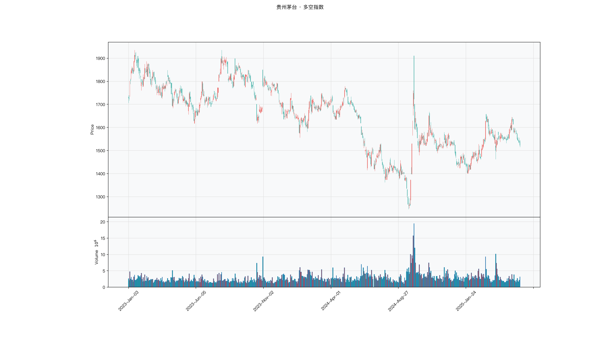

# 第015章 多空指数（BBI）

收盘后，一位交易者把五日、十日、二十日、六十日四条均线并排画在图上，短的两条向上，长的两条还在向下。他盯着屏幕，判断不了这算多头还是空头。四条线各有各的理由，两两之间还能组合出不同的结论。他需要一个能把它们合成一句话的东西。多空指数要回答的，就是多个周期方向不一致时，共识该怎么计算。

## 名称与来历

多空指数（Bull and Bear Index，BBI）。

它没有单一的发明者。把多条均线合成一条综合基准线，是实务中逐步形成的做法，在国内市场被广泛使用并固定为 5、10、20、60 日四个周期的组合。名字里的"多空"点明了用途：用一条线概括短、中、长几个周期里多空力量的整体对比。看一条均线容易片面，看四条又容易眼花，BBI 的价值就在于把多周期的信息压进一条线。

## 核心逻辑

看一条均线容易片面，看四条又容易眼花，有没有办法把多周期信息压缩成一条线？

不同周期的均线各自反映一段时间里的平均成本，5 日看极短期，60 日看中长期。任何一条单独拿出来，结论都可能偏颇：只看 5 日，会被短期噪声带偏；只看 60 日，会错过近期变化。BBI 的做法是把这几条均线做算术平均，得到一条综合线。当短、中、长周期同时向上时，综合线也向上，说明多周期方向一致，趋势相对稳固；当各周期方向相互矛盾时，综合线趋于走平，说明多空力量均衡，市场缺乏明确方向。

这实际上是一种简易的共振度量。它不需要复杂的加权，用平均就把多个周期的信息融合在一起。价格持续站在 BBI 上方，意味着当前价格高于多个周期的平均成本，买盘占据主动；价格持续在下方，则说明卖盘占优。BBI 的平滑程度介于最长与最短的组成均线之间，比单条短均线稳定，比单条长均线灵敏。平均的做法也带来一个副作用：权重被均匀分摊，最长周期的均线虽然数值上只占四分之一，却因为变化最慢而限制了整条线的响应速度，因此 BBI 更适合作为中期方向的综合基准，而不是捕捉快速转折的工具。

## 计算公式

BBI 由两步构成：先算各周期简单移动平均线，再取其算术平均。

### 各周期均线

$$\mathrm{SMA}_t^{(n)} = \frac{1}{n}\sum_{i=0}^{n-1} p_{t-i}, \qquad n \in \{5,\,10,\,20,\,60\}$$

其中 $p_t$ 为第 t 日收盘价。周期组合可随交易周期调整，但应覆盖两到三个时间维度。

### 综合平均

$$\mathrm{BBI}_t = \frac{\mathrm{SMA}_t^{(5)} + \mathrm{SMA}_t^{(10)} + \mathrm{SMA}_t^{(20)} + \mathrm{SMA}_t^{(60)}}{4}$$

**参数含义。**

| 周期 | 覆盖的时间维度 | 作用 |
|---|---|---|
| 5 日 | 极短期 | 捕捉近期波动，权重被平均稀释 |
| 10 日 | 短期 | 过滤 5 日均线的部分噪声 |
| 20 日 | 中期 | 多数波段交易的趋势锚 |
| 60 日 | 中长期 | 反映较长期方向，抑制短期误导 |
| 组合的平均 | 综合基准 | 周期个数可调，平均后得到一条线 |

**计算示例。** 假设某日各周期 SMA 分别为 5 日 58 元、10 日 57 元、20 日 56 元、60 日 55 元，当日收盘价 60 元。

$$\mathrm{BBI} = \frac{58 + 57 + 56 + 55}{4} = \frac{226}{4} = 56.5 \text{ 元}$$

收盘价 60 元站在 BBI（56.5 元）上方，且 BBI 高于 60 日均线，四个周期自短到长依次递减，说明短中长期均呈多头排列，BBI 的中期多头含义明确。

### 周期组合的选择

BBI 的可调之处在于参与平均的周期组合。默认的 5、10、20、60 覆盖短、中、长三个维度，是使用最广的一组。不同交易周期对应不同的组合取向。

| 周期组合 | 交易周期 | 特点 |
|---|---|---|
| 3、6、12、24 | 超短线 | 灵敏度高，需配合成交量过滤 |
| 5、10、20、60 | 波段 | 默认组合，覆盖较均衡 |
| 10、20、30、120 | 中长线 | 信号滞后但更稳定 |
| 5、10、30、90 | 低波动品种 | 中期权重更高，减少横盘 |

组合应覆盖两到三个时间维度，避免所有周期过于集中在同一区间。若四个周期彼此靠近，BBI 就退化成了单条均线，失去综合多周期的意义。

### 平均方式的含义

BBI 用的是算术平均，四个周期权重相同。这一选择让最长周期与最短周期对结果的影响一致，从下表可以直观看到。

| 组成周期 | 权重 | 响应速度 | 对 BBI 的作用 |
|---|---|---|---|
| 5 日 | 1/4 | 最快 | 带入短期变化 |
| 10 日 | 1/4 | 较快 | 平滑短期噪声 |
| 20 日 | 1/4 | 中等 | 提供中期基准 |
| 60 日 | 1/4 | 最慢 | 抑制短期误导 |

若希望 BBI 更灵敏，可以给短周期更大权重，或直接缩短最长周期的取值。若希望它更稳定，则相反。默认的等权是一种折中，两面都不极端。

## 用法与信号

**价格与 BBI 的相对位置。** 价格持续站在 BBI 上方且 BBI 向上倾斜，通常对应中期多头格局；价格持续在 BBI 下方且 BBI 向下倾斜，对应中期空头格局。这一条是 BBI 最基础也最常用的判断。

**趋势转换。** 价格从 BBI 下方突破至上方且 BBI 拐头向上，视为空头转多头；价格从上方跌破至下方且 BBI 拐头向下，视为多头转空头。这类信号通常要求突破后能维持数日，避免被单日的假突破误导。

**震荡过滤。** 价格围绕 BBI 上下波动且幅度有限，同时 BBI 走平，说明多空力量均衡，此时不宜依据 BBI 操作。BBI 在震荡市里会失去方向性，其价值主要在中期趋势，而不是猜顶猜底。

**多周期共振的确认。** BBI 的构成本身就是多周期信息的融合，可以把价格与 BBI 的位置，与各组成均线的排列结合起来看。当短、中、长均线同向排列且价格位于 BBI 之上，共振程度最高；当各周期均线相互缠绕，共振程度低，信号可靠性下降。

## 边界与误区

**参数组合与交易周期不匹配。** 用默认的 5、10、20、60 组合去做超短线，60 日均线会明显拖后腿，信号显得迟钝。不同交易周期应有不同的周期组合，短线可用更短的周期，中长线可用更长的周期，关键是让组合覆盖与交易周期相称的时间范围。

**震荡市中硬扛信号。** BBI 在横盘时走平，价格可能反复穿越，任何单次突破都缺乏意义。常见做法是先判断是否处于有效趋势，趋势不清时减少操作，或等待 BBI 走平被打破后再说。

**忽视突破的确认。** 低波动标的突破 BBI 后常常回踩，单日突破可能是假动作。更稳妥的做法是等待价格连续数日站在 BBI 的同一侧再确认，避免被单日波动带出局。

**用单一周期替代整体判断。** BBI 里最长周期的均线权重被平均稀释，因此它在极短期上的反应会慢于 5 日均线。把 BBI 当作所有周期的通用工具，会在需要灵敏判断的场景里显得不够。它更适合作为中期基准，与其他工具配合使用。

## 它被检验过吗

BBI 把四条均线平均成一条线，这个合成形式没有被单独检验。可引用的证据仍来自均线规则族：Brock 等（1992）报告过预测力，Sullivan 等（1999）扩大规则空间并校正数据窥探偏差后，显著性大幅下降，Park 与 Irwin（2007）综述 95 项研究的结论是混合的。完整证据链见第 007 章。

这些检验无法区分 BBI 与 SMA、EMA、WMA、DEMA、ZLEMA、DMA 之间的优劣。四条均线等权平均是否优于单条均线，没有任何可靠检验给出过排序。多周期共振的说法来自构造，不来自绩效比较。

这一类的真实失效案例，见第 008 章的「真实案例与失败模式」。

## 代码实现

### R

```r
library(ettr)
library(efactorcraft)
library(efincharts)
library(ggplot2)

BASE <- "https://raw.githubusercontent.com/dengyishuo/quant-technical-analysis/main/data/parquet"

# 取数据：本地有就用本地，没有就下载一次并缓存。
# read.csv 对本地 .gz 会自动解压，所以缓存成 .csv.gz 也能直接读。
load_data <- function(name) {
  local <- file.path("data", "parquet", name)
  if (file.exists(local)) return(local)
  cache <- file.path(tools::R_user_dir("qta", "cache"), name)
  if (!file.exists(cache)) {
    dir.create(dirname(cache), recursive = TRUE, showWarnings = FALSE)
    message("下载 ", name, " ...")
    download.file(paste0(BASE, "/", name), cache, mode = "wb", quiet = TRUE)
  }
  cache
}

read_data <- function(name) {
  d <- read.csv(load_data(name), stringsAsFactors = FALSE)
  if ("date" %in% names(d)) d$date <- as.Date(d$date)
  d
}

# 同一章里多次取用，缓存到内存，避免重复解析
.cache <- new.env(parent = emptyenv())
.blue <- function() {
  if (!exists("b", .cache)) assign("b", read_data("panel_blue_chip.csv"), .cache)
  get("b", .cache)
}
.panel <- function() {
  if (!exists("p", .cache)) {
    p <- read_data("panel_r.csv.gz")
    assign("p", p[p$date >= "2023-01-01" & p$date <= "2025-06-01", ], .cache)
  }
  get("p", .cache)
}
.index <- function() read_data("index_daily.csv")

blue  <- .blue()
panel <- .panel()

# 图的保存路径，顺手建目录，避免读者本地没有 assets/ 时报错
fig_path <- function(ch, name = "indicator_r.png") {
  d <- file.path("assets", "figures", sprintf("ch%03d", ch))
  dir.create(d, recursive = TRUE, showWarnings = FALSE)
  file.path(d, name)
}

# efincharts 要求 xts 且列名带 Adjusted
as_xts <- function(df) {
  x <- xts::xts(df[, c("open", "high", "low", "close", "volume", "adjusted")],
                order.by = df$date)
  colnames(x) <- c("Open", "High", "Low", "Close", "Volume", "Adjusted")
  x
}

maotai <- .blue()[.blue()$code == "600519.SS", ]

# 1. ettr 在长格式面板上追加指标列
maotai <- add_sma(maotai, n = 3)
maotai <- add_sma(maotai, n = 6)
maotai <- add_sma(maotai, n = 12)
maotai <- add_sma(maotai, n = 24)

# 2. 基本统计
cols <- setdiff(names(maotai), names(blue))
print(summary(maotai[, cols]))

# 3. K 线 + 成交量 + 均线
ch <- ecandlesticks(as_xts(maotai), show_ma = TRUE, ma_periods = c(20, 60),
                    title = "贵州茅台 · 多空指数")
ggsave(fig_path(15), ch$combined_plot, width = 10, height = 6, dpi = 110)
```

### Python

```python
import pathlib
import urllib.request

import pandas as pd
import ettr
import efactorcraft as efc
import efincharts as efc_

# 中文字体：mplfinance 会用 style 里的 rc 覆盖全局设置，必须写进 style
from efincharts import theme
theme.efin_style["rc"] = {
    "font.sans-serif": ["PingFang SC", "Heiti SC", "SimHei"],
    "axes.unicode_minus": False,
    "font.family": "sans-serif",
}

# A 股习惯是涨红跌绿，efincharts 的默认配色沿用了欧美习惯（涨绿跌红），
# 这里改回来，也让静态图与网页上的交互图、R 侧的图保持一致。
_mc = theme.efin_style["marketcolors"]
for _k in ("candle", "edge", "wick", "volume"):
    _mc[_k] = {"up": "#e53935", "down": "#26a69a"}

BASE = "https://raw.githubusercontent.com/dengyishuo/quant-technical-analysis/main/data/parquet"
CACHE = pathlib.Path.home() / ".cache" / "qta"
_MEM = {}


def load(name):
    """取数据：本地有就用本地，没有就下载一次并缓存。

    这样三种情形都能跑：
      1. 克隆了整个仓库    -> 直接读 data/parquet/，不联网
      2. 只复制了代码片段  -> 首次自动下载到 ~/.cache/qta，之后走缓存
      3. 之前跑过          -> 全部命中缓存，断网也能用
    """
    if name in _MEM:
        return _MEM[name]
    local = pathlib.Path("data/parquet") / name
    if local.exists():
        path = local
    else:
        CACHE.mkdir(parents=True, exist_ok=True)
        path = CACHE / name
        if not path.exists():
            print("下载 %s ..." % name)
            urllib.request.urlretrieve(BASE + "/" + name, path)
    data = pd.read_parquet(path) if name.endswith(".parquet") else pd.read_csv(path)
    _MEM[name] = data
    return data


blue = load("panel_blue_chip.parquet")
panel = load("panel.parquet")
panel = panel[(panel["date"] >= "2023-01-01") & (panel["date"] <= "2025-06-01")]
idx = load("index_daily.parquet")


def one(df, code="600519.SS"):
    """取单只标的，转成 efincharts 需要的宽表。"""
    x = df[df["code"] == code].sort_values("date").set_index("date")
    x.columns = [c.capitalize() for c in x.columns]
    return x


def fig_path(ch, name="indicator.png"):
    """图的保存路径，顺手建目录，避免读者本地没有 assets/ 时报错。"""
    d = pathlib.Path("assets") / "figures" / ("ch%03d" % ch)
    d.mkdir(parents=True, exist_ok=True)
    return str(d / name)

# 1. 取单只标的
maotai = blue[blue['code'] == '600519.SS'].copy()

# 2. ettr 在长格式面板上追加指标列，不需要手工 rolling
maotai = ettr.sma(maotai, n=[3, 6, 12, 24])

cols = [c for c in maotai.columns if c not in blue.columns]
print(maotai[cols].describe().round(3))

# 3. 画图：K 线 + 成交量 + 指标面板
px = one(maotai)
ch = efc_.candlestick(px, volume=True, title="贵州茅台 · 多空指数")
ch.save(fig_path(15))
```

<!-- fig-indicator:start -->


<p class="figcap">图 15-1　多空指数在贵州茅台上的读数（2023-01 至 2025-06）</p>
<!-- fig-indicator:end -->

## 拆解

BBI 的输出与价格同量纲。直接按数值排序，排出来的是股价水平，不是多空强弱。BBI 自身携带多周期信息，拆解时除了位置与方向，还要保留"四个周期是否同向"这一层。

| 特征名 | 计算式 | 量纲 | 经济含义 |
|--------|--------|------|----------|
| 价格偏离度 | $p_t/\mathrm{BBI}_t-1$ | 无量纲比例 | 价格相对多周期综合成本的位置 |
| 综合线斜率 | $(\mathrm{BBI}_t-\mathrm{BBI}_{t-5})/\mathrm{BBI}_{t-5}$ | 无量纲比例 | 综合基准的推进方向与速度 |
| 排列一致性 | $\sum_{n}\mathbf{1}\left[\mathrm{SMA}^{(n)}_t>\mathrm{SMA}^{(n)}_{t-5}\right]$，$n\in\{5,10,20,60\}$ | 0 至 4 的整数 | 四个周期是否同向，共识的宽度 |
| 综合与单周期之差 | $\mathrm{BBI}_t/\mathrm{SMA}^{(20)}_t-1$ | 无量纲比例 | 多周期共识相对中期单周期的偏移 |

排列一致性是 0 至 4 的整数，取值少、分布集中，中间档位样本多、两端样本少。直接做五分组会出现组内样本严重不均，通常改为三档，或把它当作条件变量。还有一处边界效应：四条均线全部向上时取值到顶，无法区分"刚刚同向"与"同向已久"，需要状态久期类的特征配合。

综合与单周期之差容易被误读。它的数值通常很小，因为 BBI 与 20 日均线共享同一批价格，只在长短周期的权重分配上不同。这个特征方差低、信噪比低，单独使用时 IC 往往不稳定，更适合作为偏离度的旁证。检验前先看两者的相关性，若接近 1，说明没有独立信息。

### R

```r
library(ettr)
library(efactorcraft)
library(efincharts)
library(ggplot2)

BASE <- "https://raw.githubusercontent.com/dengyishuo/quant-technical-analysis/main/data/parquet"

# 取数据：本地有就用本地，没有就下载一次并缓存。
# read.csv 对本地 .gz 会自动解压，所以缓存成 .csv.gz 也能直接读。
load_data <- function(name) {
  local <- file.path("data", "parquet", name)
  if (file.exists(local)) return(local)
  cache <- file.path(tools::R_user_dir("qta", "cache"), name)
  if (!file.exists(cache)) {
    dir.create(dirname(cache), recursive = TRUE, showWarnings = FALSE)
    message("下载 ", name, " ...")
    download.file(paste0(BASE, "/", name), cache, mode = "wb", quiet = TRUE)
  }
  cache
}

read_data <- function(name) {
  d <- read.csv(load_data(name), stringsAsFactors = FALSE)
  if ("date" %in% names(d)) d$date <- as.Date(d$date)
  d
}

# 同一章里多次取用，缓存到内存，避免重复解析
.cache <- new.env(parent = emptyenv())
.blue <- function() {
  if (!exists("b", .cache)) assign("b", read_data("panel_blue_chip.csv"), .cache)
  get("b", .cache)
}
.panel <- function() {
  if (!exists("p", .cache)) {
    p <- read_data("panel_r.csv.gz")
    assign("p", p[p$date >= "2023-01-01" & p$date <= "2025-06-01", ], .cache)
  }
  get("p", .cache)
}
.index <- function() read_data("index_daily.csv")

blue  <- .blue()
panel <- .panel()

# 图的保存路径，顺手建目录，避免读者本地没有 assets/ 时报错
fig_path <- function(ch, name = "indicator_r.png") {
  d <- file.path("assets", "figures", sprintf("ch%03d", ch))
  dir.create(d, recursive = TRUE, showWarnings = FALSE)
  file.path(d, name)
}

# efincharts 要求 xts 且列名带 Adjusted
as_xts <- function(df) {
  x <- xts::xts(df[, c("open", "high", "low", "close", "volume", "adjusted")],
                order.by = df$date)
  colnames(x) <- c("Open", "High", "Low", "Close", "Volume", "Adjusted")
  x
}

d <- .blue()[.blue()$code == "600519.SS", ]
d <- add_sma(d, n = 3)
d <- add_sma(d, n = 6)
d <- add_sma(d, n = 12)
d <- add_sma(d, n = 24)

d$BBI <- (d$SMA_3 + d$SMA_6 + d$SMA_12 + d$SMA_24) / 4
# 转成无量纲因子
d$f <- d$`BBI` / d$close - 1

print(summary(d$f))
```

### Python

```python
import pathlib
import urllib.request

import pandas as pd
import ettr
import efactorcraft as efc
import efincharts as efc_

# 中文字体：mplfinance 会用 style 里的 rc 覆盖全局设置，必须写进 style
from efincharts import theme
theme.efin_style["rc"] = {
    "font.sans-serif": ["PingFang SC", "Heiti SC", "SimHei"],
    "axes.unicode_minus": False,
    "font.family": "sans-serif",
}

# A 股习惯是涨红跌绿，efincharts 的默认配色沿用了欧美习惯（涨绿跌红），
# 这里改回来，也让静态图与网页上的交互图、R 侧的图保持一致。
_mc = theme.efin_style["marketcolors"]
for _k in ("candle", "edge", "wick", "volume"):
    _mc[_k] = {"up": "#e53935", "down": "#26a69a"}

BASE = "https://raw.githubusercontent.com/dengyishuo/quant-technical-analysis/main/data/parquet"
CACHE = pathlib.Path.home() / ".cache" / "qta"
_MEM = {}


def load(name):
    """取数据：本地有就用本地，没有就下载一次并缓存。

    这样三种情形都能跑：
      1. 克隆了整个仓库    -> 直接读 data/parquet/，不联网
      2. 只复制了代码片段  -> 首次自动下载到 ~/.cache/qta，之后走缓存
      3. 之前跑过          -> 全部命中缓存，断网也能用
    """
    if name in _MEM:
        return _MEM[name]
    local = pathlib.Path("data/parquet") / name
    if local.exists():
        path = local
    else:
        CACHE.mkdir(parents=True, exist_ok=True)
        path = CACHE / name
        if not path.exists():
            print("下载 %s ..." % name)
            urllib.request.urlretrieve(BASE + "/" + name, path)
    data = pd.read_parquet(path) if name.endswith(".parquet") else pd.read_csv(path)
    _MEM[name] = data
    return data


blue = load("panel_blue_chip.parquet")
panel = load("panel.parquet")
panel = panel[(panel["date"] >= "2023-01-01") & (panel["date"] <= "2025-06-01")]
idx = load("index_daily.parquet")


def one(df, code="600519.SS"):
    """取单只标的，转成 efincharts 需要的宽表。"""
    x = df[df["code"] == code].sort_values("date").set_index("date")
    x.columns = [c.capitalize() for c in x.columns]
    return x


def fig_path(ch, name="indicator.png"):
    """图的保存路径，顺手建目录，避免读者本地没有 assets/ 时报错。"""
    d = pathlib.Path("assets") / "figures" / ("ch%03d" % ch)
    d.mkdir(parents=True, exist_ok=True)
    return str(d / name)

# 1. 先在面板上算原始指标
d = panel.copy()
d = ettr.sma(d, n=[3, 6, 12, 24])

d["BBI"] = (d["SMA_3"] + d["SMA_6"] + d["SMA_12"] + d["SMA_24"]) / 4
# 2. 转成无量纲因子，才能跨标的排序
d["f"] = d["BBI"] / d.close - 1

print(d["f"].describe().round(4))
```

## 截面选股能力

BBI 的横截面因子以偏离度为主：

$$f^{dev}_t=\frac{p_t}{\mathrm{BBI}_t}-1$$

另一个候选是排列一致性：

$$f^{align}_t=\frac{1}{4}\sum_{n\in\{5,10,20,60\}}\mathbf{1}\left[\mathrm{SMA}^{(n)}_t>\mathrm{SMA}^{(n)}_{t-5}\right]$$

前者是连续的位置度量，后者是离散的共识计数，两者信息有重叠但不完全一致：偏离度为正而排列一致性偏低，说明价格刚站上综合线、各周期尚未转向，属于趋势初期；偏离度高且一致性为 4，说明趋势已经成熟，后续空间可能反而收窄。

预期表现上，偏离度属于趋势跟随型，方向通常偏正。但 BBI 含 60 日成分，响应慢于 5 日与 20 日均线，对一日收益的解释力一般弱于对五日收益。若一日窗口的 IC 接近零而五日为正，说明因子捕捉的是周级别方向。排列一致性与收益的关系可能不单调：0 至 1 方向混乱，2 至 3 是过渡态，4 才是明确的多头共识。

市况与标的依赖需要分开看。指数趋势明确、板块轮动较慢时，多周期共识更容易延续；快速轮动时，60 日成分会把已经转向的标的拖在旧方向上，符号容易失真。标的层面，波动率低、走势连贯的品种，偏离度的持续性更强。

检验时有三点值得注意。第一，BBI 偏离度与 20 日 SMA 偏离度相关性较高，判断增量信息时应把 BBI 因子对 SMA 偏离度取残差后再算 IC，残差仍有预测力才说明多周期融合带来了新信息。第二，排列一致性只有五档，分层应按取值分组而非分位分组，否则同一档会被拆散。第三，构成周期与预测窗口要匹配，含 60 日成分的指标预测一日收益时衰减很快。

### R

```r
library(ettr)
library(efactorcraft)
library(efincharts)
library(ggplot2)

BASE <- "https://raw.githubusercontent.com/dengyishuo/quant-technical-analysis/main/data/parquet"

# 取数据：本地有就用本地，没有就下载一次并缓存。
# read.csv 对本地 .gz 会自动解压，所以缓存成 .csv.gz 也能直接读。
load_data <- function(name) {
  local <- file.path("data", "parquet", name)
  if (file.exists(local)) return(local)
  cache <- file.path(tools::R_user_dir("qta", "cache"), name)
  if (!file.exists(cache)) {
    dir.create(dirname(cache), recursive = TRUE, showWarnings = FALSE)
    message("下载 ", name, " ...")
    download.file(paste0(BASE, "/", name), cache, mode = "wb", quiet = TRUE)
  }
  cache
}

read_data <- function(name) {
  d <- read.csv(load_data(name), stringsAsFactors = FALSE)
  if ("date" %in% names(d)) d$date <- as.Date(d$date)
  d
}

# 同一章里多次取用，缓存到内存，避免重复解析
.cache <- new.env(parent = emptyenv())
.blue <- function() {
  if (!exists("b", .cache)) assign("b", read_data("panel_blue_chip.csv"), .cache)
  get("b", .cache)
}
.panel <- function() {
  if (!exists("p", .cache)) {
    p <- read_data("panel_r.csv.gz")
    assign("p", p[p$date >= "2023-01-01" & p$date <= "2025-06-01", ], .cache)
  }
  get("p", .cache)
}
.index <- function() read_data("index_daily.csv")

blue  <- .blue()
panel <- .panel()

# 图的保存路径，顺手建目录，避免读者本地没有 assets/ 时报错
fig_path <- function(ch, name = "indicator_r.png") {
  d <- file.path("assets", "figures", sprintf("ch%03d", ch))
  dir.create(d, recursive = TRUE, showWarnings = FALSE)
  file.path(d, name)
}

# efincharts 要求 xts 且列名带 Adjusted
as_xts <- function(df) {
  x <- xts::xts(df[, c("open", "high", "low", "close", "volume", "adjusted")],
                order.by = df$date)
  colnames(x) <- c("Open", "High", "Low", "Close", "Volume", "Adjusted")
  x
}

d <- .panel()
d <- add_sma(d, n = 3)
d <- add_sma(d, n = 6)
d <- add_sma(d, n = 12)
d <- add_sma(d, n = 24)
d$BBI <- (d$SMA_3 + d$SMA_6 + d$SMA_12 + d$SMA_24) / 4

d$f <- d$`BBI` / d$close - 1
d <- add_next_return(d, close_col = "close", n = c(1, 5, 20))

ic <- ic_analysis(d, factor_cols = "f",
                    forward_cols = c("forward_1", "forward_5", "forward_20"),
                    method = "spearman")
print(ir_analysis(ic))

q <- quantile_analysis(d, factor_cols = "f", forward_cols = "forward_5",
                       n_groups = 5)
print(q$f$summary)
```

### Python

```python
import pathlib
import urllib.request

import pandas as pd
import ettr
import efactorcraft as efc
import efincharts as efc_

# 中文字体：mplfinance 会用 style 里的 rc 覆盖全局设置，必须写进 style
from efincharts import theme
theme.efin_style["rc"] = {
    "font.sans-serif": ["PingFang SC", "Heiti SC", "SimHei"],
    "axes.unicode_minus": False,
    "font.family": "sans-serif",
}

# A 股习惯是涨红跌绿，efincharts 的默认配色沿用了欧美习惯（涨绿跌红），
# 这里改回来，也让静态图与网页上的交互图、R 侧的图保持一致。
_mc = theme.efin_style["marketcolors"]
for _k in ("candle", "edge", "wick", "volume"):
    _mc[_k] = {"up": "#e53935", "down": "#26a69a"}

BASE = "https://raw.githubusercontent.com/dengyishuo/quant-technical-analysis/main/data/parquet"
CACHE = pathlib.Path.home() / ".cache" / "qta"
_MEM = {}


def load(name):
    """取数据：本地有就用本地，没有就下载一次并缓存。

    这样三种情形都能跑：
      1. 克隆了整个仓库    -> 直接读 data/parquet/，不联网
      2. 只复制了代码片段  -> 首次自动下载到 ~/.cache/qta，之后走缓存
      3. 之前跑过          -> 全部命中缓存，断网也能用
    """
    if name in _MEM:
        return _MEM[name]
    local = pathlib.Path("data/parquet") / name
    if local.exists():
        path = local
    else:
        CACHE.mkdir(parents=True, exist_ok=True)
        path = CACHE / name
        if not path.exists():
            print("下载 %s ..." % name)
            urllib.request.urlretrieve(BASE + "/" + name, path)
    data = pd.read_parquet(path) if name.endswith(".parquet") else pd.read_csv(path)
    _MEM[name] = data
    return data


blue = load("panel_blue_chip.parquet")
panel = load("panel.parquet")
panel = panel[(panel["date"] >= "2023-01-01") & (panel["date"] <= "2025-06-01")]
idx = load("index_daily.parquet")


def one(df, code="600519.SS"):
    """取单只标的，转成 efincharts 需要的宽表。"""
    x = df[df["code"] == code].sort_values("date").set_index("date")
    x.columns = [c.capitalize() for c in x.columns]
    return x


def fig_path(ch, name="indicator.png"):
    """图的保存路径，顺手建目录，避免读者本地没有 assets/ 时报错。"""
    d = pathlib.Path("assets") / "figures" / ("ch%03d" % ch)
    d.mkdir(parents=True, exist_ok=True)
    return str(d / name)

# 287 只、2023-01 至 2025-06，横截面才有统计意义
src = panel.copy()
d = src.copy()

# 1. 算指标
d = ettr.sma(d, n=[3, 6, 12, 24])

d["BBI"] = (d["SMA_3"] + d["SMA_6"] + d["SMA_12"] + d["SMA_24"]) / 4

# 2. 因子 + 未来收益
d["f"] = d["BBI"] / d.close - 1
d = efc.add_next_return(d, periods=(1, 5, 20))

# 3. 截面 IC 与分层
ic = efc.ic_analysis(d, factor_cols="f",
                      forward_cols=["forward_1", "forward_5", "forward_20"],
                      method="spearman")
print(efc.ir_analysis(ic).round(3))

q = efc.quantile_analysis(d, factor_col="f", forward_col="forward_5", n_groups=5)
print(q["summary"].round(4))
```

<!-- tab-ic:start -->
**计算结果**

| 前向期 | IC 均值 | IC 标准差 | ICIR | t 值 | IC>0 占比 | 期数 |
|---|---|---|---|---|---|---|
| T+1 | 0.0197 | 0.2361 | 0.083 | 1.97 | 0.5220 | 557 |
| T+5 | 0.0160 | 0.2144 | 0.075 | 1.76 | 0.5330 | 553 |
| T+20 | 0.0320 | 0.2056 | 0.155 | 3.61 | 0.5430 | 538 |

表里最该看的是 t 值，不是 IC 均值。这个因子以 T+1 为主口径，IC 均值 0.0197、ICIR 0.083、t 值 1.97，在常规门槛下不显著，方向为正向。按第 007 章给出的日频门槛（ICIR 0.13 对应 t≈2），这个结果的含义是：还看不出与噪声的区别，不能据此构造策略。

需要提醒的是，这只说明排序与未来收益之间存在可测的关联，不代表扣掉成本后还能剩下收益。横截面 IC 检验的是“买哪只”，不负责“值不值得交易”。

**五档分层**

| 分组 | 平均收益 | 标准差 | 期数 |
|---|---|---|---|
| 1 | +0.0039 | +0.0391 | 553 |
| 2 | +0.0026 | +0.0302 | 553 |
| 3 | +0.0026 | +0.0308 | 553 |
| 4 | +0.0024 | +0.0339 | 553 |
| 5 | +0.0042 | +0.0412 | 553 |

五档分层看的是形状，不是单点。最高一档在第 5 组、最低在第 4 组，两端相差 +0.03%，组序号与平均收益的秩相关为 0.07，没有明显单调性。

分层比 IC 更接近实盘，因为它直接给出“买最高档、卖最低档”的收益差。但这里的数字是毛收益，且没有考虑涨跌停买不进、停牌卖不出的情形，真实可得的差额会小于表中所列。
<!-- tab-ic:end -->

## 择时能力

在时间序列上，BBI 的择时逻辑分三层。第一层是价格与综合线的相对位置，向上突破视为中期转多，向下跌破视为转空。第二层是综合线自身的斜率，由负转正往往先于价格给出方向线索，走平则提示多空均衡。第三层是四个周期的一致性，四条均线同向时共振程度最高，缠绕时信号可靠性下降。

检验方法要与信号形态对应。突破是离散事件，每年次数有限，适合用触发日检验，比较突破日与其余交易日的后续收益。偏离度是连续变量，适合条件分位收益，观察分档后收益是否单调。最后把"偏离度为正"作为持仓条件做一次回测。第三层更适合作为条件变量。

择时检验有两处陷阱。第一，最长周期只占四分之一权重，却限制了整条线的转向速度，出场往往晚于价格的拐点，回撤有相当部分来自这段滞后。第二，横盘时价格反复穿越综合线，突破可能一周出现数次，净值被成本磨平。回测应计入费率。

### R

```r
library(ettr)
library(efactorcraft)
library(efincharts)
library(ggplot2)

BASE <- "https://raw.githubusercontent.com/dengyishuo/quant-technical-analysis/main/data/parquet"

# 取数据：本地有就用本地，没有就下载一次并缓存。
# read.csv 对本地 .gz 会自动解压，所以缓存成 .csv.gz 也能直接读。
load_data <- function(name) {
  local <- file.path("data", "parquet", name)
  if (file.exists(local)) return(local)
  cache <- file.path(tools::R_user_dir("qta", "cache"), name)
  if (!file.exists(cache)) {
    dir.create(dirname(cache), recursive = TRUE, showWarnings = FALSE)
    message("下载 ", name, " ...")
    download.file(paste0(BASE, "/", name), cache, mode = "wb", quiet = TRUE)
  }
  cache
}

read_data <- function(name) {
  d <- read.csv(load_data(name), stringsAsFactors = FALSE)
  if ("date" %in% names(d)) d$date <- as.Date(d$date)
  d
}

# 同一章里多次取用，缓存到内存，避免重复解析
.cache <- new.env(parent = emptyenv())
.blue <- function() {
  if (!exists("b", .cache)) assign("b", read_data("panel_blue_chip.csv"), .cache)
  get("b", .cache)
}
.panel <- function() {
  if (!exists("p", .cache)) {
    p <- read_data("panel_r.csv.gz")
    assign("p", p[p$date >= "2023-01-01" & p$date <= "2025-06-01", ], .cache)
  }
  get("p", .cache)
}
.index <- function() read_data("index_daily.csv")

blue  <- .blue()
panel <- .panel()

# 图的保存路径，顺手建目录，避免读者本地没有 assets/ 时报错
fig_path <- function(ch, name = "indicator_r.png") {
  d <- file.path("assets", "figures", sprintf("ch%03d", ch))
  dir.create(d, recursive = TRUE, showWarnings = FALSE)
  file.path(d, name)
}

# efincharts 要求 xts 且列名带 Adjusted
as_xts <- function(df) {
  x <- xts::xts(df[, c("open", "high", "low", "close", "volume", "adjusted")],
                order.by = df$date)
  colnames(x) <- c("Open", "High", "Low", "Close", "Volume", "Adjusted")
  x
}

t <- .index()
t <- t[t$code == "510300.SS", ]
t <- add_sma(t, n = 3)
t <- add_sma(t, n = 6)
t <- add_sma(t, n = 12)
t <- add_sma(t, n = 24)
t$BBI <- (t$SMA_3 + t$SMA_6 + t$SMA_12 + t$SMA_24) / 4
t$f <- t$`BBI` / t$close - 1
t$forward_5 <- c(tail(t$close, -5) / head(t$close, -5) - 1, rep(NA, 5))
t$q <- cut(t$f, quantile(t$f, 0:5/5, na.rm = TRUE), include.lowest = TRUE, labels = FALSE)
print(aggregate(forward_5 ~ q, data = t, FUN = function(x)
  c(mean = mean(x, na.rm = TRUE), n = sum(!is.na(x)))))
```

### Python

```python
import pathlib
import urllib.request

import pandas as pd
import ettr
import efactorcraft as efc
import efincharts as efc_

# 中文字体：mplfinance 会用 style 里的 rc 覆盖全局设置，必须写进 style
from efincharts import theme
theme.efin_style["rc"] = {
    "font.sans-serif": ["PingFang SC", "Heiti SC", "SimHei"],
    "axes.unicode_minus": False,
    "font.family": "sans-serif",
}

# A 股习惯是涨红跌绿，efincharts 的默认配色沿用了欧美习惯（涨绿跌红），
# 这里改回来，也让静态图与网页上的交互图、R 侧的图保持一致。
_mc = theme.efin_style["marketcolors"]
for _k in ("candle", "edge", "wick", "volume"):
    _mc[_k] = {"up": "#e53935", "down": "#26a69a"}

BASE = "https://raw.githubusercontent.com/dengyishuo/quant-technical-analysis/main/data/parquet"
CACHE = pathlib.Path.home() / ".cache" / "qta"
_MEM = {}


def load(name):
    """取数据：本地有就用本地，没有就下载一次并缓存。

    这样三种情形都能跑：
      1. 克隆了整个仓库    -> 直接读 data/parquet/，不联网
      2. 只复制了代码片段  -> 首次自动下载到 ~/.cache/qta，之后走缓存
      3. 之前跑过          -> 全部命中缓存，断网也能用
    """
    if name in _MEM:
        return _MEM[name]
    local = pathlib.Path("data/parquet") / name
    if local.exists():
        path = local
    else:
        CACHE.mkdir(parents=True, exist_ok=True)
        path = CACHE / name
        if not path.exists():
            print("下载 %s ..." % name)
            urllib.request.urlretrieve(BASE + "/" + name, path)
    data = pd.read_parquet(path) if name.endswith(".parquet") else pd.read_csv(path)
    _MEM[name] = data
    return data


blue = load("panel_blue_chip.parquet")
panel = load("panel.parquet")
panel = panel[(panel["date"] >= "2023-01-01") & (panel["date"] <= "2025-06-01")]
idx = load("index_daily.parquet")


def one(df, code="600519.SS"):
    """取单只标的，转成 efincharts 需要的宽表。"""
    x = df[df["code"] == code].sort_values("date").set_index("date")
    x.columns = [c.capitalize() for c in x.columns]
    return x


def fig_path(ch, name="indicator.png"):
    """图的保存路径，顺手建目录，避免读者本地没有 assets/ 时报错。"""
    d = pathlib.Path("assets") / "figures" / ("ch%03d" % ch)
    d.mkdir(parents=True, exist_ok=True)
    return str(d / name)

# 择时检验用 ETF 做市场载体，指数本身没有日线数据
t = idx[idx["code"] == "510300.SS"].sort_values("date").copy()

# 1. 在 ETF 上算同一个指标
t = ettr.sma(d, n=[3, 6, 12, 24])

t["BBI"] = (t["SMA_3"] + t["SMA_6"] + t["SMA_12"] + t["SMA_24"]) / 4

# 2. 按因子分位看未来 5 日收益
t["f"] = t["BBI"] / t.close - 1
t["forward_5"] = t["close"].shift(-5) / t["close"] - 1
# 因子可能有重复值，先按名次切，避免 qcut 报边界不唯一
t["q"] = pd.qcut(t["f"].rank(method="first"), 5, labels=False) + 1
t = t.dropna(subset=["f", "forward_5"])
print(t.groupby("q")["forward_5"].agg(["mean", "count"]).round(4))
```

三项输出各回答一个问题：突破当天之后是否真的不同、不同偏离档位的收益是否单调、按规则做是否优于一直持有。若触发日显著而分档不单调，说明阈值位置需要调整；若前两项成立而回测落后，问题多半在换手成本与滞后出场。

<!-- tab-timing:start -->
**分位收益**

| 分位 | 未来 5 日均值 | 样本数 |
|---|---|---|
| 1 | +0.0025 | 218 |
| 2 | -0.0044 | 217 |
| 3 | +0.0041 | 217 |
| 4 | -0.0061 | 217 |
| 5 | +0.0039 | 218 |

择时口径与截面不同：这里只有一个标的，看的是同一标的在不同分位下的未来收益。最高与最低分位相差 +0.14%。单标的样本有限，这个差额很容易被一两段行情主导，只能作为方向参考。

真正做择时要问的是三件事：分位阈值是否稳定、换手是否可控、扣成本后是否还有剩余。三者缺一，择时信号就只是图上好看。
<!-- tab-timing:end -->

## 组合使用与验证

BBI 在实践中常见的搭档有两个。与成交量搭配，用于确认突破的量能支持，放量突破的可靠性通常高于缩量突破。与平均趋向指数搭配，用趋势强度过滤横盘期的假突破，只在强度达标时接受 BBI 信号。

**组合的截面验证。** 把 BBI 偏离度与量比因子各自横截面标准化后加权相加，得到综合分数，再走一遍截面检验，比较组合与两个单特征的 ICIR。先算两者的横截面相关，相关性高时组合难有增量。

**组合的择时验证。** 条件型组合更适合 BBI：把"价格在综合线上方且四条均线同向"设为持仓条件，满足时持有、否则空仓，计算年化收益、夏普与最大回撤，再与单条件对照。四个周期同向这一条会显著减少持仓天数，它的价值通常体现在回撤而非收益上。

增益的判读依据方法论章的标准：**组合的 ICIR 高于两个单特征，才说明存在互补性；介于两者之间，说明只是平均；低于两者，说明信号在部分时段互相抵消。** BBI 与单条均线同源，相关性高，增益有限；BBI 与成交量差异更大，增量空间也更大。

### R

```r
library(ettr)
library(efactorcraft)
library(efincharts)
library(ggplot2)

BASE <- "https://raw.githubusercontent.com/dengyishuo/quant-technical-analysis/main/data/parquet"

# 取数据：本地有就用本地，没有就下载一次并缓存。
# read.csv 对本地 .gz 会自动解压，所以缓存成 .csv.gz 也能直接读。
load_data <- function(name) {
  local <- file.path("data", "parquet", name)
  if (file.exists(local)) return(local)
  cache <- file.path(tools::R_user_dir("qta", "cache"), name)
  if (!file.exists(cache)) {
    dir.create(dirname(cache), recursive = TRUE, showWarnings = FALSE)
    message("下载 ", name, " ...")
    download.file(paste0(BASE, "/", name), cache, mode = "wb", quiet = TRUE)
  }
  cache
}

read_data <- function(name) {
  d <- read.csv(load_data(name), stringsAsFactors = FALSE)
  if ("date" %in% names(d)) d$date <- as.Date(d$date)
  d
}

# 同一章里多次取用，缓存到内存，避免重复解析
.cache <- new.env(parent = emptyenv())
.blue <- function() {
  if (!exists("b", .cache)) assign("b", read_data("panel_blue_chip.csv"), .cache)
  get("b", .cache)
}
.panel <- function() {
  if (!exists("p", .cache)) {
    p <- read_data("panel_r.csv.gz")
    assign("p", p[p$date >= "2023-01-01" & p$date <= "2025-06-01", ], .cache)
  }
  get("p", .cache)
}
.index <- function() read_data("index_daily.csv")

blue  <- .blue()
panel <- .panel()

# 图的保存路径，顺手建目录，避免读者本地没有 assets/ 时报错
fig_path <- function(ch, name = "indicator_r.png") {
  d <- file.path("assets", "figures", sprintf("ch%03d", ch))
  dir.create(d, recursive = TRUE, showWarnings = FALSE)
  file.path(d, name)
}

# efincharts 要求 xts 且列名带 Adjusted
as_xts <- function(df) {
  x <- xts::xts(df[, c("open", "high", "low", "close", "volume", "adjusted")],
                order.by = df$date)
  colnames(x) <- c("Open", "High", "Low", "Close", "Volume", "Adjusted")
  x
}

d <- .panel()
d <- add_sma(d, n = 3)
d <- add_sma(d, n = 6)
d <- add_sma(d, n = 12)
d <- add_sma(d, n = 24)
d$BBI <- (d$SMA_3 + d$SMA_6 + d$SMA_12 + d$SMA_24) / 4
d$f1 <- d$`BBI` / d$close - 1
d <- add_cmf(d, n = 20)
d$f2 <- d$CMF
d <- add_next_return(d, close_col = "close", n = 5)
ic1 <- ic_analysis(d, factor_cols = c("f1", "f2"),
                    forward_cols = "forward_5", method = "spearman")
print(ir_analysis(ic1))
```

```r
library(ettr)
library(efactorcraft)
library(efincharts)
library(ggplot2)

BASE <- "https://raw.githubusercontent.com/dengyishuo/quant-technical-analysis/main/data/parquet"

# 取数据：本地有就用本地，没有就下载一次并缓存。
# read.csv 对本地 .gz 会自动解压，所以缓存成 .csv.gz 也能直接读。
load_data <- function(name) {
  local <- file.path("data", "parquet", name)
  if (file.exists(local)) return(local)
  cache <- file.path(tools::R_user_dir("qta", "cache"), name)
  if (!file.exists(cache)) {
    dir.create(dirname(cache), recursive = TRUE, showWarnings = FALSE)
    message("下载 ", name, " ...")
    download.file(paste0(BASE, "/", name), cache, mode = "wb", quiet = TRUE)
  }
  cache
}

read_data <- function(name) {
  d <- read.csv(load_data(name), stringsAsFactors = FALSE)
  if ("date" %in% names(d)) d$date <- as.Date(d$date)
  d
}

# 同一章里多次取用，缓存到内存，避免重复解析
.cache <- new.env(parent = emptyenv())
.blue <- function() {
  if (!exists("b", .cache)) assign("b", read_data("panel_blue_chip.csv"), .cache)
  get("b", .cache)
}
.panel <- function() {
  if (!exists("p", .cache)) {
    p <- read_data("panel_r.csv.gz")
    assign("p", p[p$date >= "2023-01-01" & p$date <= "2025-06-01", ], .cache)
  }
  get("p", .cache)
}
.index <- function() read_data("index_daily.csv")

blue  <- .blue()
panel <- .panel()

# 图的保存路径，顺手建目录，避免读者本地没有 assets/ 时报错
fig_path <- function(ch, name = "indicator_r.png") {
  d <- file.path("assets", "figures", sprintf("ch%03d", ch))
  dir.create(d, recursive = TRUE, showWarnings = FALSE)
  file.path(d, name)
}

# efincharts 要求 xts 且列名带 Adjusted
as_xts <- function(df) {
  x <- xts::xts(df[, c("open", "high", "low", "close", "volume", "adjusted")],
                order.by = df$date)
  colnames(x) <- c("Open", "High", "Low", "Close", "Volume", "Adjusted")
  x
}

d <- .panel()
d <- add_sma(d, n = 3)
d <- add_sma(d, n = 6)
d <- add_sma(d, n = 12)
d <- add_sma(d, n = 24)
d$BBI <- (d$SMA_3 + d$SMA_6 + d$SMA_12 + d$SMA_24) / 4
d$f1 <- d$`BBI` / d$close - 1
d <- add_cmf(d, n = 20)
d$f2 <- d$CMF
d <- add_next_return(d, close_col = "close", n = 5)
ic1 <- ic_analysis(d, factor_cols = c("f1", "f2"),
                    forward_cols = "forward_5", method = "spearman")
print(ir_analysis(ic1))
```

### Python

```python
import pathlib
import urllib.request

import pandas as pd
import ettr
import efactorcraft as efc
import efincharts as efc_

# 中文字体：mplfinance 会用 style 里的 rc 覆盖全局设置，必须写进 style
from efincharts import theme
theme.efin_style["rc"] = {
    "font.sans-serif": ["PingFang SC", "Heiti SC", "SimHei"],
    "axes.unicode_minus": False,
    "font.family": "sans-serif",
}

# A 股习惯是涨红跌绿，efincharts 的默认配色沿用了欧美习惯（涨绿跌红），
# 这里改回来，也让静态图与网页上的交互图、R 侧的图保持一致。
_mc = theme.efin_style["marketcolors"]
for _k in ("candle", "edge", "wick", "volume"):
    _mc[_k] = {"up": "#e53935", "down": "#26a69a"}

BASE = "https://raw.githubusercontent.com/dengyishuo/quant-technical-analysis/main/data/parquet"
CACHE = pathlib.Path.home() / ".cache" / "qta"
_MEM = {}


def load(name):
    """取数据：本地有就用本地，没有就下载一次并缓存。

    这样三种情形都能跑：
      1. 克隆了整个仓库    -> 直接读 data/parquet/，不联网
      2. 只复制了代码片段  -> 首次自动下载到 ~/.cache/qta，之后走缓存
      3. 之前跑过          -> 全部命中缓存，断网也能用
    """
    if name in _MEM:
        return _MEM[name]
    local = pathlib.Path("data/parquet") / name
    if local.exists():
        path = local
    else:
        CACHE.mkdir(parents=True, exist_ok=True)
        path = CACHE / name
        if not path.exists():
            print("下载 %s ..." % name)
            urllib.request.urlretrieve(BASE + "/" + name, path)
    data = pd.read_parquet(path) if name.endswith(".parquet") else pd.read_csv(path)
    _MEM[name] = data
    return data


blue = load("panel_blue_chip.parquet")
panel = load("panel.parquet")
panel = panel[(panel["date"] >= "2023-01-01") & (panel["date"] <= "2025-06-01")]
idx = load("index_daily.parquet")


def one(df, code="600519.SS"):
    """取单只标的，转成 efincharts 需要的宽表。"""
    x = df[df["code"] == code].sort_values("date").set_index("date")
    x.columns = [c.capitalize() for c in x.columns]
    return x


def fig_path(ch, name="indicator.png"):
    """图的保存路径，顺手建目录，避免读者本地没有 assets/ 时报错。"""
    d = pathlib.Path("assets") / "figures" / ("ch%03d" % ch)
    d.mkdir(parents=True, exist_ok=True)
    return str(d / name)

d = panel.copy()

# 1. 本章因子
d = ettr.sma(d, n=[3, 6, 12, 24])
d["BBI"] = (d["SMA_3"] + d["SMA_6"] + d["SMA_12"] + d["SMA_24"]) / 4
d["f1"] = d["BBI"] / d.close - 1

# 2. 配一个量价因子做对照
d = ettr.cmf(d, n=20)
d["f2"] = d["CMF_20"]
d = efc.add_next_return(d, periods=(5,))

# 3. 单因子与等权组合的信息比率
ic = efc.ic_analysis(d, factor_cols=["f1", "f2"], forward_cols=["forward_5"],
                      method="spearman")
d = efc.equal_weighted_composite(d, factor_cols=["f1", "f2"], new_col="f1_f2")
ic2 = efc.ic_analysis(d, factor_cols=["f1_f2"], forward_cols=["forward_5"],
                      method="spearman")
ic.update(ic2)
print(efc.ir_analysis(ic).round(3))
```

```python
import pathlib
import urllib.request

import pandas as pd
import ettr
import efactorcraft as efc
import efincharts as efc_

# 中文字体：mplfinance 会用 style 里的 rc 覆盖全局设置，必须写进 style
from efincharts import theme
theme.efin_style["rc"] = {
    "font.sans-serif": ["PingFang SC", "Heiti SC", "SimHei"],
    "axes.unicode_minus": False,
    "font.family": "sans-serif",
}

# A 股习惯是涨红跌绿，efincharts 的默认配色沿用了欧美习惯（涨绿跌红），
# 这里改回来，也让静态图与网页上的交互图、R 侧的图保持一致。
_mc = theme.efin_style["marketcolors"]
for _k in ("candle", "edge", "wick", "volume"):
    _mc[_k] = {"up": "#e53935", "down": "#26a69a"}

BASE = "https://raw.githubusercontent.com/dengyishuo/quant-technical-analysis/main/data/parquet"
CACHE = pathlib.Path.home() / ".cache" / "qta"
_MEM = {}


def load(name):
    """取数据：本地有就用本地，没有就下载一次并缓存。

    这样三种情形都能跑：
      1. 克隆了整个仓库    -> 直接读 data/parquet/，不联网
      2. 只复制了代码片段  -> 首次自动下载到 ~/.cache/qta，之后走缓存
      3. 之前跑过          -> 全部命中缓存，断网也能用
    """
    if name in _MEM:
        return _MEM[name]
    local = pathlib.Path("data/parquet") / name
    if local.exists():
        path = local
    else:
        CACHE.mkdir(parents=True, exist_ok=True)
        path = CACHE / name
        if not path.exists():
            print("下载 %s ..." % name)
            urllib.request.urlretrieve(BASE + "/" + name, path)
    data = pd.read_parquet(path) if name.endswith(".parquet") else pd.read_csv(path)
    _MEM[name] = data
    return data


blue = load("panel_blue_chip.parquet")
panel = load("panel.parquet")
panel = panel[(panel["date"] >= "2023-01-01") & (panel["date"] <= "2025-06-01")]
idx = load("index_daily.parquet")


def one(df, code="600519.SS"):
    """取单只标的，转成 efincharts 需要的宽表。"""
    x = df[df["code"] == code].sort_values("date").set_index("date")
    x.columns = [c.capitalize() for c in x.columns]
    return x


def fig_path(ch, name="indicator.png"):
    """图的保存路径，顺手建目录，避免读者本地没有 assets/ 时报错。"""
    d = pathlib.Path("assets") / "figures" / ("ch%03d" % ch)
    d.mkdir(parents=True, exist_ok=True)
    return str(d / name)

d = panel.copy()

# 1. 本章因子
d = ettr.sma(d, n=[3, 6, 12, 24])
d["BBI"] = (d["SMA_3"] + d["SMA_6"] + d["SMA_12"] + d["SMA_24"]) / 4
d["f1"] = d["BBI"] / d.close - 1

# 2. 配一个量价因子做对照
d = ettr.cmf(d, n=20)
d["f2"] = d["CMF_20"]
d = efc.add_next_return(d, periods=(5,))

# 3. 单因子与等权组合的信息比率
ic = efc.ic_analysis(d, factor_cols=["f1", "f2"], forward_cols=["forward_5"],
                      method="spearman")
d = efc.equal_weighted_composite(d, factor_cols=["f1", "f2"], new_col="f1_f2")
ic2 = efc.ic_analysis(d, factor_cols=["f1_f2"], forward_cols=["forward_5"],
                      method="spearman")
ic.update(ic2)
print(efc.ir_analysis(ic).round(3))
```

## AI 引导词

::: prompt 引导词 1：周期组合的敏感性检验

我在研究多空指数（BBI）作为趋势因子。请帮我设计一个周期组合的敏感性检验：在 A 股沪深 300 成分股 2020 至 2024 年的数据上，分别测试三组周期组合（5/10/20/60、3/6/12/24、10/20/30/120），计算"价格相对 BBI 偏离度"因子的 IC 均值与 ICIR，并输出对比表格。请用文字说明组合覆盖的时间维度与因子表现之间的关系，以及更短的组合是否一定更好。请输出可直接运行的 Python 代码，只使用 pandas、numpy、yfinance、matplotlib。

:::
::: prompt 引导词 2：与单条均线的对照实验

请帮我写一段 Python 代码，对比 BBI 与单条 20 日 SMA 作为趋势因子的差异。要求：1）分别构造价格相对 BBI 与价格相对 SMA20 的偏离度因子；2）计算两者与未来 1 日、5 日收益的 Rank IC 与 ICIR；3）统计两种因子各自发出突破信号的次数；4）用文字总结 BBI 在信号数量与稳定性上相对单条均线的优劣。数据用 yfinance 获取，代码需可直接运行。

:::
::: prompt 引导词 3：突破确认规则的量化

BBI 的单日突破常有假信号，我希望加入确认条件。请帮我把"价格向上突破 BBI 后，连续 3 个交易日保持在 BBI 上方，且突破当日成交量不低于前 5 日均量"写成可回测的明确规则，包括：1）连续保持在同侧的判定方法；2）建仓与清仓时点；3）突破确认前后信号数量与胜率的变化；4）A 股回测需要扣除的费率与印花税取值。请给出 R 和 Python 两版实现，并说明如何避免前视偏差。

:::
