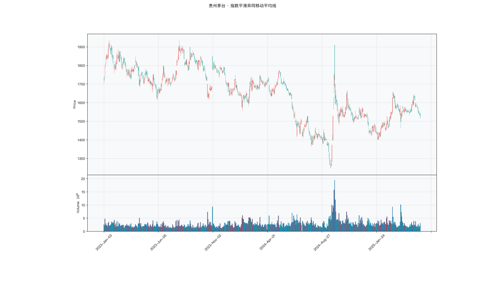

# 第016章 指数平滑异同平均线（MACD）

一位交易者已经会用均线判断方向，却总觉得少了一个数。价格还在涨，上涨的速度明显慢了，他不知道该用哪个指标描述这种变化。两条均线的差值告诉他短期比长期强多少，差值的均线告诉他这个优势在扩大还是收缩。他把两条线叠在一起，发现差值的转折常比价格早一步。指数平滑异同平均线要回答的，就是动能能否像价格一样被直接读数。

## 名称与来历

指数平滑异同平均线（Moving Average Convergence Divergence，MACD）。

它由杰拉尔德·阿佩尔（Gerald Appel）在 1979 年提出。阿佩尔关注的问题是：把两条不同周期 EMA 的差值做成一条线，再对这条线做一次平滑，会得到什么？差值反映短期与长期多空力量的此消彼长，再次平滑则过滤掉其中的随机波动。两者的组合同时具备了动能跟踪与拐点检测的能力。MACD 本身不预测价格会涨到哪里或跌到哪里，它只是持续记录多空动能的变化趋势与转折点。

## 核心逻辑

两条均线的差值能反映动能，但这个差值本身波动很大，能不能再平滑一次，让它更容易读？

这是 MACD 的设计主线。短期 EMA 反应快，长期 EMA 反应慢，两者的差值刻画了近期价格相对于较长期水平的偏离速度，也就是动能。差值上穿零轴，说明短期动能已经超过长期；差值持续扩大，说明这种优势还在增强。但原始差值波动剧烈，直接看容易受噪声干扰，所以 MACD 对差值再做一次指数平滑，得到一条更平缓的信号线。差值与信号线的交叉，就成了动能转向的确认。

再进一步，两者的差被画成柱状图，直观展示动能的强弱。柱体为正表示差值在信号线之上，多头动能占优；柱体为负表示空头动能占优；柱体的长短反映优势的大小。这三条线分工协作，而不是各自独立给出信号。当动能方向与价格同步时，趋势相对可靠；当两者背离时，趋势可能接近尾声。把 DIF 读成速度、把柱体读成加速度，可以得到一个可检验的推论：柱体由正转负只说明动能在减速，价格仍可能继续上涨，因此柱体转向不能单独当作离场信号。

## 计算公式

MACD 的核心是"EMA 差值的二次平滑"，默认参数为 12、26、9，分四步计算。

### 基础 EMA

$$\mathrm{EMA}_t^{(n)} = \alpha_n\, p_t + (1-\alpha_n)\,\mathrm{EMA}_{t-1}^{(n)}, \qquad \alpha_n = \frac{2}{n+1}$$

分别计算 12 日 EMA 与 26 日 EMA。短期 EMA 反应灵敏，长期 EMA 更稳定。

### 差离值 DIF

$$\mathrm{DIF}_t = \mathrm{EMA}_t^{(12)} - \mathrm{EMA}_t^{(26)}$$

DIF 为正，说明短期动能强于长期，偏多头；为负则偏空头。

### 信号线 DEA

$$\mathrm{DEA}_t = \alpha_9\,\mathrm{DIF}_t + (1-\alpha_9)\,\mathrm{DEA}_{t-1}, \qquad \alpha_9 = \frac{2}{9+1} = 0.2$$

DEA 是 DIF 的 9 日指数平滑，用来过滤 DIF 的短期波动。

### 柱状图

$$\mathrm{MACDbar}_t = (\mathrm{DIF}_t - \mathrm{DEA}_t)\times 2$$

系数 2 只是放大刻度，不影响信号方向，部分软件省略这一步。

**参数含义。**

| 参数 | 含义 | 默认值 | 影响 |
|---|---|---|---|
| 快线周期 | 短期 EMA 的周期 | 12 | 越小越灵敏 |
| 慢线周期 | 长期 EMA 的周期 | 26 | 越大越稳定，信号越滞后 |
| 信号周期 | DIF 的平滑周期 | 9 | 越小交叉越频繁 |
| 柱状图系数 | 放大倍率 | 2 | 仅影响刻度，不影响判断 |

**计算示例。** 设某日 $\mathrm{EMA}_{12} = 13.0$ 元，$\mathrm{EMA}_{26} = 12.4$ 元，则

$$\mathrm{DIF} = 13.0 - 12.4 = 0.60 \text{ 元}$$

设前一日 DEA 为 0.50 元，按 α=0.2：

$$\mathrm{DEA} = 0.2\times 0.60 + 0.8\times 0.50 = 0.52 \text{ 元}$$

柱状图：

$$\mathrm{MACDbar} = (0.60 - 0.52)\times 2 = 0.16$$

DIF 高于 DEA 且柱体为正，说明多头动能占优。若次日 DIF 回落至 0.45 元，DEA 为 0.51 元，柱体转为负值，动能方向发生改变。

### 参数与灵敏度

MACD 有三个参数，快线、慢线与信号周期。默认的 12、26、9 适合日线级别的股票与指数，不同品种与交易周期应做相应调整。

| 应用场景 | 参数组合 | 调整逻辑 |
|---|---|---|
| 日内交易 | 6、13、5 | 缩短周期，提高灵敏度 |
| 波段交易 | 12、26、9 | 默认组合，平衡灵敏与稳定 |
| 长线投资 | 20、50、10 | 拉长周期，过滤短期噪音 |
| 高波动品种 | 8、17、6 | 进一步缩短，快速响应 |

快慢线的间距决定了 DIF 的波动幅度，信号周期决定了 DEA 的跟随速度。三者需要整体协调，单独改动其中一个容易让柱状图的形态失衡。

## 用法与信号

**金叉与死叉。** DIF 从下向上穿越 DEA 为金叉，柱状图由负转正，是买入的预警；从上向下穿越为死叉。发生在零轴上方的金叉通常更强，对应多头趋势中的回调再启动；发生在零轴下方的金叉则视为弱势反弹，可靠性较低。死叉的判断对称进行。

**零轴穿越。** DIF 上穿零轴，从负转正，说明多头动能占据主导，趋势由弱转强；下穿零轴则说明空头动能主导，趋势由强转弱。零轴的位置为动能强弱提供了分水岭，常与交叉信号配合使用。

**背离。** 价格创新高而 DIF 未创新高，或柱状图逐步缩短，构成顶背离，提示多头动能跟不上价格；价格创新低而 DIF 未创新低，构成底背离。背离通常需要至少两个高点的对比，周期越长，信号可靠性越高。背离出现后价格仍可能延续原趋势一段时间，通常要等交叉确认再行动。

**柱状图的缩量与放量。** 红柱缩短代表多头动能减弱，即使价格仍在上涨也需警惕；红柱放长代表动能增强，趋势延续概率较高。绿柱的情形对称理解。柱状图的变化往往会先于交叉出现，可以提前给出动能变化的线索。

## 边界与误区

**不加区分地追金叉与死叉。** 零轴下方的金叉、零轴上方的死叉多为弱信号，需要结合趋势方向判断。把每一个交叉都当作买卖指令，容易在震荡中被反复止损。通常的做法是先确认更大级别的趋势，再在顺势方向里挑选信号。

**以为背离出现就等于反转。** 背离只是提示动能不足，价格仍可能沿原方向延续一段时间。把背离当作立即入场的依据，往往过早。常见处理是等待 MACD 的交叉确认，再决定是否行动。

**在震荡市中频繁使用。** 当市场在窄幅区间内运行，MACD 的交叉会非常密集，信号可靠性下降。常见做法是结合趋势强度指标过滤，只在趋势明确时使用 MACD 信号。

**忽略成交量的配合。** 金叉或死叉发生时成交量放大，信号的可靠性通常会提高；成交量萎缩时，则更可能是假信号。把 MACD 与成交量割裂开来使用，会损失一个重要旁证。

## 它被检验过吗

MACD 被广泛使用，但缺少针对它的独立同行评议检验。这条链的完整版见第 007 章。现有的证据只能来自均线规则族的整体检验，而这类检验无法把绩效归因到 MACD 这一构造，也无法区分它与快慢均线交叉的差别。

这不等于它已被证伪。它只说明，动能可以被直接读数是一个构造上的主张，尚未经过独立的统计核对。一个流传数十年的指标缺少这种核对，说明它的传播更多依靠图形直觉，而不是证据。

这一类的真实失效案例，见第 008 章的「真实案例与失败模式」。

## 代码实现

### R

```r
library(ettr)
library(efactorcraft)
library(efincharts)
library(ggplot2)

BASE <- "https://raw.githubusercontent.com/dengyishuo/quant-technical-analysis/main/data/parquet"

# 取数据：本地有就用本地，没有就下载一次并缓存。
# read.csv 对本地 .gz 会自动解压，所以缓存成 .csv.gz 也能直接读。
load_data <- function(name) {
  local <- file.path("data", "parquet", name)
  if (file.exists(local)) return(local)
  cache <- file.path(tools::R_user_dir("qta", "cache"), name)
  if (!file.exists(cache)) {
    dir.create(dirname(cache), recursive = TRUE, showWarnings = FALSE)
    message("下载 ", name, " ...")
    download.file(paste0(BASE, "/", name), cache, mode = "wb", quiet = TRUE)
  }
  cache
}

read_data <- function(name) {
  d <- read.csv(load_data(name), stringsAsFactors = FALSE)
  if ("date" %in% names(d)) d$date <- as.Date(d$date)
  d
}

# 同一章里多次取用，缓存到内存，避免重复解析
.cache <- new.env(parent = emptyenv())
.blue <- function() {
  if (!exists("b", .cache)) assign("b", read_data("panel_blue_chip.csv"), .cache)
  get("b", .cache)
}
.panel <- function() {
  if (!exists("p", .cache)) {
    p <- read_data("panel_r.csv.gz")
    assign("p", p[p$date >= "2023-01-01" & p$date <= "2025-06-01", ], .cache)
  }
  get("p", .cache)
}
.index <- function() read_data("index_daily.csv")

blue  <- .blue()
panel <- .panel()

# 图的保存路径，顺手建目录，避免读者本地没有 assets/ 时报错
fig_path <- function(ch, name = "indicator_r.png") {
  d <- file.path("assets", "figures", sprintf("ch%03d", ch))
  dir.create(d, recursive = TRUE, showWarnings = FALSE)
  file.path(d, name)
}

# efincharts 要求 xts 且列名带 Adjusted
as_xts <- function(df) {
  x <- xts::xts(df[, c("open", "high", "low", "close", "volume", "adjusted")],
                order.by = df$date)
  colnames(x) <- c("Open", "High", "Low", "Close", "Volume", "Adjusted")
  x
}

maotai <- .blue()[.blue()$code == "600519.SS", ]

# 1. ettr 在长格式面板上追加指标列
maotai <- add_macd(maotai)

# 2. 基本统计
cols <- setdiff(names(maotai), names(blue))
print(summary(maotai[, cols]))

# 3. K 线 + 成交量 + 均线
ch <- ecandlesticks(as_xts(maotai), show_ma = TRUE, ma_periods = c(20, 60),
                    title = "贵州茅台 · 指数平滑异同移动平均线")
ggsave(fig_path(16), ch$combined_plot, width = 10, height = 6, dpi = 110)
```

### Python

```python
import pathlib
import urllib.request

import pandas as pd
import ettr
import efactorcraft as efc
import efincharts as efc_

# 中文字体：mplfinance 会用 style 里的 rc 覆盖全局设置，必须写进 style
from efincharts import theme
theme.efin_style["rc"] = {
    "font.sans-serif": ["PingFang SC", "Heiti SC", "SimHei"],
    "axes.unicode_minus": False,
    "font.family": "sans-serif",
}

BASE = "https://raw.githubusercontent.com/dengyishuo/quant-technical-analysis/main/data/parquet"
CACHE = pathlib.Path.home() / ".cache" / "qta"
_MEM = {}


def load(name):
    """取数据：本地有就用本地，没有就下载一次并缓存。

    这样三种情形都能跑：
      1. 克隆了整个仓库    -> 直接读 data/parquet/，不联网
      2. 只复制了代码片段  -> 首次自动下载到 ~/.cache/qta，之后走缓存
      3. 之前跑过          -> 全部命中缓存，断网也能用
    """
    if name in _MEM:
        return _MEM[name]
    local = pathlib.Path("data/parquet") / name
    if local.exists():
        path = local
    else:
        CACHE.mkdir(parents=True, exist_ok=True)
        path = CACHE / name
        if not path.exists():
            print("下载 %s ..." % name)
            urllib.request.urlretrieve(BASE + "/" + name, path)
    data = pd.read_parquet(path) if name.endswith(".parquet") else pd.read_csv(path)
    _MEM[name] = data
    return data


blue = load("panel_blue_chip.parquet")
panel = load("panel.parquet")
panel = panel[(panel["date"] >= "2023-01-01") & (panel["date"] <= "2025-06-01")]
idx = load("index_daily.parquet")


def one(df, code="600519.SS"):
    """取单只标的，转成 efincharts 需要的宽表。"""
    x = df[df["code"] == code].sort_values("date").set_index("date")
    x.columns = [c.capitalize() for c in x.columns]
    return x


def fig_path(ch, name="indicator.png"):
    """图的保存路径，顺手建目录，避免读者本地没有 assets/ 时报错。"""
    d = pathlib.Path("assets") / "figures" / ("ch%03d" % ch)
    d.mkdir(parents=True, exist_ok=True)
    return str(d / name)

# 1. 取单只标的
maotai = blue[blue['code'] == '600519.SS'].copy()

# 2. ettr 在长格式面板上追加指标列，不需要手工 rolling
maotai = ettr.macd(maotai)

cols = [c for c in maotai.columns if c not in blue.columns]
print(maotai[cols].describe().round(3))

# 3. 画图：K 线 + 成交量 + 指标面板
px = one(maotai)
ch = efc_.candlestick(px, volume=True, title="贵州茅台 · 指数平滑异同移动平均线")
ch.save(fig_path(16))
```

<!-- fig-indicator:start -->


<p class="figcap">图 16-1　指数平滑异同移动平均线在贵州茅台上的读数（2023-01 至 2025-06）</p>
<!-- fig-indicator:end -->

## 拆解

MACD 三条线与价格同量纲，DIF 与柱状值的单位都是元。直接排序，高价股数值天然更大，排出来的是股价，不是动能。所有特征都要先除以价格，才具备横截面可比性。

| 特征名 | 计算式 | 量纲 | 经济含义 |
|--------|--------|------|----------|
| DIF 归一 | $\mathrm{DIF}_t/p_t$ | 无量纲比例 | 短期与长期均线的相对偏离，动能水平 |
| DEA 归一 | $\mathrm{DEA}_t/p_t$ | 无量纲比例 | 动能的平滑基准 |
| 柱状值归一 | $(\mathrm{DIF}_t-\mathrm{DEA}_t)/p_t$ | 无量纲比例 | 动能相对信号线的偏离，动能变化 |
| 柱状值变化 | $\left[(\mathrm{DIF}_t-\mathrm{DEA}_t)-(\mathrm{DIF}_{t-1}-\mathrm{DEA}_{t-1})\right]/p_t$ | 无量纲比例 | 动能变化的速度 |
| 零轴状态 | $\mathrm{sign}(\mathrm{DIF}_t)$ | 取值为 1、0、−1 | 多空动能的分水岭位置 |

这五个特征并不独立。柱状值等于 DIF 减去自身的一次平滑，其变化又是柱状值的差分，三者构成"水平、偏离、加速度"的层级。真正独立的只有两类：动能相对价格的强度，以及动能相对零轴的位置。

归一化的分母选择会影响结论。除以收盘价得到"单位价格动能"，把高低价股拉到同一量级，也抹平了波动率差异。另一种做法是除以真实波幅，得到"单位风险动能"，保留的是波动调整后的强度。两种口径在波动率差异大的样本里排序可能不同，报告时应说明用的是哪一种。

零轴状态只有三个取值，分布取决于样本期内的涨跌结构。它不适合做排序因子，更适合作为条件变量：按零轴上下分组，再在组内比较动能强弱。柱状值的变化率是连续量，但差分放大了噪声，信噪比低于柱状值本身。

### R

```r
library(ettr)
library(efactorcraft)
library(efincharts)
library(ggplot2)

BASE <- "https://raw.githubusercontent.com/dengyishuo/quant-technical-analysis/main/data/parquet"

# 取数据：本地有就用本地，没有就下载一次并缓存。
# read.csv 对本地 .gz 会自动解压，所以缓存成 .csv.gz 也能直接读。
load_data <- function(name) {
  local <- file.path("data", "parquet", name)
  if (file.exists(local)) return(local)
  cache <- file.path(tools::R_user_dir("qta", "cache"), name)
  if (!file.exists(cache)) {
    dir.create(dirname(cache), recursive = TRUE, showWarnings = FALSE)
    message("下载 ", name, " ...")
    download.file(paste0(BASE, "/", name), cache, mode = "wb", quiet = TRUE)
  }
  cache
}

read_data <- function(name) {
  d <- read.csv(load_data(name), stringsAsFactors = FALSE)
  if ("date" %in% names(d)) d$date <- as.Date(d$date)
  d
}

# 同一章里多次取用，缓存到内存，避免重复解析
.cache <- new.env(parent = emptyenv())
.blue <- function() {
  if (!exists("b", .cache)) assign("b", read_data("panel_blue_chip.csv"), .cache)
  get("b", .cache)
}
.panel <- function() {
  if (!exists("p", .cache)) {
    p <- read_data("panel_r.csv.gz")
    assign("p", p[p$date >= "2023-01-01" & p$date <= "2025-06-01", ], .cache)
  }
  get("p", .cache)
}
.index <- function() read_data("index_daily.csv")

blue  <- .blue()
panel <- .panel()

# 图的保存路径，顺手建目录，避免读者本地没有 assets/ 时报错
fig_path <- function(ch, name = "indicator_r.png") {
  d <- file.path("assets", "figures", sprintf("ch%03d", ch))
  dir.create(d, recursive = TRUE, showWarnings = FALSE)
  file.path(d, name)
}

# efincharts 要求 xts 且列名带 Adjusted
as_xts <- function(df) {
  x <- xts::xts(df[, c("open", "high", "low", "close", "volume", "adjusted")],
                order.by = df$date)
  colnames(x) <- c("Open", "High", "Low", "Close", "Volume", "Adjusted")
  x
}

d <- .blue()[.blue()$code == "600519.SS", ]
d <- add_macd(d)

# 转成无量纲因子
d$f <- d$`signal` / d$close

print(summary(d$f))
```

### Python

```python
import pathlib
import urllib.request

import pandas as pd
import ettr
import efactorcraft as efc
import efincharts as efc_

# 中文字体：mplfinance 会用 style 里的 rc 覆盖全局设置，必须写进 style
from efincharts import theme
theme.efin_style["rc"] = {
    "font.sans-serif": ["PingFang SC", "Heiti SC", "SimHei"],
    "axes.unicode_minus": False,
    "font.family": "sans-serif",
}

BASE = "https://raw.githubusercontent.com/dengyishuo/quant-technical-analysis/main/data/parquet"
CACHE = pathlib.Path.home() / ".cache" / "qta"
_MEM = {}


def load(name):
    """取数据：本地有就用本地，没有就下载一次并缓存。

    这样三种情形都能跑：
      1. 克隆了整个仓库    -> 直接读 data/parquet/，不联网
      2. 只复制了代码片段  -> 首次自动下载到 ~/.cache/qta，之后走缓存
      3. 之前跑过          -> 全部命中缓存，断网也能用
    """
    if name in _MEM:
        return _MEM[name]
    local = pathlib.Path("data/parquet") / name
    if local.exists():
        path = local
    else:
        CACHE.mkdir(parents=True, exist_ok=True)
        path = CACHE / name
        if not path.exists():
            print("下载 %s ..." % name)
            urllib.request.urlretrieve(BASE + "/" + name, path)
    data = pd.read_parquet(path) if name.endswith(".parquet") else pd.read_csv(path)
    _MEM[name] = data
    return data


blue = load("panel_blue_chip.parquet")
panel = load("panel.parquet")
panel = panel[(panel["date"] >= "2023-01-01") & (panel["date"] <= "2025-06-01")]
idx = load("index_daily.parquet")


def one(df, code="600519.SS"):
    """取单只标的，转成 efincharts 需要的宽表。"""
    x = df[df["code"] == code].sort_values("date").set_index("date")
    x.columns = [c.capitalize() for c in x.columns]
    return x


def fig_path(ch, name="indicator.png"):
    """图的保存路径，顺手建目录，避免读者本地没有 assets/ 时报错。"""
    d = pathlib.Path("assets") / "figures" / ("ch%03d" % ch)
    d.mkdir(parents=True, exist_ok=True)
    return str(d / name)

# 1. 先在面板上算原始指标
d = panel.copy()
d = ettr.macd(d)

# MACD 柱 = DIF - DEA，ettr 已算好
d["MACD_hist"] = d["MACD_hist"]
# 2. 转成无量纲因子，才能跨标的排序
d["f"] = d["MACD_hist"] / d.close

print(d["f"].describe().round(4))
```

## 截面选股能力

MACD 的横截面因子以柱状值为主：

$$f^{bar}_t=\frac{\mathrm{DIF}_t-\mathrm{DEA}_t}{p_t}$$

另一个候选是 DIF 本身：

$$f^{dif}_t=\frac{\mathrm{DIF}_t}{p_t}$$

前者是动能相对信号线的偏离，符号变化对应交叉，属于短期转向；后者是快慢均线的相对位置，正负对应零轴，属于中期方向。两者可分别检验，比较 ICIR，也可以同时纳入看增量。

预期表现上，两者都属于动量型因子，方向通常偏正，但时间尺度不同。柱状值半衰期短，对一日收益的解释力可能强于五日；DIF 更平滑，需要更长的窗口才能体现。若柱状值在一日窗口为正、五日衰减到零，说明它捕捉的是短期动能延续，持有期不宜拉长。

条件依赖也值得单独看。零轴上方的柱状值为正是强势中的加速，零轴下方为正是弱势中的反弹。全样本混算 IC，两类样本可能互相抵消，稳健的做法是按零轴分组分别报告。

检验时有三点需要注意。第一，归一化口径要在全样本内统一，否则 IC 的变化里混进了口径变化。第二，MACD 因子与二十日动量相关性不低，判断增量应对动量取残差后再算 IC。第三，参数与预测窗口要匹配，快慢线缩短后更灵敏，换手与噪音也同时上升。

### R

```r
library(ettr)
library(efactorcraft)
library(efincharts)
library(ggplot2)

BASE <- "https://raw.githubusercontent.com/dengyishuo/quant-technical-analysis/main/data/parquet"

# 取数据：本地有就用本地，没有就下载一次并缓存。
# read.csv 对本地 .gz 会自动解压，所以缓存成 .csv.gz 也能直接读。
load_data <- function(name) {
  local <- file.path("data", "parquet", name)
  if (file.exists(local)) return(local)
  cache <- file.path(tools::R_user_dir("qta", "cache"), name)
  if (!file.exists(cache)) {
    dir.create(dirname(cache), recursive = TRUE, showWarnings = FALSE)
    message("下载 ", name, " ...")
    download.file(paste0(BASE, "/", name), cache, mode = "wb", quiet = TRUE)
  }
  cache
}

read_data <- function(name) {
  d <- read.csv(load_data(name), stringsAsFactors = FALSE)
  if ("date" %in% names(d)) d$date <- as.Date(d$date)
  d
}

# 同一章里多次取用，缓存到内存，避免重复解析
.cache <- new.env(parent = emptyenv())
.blue <- function() {
  if (!exists("b", .cache)) assign("b", read_data("panel_blue_chip.csv"), .cache)
  get("b", .cache)
}
.panel <- function() {
  if (!exists("p", .cache)) {
    p <- read_data("panel_r.csv.gz")
    assign("p", p[p$date >= "2023-01-01" & p$date <= "2025-06-01", ], .cache)
  }
  get("p", .cache)
}
.index <- function() read_data("index_daily.csv")

blue  <- .blue()
panel <- .panel()

# 图的保存路径，顺手建目录，避免读者本地没有 assets/ 时报错
fig_path <- function(ch, name = "indicator_r.png") {
  d <- file.path("assets", "figures", sprintf("ch%03d", ch))
  dir.create(d, recursive = TRUE, showWarnings = FALSE)
  file.path(d, name)
}

# efincharts 要求 xts 且列名带 Adjusted
as_xts <- function(df) {
  x <- xts::xts(df[, c("open", "high", "low", "close", "volume", "adjusted")],
                order.by = df$date)
  colnames(x) <- c("Open", "High", "Low", "Close", "Volume", "Adjusted")
  x
}

d <- .panel()
d <- add_macd(d)

d$f <- d$`signal` / d$close
d <- add_next_return(d, close_col = "close", n = c(1, 5, 20))

ic <- ic_analysis(d, factor_cols = "f",
                    forward_cols = c("forward_1", "forward_5", "forward_20"),
                    method = "spearman")
print(ir_analysis(ic))

q <- quantile_analysis(d, factor_cols = "f", forward_cols = "forward_5",
                       n_groups = 5)
print(q$f$summary)
```

### Python

```python
import pathlib
import urllib.request

import pandas as pd
import ettr
import efactorcraft as efc
import efincharts as efc_

# 中文字体：mplfinance 会用 style 里的 rc 覆盖全局设置，必须写进 style
from efincharts import theme
theme.efin_style["rc"] = {
    "font.sans-serif": ["PingFang SC", "Heiti SC", "SimHei"],
    "axes.unicode_minus": False,
    "font.family": "sans-serif",
}

BASE = "https://raw.githubusercontent.com/dengyishuo/quant-technical-analysis/main/data/parquet"
CACHE = pathlib.Path.home() / ".cache" / "qta"
_MEM = {}


def load(name):
    """取数据：本地有就用本地，没有就下载一次并缓存。

    这样三种情形都能跑：
      1. 克隆了整个仓库    -> 直接读 data/parquet/，不联网
      2. 只复制了代码片段  -> 首次自动下载到 ~/.cache/qta，之后走缓存
      3. 之前跑过          -> 全部命中缓存，断网也能用
    """
    if name in _MEM:
        return _MEM[name]
    local = pathlib.Path("data/parquet") / name
    if local.exists():
        path = local
    else:
        CACHE.mkdir(parents=True, exist_ok=True)
        path = CACHE / name
        if not path.exists():
            print("下载 %s ..." % name)
            urllib.request.urlretrieve(BASE + "/" + name, path)
    data = pd.read_parquet(path) if name.endswith(".parquet") else pd.read_csv(path)
    _MEM[name] = data
    return data


blue = load("panel_blue_chip.parquet")
panel = load("panel.parquet")
panel = panel[(panel["date"] >= "2023-01-01") & (panel["date"] <= "2025-06-01")]
idx = load("index_daily.parquet")


def one(df, code="600519.SS"):
    """取单只标的，转成 efincharts 需要的宽表。"""
    x = df[df["code"] == code].sort_values("date").set_index("date")
    x.columns = [c.capitalize() for c in x.columns]
    return x


def fig_path(ch, name="indicator.png"):
    """图的保存路径，顺手建目录，避免读者本地没有 assets/ 时报错。"""
    d = pathlib.Path("assets") / "figures" / ("ch%03d" % ch)
    d.mkdir(parents=True, exist_ok=True)
    return str(d / name)

# 287 只、2023-01 至 2025-06，横截面才有统计意义
src = panel.copy()
d = src.copy()

# 1. 算指标
d = ettr.macd(d)


# 2. 因子 + 未来收益
d["f"] = d["MACD_hist"] / d.close
d = efc.add_next_return(d, periods=(1, 5, 20))

# 3. 截面 IC 与分层
ic = efc.ic_analysis(d, factor_cols="f",
                      forward_cols=["forward_1", "forward_5", "forward_20"],
                      method="spearman")
print(efc.ir_analysis(ic).round(3))

q = efc.quantile_analysis(d, factor_col="f", forward_col="forward_5", n_groups=5)
print(q["summary"].round(4))
```

零轴分组那一段最容易出问题。若两组 IC 符号相反，说明柱状值的正负在不同市况下含义不同，全样本均值会把两股力量抵消，得到一个接近零的假结论。

<!-- tab-ic:start -->
**计算结果**

| 前向期 | IC 均值 | IC 标准差 | ICIR | t 值 | IC>0 占比 | 期数 |
|---|---|---|---|---|---|---|
| T+1 | -0.0084 | 0.2280 | -0.037 | -0.86 | 0.4950 | 547 |
| T+5 | -0.0036 | 0.2114 | -0.017 | -0.40 | 0.4830 | 543 |
| T+20 | -0.0100 | 0.2053 | -0.049 | -1.12 | 0.4890 | 528 |

表里最该看的是 t 值，不是 IC 均值。这个因子以 T+1 为主口径，IC 均值 -0.0084、ICIR -0.037、t 值 -0.86，在常规门槛下不显著，方向为反向。按第 007 章给出的日频门槛（ICIR 0.13 对应 t≈2），这个结果的含义是：还看不出与噪声的区别，不能据此构造策略。

需要提醒的是，这只说明排序与未来收益之间存在可测的关联，不代表扣掉成本后还能剩下收益。横截面 IC 检验的是“买哪只”，不负责“值不值得交易”。

**五档分层**

| 分组 | 平均收益 | 标准差 | 期数 |
|---|---|---|---|
| 1 | +0.0039 | +0.0406 | 543 |
| 2 | +0.0020 | +0.0327 | 543 |
| 3 | +0.0024 | +0.0305 | 543 |
| 4 | +0.0031 | +0.0312 | 543 |
| 5 | +0.0045 | +0.0403 | 543 |

五档分层看的是形状，不是单点。最高一档在第 5 组、最低在第 2 组，两端相差 +0.06%，组序号与平均收益的秩相关为 0.35，没有明显单调性。

分层比 IC 更接近实盘，因为它直接给出“买最高档、卖最低档”的收益差。但这里的数字是毛收益，且没有考虑涨跌停买不进、停牌卖不出的情形，真实可得的差额会小于表中所列。
<!-- tab-ic:end -->

## 择时能力

时序上 MACD 的择时逻辑有三层。第一层是 DIF 与 DEA 的交叉，金叉与死叉是最直接的动能转向事件。第二层是 DIF 与零轴的关系，上方运行代表中期偏多。第三层是柱状值的伸缩，红柱缩短提示动能衰减，往往先于交叉出现。

检验方法要与信号形态匹配。交叉是离散事件，一年十几次，适合触发日检验，比较交叉日与其余交易日的后续收益。柱状值是连续变量，适合条件分位收益，观察分档后是否单调。最后把柱状值为正作为持仓条件回测。零轴只有两档，做分位收益意义不大，更适合作为分组条件叠加。

选择这三条路径，因为 MACD 的信息同时包含事件与状态：只测事件会漏掉状态，只测状态又看不出交叉时点是否有效。

择时检验有三处陷阱。第一，震荡市中交叉密集，一周可能出现两三次，名义收益被成本吃掉，回测应计入费率。第二，背离无法直接量化，画出的连线不同则结论不同；要检验它，应先写成明确规则，例如价格创新高而 DIF 未创新高。第三，参数在样本内优选会让结果偏乐观，应固定一组参数，检查邻近参数是否平稳。

### R

```r
library(ettr)
library(efactorcraft)
library(efincharts)
library(ggplot2)

BASE <- "https://raw.githubusercontent.com/dengyishuo/quant-technical-analysis/main/data/parquet"

# 取数据：本地有就用本地，没有就下载一次并缓存。
# read.csv 对本地 .gz 会自动解压，所以缓存成 .csv.gz 也能直接读。
load_data <- function(name) {
  local <- file.path("data", "parquet", name)
  if (file.exists(local)) return(local)
  cache <- file.path(tools::R_user_dir("qta", "cache"), name)
  if (!file.exists(cache)) {
    dir.create(dirname(cache), recursive = TRUE, showWarnings = FALSE)
    message("下载 ", name, " ...")
    download.file(paste0(BASE, "/", name), cache, mode = "wb", quiet = TRUE)
  }
  cache
}

read_data <- function(name) {
  d <- read.csv(load_data(name), stringsAsFactors = FALSE)
  if ("date" %in% names(d)) d$date <- as.Date(d$date)
  d
}

# 同一章里多次取用，缓存到内存，避免重复解析
.cache <- new.env(parent = emptyenv())
.blue <- function() {
  if (!exists("b", .cache)) assign("b", read_data("panel_blue_chip.csv"), .cache)
  get("b", .cache)
}
.panel <- function() {
  if (!exists("p", .cache)) {
    p <- read_data("panel_r.csv.gz")
    assign("p", p[p$date >= "2023-01-01" & p$date <= "2025-06-01", ], .cache)
  }
  get("p", .cache)
}
.index <- function() read_data("index_daily.csv")

blue  <- .blue()
panel <- .panel()

# 图的保存路径，顺手建目录，避免读者本地没有 assets/ 时报错
fig_path <- function(ch, name = "indicator_r.png") {
  d <- file.path("assets", "figures", sprintf("ch%03d", ch))
  dir.create(d, recursive = TRUE, showWarnings = FALSE)
  file.path(d, name)
}

# efincharts 要求 xts 且列名带 Adjusted
as_xts <- function(df) {
  x <- xts::xts(df[, c("open", "high", "low", "close", "volume", "adjusted")],
                order.by = df$date)
  colnames(x) <- c("Open", "High", "Low", "Close", "Volume", "Adjusted")
  x
}

t <- .index()
t <- t[t$code == "510300.SS", ]
t <- add_macd(t)
t$f <- t$`signal` / t$close
t$forward_5 <- c(tail(t$close, -5) / head(t$close, -5) - 1, rep(NA, 5))
t$q <- cut(t$f, quantile(t$f, 0:5/5, na.rm = TRUE), include.lowest = TRUE, labels = FALSE)
print(aggregate(forward_5 ~ q, data = t, FUN = function(x)
  c(mean = mean(x, na.rm = TRUE), n = sum(!is.na(x)))))
```

### Python

```python
import pathlib
import urllib.request

import pandas as pd
import ettr
import efactorcraft as efc
import efincharts as efc_

# 中文字体：mplfinance 会用 style 里的 rc 覆盖全局设置，必须写进 style
from efincharts import theme
theme.efin_style["rc"] = {
    "font.sans-serif": ["PingFang SC", "Heiti SC", "SimHei"],
    "axes.unicode_minus": False,
    "font.family": "sans-serif",
}

BASE = "https://raw.githubusercontent.com/dengyishuo/quant-technical-analysis/main/data/parquet"
CACHE = pathlib.Path.home() / ".cache" / "qta"
_MEM = {}


def load(name):
    """取数据：本地有就用本地，没有就下载一次并缓存。

    这样三种情形都能跑：
      1. 克隆了整个仓库    -> 直接读 data/parquet/，不联网
      2. 只复制了代码片段  -> 首次自动下载到 ~/.cache/qta，之后走缓存
      3. 之前跑过          -> 全部命中缓存，断网也能用
    """
    if name in _MEM:
        return _MEM[name]
    local = pathlib.Path("data/parquet") / name
    if local.exists():
        path = local
    else:
        CACHE.mkdir(parents=True, exist_ok=True)
        path = CACHE / name
        if not path.exists():
            print("下载 %s ..." % name)
            urllib.request.urlretrieve(BASE + "/" + name, path)
    data = pd.read_parquet(path) if name.endswith(".parquet") else pd.read_csv(path)
    _MEM[name] = data
    return data


blue = load("panel_blue_chip.parquet")
panel = load("panel.parquet")
panel = panel[(panel["date"] >= "2023-01-01") & (panel["date"] <= "2025-06-01")]
idx = load("index_daily.parquet")


def one(df, code="600519.SS"):
    """取单只标的，转成 efincharts 需要的宽表。"""
    x = df[df["code"] == code].sort_values("date").set_index("date")
    x.columns = [c.capitalize() for c in x.columns]
    return x


def fig_path(ch, name="indicator.png"):
    """图的保存路径，顺手建目录，避免读者本地没有 assets/ 时报错。"""
    d = pathlib.Path("assets") / "figures" / ("ch%03d" % ch)
    d.mkdir(parents=True, exist_ok=True)
    return str(d / name)

# 择时检验用 ETF 做市场载体，指数本身没有日线数据
t = idx[idx["code"] == "510300.SS"].sort_values("date").copy()

# 1. 在 ETF 上算同一个指标
t = ettr.macd(d)


# 2. 按因子分位看未来 5 日收益
t["f"] = t["MACD_hist"] / t.close
t["forward_5"] = t["close"].shift(-5) / t["close"] - 1
# 因子可能有重复值，先按名次切，避免 qcut 报边界不唯一
t["q"] = pd.qcut(t["f"].rank(method="first"), 5, labels=False) + 1
t = t.dropna(subset=["f", "forward_5"])
print(t.groupby("q")["forward_5"].agg(["mean", "count"]).round(4))
```

三项结果分别回答：交叉或高位之后是否真的不同、不同柱状值档位的收益是否单调、按规则做是否优于一直持有。若第一项显著而第二项不单调，说明信号有效但阈值位置不对；若前两项成立而回测落后，问题通常在换手成本与信号滞后。

<!-- tab-timing:start -->
**分位收益**

| 分位 | 未来 5 日均值 | 样本数 |
|---|---|---|
| 1 | +0.0039 | 216 |
| 2 | -0.0012 | 215 |
| 3 | -0.0005 | 215 |
| 4 | -0.0046 | 215 |
| 5 | +0.0022 | 216 |

择时口径与截面不同：这里只有一个标的，看的是同一标的在不同分位下的未来收益。最高与最低分位相差 -0.17%。单标的样本有限，这个差额很容易被一两段行情主导，只能作为方向参考。

真正做择时要问的是三件事：分位阈值是否稳定、换手是否可控、扣成本后是否还有剩余。三者缺一，择时信号就只是图上好看。
<!-- tab-timing:end -->

## 组合使用与验证

常见的搭档有两个。与成交量搭配，确认交叉时的量能配合，放量金叉通常比缩量金叉可靠。与平均趋向指数搭配，用趋势强度过滤震荡期的密集交叉。前者补参与度，后者补市况前提。

**组合的截面验证。** 把柱状值因子与量比因子标准化后加权相加，再走一遍截面检验，比较组合与两个单特征的 ICIR。先算两者的横截面相关：相关性高时组合难有增量。

**组合的择时验证。** 把"柱状值为正且价格在二十日均线上方"设为持仓条件，满足时持有、否则空仓，计算年化收益、夏普与最大回撤，再与单条件对照。加了均线过滤后持仓天数减少，改进通常体现在回撤与夏普上。

增益的判读依据方法论章的标准：**组合的 ICIR 高于两个单特征，才说明存在互补性；介于两者之间，说明只是平均；低于两者，说明信号互相抵消。** MACD 与均线同属趋势类，相关性偏高，增量有限；与成交量的差异更大，空间也更实在。

### R

```r
library(ettr)
library(efactorcraft)
library(efincharts)
library(ggplot2)

BASE <- "https://raw.githubusercontent.com/dengyishuo/quant-technical-analysis/main/data/parquet"

# 取数据：本地有就用本地，没有就下载一次并缓存。
# read.csv 对本地 .gz 会自动解压，所以缓存成 .csv.gz 也能直接读。
load_data <- function(name) {
  local <- file.path("data", "parquet", name)
  if (file.exists(local)) return(local)
  cache <- file.path(tools::R_user_dir("qta", "cache"), name)
  if (!file.exists(cache)) {
    dir.create(dirname(cache), recursive = TRUE, showWarnings = FALSE)
    message("下载 ", name, " ...")
    download.file(paste0(BASE, "/", name), cache, mode = "wb", quiet = TRUE)
  }
  cache
}

read_data <- function(name) {
  d <- read.csv(load_data(name), stringsAsFactors = FALSE)
  if ("date" %in% names(d)) d$date <- as.Date(d$date)
  d
}

# 同一章里多次取用，缓存到内存，避免重复解析
.cache <- new.env(parent = emptyenv())
.blue <- function() {
  if (!exists("b", .cache)) assign("b", read_data("panel_blue_chip.csv"), .cache)
  get("b", .cache)
}
.panel <- function() {
  if (!exists("p", .cache)) {
    p <- read_data("panel_r.csv.gz")
    assign("p", p[p$date >= "2023-01-01" & p$date <= "2025-06-01", ], .cache)
  }
  get("p", .cache)
}
.index <- function() read_data("index_daily.csv")

blue  <- .blue()
panel <- .panel()

# 图的保存路径，顺手建目录，避免读者本地没有 assets/ 时报错
fig_path <- function(ch, name = "indicator_r.png") {
  d <- file.path("assets", "figures", sprintf("ch%03d", ch))
  dir.create(d, recursive = TRUE, showWarnings = FALSE)
  file.path(d, name)
}

# efincharts 要求 xts 且列名带 Adjusted
as_xts <- function(df) {
  x <- xts::xts(df[, c("open", "high", "low", "close", "volume", "adjusted")],
                order.by = df$date)
  colnames(x) <- c("Open", "High", "Low", "Close", "Volume", "Adjusted")
  x
}

d <- .panel()
d <- add_macd(d)
d$f1 <- d$`signal` / d$close
d <- add_cmf(d, n = 20)
d$f2 <- d$CMF
d <- add_next_return(d, close_col = "close", n = 5)
ic1 <- ic_analysis(d, factor_cols = c("f1", "f2"),
                    forward_cols = "forward_5", method = "spearman")
print(ir_analysis(ic1))
```

```r
library(ettr)
library(efactorcraft)
library(efincharts)
library(ggplot2)

BASE <- "https://raw.githubusercontent.com/dengyishuo/quant-technical-analysis/main/data/parquet"

# 取数据：本地有就用本地，没有就下载一次并缓存。
# read.csv 对本地 .gz 会自动解压，所以缓存成 .csv.gz 也能直接读。
load_data <- function(name) {
  local <- file.path("data", "parquet", name)
  if (file.exists(local)) return(local)
  cache <- file.path(tools::R_user_dir("qta", "cache"), name)
  if (!file.exists(cache)) {
    dir.create(dirname(cache), recursive = TRUE, showWarnings = FALSE)
    message("下载 ", name, " ...")
    download.file(paste0(BASE, "/", name), cache, mode = "wb", quiet = TRUE)
  }
  cache
}

read_data <- function(name) {
  d <- read.csv(load_data(name), stringsAsFactors = FALSE)
  if ("date" %in% names(d)) d$date <- as.Date(d$date)
  d
}

# 同一章里多次取用，缓存到内存，避免重复解析
.cache <- new.env(parent = emptyenv())
.blue <- function() {
  if (!exists("b", .cache)) assign("b", read_data("panel_blue_chip.csv"), .cache)
  get("b", .cache)
}
.panel <- function() {
  if (!exists("p", .cache)) {
    p <- read_data("panel_r.csv.gz")
    assign("p", p[p$date >= "2023-01-01" & p$date <= "2025-06-01", ], .cache)
  }
  get("p", .cache)
}
.index <- function() read_data("index_daily.csv")

blue  <- .blue()
panel <- .panel()

# 图的保存路径，顺手建目录，避免读者本地没有 assets/ 时报错
fig_path <- function(ch, name = "indicator_r.png") {
  d <- file.path("assets", "figures", sprintf("ch%03d", ch))
  dir.create(d, recursive = TRUE, showWarnings = FALSE)
  file.path(d, name)
}

# efincharts 要求 xts 且列名带 Adjusted
as_xts <- function(df) {
  x <- xts::xts(df[, c("open", "high", "low", "close", "volume", "adjusted")],
                order.by = df$date)
  colnames(x) <- c("Open", "High", "Low", "Close", "Volume", "Adjusted")
  x
}

d <- .panel()
d <- add_macd(d)
d$f1 <- d$`signal` / d$close
d <- add_cmf(d, n = 20)
d$f2 <- d$CMF
d <- add_next_return(d, close_col = "close", n = 5)
ic1 <- ic_analysis(d, factor_cols = c("f1", "f2"),
                    forward_cols = "forward_5", method = "spearman")
print(ir_analysis(ic1))
```

### Python

```python
import pathlib
import urllib.request

import pandas as pd
import ettr
import efactorcraft as efc
import efincharts as efc_

# 中文字体：mplfinance 会用 style 里的 rc 覆盖全局设置，必须写进 style
from efincharts import theme
theme.efin_style["rc"] = {
    "font.sans-serif": ["PingFang SC", "Heiti SC", "SimHei"],
    "axes.unicode_minus": False,
    "font.family": "sans-serif",
}

BASE = "https://raw.githubusercontent.com/dengyishuo/quant-technical-analysis/main/data/parquet"
CACHE = pathlib.Path.home() / ".cache" / "qta"
_MEM = {}


def load(name):
    """取数据：本地有就用本地，没有就下载一次并缓存。

    这样三种情形都能跑：
      1. 克隆了整个仓库    -> 直接读 data/parquet/，不联网
      2. 只复制了代码片段  -> 首次自动下载到 ~/.cache/qta，之后走缓存
      3. 之前跑过          -> 全部命中缓存，断网也能用
    """
    if name in _MEM:
        return _MEM[name]
    local = pathlib.Path("data/parquet") / name
    if local.exists():
        path = local
    else:
        CACHE.mkdir(parents=True, exist_ok=True)
        path = CACHE / name
        if not path.exists():
            print("下载 %s ..." % name)
            urllib.request.urlretrieve(BASE + "/" + name, path)
    data = pd.read_parquet(path) if name.endswith(".parquet") else pd.read_csv(path)
    _MEM[name] = data
    return data


blue = load("panel_blue_chip.parquet")
panel = load("panel.parquet")
panel = panel[(panel["date"] >= "2023-01-01") & (panel["date"] <= "2025-06-01")]
idx = load("index_daily.parquet")


def one(df, code="600519.SS"):
    """取单只标的，转成 efincharts 需要的宽表。"""
    x = df[df["code"] == code].sort_values("date").set_index("date")
    x.columns = [c.capitalize() for c in x.columns]
    return x


def fig_path(ch, name="indicator.png"):
    """图的保存路径，顺手建目录，避免读者本地没有 assets/ 时报错。"""
    d = pathlib.Path("assets") / "figures" / ("ch%03d" % ch)
    d.mkdir(parents=True, exist_ok=True)
    return str(d / name)

d = panel.copy()

# 1. 本章因子
d = ettr.macd(d)
d["f1"] = d["MACD_hist"] / d.close

# 2. 配一个量价因子做对照
d = ettr.cmf(d, n=20)
d["f2"] = d["CMF_20"]
d = efc.add_next_return(d, periods=(5,))

# 3. 单因子与等权组合的信息比率
ic = efc.ic_analysis(d, factor_cols=["f1", "f2"], forward_cols=["forward_5"],
                      method="spearman")
d = efc.equal_weighted_composite(d, factor_cols=["f1", "f2"], new_col="f1_f2")
ic2 = efc.ic_analysis(d, factor_cols=["f1_f2"], forward_cols=["forward_5"],
                      method="spearman")
ic.update(ic2)
print(efc.ir_analysis(ic).round(3))
```

```python
import pathlib
import urllib.request

import pandas as pd
import ettr
import efactorcraft as efc
import efincharts as efc_

# 中文字体：mplfinance 会用 style 里的 rc 覆盖全局设置，必须写进 style
from efincharts import theme
theme.efin_style["rc"] = {
    "font.sans-serif": ["PingFang SC", "Heiti SC", "SimHei"],
    "axes.unicode_minus": False,
    "font.family": "sans-serif",
}

BASE = "https://raw.githubusercontent.com/dengyishuo/quant-technical-analysis/main/data/parquet"
CACHE = pathlib.Path.home() / ".cache" / "qta"
_MEM = {}


def load(name):
    """取数据：本地有就用本地，没有就下载一次并缓存。

    这样三种情形都能跑：
      1. 克隆了整个仓库    -> 直接读 data/parquet/，不联网
      2. 只复制了代码片段  -> 首次自动下载到 ~/.cache/qta，之后走缓存
      3. 之前跑过          -> 全部命中缓存，断网也能用
    """
    if name in _MEM:
        return _MEM[name]
    local = pathlib.Path("data/parquet") / name
    if local.exists():
        path = local
    else:
        CACHE.mkdir(parents=True, exist_ok=True)
        path = CACHE / name
        if not path.exists():
            print("下载 %s ..." % name)
            urllib.request.urlretrieve(BASE + "/" + name, path)
    data = pd.read_parquet(path) if name.endswith(".parquet") else pd.read_csv(path)
    _MEM[name] = data
    return data


blue = load("panel_blue_chip.parquet")
panel = load("panel.parquet")
panel = panel[(panel["date"] >= "2023-01-01") & (panel["date"] <= "2025-06-01")]
idx = load("index_daily.parquet")


def one(df, code="600519.SS"):
    """取单只标的，转成 efincharts 需要的宽表。"""
    x = df[df["code"] == code].sort_values("date").set_index("date")
    x.columns = [c.capitalize() for c in x.columns]
    return x


def fig_path(ch, name="indicator.png"):
    """图的保存路径，顺手建目录，避免读者本地没有 assets/ 时报错。"""
    d = pathlib.Path("assets") / "figures" / ("ch%03d" % ch)
    d.mkdir(parents=True, exist_ok=True)
    return str(d / name)

d = panel.copy()

# 1. 本章因子
d = ettr.macd(d)
d["f1"] = d["MACD_hist"] / d.close

# 2. 配一个量价因子做对照
d = ettr.cmf(d, n=20)
d["f2"] = d["CMF_20"]
d = efc.add_next_return(d, periods=(5,))

# 3. 单因子与等权组合的信息比率
ic = efc.ic_analysis(d, factor_cols=["f1", "f2"], forward_cols=["forward_5"],
                      method="spearman")
d = efc.equal_weighted_composite(d, factor_cols=["f1", "f2"], new_col="f1_f2")
ic2 = efc.ic_analysis(d, factor_cols=["f1_f2"], forward_cols=["forward_5"],
                      method="spearman")
ic.update(ic2)
print(efc.ir_analysis(ic).round(3))
```

三行截面输出要并排读。组合高于两者说明互补，介于两者之间说明只是平均，低于两者说明信号在某些时段冲突。第二种最常见，也最容易被误读成有效。择时那一组再看：条件变严后收益不变而回撤收窄，说明过滤起作用。

## AI 引导词

::: prompt 引导词 1：参数组合的敏感性检验

我在研究 MACD 作为动能因子。请帮我设计一个参数组合的敏感性检验：在 A 股沪深 300 成分股 2020 至 2024 年的数据上，分别测试三组参数（12/26/9、6/13/5、20/50/10），计算归一化 MACD 柱状图因子与未来 5 日收益的 IC 均值与 ICIR，并统计每组参数下的金叉次数。请输出一张表格，包含参数组合、IC 均值、ICIR、交叉次数四列，并用文字说明参数变短与因子灵敏度和稳定性的关系。请输出可直接运行的 Python 代码。

:::
::: prompt 引导词 2：柱状图因子与 DIF 因子的对照

请帮我写一段 Python 代码，把 MACD 分解为两个因子分别检验。要求：1）因子一用 DIF 除以价格，代表动能水平；2）因子二用柱状图除以价格，代表动能变化；3）分别计算两者与未来 1 日、5 日收益的 Rank IC 与 ICIR；4）输出对比表格并判断哪一部分的信息更强。请给出可直接运行的 Python 代码，只使用 pandas、numpy、yfinance、matplotlib。

:::
::: prompt 引导词 3：零轴与交叉联合信号的规则化

我希望把 MACD 的多条件信号做成可回测策略。请帮我把"20 日 SMA 向上、价格在其上方，同时 MACD 在零轴上方金叉"写成明确规则，包括：1）各条件的判定方式；2）建仓与清仓时点（收盘确认还是次日开盘执行）；3）换手率与持仓周期的计算；4）A 股回测需要扣除的费率与印花税取值。请给出 R 和 Python 两版实现，并说明如何避免未来函数与幸存者偏差。

:::
