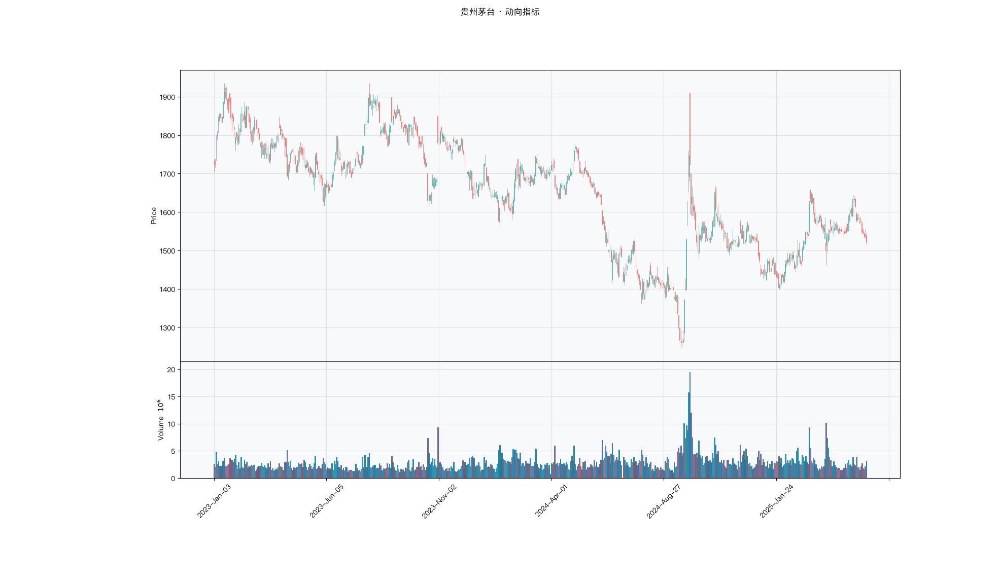

# 第017章 动向指标（DMI）

一位交易者复盘时发现，同样是上涨，有些日子低开高走、每天创出新高，有些日子高开后一路被卖。前者他敢拿，后者他拿不住，两者在收盘价上的涨幅却差不多。他把每天的高点与低点分别排开，才看出两者的区别在波动的方向，而不在涨跌的幅度。他想把上涨的力度和下跌的力度分开计量，而不是只看价格最终涨了多少。动向指标要回答的，就是方向与力度能否拆成两个数。

## 名称与来历

动向指标（Directional Movement Index，DMI），也叫动向指数。

它由 J. 威尔斯·怀尔德（J. Welles Wilder）在 1978 年的《技术交易系统新概念》中提出，与平均趋向指数来自同一套方法。区别在范围：平均趋向指数只回答"趋势有多强"，DMI 在此之上多回答两个问题，趋势朝哪个方向，以及这个方向能不能持续。它由正向趋向、负向趋向、平均趋向指数、平均趋向评级四个部分构成，把它们放在一起，给出方向、强度、持续性三个维度的判断。

## 核心逻辑

趋势有没有方向，强度够不够，能不能延续，这三个问题能不能用同一套数字回答？

此前的均线类指标都先平滑价格，再从价格里找方向。怀尔德换了一条路：不去平滑价格，而是直接度量价格当日的方向性变动。今天的高点比昨天高了多少，今天的低点比昨天低了多少，把向上的部分和向下的部分分别累加起来，用它们的比值构造出两个方向指数。这样得到的方向判断，不依赖均线，也就没有了均线固有的滞后。

三个维度各有分工。方向回答当前是多还是空，强度回答这个方向值不值得跟，持续性回答它能不能一直跟。三者结合，就形成了一个从市况判断到方向选择再到持续确认的框架。DMI 的核心用途不是给点位，而是先筛选出值得交易的市况，再在其中找方向。

## 计算公式

DMI 的计算围绕方向性变动展开，默认周期为 14 日，依次计算真实波幅、方向移动、方向指数、趋向指数差与平均趋向指数、平均趋向评级。

### 真实波幅

真实波幅（TR）反映单日价格波动的实际影响力，取三个候选值的最大者：

$$\mathrm{TR}_t = \max\bigl(H_t - L_t,\ \lvert H_t - C_{t-1}\rvert,\ \lvert L_t - C_{t-1}\rvert\bigr)$$

其中 $H_t$、$L_t$、$C_t$ 分别为当日最高价、最低价、收盘价。前一项是当日的日内振幅，后两项处理跳空情形，使 TR 覆盖缺口带来的真实波动。

### 方向移动

方向移动（DM）只统计形成明确方向的那部分波动，同一日不会同时存在正向与负向。先比较向上的幅度与向下的幅度：

$$\mathrm{up}_t = H_t - H_{t-1}, \qquad \mathrm{down}_t = L_{t-1} - L_t$$

正向方向移动与负向方向移动按规则取值：

$$\mathrm{DM}^+_t = \begin{cases}\mathrm{up}_t & \mathrm{up}_t > \mathrm{down}_t \text{ 且 } \mathrm{up}_t > 0 \\ 0 & \text{否则}\end{cases}$$

$$\mathrm{DM}^-_t = \begin{cases}\mathrm{down}_t & \mathrm{down}_t > \mathrm{up}_t \text{ 且 } \mathrm{down}_t > 0 \\ 0 & \text{否则}\end{cases}$$

若两个幅度都为负，则两者都取零。规则保证方向唯一。

### 方向指数

把方向移动与真实波幅各自做周期平滑，再取比值并放大到 0 至 100 的量级：

$$\mathrm{DI}^+_t = \frac{\mathrm{EMA}(\mathrm{DM}^+, n)_t}{\mathrm{EMA}(\mathrm{TR}, n)_t}\times 100, \qquad \mathrm{DI}^-_t = \frac{\mathrm{EMA}(\mathrm{DM}^-, n)_t}{\mathrm{EMA}(\mathrm{TR}, n)_t}\times 100$$

正向方向指数与负向方向指数之和通常接近 100，两者的相对大小反映多空谁占优。

### 趋向指数差与平均趋向指数

先由两个方向指数构造趋向指数差（DX）：

$$\mathrm{DX}_t = \frac{\lvert \mathrm{DI}^+_t - \mathrm{DI}^-_t \rvert}{\mathrm{DI}^+_t + \mathrm{DI}^-_t}\times 100$$

DX 反映方向性变动的集中程度，差值越大，说明某一方向越明确。再对 DX 做周期平滑，得到平均趋向指数：

$$\mathrm{ADX}_t = \mathrm{EMA}(\mathrm{DX}, n)_t$$

ADX 与方向无关，只度量趋势强度。

### 平均趋向评级

平均趋向评级（ADXR）是 ADX 的再平滑，用于检验趋势的持续性：

$$\mathrm{ADXR}_t = \frac{\mathrm{ADX}_t + \mathrm{ADX}_{t-n}}{2}$$

**参数含义。**

| 参数 | 含义 | 默认值 | 影响 |
|---|---|---|---|
| n | 各步平滑的周期 | 14 | 越大越平稳，信号越滞后 |
| 平滑方式 | 指数移动平均 | EMA | 比简单平均更重近期 |
| 阈值 | 市况分界 | 25 / 40 | 25 以下视为震荡，40 以上视为强趋势 |
| 持续性阈值 | ADXR 分界 | 20 | 低于 20 视为持续性不足 |

**计算示例。** 设某日 $\mathrm{EMA}(\mathrm{DM}^+, 14) = 1.20$，$\mathrm{EMA}(\mathrm{DM}^-, 14) = 0.60$，$\mathrm{EMA}(\mathrm{TR}, 14) = 3.00$，则

$$\mathrm{DI}^+ = \frac{1.20}{3.00}\times 100 = 40.0, \qquad \mathrm{DI}^- = \frac{0.60}{3.00}\times 100 = 20.0$$

方向指数差：

$$\mathrm{DX} = \frac{\lvert 40.0 - 20.0\rvert}{40.0 + 20.0}\times 100 = \frac{20}{60}\times 100 \approx 33.3$$

对 DX 做 14 日平滑后得到 ADX。若 ADX 为 30，说明趋势强度中等偏强；正向方向指数高于负向方向指数，方向偏多。这一组合指向"强度中等偏上、方向偏多的趋势市"。

## 用法与信号

**市况划分。** 这是 DMI 最核心的功能，用平均趋向指数与平均趋向评级的双阈值区分市况。平均趋向指数低于 25 时多空均衡，方向指数频繁交叉，缺乏操作价值；位于 25 至 40 之间且 ADXR 不低于 20，属于弱持续趋势；达到 40 以上且 ADXR 不低于 20，属于强持续趋势。若平均趋向指数达标但 ADXR 低于 20，则更像短期波动造成的伪趋势，可靠性较低。

**方向确认。** 只有在趋势市成立的前提下，方向指数的交叉才有意义。正向方向指数上穿负向方向指数为金叉，方向转多；下穿为死叉，方向转空。若交叉发生时平均趋向指数偏低，交叉更可能是假突破，应放弃。

**持续性的同步。** 平均趋向指数与 ADXR 同步上升，说明趋势强度增强且持续，可考虑加仓；两者同步下降，说明强度减弱且缺乏持续，应减仓；平均趋向指数上升而 ADXR 下降，说明强度可能虚增而无持续，需要警惕反转。

**趋势终结。** 当平均趋向指数跌破 25、ADXR 跌破 20、且方向指数发生反向交叉时，三者同向确认趋势终结，可考虑清仓。相比单一阈值，三重条件的止损更晚一些，但也更不容易被短期波动震出。

## 边界与误区

**只看方向指数交叉，忽略强度与持续性。** 方向指数交叉只代表方向变化，并不代表趋势成立。正向方向指数上穿负向方向指数而平均趋向指数偏低时，往往是假多头。交叉必须与强度、持续性条件一起看。

**认为平均趋向指数高就等于趋势持续。** 平均趋向指数高只说明当前强度足，还需 ADXR 达标来确认持续性。平均趋向指数偏高而 ADXR 偏低时，趋势可能是短期波动堆出来的，容易反转。

**各步参数不同步。** 平均趋向评级是平均趋向指数的再平滑，两者参数必须一致，否则持续性判断会失真。把其中一个周期改掉而另一个不改，会让两个数值的对比失去意义。

**在震荡市中强行找信号。** 平均趋向指数低于 25 时多空没有明确方向，方向指数交叉与强度波动都缺乏意义。这类行情更适合换用偏震荡的工具，而不是继续在 DMI 上找信号。

## 它被检验过吗

DMI 缺少针对它的独立同行评议检验。这条链的完整版见第 007 章。可引用的证据只来自趋势规则族的整体检验，这类检验无法把绩效归因到方向指数、趋向指数与平均趋向评级的组合，也无法说明拆分方向与力度是否带来了增量。

这不构成否证。它说明 DMI 的三层结构是设计上的分解，其有效性还没有被单独核对。一个流传数十年的指标体系缺少这种核对，传播更多依靠图形直觉。

这一类的真实失效案例，见第 008 章的「真实案例与失败模式」。

## 代码实现

### R

```r
library(ettr)
library(efactorcraft)
library(efincharts)
library(ggplot2)

# 本地数据由 xquant-db 导出，字段见 data/README.md
# 同一章会多次用到这两份数据，这里读一次缓存起来，避免反复解压
.cache <- new.env(parent = emptyenv())
.blue <- function() {
  if (!exists("b", .cache)) {
    b <- read.csv("data/parquet/panel_blue_chip.csv", stringsAsFactors = FALSE)
    b$date <- as.Date(b$date)
    assign("b", b, .cache)
  }
  get("b", .cache)
}
.panel <- function() {
  if (!exists("p", .cache)) {
    # 287 只的完整面板压成 gz，read.csv 支持 gz
    p <- read.csv("data/parquet/panel_r.csv.gz", stringsAsFactors = FALSE)
    p$date <- as.Date(p$date)
    p <- p[p$date >= "2023-01-01" & p$date <= "2025-06-01", ]
    assign("p", p, .cache)
  }
  get("p", .cache)
}
blue  <- .blue()
panel <- .panel()

# efincharts 要求 xts 且列名带 Adjusted
as_xts <- function(df) {
  x <- xts::xts(df[, c("open", "high", "low", "close", "volume", "adjusted")],
                order.by = df$date)
  colnames(x) <- c("Open", "High", "Low", "Close", "Volume", "Adjusted")
  x
}

maotai <- .blue()[.blue()$code == "600519.SS", ]

# 1. ettr 在长格式面板上追加指标列
maotai <- add_adx(maotai)

# 2. 基本统计
cols <- setdiff(names(maotai), names(blue))
print(summary(maotai[, cols]))

# 3. K 线 + 成交量 + 均线
ch <- ecandlesticks(as_xts(maotai), show_ma = TRUE, ma_periods = c(20, 60),
                    title = "贵州茅台 · 动向指标")
ggsave("assets/figures/ch017/indicator_r.png", ch$combined_plot,
       width = 10, height = 6, dpi = 110)
```

### Python

```python
import pandas as pd
import ettr
import efactorcraft as efc
import efincharts as efc_

# 中文字体：mplfinance 会用 style 里的 rc 覆盖全局设置，必须写进 style
from efincharts import theme
theme.efin_style["rc"] = {
    "font.sans-serif": ["PingFang SC", "Heiti SC", "SimHei"],
    "axes.unicode_minus": False,
    "font.family": "sans-serif",
}

# 本地数据由 xquant-db 导出，字段见 data/README.md
blue = pd.read_parquet("data/parquet/panel_blue_chip.parquet")
panel = pd.read_parquet("data/parquet/panel.parquet")
panel = panel[(panel["date"] >= "2023-01-01") & (panel["date"] <= "2025-06-01")]


def one(df, code="600519.SS"):
    """取单只标的，转成 efincharts 需要的宽表。"""
    x = df[df["code"] == code].sort_values("date").set_index("date")
    x.columns = [c.capitalize() for c in x.columns]
    return x

# 1. 取单只标的
maotai = blue[blue['code'] == '600519.SS'].copy()

# 2. ettr 在长格式面板上追加指标列，不需要手工 rolling
maotai = ettr.adx(maotai)

cols = [c for c in maotai.columns if c not in blue.columns]
print(maotai[cols].describe().round(3))

# 3. 画图：K 线 + 成交量 + 指标面板
px = one(maotai)
ch = efc_.candlestick(px, volume=True, title="贵州茅台 · 动向指标")
ch.save("assets/figures/ch017/indicator.png")
```

<!-- fig-indicator:start -->


<p class="figcap">图 17-1　动向指标在贵州茅台上的读数（2023-01 至 2025-06）</p>
<!-- fig-indicator:end -->

## 拆解

DMI 的两个方向指数都以真实波幅归一，已是 0 至 100 的相对量，跨标的可比。但两者的差值仍受波动总水平影响：正向与负向同时很高时，差值也会变大，方向却未必更明确。第一步不是取差值，而是用两者之和再做一次归一。

| 特征名 | 计算式 | 量纲 | 经济含义 |
|--------|--------|------|----------|
| 方向强度 | $(\mathrm{DI}^+_t-\mathrm{DI}^-_t)/(\mathrm{DI}^+_t+\mathrm{DI}^-_t)$ | 归一到 −1 至 1 | 多空方向的净强度 |
| 方向强度变化 | $\mathrm{dir}_t-\mathrm{dir}_{t-5}$ | 无量纲比例 | 方向优势在扩张还是收缩 |
| 交叉状态 | $\mathbf{1}\left[\mathrm{DI}^+_t>\mathrm{DI}^-_t\right]$ | 0 或 1 | 当前由哪一方主导 |
| 门限标记 | $\mathbf{1}\left[\mathrm{ADX}_t\ge 25\right]$ | 0 或 1 | 是否处于可交易的趋势市 |

四者性质差别很大。方向强度适合排序；它的差分噪音重，只宜判断优势的增减；交叉状态一旦形成会持续数周，自相关很强；门限标记不含方向，价值在分组。

交叉状态的自相关最容易被忽略。它不是每天独立抽取的伯努利变量，而是一段有记忆的状态。日频 IC 中相邻交易日的样本高度重叠，有效样本数远小于名义样本数，t 统计量会被高估。要用它做检验，应先把状态转成事件，只在交叉当日取样。

### R

```r
library(ettr)
library(efactorcraft)
library(efincharts)
library(ggplot2)

# 本地数据由 xquant-db 导出，字段见 data/README.md
# 同一章会多次用到这两份数据，这里读一次缓存起来，避免反复解压
.cache <- new.env(parent = emptyenv())
.blue <- function() {
  if (!exists("b", .cache)) {
    b <- read.csv("data/parquet/panel_blue_chip.csv", stringsAsFactors = FALSE)
    b$date <- as.Date(b$date)
    assign("b", b, .cache)
  }
  get("b", .cache)
}
.panel <- function() {
  if (!exists("p", .cache)) {
    # 287 只的完整面板压成 gz，read.csv 支持 gz
    p <- read.csv("data/parquet/panel_r.csv.gz", stringsAsFactors = FALSE)
    p$date <- as.Date(p$date)
    p <- p[p$date >= "2023-01-01" & p$date <= "2025-06-01", ]
    assign("p", p, .cache)
  }
  get("p", .cache)
}
blue  <- .blue()
panel <- .panel()

# efincharts 要求 xts 且列名带 Adjusted
as_xts <- function(df) {
  x <- xts::xts(df[, c("open", "high", "low", "close", "volume", "adjusted")],
                order.by = df$date)
  colnames(x) <- c("Open", "High", "Low", "Close", "Volume", "Adjusted")
  x
}

d <- .blue()[.blue()$code == "600519.SS", ]
d <- add_adx(d)

# 转成无量纲因子
d$f <- d$`DIp_14` - d$DIn_14

print(summary(d$f))
```

### Python

```python
import pandas as pd
import ettr
import efactorcraft as efc
import efincharts as efc_

# 中文字体：mplfinance 会用 style 里的 rc 覆盖全局设置，必须写进 style
from efincharts import theme
theme.efin_style["rc"] = {
    "font.sans-serif": ["PingFang SC", "Heiti SC", "SimHei"],
    "axes.unicode_minus": False,
    "font.family": "sans-serif",
}

# 本地数据由 xquant-db 导出，字段见 data/README.md
blue = pd.read_parquet("data/parquet/panel_blue_chip.parquet")
panel = pd.read_parquet("data/parquet/panel.parquet")
panel = panel[(panel["date"] >= "2023-01-01") & (panel["date"] <= "2025-06-01")]


def one(df, code="600519.SS"):
    """取单只标的，转成 efincharts 需要的宽表。"""
    x = df[df["code"] == code].sort_values("date").set_index("date")
    x.columns = [c.capitalize() for c in x.columns]
    return x

# 1. 先在面板上算原始指标
d = panel.copy()
d = ettr.adx(d)

# 2. 转成无量纲因子，才能跨标的排序
d["f"] = d["DIp_14"] - d.DIn_14

print(d["f"].describe().round(4))
```

## 截面选股能力

DMI 的横截面因子以方向强度为主：

$$f^{dir}_t=\frac{\mathrm{DI}^+_t-\mathrm{DI}^-_t}{\mathrm{DI}^+_t+\mathrm{DI}^-_t}$$

另一个候选是交叉状态本身。若两者 IC 接近，说明起作用的只是多空归属，强度细分没有增量。

预期表现上，方向强度属于动量型，方向通常偏正。它与价格动量的区别在于分子只统计方向性移动，把横盘波动剔除在外，因此在高波动、无方向的标的上读数更低，反转时反应也更慢。市况依赖明显：DMI 的前提是先有趋势，ADX 偏低时符号容易反复。标的层面，波动率适中、走势连贯的品种持续性更强。

检验时有三点需要注意。第一，交叉状态是状态变量而非事件，日频 IC 会因自相关而高估显著性，稳妥的做法是只取交叉当日或按周频重采样。第二，方向强度与二十日动量相关性不低，判断增量应做残差检验。第三，正负两侧的预测力可能不对称，分组报告比单一均值有信息量。

### R

```r
library(ettr)
library(efactorcraft)
library(efincharts)
library(ggplot2)

# 本地数据由 xquant-db 导出，字段见 data/README.md
# 同一章会多次用到这两份数据，这里读一次缓存起来，避免反复解压
.cache <- new.env(parent = emptyenv())
.blue <- function() {
  if (!exists("b", .cache)) {
    b <- read.csv("data/parquet/panel_blue_chip.csv", stringsAsFactors = FALSE)
    b$date <- as.Date(b$date)
    assign("b", b, .cache)
  }
  get("b", .cache)
}
.panel <- function() {
  if (!exists("p", .cache)) {
    # 287 只的完整面板压成 gz，read.csv 支持 gz
    p <- read.csv("data/parquet/panel_r.csv.gz", stringsAsFactors = FALSE)
    p$date <- as.Date(p$date)
    p <- p[p$date >= "2023-01-01" & p$date <= "2025-06-01", ]
    assign("p", p, .cache)
  }
  get("p", .cache)
}
blue  <- .blue()
panel <- .panel()

# efincharts 要求 xts 且列名带 Adjusted
as_xts <- function(df) {
  x <- xts::xts(df[, c("open", "high", "low", "close", "volume", "adjusted")],
                order.by = df$date)
  colnames(x) <- c("Open", "High", "Low", "Close", "Volume", "Adjusted")
  x
}

d <- .panel()
d <- add_adx(d)

d$f <- d$`DIp_14` - d$DIn_14
d <- add_next_return(d, close_col = "close", n = c(1, 5, 20))

ic <- ic_analysis(d, factor_cols = "f",
                    forward_cols = c("forward_1", "forward_5", "forward_20"),
                    method = "spearman")
print(ir_analysis(ic))

q <- quantile_analysis(d, factor_cols = "f", forward_cols = "forward_5",
                       n_groups = 5)
print(q$f$summary)
```

### Python

```python
import pandas as pd
import ettr
import efactorcraft as efc
import efincharts as efc_

# 中文字体：mplfinance 会用 style 里的 rc 覆盖全局设置，必须写进 style
from efincharts import theme
theme.efin_style["rc"] = {
    "font.sans-serif": ["PingFang SC", "Heiti SC", "SimHei"],
    "axes.unicode_minus": False,
    "font.family": "sans-serif",
}

# 本地数据由 xquant-db 导出，字段见 data/README.md
blue = pd.read_parquet("data/parquet/panel_blue_chip.parquet")
panel = pd.read_parquet("data/parquet/panel.parquet")
panel = panel[(panel["date"] >= "2023-01-01") & (panel["date"] <= "2025-06-01")]


def one(df, code="600519.SS"):
    """取单只标的，转成 efincharts 需要的宽表。"""
    x = df[df["code"] == code].sort_values("date").set_index("date")
    x.columns = [c.capitalize() for c in x.columns]
    return x

# 287 只、2023-01 至 2025-06，横截面才有统计意义
src = panel.copy()
d = src.copy()

# 1. 算指标
d = ettr.adx(d)


# 2. 因子 + 未来收益
d["f"] = d["DIp_14"] - d.DIn_14
d = efc.add_next_return(d, periods=(1, 5, 20))

# 3. 截面 IC 与分层
ic = efc.ic_analysis(d, factor_cols="f",
                      forward_cols=["forward_1", "forward_5", "forward_20"],
                      method="spearman")
print(efc.ir_analysis(ic).round(3))

q = efc.quantile_analysis(d, factor_col="f", forward_col="forward_5", n_groups=5)
print(q["summary"].round(4))
```

门限之上与门限之下的 IC 若一正一零，说明因子并非无效，而是需要市况配合；两段都接近零，才说明方向信息不足。

<!-- tab-ic:start -->
**计算结果**

| 前向期 | IC 均值 | IC 标准差 | ICIR | t 值 | IC>0 占比 | 期数 |
|---|---|---|---|---|---|---|
| T+1 | -0.0161 | 0.2253 | -0.072 | -1.71 | 0.4580 | 566 |
| T+5 | -0.0213 | 0.2154 | -0.099 | -2.35 | 0.4800 | 562 |
| T+20 | -0.0445 | 0.1943 | -0.229 | -5.36 | 0.4440 | 547 |

表里最该看的是 t 值，不是 IC 均值。这个因子以 T+1 为主口径，IC 均值 -0.0161、ICIR -0.072、t 值 -1.71，在常规门槛下不显著，方向为反向。按第 007 章给出的日频门槛（ICIR 0.13 对应 t≈2），这个结果的含义是：还看不出与噪声的区别，不能据此构造策略。

需要提醒的是，这只说明排序与未来收益之间存在可测的关联，不代表扣掉成本后还能剩下收益。横截面 IC 检验的是“买哪只”，不负责“值不值得交易”。

**五档分层**

| 分组 | 平均收益 | 标准差 | 期数 |
|---|---|---|---|
| 1 | +0.0034 | +0.0380 | 562 |
| 2 | +0.0037 | +0.0349 | 562 |
| 3 | +0.0025 | +0.0314 | 562 |
| 4 | +0.0023 | +0.0307 | 562 |
| 5 | +0.0046 | +0.0386 | 562 |

五档分层看的是形状，不是单点。最高一档在第 5 组、最低在第 4 组，两端相差 +0.12%，组序号与平均收益的秩相关为 0.17，没有明显单调性。

分层比 IC 更接近实盘，因为它直接给出“买最高档、卖最低档”的收益差。但这里的数字是毛收益，且没有考虑涨跌停买不进、停牌卖不出的情形，真实可得的差额会小于表中所列。
<!-- tab-ic:end -->

## 择时能力

时序上 DMI 的择时逻辑分三层。第一层是方向指数交叉，正向 DI 上穿负向 DI 为做多信号。第二层是 ADX 门限，强度达标时交叉才值得跟。第三层是 ADXR 的持续性，ADX 上升而 ADXR 下降时，强度可能是短期波动堆出来的。

检验方法要与三层结构对应。交叉是离散事件，适合触发日检验。方向强度是连续变量，适合条件分位收益。门限是二元条件，单独做分位没有意义，应转成仓位规则再回测。三层分开，才能看清收益来自方向本身还是市况过滤。

检验有三处陷阱。第一，ADX 门限在 25 附近反复穿越，仓位频繁切换，换手远高于预期，常见处理是加缓冲带，上穿 26 才开、下穿 24 才关。第二，交叉在震荡市大量出现，不做门限过滤时胜率很低，这一点在平均收益里被掩盖，应分段统计。第三，参数 n 同时影响 DI 与 ADX，敏感性检验应整组做。

### R

```r
library(ettr)
library(efactorcraft)
library(efincharts)
library(ggplot2)

# 本地数据由 xquant-db 导出，字段见 data/README.md
# 同一章会多次用到这两份数据，这里读一次缓存起来，避免反复解压
.cache <- new.env(parent = emptyenv())
.blue <- function() {
  if (!exists("b", .cache)) {
    b <- read.csv("data/parquet/panel_blue_chip.csv", stringsAsFactors = FALSE)
    b$date <- as.Date(b$date)
    assign("b", b, .cache)
  }
  get("b", .cache)
}
.panel <- function() {
  if (!exists("p", .cache)) {
    # 287 只的完整面板压成 gz，read.csv 支持 gz
    p <- read.csv("data/parquet/panel_r.csv.gz", stringsAsFactors = FALSE)
    p$date <- as.Date(p$date)
    p <- p[p$date >= "2023-01-01" & p$date <= "2025-06-01", ]
    assign("p", p, .cache)
  }
  get("p", .cache)
}
blue  <- .blue()
panel <- .panel()

# efincharts 要求 xts 且列名带 Adjusted
as_xts <- function(df) {
  x <- xts::xts(df[, c("open", "high", "low", "close", "volume", "adjusted")],
                order.by = df$date)
  colnames(x) <- c("Open", "High", "Low", "Close", "Volume", "Adjusted")
  x
}

idx <- read.csv("data/parquet/index_daily.csv", stringsAsFactors = FALSE)
idx$date <- as.Date(idx$date)
t <- idx[idx$code == "510300.SS", ]
t <- add_adx(t)
t$f <- t$`DIp_14` - t$DIn_14
t$forward_5 <- c(tail(t$close, -5) / head(t$close, -5) - 1, rep(NA, 5))
t$q <- cut(t$f, quantile(t$f, 0:5/5, na.rm = TRUE), include.lowest = TRUE, labels = FALSE)
print(aggregate(forward_5 ~ q, data = t, FUN = function(x)
  c(mean = mean(x, na.rm = TRUE), n = sum(!is.na(x)))))
```

### Python

```python
import pandas as pd
import ettr
import efactorcraft as efc
import efincharts as efc_

# 中文字体：mplfinance 会用 style 里的 rc 覆盖全局设置，必须写进 style
from efincharts import theme
theme.efin_style["rc"] = {
    "font.sans-serif": ["PingFang SC", "Heiti SC", "SimHei"],
    "axes.unicode_minus": False,
    "font.family": "sans-serif",
}

# 本地数据由 xquant-db 导出，字段见 data/README.md
blue = pd.read_parquet("data/parquet/panel_blue_chip.parquet")
panel = pd.read_parquet("data/parquet/panel.parquet")
panel = panel[(panel["date"] >= "2023-01-01") & (panel["date"] <= "2025-06-01")]


def one(df, code="600519.SS"):
    """取单只标的，转成 efincharts 需要的宽表。"""
    x = df[df["code"] == code].sort_values("date").set_index("date")
    x.columns = [c.capitalize() for c in x.columns]
    return x

# 择时检验用 ETF 做市场载体，指数本身没有日线数据
idx = pd.read_parquet("data/parquet/index_daily.parquet")
idx = idx[idx["code"] == "510300.SS"].sort_values("date")
t = idx.copy()

# 1. 在 ETF 上算同一个指标
t = ettr.adx(d)


# 2. 按因子分位看未来 5 日收益
t["f"] = t["DIp_14"] - t.DIn_14
t["forward_5"] = t["close"].shift(-5) / t["close"] - 1
# 因子可能有重复值，先按名次切，避免 qcut 报边界不唯一
t["q"] = pd.qcut(t["f"].rank(method="first"), 5, labels=False) + 1
t = t.dropna(subset=["f", "forward_5"])
print(t.groupby("q")["forward_5"].agg(["mean", "count"]).round(4))
```

三项连起来看：触发日之后是否真的不同、不同档位的收益是否单调、按规则做是否优于一直持有。若第二项在高档位回落，说明强度过高时可能已接近趋势末端，需要的是止盈而非加仓。

<!-- tab-timing:start -->
**分位收益**

| 分位 | 未来 5 日均值 | 样本数 |
|---|---|---|
| 1 | -0.0004 | 220 |
| 2 | -0.0005 | 219 |
| 3 | +0.0011 | 219 |
| 4 | -0.0007 | 219 |
| 5 | +0.0002 | 219 |

择时口径与截面不同：这里只有一个标的，看的是同一标的在不同分位下的未来收益。最高与最低分位相差 +0.06%。单标的样本有限，这个差额很容易被一两段行情主导，只能作为方向参考。

真正做择时要问的是三件事：分位阈值是否稳定、换手是否可控、扣成本后是否还有剩余。三者缺一，择时信号就只是图上好看。
<!-- tab-timing:end -->

## 组合使用与验证

常见的搭档有两个。与成交量搭配，确认交叉时的参与度，放量交叉通常更可靠。与平均真实波幅搭配，把止损距离按波动缩放，避免在高低波动品种上用同一个百分比。

**组合的截面验证。** 把方向强度与量比因子标准化后加权相加，再走一遍截面检验，比较组合与两个单特征的 ICIR。先算两者的横截面相关，相关性低才有组合的必要。

**组合的择时验证。** 把"方向强度为正且 ADX 不低于 25"设为持仓条件，满足时持有、否则空仓，计算年化收益、夏普与最大回撤，再与单用方向强度对照。门限的作用通常是减少交易次数与回撤，收益未必提高。

增益的判读依据方法论章的标准：**组合的 ICIR 高于两个单特征，才说明存在互补性；介于两者之间，说明只是平均；低于两者，说明信号互相抵消。** DMI 与 ADX 同源，把 ADX 当独立因子叠加不会带来新信息；它与成交量的维度差异更大。

### R

```r
library(ettr)
library(efactorcraft)
library(efincharts)
library(ggplot2)

# 本地数据由 xquant-db 导出，字段见 data/README.md
# 同一章会多次用到这两份数据，这里读一次缓存起来，避免反复解压
.cache <- new.env(parent = emptyenv())
.blue <- function() {
  if (!exists("b", .cache)) {
    b <- read.csv("data/parquet/panel_blue_chip.csv", stringsAsFactors = FALSE)
    b$date <- as.Date(b$date)
    assign("b", b, .cache)
  }
  get("b", .cache)
}
.panel <- function() {
  if (!exists("p", .cache)) {
    # 287 只的完整面板压成 gz，read.csv 支持 gz
    p <- read.csv("data/parquet/panel_r.csv.gz", stringsAsFactors = FALSE)
    p$date <- as.Date(p$date)
    p <- p[p$date >= "2023-01-01" & p$date <= "2025-06-01", ]
    assign("p", p, .cache)
  }
  get("p", .cache)
}
blue  <- .blue()
panel <- .panel()

# efincharts 要求 xts 且列名带 Adjusted
as_xts <- function(df) {
  x <- xts::xts(df[, c("open", "high", "low", "close", "volume", "adjusted")],
                order.by = df$date)
  colnames(x) <- c("Open", "High", "Low", "Close", "Volume", "Adjusted")
  x
}

d <- .panel()
d <- add_adx(d)
d$f1 <- d$`DIp_14` - d$DIn_14
d <- add_cmf(d, n = 20)
d$f2 <- d$CMF
d <- add_next_return(d, close_col = "close", n = 5)
ic1 <- ic_analysis(d, factor_cols = c("f1", "f2"),
                    forward_cols = "forward_5", method = "spearman")
print(ir_analysis(ic1))
```

```r
library(ettr)
library(efactorcraft)
library(efincharts)
library(ggplot2)

# 本地数据由 xquant-db 导出，字段见 data/README.md
# 同一章会多次用到这两份数据，这里读一次缓存起来，避免反复解压
.cache <- new.env(parent = emptyenv())
.blue <- function() {
  if (!exists("b", .cache)) {
    b <- read.csv("data/parquet/panel_blue_chip.csv", stringsAsFactors = FALSE)
    b$date <- as.Date(b$date)
    assign("b", b, .cache)
  }
  get("b", .cache)
}
.panel <- function() {
  if (!exists("p", .cache)) {
    # 287 只的完整面板压成 gz，read.csv 支持 gz
    p <- read.csv("data/parquet/panel_r.csv.gz", stringsAsFactors = FALSE)
    p$date <- as.Date(p$date)
    p <- p[p$date >= "2023-01-01" & p$date <= "2025-06-01", ]
    assign("p", p, .cache)
  }
  get("p", .cache)
}
blue  <- .blue()
panel <- .panel()

# efincharts 要求 xts 且列名带 Adjusted
as_xts <- function(df) {
  x <- xts::xts(df[, c("open", "high", "low", "close", "volume", "adjusted")],
                order.by = df$date)
  colnames(x) <- c("Open", "High", "Low", "Close", "Volume", "Adjusted")
  x
}

d <- .panel()
d <- add_adx(d)
d$f1 <- d$`DIp_14` - d$DIn_14
d <- add_cmf(d, n = 20)
d$f2 <- d$CMF
d <- add_next_return(d, close_col = "close", n = 5)
ic1 <- ic_analysis(d, factor_cols = c("f1", "f2"),
                    forward_cols = "forward_5", method = "spearman")
print(ir_analysis(ic1))
```

### Python

```python
import pandas as pd
import ettr
import efactorcraft as efc
import efincharts as efc_

# 中文字体：mplfinance 会用 style 里的 rc 覆盖全局设置，必须写进 style
from efincharts import theme
theme.efin_style["rc"] = {
    "font.sans-serif": ["PingFang SC", "Heiti SC", "SimHei"],
    "axes.unicode_minus": False,
    "font.family": "sans-serif",
}

# 本地数据由 xquant-db 导出，字段见 data/README.md
blue = pd.read_parquet("data/parquet/panel_blue_chip.parquet")
panel = pd.read_parquet("data/parquet/panel.parquet")
panel = panel[(panel["date"] >= "2023-01-01") & (panel["date"] <= "2025-06-01")]


def one(df, code="600519.SS"):
    """取单只标的，转成 efincharts 需要的宽表。"""
    x = df[df["code"] == code].sort_values("date").set_index("date")
    x.columns = [c.capitalize() for c in x.columns]
    return x

d = panel.copy()

# 1. 本章因子
d = ettr.adx(d)
d["f1"] = d["DIp_14"] - d.DIn_14

# 2. 配一个量价因子做对照
d = ettr.cmf(d, n=20)
d["f2"] = d["CMF_20"]
d = efc.add_next_return(d, periods=(5,))

# 3. 单因子与等权组合的信息比率
ic = efc.ic_analysis(d, factor_cols=["f1", "f2"], forward_cols=["forward_5"],
                      method="spearman")
d = efc.equal_weighted_composite(d, factor_cols=["f1", "f2"], new_col="f1_f2")
ic2 = efc.ic_analysis(d, factor_cols=["f1_f2"], forward_cols=["forward_5"],
                      method="spearman")
ic.update(ic2)
print(efc.ir_analysis(ic).round(3))
```

```python
import pandas as pd
import ettr
import efactorcraft as efc
import efincharts as efc_

# 中文字体：mplfinance 会用 style 里的 rc 覆盖全局设置，必须写进 style
from efincharts import theme
theme.efin_style["rc"] = {
    "font.sans-serif": ["PingFang SC", "Heiti SC", "SimHei"],
    "axes.unicode_minus": False,
    "font.family": "sans-serif",
}

# 本地数据由 xquant-db 导出，字段见 data/README.md
blue = pd.read_parquet("data/parquet/panel_blue_chip.parquet")
panel = pd.read_parquet("data/parquet/panel.parquet")
panel = panel[(panel["date"] >= "2023-01-01") & (panel["date"] <= "2025-06-01")]


def one(df, code="600519.SS"):
    """取单只标的，转成 efincharts 需要的宽表。"""
    x = df[df["code"] == code].sort_values("date").set_index("date")
    x.columns = [c.capitalize() for c in x.columns]
    return x

d = panel.copy()

# 1. 本章因子
d = ettr.adx(d)
d["f1"] = d["DIp_14"] - d.DIn_14

# 2. 配一个量价因子做对照
d = ettr.cmf(d, n=20)
d["f2"] = d["CMF_20"]
d = efc.add_next_return(d, periods=(5,))

# 3. 单因子与等权组合的信息比率
ic = efc.ic_analysis(d, factor_cols=["f1", "f2"], forward_cols=["forward_5"],
                      method="spearman")
d = efc.equal_weighted_composite(d, factor_cols=["f1", "f2"], new_col="f1_f2")
ic2 = efc.ic_analysis(d, factor_cols=["f1_f2"], forward_cols=["forward_5"],
                      method="spearman")
ic.update(ic2)
print(efc.ir_analysis(ic).round(3))
```

三行截面输出要并排读。组合高于两者说明互补，介于两者之间说明只是平均，低于两者说明信号在某些时段冲突。择时那一组再看：门限加上去后若交易次数大幅下降而夏普上升，说明过滤有效；若夏普也下降，说明砍掉的盈利段更多。

## AI 引导词

::: prompt 引导词 1：方向因子与强度因子的分解检验

我在研究动向指标（DMI）。请帮我设计一个分解检验：1）因子一为正负方向指数之差，代表方向；2）因子二为平均趋向指数，代表强度；3）在 A 股沪深 300 成分股 2020 至 2024 年的数据上，分别计算两者与未来 1 日、5 日收益的 Rank IC 与 ICIR；4）输出对比表格，并说明方向因子与强度因子的预测方向是否一致、强度因子是否需要结合方向使用。请输出可直接运行的 Python 代码，只使用 pandas、numpy、yfinance、matplotlib。

:::
::: prompt 引导词 2：趋势市与震荡市的分段检验

请帮我写一段 Python 代码，检验 DMI 方向因子在趋势市与震荡市中的表现差异。要求：1）以 14 日平均趋向指数是否达到 25 划分两种市况；2）分别计算方向指数之差因子与未来 5 日收益的 IC 均值与 ICIR；3）统计两种市况下方向指数交叉的次数与后续收益；4）用文字说明为什么 DMI 只在趋势市中有效。数据用 yfinance 获取，代码需保证可直接运行。

:::
::: prompt 引导词 3：三维信号的规则化回测

我希望把 DMI 的多条件信号做成可回测策略。请帮我把"平均趋向指数不低于 25、平均趋向评级不低于 20、正向方向指数上穿负向方向指数"写成明确规则，包括：1）三个条件的判定方式与优先级；2）建仓与清仓时点；3）趋势终结时的清仓条件；4）A 股回测需要扣除的费率与印花税取值。请给出 R 和 Python 两版实现，并说明如何避免未来函数与幸存者偏差。

:::
