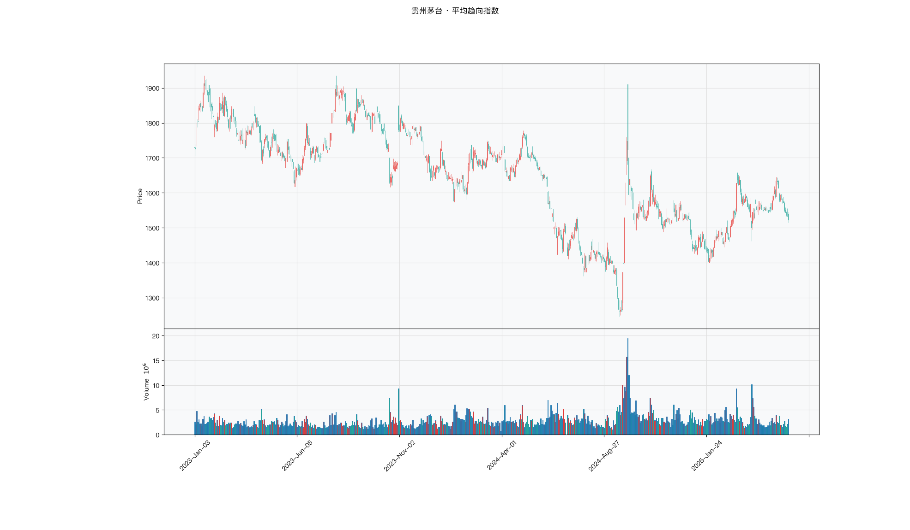

# 第018章 平均趋向指数（ADX）

一位交易者在震荡市里接连被均线金叉骗了几次，每次止损后价格又回到区间中间。他把这段时间的交叉全部标出来，发现信号密集，却没有一段能走出区间。他意识到问题不在信号本身，而在于没有先判断这段行情有没有趋势。均线只给出方向，没有说明这个方向值不值得跟。平均趋向指数要回答的，就是在任何方向信号之前，先确认市场有没有趋势。

## 名称与来历

平均趋向指数（Average Directional Index，ADX）。

它由 J. 威尔斯·怀尔德（J. Welles Wilder）在 1978 年的《技术交易系统新概念》中提出，与动向指标同时问世。怀尔德要解决的问题与前人不同：他不关心趋势朝哪个方向走，只关心趋势到底有多强。在 1978 年之前，趋势市用趋势指标、震荡市用震荡指标是一种经验说法，但没有定量标准。ADX 用一个 0 至 100 的数值填补了这个空缺，告诉交易者当前是值得顺势跟单的趋势市，还是应该袖手旁观的震荡市。

## 核心逻辑

趋势是强还是弱，能不能用一个数字直接量出来，而不必先判断方向？

ADX 的答案是：度量价格形成明确方向的集中程度。它仍然从当日的方向性变动出发，用向上的幅度和向下的幅度分别构造两个方向指数，但最终关心的不是谁大谁小，而是两者差距占整体波动的比例有多大。差距占比越大，说明方向越集中，趋势越强；差距占比越小，说明多空力量接近，趋势越弱。这个占比经过平滑，就是 ADX。

它在设计上有一个关键属性：与方向无关。无论市场是强多头还是强空头，只要方向足够集中，ADX 都会走高。所以 ADX 不能单独用来判断做多还是做空，它只回答强度。通常的用法是先把 ADX 当作市况开关，只有它达到某个水平，才启用趋势类指标；达不到，就说明市场缺乏方向，趋势指标容易失效。它为趋势交易提供了一个前置条件。也正因为它只保留强度、丢弃方向，ADX 无法单独构成一套完整的交易信号，它的价值更多体现在与其他指标的配合上，为均线交叉、突破、动能等信号提供一层市况过滤。

## 计算公式

ADX 的计算沿用方向性变动的框架，默认周期为 14 日，依次计算真实波幅、方向移动、方向指数、趋向指数差，最后平滑得到 ADX。

### 真实波幅

真实波幅（TR）取三个候选值的最大者：

$$\mathrm{TR}_t = \max\bigl(H_t - L_t,\ \lvert H_t - C_{t-1}\rvert,\ \lvert L_t - C_{t-1}\rvert\bigr)$$

其中 $H_t$、$L_t$、$C_t$ 分别为当日最高价、最低价、收盘价。前一项是日内振幅，后两项覆盖跳空情形。

### 方向移动

先计算两个候选幅度：

$$\mathrm{up}_t = H_t - H_{t-1}, \qquad \mathrm{down}_t = L_{t-1} - L_t$$

按规则取值，保证同一日方向唯一：

$$\mathrm{DM}^+_t = \begin{cases}\mathrm{up}_t & \mathrm{up}_t > \mathrm{down}_t \text{ 且 } \mathrm{up}_t > 0 \\ 0 & \text{否则}\end{cases}, \qquad \mathrm{DM}^-_t = \begin{cases}\mathrm{down}_t & \mathrm{down}_t > \mathrm{up}_t \text{ 且 } \mathrm{down}_t > 0 \\ 0 & \text{否则}\end{cases}$$

### 方向指数

分别对方向移动与真实波幅做周期平滑，再取比值：

$$\mathrm{DI}^+_t = \frac{\mathrm{EMA}(\mathrm{DM}^+, n)_t}{\mathrm{EMA}(\mathrm{TR}, n)_t}\times 100, \qquad \mathrm{DI}^-_t = \frac{\mathrm{EMA}(\mathrm{DM}^-, n)_t}{\mathrm{EMA}(\mathrm{TR}, n)_t}\times 100$$

### 趋向指数差

$$\mathrm{DX}_t = \frac{\lvert \mathrm{DI}^+_t - \mathrm{DI}^-_t \rvert}{\mathrm{DI}^+_t + \mathrm{DI}^-_t}\times 100$$

DX 全部来自两个方向指数的差距，与谁高谁低无关，因此不含方向信息。

### 平均趋向指数

$$\mathrm{ADX}_t = \mathrm{EMA}(\mathrm{DX}, n)_t$$

对 DX 再做一次平滑，得到最终的趋势强度值，取值范围为 0 至 100。

**参数含义。**

| 参数 | 含义 | 默认值 | 影响 |
|---|---|---|---|
| n | 各步平滑的周期 | 14 | 越大越平稳，信号越滞后 |
| 平滑方式 | 指数移动平均 | EMA | 权重向近期倾斜 |
| 阈值 | 市况分界 | 25、40 | 25 以下震荡，25 至 40 弱趋势，40 以上强趋势 |
| 取值范围 | ADX 的上下界 | 0 至 100 | 数值只反映强度，不含方向 |

**计算示例。** 设某日 $\mathrm{EMA}(\mathrm{DM}^+, 14) = 1.20$，$\mathrm{EMA}(\mathrm{DM}^-, 14) = 0.60$，$\mathrm{EMA}(\mathrm{TR}, 14) = 3.00$，则

$$\mathrm{DI}^+ = \frac{1.20}{3.00}\times 100 = 40.0, \qquad \mathrm{DI}^- = \frac{0.60}{3.00}\times 100 = 20.0$$

趋势指数差：

$$\mathrm{DX} = \frac{\lvert 40.0 - 20.0\rvert}{40.0 + 20.0}\times 100 \approx 33.3$$

对 DX 做 14 日平滑后，若 ADX 为 30，说明方向集中程度中等偏上，处于弱趋势与强趋势之间。注意同一组 DX 若来自 $\mathrm{DI}^+ = 20.0$ 与 $\mathrm{DI}^- = 40.0$，ADX 依旧约为 33.3，因为 ADX 不含方向。

## 用法与信号

**市况划分。** 这是 ADX 最核心的功能，用数值阈值直接判断市场有没有操作价值。ADX 低于 25 时多空动能均衡，价格横盘，趋势类指标容易失效，可观望或改用偏震荡的工具；位于 25 至 40 之间，属于弱势趋势，可轻仓参与，并用动态止损保护；达到 40 以上，属于强势趋势，可正常仓位跟随，只要 ADX 不明显回落就继续持有。

**方向确认。** ADX 本身不给方向，需要与两个方向指数配合。在 ADX 达到 25 的前提下，正向方向指数上穿负向方向指数为做多信号，下穿为做空信号。若交叉发生时 ADX 低于 25，交叉大概率是假突破，应放弃。

**强度的变化。** ADX 的升降反映趋势强度的增减。ADX 上升，说明趋势强度持续增强，现有趋势延续的概率较高，可考虑加仓；ADX 下降，说明强度逐步减弱，现有趋势可能放缓或反转，需要减仓。从高位回落但仍处于强趋势区间的 ADX 只是强度减弱，不等于趋势反转，不必立刻清仓。

**趋势终结。** 当 ADX 从高位回落并跌破 25，同时两个方向指数发生反向交叉时，趋势终结的证据较为充分，可考虑清仓。相比只看单条均线穿越，这种判断会稍晚一些，但更不容易被短期波动震出局。

## 边界与误区

**把 ADX 高当作多头信号。** ADX 只度量强度，与方向无关。ADX 走高时，市场可能是强多头，也可能是强空头，必须结合方向指数才能判断做多还是做空。只看 ADX 就动手，会把方向判断完全交给运气。

**认为 ADX 上升就等于趋势延续。** ADX 上升只说明强度增强。如果在 ADX 上升的同时方向指数发生了交叉，强度增强的可能是一个刚刚反向的新趋势。强度与方向需要同时看。

**在震荡市中强行用 ADX 找信号。** ADX 低于 25 时多空没有明确方向，任何基于它的信号都缺乏基础。这类行情的正确做法通常是停止趋势操作，或切换到偏震荡的工具。

**随意改动参数不加检验。** 参数过短，例如 5 日，会把短期波动误判为趋势，ADX 频繁抬升；参数过长，例如 30 日以上，信号会明显滞后，错过趋势初期。参数应按品种与交易周期调整，并通过稳健性检验确认，而不是凭感觉设定。

## 它被检验过吗

ADX 缺少针对它的独立同行评议检验。这条链的完整版见第 007 章。现有证据只能来自趋势规则族的整体检验，而这类检验无法把绩效归因到 ADX 这一层过滤。

这不等于 ADX 的阈值没有用处。25 与 40 是使用惯例，不是检验得到的边界。一个被当作市况开关的指标缺少独立核对，说明它的地位来自实务共识，而不是统计证据。

这一类的真实失效案例，见第 008 章的「真实案例与失败模式」。

## 代码实现

### R

```r
library(ettr)
library(efactorcraft)
library(efincharts)
library(ggplot2)

BASE <- "https://raw.githubusercontent.com/dengyishuo/quant-technical-analysis/main/data/parquet"

# 取数据：本地有就用本地，没有就下载一次并缓存。
# read.csv 对本地 .gz 会自动解压，所以缓存成 .csv.gz 也能直接读。
load_data <- function(name) {
  local <- file.path("data", "parquet", name)
  if (file.exists(local)) return(local)
  cache <- file.path(tools::R_user_dir("qta", "cache"), name)
  if (!file.exists(cache)) {
    dir.create(dirname(cache), recursive = TRUE, showWarnings = FALSE)
    message("下载 ", name, " ...")
    download.file(paste0(BASE, "/", name), cache, mode = "wb", quiet = TRUE)
  }
  cache
}

read_data <- function(name) {
  d <- read.csv(load_data(name), stringsAsFactors = FALSE)
  if ("date" %in% names(d)) d$date <- as.Date(d$date)
  d
}

# 同一章里多次取用，缓存到内存，避免重复解析
.cache <- new.env(parent = emptyenv())
.blue <- function() {
  if (!exists("b", .cache)) assign("b", read_data("panel_blue_chip.csv"), .cache)
  get("b", .cache)
}
.panel <- function() {
  if (!exists("p", .cache)) {
    p <- read_data("panel_r.csv.gz")
    assign("p", p[p$date >= "2023-01-01" & p$date <= "2025-06-01", ], .cache)
  }
  get("p", .cache)
}
.index <- function() read_data("index_daily.csv")

blue  <- .blue()
panel <- .panel()

# 图的保存路径，顺手建目录，避免读者本地没有 assets/ 时报错
fig_path <- function(ch, name = "indicator_r.png") {
  d <- file.path("assets", "figures", sprintf("ch%03d", ch))
  dir.create(d, recursive = TRUE, showWarnings = FALSE)
  file.path(d, name)
}

# efincharts 要求 xts 且列名带 Adjusted
as_xts <- function(df) {
  x <- xts::xts(df[, c("open", "high", "low", "close", "volume", "adjusted")],
                order.by = df$date)
  colnames(x) <- c("Open", "High", "Low", "Close", "Volume", "Adjusted")
  x
}

maotai <- .blue()[.blue()$code == "600519.SS", ]

# 1. ettr 在长格式面板上追加指标列
maotai <- add_adx(maotai)

# 2. 基本统计
cols <- setdiff(names(maotai), names(blue))
print(summary(maotai[, cols]))

# 3. K 线 + 成交量 + 均线
ch <- ecandlesticks(as_xts(maotai), show_ma = TRUE, ma_periods = c(20, 60),
                    title = "贵州茅台 · 平均趋向指数")
ggsave(fig_path(18), ch$combined_plot, width = 10, height = 6, dpi = 110)
```

### Python

```python
import pathlib
import urllib.request

import pandas as pd
import ettr
import efactorcraft as efc
import efincharts as efc_

# 中文字体：mplfinance 会用 style 里的 rc 覆盖全局设置，必须写进 style
from efincharts import theme
theme.efin_style["rc"] = {
    "font.sans-serif": ["PingFang SC", "Heiti SC", "SimHei"],
    "axes.unicode_minus": False,
    "font.family": "sans-serif",
}

# A 股习惯是涨红跌绿，efincharts 的默认配色沿用了欧美习惯（涨绿跌红），
# 这里改回来，也让静态图与网页上的交互图、R 侧的图保持一致。
_mc = theme.efin_style["marketcolors"]
for _k in ("candle", "edge", "wick", "volume"):
    _mc[_k] = {"up": "#e53935", "down": "#26a69a"}

BASE = "https://raw.githubusercontent.com/dengyishuo/quant-technical-analysis/main/data/parquet"
CACHE = pathlib.Path.home() / ".cache" / "qta"
_MEM = {}


def load(name):
    """取数据：本地有就用本地，没有就下载一次并缓存。

    这样三种情形都能跑：
      1. 克隆了整个仓库    -> 直接读 data/parquet/，不联网
      2. 只复制了代码片段  -> 首次自动下载到 ~/.cache/qta，之后走缓存
      3. 之前跑过          -> 全部命中缓存，断网也能用
    """
    if name in _MEM:
        return _MEM[name]
    local = pathlib.Path("data/parquet") / name
    if local.exists():
        path = local
    else:
        CACHE.mkdir(parents=True, exist_ok=True)
        path = CACHE / name
        if not path.exists():
            print("下载 %s ..." % name)
            urllib.request.urlretrieve(BASE + "/" + name, path)
    data = pd.read_parquet(path) if name.endswith(".parquet") else pd.read_csv(path)
    _MEM[name] = data
    return data


blue = load("panel_blue_chip.parquet")
panel = load("panel.parquet")
panel = panel[(panel["date"] >= "2023-01-01") & (panel["date"] <= "2025-06-01")]
idx = load("index_daily.parquet")


def one(df, code="600519.SS"):
    """取单只标的，转成 efincharts 需要的宽表。"""
    x = df[df["code"] == code].sort_values("date").set_index("date")
    x.columns = [c.capitalize() for c in x.columns]
    return x


def fig_path(ch, name="indicator.png"):
    """图的保存路径，顺手建目录，避免读者本地没有 assets/ 时报错。"""
    d = pathlib.Path("assets") / "figures" / ("ch%03d" % ch)
    d.mkdir(parents=True, exist_ok=True)
    return str(d / name)

# 1. 取单只标的
maotai = blue[blue['code'] == '600519.SS'].copy()

# 2. ettr 在长格式面板上追加指标列，不需要手工 rolling
maotai = ettr.adx(maotai)

cols = [c for c in maotai.columns if c not in blue.columns]
print(maotai[cols].describe().round(3))

# 3. 画图：K 线 + 成交量 + 指标面板
px = one(maotai)
ch = efc_.candlestick(px, volume=True, title="贵州茅台 · 平均趋向指数")
ch.save(fig_path(18))
```

<!-- fig-indicator:start -->


<p class="figcap">图 18-1　平均趋向指数在贵州茅台上的读数（2023-01 至 2025-06）</p>
<!-- fig-indicator:end -->

## 拆解

ADX 是 0 至 100 的相对量，看上去可以直接排序。但它度量的是市场状态，不是个股优劣。同一天里所有标的的 ADX 都受大盘波动影响，一只股票 ADX 高，可能只是所在板块正在单边运行，与它能否跑赢同类没有直接关系。

| 特征名 | 计算式 | 量纲 | 经济含义 |
|--------|--------|------|----------|
| ADX 水平 | $\mathrm{ADX}_t$ | 0 至 100 | 当前趋势强度的原值读数 |
| ADX 斜率 | $\mathrm{ADX}_t-\mathrm{ADX}_{t-5}$ | 点（0 至 100 的差） | 强度在增强还是衰减 |
| ADX 分位 | $\mathrm{rank}_{250}(\mathrm{ADX}_t)/250$ | 0 至 1 | 强度在自身历史中的位置 |
| 门限状态 | $\mathbf{1}\left[\mathrm{ADX}_t\ge 25\right]$ | 0 或 1 | 处于趋势市还是震荡市 |

水平是原值读数，跨标的可比但不可解释为优劣。分位把它换成历史位置，解决不同标的 ADX 中枢不同的问题：一只长期高波动的股票 ADX 常在 30 以上，另一只不到 20，比位置比比数值更有意义。斜率刻画变化方向，与水平互补：高水平加负斜率是强趋势在衰减，低水平加正斜率可能是趋势在形成。

门限状态是这一章的核心。它把连续读数压成二元条件，用途不是排序，而是分组：ADX 高于门限时趋势信号才有发挥空间，低于门限时均值回归类信号更合适。再叠一层波动维度，可得趋势与震荡、高波与低波的四个象限，其作用同样是给其他因子划定适用范围，而不是预测收益。

### R

```r
library(ettr)
library(efactorcraft)
library(efincharts)
library(ggplot2)

BASE <- "https://raw.githubusercontent.com/dengyishuo/quant-technical-analysis/main/data/parquet"

# 取数据：本地有就用本地，没有就下载一次并缓存。
# read.csv 对本地 .gz 会自动解压，所以缓存成 .csv.gz 也能直接读。
load_data <- function(name) {
  local <- file.path("data", "parquet", name)
  if (file.exists(local)) return(local)
  cache <- file.path(tools::R_user_dir("qta", "cache"), name)
  if (!file.exists(cache)) {
    dir.create(dirname(cache), recursive = TRUE, showWarnings = FALSE)
    message("下载 ", name, " ...")
    download.file(paste0(BASE, "/", name), cache, mode = "wb", quiet = TRUE)
  }
  cache
}

read_data <- function(name) {
  d <- read.csv(load_data(name), stringsAsFactors = FALSE)
  if ("date" %in% names(d)) d$date <- as.Date(d$date)
  d
}

# 同一章里多次取用，缓存到内存，避免重复解析
.cache <- new.env(parent = emptyenv())
.blue <- function() {
  if (!exists("b", .cache)) assign("b", read_data("panel_blue_chip.csv"), .cache)
  get("b", .cache)
}
.panel <- function() {
  if (!exists("p", .cache)) {
    p <- read_data("panel_r.csv.gz")
    assign("p", p[p$date >= "2023-01-01" & p$date <= "2025-06-01", ], .cache)
  }
  get("p", .cache)
}
.index <- function() read_data("index_daily.csv")

blue  <- .blue()
panel <- .panel()

# 图的保存路径，顺手建目录，避免读者本地没有 assets/ 时报错
fig_path <- function(ch, name = "indicator_r.png") {
  d <- file.path("assets", "figures", sprintf("ch%03d", ch))
  dir.create(d, recursive = TRUE, showWarnings = FALSE)
  file.path(d, name)
}

# efincharts 要求 xts 且列名带 Adjusted
as_xts <- function(df) {
  x <- xts::xts(df[, c("open", "high", "low", "close", "volume", "adjusted")],
                order.by = df$date)
  colnames(x) <- c("Open", "High", "Low", "Close", "Volume", "Adjusted")
  x
}

d <- .blue()[.blue()$code == "600519.SS", ]
d <- add_adx(d)

# 转成无量纲因子
d$f <- d$`ADX_14`

print(summary(d$f))
```

### Python

```python
import pathlib
import urllib.request

import pandas as pd
import ettr
import efactorcraft as efc
import efincharts as efc_

# 中文字体：mplfinance 会用 style 里的 rc 覆盖全局设置，必须写进 style
from efincharts import theme
theme.efin_style["rc"] = {
    "font.sans-serif": ["PingFang SC", "Heiti SC", "SimHei"],
    "axes.unicode_minus": False,
    "font.family": "sans-serif",
}

# A 股习惯是涨红跌绿，efincharts 的默认配色沿用了欧美习惯（涨绿跌红），
# 这里改回来，也让静态图与网页上的交互图、R 侧的图保持一致。
_mc = theme.efin_style["marketcolors"]
for _k in ("candle", "edge", "wick", "volume"):
    _mc[_k] = {"up": "#e53935", "down": "#26a69a"}

BASE = "https://raw.githubusercontent.com/dengyishuo/quant-technical-analysis/main/data/parquet"
CACHE = pathlib.Path.home() / ".cache" / "qta"
_MEM = {}


def load(name):
    """取数据：本地有就用本地，没有就下载一次并缓存。

    这样三种情形都能跑：
      1. 克隆了整个仓库    -> 直接读 data/parquet/，不联网
      2. 只复制了代码片段  -> 首次自动下载到 ~/.cache/qta，之后走缓存
      3. 之前跑过          -> 全部命中缓存，断网也能用
    """
    if name in _MEM:
        return _MEM[name]
    local = pathlib.Path("data/parquet") / name
    if local.exists():
        path = local
    else:
        CACHE.mkdir(parents=True, exist_ok=True)
        path = CACHE / name
        if not path.exists():
            print("下载 %s ..." % name)
            urllib.request.urlretrieve(BASE + "/" + name, path)
    data = pd.read_parquet(path) if name.endswith(".parquet") else pd.read_csv(path)
    _MEM[name] = data
    return data


blue = load("panel_blue_chip.parquet")
panel = load("panel.parquet")
panel = panel[(panel["date"] >= "2023-01-01") & (panel["date"] <= "2025-06-01")]
idx = load("index_daily.parquet")


def one(df, code="600519.SS"):
    """取单只标的，转成 efincharts 需要的宽表。"""
    x = df[df["code"] == code].sort_values("date").set_index("date")
    x.columns = [c.capitalize() for c in x.columns]
    return x


def fig_path(ch, name="indicator.png"):
    """图的保存路径，顺手建目录，避免读者本地没有 assets/ 时报错。"""
    d = pathlib.Path("assets") / "figures" / ("ch%03d" % ch)
    d.mkdir(parents=True, exist_ok=True)
    return str(d / name)

# 1. 先在面板上算原始指标
d = panel.copy()
d = ettr.adx(d)

# 2. 转成无量纲因子，才能跨标的排序
d["f"] = d["ADX_14"]

print(d["f"].describe().round(4))
```

## 截面选股能力

ADX 不适合构造排序因子，截面检验的对象因此不是它自己，而是它在分组上的作用。做法是按 ADX 把每个时点的标的分为三组，在组内计算其他因子的 IC：

$$IC^{(k)}_t=\rho_s\left(f_{\cdot,t}\mid \mathrm{ADX}\in Q_k,\ r_{\cdot,t\to t+h}\right),\qquad k=1,2,3$$

其中 $f$ 通常取动量因子，例如二十日收益率。ADX 由此从被检验的对象变成了检验的条件。

预期上，动量因子在高 ADX 组的 IC 通常更强，在低 ADX 组可能接近零甚至转负。这与 ADX 的设计意图一致：趋势市延续性更强，震荡市反转更常见。若三组差异不明显，说明该样本内市况没有调节作用。分组口径有两种，按个股 ADX 回答"该股是否处于趋势"，按指数 ADX 回答"市场是否处于趋势"，前者贴近选股，后者贴近择时。

检验时有三点需要注意。第一，分组后每组标的数减少，样本不足时 IC 噪音明显放大，标的池较小时应减少组数或改用二分。第二，ADX 分组在每个时点重算，组内成员每天变化，组合换手会因此上升。第三，ADX 与波动率正相关，高 ADX 组往往也是高波动组，分组效应里混着波动率效应，可在组内再按波动率分层。

### R

```r
library(ettr)
library(efactorcraft)
library(efincharts)
library(ggplot2)

BASE <- "https://raw.githubusercontent.com/dengyishuo/quant-technical-analysis/main/data/parquet"

# 取数据：本地有就用本地，没有就下载一次并缓存。
# read.csv 对本地 .gz 会自动解压，所以缓存成 .csv.gz 也能直接读。
load_data <- function(name) {
  local <- file.path("data", "parquet", name)
  if (file.exists(local)) return(local)
  cache <- file.path(tools::R_user_dir("qta", "cache"), name)
  if (!file.exists(cache)) {
    dir.create(dirname(cache), recursive = TRUE, showWarnings = FALSE)
    message("下载 ", name, " ...")
    download.file(paste0(BASE, "/", name), cache, mode = "wb", quiet = TRUE)
  }
  cache
}

read_data <- function(name) {
  d <- read.csv(load_data(name), stringsAsFactors = FALSE)
  if ("date" %in% names(d)) d$date <- as.Date(d$date)
  d
}

# 同一章里多次取用，缓存到内存，避免重复解析
.cache <- new.env(parent = emptyenv())
.blue <- function() {
  if (!exists("b", .cache)) assign("b", read_data("panel_blue_chip.csv"), .cache)
  get("b", .cache)
}
.panel <- function() {
  if (!exists("p", .cache)) {
    p <- read_data("panel_r.csv.gz")
    assign("p", p[p$date >= "2023-01-01" & p$date <= "2025-06-01", ], .cache)
  }
  get("p", .cache)
}
.index <- function() read_data("index_daily.csv")

blue  <- .blue()
panel <- .panel()

# 图的保存路径，顺手建目录，避免读者本地没有 assets/ 时报错
fig_path <- function(ch, name = "indicator_r.png") {
  d <- file.path("assets", "figures", sprintf("ch%03d", ch))
  dir.create(d, recursive = TRUE, showWarnings = FALSE)
  file.path(d, name)
}

# efincharts 要求 xts 且列名带 Adjusted
as_xts <- function(df) {
  x <- xts::xts(df[, c("open", "high", "low", "close", "volume", "adjusted")],
                order.by = df$date)
  colnames(x) <- c("Open", "High", "Low", "Close", "Volume", "Adjusted")
  x
}

d <- .panel()
d <- add_adx(d)

d$f <- d$`ADX_14`
d <- add_next_return(d, close_col = "close", n = c(1, 5, 20))

ic <- ic_analysis(d, factor_cols = "f",
                    forward_cols = c("forward_1", "forward_5", "forward_20"),
                    method = "spearman")
print(ir_analysis(ic))

q <- quantile_analysis(d, factor_cols = "f", forward_cols = "forward_5",
                       n_groups = 5)
print(q$f$summary)
```

### Python

```python
import pathlib
import urllib.request

import pandas as pd
import ettr
import efactorcraft as efc
import efincharts as efc_

# 中文字体：mplfinance 会用 style 里的 rc 覆盖全局设置，必须写进 style
from efincharts import theme
theme.efin_style["rc"] = {
    "font.sans-serif": ["PingFang SC", "Heiti SC", "SimHei"],
    "axes.unicode_minus": False,
    "font.family": "sans-serif",
}

# A 股习惯是涨红跌绿，efincharts 的默认配色沿用了欧美习惯（涨绿跌红），
# 这里改回来，也让静态图与网页上的交互图、R 侧的图保持一致。
_mc = theme.efin_style["marketcolors"]
for _k in ("candle", "edge", "wick", "volume"):
    _mc[_k] = {"up": "#e53935", "down": "#26a69a"}

BASE = "https://raw.githubusercontent.com/dengyishuo/quant-technical-analysis/main/data/parquet"
CACHE = pathlib.Path.home() / ".cache" / "qta"
_MEM = {}


def load(name):
    """取数据：本地有就用本地，没有就下载一次并缓存。

    这样三种情形都能跑：
      1. 克隆了整个仓库    -> 直接读 data/parquet/，不联网
      2. 只复制了代码片段  -> 首次自动下载到 ~/.cache/qta，之后走缓存
      3. 之前跑过          -> 全部命中缓存，断网也能用
    """
    if name in _MEM:
        return _MEM[name]
    local = pathlib.Path("data/parquet") / name
    if local.exists():
        path = local
    else:
        CACHE.mkdir(parents=True, exist_ok=True)
        path = CACHE / name
        if not path.exists():
            print("下载 %s ..." % name)
            urllib.request.urlretrieve(BASE + "/" + name, path)
    data = pd.read_parquet(path) if name.endswith(".parquet") else pd.read_csv(path)
    _MEM[name] = data
    return data


blue = load("panel_blue_chip.parquet")
panel = load("panel.parquet")
panel = panel[(panel["date"] >= "2023-01-01") & (panel["date"] <= "2025-06-01")]
idx = load("index_daily.parquet")


def one(df, code="600519.SS"):
    """取单只标的，转成 efincharts 需要的宽表。"""
    x = df[df["code"] == code].sort_values("date").set_index("date")
    x.columns = [c.capitalize() for c in x.columns]
    return x


def fig_path(ch, name="indicator.png"):
    """图的保存路径，顺手建目录，避免读者本地没有 assets/ 时报错。"""
    d = pathlib.Path("assets") / "figures" / ("ch%03d" % ch)
    d.mkdir(parents=True, exist_ok=True)
    return str(d / name)

# 287 只、2023-01 至 2025-06，横截面才有统计意义
src = panel.copy()
d = src.copy()

# 1. 算指标
d = ettr.adx(d)


# 2. 因子 + 未来收益
d["f"] = d["ADX_14"]
d = efc.add_next_return(d, periods=(1, 5, 20))

# 3. 截面 IC 与分层
ic = efc.ic_analysis(d, factor_cols="f",
                      forward_cols=["forward_1", "forward_5", "forward_20"],
                      method="spearman")
print(efc.ir_analysis(ic).round(3))

q = efc.quantile_analysis(d, factor_col="f", forward_col="forward_5", n_groups=5)
print(q["summary"].round(4))
```

三组按 ADX 由低到高排列，第三组 IC 明显高于第一组，说明动量的有效性依赖市况；三组相近，说明该样本里 ADX 没有调节作用。ADX 自身那一行多半接近零，这不是失败，它本来就不承担排序职责。

<!-- tab-ic:start -->
**计算结果**

| 前向期 | IC 均值 | IC 标准差 | ICIR | t 值 | IC>0 占比 | 期数 |
|---|---|---|---|---|---|---|
| T+1 | -0.0017 | 0.1443 | -0.011 | -0.27 | 0.5150 | 553 |
| T+5 | 0.0020 | 0.1370 | 0.015 | 0.34 | 0.5010 | 549 |
| T+20 | -0.0061 | 0.1274 | -0.048 | -1.11 | 0.4400 | 534 |

表里最该看的是 t 值，不是 IC 均值。这个因子以 T+1 为主口径，IC 均值 -0.0017、ICIR -0.011、t 值 -0.27，在常规门槛下不显著，方向为反向。按第 007 章给出的日频门槛（ICIR 0.13 对应 t≈2），这个结果的含义是：还看不出与噪声的区别，不能据此构造策略。

需要提醒的是，这只说明排序与未来收益之间存在可测的关联，不代表扣掉成本后还能剩下收益。横截面 IC 检验的是“买哪只”，不负责“值不值得交易”。

**五档分层**

| 分组 | 平均收益 | 标准差 | 期数 |
|---|---|---|---|
| 1 | +0.0015 | +0.0328 | 549 |
| 2 | +0.0027 | +0.0332 | 549 |
| 3 | +0.0036 | +0.0325 | 549 |
| 4 | +0.0039 | +0.0344 | 549 |
| 5 | +0.0045 | +0.0370 | 549 |

五档分层看的是形状，不是单点。最高一档在第 5 组、最低在第 1 组，两端相差 +0.30%，组序号与平均收益的秩相关为 0.97，接近单调。

分层比 IC 更接近实盘，因为它直接给出“买最高档、卖最低档”的收益差。但这里的数字是毛收益，且没有考虑涨跌停买不进、停牌卖不出的情形，真实可得的差额会小于表中所列。
<!-- tab-ic:end -->

## 择时能力

ADX 在时序上不产生方向信号，择时角色是开关。第一层是门限：是否达到 25，决定趋势策略是否启用。第二层是变化方向：上升说明强度增强，下降说明趋势衰减。第三层是极值：冲到 40 以上后回落，往往对应趋势末段，但回落不等于反转。

检验方法要围绕这个角色设计。分档后的条件收益看的是不同强度区间里收益的均值与离散度，不是单调性。门限触发日检验比较达标日与未达标日之后的表现。最后把开关写成仓位规则回测，与一直持有对照。不用单调性判断，是因为高强度既可能对应大涨也可能对应大跌。

检验有三处陷阱。第一，ADX 对价格有平滑，门限开关都晚于趋势起点，回测收益里天然含一段滞后损失。第二，门限在 25 附近反复穿越时开关会抖动，仓位频繁变化，成本被放大。第三，ADX 的水平与样本期波动结构有关，同一阈值跨市场比较未必合适，分位数阈值有时更稳。

### R

```r
library(ettr)
library(efactorcraft)
library(efincharts)
library(ggplot2)

BASE <- "https://raw.githubusercontent.com/dengyishuo/quant-technical-analysis/main/data/parquet"

# 取数据：本地有就用本地，没有就下载一次并缓存。
# read.csv 对本地 .gz 会自动解压，所以缓存成 .csv.gz 也能直接读。
load_data <- function(name) {
  local <- file.path("data", "parquet", name)
  if (file.exists(local)) return(local)
  cache <- file.path(tools::R_user_dir("qta", "cache"), name)
  if (!file.exists(cache)) {
    dir.create(dirname(cache), recursive = TRUE, showWarnings = FALSE)
    message("下载 ", name, " ...")
    download.file(paste0(BASE, "/", name), cache, mode = "wb", quiet = TRUE)
  }
  cache
}

read_data <- function(name) {
  d <- read.csv(load_data(name), stringsAsFactors = FALSE)
  if ("date" %in% names(d)) d$date <- as.Date(d$date)
  d
}

# 同一章里多次取用，缓存到内存，避免重复解析
.cache <- new.env(parent = emptyenv())
.blue <- function() {
  if (!exists("b", .cache)) assign("b", read_data("panel_blue_chip.csv"), .cache)
  get("b", .cache)
}
.panel <- function() {
  if (!exists("p", .cache)) {
    p <- read_data("panel_r.csv.gz")
    assign("p", p[p$date >= "2023-01-01" & p$date <= "2025-06-01", ], .cache)
  }
  get("p", .cache)
}
.index <- function() read_data("index_daily.csv")

blue  <- .blue()
panel <- .panel()

# 图的保存路径，顺手建目录，避免读者本地没有 assets/ 时报错
fig_path <- function(ch, name = "indicator_r.png") {
  d <- file.path("assets", "figures", sprintf("ch%03d", ch))
  dir.create(d, recursive = TRUE, showWarnings = FALSE)
  file.path(d, name)
}

# efincharts 要求 xts 且列名带 Adjusted
as_xts <- function(df) {
  x <- xts::xts(df[, c("open", "high", "low", "close", "volume", "adjusted")],
                order.by = df$date)
  colnames(x) <- c("Open", "High", "Low", "Close", "Volume", "Adjusted")
  x
}

t <- .index()
t <- t[t$code == "510300.SS", ]
t <- add_adx(t)
t$f <- t$`ADX_14`
t$forward_5 <- c(tail(t$close, -5) / head(t$close, -5) - 1, rep(NA, 5))
t$q <- cut(t$f, quantile(t$f, 0:5/5, na.rm = TRUE), include.lowest = TRUE, labels = FALSE)
print(aggregate(forward_5 ~ q, data = t, FUN = function(x)
  c(mean = mean(x, na.rm = TRUE), n = sum(!is.na(x)))))
```

### Python

```python
import pathlib
import urllib.request

import pandas as pd
import ettr
import efactorcraft as efc
import efincharts as efc_

# 中文字体：mplfinance 会用 style 里的 rc 覆盖全局设置，必须写进 style
from efincharts import theme
theme.efin_style["rc"] = {
    "font.sans-serif": ["PingFang SC", "Heiti SC", "SimHei"],
    "axes.unicode_minus": False,
    "font.family": "sans-serif",
}

# A 股习惯是涨红跌绿，efincharts 的默认配色沿用了欧美习惯（涨绿跌红），
# 这里改回来，也让静态图与网页上的交互图、R 侧的图保持一致。
_mc = theme.efin_style["marketcolors"]
for _k in ("candle", "edge", "wick", "volume"):
    _mc[_k] = {"up": "#e53935", "down": "#26a69a"}

BASE = "https://raw.githubusercontent.com/dengyishuo/quant-technical-analysis/main/data/parquet"
CACHE = pathlib.Path.home() / ".cache" / "qta"
_MEM = {}


def load(name):
    """取数据：本地有就用本地，没有就下载一次并缓存。

    这样三种情形都能跑：
      1. 克隆了整个仓库    -> 直接读 data/parquet/，不联网
      2. 只复制了代码片段  -> 首次自动下载到 ~/.cache/qta，之后走缓存
      3. 之前跑过          -> 全部命中缓存，断网也能用
    """
    if name in _MEM:
        return _MEM[name]
    local = pathlib.Path("data/parquet") / name
    if local.exists():
        path = local
    else:
        CACHE.mkdir(parents=True, exist_ok=True)
        path = CACHE / name
        if not path.exists():
            print("下载 %s ..." % name)
            urllib.request.urlretrieve(BASE + "/" + name, path)
    data = pd.read_parquet(path) if name.endswith(".parquet") else pd.read_csv(path)
    _MEM[name] = data
    return data


blue = load("panel_blue_chip.parquet")
panel = load("panel.parquet")
panel = panel[(panel["date"] >= "2023-01-01") & (panel["date"] <= "2025-06-01")]
idx = load("index_daily.parquet")


def one(df, code="600519.SS"):
    """取单只标的，转成 efincharts 需要的宽表。"""
    x = df[df["code"] == code].sort_values("date").set_index("date")
    x.columns = [c.capitalize() for c in x.columns]
    return x


def fig_path(ch, name="indicator.png"):
    """图的保存路径，顺手建目录，避免读者本地没有 assets/ 时报错。"""
    d = pathlib.Path("assets") / "figures" / ("ch%03d" % ch)
    d.mkdir(parents=True, exist_ok=True)
    return str(d / name)

# 择时检验用 ETF 做市场载体，指数本身没有日线数据
t = idx[idx["code"] == "510300.SS"].sort_values("date").copy()

# 1. 在 ETF 上算同一个指标
t = ettr.adx(d)


# 2. 按因子分位看未来 5 日收益
t["f"] = t["ADX_14"]
t["forward_5"] = t["close"].shift(-5) / t["close"] - 1
# 因子可能有重复值，先按名次切，避免 qcut 报边界不唯一
t["q"] = pd.qcut(t["f"].rank(method="first"), 5, labels=False) + 1
t = t.dropna(subset=["f", "forward_5"])
print(t.groupby("q")["forward_5"].agg(["mean", "count"]).round(4))
```

读法与单因子择时不同。条件分位那一项，重点不在最高档与最低档的差，而在各档收益的波动与胜率。开关那一项，重点在最大回撤与夏普：收益略低而回撤明显收窄，就是有效的过滤。

<!-- tab-timing:start -->
**分位收益**

| 分位 | 未来 5 日均值 | 样本数 |
|---|---|---|
| 1 | -0.0007 | 217 |
| 2 | -0.0035 | 216 |
| 3 | +0.0024 | 217 |
| 4 | +0.0036 | 216 |
| 5 | -0.0019 | 217 |

择时口径与截面不同：这里只有一个标的，看的是同一标的在不同分位下的未来收益。最高与最低分位相差 -0.12%。单标的样本有限，这个差额很容易被一两段行情主导，只能作为方向参考。

真正做择时要问的是三件事：分位阈值是否稳定、换手是否可控、扣成本后是否还有剩余。三者缺一，择时信号就只是图上好看。
<!-- tab-timing:end -->

## 组合使用与验证

ADX 与搭档不是并列关系，而是主从关系。它不提供方向，需与均线、MACD 或 SAR 搭配，由后者给方向，ADX 给许可。与二十日均线搭配最常见：价格在均线上方且 ADX 达标时持仓。与 SAR 搭配，可过滤震荡期的频繁翻转。

**组合的截面验证。** 这一步分两层。第一层是条件分组：按 ADX 分三组，比较动量因子的 IC，看调节作用是否存在。第二层才是加权：把动量与量比合成一个新分数，再在组内重算 IC，看组合是否只在某一组有效。判读的重点是组间差异，不是组合与单特征的排序比较。

**组合的择时验证。** 把"ADX 达标且价格在均线上方"作为持仓条件，与"仅在均线上方"对照，比较年化收益、夏普与最大回撤，并统计持仓天数与换手。ADX 的作用应体现在换手下降与回撤收窄上；若收益也被削掉一大块，说明门限过严。

增益的判读依据方法论章的标准：**组合的 ICIR 高于两个单特征，才说明存在互补性；介于两者之间，说明只是平均；低于两者，说明信号互相抵消。** 对门限变量，更实用的判据是组间差：高组的 ICIR 高于低组，且差距在分段检验中稳定，才算有效。

### R

```r
library(ettr)
library(efactorcraft)
library(efincharts)
library(ggplot2)

BASE <- "https://raw.githubusercontent.com/dengyishuo/quant-technical-analysis/main/data/parquet"

# 取数据：本地有就用本地，没有就下载一次并缓存。
# read.csv 对本地 .gz 会自动解压，所以缓存成 .csv.gz 也能直接读。
load_data <- function(name) {
  local <- file.path("data", "parquet", name)
  if (file.exists(local)) return(local)
  cache <- file.path(tools::R_user_dir("qta", "cache"), name)
  if (!file.exists(cache)) {
    dir.create(dirname(cache), recursive = TRUE, showWarnings = FALSE)
    message("下载 ", name, " ...")
    download.file(paste0(BASE, "/", name), cache, mode = "wb", quiet = TRUE)
  }
  cache
}

read_data <- function(name) {
  d <- read.csv(load_data(name), stringsAsFactors = FALSE)
  if ("date" %in% names(d)) d$date <- as.Date(d$date)
  d
}

# 同一章里多次取用，缓存到内存，避免重复解析
.cache <- new.env(parent = emptyenv())
.blue <- function() {
  if (!exists("b", .cache)) assign("b", read_data("panel_blue_chip.csv"), .cache)
  get("b", .cache)
}
.panel <- function() {
  if (!exists("p", .cache)) {
    p <- read_data("panel_r.csv.gz")
    assign("p", p[p$date >= "2023-01-01" & p$date <= "2025-06-01", ], .cache)
  }
  get("p", .cache)
}
.index <- function() read_data("index_daily.csv")

blue  <- .blue()
panel <- .panel()

# 图的保存路径，顺手建目录，避免读者本地没有 assets/ 时报错
fig_path <- function(ch, name = "indicator_r.png") {
  d <- file.path("assets", "figures", sprintf("ch%03d", ch))
  dir.create(d, recursive = TRUE, showWarnings = FALSE)
  file.path(d, name)
}

# efincharts 要求 xts 且列名带 Adjusted
as_xts <- function(df) {
  x <- xts::xts(df[, c("open", "high", "low", "close", "volume", "adjusted")],
                order.by = df$date)
  colnames(x) <- c("Open", "High", "Low", "Close", "Volume", "Adjusted")
  x
}

d <- .panel()
d <- add_adx(d)
d$f1 <- d$`ADX_14`
d <- add_cmf(d, n = 20)
d$f2 <- d$CMF
d <- add_next_return(d, close_col = "close", n = 5)
ic1 <- ic_analysis(d, factor_cols = c("f1", "f2"),
                    forward_cols = "forward_5", method = "spearman")
print(ir_analysis(ic1))
```

```r
library(ettr)
library(efactorcraft)
library(efincharts)
library(ggplot2)

BASE <- "https://raw.githubusercontent.com/dengyishuo/quant-technical-analysis/main/data/parquet"

# 取数据：本地有就用本地，没有就下载一次并缓存。
# read.csv 对本地 .gz 会自动解压，所以缓存成 .csv.gz 也能直接读。
load_data <- function(name) {
  local <- file.path("data", "parquet", name)
  if (file.exists(local)) return(local)
  cache <- file.path(tools::R_user_dir("qta", "cache"), name)
  if (!file.exists(cache)) {
    dir.create(dirname(cache), recursive = TRUE, showWarnings = FALSE)
    message("下载 ", name, " ...")
    download.file(paste0(BASE, "/", name), cache, mode = "wb", quiet = TRUE)
  }
  cache
}

read_data <- function(name) {
  d <- read.csv(load_data(name), stringsAsFactors = FALSE)
  if ("date" %in% names(d)) d$date <- as.Date(d$date)
  d
}

# 同一章里多次取用，缓存到内存，避免重复解析
.cache <- new.env(parent = emptyenv())
.blue <- function() {
  if (!exists("b", .cache)) assign("b", read_data("panel_blue_chip.csv"), .cache)
  get("b", .cache)
}
.panel <- function() {
  if (!exists("p", .cache)) {
    p <- read_data("panel_r.csv.gz")
    assign("p", p[p$date >= "2023-01-01" & p$date <= "2025-06-01", ], .cache)
  }
  get("p", .cache)
}
.index <- function() read_data("index_daily.csv")

blue  <- .blue()
panel <- .panel()

# 图的保存路径，顺手建目录，避免读者本地没有 assets/ 时报错
fig_path <- function(ch, name = "indicator_r.png") {
  d <- file.path("assets", "figures", sprintf("ch%03d", ch))
  dir.create(d, recursive = TRUE, showWarnings = FALSE)
  file.path(d, name)
}

# efincharts 要求 xts 且列名带 Adjusted
as_xts <- function(df) {
  x <- xts::xts(df[, c("open", "high", "low", "close", "volume", "adjusted")],
                order.by = df$date)
  colnames(x) <- c("Open", "High", "Low", "Close", "Volume", "Adjusted")
  x
}

d <- .panel()
d <- add_adx(d)
d$f1 <- d$`ADX_14`
d <- add_cmf(d, n = 20)
d$f2 <- d$CMF
d <- add_next_return(d, close_col = "close", n = 5)
ic1 <- ic_analysis(d, factor_cols = c("f1", "f2"),
                    forward_cols = "forward_5", method = "spearman")
print(ir_analysis(ic1))
```

### Python

```python
import pathlib
import urllib.request

import pandas as pd
import ettr
import efactorcraft as efc
import efincharts as efc_

# 中文字体：mplfinance 会用 style 里的 rc 覆盖全局设置，必须写进 style
from efincharts import theme
theme.efin_style["rc"] = {
    "font.sans-serif": ["PingFang SC", "Heiti SC", "SimHei"],
    "axes.unicode_minus": False,
    "font.family": "sans-serif",
}

# A 股习惯是涨红跌绿，efincharts 的默认配色沿用了欧美习惯（涨绿跌红），
# 这里改回来，也让静态图与网页上的交互图、R 侧的图保持一致。
_mc = theme.efin_style["marketcolors"]
for _k in ("candle", "edge", "wick", "volume"):
    _mc[_k] = {"up": "#e53935", "down": "#26a69a"}

BASE = "https://raw.githubusercontent.com/dengyishuo/quant-technical-analysis/main/data/parquet"
CACHE = pathlib.Path.home() / ".cache" / "qta"
_MEM = {}


def load(name):
    """取数据：本地有就用本地，没有就下载一次并缓存。

    这样三种情形都能跑：
      1. 克隆了整个仓库    -> 直接读 data/parquet/，不联网
      2. 只复制了代码片段  -> 首次自动下载到 ~/.cache/qta，之后走缓存
      3. 之前跑过          -> 全部命中缓存，断网也能用
    """
    if name in _MEM:
        return _MEM[name]
    local = pathlib.Path("data/parquet") / name
    if local.exists():
        path = local
    else:
        CACHE.mkdir(parents=True, exist_ok=True)
        path = CACHE / name
        if not path.exists():
            print("下载 %s ..." % name)
            urllib.request.urlretrieve(BASE + "/" + name, path)
    data = pd.read_parquet(path) if name.endswith(".parquet") else pd.read_csv(path)
    _MEM[name] = data
    return data


blue = load("panel_blue_chip.parquet")
panel = load("panel.parquet")
panel = panel[(panel["date"] >= "2023-01-01") & (panel["date"] <= "2025-06-01")]
idx = load("index_daily.parquet")


def one(df, code="600519.SS"):
    """取单只标的，转成 efincharts 需要的宽表。"""
    x = df[df["code"] == code].sort_values("date").set_index("date")
    x.columns = [c.capitalize() for c in x.columns]
    return x


def fig_path(ch, name="indicator.png"):
    """图的保存路径，顺手建目录，避免读者本地没有 assets/ 时报错。"""
    d = pathlib.Path("assets") / "figures" / ("ch%03d" % ch)
    d.mkdir(parents=True, exist_ok=True)
    return str(d / name)

d = panel.copy()

# 1. 本章因子
d = ettr.adx(d)
d["f1"] = d["ADX_14"]

# 2. 配一个量价因子做对照
d = ettr.cmf(d, n=20)
d["f2"] = d["CMF_20"]
d = efc.add_next_return(d, periods=(5,))

# 3. 单因子与等权组合的信息比率
ic = efc.ic_analysis(d, factor_cols=["f1", "f2"], forward_cols=["forward_5"],
                      method="spearman")
d = efc.equal_weighted_composite(d, factor_cols=["f1", "f2"], new_col="f1_f2")
ic2 = efc.ic_analysis(d, factor_cols=["f1_f2"], forward_cols=["forward_5"],
                      method="spearman")
ic.update(ic2)
print(efc.ir_analysis(ic).round(3))
```

```python
import pathlib
import urllib.request

import pandas as pd
import ettr
import efactorcraft as efc
import efincharts as efc_

# 中文字体：mplfinance 会用 style 里的 rc 覆盖全局设置，必须写进 style
from efincharts import theme
theme.efin_style["rc"] = {
    "font.sans-serif": ["PingFang SC", "Heiti SC", "SimHei"],
    "axes.unicode_minus": False,
    "font.family": "sans-serif",
}

# A 股习惯是涨红跌绿，efincharts 的默认配色沿用了欧美习惯（涨绿跌红），
# 这里改回来，也让静态图与网页上的交互图、R 侧的图保持一致。
_mc = theme.efin_style["marketcolors"]
for _k in ("candle", "edge", "wick", "volume"):
    _mc[_k] = {"up": "#e53935", "down": "#26a69a"}

BASE = "https://raw.githubusercontent.com/dengyishuo/quant-technical-analysis/main/data/parquet"
CACHE = pathlib.Path.home() / ".cache" / "qta"
_MEM = {}


def load(name):
    """取数据：本地有就用本地，没有就下载一次并缓存。

    这样三种情形都能跑：
      1. 克隆了整个仓库    -> 直接读 data/parquet/，不联网
      2. 只复制了代码片段  -> 首次自动下载到 ~/.cache/qta，之后走缓存
      3. 之前跑过          -> 全部命中缓存，断网也能用
    """
    if name in _MEM:
        return _MEM[name]
    local = pathlib.Path("data/parquet") / name
    if local.exists():
        path = local
    else:
        CACHE.mkdir(parents=True, exist_ok=True)
        path = CACHE / name
        if not path.exists():
            print("下载 %s ..." % name)
            urllib.request.urlretrieve(BASE + "/" + name, path)
    data = pd.read_parquet(path) if name.endswith(".parquet") else pd.read_csv(path)
    _MEM[name] = data
    return data


blue = load("panel_blue_chip.parquet")
panel = load("panel.parquet")
panel = panel[(panel["date"] >= "2023-01-01") & (panel["date"] <= "2025-06-01")]
idx = load("index_daily.parquet")


def one(df, code="600519.SS"):
    """取单只标的，转成 efincharts 需要的宽表。"""
    x = df[df["code"] == code].sort_values("date").set_index("date")
    x.columns = [c.capitalize() for c in x.columns]
    return x


def fig_path(ch, name="indicator.png"):
    """图的保存路径，顺手建目录，避免读者本地没有 assets/ 时报错。"""
    d = pathlib.Path("assets") / "figures" / ("ch%03d" % ch)
    d.mkdir(parents=True, exist_ok=True)
    return str(d / name)

d = panel.copy()

# 1. 本章因子
d = ettr.adx(d)
d["f1"] = d["ADX_14"]

# 2. 配一个量价因子做对照
d = ettr.cmf(d, n=20)
d["f2"] = d["CMF_20"]
d = efc.add_next_return(d, periods=(5,))

# 3. 单因子与等权组合的信息比率
ic = efc.ic_analysis(d, factor_cols=["f1", "f2"], forward_cols=["forward_5"],
                      method="spearman")
d = efc.equal_weighted_composite(d, factor_cols=["f1", "f2"], new_col="f1_f2")
ic2 = efc.ic_analysis(d, factor_cols=["f1_f2"], forward_cols=["forward_5"],
                      method="spearman")
ic.update(ic2)
print(efc.ir_analysis(ic).round(3))
```

组合增益在这个框架下不表现为 ICIR 上升，而表现为分组差异扩大。若组合因子的 ICIR 在高组明显高于动量单独使用，说明量比补上了强度之外的信息；若三组都无改善，说明只是把两个弱信号叠在一起。

## AI 引导词

::: prompt 引导词 1：强度因子的条件作用检验

我在研究平均趋向指数（ADX）。请帮我设计一个条件作用检验：1）在 A 股沪深 300 成分股 2020 至 2024 年的数据上，计算 14 日 ADX；2）按 ADX 高低把样本分为三组（低、中、高）；3）在各组内分别计算一个动量因子（如 20 日收益率）与未来 5 日收益的 Rank IC；4）输出一张表格，说明动量因子在高 ADX 组中是否表现更好。请给出可直接运行的 Python 代码，只使用 pandas、numpy、yfinance、matplotlib。

:::
::: prompt 引导词 2：强度与方向组合因子的检验

请帮我写一段 Python 代码，检验"强度加权方向"因子的预测能力。要求：1）构造因子为方向指数之差的符号乘以 ADX；2）同时构造两个对照因子，纯方向因子与纯强度因子；3）分别计算三组因子与未来 1 日、5 日收益的 Rank IC 与 ICIR；4）输出对比表格并判断组合因子是否优于单因子。数据用 yfinance 获取，代码需保证可直接运行。

:::
::: prompt 引导词 3：市况阈值的规则化回测

我希望把 ADX 用作趋势策略的市况开关。请帮我把"ADX 不低于 25 时才启用趋势信号，ADX 跌破 25 时清仓"写成明确规则，包括：1）趋势信号的来源（例如价格与 20 日 SMA 的关系）；2）开关状态的判定与避免频繁切换的处理；3）换手率与持仓周期统计；4）A 股回测需要扣除的费率与印花税取值。请给出 R 和 Python 两版实现，并说明如何避免未来函数。

:::
