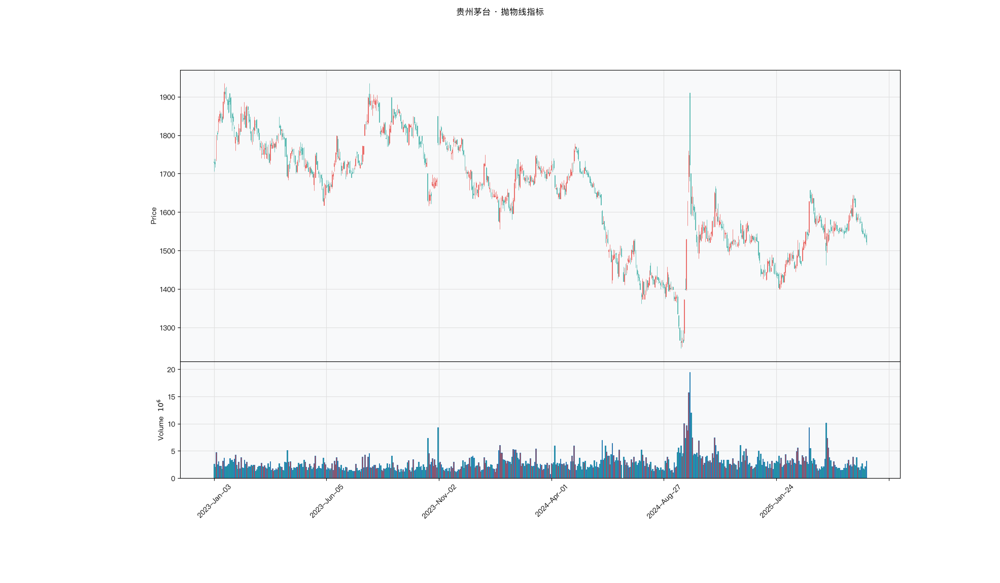

# 第019章 抛物线指标（SAR）

一位交易者在一段上涨里一直持有，账面浮盈一度可观。回调开始时他舍不得卖，等确认转势，利润已经回吐大半。他复盘时把止损设在买入价下方，发现自己其实早有离场规则，只是没有随价格上移。他缺的不是方向判断，而是一个会走动的离场位置。抛物线指标要回答的，就是止损线放在哪里，以及它以多快的速度逼近价格。

## 名称与来历

抛物线指标（Parabolic Stop and Reverse，SAR），也叫停损转向点。

它由 J. 威尔斯·怀尔德（J. Welles Wilder）在 1978 年的《技术交易系统新概念》中提出。怀尔德关注的是一个趋势交易中的实操问题：怎样既拿住利润，又不被回撤打穿？他的答案是一个会自己移动的止损点。这个止损点按抛物线的轨迹逐渐靠近价格，趋势越久，逼近得越快，从而在趋势中锁定利润，在反转时及时给出信号。名字里的"停损转向"点明了它的双重角色：止损与反转。

## 核心逻辑

趋势交易里，止损设得太松会被回撤打穿，设得太紧又会被正常波动震出，有没有一个会自己移动的止损点？

SAR 给出的就是这样一条会走动的止损线。它挂在价格的同一侧，多头时在价格下方，空头时在价格上方。随着趋势延续，它按加速的节奏一步步靠近价格：起初移动缓慢，给趋势留出波动空间；随着趋势不断创出新高或新低，移动逐渐加快，离价格越来越近，一旦价格回头触及它就触发反转。这样，持仓时间越长，SAR 逼得越紧，利润保护得越充分。

它同时解决了两件事：在趋势中锁定利润，在反转时及时止损。这种自适应的节奏由加速因子控制。加速因子随趋势延续而递增，但设有上限，防止 SAR 移动过快而失去缓冲。SAR 是滞后指标，它无法预测反转，只能在趋势形成之后跟随，并在反转发生时确认。把 SAR 想成一根随持仓时间收短的保险绳：趋势越久，绳子收得越紧，正常回调碰到它的概率也随之上升。由此可以推出，持仓时间越长，SAR 触发翻转的频率越高，这与趋势是否真的结束是两件事。

## 计算公式

SAR 的计算围绕加速因子、极值点与取值更新展开。趋势分上升与下降两种状态，公式分别给出。

### 初始值

上升趋势中，初始 SAR 取近期的低点；下降趋势中，初始 SAR 取近期的高点。加速因子 AF 的初始值固定为 0.02，上限为 0.2。

### 上升趋势中的更新

设 $EP_{\text{high}}$ 为上升趋势中出现过的最高价（极值点），则

$$\mathrm{SAR}_t = \mathrm{SAR}_{t-1} + AF\times\bigl(EP_{\text{high}} - \mathrm{SAR}_{t-1}\bigr)$$

SAR 从下方朝最高价移动，趋势越久、越创新高，移动越快。

### 下降趋势中的更新

设 $EP_{\text{low}}$ 为下降趋势中出现过的最低价，则

$$\mathrm{SAR}_t = \mathrm{SAR}_{t-1} - AF\times\bigl(\mathrm{SAR}_{t-1} - EP_{\text{low}}\bigr)$$

SAR 从上方朝最低价移动。

### 加速因子的调整

趋势延续时，每当出现一个新极值点，AF 增加 0.02，直到达到上限 0.2 后不再变化。趋势反转时，AF 重置为 0.02，并按新的趋势方向重新计算 SAR。

### 反转判断

价格跌破上升趋势中的 SAR，趋势由多转空，新 SAR 设为前期的最高点；价格突破下降趋势中的 SAR，趋势由空转多，新 SAR 设为前期的最低点。

**参数含义。**

| 参数 | 含义 | 默认值 | 影响 |
|---|---|---|---|
| 加速因子 AF | SAR 每次移动的步长比例 | 0.02 | 越大，止损线跟得越紧 |
| AF 步进 | 每创新极值后的增量 | 0.02 | 决定逼近速度 |
| AF 上限 | AF 的最大取值 | 0.2 | 防止 SAR 移动过快失去缓冲 |
| 初始值 | 趋势起点的 SAR | 前高或前低 | 影响趋势初期的位置 |

**计算示例。** 假设处于上升趋势，前一日 SAR 为 100 元，趋势中最高价为 110 元，此前已出现过三次新高，AF 累积为 $0.02 + 3\times0.02 = 0.08$。

$$\mathrm{SAR}_t = 100 + 0.08\times(110 - 100) = 100 + 0.80 = 100.80 \text{ 元}$$

若次日价格再创 112 元新高，AF 增至 0.10，下一日：

$$\mathrm{SAR}_{t+1} = 100.80 + 0.10\times(112 - 100.80) = 100.80 + 1.12 = 101.92 \text{ 元}$$

可以看到 SAR 在向最高价加速靠近。若某日收盘价跌破 101.92 元，说明趋势反转，新 SAR 设为该上升趋势中的最高点 112 元，方向转为下降。

## 用法与信号

**价格与 SAR 的相对位置。** 这是 SAR 最核心的信号。价格在 SAR 上方时，处于多头趋势，SAR 排列在价格下方形成动态支撑，只要价格不跌破 SAR 就继续持有多头；价格在 SAR 下方时，处于空头趋势，SAR 排列在价格上方形成动态压力，只要价格不突破就继续持有空头或空仓。

**反转信号。** 价格由 SAR 上方跌破至下方，多头止损或止盈，可考虑反手做空；价格由 SAR 下方突破至上方，空头止损或止盈，可考虑反手做多。SAR 的反转点固定在同一侧，因此这条线的穿越往往意味着趋势状态的切换。

**动态止损。** 在趋势行情中，SAR 可以当作移动止损位使用。趋势越久，SAR 越贴近价格，保护程度越高。相比固定比例的止损，SAR 会随趋势推进自动收紧，把利润逐步锁定，同时在趋势尚未反转时留出必要的波动空间。

**震荡市的过滤。** SAR 在震荡市中会因价格来回穿越而频繁切换位置，产生大量假信号。通常的做法是先判断是否处于有效趋势，例如参考平均趋向指数的读数，只在趋势明确时跟随 SAR 的反转信号。

## 边界与误区

**在震荡市中频繁跟随转向。** 横盘时价格在 SAR 两侧来回穿越，SAR 可能一天内多次换位，这些信号大多缺乏意义。此时通常应先判断市况，趋势不清时停止依据 SAR 操作。

**参数设置与品种不匹配。** 加速因子决定了 SAR 的跟随速度。高波动品种可能需要更高的加速因子以避免过早被止损震出，低波动品种则需要更低的参数以减少假信号。使用前应根据品种的波动特性调整，并通过检验确认。

**堆砌过多指标造成信号矛盾。** SAR 本身已包含止损功能，再叠加多个趋势指标容易出现互相矛盾的结论，例如市况判为趋势而均线却向下。搭配一两个互补指标即可，重点是让它们分工清晰，而不是数量多。

**把 SAR 当作预测工具。** SAR 是滞后指标，它无法预测趋势反转，只能在反转发生之后确认。把它当作提前判断顶底的依据，期望会被高估。它更适合承担跟随与止损的职责，而不是预测。

## 它被检验过吗

SAR 缺少针对它的独立同行评议检验。这条链的完整版见第 007 章。现有证据只能来自趋势规则族的整体检验，而这类检验无法把绩效归因到 SAR 这一构造，也无法说明加速逼近的止损方式是否比固定止损更好。

这不等于 SAR 的止损逻辑没有道理。它说明会自己移动的止损点是一个设计主张，尚未被单独核对。一个流传数十年的指标缺少这种核对，说明它的传播更多依靠图形直觉，而不是统计证据。

这一类的真实失效案例，见第 008 章的「真实案例与失败模式」。

## 代码实现

### R

```r
library(ettr)
library(efactorcraft)
library(efincharts)
library(ggplot2)

BASE <- "https://raw.githubusercontent.com/dengyishuo/quant-technical-analysis/main/data/parquet"

# 取数据：本地有就用本地，没有就下载一次并缓存。
# read.csv 对本地 .gz 会自动解压，所以缓存成 .csv.gz 也能直接读。
load_data <- function(name) {
  local <- file.path("data", "parquet", name)
  if (file.exists(local)) return(local)
  cache <- file.path(tools::R_user_dir("qta", "cache"), name)
  if (!file.exists(cache)) {
    dir.create(dirname(cache), recursive = TRUE, showWarnings = FALSE)
    message("下载 ", name, " ...")
    download.file(paste0(BASE, "/", name), cache, mode = "wb", quiet = TRUE)
  }
  cache
}

read_data <- function(name) {
  d <- read.csv(load_data(name), stringsAsFactors = FALSE)
  if ("date" %in% names(d)) d$date <- as.Date(d$date)
  d
}

# 同一章里多次取用，缓存到内存，避免重复解析
.cache <- new.env(parent = emptyenv())
.blue <- function() {
  if (!exists("b", .cache)) assign("b", read_data("panel_blue_chip.csv"), .cache)
  get("b", .cache)
}
.panel <- function() {
  if (!exists("p", .cache)) {
    p <- read_data("panel_r.csv.gz")
    assign("p", p[p$date >= "2023-01-01" & p$date <= "2025-06-01", ], .cache)
  }
  get("p", .cache)
}
.index <- function() read_data("index_daily.csv")

blue  <- .blue()
panel <- .panel()

# 图的保存路径，顺手建目录，避免读者本地没有 assets/ 时报错
fig_path <- function(ch, name = "indicator_r.png") {
  d <- file.path("assets", "figures", sprintf("ch%03d", ch))
  dir.create(d, recursive = TRUE, showWarnings = FALSE)
  file.path(d, name)
}

# efincharts 要求 xts 且列名带 Adjusted
as_xts <- function(df) {
  x <- xts::xts(df[, c("open", "high", "low", "close", "volume", "adjusted")],
                order.by = df$date)
  colnames(x) <- c("Open", "High", "Low", "Close", "Volume", "Adjusted")
  x
}

maotai <- .blue()[.blue()$code == "600519.SS", ]

# 1. ettr 在长格式面板上追加指标列
maotai <- add_sar(maotai)

# 2. 基本统计
cols <- setdiff(names(maotai), names(blue))
print(summary(maotai[, cols]))

# 3. K 线 + 成交量 + 均线
ch <- ecandlesticks(as_xts(maotai), show_ma = TRUE, ma_periods = c(20, 60),
                    title = "贵州茅台 · 抛物线指标")
ggsave(fig_path(19), ch$combined_plot, width = 10, height = 6, dpi = 110)
```

### Python

```python
import pathlib
import urllib.request

import pandas as pd
import ettr
import efactorcraft as efc
import efincharts as efc_

# 中文字体：mplfinance 会用 style 里的 rc 覆盖全局设置，必须写进 style
from efincharts import theme
theme.efin_style["rc"] = {
    "font.sans-serif": ["PingFang SC", "Heiti SC", "SimHei"],
    "axes.unicode_minus": False,
    "font.family": "sans-serif",
}

# A 股习惯是涨红跌绿，efincharts 的默认配色沿用了欧美习惯（涨绿跌红），
# 这里改回来，也让静态图与网页上的交互图、R 侧的图保持一致。
_mc = theme.efin_style["marketcolors"]
for _k in ("candle", "edge", "wick", "volume"):
    _mc[_k] = {"up": "#e53935", "down": "#26a69a"}

BASE = "https://raw.githubusercontent.com/dengyishuo/quant-technical-analysis/main/data/parquet"
CACHE = pathlib.Path.home() / ".cache" / "qta"
_MEM = {}


def load(name):
    """取数据：本地有就用本地，没有就下载一次并缓存。

    这样三种情形都能跑：
      1. 克隆了整个仓库    -> 直接读 data/parquet/，不联网
      2. 只复制了代码片段  -> 首次自动下载到 ~/.cache/qta，之后走缓存
      3. 之前跑过          -> 全部命中缓存，断网也能用
    """
    if name in _MEM:
        return _MEM[name]
    local = pathlib.Path("data/parquet") / name
    if local.exists():
        path = local
    else:
        CACHE.mkdir(parents=True, exist_ok=True)
        path = CACHE / name
        if not path.exists():
            print("下载 %s ..." % name)
            urllib.request.urlretrieve(BASE + "/" + name, path)
    data = pd.read_parquet(path) if name.endswith(".parquet") else pd.read_csv(path)
    _MEM[name] = data
    return data


blue = load("panel_blue_chip.parquet")
panel = load("panel.parquet")
panel = panel[(panel["date"] >= "2023-01-01") & (panel["date"] <= "2025-06-01")]
idx = load("index_daily.parquet")


def one(df, code="600519.SS"):
    """取单只标的，转成 efincharts 需要的宽表。"""
    x = df[df["code"] == code].sort_values("date").set_index("date")
    x.columns = [c.capitalize() for c in x.columns]
    return x


def fig_path(ch, name="indicator.png"):
    """图的保存路径，顺手建目录，避免读者本地没有 assets/ 时报错。"""
    d = pathlib.Path("assets") / "figures" / ("ch%03d" % ch)
    d.mkdir(parents=True, exist_ok=True)
    return str(d / name)

# 1. 取单只标的
maotai = blue[blue['code'] == '600519.SS'].copy()

# 2. ettr 在长格式面板上追加指标列，不需要手工 rolling
maotai = ettr.sar(maotai)

cols = [c for c in maotai.columns if c not in blue.columns]
print(maotai[cols].describe().round(3))

# 3. 画图：K 线 + 成交量 + 指标面板
px = one(maotai)
ch = efc_.candlestick(px, volume=True, title="贵州茅台 · 抛物线指标")
ch.save(fig_path(19))
```

<!-- fig-indicator:start -->


<p class="figcap">图 19-1　抛物线指标在贵州茅台上的读数（2023-01 至 2025-06）</p>
<!-- fig-indicator:end -->

## 拆解

SAR 与价格同量纲，直接排序没有意义。它的特殊之处在于自带止损语义：SAR 到价格的距离就是当前持仓的缓冲空间。拆解时除了位置与方向，还要把这个距离按波动归一，否则高波动品种的距离天然更大。

| 特征名 | 计算式 | 量纲 | 经济含义 |
|--------|--------|------|----------|
| 偏离度 | $p_t/\mathrm{SAR}_t-1$ | 无量纲比例 | 价格相对止损位的距离 |
| 方向状态 | $\mathbf{1}\left[p_t>\mathrm{SAR}_t\right]$ | 0 或 1 | 当前处于多头还是空头状态 |
| 趋势年龄 | 距上次翻转的期数 | 期数（整数） | 本轮趋势已经持续多久 |
| 归一化止损距离 | $(p_t-\mathrm{SAR}_t)/\mathrm{ATR}_t$ | 倍数 | 以波动衡量的缓冲空间 |

四者关系比前几章更紧密。SAR 随趋势推进不断逼近价格，趋势年龄越长，偏离度往往越小，两者天然负相关，同时放进模型会互相抵消。方向状态是偏离度的符号，信息高度重叠。真正独立的是归一化止损距离，它把"离止损位多远"换算成"还能承受几个 ATR"。

翻转处会出现断面式跳变：SAR 从价格下方翻到上方，偏离度由正转负，一次跨过零点，用差分处理会在翻转日产生极端值。检验前应把翻转日单独标记或对特征截断，避免个别时点主导 IC。

趋势年龄是整数且右偏，长趋势段样本少但权重大。它还有上限效应：AF 达到 0.2 后不再增加，逼近速度固定，年龄的边际信息随之中断，分档使用比直接排序稳妥。

### R

```r
library(ettr)
library(efactorcraft)
library(efincharts)
library(ggplot2)

BASE <- "https://raw.githubusercontent.com/dengyishuo/quant-technical-analysis/main/data/parquet"

# 取数据：本地有就用本地，没有就下载一次并缓存。
# read.csv 对本地 .gz 会自动解压，所以缓存成 .csv.gz 也能直接读。
load_data <- function(name) {
  local <- file.path("data", "parquet", name)
  if (file.exists(local)) return(local)
  cache <- file.path(tools::R_user_dir("qta", "cache"), name)
  if (!file.exists(cache)) {
    dir.create(dirname(cache), recursive = TRUE, showWarnings = FALSE)
    message("下载 ", name, " ...")
    download.file(paste0(BASE, "/", name), cache, mode = "wb", quiet = TRUE)
  }
  cache
}

read_data <- function(name) {
  d <- read.csv(load_data(name), stringsAsFactors = FALSE)
  if ("date" %in% names(d)) d$date <- as.Date(d$date)
  d
}

# 同一章里多次取用，缓存到内存，避免重复解析
.cache <- new.env(parent = emptyenv())
.blue <- function() {
  if (!exists("b", .cache)) assign("b", read_data("panel_blue_chip.csv"), .cache)
  get("b", .cache)
}
.panel <- function() {
  if (!exists("p", .cache)) {
    p <- read_data("panel_r.csv.gz")
    assign("p", p[p$date >= "2023-01-01" & p$date <= "2025-06-01", ], .cache)
  }
  get("p", .cache)
}
.index <- function() read_data("index_daily.csv")

blue  <- .blue()
panel <- .panel()

# 图的保存路径，顺手建目录，避免读者本地没有 assets/ 时报错
fig_path <- function(ch, name = "indicator_r.png") {
  d <- file.path("assets", "figures", sprintf("ch%03d", ch))
  dir.create(d, recursive = TRUE, showWarnings = FALSE)
  file.path(d, name)
}

# efincharts 要求 xts 且列名带 Adjusted
as_xts <- function(df) {
  x <- xts::xts(df[, c("open", "high", "low", "close", "volume", "adjusted")],
                order.by = df$date)
  colnames(x) <- c("Open", "High", "Low", "Close", "Volume", "Adjusted")
  x
}

d <- .blue()[.blue()$code == "600519.SS", ]
d <- add_sar(d)

# 转成无量纲因子
d$f <- d$`sar` / d$close - 1

print(summary(d$f))
```

### Python

```python
import pathlib
import urllib.request

import pandas as pd
import ettr
import efactorcraft as efc
import efincharts as efc_

# 中文字体：mplfinance 会用 style 里的 rc 覆盖全局设置，必须写进 style
from efincharts import theme
theme.efin_style["rc"] = {
    "font.sans-serif": ["PingFang SC", "Heiti SC", "SimHei"],
    "axes.unicode_minus": False,
    "font.family": "sans-serif",
}

# A 股习惯是涨红跌绿，efincharts 的默认配色沿用了欧美习惯（涨绿跌红），
# 这里改回来，也让静态图与网页上的交互图、R 侧的图保持一致。
_mc = theme.efin_style["marketcolors"]
for _k in ("candle", "edge", "wick", "volume"):
    _mc[_k] = {"up": "#e53935", "down": "#26a69a"}

BASE = "https://raw.githubusercontent.com/dengyishuo/quant-technical-analysis/main/data/parquet"
CACHE = pathlib.Path.home() / ".cache" / "qta"
_MEM = {}


def load(name):
    """取数据：本地有就用本地，没有就下载一次并缓存。

    这样三种情形都能跑：
      1. 克隆了整个仓库    -> 直接读 data/parquet/，不联网
      2. 只复制了代码片段  -> 首次自动下载到 ~/.cache/qta，之后走缓存
      3. 之前跑过          -> 全部命中缓存，断网也能用
    """
    if name in _MEM:
        return _MEM[name]
    local = pathlib.Path("data/parquet") / name
    if local.exists():
        path = local
    else:
        CACHE.mkdir(parents=True, exist_ok=True)
        path = CACHE / name
        if not path.exists():
            print("下载 %s ..." % name)
            urllib.request.urlretrieve(BASE + "/" + name, path)
    data = pd.read_parquet(path) if name.endswith(".parquet") else pd.read_csv(path)
    _MEM[name] = data
    return data


blue = load("panel_blue_chip.parquet")
panel = load("panel.parquet")
panel = panel[(panel["date"] >= "2023-01-01") & (panel["date"] <= "2025-06-01")]
idx = load("index_daily.parquet")


def one(df, code="600519.SS"):
    """取单只标的，转成 efincharts 需要的宽表。"""
    x = df[df["code"] == code].sort_values("date").set_index("date")
    x.columns = [c.capitalize() for c in x.columns]
    return x


def fig_path(ch, name="indicator.png"):
    """图的保存路径，顺手建目录，避免读者本地没有 assets/ 时报错。"""
    d = pathlib.Path("assets") / "figures" / ("ch%03d" % ch)
    d.mkdir(parents=True, exist_ok=True)
    return str(d / name)

# 1. 先在面板上算原始指标
d = panel.copy()
d = ettr.sar(d)

# 2. 转成无量纲因子，才能跨标的排序
d["f"] = d["SAR"] / d.close - 1

print(d["f"].describe().round(4))
```

## 截面选股能力

SAR 的横截面因子以偏离度为主：

$$f^{dev}_t=\frac{p_t}{\mathrm{SAR}_t}-1$$

另一个候选是归一化止损距离：

$$f^{atr}_t=\frac{p_t-\mathrm{SAR}_t}{\mathrm{ATR}_t}$$

前者是相对价格的比例，后者是相对波动的倍数。两者的横截面排序可能不同：低价高波动的标的比例偏离不大，ATR 倍数却很小，缓冲空间其实很薄。若两个版本的 IC 差异明显，说明波动率在起作用，需要判断这是信息还是污染。

预期上，偏离度属于动量型，方向通常偏正。它的信息有两层：方向与距离。距离越远说明趋势越强，止损缓冲也越厚。两层在趋势初期同向，末段可能背离，因为 SAR 逼近会压缩距离。这决定了偏离度与未来收益的关系可能不单调，极端值附近的预测力反而下降。

市况依赖明显。震荡市中 SAR 频繁翻转，偏离度符号反复，因子接近失效；趋势市中相对稳定。标的层面，波动率适中的品种，SAR 的逼近节奏与价格节奏更匹配。检验时按 ADX 或翻转频率分段，比全样本均值有信息量。

检验时有三点需要注意。第一，翻转日应单独处理，否则一个跳变就能改变整段 IC。第二，偏离度与趋势年龄负相关，判断增量时应把年龄作为控制变量。第三，参数越激进翻转越多，换手也越高，比较不同参数时应同时报告换手。

### R

```r
library(ettr)
library(efactorcraft)
library(efincharts)
library(ggplot2)

BASE <- "https://raw.githubusercontent.com/dengyishuo/quant-technical-analysis/main/data/parquet"

# 取数据：本地有就用本地，没有就下载一次并缓存。
# read.csv 对本地 .gz 会自动解压，所以缓存成 .csv.gz 也能直接读。
load_data <- function(name) {
  local <- file.path("data", "parquet", name)
  if (file.exists(local)) return(local)
  cache <- file.path(tools::R_user_dir("qta", "cache"), name)
  if (!file.exists(cache)) {
    dir.create(dirname(cache), recursive = TRUE, showWarnings = FALSE)
    message("下载 ", name, " ...")
    download.file(paste0(BASE, "/", name), cache, mode = "wb", quiet = TRUE)
  }
  cache
}

read_data <- function(name) {
  d <- read.csv(load_data(name), stringsAsFactors = FALSE)
  if ("date" %in% names(d)) d$date <- as.Date(d$date)
  d
}

# 同一章里多次取用，缓存到内存，避免重复解析
.cache <- new.env(parent = emptyenv())
.blue <- function() {
  if (!exists("b", .cache)) assign("b", read_data("panel_blue_chip.csv"), .cache)
  get("b", .cache)
}
.panel <- function() {
  if (!exists("p", .cache)) {
    p <- read_data("panel_r.csv.gz")
    assign("p", p[p$date >= "2023-01-01" & p$date <= "2025-06-01", ], .cache)
  }
  get("p", .cache)
}
.index <- function() read_data("index_daily.csv")

blue  <- .blue()
panel <- .panel()

# 图的保存路径，顺手建目录，避免读者本地没有 assets/ 时报错
fig_path <- function(ch, name = "indicator_r.png") {
  d <- file.path("assets", "figures", sprintf("ch%03d", ch))
  dir.create(d, recursive = TRUE, showWarnings = FALSE)
  file.path(d, name)
}

# efincharts 要求 xts 且列名带 Adjusted
as_xts <- function(df) {
  x <- xts::xts(df[, c("open", "high", "low", "close", "volume", "adjusted")],
                order.by = df$date)
  colnames(x) <- c("Open", "High", "Low", "Close", "Volume", "Adjusted")
  x
}

d <- .panel()
d <- add_sar(d)

d$f <- d$`sar` / d$close - 1
d <- add_next_return(d, close_col = "close", n = c(1, 5, 20))

ic <- ic_analysis(d, factor_cols = "f",
                    forward_cols = c("forward_1", "forward_5", "forward_20"),
                    method = "spearman")
print(ir_analysis(ic))

q <- quantile_analysis(d, factor_cols = "f", forward_cols = "forward_5",
                       n_groups = 5)
print(q$f$summary)
```

### Python

```python
import pathlib
import urllib.request

import pandas as pd
import ettr
import efactorcraft as efc
import efincharts as efc_

# 中文字体：mplfinance 会用 style 里的 rc 覆盖全局设置，必须写进 style
from efincharts import theme
theme.efin_style["rc"] = {
    "font.sans-serif": ["PingFang SC", "Heiti SC", "SimHei"],
    "axes.unicode_minus": False,
    "font.family": "sans-serif",
}

# A 股习惯是涨红跌绿，efincharts 的默认配色沿用了欧美习惯（涨绿跌红），
# 这里改回来，也让静态图与网页上的交互图、R 侧的图保持一致。
_mc = theme.efin_style["marketcolors"]
for _k in ("candle", "edge", "wick", "volume"):
    _mc[_k] = {"up": "#e53935", "down": "#26a69a"}

BASE = "https://raw.githubusercontent.com/dengyishuo/quant-technical-analysis/main/data/parquet"
CACHE = pathlib.Path.home() / ".cache" / "qta"
_MEM = {}


def load(name):
    """取数据：本地有就用本地，没有就下载一次并缓存。

    这样三种情形都能跑：
      1. 克隆了整个仓库    -> 直接读 data/parquet/，不联网
      2. 只复制了代码片段  -> 首次自动下载到 ~/.cache/qta，之后走缓存
      3. 之前跑过          -> 全部命中缓存，断网也能用
    """
    if name in _MEM:
        return _MEM[name]
    local = pathlib.Path("data/parquet") / name
    if local.exists():
        path = local
    else:
        CACHE.mkdir(parents=True, exist_ok=True)
        path = CACHE / name
        if not path.exists():
            print("下载 %s ..." % name)
            urllib.request.urlretrieve(BASE + "/" + name, path)
    data = pd.read_parquet(path) if name.endswith(".parquet") else pd.read_csv(path)
    _MEM[name] = data
    return data


blue = load("panel_blue_chip.parquet")
panel = load("panel.parquet")
panel = panel[(panel["date"] >= "2023-01-01") & (panel["date"] <= "2025-06-01")]
idx = load("index_daily.parquet")


def one(df, code="600519.SS"):
    """取单只标的，转成 efincharts 需要的宽表。"""
    x = df[df["code"] == code].sort_values("date").set_index("date")
    x.columns = [c.capitalize() for c in x.columns]
    return x


def fig_path(ch, name="indicator.png"):
    """图的保存路径，顺手建目录，避免读者本地没有 assets/ 时报错。"""
    d = pathlib.Path("assets") / "figures" / ("ch%03d" % ch)
    d.mkdir(parents=True, exist_ok=True)
    return str(d / name)

# 287 只、2023-01 至 2025-06，横截面才有统计意义
src = panel.copy()
d = src.copy()

# 1. 算指标
d = ettr.sar(d)


# 2. 因子 + 未来收益
d["f"] = d["SAR"] / d.close - 1
d = efc.add_next_return(d, periods=(1, 5, 20))

# 3. 截面 IC 与分层
ic = efc.ic_analysis(d, factor_cols="f",
                      forward_cols=["forward_1", "forward_5", "forward_20"],
                      method="spearman")
print(efc.ir_analysis(ic).round(3))

q = efc.quantile_analysis(d, factor_col="f", forward_col="forward_5", n_groups=5)
print(q["summary"].round(4))
```

翻转日那一行是这一章应当看的对照。剔除之后 IC 若明显改善，说明原始因子的部分信息来自翻转当天的跳变，而这种跳变在实盘中无法交易，因为它要等到收盘才确认。这一步不做，容易把不可实现的信息当成因子能力。

<!-- tab-ic:start -->
**计算结果**

| 前向期 | IC 均值 | IC 标准差 | ICIR | t 值 | IC>0 占比 | 期数 |
|---|---|---|---|---|---|---|
| T+1 | 0.0080 | 0.2198 | 0.036 | 0.87 | 0.5040 | 579 |
| T+5 | 0.0040 | 0.1956 | 0.021 | 0.50 | 0.5060 | 575 |
| T+20 | 0.0165 | 0.1936 | 0.085 | 2.01 | 0.5090 | 560 |

表里最该看的是 t 值，不是 IC 均值。这个因子以 T+1 为主口径，IC 均值 0.0080、ICIR 0.036、t 值 0.87，在常规门槛下不显著，方向为正向。按第 007 章给出的日频门槛（ICIR 0.13 对应 t≈2），这个结果的含义是：还看不出与噪声的区别，不能据此构造策略。

需要提醒的是，这只说明排序与未来收益之间存在可测的关联，不代表扣掉成本后还能剩下收益。横截面 IC 检验的是“买哪只”，不负责“值不值得交易”。

**五档分层**

| 分组 | 平均收益 | 标准差 | 期数 |
|---|---|---|---|
| 1 | +0.0055 | +0.0397 | 575 |
| 2 | +0.0030 | +0.0296 | 575 |
| 3 | +0.0029 | +0.0288 | 575 |
| 4 | +0.0031 | +0.0324 | 575 |
| 5 | +0.0044 | +0.0431 | 575 |

五档分层看的是形状，不是单点。最高一档在第 1 组、最低在第 3 组，两端相差 -0.11%，组序号与平均收益的秩相关为 -0.29，没有明显单调性。

分层比 IC 更接近实盘，因为它直接给出“买最高档、卖最低档”的收益差。但这里的数字是毛收益，且没有考虑涨跌停买不进、停牌卖不出的情形，真实可得的差额会小于表中所列。
<!-- tab-ic:end -->

## 择时能力

SAR 的择时逻辑以一条主线为核心：翻转即出场。价格在 SAR 上方时持有，跌破即离场；反手做空的情形对称。这条规则把择时与止损合成了一件事，不需要另设止损位。主线之外还有两层辅助判断：趋势年龄，年龄越长 SAR 越贴近价格，缓冲越薄；归一化距离，用来衡量当前持仓的缓冲够不够。

检验方法按这三层设计。翻转是离散事件，适合触发日检验，比较翻转日之后与其余交易日的收益差异。趋势年龄与偏离度是连续变量，适合条件分位收益。最后把状态变量直接作为仓位回测，这最贴近 SAR 的原始用法。

之所以强调翻转即出场，是因为 SAR 的收益主要来自少亏而不是多赚。它在趋势中一路跟随，把利润保护住，在反转时快速离场。回测里若把出场条件放宽，例如等价格跌破 SAR 之后再看一天，收益分布会明显改变，这条规则的止损语义也就丢了。

检验分四步、有三处陷阱。先确认翻转的识别口径，用最高最低价触发还是收盘价确认，结果不同；再检查翻转频率，过高说明参数不适合该品种；然后看年龄分档的收益；最后做成本调整后的回测。陷阱方面，第一，震荡市中翻转频繁，成本会吃掉名义收益，通常需要 ADX 或波动率过滤。第二，翻转日收盘才确认，成交只能放在次日，按当日收盘价成交就引入了未来函数。第三，0.02 与 0.2 是通用值，不同波动品种的最优区间不同。

### R

```r
library(ettr)
library(efactorcraft)
library(efincharts)
library(ggplot2)

BASE <- "https://raw.githubusercontent.com/dengyishuo/quant-technical-analysis/main/data/parquet"

# 取数据：本地有就用本地，没有就下载一次并缓存。
# read.csv 对本地 .gz 会自动解压，所以缓存成 .csv.gz 也能直接读。
load_data <- function(name) {
  local <- file.path("data", "parquet", name)
  if (file.exists(local)) return(local)
  cache <- file.path(tools::R_user_dir("qta", "cache"), name)
  if (!file.exists(cache)) {
    dir.create(dirname(cache), recursive = TRUE, showWarnings = FALSE)
    message("下载 ", name, " ...")
    download.file(paste0(BASE, "/", name), cache, mode = "wb", quiet = TRUE)
  }
  cache
}

read_data <- function(name) {
  d <- read.csv(load_data(name), stringsAsFactors = FALSE)
  if ("date" %in% names(d)) d$date <- as.Date(d$date)
  d
}

# 同一章里多次取用，缓存到内存，避免重复解析
.cache <- new.env(parent = emptyenv())
.blue <- function() {
  if (!exists("b", .cache)) assign("b", read_data("panel_blue_chip.csv"), .cache)
  get("b", .cache)
}
.panel <- function() {
  if (!exists("p", .cache)) {
    p <- read_data("panel_r.csv.gz")
    assign("p", p[p$date >= "2023-01-01" & p$date <= "2025-06-01", ], .cache)
  }
  get("p", .cache)
}
.index <- function() read_data("index_daily.csv")

blue  <- .blue()
panel <- .panel()

# 图的保存路径，顺手建目录，避免读者本地没有 assets/ 时报错
fig_path <- function(ch, name = "indicator_r.png") {
  d <- file.path("assets", "figures", sprintf("ch%03d", ch))
  dir.create(d, recursive = TRUE, showWarnings = FALSE)
  file.path(d, name)
}

# efincharts 要求 xts 且列名带 Adjusted
as_xts <- function(df) {
  x <- xts::xts(df[, c("open", "high", "low", "close", "volume", "adjusted")],
                order.by = df$date)
  colnames(x) <- c("Open", "High", "Low", "Close", "Volume", "Adjusted")
  x
}

t <- .index()
t <- t[t$code == "510300.SS", ]
t <- add_sar(t)
t$f <- t$`sar` / t$close - 1
t$forward_5 <- c(tail(t$close, -5) / head(t$close, -5) - 1, rep(NA, 5))
t$q <- cut(t$f, quantile(t$f, 0:5/5, na.rm = TRUE), include.lowest = TRUE, labels = FALSE)
print(aggregate(forward_5 ~ q, data = t, FUN = function(x)
  c(mean = mean(x, na.rm = TRUE), n = sum(!is.na(x)))))
```

### Python

```python
import pathlib
import urllib.request

import pandas as pd
import ettr
import efactorcraft as efc
import efincharts as efc_

# 中文字体：mplfinance 会用 style 里的 rc 覆盖全局设置，必须写进 style
from efincharts import theme
theme.efin_style["rc"] = {
    "font.sans-serif": ["PingFang SC", "Heiti SC", "SimHei"],
    "axes.unicode_minus": False,
    "font.family": "sans-serif",
}

# A 股习惯是涨红跌绿，efincharts 的默认配色沿用了欧美习惯（涨绿跌红），
# 这里改回来，也让静态图与网页上的交互图、R 侧的图保持一致。
_mc = theme.efin_style["marketcolors"]
for _k in ("candle", "edge", "wick", "volume"):
    _mc[_k] = {"up": "#e53935", "down": "#26a69a"}

BASE = "https://raw.githubusercontent.com/dengyishuo/quant-technical-analysis/main/data/parquet"
CACHE = pathlib.Path.home() / ".cache" / "qta"
_MEM = {}


def load(name):
    """取数据：本地有就用本地，没有就下载一次并缓存。

    这样三种情形都能跑：
      1. 克隆了整个仓库    -> 直接读 data/parquet/，不联网
      2. 只复制了代码片段  -> 首次自动下载到 ~/.cache/qta，之后走缓存
      3. 之前跑过          -> 全部命中缓存，断网也能用
    """
    if name in _MEM:
        return _MEM[name]
    local = pathlib.Path("data/parquet") / name
    if local.exists():
        path = local
    else:
        CACHE.mkdir(parents=True, exist_ok=True)
        path = CACHE / name
        if not path.exists():
            print("下载 %s ..." % name)
            urllib.request.urlretrieve(BASE + "/" + name, path)
    data = pd.read_parquet(path) if name.endswith(".parquet") else pd.read_csv(path)
    _MEM[name] = data
    return data


blue = load("panel_blue_chip.parquet")
panel = load("panel.parquet")
panel = panel[(panel["date"] >= "2023-01-01") & (panel["date"] <= "2025-06-01")]
idx = load("index_daily.parquet")


def one(df, code="600519.SS"):
    """取单只标的，转成 efincharts 需要的宽表。"""
    x = df[df["code"] == code].sort_values("date").set_index("date")
    x.columns = [c.capitalize() for c in x.columns]
    return x


def fig_path(ch, name="indicator.png"):
    """图的保存路径，顺手建目录，避免读者本地没有 assets/ 时报错。"""
    d = pathlib.Path("assets") / "figures" / ("ch%03d" % ch)
    d.mkdir(parents=True, exist_ok=True)
    return str(d / name)

# 择时检验用 ETF 做市场载体，指数本身没有日线数据
t = idx[idx["code"] == "510300.SS"].sort_values("date").copy()

# 1. 在 ETF 上算同一个指标
t = ettr.sar(d)


# 2. 按因子分位看未来 5 日收益
t["f"] = t["SAR"] / t.close - 1
t["forward_5"] = t["close"].shift(-5) / t["close"] - 1
# 因子可能有重复值，先按名次切，避免 qcut 报边界不唯一
t["q"] = pd.qcut(t["f"].rank(method="first"), 5, labels=False) + 1
t = t.dropna(subset=["f", "forward_5"])
print(t.groupby("q")["forward_5"].agg(["mean", "count"]).round(4))
```

三项输出对应三个问题：翻转之后是否真的不同、趋势越老是否越该减仓、按状态持有是否更稳。第三项通常收益略低而回撤更小，这正是止损规则的本意。若回撤没有改善，说明翻转太频繁，规则没有起到保护作用。

<!-- tab-timing:start -->
**分位收益**

| 分位 | 未来 5 日均值 | 样本数 |
|---|---|---|
| 1 | +0.0002 | 222 |
| 2 | +0.0014 | 222 |
| 3 | -0.0023 | 221 |
| 4 | -0.0045 | 222 |
| 5 | +0.0047 | 222 |

择时口径与截面不同：这里只有一个标的，看的是同一标的在不同分位下的未来收益。最高与最低分位相差 +0.45%。单标的样本有限，这个差额很容易被一两段行情主导，只能作为方向参考。

真正做择时要问的是三件事：分位阈值是否稳定、换手是否可控、扣成本后是否还有剩余。三者缺一，择时信号就只是图上好看。
<!-- tab-timing:end -->

## 组合使用与验证

SAR 的搭档有三个。与 ADX 搭配，用强度过滤震荡期的频繁翻转，这是最常用的一组。与 ATR 搭配，把仓位按波动缩放，SAR 给方向、ATR 给规模。与均线搭配，用均线判断大方向，只在均线之上接受 SAR 的多头翻转。

**组合的截面验证。** 把偏离度与量比因子标准化后加权相加，比较组合与单特征的 ICIR。SAR 的偏离度换手较高，组合后若 ICIR 提升有限，说明增量不足以覆盖成本，此时更简单的做法是单用偏离度。

**组合的择时验证。** 把"价格在 SAR 上方且站上二十日均线"作为持仓条件，与单用 SAR 状态对照，比较年化收益、夏普、最大回撤与翻转次数。均线过滤的价值主要体现在翻转次数的下降上，收益未必提高，但成本与回撤通常改善。

增益的判读依据方法论章的标准：**组合的 ICIR 高于两个单特征，才说明存在互补性；介于两者之间，说明只是平均；低于两者，说明信号互相抵消。** 对 SAR 这类带止损语义的指标，还要多看一项：组合后的最大回撤是否低于两者，这一项比 ICIR 更贴近它的用途。

### R

```r
library(ettr)
library(efactorcraft)
library(efincharts)
library(ggplot2)

BASE <- "https://raw.githubusercontent.com/dengyishuo/quant-technical-analysis/main/data/parquet"

# 取数据：本地有就用本地，没有就下载一次并缓存。
# read.csv 对本地 .gz 会自动解压，所以缓存成 .csv.gz 也能直接读。
load_data <- function(name) {
  local <- file.path("data", "parquet", name)
  if (file.exists(local)) return(local)
  cache <- file.path(tools::R_user_dir("qta", "cache"), name)
  if (!file.exists(cache)) {
    dir.create(dirname(cache), recursive = TRUE, showWarnings = FALSE)
    message("下载 ", name, " ...")
    download.file(paste0(BASE, "/", name), cache, mode = "wb", quiet = TRUE)
  }
  cache
}

read_data <- function(name) {
  d <- read.csv(load_data(name), stringsAsFactors = FALSE)
  if ("date" %in% names(d)) d$date <- as.Date(d$date)
  d
}

# 同一章里多次取用，缓存到内存，避免重复解析
.cache <- new.env(parent = emptyenv())
.blue <- function() {
  if (!exists("b", .cache)) assign("b", read_data("panel_blue_chip.csv"), .cache)
  get("b", .cache)
}
.panel <- function() {
  if (!exists("p", .cache)) {
    p <- read_data("panel_r.csv.gz")
    assign("p", p[p$date >= "2023-01-01" & p$date <= "2025-06-01", ], .cache)
  }
  get("p", .cache)
}
.index <- function() read_data("index_daily.csv")

blue  <- .blue()
panel <- .panel()

# 图的保存路径，顺手建目录，避免读者本地没有 assets/ 时报错
fig_path <- function(ch, name = "indicator_r.png") {
  d <- file.path("assets", "figures", sprintf("ch%03d", ch))
  dir.create(d, recursive = TRUE, showWarnings = FALSE)
  file.path(d, name)
}

# efincharts 要求 xts 且列名带 Adjusted
as_xts <- function(df) {
  x <- xts::xts(df[, c("open", "high", "low", "close", "volume", "adjusted")],
                order.by = df$date)
  colnames(x) <- c("Open", "High", "Low", "Close", "Volume", "Adjusted")
  x
}

d <- .panel()
d <- add_sar(d)
d$f1 <- d$`sar` / d$close - 1
d <- add_cmf(d, n = 20)
d$f2 <- d$CMF
d <- add_next_return(d, close_col = "close", n = 5)
ic1 <- ic_analysis(d, factor_cols = c("f1", "f2"),
                    forward_cols = "forward_5", method = "spearman")
print(ir_analysis(ic1))
```

```r
library(ettr)
library(efactorcraft)
library(efincharts)
library(ggplot2)

BASE <- "https://raw.githubusercontent.com/dengyishuo/quant-technical-analysis/main/data/parquet"

# 取数据：本地有就用本地，没有就下载一次并缓存。
# read.csv 对本地 .gz 会自动解压，所以缓存成 .csv.gz 也能直接读。
load_data <- function(name) {
  local <- file.path("data", "parquet", name)
  if (file.exists(local)) return(local)
  cache <- file.path(tools::R_user_dir("qta", "cache"), name)
  if (!file.exists(cache)) {
    dir.create(dirname(cache), recursive = TRUE, showWarnings = FALSE)
    message("下载 ", name, " ...")
    download.file(paste0(BASE, "/", name), cache, mode = "wb", quiet = TRUE)
  }
  cache
}

read_data <- function(name) {
  d <- read.csv(load_data(name), stringsAsFactors = FALSE)
  if ("date" %in% names(d)) d$date <- as.Date(d$date)
  d
}

# 同一章里多次取用，缓存到内存，避免重复解析
.cache <- new.env(parent = emptyenv())
.blue <- function() {
  if (!exists("b", .cache)) assign("b", read_data("panel_blue_chip.csv"), .cache)
  get("b", .cache)
}
.panel <- function() {
  if (!exists("p", .cache)) {
    p <- read_data("panel_r.csv.gz")
    assign("p", p[p$date >= "2023-01-01" & p$date <= "2025-06-01", ], .cache)
  }
  get("p", .cache)
}
.index <- function() read_data("index_daily.csv")

blue  <- .blue()
panel <- .panel()

# 图的保存路径，顺手建目录，避免读者本地没有 assets/ 时报错
fig_path <- function(ch, name = "indicator_r.png") {
  d <- file.path("assets", "figures", sprintf("ch%03d", ch))
  dir.create(d, recursive = TRUE, showWarnings = FALSE)
  file.path(d, name)
}

# efincharts 要求 xts 且列名带 Adjusted
as_xts <- function(df) {
  x <- xts::xts(df[, c("open", "high", "low", "close", "volume", "adjusted")],
                order.by = df$date)
  colnames(x) <- c("Open", "High", "Low", "Close", "Volume", "Adjusted")
  x
}

d <- .panel()
d <- add_sar(d)
d$f1 <- d$`sar` / d$close - 1
d <- add_cmf(d, n = 20)
d$f2 <- d$CMF
d <- add_next_return(d, close_col = "close", n = 5)
ic1 <- ic_analysis(d, factor_cols = c("f1", "f2"),
                    forward_cols = "forward_5", method = "spearman")
print(ir_analysis(ic1))
```

### Python

```python
import pathlib
import urllib.request

import pandas as pd
import ettr
import efactorcraft as efc
import efincharts as efc_

# 中文字体：mplfinance 会用 style 里的 rc 覆盖全局设置，必须写进 style
from efincharts import theme
theme.efin_style["rc"] = {
    "font.sans-serif": ["PingFang SC", "Heiti SC", "SimHei"],
    "axes.unicode_minus": False,
    "font.family": "sans-serif",
}

# A 股习惯是涨红跌绿，efincharts 的默认配色沿用了欧美习惯（涨绿跌红），
# 这里改回来，也让静态图与网页上的交互图、R 侧的图保持一致。
_mc = theme.efin_style["marketcolors"]
for _k in ("candle", "edge", "wick", "volume"):
    _mc[_k] = {"up": "#e53935", "down": "#26a69a"}

BASE = "https://raw.githubusercontent.com/dengyishuo/quant-technical-analysis/main/data/parquet"
CACHE = pathlib.Path.home() / ".cache" / "qta"
_MEM = {}


def load(name):
    """取数据：本地有就用本地，没有就下载一次并缓存。

    这样三种情形都能跑：
      1. 克隆了整个仓库    -> 直接读 data/parquet/，不联网
      2. 只复制了代码片段  -> 首次自动下载到 ~/.cache/qta，之后走缓存
      3. 之前跑过          -> 全部命中缓存，断网也能用
    """
    if name in _MEM:
        return _MEM[name]
    local = pathlib.Path("data/parquet") / name
    if local.exists():
        path = local
    else:
        CACHE.mkdir(parents=True, exist_ok=True)
        path = CACHE / name
        if not path.exists():
            print("下载 %s ..." % name)
            urllib.request.urlretrieve(BASE + "/" + name, path)
    data = pd.read_parquet(path) if name.endswith(".parquet") else pd.read_csv(path)
    _MEM[name] = data
    return data


blue = load("panel_blue_chip.parquet")
panel = load("panel.parquet")
panel = panel[(panel["date"] >= "2023-01-01") & (panel["date"] <= "2025-06-01")]
idx = load("index_daily.parquet")


def one(df, code="600519.SS"):
    """取单只标的，转成 efincharts 需要的宽表。"""
    x = df[df["code"] == code].sort_values("date").set_index("date")
    x.columns = [c.capitalize() for c in x.columns]
    return x


def fig_path(ch, name="indicator.png"):
    """图的保存路径，顺手建目录，避免读者本地没有 assets/ 时报错。"""
    d = pathlib.Path("assets") / "figures" / ("ch%03d" % ch)
    d.mkdir(parents=True, exist_ok=True)
    return str(d / name)

d = panel.copy()

# 1. 本章因子
d = ettr.sar(d)
d["f1"] = d["SAR"] / d.close - 1

# 2. 配一个量价因子做对照
d = ettr.cmf(d, n=20)
d["f2"] = d["CMF_20"]
d = efc.add_next_return(d, periods=(5,))

# 3. 单因子与等权组合的信息比率
ic = efc.ic_analysis(d, factor_cols=["f1", "f2"], forward_cols=["forward_5"],
                      method="spearman")
d = efc.equal_weighted_composite(d, factor_cols=["f1", "f2"], new_col="f1_f2")
ic2 = efc.ic_analysis(d, factor_cols=["f1_f2"], forward_cols=["forward_5"],
                      method="spearman")
ic.update(ic2)
print(efc.ir_analysis(ic).round(3))
```

```python
import pathlib
import urllib.request

import pandas as pd
import ettr
import efactorcraft as efc
import efincharts as efc_

# 中文字体：mplfinance 会用 style 里的 rc 覆盖全局设置，必须写进 style
from efincharts import theme
theme.efin_style["rc"] = {
    "font.sans-serif": ["PingFang SC", "Heiti SC", "SimHei"],
    "axes.unicode_minus": False,
    "font.family": "sans-serif",
}

# A 股习惯是涨红跌绿，efincharts 的默认配色沿用了欧美习惯（涨绿跌红），
# 这里改回来，也让静态图与网页上的交互图、R 侧的图保持一致。
_mc = theme.efin_style["marketcolors"]
for _k in ("candle", "edge", "wick", "volume"):
    _mc[_k] = {"up": "#e53935", "down": "#26a69a"}

BASE = "https://raw.githubusercontent.com/dengyishuo/quant-technical-analysis/main/data/parquet"
CACHE = pathlib.Path.home() / ".cache" / "qta"
_MEM = {}


def load(name):
    """取数据：本地有就用本地，没有就下载一次并缓存。

    这样三种情形都能跑：
      1. 克隆了整个仓库    -> 直接读 data/parquet/，不联网
      2. 只复制了代码片段  -> 首次自动下载到 ~/.cache/qta，之后走缓存
      3. 之前跑过          -> 全部命中缓存，断网也能用
    """
    if name in _MEM:
        return _MEM[name]
    local = pathlib.Path("data/parquet") / name
    if local.exists():
        path = local
    else:
        CACHE.mkdir(parents=True, exist_ok=True)
        path = CACHE / name
        if not path.exists():
            print("下载 %s ..." % name)
            urllib.request.urlretrieve(BASE + "/" + name, path)
    data = pd.read_parquet(path) if name.endswith(".parquet") else pd.read_csv(path)
    _MEM[name] = data
    return data


blue = load("panel_blue_chip.parquet")
panel = load("panel.parquet")
panel = panel[(panel["date"] >= "2023-01-01") & (panel["date"] <= "2025-06-01")]
idx = load("index_daily.parquet")


def one(df, code="600519.SS"):
    """取单只标的，转成 efincharts 需要的宽表。"""
    x = df[df["code"] == code].sort_values("date").set_index("date")
    x.columns = [c.capitalize() for c in x.columns]
    return x


def fig_path(ch, name="indicator.png"):
    """图的保存路径，顺手建目录，避免读者本地没有 assets/ 时报错。"""
    d = pathlib.Path("assets") / "figures" / ("ch%03d" % ch)
    d.mkdir(parents=True, exist_ok=True)
    return str(d / name)

d = panel.copy()

# 1. 本章因子
d = ettr.sar(d)
d["f1"] = d["SAR"] / d.close - 1

# 2. 配一个量价因子做对照
d = ettr.cmf(d, n=20)
d["f2"] = d["CMF_20"]
d = efc.add_next_return(d, periods=(5,))

# 3. 单因子与等权组合的信息比率
ic = efc.ic_analysis(d, factor_cols=["f1", "f2"], forward_cols=["forward_5"],
                      method="spearman")
d = efc.equal_weighted_composite(d, factor_cols=["f1", "f2"], new_col="f1_f2")
ic2 = efc.ic_analysis(d, factor_cols=["f1_f2"], forward_cols=["forward_5"],
                      method="spearman")
ic.update(ic2)
print(efc.ir_analysis(ic).round(3))
```

三行截面输出要并排读。组合高于两者说明互补，介于两者之间说明只是平均，低于两者说明信号互相冲突。择时那一组还要看翻转次数：条件收紧后翻转次数大幅下降而夏普上升，说明过滤有效；翻转次数下降但收益与夏普一起下降，说明过滤把趋势段也砍掉了。

## AI 引导词

::: prompt 引导词 1：加速因子的敏感性检验

我在研究抛物线指标（SAR）作为趋势因子。请帮我设计一个加速因子的敏感性检验：在 A 股沪深 300 成分股 2020 至 2024 年的数据上，分别测试三组参数（0.02/0.2、0.01/0.1、0.03/0.3），计算价格相对 SAR 偏离度因子与未来 5 日收益的 IC 均值与 ICIR，并统计每组参数下的反转信号次数。请输出一张表格，包含参数组合、IC 均值、ICIR、反转次数四列，并用文字说明加速因子与信号频率、因子稳定性之间的关系。请输出可直接运行的 Python 代码。

:::
::: prompt 引导词 2：偏离度因子与状态因子的对照

请帮我写一段 Python 代码，把 SAR 分解为两个因子分别检验。要求：1）因子一为价格相对 SAR 的偏离度，代表距离；2）因子二为价格与 SAR 的相对位置状态，代表方向；3）分别计算两者与未来 1 日、5 日收益的 Rank IC 与 ICIR；4）输出对比表格并判断信息主要来自方向还是距离。请给出可直接运行的 Python 代码，只使用 pandas、numpy、yfinance、matplotlib。

:::
::: prompt 引导词 3：市况过滤的规则化回测

我希望把 SAR 与市况判断结合成可回测的策略。请帮我把"ADX 不低于 25 且价格突破 SAR 时建仓，价格跌破 SAR 时清仓"写成明确规则，包括：1）建仓与清仓的时点判定（收盘确认还是次日开盘执行）；2）反转信号的识别方式；3）换手率与持仓周期的统计；4）A 股回测需要扣除的费率与印花税取值。请给出 R 和 Python 两版实现，并说明如何避免未来函数与幸存者偏差。

:::
