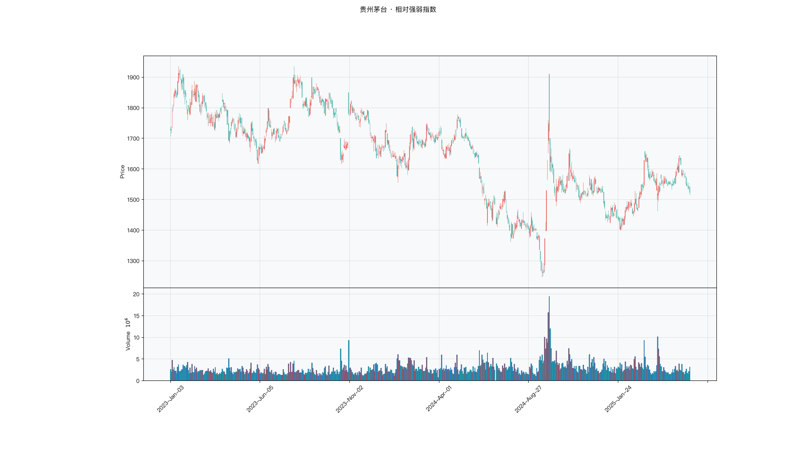

# 第021章 相对强弱指数（RSI）

复盘笔记里写着"这波涨得太多了"，第二天有人追问"太多"是多少，交易者答不上来。他试着数涨幅、数连涨天数、数涨停次数，三个口径给出三种答案，谁也说服不了谁。同一段涨幅，换成十天或二十天来量，结论就不一样；涨了同样的幅度，中间有没有回撤，感受也完全不同。他想找一个只回答买方力量占了几成的读数。

## 名称与来历

相对强弱指数（Relative Strength Index，RSI），简称 RSI。

它由 J. Welles Wilder 于 1978 年在《技术交易系统新概念》一书中提出。同一本书里还给出了平均真实波幅、动向指标与抛物线指标，RSI 是其中流传最广的一个。Wilder 的原始动机很直接：交易者凭感觉说"涨得多了要回调""跌得深了要反弹"，这种感觉无法量化，也无法复核。他希望有一个统一的读数，把多空双方的力量对比压缩成一个数字。

需要区分的是，RSI 里的"相对强弱"指的不是两只股票之间的强弱，而是一只股票自身的上涨力量与下跌力量之比。这个命名在后来的实践中造成过不少误解。

## 核心逻辑

一个投资者盯着一只连续上涨的股票，心里会浮现一个问题：涨了这么多，该歇一歇了吧。可是"这么多"到底是几个百分点、几天，凭感觉无法回答。RSI 先把这个模糊的问题变成一个可以计算的量。

它把观察窗口内每一日的涨跌分开记账。上涨的日子记涨幅，下跌的日子记跌幅，两者分别求平均，再相除，得到一个比值。这个比值衡量的是"这段时间里，涨的力量是跌的力量的几倍"。比值大，说明买方持续占优；比值小，说明卖方持续占优。

比值本身没有上界，涨幅可以是跌幅的十倍，也可以只有一点点。为了便于读数，RSI 用一次分式变换把这个比值压进 0 到 100 的区间。50 是分界线，对应涨跌力量大致均衡；越接近 100，买方越占绝对优势；越接近 0，卖方越占绝对优势。

这套设计有一个隐含前提：涨跌力量会在极端之后向均衡回归。前提成立时，RSI 在两端给出的信号有效；前提不成立时，也就是单边趋势运行的时候，RSI 会长期困在极端区域，信号失效。这是理解 RSI 的边界时需要先记住的一句话。

## 计算公式

RSI 的推导分三步，核心在于第二步的平滑方式。

### 第一步：拆分每日涨跌

对相邻两个交易日求收盘价之差：

$$\Delta P_t = C_t - C_{t-1}$$

$\Delta P_t$ 为正记入上涨幅度 $U_t$，为负取其绝对值记入下跌幅度 $D_t$，为零时两者都记零。

### 第二步：Wilder 平滑

对 $U_t$ 与 $D_t$ 分别做平滑，得到平均上涨幅度与平均下跌幅度。Wilder 用的不是简单平均，而是一种特殊的递推平滑：

$$\overline{U}_t = \frac{\overline{U}_{t-1} \times (n-1) + U_t}{n}$$

$$\overline{D}_t = \frac{\overline{D}_{t-1} \times (n-1) + D_t}{n}$$

递推需要一个起点。第一期的平均涨跌幅直接取前 n 个周期的算术平均值。之后每一步都用上式滚动更新。

这个式子常被写作指数平滑，但它的平滑系数是 $1/n$，而不是标准指数移动平均的 $2/(n+1)$。两者不可混用：以 n = 14 为例，Wilder 平滑的系数约为 0.0714，标准指数平滑的系数约为 0.1333，后者反应更快，得到的历史 RSI 也完全不同。多数软件图表默认用的是 Wilder 平滑，自己动手实现时需要确认这一点。

### 第三步：压缩到 0 到 100

先求相对强度：

$$RS_t = \frac{\overline{U}_t}{\overline{D}_t}$$

再变换：

$$RSI_t = 100 - \frac{100}{1 + RS_t}$$

当 $\overline{D}_t$ 为零时，$RS$ 取无穷大，RSI 取 100；当 $\overline{U}_t$ 为零时，$RS$ 为零，RSI 取 0。这解释了为什么 RSI 的端点是 0 和 100 而不是其他数字。

**计算示例。** 取 n = 14。假设前 14 日的上涨幅度之和为 28，下跌幅度之和为 14，则起点的平均上涨幅度为 2.0，平均下跌幅度为 1.0。次日上涨幅度为 3，下跌幅度为 0：

$$\overline{U} = \frac{2.0 \times 13 + 3}{14} = 2.071$$

$$\overline{D} = \frac{1.0 \times 13 + 0}{14} = 0.929$$

$$RS = \frac{2.071}{0.929} = 2.23$$

$$RSI = 100 - \frac{100}{1 + 2.23} = 69.0$$

读数 69 落在中性偏多的位置，接近但尚未越过 70。

**参数含义。** n 是唯一的参数，TTR 与多数软件的默认取值为 14。

| n | 反应速度 | 信号密度 | 典型用途 |
|---|---------|---------|---------|
| 6 | 快 | 高，假信号多 | 短线拐点捕捉，与 14 日组合使用 |
| 14 | 中 | 中 | 默认基准，日线波段 |
| 24 | 慢 | 低，信号稳 | 过滤噪音，确认中期方向 |

实践中常用三条不同周期的 RSI 组合：6 日线先动，14 日线跟上，24 日线确认。短周期先行进入极端区，随后长周期跟进时，拐点判断的可靠度相对更高。

## 用法与信号

**超买与超卖。** 这是 RSI 最基础的用法。14 日 RSI 越过 70 视为超买，跌破 30 视为超卖，逻辑是极端之后向均值回归。用法上有一个务实的修正：30 到 70 的中性区并不是无用区，读数从超卖区回升并越过 50，往往比停留在 30 附近更有意义，因为 50 轴代表力量对比完成了切换。

**背离。** 价格创出新高而 RSI 没有同步创出新高，称为顶背离；价格创出新低而 RSI 没有同步创出新低，称为底背离。背离说明价格还在推进，但推进的力量在减弱，属于预警信号。使用时需要注意，背离至少需要两个高点或两个低点作对比，比较的时间跨度太短时，结论不稳。

**周期之间的交叉。** 把 6 日 RSI 与 14 日 RSI 画在一起，短线上穿长线为金叉，下穿为死叉。这类交叉在震荡市中可用，在趋势市里交叉会非常频繁却大多无效。有一个过滤器比较实用：交叉点若发生在 30 到 50 区间，多头含义更足；若发生在 70 以上，多半是假金叉。

**趋势中的 50 轴。** 在方向明确的行情里，RSI 的用法要换。上升趋势中 RSI 通常在 50 以上波动，回调到 30 到 50 区间而不破，是顺势加仓的位置；下降趋势中 RSI 通常在 50 以下波动，反弹到 50 到 70 区间而不破，是顺势减仓的位置。此时 RSI 的极端读数不是反转信号，而是趋势强度的证据。

## 边界与误区

**强趋势中超买可以持续很久。** 连续涨停的品种，RSI 可以在 80 以上停留十个交易日以上。按超买卖出会错过整段行情，按超买做空会被反复打爆。判断依据是 ADX 是否越过 25 并且向上。只要是强趋势，超买超卖就要降级为参考，不能当作扳机。

**背离不是触发信号。** 背离只说明当前的推进力量在减弱，不说明价格接下来会下跌。顶背离常常连续出现两三次，价格仍然缓慢上行。把它当作减仓的提醒是合理的，当作开仓的信号则风险偏高。需要等价格本身破坏结构，比如跌破前一个低点，再动手。

**Wilder 平滑与标准指数平滑不能混用。** 用 `ewm(span=14)` 计算出来的 RSI 与图表软件显示的 RSI 会有可观的差异，因为两者平滑系数不同。跨平台对照读数或复现历史信号时，需要先确认平滑口径。

**阈值不是精确分界。** 70 与 69 之间没有任何本质区别。把 70 当作一条需要尊重的线，会产生"差 0.3 就入场"这类过度精确的操作。更稳的做法是看读数是否持续处在极端区域，并把它与其他证据结合。

## 它被检验过吗

RSI 缺少针对该指标的独立同行评议检验。现有的统计证据来自技术分析规则族的整体检验，这类检验无法把绩效归因到某一个震荡指标上。完整的证据链见第 007 章。

震荡类还有一层方法上的难处。它的核心假设是价格围绕中枢回归，这个假设在趋势市里直接失效。把趋势段与震荡段混在同一样本里，正负相抵，很容易得到"接近零"的结论。这个结论既不能证明它有用，也不能证明它没用。

这一类的真实失效案例，见第 020 章的「真实案例与失败模式」。

## 代码实现

### R

```r
library(ettr)
library(efactorcraft)
library(efincharts)
library(ggplot2)

BASE <- "https://raw.githubusercontent.com/dengyishuo/quant-technical-analysis/main/data/parquet"

# 取数据：本地有就用本地，没有就下载一次并缓存。
# read.csv 对本地 .gz 会自动解压，所以缓存成 .csv.gz 也能直接读。
load_data <- function(name) {
  local <- file.path("data", "parquet", name)
  if (file.exists(local)) return(local)
  cache <- file.path(tools::R_user_dir("qta", "cache"), name)
  if (!file.exists(cache)) {
    dir.create(dirname(cache), recursive = TRUE, showWarnings = FALSE)
    message("下载 ", name, " ...")
    download.file(paste0(BASE, "/", name), cache, mode = "wb", quiet = TRUE)
  }
  cache
}

read_data <- function(name) {
  d <- read.csv(load_data(name), stringsAsFactors = FALSE)
  if ("date" %in% names(d)) d$date <- as.Date(d$date)
  d
}

# 同一章里多次取用，缓存到内存，避免重复解析
.cache <- new.env(parent = emptyenv())
.blue <- function() {
  if (!exists("b", .cache)) assign("b", read_data("panel_blue_chip.csv"), .cache)
  get("b", .cache)
}
.panel <- function() {
  if (!exists("p", .cache)) {
    p <- read_data("panel_r.csv.gz")
    assign("p", p[p$date >= "2023-01-01" & p$date <= "2025-06-01", ], .cache)
  }
  get("p", .cache)
}
.index <- function() read_data("index_daily.csv")

blue  <- .blue()
panel <- .panel()

# 图的保存路径，顺手建目录，避免读者本地没有 assets/ 时报错
fig_path <- function(ch, name = "indicator_r.png") {
  d <- file.path("assets", "figures", sprintf("ch%03d", ch))
  dir.create(d, recursive = TRUE, showWarnings = FALSE)
  file.path(d, name)
}

# efincharts 要求 xts 且列名带 Adjusted
as_xts <- function(df) {
  x <- xts::xts(df[, c("open", "high", "low", "close", "volume", "adjusted")],
                order.by = df$date)
  colnames(x) <- c("Open", "High", "Low", "Close", "Volume", "Adjusted")
  x
}

maotai <- .blue()[.blue()$code == "600519.SS", ]

# 1. ettr 在长格式面板上追加指标列
maotai <- add_rsi(maotai, n = 14)

# 2. 基本统计
cols <- setdiff(names(maotai), names(blue))
print(summary(maotai[, cols]))

# 3. K 线 + 成交量 + 均线
ch <- ecandlesticks(as_xts(maotai), show_ma = TRUE, ma_periods = c(20, 60),
                    title = "贵州茅台 · 相对强弱指数")
ggsave(fig_path(21), ch$combined_plot, width = 10, height = 6, dpi = 110)
```

### Python

```python
import pathlib
import urllib.request

import pandas as pd
import ettr
import efactorcraft as efc
import efincharts as efc_

# 中文字体：mplfinance 会用 style 里的 rc 覆盖全局设置，必须写进 style
from efincharts import theme
theme.efin_style["rc"] = {
    "font.sans-serif": ["PingFang SC", "Heiti SC", "SimHei"],
    "axes.unicode_minus": False,
    "font.family": "sans-serif",
}

# A 股习惯是涨红跌绿，efincharts 的默认配色沿用了欧美习惯（涨绿跌红），
# 这里改回来，也让静态图与网页上的交互图、R 侧的图保持一致。
_mc = theme.efin_style["marketcolors"]
for _k in ("candle", "edge", "wick", "volume"):
    _mc[_k] = {"up": "#e53935", "down": "#26a69a"}

BASE = "https://raw.githubusercontent.com/dengyishuo/quant-technical-analysis/main/data/parquet"
CACHE = pathlib.Path.home() / ".cache" / "qta"
_MEM = {}


def load(name):
    """取数据：本地有就用本地，没有就下载一次并缓存。

    这样三种情形都能跑：
      1. 克隆了整个仓库    -> 直接读 data/parquet/，不联网
      2. 只复制了代码片段  -> 首次自动下载到 ~/.cache/qta，之后走缓存
      3. 之前跑过          -> 全部命中缓存，断网也能用
    """
    if name in _MEM:
        return _MEM[name]
    local = pathlib.Path("data/parquet") / name
    if local.exists():
        path = local
    else:
        CACHE.mkdir(parents=True, exist_ok=True)
        path = CACHE / name
        if not path.exists():
            print("下载 %s ..." % name)
            urllib.request.urlretrieve(BASE + "/" + name, path)
    data = pd.read_parquet(path) if name.endswith(".parquet") else pd.read_csv(path)
    _MEM[name] = data
    return data


blue = load("panel_blue_chip.parquet")
panel = load("panel.parquet")
panel = panel[(panel["date"] >= "2023-01-01") & (panel["date"] <= "2025-06-01")]
idx = load("index_daily.parquet")


def one(df, code="600519.SS"):
    """取单只标的，转成 efincharts 需要的宽表。"""
    x = df[df["code"] == code].sort_values("date").set_index("date")
    x.columns = [c.capitalize() for c in x.columns]
    return x


def fig_path(ch, name="indicator.png"):
    """图的保存路径，顺手建目录，避免读者本地没有 assets/ 时报错。"""
    d = pathlib.Path("assets") / "figures" / ("ch%03d" % ch)
    d.mkdir(parents=True, exist_ok=True)
    return str(d / name)

# 1. 取单只标的
maotai = blue[blue['code'] == '600519.SS'].copy()

# 2. ettr 在长格式面板上追加指标列，不需要手工 rolling
maotai = ettr.rsi(maotai, n=14)

cols = [c for c in maotai.columns if c not in blue.columns]
print(maotai[cols].describe().round(3))

# 3. 画图：K 线 + 成交量 + 指标面板
px = one(maotai)
ch = efc_.candlestick(px, volume=True, title="贵州茅台 · 相对强弱指数")
ch.save(fig_path(21))
```

<!-- fig-indicator:start -->


<p class="figcap">图 21-1　相对强弱指数在贵州茅台上的读数（2023-01 至 2025-06）</p>
<!-- fig-indicator:end -->

## 拆解

RSI 已经压缩在 0 到 100 之间，跨标的可以直接比较，这一点比价格类指标省事。直接拿读数做横截面因子仍有两处不便。一是刻度的中性点落在 50，而因子习惯以零为中心，符号的经济含义要绕一道弯。二是 RSI 是比值经分式变换后的结果，涨跌方向与波动幅度被揉进同一个数字，单看一个读数分不清力量强与波动大。

| 特征名 | 计算式 | 量纲 | 经济含义 |
|--------|--------|------|----------|
| 中轴偏离 | $RSI_t - 50$ | 无量纲，取值 −50 到 50 | 多空力量对比相对均衡点的位置 |
| 原始读数 | $RSI_t$ | 无量纲，取值 0 到 100 | 同上，零点落在刻度的一端之外 |
| 变化率 | $RSI_t - RSI_{t-n}$ | 无量纲，单位为点 | 力量对比的边际变化速度 |
| 极值持续期 | 连续 $RSI > 70$ 或 $RSI < 30$ 的期数 | 期数（整数） | 极端状态的持续时间 |

四个特征同源，相关性不低。偏离值与原始读数只差一个常数平移，横截面排序完全一致，秩相关系数恒为 1，IC 也完全相同，两者只需报告一个。选择偏离值不是因为信息更多，而是因为系数符号可以直接读成高于或低于中轴，写结论时少一次换算。

变化率与偏离值的关系要复杂一些。前者是差分，后者是水平。读数处在 80 而五日前是 85，偏离值很高、变化率为负，含义是仍在超买区但在回落；读数处在 55 而五日前是 45，偏离值不高、变化率为正，含义是刚越过中轴。两种状态在交易上并不相同，混在一个因子里会互相稀释。

极值持续期的问题在分布。它是整数，右偏明显，一段连续的超买行情就能累计出很大的数值，排序时头部被少数标的占据。它同时自带方向：超买侧与超卖侧的持续期含义相反，取绝对值会把两端合并，剩下的是极端程度，不是方向。

### R

```r
library(ettr)
library(efactorcraft)
library(efincharts)
library(ggplot2)

BASE <- "https://raw.githubusercontent.com/dengyishuo/quant-technical-analysis/main/data/parquet"

# 取数据：本地有就用本地，没有就下载一次并缓存。
# read.csv 对本地 .gz 会自动解压，所以缓存成 .csv.gz 也能直接读。
load_data <- function(name) {
  local <- file.path("data", "parquet", name)
  if (file.exists(local)) return(local)
  cache <- file.path(tools::R_user_dir("qta", "cache"), name)
  if (!file.exists(cache)) {
    dir.create(dirname(cache), recursive = TRUE, showWarnings = FALSE)
    message("下载 ", name, " ...")
    download.file(paste0(BASE, "/", name), cache, mode = "wb", quiet = TRUE)
  }
  cache
}

read_data <- function(name) {
  d <- read.csv(load_data(name), stringsAsFactors = FALSE)
  if ("date" %in% names(d)) d$date <- as.Date(d$date)
  d
}

# 同一章里多次取用，缓存到内存，避免重复解析
.cache <- new.env(parent = emptyenv())
.blue <- function() {
  if (!exists("b", .cache)) assign("b", read_data("panel_blue_chip.csv"), .cache)
  get("b", .cache)
}
.panel <- function() {
  if (!exists("p", .cache)) {
    p <- read_data("panel_r.csv.gz")
    assign("p", p[p$date >= "2023-01-01" & p$date <= "2025-06-01", ], .cache)
  }
  get("p", .cache)
}
.index <- function() read_data("index_daily.csv")

blue  <- .blue()
panel <- .panel()

# 图的保存路径，顺手建目录，避免读者本地没有 assets/ 时报错
fig_path <- function(ch, name = "indicator_r.png") {
  d <- file.path("assets", "figures", sprintf("ch%03d", ch))
  dir.create(d, recursive = TRUE, showWarnings = FALSE)
  file.path(d, name)
}

# efincharts 要求 xts 且列名带 Adjusted
as_xts <- function(df) {
  x <- xts::xts(df[, c("open", "high", "low", "close", "volume", "adjusted")],
                order.by = df$date)
  colnames(x) <- c("Open", "High", "Low", "Close", "Volume", "Adjusted")
  x
}

d <- .blue()[.blue()$code == "600519.SS", ]
d <- add_rsi(d, n = 14)

# 转成无量纲因子
d$f <- d$`RSI_14`

print(summary(d$f))
```

### Python

```python
import pathlib
import urllib.request

import pandas as pd
import ettr
import efactorcraft as efc
import efincharts as efc_

# 中文字体：mplfinance 会用 style 里的 rc 覆盖全局设置，必须写进 style
from efincharts import theme
theme.efin_style["rc"] = {
    "font.sans-serif": ["PingFang SC", "Heiti SC", "SimHei"],
    "axes.unicode_minus": False,
    "font.family": "sans-serif",
}

# A 股习惯是涨红跌绿，efincharts 的默认配色沿用了欧美习惯（涨绿跌红），
# 这里改回来，也让静态图与网页上的交互图、R 侧的图保持一致。
_mc = theme.efin_style["marketcolors"]
for _k in ("candle", "edge", "wick", "volume"):
    _mc[_k] = {"up": "#e53935", "down": "#26a69a"}

BASE = "https://raw.githubusercontent.com/dengyishuo/quant-technical-analysis/main/data/parquet"
CACHE = pathlib.Path.home() / ".cache" / "qta"
_MEM = {}


def load(name):
    """取数据：本地有就用本地，没有就下载一次并缓存。

    这样三种情形都能跑：
      1. 克隆了整个仓库    -> 直接读 data/parquet/，不联网
      2. 只复制了代码片段  -> 首次自动下载到 ~/.cache/qta，之后走缓存
      3. 之前跑过          -> 全部命中缓存，断网也能用
    """
    if name in _MEM:
        return _MEM[name]
    local = pathlib.Path("data/parquet") / name
    if local.exists():
        path = local
    else:
        CACHE.mkdir(parents=True, exist_ok=True)
        path = CACHE / name
        if not path.exists():
            print("下载 %s ..." % name)
            urllib.request.urlretrieve(BASE + "/" + name, path)
    data = pd.read_parquet(path) if name.endswith(".parquet") else pd.read_csv(path)
    _MEM[name] = data
    return data


blue = load("panel_blue_chip.parquet")
panel = load("panel.parquet")
panel = panel[(panel["date"] >= "2023-01-01") & (panel["date"] <= "2025-06-01")]
idx = load("index_daily.parquet")


def one(df, code="600519.SS"):
    """取单只标的，转成 efincharts 需要的宽表。"""
    x = df[df["code"] == code].sort_values("date").set_index("date")
    x.columns = [c.capitalize() for c in x.columns]
    return x


def fig_path(ch, name="indicator.png"):
    """图的保存路径，顺手建目录，避免读者本地没有 assets/ 时报错。"""
    d = pathlib.Path("assets") / "figures" / ("ch%03d" % ch)
    d.mkdir(parents=True, exist_ok=True)
    return str(d / name)

# 1. 先在面板上算原始指标
d = panel.copy()
d = ettr.rsi(d, n=14)

# 2. 转成无量纲因子，才能跨标的排序
d["f"] = d["RSI_14"]

print(d["f"].describe().round(4))
```

## 截面选股能力

最常用的构造是中轴偏离，

$$f^{dev}_t = RSI^{(14)}_t - 50$$

它把有界读数搬到以零为中心的坐标上，正值表示涨的力量占优。另一个构造是变化率，

$$f^{chg}_t = RSI^{(14)}_t - RSI^{(14)}_{t-5}$$

它度量力量对比在五日内的推进或衰减，属于纯边际信息。

**符号没有先验答案。** 高读数可以有两种解释。一种是超买将回落，读数越高，未来收益越低，因子方向为负；另一种是强势在延续，读数越高说明买盘越坚决，方向为正。两种解释都能找到依据，取哪一种取决于样本、周期与标的类型。把方向写死在假设里，是这类因子最容易出错的地方。

预期表现上，中轴偏离在短窗口偏反转，在中等窗口偏动量。一日前向收益对应的 IC 常偏负，日内急涨之后有回吐；五日窗口的方向则取决于样本期的市场结构。市况层面，趋势明确的阶段高读数更容易延续，区间震荡的阶段高读数更容易回落。标的层面，高波动、题材属性强的品种反转更明显，低波动的蓝筹更接近动量。

检验时有三点值得注意。第一，**符号按数据判定，并按时间切分复核**。先算全样本 IC 看符号，再按年份或按大盘趋势强弱分段，检查符号是否翻转。若某几年为正、另几年为负，全样本均值会被拉平，报一个接近零的数字没有意义。第二，**一日与五日的结论分开报告**。两个窗口符号相反是这类因子的常态，合并会掩盖结构。第三，**共线要处理**。偏离值与原始读数的排序等价，变化率与偏离值的相关也不低，同族特征不宜全部入模。

还有一种情形需要单独提醒。全样本 IC 接近零，分段之后每一段的绝对值都不小，方向却相反。这不说明因子无用，说明它依赖市况。处理方式不是弃用，而是加一个市况开关，或者分层之后再判断。震荡类指标大多落在这一情形里。

### R

```r
library(ettr)
library(efactorcraft)
library(efincharts)
library(ggplot2)

BASE <- "https://raw.githubusercontent.com/dengyishuo/quant-technical-analysis/main/data/parquet"

# 取数据：本地有就用本地，没有就下载一次并缓存。
# read.csv 对本地 .gz 会自动解压，所以缓存成 .csv.gz 也能直接读。
load_data <- function(name) {
  local <- file.path("data", "parquet", name)
  if (file.exists(local)) return(local)
  cache <- file.path(tools::R_user_dir("qta", "cache"), name)
  if (!file.exists(cache)) {
    dir.create(dirname(cache), recursive = TRUE, showWarnings = FALSE)
    message("下载 ", name, " ...")
    download.file(paste0(BASE, "/", name), cache, mode = "wb", quiet = TRUE)
  }
  cache
}

read_data <- function(name) {
  d <- read.csv(load_data(name), stringsAsFactors = FALSE)
  if ("date" %in% names(d)) d$date <- as.Date(d$date)
  d
}

# 同一章里多次取用，缓存到内存，避免重复解析
.cache <- new.env(parent = emptyenv())
.blue <- function() {
  if (!exists("b", .cache)) assign("b", read_data("panel_blue_chip.csv"), .cache)
  get("b", .cache)
}
.panel <- function() {
  if (!exists("p", .cache)) {
    p <- read_data("panel_r.csv.gz")
    assign("p", p[p$date >= "2023-01-01" & p$date <= "2025-06-01", ], .cache)
  }
  get("p", .cache)
}
.index <- function() read_data("index_daily.csv")

blue  <- .blue()
panel <- .panel()

# 图的保存路径，顺手建目录，避免读者本地没有 assets/ 时报错
fig_path <- function(ch, name = "indicator_r.png") {
  d <- file.path("assets", "figures", sprintf("ch%03d", ch))
  dir.create(d, recursive = TRUE, showWarnings = FALSE)
  file.path(d, name)
}

# efincharts 要求 xts 且列名带 Adjusted
as_xts <- function(df) {
  x <- xts::xts(df[, c("open", "high", "low", "close", "volume", "adjusted")],
                order.by = df$date)
  colnames(x) <- c("Open", "High", "Low", "Close", "Volume", "Adjusted")
  x
}

d <- .panel()
d <- add_rsi(d, n = 14)

d$f <- d$`RSI_14`
d <- add_next_return(d, close_col = "close", n = c(1, 5, 20))

ic <- ic_analysis(d, factor_cols = "f",
                    forward_cols = c("forward_1", "forward_5", "forward_20"),
                    method = "spearman")
print(ir_analysis(ic))

q <- quantile_analysis(d, factor_cols = "f", forward_cols = "forward_5",
                       n_groups = 5)
print(q$f$summary)
```

### Python

```python
import pathlib
import urllib.request

import pandas as pd
import ettr
import efactorcraft as efc
import efincharts as efc_

# 中文字体：mplfinance 会用 style 里的 rc 覆盖全局设置，必须写进 style
from efincharts import theme
theme.efin_style["rc"] = {
    "font.sans-serif": ["PingFang SC", "Heiti SC", "SimHei"],
    "axes.unicode_minus": False,
    "font.family": "sans-serif",
}

# A 股习惯是涨红跌绿，efincharts 的默认配色沿用了欧美习惯（涨绿跌红），
# 这里改回来，也让静态图与网页上的交互图、R 侧的图保持一致。
_mc = theme.efin_style["marketcolors"]
for _k in ("candle", "edge", "wick", "volume"):
    _mc[_k] = {"up": "#e53935", "down": "#26a69a"}

BASE = "https://raw.githubusercontent.com/dengyishuo/quant-technical-analysis/main/data/parquet"
CACHE = pathlib.Path.home() / ".cache" / "qta"
_MEM = {}


def load(name):
    """取数据：本地有就用本地，没有就下载一次并缓存。

    这样三种情形都能跑：
      1. 克隆了整个仓库    -> 直接读 data/parquet/，不联网
      2. 只复制了代码片段  -> 首次自动下载到 ~/.cache/qta，之后走缓存
      3. 之前跑过          -> 全部命中缓存，断网也能用
    """
    if name in _MEM:
        return _MEM[name]
    local = pathlib.Path("data/parquet") / name
    if local.exists():
        path = local
    else:
        CACHE.mkdir(parents=True, exist_ok=True)
        path = CACHE / name
        if not path.exists():
            print("下载 %s ..." % name)
            urllib.request.urlretrieve(BASE + "/" + name, path)
    data = pd.read_parquet(path) if name.endswith(".parquet") else pd.read_csv(path)
    _MEM[name] = data
    return data


blue = load("panel_blue_chip.parquet")
panel = load("panel.parquet")
panel = panel[(panel["date"] >= "2023-01-01") & (panel["date"] <= "2025-06-01")]
idx = load("index_daily.parquet")


def one(df, code="600519.SS"):
    """取单只标的，转成 efincharts 需要的宽表。"""
    x = df[df["code"] == code].sort_values("date").set_index("date")
    x.columns = [c.capitalize() for c in x.columns]
    return x


def fig_path(ch, name="indicator.png"):
    """图的保存路径，顺手建目录，避免读者本地没有 assets/ 时报错。"""
    d = pathlib.Path("assets") / "figures" / ("ch%03d" % ch)
    d.mkdir(parents=True, exist_ok=True)
    return str(d / name)

# 287 只、2023-01 至 2025-06，横截面才有统计意义
src = panel.copy()
d = src.copy()

# 1. 算指标
d = ettr.rsi(d, n=14)


# 2. 因子 + 未来收益
d["f"] = d["RSI_14"]
d = efc.add_next_return(d, periods=(1, 5, 20))

# 3. 截面 IC 与分层
ic = efc.ic_analysis(d, factor_cols="f",
                      forward_cols=["forward_1", "forward_5", "forward_20"],
                      method="spearman")
print(efc.ir_analysis(ic).round(3))

q = efc.quantile_analysis(d, factor_col="f", forward_col="forward_5", n_groups=5)
print(q["summary"].round(4))
```

这几组输出的读法不同。一日与五日的对比反映有效持有期；分层收益的单调性反映关系是否线性；按年切分的 IC 反映符号是否稳定。第三项最容易被跳过，但对震荡类因子它往往是决定性的一项。

<!-- tab-ic:start -->
**计算结果**

| 前向期 | IC 均值 | IC 标准差 | ICIR | t 值 | IC>0 占比 | 期数 |
|---|---|---|---|---|---|---|
| T+1 | -0.0160 | 0.2303 | -0.070 | -1.66 | 0.4780 | 567 |
| T+5 | -0.0181 | 0.2216 | -0.082 | -1.94 | 0.4800 | 563 |
| T+20 | -0.0401 | 0.1973 | -0.203 | -4.76 | 0.4510 | 548 |

表里最该看的是 t 值，不是 IC 均值。这个因子以 T+1 为主口径，IC 均值 -0.0160、ICIR -0.070、t 值 -1.66，在常规门槛下不显著，方向为反向。按第 007 章给出的日频门槛（ICIR 0.13 对应 t≈2），这个结果的含义是：还看不出与噪声的区别，不能据此构造策略。

需要提醒的是，这只说明排序与未来收益之间存在可测的关联，不代表扣掉成本后还能剩下收益。横截面 IC 检验的是“买哪只”，不负责“值不值得交易”。

**五档分层**

| 分组 | 平均收益 | 标准差 | 期数 |
|---|---|---|---|
| 1 | +0.0040 | +0.0396 | 563 |
| 2 | +0.0036 | +0.0355 | 563 |
| 3 | +0.0021 | +0.0319 | 563 |
| 4 | +0.0026 | +0.0307 | 563 |
| 5 | +0.0044 | +0.0364 | 563 |

五档分层看的是形状，不是单点。最高一档在第 5 组、最低在第 3 组，两端相差 +0.04%，组序号与平均收益的秩相关为 -0.03，没有明显单调性。

分层比 IC 更接近实盘，因为它直接给出“买最高档、卖最低档”的收益差。但这里的数字是毛收益，且没有考虑涨跌停买不进、停牌卖不出的情形，真实可得的差额会小于表中所列。
<!-- tab-ic:end -->

## 择时能力

RSI 的择时逻辑有三层。第一层是阈值穿越：读数越过 70 视为超买，跌破 30 视为超卖，属于离散事件。第二层是 50 轴的归属，站上或跌破代表力量对比完成切换，属于状态信号。第三层是背离：价格创新高而读数没有跟进，需要至少两个高点作比较。

方法要与形态匹配。阈值穿越是事件，适合用信号触发日检验，把触发日与其余交易日分组，比较其后的收益。连续读数适合条件分位收益，观察五档是否单调，以及两端是否比中间更有效。50 轴规则可以直接转成仓位，做一次完整回测，与买入持有对照。三层各用一种方法，回答的是三个不同的问题。

选择这三条路径而不是只做一条，原因在于震荡指标的择时能力集中在极端区间。截面检验把所有标的放在一起排序，中间区域的噪音会稀释两端的信号；时序检验只关心同一标的的状态变化，极端样本得以单独观察。趋势类指标的情形相反，它们的状态持续性强，截面排序更容易稳定。

陷阱有三个。第一，**阈值固定，波动率不同**。同一个 70 对低波动蓝筹与高波动题材股的含义并不相同，分段统计比全样本有信息量。第二，**强趋势中的钝化**。单边行情里读数长期停在极端区，按超买卖出会连续踏空，回测的最大回撤往往出现在这一段。第三，**信号频次与成本**。50 轴穿越在震荡市里一周可能出现数次，回测不扣费率与印花税，结论会明显偏乐观。

### R

```r
library(ettr)
library(efactorcraft)
library(efincharts)
library(ggplot2)

BASE <- "https://raw.githubusercontent.com/dengyishuo/quant-technical-analysis/main/data/parquet"

# 取数据：本地有就用本地，没有就下载一次并缓存。
# read.csv 对本地 .gz 会自动解压，所以缓存成 .csv.gz 也能直接读。
load_data <- function(name) {
  local <- file.path("data", "parquet", name)
  if (file.exists(local)) return(local)
  cache <- file.path(tools::R_user_dir("qta", "cache"), name)
  if (!file.exists(cache)) {
    dir.create(dirname(cache), recursive = TRUE, showWarnings = FALSE)
    message("下载 ", name, " ...")
    download.file(paste0(BASE, "/", name), cache, mode = "wb", quiet = TRUE)
  }
  cache
}

read_data <- function(name) {
  d <- read.csv(load_data(name), stringsAsFactors = FALSE)
  if ("date" %in% names(d)) d$date <- as.Date(d$date)
  d
}

# 同一章里多次取用，缓存到内存，避免重复解析
.cache <- new.env(parent = emptyenv())
.blue <- function() {
  if (!exists("b", .cache)) assign("b", read_data("panel_blue_chip.csv"), .cache)
  get("b", .cache)
}
.panel <- function() {
  if (!exists("p", .cache)) {
    p <- read_data("panel_r.csv.gz")
    assign("p", p[p$date >= "2023-01-01" & p$date <= "2025-06-01", ], .cache)
  }
  get("p", .cache)
}
.index <- function() read_data("index_daily.csv")

blue  <- .blue()
panel <- .panel()

# 图的保存路径，顺手建目录，避免读者本地没有 assets/ 时报错
fig_path <- function(ch, name = "indicator_r.png") {
  d <- file.path("assets", "figures", sprintf("ch%03d", ch))
  dir.create(d, recursive = TRUE, showWarnings = FALSE)
  file.path(d, name)
}

# efincharts 要求 xts 且列名带 Adjusted
as_xts <- function(df) {
  x <- xts::xts(df[, c("open", "high", "low", "close", "volume", "adjusted")],
                order.by = df$date)
  colnames(x) <- c("Open", "High", "Low", "Close", "Volume", "Adjusted")
  x
}

t <- .index()
t <- t[t$code == "510300.SS", ]
t <- add_rsi(t, n = 14)
t$f <- t$`RSI_14`
t$forward_5 <- c(tail(t$close, -5) / head(t$close, -5) - 1, rep(NA, 5))
t$q <- cut(t$f, quantile(t$f, 0:5/5, na.rm = TRUE), include.lowest = TRUE, labels = FALSE)
print(aggregate(forward_5 ~ q, data = t, FUN = function(x)
  c(mean = mean(x, na.rm = TRUE), n = sum(!is.na(x)))))
```

### Python

```python
import pathlib
import urllib.request

import pandas as pd
import ettr
import efactorcraft as efc
import efincharts as efc_

# 中文字体：mplfinance 会用 style 里的 rc 覆盖全局设置，必须写进 style
from efincharts import theme
theme.efin_style["rc"] = {
    "font.sans-serif": ["PingFang SC", "Heiti SC", "SimHei"],
    "axes.unicode_minus": False,
    "font.family": "sans-serif",
}

# A 股习惯是涨红跌绿，efincharts 的默认配色沿用了欧美习惯（涨绿跌红），
# 这里改回来，也让静态图与网页上的交互图、R 侧的图保持一致。
_mc = theme.efin_style["marketcolors"]
for _k in ("candle", "edge", "wick", "volume"):
    _mc[_k] = {"up": "#e53935", "down": "#26a69a"}

BASE = "https://raw.githubusercontent.com/dengyishuo/quant-technical-analysis/main/data/parquet"
CACHE = pathlib.Path.home() / ".cache" / "qta"
_MEM = {}


def load(name):
    """取数据：本地有就用本地，没有就下载一次并缓存。

    这样三种情形都能跑：
      1. 克隆了整个仓库    -> 直接读 data/parquet/，不联网
      2. 只复制了代码片段  -> 首次自动下载到 ~/.cache/qta，之后走缓存
      3. 之前跑过          -> 全部命中缓存，断网也能用
    """
    if name in _MEM:
        return _MEM[name]
    local = pathlib.Path("data/parquet") / name
    if local.exists():
        path = local
    else:
        CACHE.mkdir(parents=True, exist_ok=True)
        path = CACHE / name
        if not path.exists():
            print("下载 %s ..." % name)
            urllib.request.urlretrieve(BASE + "/" + name, path)
    data = pd.read_parquet(path) if name.endswith(".parquet") else pd.read_csv(path)
    _MEM[name] = data
    return data


blue = load("panel_blue_chip.parquet")
panel = load("panel.parquet")
panel = panel[(panel["date"] >= "2023-01-01") & (panel["date"] <= "2025-06-01")]
idx = load("index_daily.parquet")


def one(df, code="600519.SS"):
    """取单只标的，转成 efincharts 需要的宽表。"""
    x = df[df["code"] == code].sort_values("date").set_index("date")
    x.columns = [c.capitalize() for c in x.columns]
    return x


def fig_path(ch, name="indicator.png"):
    """图的保存路径，顺手建目录，避免读者本地没有 assets/ 时报错。"""
    d = pathlib.Path("assets") / "figures" / ("ch%03d" % ch)
    d.mkdir(parents=True, exist_ok=True)
    return str(d / name)

# 择时检验用 ETF 做市场载体，指数本身没有日线数据
t = idx[idx["code"] == "510300.SS"].sort_values("date").copy()

# 1. 在 ETF 上算同一个指标
t = ettr.rsi(d, n=14)


# 2. 按因子分位看未来 5 日收益
t["f"] = t["RSI_14"]
t["forward_5"] = t["close"].shift(-5) / t["close"] - 1
# 因子可能有重复值，先按名次切，避免 qcut 报边界不唯一
t["q"] = pd.qcut(t["f"].rank(method="first"), 5, labels=False) + 1
t = t.dropna(subset=["f", "forward_5"])
print(t.groupby("q")["forward_5"].agg(["mean", "count"]).round(4))
```

四组结果要连着读。上下尾的 t 统计量符号相反，说明两端都有效但方向对称；只有一端显著，说明信息偏一侧。条件分位若两端高、中间低，说明指标只在极端处有用。回测输给买入持有未必说明指标无效，可能只是持仓时间太短。

<!-- tab-timing:start -->
**分位收益**

| 分位 | 未来 5 日均值 | 样本数 |
|---|---|---|
| 1 | +0.0034 | 220 |
| 2 | -0.0038 | 219 |
| 3 | -0.0003 | 219 |
| 4 | -0.0016 | 219 |
| 5 | +0.0022 | 220 |

择时口径与截面不同：这里只有一个标的，看的是同一标的在不同分位下的未来收益。最高与最低分位相差 -0.12%。单标的样本有限，这个差额很容易被一两段行情主导，只能作为方向参考。

真正做择时要问的是三件事：分位阈值是否稳定、换手是否可控、扣成本后是否还有剩余。三者缺一，择时信号就只是图上好看。
<!-- tab-timing:end -->

## 组合使用与验证

RSI 的搭档有三个。与均线偏离度搭配，一个度量力量对比，一个度量价格相对成本的位置，维度不同，相关性中等。与成交量搭配，用放量确认超卖反弹的承接，缩量的超卖往往还要继续磨。与 ADX 搭配，用趋势强度裁定读数该按超买还是按强势解读。三者互补的点分别是价格结构、参与度与市况前提。

**组合的截面验证。** 加权型做法是把 RSI 偏离与均线偏离各自横截面标准化后按权重相加，重算 IC，再与两个单特征比较。这里有一处与趋势类不同的地方需要先处理：两个特征的方向要先对齐。RSI 偏离若被判定为负向因子，入组合前要取负号，否则等权相加会让两个信号互相抵消，组合 IC 接近零，看起来像没有互补性，实际是符号没对上。条件型做法是先定义“RSI 低于 30 且价格在二十日均线上方”，转成二值信号再做事件研究。

**组合的择时验证。** 把均线方向作为开关，价格在二十日均线上方时接受超卖侧的买入信号，下方时只接受超买侧的减仓信号，其余时间空仓。回测时与不加过滤的单一规则对照，看年化、夏普与最大回撤三项，重点在回撤。过滤器的价值通常体现在少亏，而不是多赚。

增益判读的依据是方法论章的标准：**组合的 ICIR 高于两个单特征，才说明存在互补性；若介于两者之间，说明只是平均。** 第一步应当计算两个特征的横截面平均相关。RSI 偏离与均线偏离的相关性中等，组合仍有空间；若换成 RSI 与 WPR，两者信息源接近，组合几乎没有增量。同源指标的组合结果多半是平均，这一点可以当作判据使用。

### R

```r
library(ettr)
library(efactorcraft)
library(efincharts)
library(ggplot2)

BASE <- "https://raw.githubusercontent.com/dengyishuo/quant-technical-analysis/main/data/parquet"

# 取数据：本地有就用本地，没有就下载一次并缓存。
# read.csv 对本地 .gz 会自动解压，所以缓存成 .csv.gz 也能直接读。
load_data <- function(name) {
  local <- file.path("data", "parquet", name)
  if (file.exists(local)) return(local)
  cache <- file.path(tools::R_user_dir("qta", "cache"), name)
  if (!file.exists(cache)) {
    dir.create(dirname(cache), recursive = TRUE, showWarnings = FALSE)
    message("下载 ", name, " ...")
    download.file(paste0(BASE, "/", name), cache, mode = "wb", quiet = TRUE)
  }
  cache
}

read_data <- function(name) {
  d <- read.csv(load_data(name), stringsAsFactors = FALSE)
  if ("date" %in% names(d)) d$date <- as.Date(d$date)
  d
}

# 同一章里多次取用，缓存到内存，避免重复解析
.cache <- new.env(parent = emptyenv())
.blue <- function() {
  if (!exists("b", .cache)) assign("b", read_data("panel_blue_chip.csv"), .cache)
  get("b", .cache)
}
.panel <- function() {
  if (!exists("p", .cache)) {
    p <- read_data("panel_r.csv.gz")
    assign("p", p[p$date >= "2023-01-01" & p$date <= "2025-06-01", ], .cache)
  }
  get("p", .cache)
}
.index <- function() read_data("index_daily.csv")

blue  <- .blue()
panel <- .panel()

# 图的保存路径，顺手建目录，避免读者本地没有 assets/ 时报错
fig_path <- function(ch, name = "indicator_r.png") {
  d <- file.path("assets", "figures", sprintf("ch%03d", ch))
  dir.create(d, recursive = TRUE, showWarnings = FALSE)
  file.path(d, name)
}

# efincharts 要求 xts 且列名带 Adjusted
as_xts <- function(df) {
  x <- xts::xts(df[, c("open", "high", "low", "close", "volume", "adjusted")],
                order.by = df$date)
  colnames(x) <- c("Open", "High", "Low", "Close", "Volume", "Adjusted")
  x
}

d <- .panel()
d <- add_rsi(d, n = 14)
d$f1 <- d$`RSI_14`
d <- add_cmf(d, n = 20)
d$f2 <- d$CMF
d <- add_next_return(d, close_col = "close", n = 5)
ic1 <- ic_analysis(d, factor_cols = c("f1", "f2"),
                    forward_cols = "forward_5", method = "spearman")
print(ir_analysis(ic1))
```

```r
library(ettr)
library(efactorcraft)
library(efincharts)
library(ggplot2)

BASE <- "https://raw.githubusercontent.com/dengyishuo/quant-technical-analysis/main/data/parquet"

# 取数据：本地有就用本地，没有就下载一次并缓存。
# read.csv 对本地 .gz 会自动解压，所以缓存成 .csv.gz 也能直接读。
load_data <- function(name) {
  local <- file.path("data", "parquet", name)
  if (file.exists(local)) return(local)
  cache <- file.path(tools::R_user_dir("qta", "cache"), name)
  if (!file.exists(cache)) {
    dir.create(dirname(cache), recursive = TRUE, showWarnings = FALSE)
    message("下载 ", name, " ...")
    download.file(paste0(BASE, "/", name), cache, mode = "wb", quiet = TRUE)
  }
  cache
}

read_data <- function(name) {
  d <- read.csv(load_data(name), stringsAsFactors = FALSE)
  if ("date" %in% names(d)) d$date <- as.Date(d$date)
  d
}

# 同一章里多次取用，缓存到内存，避免重复解析
.cache <- new.env(parent = emptyenv())
.blue <- function() {
  if (!exists("b", .cache)) assign("b", read_data("panel_blue_chip.csv"), .cache)
  get("b", .cache)
}
.panel <- function() {
  if (!exists("p", .cache)) {
    p <- read_data("panel_r.csv.gz")
    assign("p", p[p$date >= "2023-01-01" & p$date <= "2025-06-01", ], .cache)
  }
  get("p", .cache)
}
.index <- function() read_data("index_daily.csv")

blue  <- .blue()
panel <- .panel()

# 图的保存路径，顺手建目录，避免读者本地没有 assets/ 时报错
fig_path <- function(ch, name = "indicator_r.png") {
  d <- file.path("assets", "figures", sprintf("ch%03d", ch))
  dir.create(d, recursive = TRUE, showWarnings = FALSE)
  file.path(d, name)
}

# efincharts 要求 xts 且列名带 Adjusted
as_xts <- function(df) {
  x <- xts::xts(df[, c("open", "high", "low", "close", "volume", "adjusted")],
                order.by = df$date)
  colnames(x) <- c("Open", "High", "Low", "Close", "Volume", "Adjusted")
  x
}

d <- .panel()
d <- add_rsi(d, n = 14)
d$f1 <- d$`RSI_14`
d <- add_cmf(d, n = 20)
d$f2 <- d$CMF
d <- add_next_return(d, close_col = "close", n = 5)
ic1 <- ic_analysis(d, factor_cols = c("f1", "f2"),
                    forward_cols = "forward_5", method = "spearman")
print(ir_analysis(ic1))
```

### Python

```python
import pathlib
import urllib.request

import pandas as pd
import ettr
import efactorcraft as efc
import efincharts as efc_

# 中文字体：mplfinance 会用 style 里的 rc 覆盖全局设置，必须写进 style
from efincharts import theme
theme.efin_style["rc"] = {
    "font.sans-serif": ["PingFang SC", "Heiti SC", "SimHei"],
    "axes.unicode_minus": False,
    "font.family": "sans-serif",
}

# A 股习惯是涨红跌绿，efincharts 的默认配色沿用了欧美习惯（涨绿跌红），
# 这里改回来，也让静态图与网页上的交互图、R 侧的图保持一致。
_mc = theme.efin_style["marketcolors"]
for _k in ("candle", "edge", "wick", "volume"):
    _mc[_k] = {"up": "#e53935", "down": "#26a69a"}

BASE = "https://raw.githubusercontent.com/dengyishuo/quant-technical-analysis/main/data/parquet"
CACHE = pathlib.Path.home() / ".cache" / "qta"
_MEM = {}


def load(name):
    """取数据：本地有就用本地，没有就下载一次并缓存。

    这样三种情形都能跑：
      1. 克隆了整个仓库    -> 直接读 data/parquet/，不联网
      2. 只复制了代码片段  -> 首次自动下载到 ~/.cache/qta，之后走缓存
      3. 之前跑过          -> 全部命中缓存，断网也能用
    """
    if name in _MEM:
        return _MEM[name]
    local = pathlib.Path("data/parquet") / name
    if local.exists():
        path = local
    else:
        CACHE.mkdir(parents=True, exist_ok=True)
        path = CACHE / name
        if not path.exists():
            print("下载 %s ..." % name)
            urllib.request.urlretrieve(BASE + "/" + name, path)
    data = pd.read_parquet(path) if name.endswith(".parquet") else pd.read_csv(path)
    _MEM[name] = data
    return data


blue = load("panel_blue_chip.parquet")
panel = load("panel.parquet")
panel = panel[(panel["date"] >= "2023-01-01") & (panel["date"] <= "2025-06-01")]
idx = load("index_daily.parquet")


def one(df, code="600519.SS"):
    """取单只标的，转成 efincharts 需要的宽表。"""
    x = df[df["code"] == code].sort_values("date").set_index("date")
    x.columns = [c.capitalize() for c in x.columns]
    return x


def fig_path(ch, name="indicator.png"):
    """图的保存路径，顺手建目录，避免读者本地没有 assets/ 时报错。"""
    d = pathlib.Path("assets") / "figures" / ("ch%03d" % ch)
    d.mkdir(parents=True, exist_ok=True)
    return str(d / name)

d = panel.copy()

# 1. 本章因子
d = ettr.rsi(d, n=14)
d["f1"] = d["RSI_14"]

# 2. 配一个量价因子做对照
d = ettr.cmf(d, n=20)
d["f2"] = d["CMF_20"]
d = efc.add_next_return(d, periods=(5,))

# 3. 单因子与等权组合的信息比率
ic = efc.ic_analysis(d, factor_cols=["f1", "f2"], forward_cols=["forward_5"],
                      method="spearman")
d = efc.equal_weighted_composite(d, factor_cols=["f1", "f2"], new_col="f1_f2")
ic2 = efc.ic_analysis(d, factor_cols=["f1_f2"], forward_cols=["forward_5"],
                      method="spearman")
ic.update(ic2)
print(efc.ir_analysis(ic).round(3))
```

```python
import pathlib
import urllib.request

import pandas as pd
import ettr
import efactorcraft as efc
import efincharts as efc_

# 中文字体：mplfinance 会用 style 里的 rc 覆盖全局设置，必须写进 style
from efincharts import theme
theme.efin_style["rc"] = {
    "font.sans-serif": ["PingFang SC", "Heiti SC", "SimHei"],
    "axes.unicode_minus": False,
    "font.family": "sans-serif",
}

# A 股习惯是涨红跌绿，efincharts 的默认配色沿用了欧美习惯（涨绿跌红），
# 这里改回来，也让静态图与网页上的交互图、R 侧的图保持一致。
_mc = theme.efin_style["marketcolors"]
for _k in ("candle", "edge", "wick", "volume"):
    _mc[_k] = {"up": "#e53935", "down": "#26a69a"}

BASE = "https://raw.githubusercontent.com/dengyishuo/quant-technical-analysis/main/data/parquet"
CACHE = pathlib.Path.home() / ".cache" / "qta"
_MEM = {}


def load(name):
    """取数据：本地有就用本地，没有就下载一次并缓存。

    这样三种情形都能跑：
      1. 克隆了整个仓库    -> 直接读 data/parquet/，不联网
      2. 只复制了代码片段  -> 首次自动下载到 ~/.cache/qta，之后走缓存
      3. 之前跑过          -> 全部命中缓存，断网也能用
    """
    if name in _MEM:
        return _MEM[name]
    local = pathlib.Path("data/parquet") / name
    if local.exists():
        path = local
    else:
        CACHE.mkdir(parents=True, exist_ok=True)
        path = CACHE / name
        if not path.exists():
            print("下载 %s ..." % name)
            urllib.request.urlretrieve(BASE + "/" + name, path)
    data = pd.read_parquet(path) if name.endswith(".parquet") else pd.read_csv(path)
    _MEM[name] = data
    return data


blue = load("panel_blue_chip.parquet")
panel = load("panel.parquet")
panel = panel[(panel["date"] >= "2023-01-01") & (panel["date"] <= "2025-06-01")]
idx = load("index_daily.parquet")


def one(df, code="600519.SS"):
    """取单只标的，转成 efincharts 需要的宽表。"""
    x = df[df["code"] == code].sort_values("date").set_index("date")
    x.columns = [c.capitalize() for c in x.columns]
    return x


def fig_path(ch, name="indicator.png"):
    """图的保存路径，顺手建目录，避免读者本地没有 assets/ 时报错。"""
    d = pathlib.Path("assets") / "figures" / ("ch%03d" % ch)
    d.mkdir(parents=True, exist_ok=True)
    return str(d / name)

d = panel.copy()

# 1. 本章因子
d = ettr.rsi(d, n=14)
d["f1"] = d["RSI_14"]

# 2. 配一个量价因子做对照
d = ettr.cmf(d, n=20)
d["f2"] = d["CMF_20"]
d = efc.add_next_return(d, periods=(5,))

# 3. 单因子与等权组合的信息比率
ic = efc.ic_analysis(d, factor_cols=["f1", "f2"], forward_cols=["forward_5"],
                      method="spearman")
d = efc.equal_weighted_composite(d, factor_cols=["f1", "f2"], new_col="f1_f2")
ic2 = efc.ic_analysis(d, factor_cols=["f1_f2"], forward_cols=["forward_5"],
                      method="spearman")
ic.update(ic2)
print(efc.ir_analysis(ic).round(3))
```

四行输出要放在一起读。组合的 ICIR 高于两者，说明互补；介于两者之间，说明只是把两个信号平均了一下；低于两者，说明两者在特定时段的信号方向冲突。第二种情况最常见，也最容易被误读成组合有用，因为它确实比差的那个好。

## AI 引导词

::: prompt 引导词 1：平滑方式对照

我在用 Python 计算相对强弱指数（RSI），发现同一只股票在我的代码和行情软件里的读数不一致。请帮我排查原因：1）分别用 Wilder 平滑（平滑系数 1/n）和标准指数平滑（平滑系数 2/(n+1)）实现 14 日 RSI；2）在贵州茅台 2023 至 2025 年的日线上计算两版序列，统计两者的平均绝对偏差和最大偏差；3）画出两条 RSI 曲线的对照图；4）用文字说明哪一种才是行情软件常用的口径。请只使用 pandas、numpy、yfinance、matplotlib，输出可直接运行的完整代码。

:::
::: prompt 引导词 2：阈值敏感性检验

我打算把 RSI 的超买阈值从固定的 70 改成按标的波动率动态调整。请帮我设计并实现一个检验方案：1）对每个标的计算 60 日滚动波动率，按波动率高低把标的分为三组；2）在三组内分别统计 RSI 越过不同阈值（60、65、70、75、80）之后未来 5 日收益的均值与胜率；3）输出一张表格，行是阈值，列是三个波动率分组；4）根据结果判断"固定阈值"与"动态阈值"哪种做法更稳。请用 pandas 与 numpy 实现，数据用 yfinance 获取至少 5 只 A 股标的。

:::
::: prompt 引导词 3：市况切换的规则化

我注意到 RSI 在震荡市和趋势市的用法完全不同。请帮我把这个切换写成可回测的明确规则：1）用 14 日平均趋向指数（ADX）作为市况开关，约定低于 25 为震荡市、高于 25 为趋势市；2）震荡市中，RSI 跌破 30 买入、升破 70 卖出；3）趋势市中，改为 RSI 回调至 50 附近且价格仍在 20 日均线上方时买入，跌破 50 时卖出；4）回测需按月调仓、等权分配，初始资金 10 万，费率 0.0003，印花税 0.001，并与等权基准对比。请给出 R 和 Python 两版实现，并说明这套规则在哪些行情下会失效。

:::
