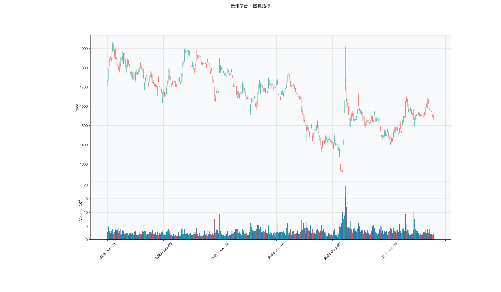

# 第022章 随机指标（KDJ）

一个做短线的交易者在收盘前盯着屏幕，想为明天定一个入场点。他看到收盘价落在当日区间的上部，觉得买方还占着上风；可前一日同一时刻，价格也在上部，第三天却掉了下来。单看一天的收盘位置，跳动太大，读不出连续的强弱。他想知道的是，把最近几天的收盘位置连起来看，买方在区间里的优势是在增强还是在衰减。

## 名称与来历

随机指标（Stochastic Oscillator，KDJ），中文常称随机指标或 KDJ 指标。

它的思想来自 George Lane，在 1950 年代提出，1984 年通过讲座与出版物被广泛推广。Lane 的观察是：在上涨的行情里，收盘价倾向于落在当日价格区间的上半部；在下跌的行情里，收盘价倾向于落在下半部。如果把这个位置关系连续记录下来，就能看出多空力量在区间内部的变化。

KDJ 原始形态只有 K 与 D 两条线，J 线是后来加入的放大器。国内软件习惯把它整体称为 KDJ，三条线一起显示。它不判断趋势方向，目标是捕捉价格在区间内部走到极端之后的回归。

## 核心逻辑

看一只在区间里来回震荡的股票，每天都有一个具体的价格区间，从当日最高到当日最低。有一个问题很具体：今天收盘时，价格站在这个区间从下往上数的什么位置？

如果连续几天收盘都在区间的顶端，说明每次下探都被买盘顶回去，买方在区间内占上风；如果连续收在底端，说明每次上冲都被卖盘压回。KDJ 要测量的就是这个位置，并且把它换算成 0 到 100 的读数。

读数接近 100，表示收盘价贴着区间顶部，短期买力已经用尽；读数接近 0，表示贴着底部，卖力已经用尽。K 线对这个位置做了一次平滑，D 线再平滑一次，因此 K 比 D 灵敏，交叉出现的位置就是力量对比发生变化的时点。J 线把 K 与 D 的差距放大，专门用来标记两个极端。

有一处细节决定了 KDJ 与威廉指标的区别。KDJ 用区间下沿作零点，读数越高越接近顶部；威廉指标用区间上沿作零点，读数越低越接近顶部。两者的信息量等价，只是坐标轴方向相反。理解这一点，就不会被两条曲线看起来"方向相反"迷惑。

## 计算公式

KDJ 的计算分四步，默认参数为（9, 3, 3），依次是 RSV 窗口、K 平滑期、D 平滑期。

### 第一步：计算未成熟随机值

未成熟随机值（Raw Stochastic Value，RSV）是当日收盘价在近 n 日高低区间中的相对位置：

$$RSV_t = \frac{C_t - L_n}{H_n - L_n} \times 100$$

其中 $H_n$ 为近 n 日最高价，$L_n$ 为近 n 日最低价，$C_t$ 为当日收盘价。若区间高度为零（近 n 日无波动），约定 $RSV_t = 50$。

### 第二步：计算 K 线

对 RSV 做一次平滑，平滑系数为 $1/m_1$：

$$K_t = \frac{m_1 - 1}{m_1} K_{t-1} + \frac{1}{m_1} RSV_t$$

默认 $m_1 = 3$，即 $K_t = \frac{2}{3}K_{t-1} + \frac{1}{3}RSV_t$。起点取前 $m_1$ 个 RSV 的算术平均值。这个平滑系数 1/3 与 Wilder 平滑的口径一致，与标准指数平滑不同。

### 第三步：计算 D 线

对 K 线再做一次同参数的平滑：

$$D_t = \frac{m_2 - 1}{m_2} D_{t-1} + \frac{1}{m_2} K_t$$

默认 $m_2 = 3$，起点与 K 的起点相同。两次平滑叠加，使 D 比 K 滞后约一个平滑期。

### 第四步：计算 J 线

$$J_t = 3 K_t - 2 D_t$$

这个式子是 K 与 D 的线性外推。当 K 与 D 相等时 J 等于 K；当 K 明显快于 D 时，$3K - 2D$ 会被推到 0 以下或 100 以上，从而把极端状态放大。

**计算示例。** 取 n = 9。假设近 9 日最高价 20 元，最低价 16 元，当日收盘 19 元，则

$$RSV = \frac{19 - 16}{20 - 16} \times 100 = 75$$

若前一日 K 为 60、D 为 55，则

$$K = \frac{2}{3} \times 60 + \frac{1}{3} \times 75 = 65$$

$$D = \frac{2}{3} \times 55 + \frac{1}{3} \times 65 = 58.3$$

$$J = 3 \times 65 - 2 \times 58.3 = 78.4$$

三条线同时上行，读数位于中性偏多区域，尚未进入极端。

**参数含义。** 三个参数各自的作用不同。

| 参数 | 默认值 | 作用 | 调整影响 |
|------|--------|------|---------|
| n（RSV 窗口） | 9 | 决定参照区间的长度 | 缩短更灵敏，拉长更平滑 |
| $m_1$（K 平滑） | 3 | 决定 K 的灵敏度 | 减小则 K 更快，交叉更频繁 |
| $m_2$（D 平滑） | 3 | 决定 D 的滞后 | 增大则 D 更稳，交叉更少 |

需要留意 TTR 的实现。TTR 的 `stoch()` 用简单平均代替上面的递推平滑，取 3 期平均与取 1/3 系数的递推平滑结果接近但不完全相同。做学术复现时应统一口径，对照国内行情软件的 KDJ 时，差别主要来自这一步。

## 用法与信号

**超买与超卖。** K 与 D 高于 80 视为超买，低于 20 视为超卖。J 线的作用在这一步更明显：J 越过 100 表示极端超买，跌破 0 表示极端超卖，此时的反转概率明显高于 K、D 刚进入超买区。极端信号与 K、D 区间一致时，可信度最高。

**金叉与死叉。** K 从下向上穿越 D 为金叉，从上向下穿越为死叉。交叉本身不足以构成信号，需要看交叉发生的区域。金叉发生在 20 以下的低位，是超卖反弹的确认；金叉发生在 80 以上，多半是假信号。死叉同理，发生在高位有效，发生在低位无意义。

**背离。** 价格创出新高而 K、D 没有同步创新高，是顶背离；价格创出新低而 K、D 没有同步创新低，是底背离。J 线可以作为加强条件：顶背离时 J 高于 100，底背离时 J 低于 0，信号的分量更重。

**弱趋势中的回调定位。** 在 ADX 处于 25 到 40 之间的弱趋势里，KDJ 可以配合趋势方向使用。上升趋势中价格在 20 日均线上方时，K、D 跌入低位是回调加仓的位置；下降趋势中价格在均线下方时，K、D 升入高位是反弹减仓的位置。ADX 越过 40 之后，这一用法要停用。

## 边界与误区

**强趋势中会钝化。** 这是 KDJ 最被诟病的地方。单边上涨时，收盘价持续贴近 9 日区间的顶部，RSV 长期接近 100，K 与 D 粘在 80 以上不下来。此时超买读数是趋势强的结果，不是回调的征兆。判断依据仍然是 ADX，越过 40 就该把 KDJ 放到一边。

**金叉不等于买入。** 交叉的位置比交叉本身重要。低位金叉与高位金叉的含义相反，只截取"金叉"两个字去做交易，等于丢掉了信号的一半信息。一个可操作的判据是：金叉时 K 是否位于 50 以下且 J 是否刚从 0 附近回升。

**参数不是越小越好。** 把 n 缩到 5 会让 RSV 频繁跳动，金叉死叉一周出现数次，其中多数无效。参数的选择应当与持有周期匹配，日内交易用短参数，波段用默认参数，长线用长参数，而不是一律追求灵敏。

**J 线的越界不是异常。** 部分软件对 J 线做了上下封顶处理，看起来更整齐，但掩盖了极端程度。原式的 J 线本来就可以越出 0 到 100，越界幅度越大，极端越明显。看到 J 线跑到 120 或负 20，不必怀疑数据出错。

## 它被检验过吗

KDJ 缺少针对该指标的独立同行评议检验。能查到的统计证据都在技术分析规则族的层面，规则族检验回答的是这一族规则整体有没有预测力，无法把绩效拆到单个震荡指标上。完整的证据链见第 007 章。

震荡类的检验还受一个结构性问题的拖累。指标的核心假设是价格围绕中枢回归，趋势市里这个假设不成立。样本中趋势段与震荡段并存时，两类区间的收益方向相反，合并统计会互相抵消，均值被拉向零。报出这个均值时，应当同时报出分段结果。

这一类的真实失效案例，见第 020 章的「真实案例与失败模式」。

## 代码实现

### R

```r
library(ettr)
library(efactorcraft)
library(efincharts)
library(ggplot2)

BASE <- "https://raw.githubusercontent.com/dengyishuo/quant-technical-analysis/main/data/parquet"

# 取数据：本地有就用本地，没有就下载一次并缓存。
# read.csv 对本地 .gz 会自动解压，所以缓存成 .csv.gz 也能直接读。
load_data <- function(name) {
  local <- file.path("data", "parquet", name)
  if (file.exists(local)) return(local)
  cache <- file.path(tools::R_user_dir("qta", "cache"), name)
  if (!file.exists(cache)) {
    dir.create(dirname(cache), recursive = TRUE, showWarnings = FALSE)
    message("下载 ", name, " ...")
    download.file(paste0(BASE, "/", name), cache, mode = "wb", quiet = TRUE)
  }
  cache
}

read_data <- function(name) {
  d <- read.csv(load_data(name), stringsAsFactors = FALSE)
  if ("date" %in% names(d)) d$date <- as.Date(d$date)
  d
}

# 同一章里多次取用，缓存到内存，避免重复解析
.cache <- new.env(parent = emptyenv())
.blue <- function() {
  if (!exists("b", .cache)) assign("b", read_data("panel_blue_chip.csv"), .cache)
  get("b", .cache)
}
.panel <- function() {
  if (!exists("p", .cache)) {
    p <- read_data("panel_r.csv.gz")
    assign("p", p[p$date >= "2023-01-01" & p$date <= "2025-06-01", ], .cache)
  }
  get("p", .cache)
}
.index <- function() read_data("index_daily.csv")

blue  <- .blue()
panel <- .panel()

# 图的保存路径，顺手建目录，避免读者本地没有 assets/ 时报错
fig_path <- function(ch, name = "indicator_r.png") {
  d <- file.path("assets", "figures", sprintf("ch%03d", ch))
  dir.create(d, recursive = TRUE, showWarnings = FALSE)
  file.path(d, name)
}

# efincharts 要求 xts 且列名带 Adjusted
as_xts <- function(df) {
  x <- xts::xts(df[, c("open", "high", "low", "close", "volume", "adjusted")],
                order.by = df$date)
  colnames(x) <- c("Open", "High", "Low", "Close", "Volume", "Adjusted")
  x
}

maotai <- .blue()[.blue()$code == "600519.SS", ]

# 1. ettr 在长格式面板上追加指标列
maotai <- add_kdj(maotai)

# 2. 基本统计
cols <- setdiff(names(maotai), names(blue))
print(summary(maotai[, cols]))

# 3. K 线 + 成交量 + 均线
ch <- ecandlesticks(as_xts(maotai), show_ma = TRUE, ma_periods = c(20, 60),
                    title = "贵州茅台 · 随机指标")
ggsave(fig_path(22), ch$combined_plot, width = 10, height = 6, dpi = 110)
```

### Python

```python
import pathlib
import urllib.request

import pandas as pd
import ettr
import efactorcraft as efc
import efincharts as efc_

# 中文字体：mplfinance 会用 style 里的 rc 覆盖全局设置，必须写进 style
from efincharts import theme
theme.efin_style["rc"] = {
    "font.sans-serif": ["PingFang SC", "Heiti SC", "SimHei"],
    "axes.unicode_minus": False,
    "font.family": "sans-serif",
}

BASE = "https://raw.githubusercontent.com/dengyishuo/quant-technical-analysis/main/data/parquet"
CACHE = pathlib.Path.home() / ".cache" / "qta"
_MEM = {}


def load(name):
    """取数据：本地有就用本地，没有就下载一次并缓存。

    这样三种情形都能跑：
      1. 克隆了整个仓库    -> 直接读 data/parquet/，不联网
      2. 只复制了代码片段  -> 首次自动下载到 ~/.cache/qta，之后走缓存
      3. 之前跑过          -> 全部命中缓存，断网也能用
    """
    if name in _MEM:
        return _MEM[name]
    local = pathlib.Path("data/parquet") / name
    if local.exists():
        path = local
    else:
        CACHE.mkdir(parents=True, exist_ok=True)
        path = CACHE / name
        if not path.exists():
            print("下载 %s ..." % name)
            urllib.request.urlretrieve(BASE + "/" + name, path)
    data = pd.read_parquet(path) if name.endswith(".parquet") else pd.read_csv(path)
    _MEM[name] = data
    return data


blue = load("panel_blue_chip.parquet")
panel = load("panel.parquet")
panel = panel[(panel["date"] >= "2023-01-01") & (panel["date"] <= "2025-06-01")]
idx = load("index_daily.parquet")


def one(df, code="600519.SS"):
    """取单只标的，转成 efincharts 需要的宽表。"""
    x = df[df["code"] == code].sort_values("date").set_index("date")
    x.columns = [c.capitalize() for c in x.columns]
    return x


def fig_path(ch, name="indicator.png"):
    """图的保存路径，顺手建目录，避免读者本地没有 assets/ 时报错。"""
    d = pathlib.Path("assets") / "figures" / ("ch%03d" % ch)
    d.mkdir(parents=True, exist_ok=True)
    return str(d / name)

# 1. 取单只标的
maotai = blue[blue['code'] == '600519.SS'].copy()

# 2. ettr 在长格式面板上追加指标列，不需要手工 rolling
maotai = ettr.kdj(maotai)

cols = [c for c in maotai.columns if c not in blue.columns]
print(maotai[cols].describe().round(3))

# 3. 画图：K 线 + 成交量 + 指标面板
px = one(maotai)
ch = efc_.candlestick(px, volume=True, title="贵州茅台 · 随机指标")
ch.save(fig_path(22))
```

<!-- fig-indicator:start -->


<p class="figcap">图 22-1　随机指标在贵州茅台上的读数（2023-01 至 2025-06）</p>
<!-- fig-indicator:end -->

## 拆解

KDJ 输出三条线，读数都在 0 到 100 附近，J 可以越界。三条线之间是线性关系，$J = 3K - 2D$，所以 J 不含独立信息，它是 K 与 D 的外推。直接拿 K 做因子有两处问题。一是 K 经过两次平滑，位置量偏慢，趋势股可以长期停在 80 上方，“高”成了常态而非异常。二是不同标的的 K 分布中心不同，横截面排序里混进了平滑程度与波动结构的差异。

| 特征名 | 计算式 | 量纲 | 经济含义 |
|--------|--------|------|----------|
| 位置偏离 | $K_t - 50$ | 无量纲，取值 −50 到 50 | 收盘价在近期区间中的静态位置 |
| 柱状值 | $K_t - D_t$ | 无量纲，取值约 −50 到 50 | 短期相对中期的领先程度 |
| J 值 | $3K_t - 2D_t$ | 无量纲，可越出 0 到 100 | 位置与领先程度的合成，带放大 |
| 交叉状态 | $K > D$ 记 1，否则记 0 | 二值 | 多空短期优势的方向 |

把 J 展开可以看到，$J = K + 2(K - D)$，即位置加上两倍的柱状值。这意味着 J 与柱状值高度共线，两者不宜同时入模。J 的额外价值只在尾部：越界幅度大时，柱状值的绝对值也大，只是 J 的读数更醒目，截面排序在两端被拉开。把它截断在 0 到 100 之后，越界部分被压平，J 与 K 的差异只剩 $2(K-D)$ 这一项，而柱状值已经提供了同样的信息。因此 J 入模前通常先截断或缩尾，越界幅度另作状态变量保留，不直接进入排序。

柱状值的方向含义明确，为正表示 K 在 D 上方，短期力量强于中期。它是变化率型特征，半衰期短。位置偏离是水平型特征，更接近超买超卖。两者相关但不重合：K 可以在 70 上方而柱状值为负，那是高位转弱；K 可以在 40 附近而柱状值为正，那是低位转强。后一种状态在交易上的意义往往更大，这也是柱状值比位置偏离更适合做短周期因子的原因。

交叉状态是二值化的写法，只记 K 是否在 D 上方，信息与柱状值的符号相同，日频翻转更频繁。

### R

```r
library(ettr)
library(efactorcraft)
library(efincharts)
library(ggplot2)

BASE <- "https://raw.githubusercontent.com/dengyishuo/quant-technical-analysis/main/data/parquet"

# 取数据：本地有就用本地，没有就下载一次并缓存。
# read.csv 对本地 .gz 会自动解压，所以缓存成 .csv.gz 也能直接读。
load_data <- function(name) {
  local <- file.path("data", "parquet", name)
  if (file.exists(local)) return(local)
  cache <- file.path(tools::R_user_dir("qta", "cache"), name)
  if (!file.exists(cache)) {
    dir.create(dirname(cache), recursive = TRUE, showWarnings = FALSE)
    message("下载 ", name, " ...")
    download.file(paste0(BASE, "/", name), cache, mode = "wb", quiet = TRUE)
  }
  cache
}

read_data <- function(name) {
  d <- read.csv(load_data(name), stringsAsFactors = FALSE)
  if ("date" %in% names(d)) d$date <- as.Date(d$date)
  d
}

# 同一章里多次取用，缓存到内存，避免重复解析
.cache <- new.env(parent = emptyenv())
.blue <- function() {
  if (!exists("b", .cache)) assign("b", read_data("panel_blue_chip.csv"), .cache)
  get("b", .cache)
}
.panel <- function() {
  if (!exists("p", .cache)) {
    p <- read_data("panel_r.csv.gz")
    assign("p", p[p$date >= "2023-01-01" & p$date <= "2025-06-01", ], .cache)
  }
  get("p", .cache)
}
.index <- function() read_data("index_daily.csv")

blue  <- .blue()
panel <- .panel()

# 图的保存路径，顺手建目录，避免读者本地没有 assets/ 时报错
fig_path <- function(ch, name = "indicator_r.png") {
  d <- file.path("assets", "figures", sprintf("ch%03d", ch))
  dir.create(d, recursive = TRUE, showWarnings = FALSE)
  file.path(d, name)
}

# efincharts 要求 xts 且列名带 Adjusted
as_xts <- function(df) {
  x <- xts::xts(df[, c("open", "high", "low", "close", "volume", "adjusted")],
                order.by = df$date)
  colnames(x) <- c("Open", "High", "Low", "Close", "Volume", "Adjusted")
  x
}

d <- .blue()[.blue()$code == "600519.SS", ]
d <- add_kdj(d)

# 转成无量纲因子
d$f <- d$`J_9`

print(summary(d$f))
```

### Python

```python
import pathlib
import urllib.request

import pandas as pd
import ettr
import efactorcraft as efc
import efincharts as efc_

# 中文字体：mplfinance 会用 style 里的 rc 覆盖全局设置，必须写进 style
from efincharts import theme
theme.efin_style["rc"] = {
    "font.sans-serif": ["PingFang SC", "Heiti SC", "SimHei"],
    "axes.unicode_minus": False,
    "font.family": "sans-serif",
}

BASE = "https://raw.githubusercontent.com/dengyishuo/quant-technical-analysis/main/data/parquet"
CACHE = pathlib.Path.home() / ".cache" / "qta"
_MEM = {}


def load(name):
    """取数据：本地有就用本地，没有就下载一次并缓存。

    这样三种情形都能跑：
      1. 克隆了整个仓库    -> 直接读 data/parquet/，不联网
      2. 只复制了代码片段  -> 首次自动下载到 ~/.cache/qta，之后走缓存
      3. 之前跑过          -> 全部命中缓存，断网也能用
    """
    if name in _MEM:
        return _MEM[name]
    local = pathlib.Path("data/parquet") / name
    if local.exists():
        path = local
    else:
        CACHE.mkdir(parents=True, exist_ok=True)
        path = CACHE / name
        if not path.exists():
            print("下载 %s ..." % name)
            urllib.request.urlretrieve(BASE + "/" + name, path)
    data = pd.read_parquet(path) if name.endswith(".parquet") else pd.read_csv(path)
    _MEM[name] = data
    return data


blue = load("panel_blue_chip.parquet")
panel = load("panel.parquet")
panel = panel[(panel["date"] >= "2023-01-01") & (panel["date"] <= "2025-06-01")]
idx = load("index_daily.parquet")


def one(df, code="600519.SS"):
    """取单只标的，转成 efincharts 需要的宽表。"""
    x = df[df["code"] == code].sort_values("date").set_index("date")
    x.columns = [c.capitalize() for c in x.columns]
    return x


def fig_path(ch, name="indicator.png"):
    """图的保存路径，顺手建目录，避免读者本地没有 assets/ 时报错。"""
    d = pathlib.Path("assets") / "figures" / ("ch%03d" % ch)
    d.mkdir(parents=True, exist_ok=True)
    return str(d / name)

# 1. 先在面板上算原始指标
d = panel.copy()
d = ettr.kdj(d)

# 2. 转成无量纲因子，才能跨标的排序
d["f"] = d["KDJ_J"]

print(d["f"].describe().round(4))
```

## 截面选股能力

主要因子是柱状值，

$$f^{diff}_t = K^{(9,3,3)}_t - D^{(9,3,3)}_t$$

它度量短期相对中期的领先程度，方向含义比单看 K 清楚。辅助因子是位置偏离，

$$f^{pos}_t = K^{(9,3,3)}_t - 50$$

两者分别对应力量变化与静态位置，经济含义不同，IC 的符号也可能不同。

**符号没有先验答案。** K 高可以读成超买将回落，也可以读成强势在延续；柱状值为正可以读成短期动能向上，也可以读成短期过热。同一个读数对应两个方向相反的解释，先验选一个都不稳妥。震荡类指标的方向与趋势类相反，错误也更容易发生，因为与直觉相反的那一面只在强趋势里显现。

预期表现上，柱状值的半衰期最短，一日窗口的信息通常强于五日，超过一周之后大部分消散。位置偏离在五日窗口上更可能呈现反转，因为 K 的两次平滑让它落后于价格。市况层面，震荡市里位置偏离偏负，趋势市里可能转正；柱状值是差分，滞后更小，两种市况下都可能为正。标的层面，波动率高的品种柱状值翻转更快，IC 的绝对值可能更大，稳定性却更差。

检验时有三点值得注意。第一，**符号按数据判定，并按时间切分复核**。先算全样本 IC 看符号，再按年份或按趋势强度分段，检查是否翻转。柱状值的符号翻转比 RSI 更频繁，分段这一步不能省。第二，**换手要一并报告**。日频上 K 与 D 的相对位置今天为正、明天为负都是常事，IC 好看但成本高，只看 IC 会高估可用性。第三，**共线要处理**。J 与柱状值成对，K 与位置偏离成对，各取一个即可；若仍要使用 J，先截断在 0 到 100 或按分位缩尾，避免个别越界值主导排序。

全样本 IC 接近零、分段之后清晰，是这类因子常见的情形。KDJ 的信号在时间上聚集，钝化期与转折期的读数方向相反，两段在均值上互相抵消。遇到这种结果，先按市况分层，再判断是否可用。

### R

```r
library(ettr)
library(efactorcraft)
library(efincharts)
library(ggplot2)

BASE <- "https://raw.githubusercontent.com/dengyishuo/quant-technical-analysis/main/data/parquet"

# 取数据：本地有就用本地，没有就下载一次并缓存。
# read.csv 对本地 .gz 会自动解压，所以缓存成 .csv.gz 也能直接读。
load_data <- function(name) {
  local <- file.path("data", "parquet", name)
  if (file.exists(local)) return(local)
  cache <- file.path(tools::R_user_dir("qta", "cache"), name)
  if (!file.exists(cache)) {
    dir.create(dirname(cache), recursive = TRUE, showWarnings = FALSE)
    message("下载 ", name, " ...")
    download.file(paste0(BASE, "/", name), cache, mode = "wb", quiet = TRUE)
  }
  cache
}

read_data <- function(name) {
  d <- read.csv(load_data(name), stringsAsFactors = FALSE)
  if ("date" %in% names(d)) d$date <- as.Date(d$date)
  d
}

# 同一章里多次取用，缓存到内存，避免重复解析
.cache <- new.env(parent = emptyenv())
.blue <- function() {
  if (!exists("b", .cache)) assign("b", read_data("panel_blue_chip.csv"), .cache)
  get("b", .cache)
}
.panel <- function() {
  if (!exists("p", .cache)) {
    p <- read_data("panel_r.csv.gz")
    assign("p", p[p$date >= "2023-01-01" & p$date <= "2025-06-01", ], .cache)
  }
  get("p", .cache)
}
.index <- function() read_data("index_daily.csv")

blue  <- .blue()
panel <- .panel()

# 图的保存路径，顺手建目录，避免读者本地没有 assets/ 时报错
fig_path <- function(ch, name = "indicator_r.png") {
  d <- file.path("assets", "figures", sprintf("ch%03d", ch))
  dir.create(d, recursive = TRUE, showWarnings = FALSE)
  file.path(d, name)
}

# efincharts 要求 xts 且列名带 Adjusted
as_xts <- function(df) {
  x <- xts::xts(df[, c("open", "high", "low", "close", "volume", "adjusted")],
                order.by = df$date)
  colnames(x) <- c("Open", "High", "Low", "Close", "Volume", "Adjusted")
  x
}

d <- .panel()
d <- add_kdj(d)

d$f <- d$`J_9`
d <- add_next_return(d, close_col = "close", n = c(1, 5, 20))

ic <- ic_analysis(d, factor_cols = "f",
                    forward_cols = c("forward_1", "forward_5", "forward_20"),
                    method = "spearman")
print(ir_analysis(ic))

q <- quantile_analysis(d, factor_cols = "f", forward_cols = "forward_5",
                       n_groups = 5)
print(q$f$summary)
```

### Python

```python
import pathlib
import urllib.request

import pandas as pd
import ettr
import efactorcraft as efc
import efincharts as efc_

# 中文字体：mplfinance 会用 style 里的 rc 覆盖全局设置，必须写进 style
from efincharts import theme
theme.efin_style["rc"] = {
    "font.sans-serif": ["PingFang SC", "Heiti SC", "SimHei"],
    "axes.unicode_minus": False,
    "font.family": "sans-serif",
}

BASE = "https://raw.githubusercontent.com/dengyishuo/quant-technical-analysis/main/data/parquet"
CACHE = pathlib.Path.home() / ".cache" / "qta"
_MEM = {}


def load(name):
    """取数据：本地有就用本地，没有就下载一次并缓存。

    这样三种情形都能跑：
      1. 克隆了整个仓库    -> 直接读 data/parquet/，不联网
      2. 只复制了代码片段  -> 首次自动下载到 ~/.cache/qta，之后走缓存
      3. 之前跑过          -> 全部命中缓存，断网也能用
    """
    if name in _MEM:
        return _MEM[name]
    local = pathlib.Path("data/parquet") / name
    if local.exists():
        path = local
    else:
        CACHE.mkdir(parents=True, exist_ok=True)
        path = CACHE / name
        if not path.exists():
            print("下载 %s ..." % name)
            urllib.request.urlretrieve(BASE + "/" + name, path)
    data = pd.read_parquet(path) if name.endswith(".parquet") else pd.read_csv(path)
    _MEM[name] = data
    return data


blue = load("panel_blue_chip.parquet")
panel = load("panel.parquet")
panel = panel[(panel["date"] >= "2023-01-01") & (panel["date"] <= "2025-06-01")]
idx = load("index_daily.parquet")


def one(df, code="600519.SS"):
    """取单只标的，转成 efincharts 需要的宽表。"""
    x = df[df["code"] == code].sort_values("date").set_index("date")
    x.columns = [c.capitalize() for c in x.columns]
    return x


def fig_path(ch, name="indicator.png"):
    """图的保存路径，顺手建目录，避免读者本地没有 assets/ 时报错。"""
    d = pathlib.Path("assets") / "figures" / ("ch%03d" % ch)
    d.mkdir(parents=True, exist_ok=True)
    return str(d / name)

# 287 只、2023-01 至 2025-06，横截面才有统计意义
src = panel.copy()
d = src.copy()

# 1. 算指标
d = ettr.kdj(d)


# 2. 因子 + 未来收益
d["f"] = d["KDJ_J"]
d = efc.add_next_return(d, periods=(1, 5, 20))

# 3. 截面 IC 与分层
ic = efc.ic_analysis(d, factor_cols="f",
                      forward_cols=["forward_1", "forward_5", "forward_20"],
                      method="spearman")
print(efc.ir_analysis(ic).round(3))

q = efc.quantile_analysis(d, factor_col="f", forward_col="forward_5", n_groups=5)
print(q["summary"].round(4))
```

输出里最值得停留的是最后一段。逐年 IC 若在零的两侧来回，说明柱状值的方向随市况切换，单一符号的结论不成立。分层结果则回答另一个问题：这个因子的信息是集中在两端，还是贯穿五组。

<!-- tab-ic:start -->
**计算结果**

| 前向期 | IC 均值 | IC 标准差 | ICIR | t 值 | IC>0 占比 | 期数 |
|---|---|---|---|---|---|---|
| T+1 | -0.0058 | 0.2115 | -0.027 | -0.65 | 0.5030 | 572 |
| T+5 | 0.0083 | 0.1928 | 0.043 | 1.02 | 0.5260 | 568 |
| T+20 | -0.0033 | 0.1861 | -0.018 | -0.42 | 0.5320 | 553 |

表里最该看的是 t 值，不是 IC 均值。这个因子以 T+1 为主口径，IC 均值 -0.0058、ICIR -0.027、t 值 -0.65，在常规门槛下不显著，方向为反向。按第 007 章给出的日频门槛（ICIR 0.13 对应 t≈2），这个结果的含义是：还看不出与噪声的区别，不能据此构造策略。

需要提醒的是，这只说明排序与未来收益之间存在可测的关联，不代表扣掉成本后还能剩下收益。横截面 IC 检验的是“买哪只”，不负责“值不值得交易”。

**五档分层**

| 分组 | 平均收益 | 标准差 | 期数 |
|---|---|---|---|
| 1 | +0.0033 | +0.0378 | 568 |
| 2 | +0.0028 | +0.0366 | 568 |
| 3 | +0.0031 | +0.0342 | 568 |
| 4 | +0.0041 | +0.0324 | 568 |
| 5 | +0.0044 | +0.0309 | 568 |

五档分层看的是形状，不是单点。最高一档在第 5 组、最低在第 2 组，两端相差 +0.11%，组序号与平均收益的秩相关为 0.81，接近单调。

分层比 IC 更接近实盘，因为它直接给出“买最高档、卖最低档”的收益差。但这里的数字是毛收益，且没有考虑涨跌停买不进、停牌卖不出的情形，真实可得的差额会小于表中所列。
<!-- tab-ic:end -->

## 择时能力

KDJ 的择时逻辑分三层。第一层是区域：K、D 进入 80 上方或 20 下方，代表价格贴在近九日区间的边缘。第二层是交叉：K 上穿 D 为金叉，下穿为死叉，交叉发生的位置决定它的含义。第三层是 J 越界：J 超过 100 或低于 0，属于极端中的极端。

方法与形态要匹配。交叉是离散事件，适合用信号触发日检验，但需要按 K 的水平分组，否则低位金叉与高位金叉混在一起，方向相反的两类样本互相抵消，得到接近零的差异。J 越界是稀有事件，适合用条件分位收益观察两端。区域状态可以直接转成仓位规则做回测。

这里有一条与趋势类不同的判断。KDJ 的信号在时间上聚集，钝化期的连续触发不满足独立同分布，t 检验的标准误会被低估，显著性看起来比实际更强。因此单个检验只能作参考，回测的对照更重要。同样因为聚集，信号次数与最终盈亏并不成比例，少数几段行情贡献了大部分结果。

陷阱有三个。第一，**钝化**。单边行情里 K、D 长期粘在 80 上方，按超买卖出会连续踏空，趋势强度越过 40 之后这套信号宜停用。第二，**交叉的位置被忽略**。只看金叉两个字，等于扔掉一半信息。第三，**参数与阈值在同一段样本里挑选**。n 取 5 还是 9、超买线取 80 还是 85，如果在回测区间内试过多次，结果就是拟合出来的。

### R

```r
library(ettr)
library(efactorcraft)
library(efincharts)
library(ggplot2)

BASE <- "https://raw.githubusercontent.com/dengyishuo/quant-technical-analysis/main/data/parquet"

# 取数据：本地有就用本地，没有就下载一次并缓存。
# read.csv 对本地 .gz 会自动解压，所以缓存成 .csv.gz 也能直接读。
load_data <- function(name) {
  local <- file.path("data", "parquet", name)
  if (file.exists(local)) return(local)
  cache <- file.path(tools::R_user_dir("qta", "cache"), name)
  if (!file.exists(cache)) {
    dir.create(dirname(cache), recursive = TRUE, showWarnings = FALSE)
    message("下载 ", name, " ...")
    download.file(paste0(BASE, "/", name), cache, mode = "wb", quiet = TRUE)
  }
  cache
}

read_data <- function(name) {
  d <- read.csv(load_data(name), stringsAsFactors = FALSE)
  if ("date" %in% names(d)) d$date <- as.Date(d$date)
  d
}

# 同一章里多次取用，缓存到内存，避免重复解析
.cache <- new.env(parent = emptyenv())
.blue <- function() {
  if (!exists("b", .cache)) assign("b", read_data("panel_blue_chip.csv"), .cache)
  get("b", .cache)
}
.panel <- function() {
  if (!exists("p", .cache)) {
    p <- read_data("panel_r.csv.gz")
    assign("p", p[p$date >= "2023-01-01" & p$date <= "2025-06-01", ], .cache)
  }
  get("p", .cache)
}
.index <- function() read_data("index_daily.csv")

blue  <- .blue()
panel <- .panel()

# 图的保存路径，顺手建目录，避免读者本地没有 assets/ 时报错
fig_path <- function(ch, name = "indicator_r.png") {
  d <- file.path("assets", "figures", sprintf("ch%03d", ch))
  dir.create(d, recursive = TRUE, showWarnings = FALSE)
  file.path(d, name)
}

# efincharts 要求 xts 且列名带 Adjusted
as_xts <- function(df) {
  x <- xts::xts(df[, c("open", "high", "low", "close", "volume", "adjusted")],
                order.by = df$date)
  colnames(x) <- c("Open", "High", "Low", "Close", "Volume", "Adjusted")
  x
}

t <- .index()
t <- t[t$code == "510300.SS", ]
t <- add_kdj(t)
t$f <- t$`J_9`
t$forward_5 <- c(tail(t$close, -5) / head(t$close, -5) - 1, rep(NA, 5))
t$q <- cut(t$f, quantile(t$f, 0:5/5, na.rm = TRUE), include.lowest = TRUE, labels = FALSE)
print(aggregate(forward_5 ~ q, data = t, FUN = function(x)
  c(mean = mean(x, na.rm = TRUE), n = sum(!is.na(x)))))
```

### Python

```python
import pathlib
import urllib.request

import pandas as pd
import ettr
import efactorcraft as efc
import efincharts as efc_

# 中文字体：mplfinance 会用 style 里的 rc 覆盖全局设置，必须写进 style
from efincharts import theme
theme.efin_style["rc"] = {
    "font.sans-serif": ["PingFang SC", "Heiti SC", "SimHei"],
    "axes.unicode_minus": False,
    "font.family": "sans-serif",
}

BASE = "https://raw.githubusercontent.com/dengyishuo/quant-technical-analysis/main/data/parquet"
CACHE = pathlib.Path.home() / ".cache" / "qta"
_MEM = {}


def load(name):
    """取数据：本地有就用本地，没有就下载一次并缓存。

    这样三种情形都能跑：
      1. 克隆了整个仓库    -> 直接读 data/parquet/，不联网
      2. 只复制了代码片段  -> 首次自动下载到 ~/.cache/qta，之后走缓存
      3. 之前跑过          -> 全部命中缓存，断网也能用
    """
    if name in _MEM:
        return _MEM[name]
    local = pathlib.Path("data/parquet") / name
    if local.exists():
        path = local
    else:
        CACHE.mkdir(parents=True, exist_ok=True)
        path = CACHE / name
        if not path.exists():
            print("下载 %s ..." % name)
            urllib.request.urlretrieve(BASE + "/" + name, path)
    data = pd.read_parquet(path) if name.endswith(".parquet") else pd.read_csv(path)
    _MEM[name] = data
    return data


blue = load("panel_blue_chip.parquet")
panel = load("panel.parquet")
panel = panel[(panel["date"] >= "2023-01-01") & (panel["date"] <= "2025-06-01")]
idx = load("index_daily.parquet")


def one(df, code="600519.SS"):
    """取单只标的，转成 efincharts 需要的宽表。"""
    x = df[df["code"] == code].sort_values("date").set_index("date")
    x.columns = [c.capitalize() for c in x.columns]
    return x


def fig_path(ch, name="indicator.png"):
    """图的保存路径，顺手建目录，避免读者本地没有 assets/ 时报错。"""
    d = pathlib.Path("assets") / "figures" / ("ch%03d" % ch)
    d.mkdir(parents=True, exist_ok=True)
    return str(d / name)

# 择时检验用 ETF 做市场载体，指数本身没有日线数据
t = idx[idx["code"] == "510300.SS"].sort_values("date").copy()

# 1. 在 ETF 上算同一个指标
t = ettr.kdj(d)


# 2. 按因子分位看未来 5 日收益
t["f"] = t["KDJ_J"]
t["forward_5"] = t["close"].shift(-5) / t["close"] - 1
# 因子可能有重复值，先按名次切，避免 qcut 报边界不唯一
t["q"] = pd.qcut(t["f"].rank(method="first"), 5, labels=False) + 1
t = t.dropna(subset=["f", "forward_5"])
print(t.groupby("q")["forward_5"].agg(["mean", "count"]).round(4))
```

第一张表是关键。低位金叉与高位金叉的次数未必相当，平均收益却常常一正一负。若两者的差异明显大于全样本均值，说明交叉本身没有方向，位置才有方向。分位收益若呈两端高、中间低，与金叉的结论互相印证；若单调，则说明这个标的的 KDJ 更接近动量指标。

<!-- tab-timing:start -->
**分位收益**

| 分位 | 未来 5 日均值 | 样本数 |
|---|---|---|
| 1 | +0.0018 | 222 |
| 2 | -0.0011 | 221 |
| 3 | -0.0007 | 221 |
| 4 | -0.0011 | 221 |
| 5 | +0.0006 | 221 |

择时口径与截面不同：这里只有一个标的，看的是同一标的在不同分位下的未来收益。最高与最低分位相差 -0.12%。单标的样本有限，这个差额很容易被一两段行情主导，只能作为方向参考。

真正做择时要问的是三件事：分位阈值是否稳定、换手是否可控、扣成本后是否还有剩余。三者缺一，择时信号就只是图上好看。
<!-- tab-timing:end -->

## 组合使用与验证

KDJ 的搭档有三个。与 ADX 搭配，用趋势强度划定可用区间，越过 40 之后停用交叉信号。与均线搭配，用价格相对二十日均线的位置约束方向，上升趋势中只接受低位金叉。与成交量搭配，用放量确认金叉背后的资金参与。三者互补的点分别是市况、方向与参与度。

**组合的截面验证。** 柱状值与均线偏离的组合值得一试，前者是短期力量变化，后者是中期位置，相关性不高，互补空间较大。加权型的做法是横截面标准化后相加，重算 IC，与两个单特征比较。条件型的做法是先定义“K 低于 20 且价格在二十日均线上方”，转成二值信号后看触发样本内的收益。前者回答排序精度，后者回答条件共振。

**组合的择时验证。** 把趋势强度作为开关，ADX 低于 40 时按 KDJ 规则做，高于 40 时按均线方向持仓，KDJ 不参与。回测时与单纯按 KDJ 做、单纯按均线做各对照一次，看三项指标分别落在什么位置。组合的价值通常出现在回撤上，收益未必提高。

增益判读的依据是方法论章的标准：**组合的 ICIR 高于两个单特征，才说明存在互补性；介于两者之间，说明只是平均。** KDJ 与均线属于不同维度，互补的可能性高于同源指标之间的组合。检验之前先算两者的横截面相关，相关低是有可能增量的前提，不是结论。

### R

```r
library(ettr)
library(efactorcraft)
library(efincharts)
library(ggplot2)

BASE <- "https://raw.githubusercontent.com/dengyishuo/quant-technical-analysis/main/data/parquet"

# 取数据：本地有就用本地，没有就下载一次并缓存。
# read.csv 对本地 .gz 会自动解压，所以缓存成 .csv.gz 也能直接读。
load_data <- function(name) {
  local <- file.path("data", "parquet", name)
  if (file.exists(local)) return(local)
  cache <- file.path(tools::R_user_dir("qta", "cache"), name)
  if (!file.exists(cache)) {
    dir.create(dirname(cache), recursive = TRUE, showWarnings = FALSE)
    message("下载 ", name, " ...")
    download.file(paste0(BASE, "/", name), cache, mode = "wb", quiet = TRUE)
  }
  cache
}

read_data <- function(name) {
  d <- read.csv(load_data(name), stringsAsFactors = FALSE)
  if ("date" %in% names(d)) d$date <- as.Date(d$date)
  d
}

# 同一章里多次取用，缓存到内存，避免重复解析
.cache <- new.env(parent = emptyenv())
.blue <- function() {
  if (!exists("b", .cache)) assign("b", read_data("panel_blue_chip.csv"), .cache)
  get("b", .cache)
}
.panel <- function() {
  if (!exists("p", .cache)) {
    p <- read_data("panel_r.csv.gz")
    assign("p", p[p$date >= "2023-01-01" & p$date <= "2025-06-01", ], .cache)
  }
  get("p", .cache)
}
.index <- function() read_data("index_daily.csv")

blue  <- .blue()
panel <- .panel()

# 图的保存路径，顺手建目录，避免读者本地没有 assets/ 时报错
fig_path <- function(ch, name = "indicator_r.png") {
  d <- file.path("assets", "figures", sprintf("ch%03d", ch))
  dir.create(d, recursive = TRUE, showWarnings = FALSE)
  file.path(d, name)
}

# efincharts 要求 xts 且列名带 Adjusted
as_xts <- function(df) {
  x <- xts::xts(df[, c("open", "high", "low", "close", "volume", "adjusted")],
                order.by = df$date)
  colnames(x) <- c("Open", "High", "Low", "Close", "Volume", "Adjusted")
  x
}

d <- .panel()
d <- add_kdj(d)
d$f1 <- d$`J_9`
d <- add_cmf(d, n = 20)
d$f2 <- d$CMF
d <- add_next_return(d, close_col = "close", n = 5)
ic1 <- ic_analysis(d, factor_cols = c("f1", "f2"),
                    forward_cols = "forward_5", method = "spearman")
print(ir_analysis(ic1))
```

```r
library(ettr)
library(efactorcraft)
library(efincharts)
library(ggplot2)

BASE <- "https://raw.githubusercontent.com/dengyishuo/quant-technical-analysis/main/data/parquet"

# 取数据：本地有就用本地，没有就下载一次并缓存。
# read.csv 对本地 .gz 会自动解压，所以缓存成 .csv.gz 也能直接读。
load_data <- function(name) {
  local <- file.path("data", "parquet", name)
  if (file.exists(local)) return(local)
  cache <- file.path(tools::R_user_dir("qta", "cache"), name)
  if (!file.exists(cache)) {
    dir.create(dirname(cache), recursive = TRUE, showWarnings = FALSE)
    message("下载 ", name, " ...")
    download.file(paste0(BASE, "/", name), cache, mode = "wb", quiet = TRUE)
  }
  cache
}

read_data <- function(name) {
  d <- read.csv(load_data(name), stringsAsFactors = FALSE)
  if ("date" %in% names(d)) d$date <- as.Date(d$date)
  d
}

# 同一章里多次取用，缓存到内存，避免重复解析
.cache <- new.env(parent = emptyenv())
.blue <- function() {
  if (!exists("b", .cache)) assign("b", read_data("panel_blue_chip.csv"), .cache)
  get("b", .cache)
}
.panel <- function() {
  if (!exists("p", .cache)) {
    p <- read_data("panel_r.csv.gz")
    assign("p", p[p$date >= "2023-01-01" & p$date <= "2025-06-01", ], .cache)
  }
  get("p", .cache)
}
.index <- function() read_data("index_daily.csv")

blue  <- .blue()
panel <- .panel()

# 图的保存路径，顺手建目录，避免读者本地没有 assets/ 时报错
fig_path <- function(ch, name = "indicator_r.png") {
  d <- file.path("assets", "figures", sprintf("ch%03d", ch))
  dir.create(d, recursive = TRUE, showWarnings = FALSE)
  file.path(d, name)
}

# efincharts 要求 xts 且列名带 Adjusted
as_xts <- function(df) {
  x <- xts::xts(df[, c("open", "high", "low", "close", "volume", "adjusted")],
                order.by = df$date)
  colnames(x) <- c("Open", "High", "Low", "Close", "Volume", "Adjusted")
  x
}

d <- .panel()
d <- add_kdj(d)
d$f1 <- d$`J_9`
d <- add_cmf(d, n = 20)
d$f2 <- d$CMF
d <- add_next_return(d, close_col = "close", n = 5)
ic1 <- ic_analysis(d, factor_cols = c("f1", "f2"),
                    forward_cols = "forward_5", method = "spearman")
print(ir_analysis(ic1))
```

### Python

```python
import pathlib
import urllib.request

import pandas as pd
import ettr
import efactorcraft as efc
import efincharts as efc_

# 中文字体：mplfinance 会用 style 里的 rc 覆盖全局设置，必须写进 style
from efincharts import theme
theme.efin_style["rc"] = {
    "font.sans-serif": ["PingFang SC", "Heiti SC", "SimHei"],
    "axes.unicode_minus": False,
    "font.family": "sans-serif",
}

BASE = "https://raw.githubusercontent.com/dengyishuo/quant-technical-analysis/main/data/parquet"
CACHE = pathlib.Path.home() / ".cache" / "qta"
_MEM = {}


def load(name):
    """取数据：本地有就用本地，没有就下载一次并缓存。

    这样三种情形都能跑：
      1. 克隆了整个仓库    -> 直接读 data/parquet/，不联网
      2. 只复制了代码片段  -> 首次自动下载到 ~/.cache/qta，之后走缓存
      3. 之前跑过          -> 全部命中缓存，断网也能用
    """
    if name in _MEM:
        return _MEM[name]
    local = pathlib.Path("data/parquet") / name
    if local.exists():
        path = local
    else:
        CACHE.mkdir(parents=True, exist_ok=True)
        path = CACHE / name
        if not path.exists():
            print("下载 %s ..." % name)
            urllib.request.urlretrieve(BASE + "/" + name, path)
    data = pd.read_parquet(path) if name.endswith(".parquet") else pd.read_csv(path)
    _MEM[name] = data
    return data


blue = load("panel_blue_chip.parquet")
panel = load("panel.parquet")
panel = panel[(panel["date"] >= "2023-01-01") & (panel["date"] <= "2025-06-01")]
idx = load("index_daily.parquet")


def one(df, code="600519.SS"):
    """取单只标的，转成 efincharts 需要的宽表。"""
    x = df[df["code"] == code].sort_values("date").set_index("date")
    x.columns = [c.capitalize() for c in x.columns]
    return x


def fig_path(ch, name="indicator.png"):
    """图的保存路径，顺手建目录，避免读者本地没有 assets/ 时报错。"""
    d = pathlib.Path("assets") / "figures" / ("ch%03d" % ch)
    d.mkdir(parents=True, exist_ok=True)
    return str(d / name)

d = panel.copy()

# 1. 本章因子
d = ettr.kdj(d)
d["f1"] = d["KDJ_J"]

# 2. 配一个量价因子做对照
d = ettr.cmf(d, n=20)
d["f2"] = d["CMF_20"]
d = efc.add_next_return(d, periods=(5,))

# 3. 单因子与等权组合的信息比率
ic = efc.ic_analysis(d, factor_cols=["f1", "f2"], forward_cols=["forward_5"],
                      method="spearman")
d = efc.equal_weighted_composite(d, factor_cols=["f1", "f2"], new_col="f1_f2")
ic2 = efc.ic_analysis(d, factor_cols=["f1_f2"], forward_cols=["forward_5"],
                      method="spearman")
ic.update(ic2)
print(efc.ir_analysis(ic).round(3))
```

```python
import pathlib
import urllib.request

import pandas as pd
import ettr
import efactorcraft as efc
import efincharts as efc_

# 中文字体：mplfinance 会用 style 里的 rc 覆盖全局设置，必须写进 style
from efincharts import theme
theme.efin_style["rc"] = {
    "font.sans-serif": ["PingFang SC", "Heiti SC", "SimHei"],
    "axes.unicode_minus": False,
    "font.family": "sans-serif",
}

BASE = "https://raw.githubusercontent.com/dengyishuo/quant-technical-analysis/main/data/parquet"
CACHE = pathlib.Path.home() / ".cache" / "qta"
_MEM = {}


def load(name):
    """取数据：本地有就用本地，没有就下载一次并缓存。

    这样三种情形都能跑：
      1. 克隆了整个仓库    -> 直接读 data/parquet/，不联网
      2. 只复制了代码片段  -> 首次自动下载到 ~/.cache/qta，之后走缓存
      3. 之前跑过          -> 全部命中缓存，断网也能用
    """
    if name in _MEM:
        return _MEM[name]
    local = pathlib.Path("data/parquet") / name
    if local.exists():
        path = local
    else:
        CACHE.mkdir(parents=True, exist_ok=True)
        path = CACHE / name
        if not path.exists():
            print("下载 %s ..." % name)
            urllib.request.urlretrieve(BASE + "/" + name, path)
    data = pd.read_parquet(path) if name.endswith(".parquet") else pd.read_csv(path)
    _MEM[name] = data
    return data


blue = load("panel_blue_chip.parquet")
panel = load("panel.parquet")
panel = panel[(panel["date"] >= "2023-01-01") & (panel["date"] <= "2025-06-01")]
idx = load("index_daily.parquet")


def one(df, code="600519.SS"):
    """取单只标的，转成 efincharts 需要的宽表。"""
    x = df[df["code"] == code].sort_values("date").set_index("date")
    x.columns = [c.capitalize() for c in x.columns]
    return x


def fig_path(ch, name="indicator.png"):
    """图的保存路径，顺手建目录，避免读者本地没有 assets/ 时报错。"""
    d = pathlib.Path("assets") / "figures" / ("ch%03d" % ch)
    d.mkdir(parents=True, exist_ok=True)
    return str(d / name)

d = panel.copy()

# 1. 本章因子
d = ettr.kdj(d)
d["f1"] = d["KDJ_J"]

# 2. 配一个量价因子做对照
d = ettr.cmf(d, n=20)
d["f2"] = d["CMF_20"]
d = efc.add_next_return(d, periods=(5,))

# 3. 单因子与等权组合的信息比率
ic = efc.ic_analysis(d, factor_cols=["f1", "f2"], forward_cols=["forward_5"],
                      method="spearman")
d = efc.equal_weighted_composite(d, factor_cols=["f1", "f2"], new_col="f1_f2")
ic2 = efc.ic_analysis(d, factor_cols=["f1_f2"], forward_cols=["forward_5"],
                      method="spearman")
ic.update(ic2)
print(efc.ir_analysis(ic).round(3))
```

读法与前一章相同。组合的 ICIR 高于两者才算互补。择时那一行看的是另一件事：把强趋势段剔掉之后，信号是否改善。若改善主要出现在回撤上，说明过滤器在做它该做的事；若收益也大幅下降，说明被剔掉的那一段里信号原本有效，过滤过度。

## AI 引导词

::: prompt 引导词 1：三条线的分工检验

我在用随机指标（KDJ）做交易，不确定应该以哪条线为准。请帮我设计一个对照检验：1）用 9 日窗口计算 RSV、K、D、J 四条序列；2）分别以"K 上穿 D"、"RSV 上穿 50"、"J 跌破 0 后回升"作为买入条件，统计每种条件之后 1 日、5 日、10 日收益的均值与胜率；3）输出一张对比表；4）用文字总结哪条线的信号最稳、哪条线噪音最多。数据请用 yfinance 获取贵州茅台 2023 至 2025 年日线，代码只使用 pandas、numpy、matplotlib。

:::
::: prompt 引导词 2：平滑口径的复现

我发现用 Python 自己算的 KDJ 和国内行情软件的读数对不上。请帮我排查：1）按国内常用口径实现 K 线，平滑系数取 1/3，起点取前 3 个 RSV 的算术平均；2）另写一版用 3 期简单移动平均代替递推平滑；3）在同一段数据上计算两版的平均绝对偏差；4）说明哪一种更接近国内软件的显示，以及差异会随时间扩大还是收敛。请给出完整可运行的 Python 代码，并解释递推平滑与简单平均在数学上的关系。

:::
::: prompt 引导词 3：因子构造与换手率

我想把 KDJ 当作横截面选股因子使用，担心换手率太高。请帮我做一次完整的因子检验：1）分别构造"K 减 D"的差值因子和"K 减 50"的位置因子；2）在 50 只 A 股标的的日频数据上计算两个因子与未来 1 日、5 日收益的 Rank IC 与 ICIR；3）按因子值分五组做分层回测，报告各组的年化收益、换手率与扣除费率 0.0003、印花税 0.001 之后的净值；4）给出结论：哪个构造更适合月频调仓，哪些构造需要改成周频或日频。请使用 pandas 与 numpy 实现。

:::
