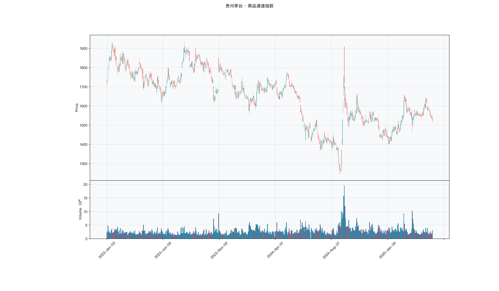

# 第023章 商品通道指数（CCI）

一位研究者在复盘一只平时在 100 元上下波动的股票，某天它收在 108 元，他在图上标了一个"异常"。旁人问，八元在这只股票上算大吗。他翻回去看，这只股票日常的振幅本就有五元，八元只相当于一天半的波动。同一个绝对偏离，换一个品种、换一段时期，分量完全不同。他需要一个先把偏离折算成当地波动单位、再判断是否异常的读数。

## 名称与来历

商品通道指数（Commodity Channel Index，CCI）。

它由 Donald Lambert 于 1980 年提出，最初发表在商品期货领域的技术分析文章里。名字里的"商品"正是来历的痕迹：Lambert 当时面对的是商品价格因供需失衡而剧烈偏离均值的情况，传统指标用固定的超买超卖线判断极端，在商品市场里频繁失灵。他的想法是换一个参照系，不用固定阈值，而用价格自身偏离均值的程度来定义什么叫极端。

CCI 后来被应用到股票、外汇与数字资产市场。它的一个特点是同时兼顾两种用途：在区间行情里给出回归信号，在趋势行情里给出跟随信号。代价是使用者需要自己判断当前属于哪一种行情。

## 核心逻辑

有一只股票平时在 100 元上下小幅波动，某天突然涨到 108 元。这算不算偏离？如果它过去两个月的日波动标准差只有 1 元，那 8 元的偏离相当罕见；如果它平时一天的振幅就有 5 元，那 8 元不算什么。同一个绝对偏离，在不同波动环境下含义完全不同。

CCI 要解决的就是这个问题：把偏离用当时的波动幅度做归一化。做法是先用最高、最低、收盘三个价格合成一个典型价格，再算典型价格与其均值的偏离，最后除以同期偏离的平均绝对值。分母换成"平均绝对偏差"而不是标准差，是因为平均绝对偏差对单个极端值的敏感度更低，不容易被一两天的暴动拉高，得到的读数在商品这类高波动品种上更稳。

可以把平均绝对偏差想成当地的步长。用步长去量距离，得到的是走了几步，不是走了几米。同一段绝对偏离，在高波动品种上也许只合一步，在低波动品种上要合五步。由此可以推出一个可复核的性质：把整段价格同比例放大，CCI 不变。它度量的是偏离相当于几个当地步长，跨标的排序比较的是相对位置，不是绝对涨跌力度。要谈力度，得另取一个不带归一化的量。

归一化之后，读数在正负 100 之内的部分表示价格仍在均值附近游走，越过正负 100 表示开始偏离，越过正负 200 表示偏离严重。因此读数的含义带有双重性：在区间行情里它代表超买超卖，在趋势行情里它代表趋势强度。读数本身不区分布两种情形，需要外部信息来裁定。

这个双重性正是 CCI 与其他震荡指标的分水岭。RSI 越过 70 基本就是超买，CCI 越过 100 却可能是超买，也可能是趋势启动。使用 CCI 时，市况判断不是可选项，而是前置条件。

## 计算公式

CCI 的计算分五步，核心是平均绝对偏差这一项。

### 第一步：计算典型价格

$$\text{TP}_t = \frac{H_t + L_t + C_t}{3}$$

典型价格把当日三个价格合成一个代表值。它的作用是在保留日内波动信息的同时，避免只用收盘价带来的单点失真。

### 第二步：计算典型价格的移动平均

$$\overline{TP}_t = \frac{1}{n}\sum_{i=0}^{n-1} \text{TP}_{t-i}$$

这是 n 期简单移动平均，表示价格的中枢位置。

### 第三步：计算平均绝对偏差

$$\text{MAD}_t = \frac{1}{n}\sum_{i=0}^{n-1} \left| \text{TP}_{t-i} - \overline{TP}_t \right|$$

这一项度量的是价格围绕中枢的平均摆动幅度。注意它与标准差的区别：标准差先平方再开方，单个离群值会被平方放大；平均绝对偏差取绝对值，离群值的影响是线性的。选择后者，使 CCI 的读数在极端行情里不会因为一两天的暴动而剧烈失真。

### 第四步：计算偏离并归一化

$$\text{CCI}_t = \frac{\text{TP}_t - \overline{TP}_t}{0.015 \times \text{MAD}_t}$$

分母里的 0.015 是一个缩放系数。它的作用是把典型情况下的读数拉到正负 100 以内，让"越过 100 算偏离"这个约定成立。这个常数是经验值，随参数 n 和品种波动特性会有偏差，不必把它当作精确的数学常数。

**计算示例。** 取 n = 5。假设近 5 日典型价格为 20、21、22、21、23，则

$$\overline{TP} = \frac{20+21+22+21+23}{5} = 21.4$$

$$\text{MAD} = \frac{1.4 + 0.4 + 0.6 + 0.4 + 1.6}{5} = 0.88$$

当日典型价格若为 23，则

$$\text{CCI} = \frac{23 - 21.4}{0.015 \times 0.88} = 121.2$$

读数越过 100，属于偏离状态。若次日典型价格回落到 22，则偏离收窄，CCI 随之回落至 100 以内，回归信号解除。

**参数含义。** n 是唯一的参数，TTR 的 `CCI()` 默认取 20，经典文献常取 14。

| n | 灵敏度 | 信号频率 | 典型用途 |
|---|--------|---------|---------|
| 6 | 高 | 高 | 日内短线，需成交量过滤假信号 |
| 14 | 中高 | 中 | 经典参数，多数日线品种适用 |
| 20 | 中 | 中低 | TTR 默认，波段操作 |
| 30 | 低 | 低 | 低波动品种，只捕捉显著偏离 |

## 用法与信号

**区间行情中的超买超卖。** 当市场处于窄幅震荡时，CCI 越过正 100 表示价格偏离中枢向上，视为超买；跌破负 100 视为超卖。这类信号的有效期通常不长，因为在区间行情里均值回归的力量占主导。操作上需要设置明确的止损，把止损放在区间极值之外。

**趋势行情中的跟随。** 同样的越过正 100，在趋势行情里的解读完全相反。上升趋势中 CCI 越过正 100 是趋势启动的确认，越过正 200 表示趋势强劲，此时应持仓而不是减仓。判断趋势结束的信号改为 CCI 回落到正 100 以下。下降趋势同理，以 CCI 回升到负 100 以上作为趋势结束的参考。

**背离。** 价格创出新高而 CCI 没有同步创新高，是顶背离；价格创出新低而 CCI 没有同步创新低，是底背离。CCI 的背离比位置读数更有信息量，因为它反映的是偏离幅度在收缩。背离需要等待确认，常见做法是等 CCI 回到正负 100 之内再动手。

**与均线的配合。** 把 20 日均线作为方向锚，CCI 作为入场时机。价格在均线上方且均线向上时，只看 CCI 的多头信号；价格在均线下方且均线向下时，只看 CCI 的空头信号。均线走平时才允许双向使用超买超卖信号。

## 边界与误区

**读数高不等于超买。** 这是 CCI 最容易出错的地方。强趋势中 CCI 可以长期停留在正 200 以上，此时读数的含义是趋势强劲，不是回调预警。把 CCI 当普通震荡指标使用，会在趋势行情里连续被套。判断依据是 ADX 与均线方向，两者确认趋势之后，超买超卖的解释就要让位。

**缩放系数不是定值。** 0.015 是为了让读数落在正负 100 附近而选的常数。波动率明显高于常规的品种，读数会普遍偏大，按正负 100 判断就会过于频繁地触发信号。这类品种可以把常态区间放宽到正负 120 附近，极端区间放宽到正负 250 附近。

**平均绝对偏差在极窄区间里会趋近于零。** 长时间横盘且振幅极小时，分母很小，CCI 会被放大到异常大的数值。这不是有效信号，而是分母被压缩带来的数值放大。遇到这类读数应结合价格实际振幅判断，忽略幅度失真的部分。

**CCI 不适合流动性差的品种。** 成交清淡时价格跳空频繁，典型价格的连续性被破坏，读数容易失真。日均成交额过低的品种，CCI 的信号参考价值有限。

## 它被检验过吗

CCI 缺少针对该指标的独立同行评议检验。现有证据只能来自技术分析规则族的整体检验，这类检验无法把绩效归因到单个震荡指标。完整的证据链见第 007 章。

方法上还有一层困难。CCI 的核心假设是价格围绕中枢回归，这个假设在趋势市里失效，而读数在趋势中又会转为趋势强度的表达。两类样本混在一起，正负相抵，容易得到接近零的均值。这个均值反映的是样本构成，不是指标的能力。

这一类的真实失效案例，见第 020 章的「真实案例与失败模式」。

## 代码实现

### R

```r
library(ettr)
library(efactorcraft)
library(efincharts)
library(ggplot2)

BASE <- "https://raw.githubusercontent.com/dengyishuo/quant-technical-analysis/main/data/parquet"

# 取数据：本地有就用本地，没有就下载一次并缓存。
# read.csv 对本地 .gz 会自动解压，所以缓存成 .csv.gz 也能直接读。
load_data <- function(name) {
  local <- file.path("data", "parquet", name)
  if (file.exists(local)) return(local)
  cache <- file.path(tools::R_user_dir("qta", "cache"), name)
  if (!file.exists(cache)) {
    dir.create(dirname(cache), recursive = TRUE, showWarnings = FALSE)
    message("下载 ", name, " ...")
    download.file(paste0(BASE, "/", name), cache, mode = "wb", quiet = TRUE)
  }
  cache
}

read_data <- function(name) {
  d <- read.csv(load_data(name), stringsAsFactors = FALSE)
  if ("date" %in% names(d)) d$date <- as.Date(d$date)
  d
}

# 同一章里多次取用，缓存到内存，避免重复解析
.cache <- new.env(parent = emptyenv())
.blue <- function() {
  if (!exists("b", .cache)) assign("b", read_data("panel_blue_chip.csv"), .cache)
  get("b", .cache)
}
.panel <- function() {
  if (!exists("p", .cache)) {
    p <- read_data("panel_r.csv.gz")
    assign("p", p[p$date >= "2023-01-01" & p$date <= "2025-06-01", ], .cache)
  }
  get("p", .cache)
}
.index <- function() read_data("index_daily.csv")

blue  <- .blue()
panel <- .panel()

# 图的保存路径，顺手建目录，避免读者本地没有 assets/ 时报错
fig_path <- function(ch, name = "indicator_r.png") {
  d <- file.path("assets", "figures", sprintf("ch%03d", ch))
  dir.create(d, recursive = TRUE, showWarnings = FALSE)
  file.path(d, name)
}

# efincharts 要求 xts 且列名带 Adjusted
as_xts <- function(df) {
  x <- xts::xts(df[, c("open", "high", "low", "close", "volume", "adjusted")],
                order.by = df$date)
  colnames(x) <- c("Open", "High", "Low", "Close", "Volume", "Adjusted")
  x
}

maotai <- .blue()[.blue()$code == "600519.SS", ]

# 1. ettr 在长格式面板上追加指标列
maotai <- add_cci(maotai)

# 2. 基本统计
cols <- setdiff(names(maotai), names(blue))
print(summary(maotai[, cols]))

# 3. K 线 + 成交量 + 均线
ch <- ecandlesticks(as_xts(maotai), show_ma = TRUE, ma_periods = c(20, 60),
                    title = "贵州茅台 · 商品通道指数")
ggsave(fig_path(23), ch$combined_plot, width = 10, height = 6, dpi = 110)
```

### Python

```python
import pathlib
import urllib.request

import pandas as pd
import ettr
import efactorcraft as efc
import efincharts as efc_

# 中文字体：mplfinance 会用 style 里的 rc 覆盖全局设置，必须写进 style
from efincharts import theme
theme.efin_style["rc"] = {
    "font.sans-serif": ["PingFang SC", "Heiti SC", "SimHei"],
    "axes.unicode_minus": False,
    "font.family": "sans-serif",
}

BASE = "https://raw.githubusercontent.com/dengyishuo/quant-technical-analysis/main/data/parquet"
CACHE = pathlib.Path.home() / ".cache" / "qta"
_MEM = {}


def load(name):
    """取数据：本地有就用本地，没有就下载一次并缓存。

    这样三种情形都能跑：
      1. 克隆了整个仓库    -> 直接读 data/parquet/，不联网
      2. 只复制了代码片段  -> 首次自动下载到 ~/.cache/qta，之后走缓存
      3. 之前跑过          -> 全部命中缓存，断网也能用
    """
    if name in _MEM:
        return _MEM[name]
    local = pathlib.Path("data/parquet") / name
    if local.exists():
        path = local
    else:
        CACHE.mkdir(parents=True, exist_ok=True)
        path = CACHE / name
        if not path.exists():
            print("下载 %s ..." % name)
            urllib.request.urlretrieve(BASE + "/" + name, path)
    data = pd.read_parquet(path) if name.endswith(".parquet") else pd.read_csv(path)
    _MEM[name] = data
    return data


blue = load("panel_blue_chip.parquet")
panel = load("panel.parquet")
panel = panel[(panel["date"] >= "2023-01-01") & (panel["date"] <= "2025-06-01")]
idx = load("index_daily.parquet")


def one(df, code="600519.SS"):
    """取单只标的，转成 efincharts 需要的宽表。"""
    x = df[df["code"] == code].sort_values("date").set_index("date")
    x.columns = [c.capitalize() for c in x.columns]
    return x


def fig_path(ch, name="indicator.png"):
    """图的保存路径，顺手建目录，避免读者本地没有 assets/ 时报错。"""
    d = pathlib.Path("assets") / "figures" / ("ch%03d" % ch)
    d.mkdir(parents=True, exist_ok=True)
    return str(d / name)

# 1. 取单只标的
maotai = blue[blue['code'] == '600519.SS'].copy()

# 2. ettr 在长格式面板上追加指标列，不需要手工 rolling
maotai = ettr.cci(maotai)

cols = [c for c in maotai.columns if c not in blue.columns]
print(maotai[cols].describe().round(3))

# 3. 画图：K 线 + 成交量 + 指标面板
px = one(maotai)
ch = efc_.candlestick(px, volume=True, title="贵州茅台 · 商品通道指数")
ch.save(fig_path(23))
```

<!-- fig-indicator:start -->


<p class="figcap">图 23-1　商品通道指数在贵州茅台上的读数（2023-01 至 2025-06）</p>
<!-- fig-indicator:end -->

## 拆解

在常用的震荡指标里，CCI 属于少数没有上下界的一个。它的量纲是“典型价格偏离中枢的幅度，除以同期平均绝对偏差”，理论上可以取到任意大。好处是跨标的可比性不依赖价格水平，因为分母已经用各自的波动做了归一；坏处是尾部极厚，排序容易被少数极端读数控制。

| 特征名 | 计算式 | 量纲 | 经济含义 |
|--------|--------|------|----------|
| 原始读数 | $CCI_t$ | 无量纲，无上下界 | 偏离中枢的标准化幅度，带方向 |
| 分位标准化值 | 横截面 $z$ 分数或百分位 | 无量纲，近似有界 | 同上，尾部被压缩后的相对位置 |
| 偏离强度 | $\vert CCI_t \vert$ | 无量纲，非负 | 偏离的绝对幅度，不带方向 |
| 穿越状态 | 上穿 100 记 1，下穿记 −1，其余记 0 | 三值离散 | 进入或离开偏离区的时点 |

分位标准化常被误认为能提高预测力。这一点需要说清：秩相关只依赖排序，而分位变换是单调的，所以原值与分位值的 Rank IC 完全相同。分位化真正影响的是两处。一是分层回测，等分点被极值拉动时，中间几组会挤在一起，单调性测不出来；二是加权组合，某日出现一个极端读数，整个横截面的标准化分数会被压缩。它的作用是让后续步骤稳健，不是让 IC 变高。

绝对值特征丢掉方向，只留强度。它在一种场合有用：判断市场是否处于异常状态。趋势行情里 $\vert CCI \vert$ 大，可能代表趋势强劲；震荡行情里 $\vert CCI \vert$ 大，代表超买超卖。两者都不是方向信号，只能作为状态变量。把它当因子单独使用，等于放弃了方向，通常不会有好结果。

穿越状态要注意计数方式。CCI 越过 100 之后可以停留很久，逐日标记为 1 会把一段行情记成几十个信号，事件研究的样本被同一段行情重复填充，显著性被高估。合理的做法是只在穿越当日记一次，停留期另设一个持续期特征。分母的问题属于另一类。长时间窄幅横盘时，平均绝对偏差趋近于零，读数被数值放大到很大，这类读数不是有效信号，而是分母被压缩的结果，横截面上它会挤进头部，把排序带偏。处理方式有两种，按分母相对于价格的比值设一个下限，或者统一改用分位值，让极端读数最多只影响一个名次。

### R

```r
library(ettr)
library(efactorcraft)
library(efincharts)
library(ggplot2)

BASE <- "https://raw.githubusercontent.com/dengyishuo/quant-technical-analysis/main/data/parquet"

# 取数据：本地有就用本地，没有就下载一次并缓存。
# read.csv 对本地 .gz 会自动解压，所以缓存成 .csv.gz 也能直接读。
load_data <- function(name) {
  local <- file.path("data", "parquet", name)
  if (file.exists(local)) return(local)
  cache <- file.path(tools::R_user_dir("qta", "cache"), name)
  if (!file.exists(cache)) {
    dir.create(dirname(cache), recursive = TRUE, showWarnings = FALSE)
    message("下载 ", name, " ...")
    download.file(paste0(BASE, "/", name), cache, mode = "wb", quiet = TRUE)
  }
  cache
}

read_data <- function(name) {
  d <- read.csv(load_data(name), stringsAsFactors = FALSE)
  if ("date" %in% names(d)) d$date <- as.Date(d$date)
  d
}

# 同一章里多次取用，缓存到内存，避免重复解析
.cache <- new.env(parent = emptyenv())
.blue <- function() {
  if (!exists("b", .cache)) assign("b", read_data("panel_blue_chip.csv"), .cache)
  get("b", .cache)
}
.panel <- function() {
  if (!exists("p", .cache)) {
    p <- read_data("panel_r.csv.gz")
    assign("p", p[p$date >= "2023-01-01" & p$date <= "2025-06-01", ], .cache)
  }
  get("p", .cache)
}
.index <- function() read_data("index_daily.csv")

blue  <- .blue()
panel <- .panel()

# 图的保存路径，顺手建目录，避免读者本地没有 assets/ 时报错
fig_path <- function(ch, name = "indicator_r.png") {
  d <- file.path("assets", "figures", sprintf("ch%03d", ch))
  dir.create(d, recursive = TRUE, showWarnings = FALSE)
  file.path(d, name)
}

# efincharts 要求 xts 且列名带 Adjusted
as_xts <- function(df) {
  x <- xts::xts(df[, c("open", "high", "low", "close", "volume", "adjusted")],
                order.by = df$date)
  colnames(x) <- c("Open", "High", "Low", "Close", "Volume", "Adjusted")
  x
}

d <- .blue()[.blue()$code == "600519.SS", ]
d <- add_cci(d)

# 转成无量纲因子
d$f <- d$`CCI_20`

print(summary(d$f))
```

### Python

```python
import pathlib
import urllib.request

import pandas as pd
import ettr
import efactorcraft as efc
import efincharts as efc_

# 中文字体：mplfinance 会用 style 里的 rc 覆盖全局设置，必须写进 style
from efincharts import theme
theme.efin_style["rc"] = {
    "font.sans-serif": ["PingFang SC", "Heiti SC", "SimHei"],
    "axes.unicode_minus": False,
    "font.family": "sans-serif",
}

BASE = "https://raw.githubusercontent.com/dengyishuo/quant-technical-analysis/main/data/parquet"
CACHE = pathlib.Path.home() / ".cache" / "qta"
_MEM = {}


def load(name):
    """取数据：本地有就用本地，没有就下载一次并缓存。

    这样三种情形都能跑：
      1. 克隆了整个仓库    -> 直接读 data/parquet/，不联网
      2. 只复制了代码片段  -> 首次自动下载到 ~/.cache/qta，之后走缓存
      3. 之前跑过          -> 全部命中缓存，断网也能用
    """
    if name in _MEM:
        return _MEM[name]
    local = pathlib.Path("data/parquet") / name
    if local.exists():
        path = local
    else:
        CACHE.mkdir(parents=True, exist_ok=True)
        path = CACHE / name
        if not path.exists():
            print("下载 %s ..." % name)
            urllib.request.urlretrieve(BASE + "/" + name, path)
    data = pd.read_parquet(path) if name.endswith(".parquet") else pd.read_csv(path)
    _MEM[name] = data
    return data


blue = load("panel_blue_chip.parquet")
panel = load("panel.parquet")
panel = panel[(panel["date"] >= "2023-01-01") & (panel["date"] <= "2025-06-01")]
idx = load("index_daily.parquet")


def one(df, code="600519.SS"):
    """取单只标的，转成 efincharts 需要的宽表。"""
    x = df[df["code"] == code].sort_values("date").set_index("date")
    x.columns = [c.capitalize() for c in x.columns]
    return x


def fig_path(ch, name="indicator.png"):
    """图的保存路径，顺手建目录，避免读者本地没有 assets/ 时报错。"""
    d = pathlib.Path("assets") / "figures" / ("ch%03d" % ch)
    d.mkdir(parents=True, exist_ok=True)
    return str(d / name)

# 1. 先在面板上算原始指标
d = panel.copy()
d = ettr.cci(d)

# 2. 转成无量纲因子，才能跨标的排序
d["f"] = d["CCI_20"]

print(d["f"].describe().round(4))
```

## 截面选股能力

CCI 的读数本身可以入因子，但先要做尾部处理。常用的两种构造是横截面标准化与双曲正切压缩，

$$f^{z}_t = \frac{CCI_t - \mathrm{median}(CCI_{\cdot,t})}{\mathrm{MAD}(CCI_{\cdot,t})}, \quad f^{z}_t \leftarrow \max(-3, \min(3, f^{z}_t))$$

前者保留排序、压缩尾部。另一种常见做法是双曲正切压缩，把读数映射到正负 1 之间，形状更平滑。两者对 IC 的影响有限，对分层与组合的影响明显。检验时可以只报一个，另一种作为稳健性对照。

**符号没有先验答案。** 正读数可以读成超买将回落，方向为负；也可以读成趋势启动的确认，方向为正。CCI 的双重性比 RSI 更彻底，因为它没有固定的中性轴，同一个 150 在区间行情与趋势行情里含义相反。先验选一个方向，等于替市场做了判断。

预期表现上，短窗口偏反转、中等窗口偏动量，这个结构与 RSI 类似，但幅度更依赖市况。趋势明确、板块效应强的阶段，高读数更容易延续；横盘缩量的阶段，高读数更容易回落。标的层面，周期属性强、走势连贯的品种，正向关系更常见；小盘、题材驱动的品种，反转更明显。这些差异在分段之后通常比全样本清楚。

检验时有三点值得注意。第一，**尾部处理与分母检查要同时做**。只缩尾而不看分母，极端读数仍会从另一个入口进来，构造时按分母与价格的比值设一个下限即可。第二，**市况分段不是可选项**。CCI 的符号依赖市况，这一条在本类指标里最明确，分段报告比全样本均值有信息量得多。第三，**符号按数据判定**。先算全样本 IC 看符号，再按年份与趋势强度分段，检查符号是否稳定。若全样本接近零而两段一正一负，说明这个因子需要市况开关，而不是需要弃用。

全样本 IC 接近零是这类因子的常态。原因不是信号弱，是两段的方向相反，在均值上互相抵消。遇到这种结果，先做分层再看是否保留，比直接下结论稳妥。

### R

```r
library(ettr)
library(efactorcraft)
library(efincharts)
library(ggplot2)

BASE <- "https://raw.githubusercontent.com/dengyishuo/quant-technical-analysis/main/data/parquet"

# 取数据：本地有就用本地，没有就下载一次并缓存。
# read.csv 对本地 .gz 会自动解压，所以缓存成 .csv.gz 也能直接读。
load_data <- function(name) {
  local <- file.path("data", "parquet", name)
  if (file.exists(local)) return(local)
  cache <- file.path(tools::R_user_dir("qta", "cache"), name)
  if (!file.exists(cache)) {
    dir.create(dirname(cache), recursive = TRUE, showWarnings = FALSE)
    message("下载 ", name, " ...")
    download.file(paste0(BASE, "/", name), cache, mode = "wb", quiet = TRUE)
  }
  cache
}

read_data <- function(name) {
  d <- read.csv(load_data(name), stringsAsFactors = FALSE)
  if ("date" %in% names(d)) d$date <- as.Date(d$date)
  d
}

# 同一章里多次取用，缓存到内存，避免重复解析
.cache <- new.env(parent = emptyenv())
.blue <- function() {
  if (!exists("b", .cache)) assign("b", read_data("panel_blue_chip.csv"), .cache)
  get("b", .cache)
}
.panel <- function() {
  if (!exists("p", .cache)) {
    p <- read_data("panel_r.csv.gz")
    assign("p", p[p$date >= "2023-01-01" & p$date <= "2025-06-01", ], .cache)
  }
  get("p", .cache)
}
.index <- function() read_data("index_daily.csv")

blue  <- .blue()
panel <- .panel()

# 图的保存路径，顺手建目录，避免读者本地没有 assets/ 时报错
fig_path <- function(ch, name = "indicator_r.png") {
  d <- file.path("assets", "figures", sprintf("ch%03d", ch))
  dir.create(d, recursive = TRUE, showWarnings = FALSE)
  file.path(d, name)
}

# efincharts 要求 xts 且列名带 Adjusted
as_xts <- function(df) {
  x <- xts::xts(df[, c("open", "high", "low", "close", "volume", "adjusted")],
                order.by = df$date)
  colnames(x) <- c("Open", "High", "Low", "Close", "Volume", "Adjusted")
  x
}

d <- .panel()
d <- add_cci(d)

d$f <- d$`CCI_20`
d <- add_next_return(d, close_col = "close", n = c(1, 5, 20))

ic <- ic_analysis(d, factor_cols = "f",
                    forward_cols = c("forward_1", "forward_5", "forward_20"),
                    method = "spearman")
print(ir_analysis(ic))

q <- quantile_analysis(d, factor_cols = "f", forward_cols = "forward_5",
                       n_groups = 5)
print(q$f$summary)
```

### Python

```python
import pathlib
import urllib.request

import pandas as pd
import ettr
import efactorcraft as efc
import efincharts as efc_

# 中文字体：mplfinance 会用 style 里的 rc 覆盖全局设置，必须写进 style
from efincharts import theme
theme.efin_style["rc"] = {
    "font.sans-serif": ["PingFang SC", "Heiti SC", "SimHei"],
    "axes.unicode_minus": False,
    "font.family": "sans-serif",
}

BASE = "https://raw.githubusercontent.com/dengyishuo/quant-technical-analysis/main/data/parquet"
CACHE = pathlib.Path.home() / ".cache" / "qta"
_MEM = {}


def load(name):
    """取数据：本地有就用本地，没有就下载一次并缓存。

    这样三种情形都能跑：
      1. 克隆了整个仓库    -> 直接读 data/parquet/，不联网
      2. 只复制了代码片段  -> 首次自动下载到 ~/.cache/qta，之后走缓存
      3. 之前跑过          -> 全部命中缓存，断网也能用
    """
    if name in _MEM:
        return _MEM[name]
    local = pathlib.Path("data/parquet") / name
    if local.exists():
        path = local
    else:
        CACHE.mkdir(parents=True, exist_ok=True)
        path = CACHE / name
        if not path.exists():
            print("下载 %s ..." % name)
            urllib.request.urlretrieve(BASE + "/" + name, path)
    data = pd.read_parquet(path) if name.endswith(".parquet") else pd.read_csv(path)
    _MEM[name] = data
    return data


blue = load("panel_blue_chip.parquet")
panel = load("panel.parquet")
panel = panel[(panel["date"] >= "2023-01-01") & (panel["date"] <= "2025-06-01")]
idx = load("index_daily.parquet")


def one(df, code="600519.SS"):
    """取单只标的，转成 efincharts 需要的宽表。"""
    x = df[df["code"] == code].sort_values("date").set_index("date")
    x.columns = [c.capitalize() for c in x.columns]
    return x


def fig_path(ch, name="indicator.png"):
    """图的保存路径，顺手建目录，避免读者本地没有 assets/ 时报错。"""
    d = pathlib.Path("assets") / "figures" / ("ch%03d" % ch)
    d.mkdir(parents=True, exist_ok=True)
    return str(d / name)

# 287 只、2023-01 至 2025-06，横截面才有统计意义
src = panel.copy()
d = src.copy()

# 1. 算指标
d = ettr.cci(d)


# 2. 因子 + 未来收益
d["f"] = d["CCI_20"]
d = efc.add_next_return(d, periods=(1, 5, 20))

# 3. 截面 IC 与分层
ic = efc.ic_analysis(d, factor_cols="f",
                      forward_cols=["forward_1", "forward_5", "forward_20"],
                      method="spearman")
print(efc.ir_analysis(ic).round(3))

q = efc.quantile_analysis(d, factor_col="f", forward_col="forward_5", n_groups=5)
print(q["summary"].round(4))
```

分层结果的看点是中间三组，而不是首尾两组的差距。原始读数的分层常常首尾差得很远、中间挤在一起，单调性的秩相关却不低，看起来像有效；做了尾部处理之后，若中间三组的差异变得清楚，说明原来的形状是被极值拉出来的。若处理后单调性反而下降，说明信息确实集中在尾部，此时用分位分档比等分更合适。

<!-- tab-ic:start -->
**计算结果**

| 前向期 | IC 均值 | IC 标准差 | ICIR | t 值 | IC>0 占比 | 期数 |
|---|---|---|---|---|---|---|
| T+1 | -0.0098 | 0.2174 | -0.045 | -1.05 | 0.4830 | 542 |
| T+5 | -0.0103 | 0.2041 | -0.051 | -1.17 | 0.4940 | 538 |
| T+20 | -0.0317 | 0.1884 | -0.168 | -3.85 | 0.4460 | 523 |

表里最该看的是 t 值，不是 IC 均值。这个因子以 T+1 为主口径，IC 均值 -0.0098、ICIR -0.045、t 值 -1.05，在常规门槛下不显著，方向为反向。按第 007 章给出的日频门槛（ICIR 0.13 对应 t≈2），这个结果的含义是：还看不出与噪声的区别，不能据此构造策略。

需要提醒的是，这只说明排序与未来收益之间存在可测的关联，不代表扣掉成本后还能剩下收益。横截面 IC 检验的是“买哪只”，不负责“值不值得交易”。

**五档分层**

| 分组 | 平均收益 | 标准差 | 期数 |
|---|---|---|---|
| 1 | +0.0041 | +0.0382 | 538 |
| 2 | +0.0031 | +0.0361 | 538 |
| 3 | +0.0015 | +0.0324 | 538 |
| 4 | +0.0020 | +0.0330 | 538 |
| 5 | +0.0050 | +0.0364 | 538 |

五档分层看的是形状，不是单点。最高一档在第 5 组、最低在第 3 组，两端相差 +0.09%，组序号与平均收益的秩相关为 0.08，没有明显单调性。

分层比 IC 更接近实盘，因为它直接给出“买最高档、卖最低档”的收益差。但这里的数字是毛收益，且没有考虑涨跌停买不进、停牌卖不出的情形，真实可得的差额会小于表中所列。
<!-- tab-ic:end -->

## 择时能力

CCI 的择时逻辑有三层。第一层是正负 100 的穿越，代表价格离开中枢进入偏离状态。第二层是正负 200 以上的停留，代表偏离已经持续，更接近趋势强度的度量。第三层是背离，价格创新高而读数没有跟上，说明偏离在收缩。

方法与形态匹配。穿越是事件，适合用信号触发日检验，但要意识到触发日并不多，样本量小会让检验的功效下降，结论容易受个别行情影响。连续读数适合条件分位收益，观察五档的形状，是单调还是只在两端有效。仓位规则适合做完整回测，且应当做两次：一次顺势，一次反转。

两次回测不是多余。同一个读数在两种市况里含义相反，只测一个方向，得到的结论无法区分“指标无效”与“方向选错”。把两个方向都跑一遍，若顺势的收益集中在趋势段、反转的收益集中在震荡段，说明真正的驱动是市况，不是读数本身。这个观察对 CCI 尤其重要，因为它的双重性写在定义里。

陷阱有三个。第一，**阈值随品种漂移**。0.015 是为常规波动率选的缩放常数，波动明显偏高的品种，读数整体偏大，按 100 判断会过于频繁地触发。第二，**重叠样本**。以五日为前向窗口、逐日检验时，相邻样本共享四天收益，自相关会让 t 统计量偏大。第三，**背离没有触发时点**。背离是形态判断，起点与终点都带主观性，很难写进规则化的回测，只能作为辅助观察。

### R

```r
library(ettr)
library(efactorcraft)
library(efincharts)
library(ggplot2)

BASE <- "https://raw.githubusercontent.com/dengyishuo/quant-technical-analysis/main/data/parquet"

# 取数据：本地有就用本地，没有就下载一次并缓存。
# read.csv 对本地 .gz 会自动解压，所以缓存成 .csv.gz 也能直接读。
load_data <- function(name) {
  local <- file.path("data", "parquet", name)
  if (file.exists(local)) return(local)
  cache <- file.path(tools::R_user_dir("qta", "cache"), name)
  if (!file.exists(cache)) {
    dir.create(dirname(cache), recursive = TRUE, showWarnings = FALSE)
    message("下载 ", name, " ...")
    download.file(paste0(BASE, "/", name), cache, mode = "wb", quiet = TRUE)
  }
  cache
}

read_data <- function(name) {
  d <- read.csv(load_data(name), stringsAsFactors = FALSE)
  if ("date" %in% names(d)) d$date <- as.Date(d$date)
  d
}

# 同一章里多次取用，缓存到内存，避免重复解析
.cache <- new.env(parent = emptyenv())
.blue <- function() {
  if (!exists("b", .cache)) assign("b", read_data("panel_blue_chip.csv"), .cache)
  get("b", .cache)
}
.panel <- function() {
  if (!exists("p", .cache)) {
    p <- read_data("panel_r.csv.gz")
    assign("p", p[p$date >= "2023-01-01" & p$date <= "2025-06-01", ], .cache)
  }
  get("p", .cache)
}
.index <- function() read_data("index_daily.csv")

blue  <- .blue()
panel <- .panel()

# 图的保存路径，顺手建目录，避免读者本地没有 assets/ 时报错
fig_path <- function(ch, name = "indicator_r.png") {
  d <- file.path("assets", "figures", sprintf("ch%03d", ch))
  dir.create(d, recursive = TRUE, showWarnings = FALSE)
  file.path(d, name)
}

# efincharts 要求 xts 且列名带 Adjusted
as_xts <- function(df) {
  x <- xts::xts(df[, c("open", "high", "low", "close", "volume", "adjusted")],
                order.by = df$date)
  colnames(x) <- c("Open", "High", "Low", "Close", "Volume", "Adjusted")
  x
}

t <- .index()
t <- t[t$code == "510300.SS", ]
t <- add_cci(t)
t$f <- t$`CCI_20`
t$forward_5 <- c(tail(t$close, -5) / head(t$close, -5) - 1, rep(NA, 5))
t$q <- cut(t$f, quantile(t$f, 0:5/5, na.rm = TRUE), include.lowest = TRUE, labels = FALSE)
print(aggregate(forward_5 ~ q, data = t, FUN = function(x)
  c(mean = mean(x, na.rm = TRUE), n = sum(!is.na(x)))))
```

### Python

```python
import pathlib
import urllib.request

import pandas as pd
import ettr
import efactorcraft as efc
import efincharts as efc_

# 中文字体：mplfinance 会用 style 里的 rc 覆盖全局设置，必须写进 style
from efincharts import theme
theme.efin_style["rc"] = {
    "font.sans-serif": ["PingFang SC", "Heiti SC", "SimHei"],
    "axes.unicode_minus": False,
    "font.family": "sans-serif",
}

BASE = "https://raw.githubusercontent.com/dengyishuo/quant-technical-analysis/main/data/parquet"
CACHE = pathlib.Path.home() / ".cache" / "qta"
_MEM = {}


def load(name):
    """取数据：本地有就用本地，没有就下载一次并缓存。

    这样三种情形都能跑：
      1. 克隆了整个仓库    -> 直接读 data/parquet/，不联网
      2. 只复制了代码片段  -> 首次自动下载到 ~/.cache/qta，之后走缓存
      3. 之前跑过          -> 全部命中缓存，断网也能用
    """
    if name in _MEM:
        return _MEM[name]
    local = pathlib.Path("data/parquet") / name
    if local.exists():
        path = local
    else:
        CACHE.mkdir(parents=True, exist_ok=True)
        path = CACHE / name
        if not path.exists():
            print("下载 %s ..." % name)
            urllib.request.urlretrieve(BASE + "/" + name, path)
    data = pd.read_parquet(path) if name.endswith(".parquet") else pd.read_csv(path)
    _MEM[name] = data
    return data


blue = load("panel_blue_chip.parquet")
panel = load("panel.parquet")
panel = panel[(panel["date"] >= "2023-01-01") & (panel["date"] <= "2025-06-01")]
idx = load("index_daily.parquet")


def one(df, code="600519.SS"):
    """取单只标的，转成 efincharts 需要的宽表。"""
    x = df[df["code"] == code].sort_values("date").set_index("date")
    x.columns = [c.capitalize() for c in x.columns]
    return x


def fig_path(ch, name="indicator.png"):
    """图的保存路径，顺手建目录，避免读者本地没有 assets/ 时报错。"""
    d = pathlib.Path("assets") / "figures" / ("ch%03d" % ch)
    d.mkdir(parents=True, exist_ok=True)
    return str(d / name)

# 择时检验用 ETF 做市场载体，指数本身没有日线数据
t = idx[idx["code"] == "510300.SS"].sort_values("date").copy()

# 1. 在 ETF 上算同一个指标
t = ettr.cci(d)


# 2. 按因子分位看未来 5 日收益
t["f"] = t["CCI_20"]
t["forward_5"] = t["close"].shift(-5) / t["close"] - 1
# 因子可能有重复值，先按名次切，避免 qcut 报边界不唯一
t["q"] = pd.qcut(t["f"].rank(method="first"), 5, labels=False) + 1
t = t.dropna(subset=["f", "forward_5"])
print(t.groupby("q")["forward_5"].agg(["mean", "count"]).round(4))
```

五组输出里，前两组回答方向，第三组回答形状，后两组回答规则。若顺势与反转的 t 统计量一正一负且量级相当，说明读数本身没有方向，方向由市况给出。条件分位若在第一档与第五档都为正、中间为负，属于少见但信息量很大的形状，通常对应“强趋势向上”与“超卖反弹”两种机制叠加。

<!-- tab-timing:start -->
**分位收益**

| 分位 | 未来 5 日均值 | 样本数 |
|---|---|---|
| 1 | +0.0017 | 222 |
| 2 | -0.0002 | 222 |
| 3 | -0.0030 | 222 |
| 4 | -0.0006 | 222 |
| 5 | +0.0015 | 222 |

择时口径与截面不同：这里只有一个标的，看的是同一标的在不同分位下的未来收益。最高与最低分位相差 -0.02%。单标的样本有限，这个差额很容易被一两段行情主导，只能作为方向参考。

真正做择时要问的是三件事：分位阈值是否稳定、换手是否可控、扣成本后是否还有剩余。三者缺一，择时信号就只是图上好看。
<!-- tab-timing:end -->

## 组合使用与验证

CCI 的搭档有三个。与 ADX 搭配，先把市况定下来，再决定读数是超买还是强势，这一层对 CCI 几乎是前置条件。与均线搭配，用价格相对均线的位置约束方向，避免在下跌趋势里反复抄底。与量比搭配，用放量确认突破的有效性，缩量时的偏离更容易无功而返。

**组合的截面验证。** CCI 的组合更适合用条件型，而不是加权型。原因是它的读数含义随市况变化，把两个方向的解释加权平均，得到的分数没有一致的含义。条件型的做法是先按趋势强度把样本分成两段，在震荡段用负号、在趋势段用正号，再与均线偏离相加。这样处理之后，组合的 IC 才有可解释的符号。若不做分段直接等权相加，组合的 ICIR 常落在两个单特征之间，看起来是平均，实际是两段互相抵消。

**组合的择时验证。** 规则可以写成：ADX 低于 25 时按反转做，读数越高越减仓；ADX 高于 25 时按顺势做，读数越高越加仓。两条规则各自回测，再合成一条，与买入持有对照。重点看两段的贡献是否与截面结论一致，若截面显示震荡段为负、趋势段为正，择时上也应当看到类似的分工。

增益判读仍按方法论章的标准：**组合的 ICIR 高于两个单特征，才说明存在互补性；介于两者之间，说明只是平均。** 对 CCI 而言，“高于两者”的前提通常是先做了市况分层，否则两个方向相反的信号在组合里互相抵消，ICIR 很难超过单特征。这一步也可以反过来用作诊断：若分段组合的 ICIR 明显高于不分段，说明市况确实是主要矛盾。

### R

```r
library(ettr)
library(efactorcraft)
library(efincharts)
library(ggplot2)

BASE <- "https://raw.githubusercontent.com/dengyishuo/quant-technical-analysis/main/data/parquet"

# 取数据：本地有就用本地，没有就下载一次并缓存。
# read.csv 对本地 .gz 会自动解压，所以缓存成 .csv.gz 也能直接读。
load_data <- function(name) {
  local <- file.path("data", "parquet", name)
  if (file.exists(local)) return(local)
  cache <- file.path(tools::R_user_dir("qta", "cache"), name)
  if (!file.exists(cache)) {
    dir.create(dirname(cache), recursive = TRUE, showWarnings = FALSE)
    message("下载 ", name, " ...")
    download.file(paste0(BASE, "/", name), cache, mode = "wb", quiet = TRUE)
  }
  cache
}

read_data <- function(name) {
  d <- read.csv(load_data(name), stringsAsFactors = FALSE)
  if ("date" %in% names(d)) d$date <- as.Date(d$date)
  d
}

# 同一章里多次取用，缓存到内存，避免重复解析
.cache <- new.env(parent = emptyenv())
.blue <- function() {
  if (!exists("b", .cache)) assign("b", read_data("panel_blue_chip.csv"), .cache)
  get("b", .cache)
}
.panel <- function() {
  if (!exists("p", .cache)) {
    p <- read_data("panel_r.csv.gz")
    assign("p", p[p$date >= "2023-01-01" & p$date <= "2025-06-01", ], .cache)
  }
  get("p", .cache)
}
.index <- function() read_data("index_daily.csv")

blue  <- .blue()
panel <- .panel()

# 图的保存路径，顺手建目录，避免读者本地没有 assets/ 时报错
fig_path <- function(ch, name = "indicator_r.png") {
  d <- file.path("assets", "figures", sprintf("ch%03d", ch))
  dir.create(d, recursive = TRUE, showWarnings = FALSE)
  file.path(d, name)
}

# efincharts 要求 xts 且列名带 Adjusted
as_xts <- function(df) {
  x <- xts::xts(df[, c("open", "high", "low", "close", "volume", "adjusted")],
                order.by = df$date)
  colnames(x) <- c("Open", "High", "Low", "Close", "Volume", "Adjusted")
  x
}

d <- .panel()
d <- add_cci(d)
d$f1 <- d$`CCI_20`
d <- add_cmf(d, n = 20)
d$f2 <- d$CMF
d <- add_next_return(d, close_col = "close", n = 5)
ic1 <- ic_analysis(d, factor_cols = c("f1", "f2"),
                    forward_cols = "forward_5", method = "spearman")
print(ir_analysis(ic1))
```

```r
library(ettr)
library(efactorcraft)
library(efincharts)
library(ggplot2)

BASE <- "https://raw.githubusercontent.com/dengyishuo/quant-technical-analysis/main/data/parquet"

# 取数据：本地有就用本地，没有就下载一次并缓存。
# read.csv 对本地 .gz 会自动解压，所以缓存成 .csv.gz 也能直接读。
load_data <- function(name) {
  local <- file.path("data", "parquet", name)
  if (file.exists(local)) return(local)
  cache <- file.path(tools::R_user_dir("qta", "cache"), name)
  if (!file.exists(cache)) {
    dir.create(dirname(cache), recursive = TRUE, showWarnings = FALSE)
    message("下载 ", name, " ...")
    download.file(paste0(BASE, "/", name), cache, mode = "wb", quiet = TRUE)
  }
  cache
}

read_data <- function(name) {
  d <- read.csv(load_data(name), stringsAsFactors = FALSE)
  if ("date" %in% names(d)) d$date <- as.Date(d$date)
  d
}

# 同一章里多次取用，缓存到内存，避免重复解析
.cache <- new.env(parent = emptyenv())
.blue <- function() {
  if (!exists("b", .cache)) assign("b", read_data("panel_blue_chip.csv"), .cache)
  get("b", .cache)
}
.panel <- function() {
  if (!exists("p", .cache)) {
    p <- read_data("panel_r.csv.gz")
    assign("p", p[p$date >= "2023-01-01" & p$date <= "2025-06-01", ], .cache)
  }
  get("p", .cache)
}
.index <- function() read_data("index_daily.csv")

blue  <- .blue()
panel <- .panel()

# 图的保存路径，顺手建目录，避免读者本地没有 assets/ 时报错
fig_path <- function(ch, name = "indicator_r.png") {
  d <- file.path("assets", "figures", sprintf("ch%03d", ch))
  dir.create(d, recursive = TRUE, showWarnings = FALSE)
  file.path(d, name)
}

# efincharts 要求 xts 且列名带 Adjusted
as_xts <- function(df) {
  x <- xts::xts(df[, c("open", "high", "low", "close", "volume", "adjusted")],
                order.by = df$date)
  colnames(x) <- c("Open", "High", "Low", "Close", "Volume", "Adjusted")
  x
}

d <- .panel()
d <- add_cci(d)
d$f1 <- d$`CCI_20`
d <- add_cmf(d, n = 20)
d$f2 <- d$CMF
d <- add_next_return(d, close_col = "close", n = 5)
ic1 <- ic_analysis(d, factor_cols = c("f1", "f2"),
                    forward_cols = "forward_5", method = "spearman")
print(ir_analysis(ic1))
```

### Python

```python
import pathlib
import urllib.request

import pandas as pd
import ettr
import efactorcraft as efc
import efincharts as efc_

# 中文字体：mplfinance 会用 style 里的 rc 覆盖全局设置，必须写进 style
from efincharts import theme
theme.efin_style["rc"] = {
    "font.sans-serif": ["PingFang SC", "Heiti SC", "SimHei"],
    "axes.unicode_minus": False,
    "font.family": "sans-serif",
}

BASE = "https://raw.githubusercontent.com/dengyishuo/quant-technical-analysis/main/data/parquet"
CACHE = pathlib.Path.home() / ".cache" / "qta"
_MEM = {}


def load(name):
    """取数据：本地有就用本地，没有就下载一次并缓存。

    这样三种情形都能跑：
      1. 克隆了整个仓库    -> 直接读 data/parquet/，不联网
      2. 只复制了代码片段  -> 首次自动下载到 ~/.cache/qta，之后走缓存
      3. 之前跑过          -> 全部命中缓存，断网也能用
    """
    if name in _MEM:
        return _MEM[name]
    local = pathlib.Path("data/parquet") / name
    if local.exists():
        path = local
    else:
        CACHE.mkdir(parents=True, exist_ok=True)
        path = CACHE / name
        if not path.exists():
            print("下载 %s ..." % name)
            urllib.request.urlretrieve(BASE + "/" + name, path)
    data = pd.read_parquet(path) if name.endswith(".parquet") else pd.read_csv(path)
    _MEM[name] = data
    return data


blue = load("panel_blue_chip.parquet")
panel = load("panel.parquet")
panel = panel[(panel["date"] >= "2023-01-01") & (panel["date"] <= "2025-06-01")]
idx = load("index_daily.parquet")


def one(df, code="600519.SS"):
    """取单只标的，转成 efincharts 需要的宽表。"""
    x = df[df["code"] == code].sort_values("date").set_index("date")
    x.columns = [c.capitalize() for c in x.columns]
    return x


def fig_path(ch, name="indicator.png"):
    """图的保存路径，顺手建目录，避免读者本地没有 assets/ 时报错。"""
    d = pathlib.Path("assets") / "figures" / ("ch%03d" % ch)
    d.mkdir(parents=True, exist_ok=True)
    return str(d / name)

d = panel.copy()

# 1. 本章因子
d = ettr.cci(d)
d["f1"] = d["CCI_20"]

# 2. 配一个量价因子做对照
d = ettr.cmf(d, n=20)
d["f2"] = d["CMF_20"]
d = efc.add_next_return(d, periods=(5,))

# 3. 单因子与等权组合的信息比率
ic = efc.ic_analysis(d, factor_cols=["f1", "f2"], forward_cols=["forward_5"],
                      method="spearman")
d = efc.equal_weighted_composite(d, factor_cols=["f1", "f2"], new_col="f1_f2")
ic2 = efc.ic_analysis(d, factor_cols=["f1_f2"], forward_cols=["forward_5"],
                      method="spearman")
ic.update(ic2)
print(efc.ir_analysis(ic).round(3))
```

```python
import pathlib
import urllib.request

import pandas as pd
import ettr
import efactorcraft as efc
import efincharts as efc_

# 中文字体：mplfinance 会用 style 里的 rc 覆盖全局设置，必须写进 style
from efincharts import theme
theme.efin_style["rc"] = {
    "font.sans-serif": ["PingFang SC", "Heiti SC", "SimHei"],
    "axes.unicode_minus": False,
    "font.family": "sans-serif",
}

BASE = "https://raw.githubusercontent.com/dengyishuo/quant-technical-analysis/main/data/parquet"
CACHE = pathlib.Path.home() / ".cache" / "qta"
_MEM = {}


def load(name):
    """取数据：本地有就用本地，没有就下载一次并缓存。

    这样三种情形都能跑：
      1. 克隆了整个仓库    -> 直接读 data/parquet/，不联网
      2. 只复制了代码片段  -> 首次自动下载到 ~/.cache/qta，之后走缓存
      3. 之前跑过          -> 全部命中缓存，断网也能用
    """
    if name in _MEM:
        return _MEM[name]
    local = pathlib.Path("data/parquet") / name
    if local.exists():
        path = local
    else:
        CACHE.mkdir(parents=True, exist_ok=True)
        path = CACHE / name
        if not path.exists():
            print("下载 %s ..." % name)
            urllib.request.urlretrieve(BASE + "/" + name, path)
    data = pd.read_parquet(path) if name.endswith(".parquet") else pd.read_csv(path)
    _MEM[name] = data
    return data


blue = load("panel_blue_chip.parquet")
panel = load("panel.parquet")
panel = panel[(panel["date"] >= "2023-01-01") & (panel["date"] <= "2025-06-01")]
idx = load("index_daily.parquet")


def one(df, code="600519.SS"):
    """取单只标的，转成 efincharts 需要的宽表。"""
    x = df[df["code"] == code].sort_values("date").set_index("date")
    x.columns = [c.capitalize() for c in x.columns]
    return x


def fig_path(ch, name="indicator.png"):
    """图的保存路径，顺手建目录，避免读者本地没有 assets/ 时报错。"""
    d = pathlib.Path("assets") / "figures" / ("ch%03d" % ch)
    d.mkdir(parents=True, exist_ok=True)
    return str(d / name)

d = panel.copy()

# 1. 本章因子
d = ettr.cci(d)
d["f1"] = d["CCI_20"]

# 2. 配一个量价因子做对照
d = ettr.cmf(d, n=20)
d["f2"] = d["CMF_20"]
d = efc.add_next_return(d, periods=(5,))

# 3. 单因子与等权组合的信息比率
ic = efc.ic_analysis(d, factor_cols=["f1", "f2"], forward_cols=["forward_5"],
                      method="spearman")
d = efc.equal_weighted_composite(d, factor_cols=["f1", "f2"], new_col="f1_f2")
ic2 = efc.ic_analysis(d, factor_cols=["f1_f2"], forward_cols=["forward_5"],
                      method="spearman")
ic.update(ic2)
print(efc.ir_analysis(ic).round(3))
```

最后两行是这一节的重点。分段定方向之后，择时表现若明显好于不分段的顺势规则，说明此前的低效来自方向错配，而不是信号太弱。若两者差不多，说明市况分层在时序上没有带来增量，增益只存在于截面，两边的结论需要分开陈述，不宜合并成一句“组合有效”。

## AI 引导词

::: prompt 引导词 1：平均绝对偏差与标准差的对照

商品通道指数（CCI）用平均绝对偏差作分母，而不是标准差。我想验证这个选择带来的差异。请帮我实现：1）用同一段日线数据分别计算以平均绝对偏差和以标准差为分母的两种 CCI；2）统计两条序列的标准差、极值区间以及落在正负 100 以内的比例；3）在数据中加入一个单日异常值（例如把某天典型价格放大三倍），观察两种版本受影响的程度；4）用文字说明为什么平均绝对偏差对极端值更稳健。请用 pandas 与 numpy 实现，数据用 yfinance 获取贵州茅台 2023 至 2025 年日线。

:::
::: prompt 引导词 2：市况分离的信号统计

CCI 的读数在震荡市和趋势市含义不同，我想用数据把这个差异量化。请帮我：1）计算 14 日平均趋向指数（ADX），按 25 为界把交易日分为震荡与趋势两组；2）在两组内分别统计 CCI 越过正 100、越过正 200 之后未来 5 日与 10 日的平均收益与胜率；3）输出一张二维表，行是阈值，列是市况分组；4）根据结果说明哪一组市况下把 CCI 当反转指标更好，哪一组当趋势指标更好。请只使用 pandas、numpy、yfinance、matplotlib，输出完整代码与结论文字。

:::
::: prompt 引导词 3：尾部压缩对分层的影响

我在把 CCI 当作横截面因子使用，发现分层回测的单调性不理想。请帮我排查是否与读数尾部分布有关：1）画出 CCI 因子的直方图与分位数分布；2）分别用原始值、反正切压缩、分位数排名三种方式构造因子；3）对三种构造在至少 50 只 A 股上计算 Rank IC 与 ICIR，并做五组分层回测；4）输出三者的对比表并说明哪一种最能恢复单调性。请给出可直接运行的 Python 代码，并说明分位数排名在实盘中需要注意的时点问题。

:::
