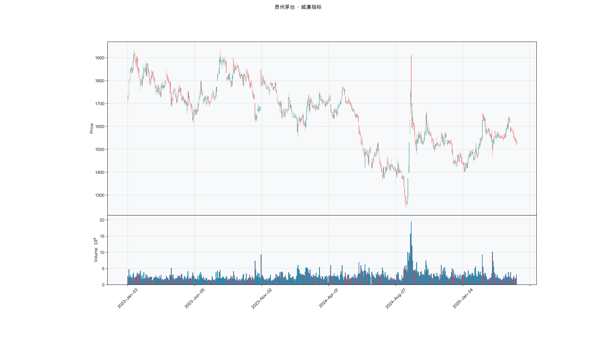

# 第024章 威廉指标（WPR）

一个交易者把威廉指标与随机指标并排放在同一张图上，同一段行情里，一条提示超买，另一条提示超卖。他先怀疑参数设错，核对了三遍窗口长度，两组读数仍然对不上。他把两条曲线的数值逐日抄下来对照，才发现一个从区间上沿往下量，一个从下沿往上量。方向相反，说的是同一件事。他想弄清楚，这个反着写的刻度究竟在度量什么。

## 名称与来历

威廉指标（Williams %R，缩写 WPR），也常写作 %R 或威廉超买超卖指标。

它由 Larry Williams 于 1973 年提出。Williams 是一位商品交易者，他提出的问题与当时流行的思路相反：大多数指标在追随价格趋势，能不能反过来，专门去找市场什么时候走得过头了。他的答案是把收盘价在近期高低区间中的位置用一个反向百分比表达出来，越接近 0 表示价格越靠近区间上沿，越接近负 100 表示越靠近下沿。

这个反向的数值轴是 WPR 最容易被误读的地方。读数从负 100 到 0，看起来像是一个亏损指标，实际上它度量的是位置。理解这一点之后，它与随机指标的关系就很清楚：两者测的是同一个位置，只是一个以下沿为零点，一个以上沿为零点。

## 核心逻辑

有一只股票最近在一个区间里来回走，区间上沿 20 元，下沿 15 元。某天收盘 19.5 元，几乎贴着上沿。这时一个具体的问题浮现出来：买方还能把这个价格往上推多少？

WPR 的回答方式是量出收盘价到上沿的距离，再除以区间高度。距离越小，说明价格越靠近上沿，买方的推力用到的比例越高。读数接近 0 就是这个意思。反过来，收盘价越接近下沿，读数越接近负 100，表示卖方已经把这个价位压得很低。

这套读数之所以用反向轴，是因为 Williams 把指标设计成"越极端越接近边界"的形式。负 20 以上为超买，负 80 以下为超卖，两个阈值都靠近端点，视觉上更容易分辨极端。代价是数值方向与直觉相反，初学者容易把负 80 当成长势信号。

WPR 与 KDJ 的另一处差别在于平滑。KDJ 对位置做了两次平滑，读数更慢更稳；WPR 直接使用当日的未平滑位置，反应更快，噪音也更多。快与稳的取舍，在这里表现为信号频率的差异。

## 计算公式

WPR 只有一个式子，结构简单，但分子分母的取法需要说清楚。

$$WPR_t = \frac{H_n - C_t}{H_n - L_n} \times (-100)$$

其中 $H_n$ 为近 n 日最高价，$L_n$ 为近 n 日最低价，$C_t$ 为当日收盘价。默认参数 n = 14。

分子是区间上沿与收盘价的距离，分母是区间高度，两者相除得到"收盘价距上沿的比例"。乘以负 100 之后，读数落在负 100 到 0 之间：收盘价等于上沿时读数为 0，等于下沿时读数为负 100。

若区间高度为零，即近 n 日最高价等于最低价，式子出现零分母，此时约定读数为中性值。多数软件取负 50。

**计算示例。** 取 n = 14。近 14 日最高价 20 元，最低价 15 元，当日收盘 16 元，则

$$WPR = \frac{20 - 16}{20 - 15} \times (-100) = -80$$

读数到达负 80，进入超卖区域。次日收盘涨至 19 元，则

$$WPR = \frac{20 - 19}{20 - 15} \times (-100) = -20$$

读数升至负 20，进入超买区域。同一个区间内，价格的反弹把读数从一端推到了另一端，这正是 WPR 灵敏的体现。

**参数含义。** n 是唯一的参数，TTR 的 `WPR()` 默认取 14。需要注意 TTR 的实现返回的是 0 到 1 的比例值，不是公式里的负 100 到 0，调用后要乘负 100 才能与正文的阈值对应。这个差异不影响排序，但会让阈值判断完全失效，用 TTR 计算时应先核对一遍返回范围。

| n | 反应速度 | 信号密度 | 典型用途 |
|---|---------|---------|---------|
| 6 | 很快 | 很高 | 短线极端捕捉，需与其他周期共振过滤 |
| 14 | 快 | 高 | 默认参数，日线波段 |
| 28 | 中 | 中 | 过滤噪音，中期极端确认 |

实践中常用多周期组合。6 日、14 日、28 日三条曲线同时进入超卖区，可信度明显高于单条曲线。反过来说，短期超卖而中期仍在中间区域时，多半只是短期波动。

**读数含义对照。**

| 读数区间 | 含义 | 常见解读 |
|---------|------|---------|
| 大于负 20 | 收盘价贴近区间上沿 | 超买，短期回调概率上升 |
| 负 20 到负 80 | 中性 | 无明确信号 |
| 小于负 80 | 收盘价贴近区间下沿 | 超卖，短期反弹概率上升 |

## 用法与信号

**极端值反转。** 这是 WPR 最直接的用法。读数跌破负 80 后价格止跌企稳，视为超卖反弹的起点；读数升破负 20 后价格出现见顶迹象，视为超买回调的起点。判断有效性的一个经验是看持续性：连续两日停留在极端区之后读数的回升，比单日触及更有分量。

**多周期共振。** 单周期的 WPR 对跳空很敏感，一天的大幅跳空就能把读数推到极端。用不同周期互相印证可以减少这类误判。买入方向的共振条件是短期读数为负 80 以下、中期为负 70 以下、长期为负 60 以下，三者同时满足。卖出方向按对称的读数布置。

**背离。** 价格创出新高而 WPR 没有同步刷新新高，是顶背离；价格创出新低而 WPR 没有同步刷新新低，是底背离。背离适合作为趋势末段的预警，配合成交量使用更稳：底背离时若成交量放大，说明有资金承接。

**弱趋势中的回调深度定位。** 在 ADX 处于 25 到 40 的弱趋势里，WPR 可以用来判断回调是否到位。上升趋势中读数回到负 60 到负 80 区间，往往是回调结束的位置；下降趋势中读数反弹到负 20 到负 40 区间，往往是反弹结束的位置。ADX 越过 40 之后这一用法失效。

## 边界与误区

**数值方向需要记牢。** 负 80 是超卖，负 20 是超买，这个方向与大多数指标相反。把负 80 当强势、负 20 当弱势，会让整套信号完全反过来。习惯之后可以在代码里加一步转换，把读数映射到 0 到 100 的正向区间再使用。

**强趋势中会钝化。** 单边上涨时收盘价持续贴近区间上沿，WPR 可以在负 20 以上停留很久。这时的读数代表趋势强劲而非回调预警。判断依据同样是 ADX，越过 40 之后应当放弃 WPR 的极端值信号。

**单周期读数容易受跳空影响。** 一次跳空低开就可能让 6 日 WPR 瞬间跌到负 90 附近，而这并不是缓慢走弱的结果。需要中期读数确认，或者把比较基准换成一个更长的窗口。

**不看成交量。** WPR 只使用价格，不包含成交量信息。超卖时如果成交量萎缩，说明抛压自然衰竭但承接也弱，价格可能继续在低位徘徊。把成交量作为附加条件，能过滤掉一部分无效信号。

## 它被检验过吗

WPR 缺少针对该指标的独立同行评议检验。现有的统计证据来自技术分析规则族的整体检验，而规则族的结论无法拆分到某一个震荡指标头上。完整的证据链见第 007 章。

还有一处方法上的不对称需要说明。WPR 的假设是价格围绕中枢回归，趋势市里这个前提失效。趋势段与震荡段混在同一份样本里，两类区间的收益方向相反，合并之后互相抵消，很容易读出"接近零"。这个读数既不能证明它有用，也不能证明它没用。

这一类的真实失效案例，见第 020 章的「真实案例与失败模式」。

## 代码实现

### R

```r
library(ettr)
library(efactorcraft)
library(efincharts)
library(ggplot2)

# 本地数据由 xquant-db 导出，字段见 data/README.md
# 同一章会多次用到这两份数据，这里读一次缓存起来，避免反复解压
.cache <- new.env(parent = emptyenv())
.blue <- function() {
  if (!exists("b", .cache)) {
    b <- read.csv("data/parquet/panel_blue_chip.csv", stringsAsFactors = FALSE)
    b$date <- as.Date(b$date)
    assign("b", b, .cache)
  }
  get("b", .cache)
}
.panel <- function() {
  if (!exists("p", .cache)) {
    # 287 只的完整面板压成 gz，read.csv 支持 gz
    p <- read.csv("data/parquet/panel_r.csv.gz", stringsAsFactors = FALSE)
    p$date <- as.Date(p$date)
    p <- p[p$date >= "2023-01-01" & p$date <= "2025-06-01", ]
    assign("p", p, .cache)
  }
  get("p", .cache)
}
blue  <- .blue()
panel <- .panel()

# efincharts 要求 xts 且列名带 Adjusted
as_xts <- function(df) {
  x <- xts::xts(df[, c("open", "high", "low", "close", "volume", "adjusted")],
                order.by = df$date)
  colnames(x) <- c("Open", "High", "Low", "Close", "Volume", "Adjusted")
  x
}

maotai <- .blue()[.blue()$code == "600519.SS", ]

# 1. ettr 在长格式面板上追加指标列
maotai <- add_wpr(maotai, n = 14)

# 2. 基本统计
cols <- setdiff(names(maotai), names(blue))
print(summary(maotai[, cols]))

# 3. K 线 + 成交量 + 均线
ch <- ecandlesticks(as_xts(maotai), show_ma = TRUE, ma_periods = c(20, 60),
                    title = "贵州茅台 · 威廉指标")
ggsave("assets/figures/ch024/indicator_r.png", ch$combined_plot,
       width = 10, height = 6, dpi = 110)
```

### Python

```python
import pandas as pd
import ettr
import efactorcraft as efc
import efincharts as efc_

# 中文字体：mplfinance 会用 style 里的 rc 覆盖全局设置，必须写进 style
from efincharts import theme
theme.efin_style["rc"] = {
    "font.sans-serif": ["PingFang SC", "Heiti SC", "SimHei"],
    "axes.unicode_minus": False,
    "font.family": "sans-serif",
}

# 本地数据由 xquant-db 导出，字段见 data/README.md
blue = pd.read_parquet("data/parquet/panel_blue_chip.parquet")
panel = pd.read_parquet("data/parquet/panel.parquet")
panel = panel[(panel["date"] >= "2023-01-01") & (panel["date"] <= "2025-06-01")]


def one(df, code="600519.SS"):
    """取单只标的，转成 efincharts 需要的宽表。"""
    x = df[df["code"] == code].sort_values("date").set_index("date")
    x.columns = [c.capitalize() for c in x.columns]
    return x

# 1. 取单只标的
maotai = blue[blue['code'] == '600519.SS'].copy()

# 2. ettr 在长格式面板上追加指标列，不需要手工 rolling
maotai = ettr.wpr(maotai)

cols = [c for c in maotai.columns if c not in blue.columns]
print(maotai[cols].describe().round(3))

# 3. 画图：K 线 + 成交量 + 指标面板
px = one(maotai)
ch = efc_.candlestick(px, volume=True, title="贵州茅台 · 威廉指标")
ch.save("assets/figures/ch024/indicator.png")
```

<!-- fig-indicator:start -->


<p class="figcap">图 24-1　威廉指标在贵州茅台上的读数（2023-01 至 2025-06）</p>
<!-- fig-indicator:end -->

## 拆解

WPR 的读数落在负 100 到 0 之间，方向与 RSI 相反：越接近 0，收盘价越贴近区间上沿，属于超买；越接近负 100，越贴近下沿，属于超卖。直接拿读数做因子，排序方向与“强势”相反，系数符号容易读反。

还要先处理一处实现差异。TTR 的 `WPR()` 返回的是 0 到 1 的比例值，分子是区间上沿与收盘价的距离，分母是区间高度。这个比例越接近 0，收盘价越贴近上沿。乘负 100 之后才得到公式所用的负 100 到 0 刻度。漏乘这一步，排序整体反转，因子 IC 的符号跟着反转，数值大小却不变，从输出上看不出任何异常。这类错误只能靠对照原始定义发现，所以本节把刻度换算单独列出来。

| 特征名 | 计算式 | 量纲 | 经济含义 |
|--------|--------|------|----------|
| 标准读数 | $\frac{H_n - C_t}{H_n - L_n} \times (-100)$ | 无量纲，−100 到 0 | 收盘价距区间上沿的比例，带负号 |
| 平移值 | $WPR_t + 50$ | 无量纲，−50 到 50 | 同上，中心移到零轴 |
| 镜像读数 | $-WPR_t$ | 无量纲，0 到 100 | 与 RSI 同向，越大越接近上沿 |
| 分位标记 | 当期读数在自身回看窗口中的百分位 | 无量纲，0 到 1 | 极端程度相对于该标的历史分布的位置 |
| 极值持续期 | 连续 $WPR < -80$ 或 $WPR > -20$ 的期数 | 期数（整数） | 极端状态的持续时间 |

平移与镜像只差一个符号，含义却不同。平移值回答“读数在区间中点之上还是之下”，正号对应靠近上沿；镜像读数回答“价格在区间中的位置有多高”，与 RSI 的刻度一致。两者不能混用：镜像是平移值取负得到的，方向与标准读数相反，误当作同一刻度会把结论写反。

分位标记处理的是阈值不可移植的问题。负 80 对高波动品种可能一周出现数次，对低波动品种一年也未必出现一次，同一个阈值在不同标的上的稀有程度相差很远。把读数换成自身历史的百分位，排序依据就从读数绝对值变成各自历史中的相对位置，阈值可以统一成分位线，跨标的比较才有共同语言。代价是分位依赖回看窗口，窗口越短越贴近当前波动结构，越长越稳定，窗口长度需要在样本外复核。

排序上，标准读数、平移值、镜像读数互为单调变换，横截面秩相关分别是 1、1、−1。三者作为因子的判别力完全相同，IC 的绝对值相同，符号视刻度而定。因此选择哪一种只影响解释，不影响检验结果。把这一点写清楚，可以省去很多“换了刻度以后因子失效”的困惑：失效的不是因子，是符号没有跟着换。

极值持续期在 WPR 上要谨慎。WPR 不做平滑，一天跳空就能把读数推到极端，持续期通常很短，“连续三日超卖”这种条件本身就带筛选作用。它的分布比 RSI 的持续期更集中，长尾更少，因此截断的必要性低一些，但方向问题仍在：超买侧与超卖侧的持续期含义相反，不能合并。

### R

```r
library(ettr)
library(efactorcraft)
library(efincharts)
library(ggplot2)

# 本地数据由 xquant-db 导出，字段见 data/README.md
# 同一章会多次用到这两份数据，这里读一次缓存起来，避免反复解压
.cache <- new.env(parent = emptyenv())
.blue <- function() {
  if (!exists("b", .cache)) {
    b <- read.csv("data/parquet/panel_blue_chip.csv", stringsAsFactors = FALSE)
    b$date <- as.Date(b$date)
    assign("b", b, .cache)
  }
  get("b", .cache)
}
.panel <- function() {
  if (!exists("p", .cache)) {
    # 287 只的完整面板压成 gz，read.csv 支持 gz
    p <- read.csv("data/parquet/panel_r.csv.gz", stringsAsFactors = FALSE)
    p$date <- as.Date(p$date)
    p <- p[p$date >= "2023-01-01" & p$date <= "2025-06-01", ]
    assign("p", p, .cache)
  }
  get("p", .cache)
}
blue  <- .blue()
panel <- .panel()

# efincharts 要求 xts 且列名带 Adjusted
as_xts <- function(df) {
  x <- xts::xts(df[, c("open", "high", "low", "close", "volume", "adjusted")],
                order.by = df$date)
  colnames(x) <- c("Open", "High", "Low", "Close", "Volume", "Adjusted")
  x
}

d <- .blue()[.blue()$code == "600519.SS", ]
d <- add_wpr(d, n = 14)

# 转成无量纲因子
d$f <- d$`WPR_14`

print(summary(d$f))
```

### Python

```python
import pandas as pd
import ettr
import efactorcraft as efc
import efincharts as efc_

# 中文字体：mplfinance 会用 style 里的 rc 覆盖全局设置，必须写进 style
from efincharts import theme
theme.efin_style["rc"] = {
    "font.sans-serif": ["PingFang SC", "Heiti SC", "SimHei"],
    "axes.unicode_minus": False,
    "font.family": "sans-serif",
}

# 本地数据由 xquant-db 导出，字段见 data/README.md
blue = pd.read_parquet("data/parquet/panel_blue_chip.parquet")
panel = pd.read_parquet("data/parquet/panel.parquet")
panel = panel[(panel["date"] >= "2023-01-01") & (panel["date"] <= "2025-06-01")]


def one(df, code="600519.SS"):
    """取单只标的，转成 efincharts 需要的宽表。"""
    x = df[df["code"] == code].sort_values("date").set_index("date")
    x.columns = [c.capitalize() for c in x.columns]
    return x

# 1. 先在面板上算原始指标
d = panel.copy()
d = ettr.wpr(d)

# 2. 转成无量纲因子，才能跨标的排序
d["f"] = d["WPR_14"]

print(d["f"].describe().round(4))
```

## 截面选股能力

常用的构造是平移值，

$$f^{dev}_t = WPR^{(14)}_t + 50$$

另一种是镜像读数，

$$f^{mirror}_t = -WPR^{(14)}_t$$

两者满足 $f^{mirror} = 50 - f^{dev}$，排序完全反向，IC 互为相反数。只需要检验一个，另一个的结果可以直接推出。写出两个式子是为了把符号问题摆在明处：报告里说因子有效时，要说清用的是哪一个刻度。

**符号没有先验答案。** 读数接近 0 可以读成超买将回落，方向为负；也可以读成价格贴着区间上沿、买盘仍在推进，方向为正。换成镜像刻度，两个解释的符号整体翻转。跨指标比较时这一点尤其容易出错：RSI 与 WPR 并列在同一张表里，若一个用原始刻度、一个用镜像刻度，两个正号的含义正好相反。

预期表现上，WPR 未做平滑，短窗口的反应比 RSI 更快，一日窗口的信息通常更强，五日之后衰减明显。市况层面，趋势明确时高读数容易延续，横盘时高读数容易回落。标的层面，跳空多、流动性一般的品种，读数噪音大，因子的稳定性差一些。

检验时有三点值得注意。第一，**先核对刻度再算 IC**。用 TTR 计算时要确认已经乘过负 100，用自写函数时要确认分子是上沿减收盘价。第二，**与 RSI 做镜像对照**。两者信息源接近，镜像刻度下的横截面相关应当很高，IC 的绝对值应当接近。若两者差异很大，先怀疑实现有误，再怀疑结论。第三，**符号按数据判定**。先算全样本 IC，再按年份与趋势强度分段，检查是否稳定。全样本接近零而分段清晰，是这类因子的常见情形。

参数也值得单独看一遍。6 日版本的跳动更大，反转效应更明显，换手也更高；28 日版本更稳，信号更少。把两个版本放在一起比较，既能看出灵敏度与稳定性的取舍，也能顺带估计成本对结论的影响。

### R

```r
library(ettr)
library(efactorcraft)
library(efincharts)
library(ggplot2)

# 本地数据由 xquant-db 导出，字段见 data/README.md
# 同一章会多次用到这两份数据，这里读一次缓存起来，避免反复解压
.cache <- new.env(parent = emptyenv())
.blue <- function() {
  if (!exists("b", .cache)) {
    b <- read.csv("data/parquet/panel_blue_chip.csv", stringsAsFactors = FALSE)
    b$date <- as.Date(b$date)
    assign("b", b, .cache)
  }
  get("b", .cache)
}
.panel <- function() {
  if (!exists("p", .cache)) {
    # 287 只的完整面板压成 gz，read.csv 支持 gz
    p <- read.csv("data/parquet/panel_r.csv.gz", stringsAsFactors = FALSE)
    p$date <- as.Date(p$date)
    p <- p[p$date >= "2023-01-01" & p$date <= "2025-06-01", ]
    assign("p", p, .cache)
  }
  get("p", .cache)
}
blue  <- .blue()
panel <- .panel()

# efincharts 要求 xts 且列名带 Adjusted
as_xts <- function(df) {
  x <- xts::xts(df[, c("open", "high", "low", "close", "volume", "adjusted")],
                order.by = df$date)
  colnames(x) <- c("Open", "High", "Low", "Close", "Volume", "Adjusted")
  x
}

d <- .panel()
d <- add_wpr(d, n = 14)

d$f <- d$`WPR_14`
d <- add_next_return(d, close_col = "close", n = c(1, 5, 20))

ic <- ic_analysis(d, factor_cols = "f",
                    forward_cols = c("forward_1", "forward_5", "forward_20"),
                    method = "spearman")
print(ir_analysis(ic))

q <- quantile_analysis(d, factor_cols = "f", forward_cols = "forward_5",
                       n_groups = 5)
print(q$f$summary)
```

### Python

```python
import pandas as pd
import ettr
import efactorcraft as efc
import efincharts as efc_

# 中文字体：mplfinance 会用 style 里的 rc 覆盖全局设置，必须写进 style
from efincharts import theme
theme.efin_style["rc"] = {
    "font.sans-serif": ["PingFang SC", "Heiti SC", "SimHei"],
    "axes.unicode_minus": False,
    "font.family": "sans-serif",
}

# 本地数据由 xquant-db 导出，字段见 data/README.md
blue = pd.read_parquet("data/parquet/panel_blue_chip.parquet")
panel = pd.read_parquet("data/parquet/panel.parquet")
panel = panel[(panel["date"] >= "2023-01-01") & (panel["date"] <= "2025-06-01")]


def one(df, code="600519.SS"):
    """取单只标的，转成 efincharts 需要的宽表。"""
    x = df[df["code"] == code].sort_values("date").set_index("date")
    x.columns = [c.capitalize() for c in x.columns]
    return x

# 287 只、2023-01 至 2025-06，横截面才有统计意义
src = panel.copy()
d = src.copy()

# 1. 算指标
d = ettr.wpr(d)


# 2. 因子 + 未来收益
d["f"] = d["WPR_14"]
d = efc.add_next_return(d, periods=(1, 5, 20))

# 3. 截面 IC 与分层
ic = efc.ic_analysis(d, factor_cols="f",
                      forward_cols=["forward_1", "forward_5", "forward_20"],
                      method="spearman")
print(efc.ir_analysis(ic).round(3))

q = efc.quantile_analysis(d, factor_col="f", forward_col="forward_5", n_groups=5)
print(q["summary"].round(4))
```

平移值与镜像刻度的两行 IC 要直接对照：大小相当、符号相反，说明换算没有问题；若两者符号相同，几乎可以断定其中一处刻度处理有误。这一行检查比任何统计检验都便宜，值得固定放在流程里。

<!-- tab-ic:start -->
**计算结果**

| 前向期 | IC 均值 | IC 标准差 | ICIR | t 值 | IC>0 占比 | 期数 |
|---|---|---|---|---|---|---|
| T+1 | -0.0109 | 0.2155 | -0.050 | -1.20 | 0.4830 | 567 |
| T+5 | -0.0007 | 0.1989 | -0.004 | -0.08 | 0.5190 | 563 |
| T+20 | -0.0184 | 0.1880 | -0.098 | -2.29 | 0.4930 | 548 |

表里最该看的是 t 值，不是 IC 均值。这个因子以 T+1 为主口径，IC 均值 -0.0109、ICIR -0.050、t 值 -1.20，在常规门槛下不显著，方向为反向。按第 007 章给出的日频门槛（ICIR 0.13 对应 t≈2），这个结果的含义是：还看不出与噪声的区别，不能据此构造策略。

需要提醒的是，这只说明排序与未来收益之间存在可测的关联，不代表扣掉成本后还能剩下收益。横截面 IC 检验的是“买哪只”，不负责“值不值得交易”。

**五档分层**

| 分组 | 平均收益 | 标准差 | 期数 |
|---|---|---|---|
| 1 | +0.0038 | +0.0387 | 563 |
| 2 | +0.0024 | +0.0352 | 563 |
| 3 | +0.0026 | +0.0336 | 563 |
| 4 | +0.0034 | +0.0325 | 563 |
| 5 | +0.0045 | +0.0314 | 560 |

五档分层看的是形状，不是单点。最高一档在第 5 组、最低在第 2 组，两端相差 +0.07%，组序号与平均收益的秩相关为 0.44，有方向但不严格单调。

分层比 IC 更接近实盘，因为它直接给出“买最高档、卖最低档”的收益差。但这里的数字是毛收益，且没有考虑涨跌停买不进、停牌卖不出的情形，真实可得的差额会小于表中所列。
<!-- tab-ic:end -->

## 择时能力

WPR 的择时逻辑分三层。第一层是极端区：读数跌破负 80 视为超卖，升破负 20 视为超买。第二层是多周期共振：短期、中期、长期同时进入极端区，信号的分量更重。第三层是背离：价格创新高而读数没有刷新，说明推力在减弱。

方法与形态匹配。极端区是阈值事件，适合用信号触发日检验，并且要分两尾各测一次，因为 WPR 的方向与多数指标相反，只测一尾容易得出反向的结论。连续读数适合条件分位收益，看五档的形状。共振是条件型规则，两个条件同时成立时样本变少，适合直接用仓位回测观察整体效果。

为什么不用单一的截面结论代替时序检验。WPR 的信号集中在少数时点，且未平滑，截面排序里的日间噪音很大，中间区域的标的排序几乎随机。时序检验只关心同一标的在不同时刻的状态，极端区的样本可以单独拎出来看，信噪比更高。这也是震荡类指标的共性：截面上说不清的方向，在时序的尾部常常比较清楚。

陷阱有三个。第一，**跳空制造假极端**。一次跳空低开就能让 6 日读数瞬间跌到负 90 附近，这不是缓慢走弱的结果，后续走势也与自然形成的超卖不同。第二，**单日触及不等于状态**。读数在极端区停留一日就回升，与连续多日停留，含义不同，混在一起统计会互相稀释。第三，**钝化**。单边上涨时读数长期停在负 20 上方，按超买卖出会连续踏空。

### R

```r
library(ettr)
library(efactorcraft)
library(efincharts)
library(ggplot2)

# 本地数据由 xquant-db 导出，字段见 data/README.md
# 同一章会多次用到这两份数据，这里读一次缓存起来，避免反复解压
.cache <- new.env(parent = emptyenv())
.blue <- function() {
  if (!exists("b", .cache)) {
    b <- read.csv("data/parquet/panel_blue_chip.csv", stringsAsFactors = FALSE)
    b$date <- as.Date(b$date)
    assign("b", b, .cache)
  }
  get("b", .cache)
}
.panel <- function() {
  if (!exists("p", .cache)) {
    # 287 只的完整面板压成 gz，read.csv 支持 gz
    p <- read.csv("data/parquet/panel_r.csv.gz", stringsAsFactors = FALSE)
    p$date <- as.Date(p$date)
    p <- p[p$date >= "2023-01-01" & p$date <= "2025-06-01", ]
    assign("p", p, .cache)
  }
  get("p", .cache)
}
blue  <- .blue()
panel <- .panel()

# efincharts 要求 xts 且列名带 Adjusted
as_xts <- function(df) {
  x <- xts::xts(df[, c("open", "high", "low", "close", "volume", "adjusted")],
                order.by = df$date)
  colnames(x) <- c("Open", "High", "Low", "Close", "Volume", "Adjusted")
  x
}

idx <- read.csv("data/parquet/index_daily.csv", stringsAsFactors = FALSE)
idx$date <- as.Date(idx$date)
t <- idx[idx$code == "510300.SS", ]
t <- add_wpr(t, n = 14)
t$f <- t$`WPR_14`
t$forward_5 <- c(tail(t$close, -5) / head(t$close, -5) - 1, rep(NA, 5))
t$q <- cut(t$f, quantile(t$f, 0:5/5, na.rm = TRUE), include.lowest = TRUE, labels = FALSE)
print(aggregate(forward_5 ~ q, data = t, FUN = function(x)
  c(mean = mean(x, na.rm = TRUE), n = sum(!is.na(x)))))
```

### Python

```python
import pandas as pd
import ettr
import efactorcraft as efc
import efincharts as efc_

# 中文字体：mplfinance 会用 style 里的 rc 覆盖全局设置，必须写进 style
from efincharts import theme
theme.efin_style["rc"] = {
    "font.sans-serif": ["PingFang SC", "Heiti SC", "SimHei"],
    "axes.unicode_minus": False,
    "font.family": "sans-serif",
}

# 本地数据由 xquant-db 导出，字段见 data/README.md
blue = pd.read_parquet("data/parquet/panel_blue_chip.parquet")
panel = pd.read_parquet("data/parquet/panel.parquet")
panel = panel[(panel["date"] >= "2023-01-01") & (panel["date"] <= "2025-06-01")]


def one(df, code="600519.SS"):
    """取单只标的，转成 efincharts 需要的宽表。"""
    x = df[df["code"] == code].sort_values("date").set_index("date")
    x.columns = [c.capitalize() for c in x.columns]
    return x

# 择时检验用 ETF 做市场载体，指数本身没有日线数据
idx = pd.read_parquet("data/parquet/index_daily.parquet")
idx = idx[idx["code"] == "510300.SS"].sort_values("date")
t = idx.copy()

# 1. 在 ETF 上算同一个指标
t = ettr.wpr(d)


# 2. 按因子分位看未来 5 日收益
t["f"] = t["WPR_14"]
t["forward_5"] = t["close"].shift(-5) / t["close"] - 1
# 因子可能有重复值，先按名次切，避免 qcut 报边界不唯一
t["q"] = pd.qcut(t["f"].rank(method="first"), 5, labels=False) + 1
t = t.dropna(subset=["f", "forward_5"])
print(t.groupby("q")["forward_5"].agg(["mean", "count"]).round(4))
```

四组输出的关系与前一章相同，但方向要按 WPR 的刻度读。上尾对应接近区间上沿，下尾对应接近下沿。若下尾的触发日收益显著高于其余交易日，说明超卖反弹在这个标的上成立，反转规则有依据；若上尾的触发日收益也偏高，说明这个标的更接近动量，两个方向不能同时成立，需要按市况分开。

<!-- tab-timing:start -->
**分位收益**

| 分位 | 未来 5 日均值 | 样本数 |
|---|---|---|
| 1 | -0.0012 | 222 |
| 2 | +0.0015 | 222 |
| 3 | +0.0018 | 222 |
| 4 | -0.0040 | 222 |
| 5 | +0.0013 | 222 |

择时口径与截面不同：这里只有一个标的，看的是同一标的在不同分位下的未来收益。最高与最低分位相差 +0.25%。单标的样本有限，这个差额很容易被一两段行情主导，只能作为方向参考。

真正做择时要问的是三件事：分位阈值是否稳定、换手是否可控、扣成本后是否还有剩余。三者缺一，择时信号就只是图上好看。
<!-- tab-timing:end -->

## 组合使用与验证

WPR 的搭档有三个。与成交量搭配，用放量确认超卖区的承接，缩量时的超卖往往还要继续磨。与 ADX 搭配，用趋势强度决定极端读数该按反转还是按强势解读。与 RSI 搭配，两者信息源接近，主要用途不是增强信号，而是互相校验。

**组合的截面验证。** 与 RSI 的组合应当先做一次“冗余检验”。把 WPR 换成镜像刻度，与 RSI 做横截面相关，若两者接近同向且相关系数很高，说明它们度量的是同一件事，组合不会带来增量。这一步的价值在于验证实现：镜像刻度下两个因子的 IC 应当接近互为相反数，相关应当很高且符号为正。若结果偏离这个预期，先检查刻度换算，再谈组合。真正可能带来增量的是 WPR 与量比的组合，一个度量位置，一个度量参与度，相关性低得多。

**组合的择时验证。** 常见的规则是多周期共振：6 日读数低于负 80 且 14 日低于负 70 时才买入，其余时间空仓。回测时与单周期规则对照，看信号次数、年化与最大回撤三项。共振的作用通常是提高胜率、减少信号，代价是错过一部分只有短周期触及极端的行情，收益未必提高。

增益判读仍按方法论章的标准：**组合的 ICIR 高于两个单特征，才说明存在互补性；介于两者之间，说明只是平均。** WPR 与 RSI 属于同源，组合的结果多半是平均，这个结果本身有诊断价值，不必视为失败。WPR 与量比的信息维度不同，出现互补的可能性更大。

### R

```r
library(ettr)
library(efactorcraft)
library(efincharts)
library(ggplot2)

# 本地数据由 xquant-db 导出，字段见 data/README.md
# 同一章会多次用到这两份数据，这里读一次缓存起来，避免反复解压
.cache <- new.env(parent = emptyenv())
.blue <- function() {
  if (!exists("b", .cache)) {
    b <- read.csv("data/parquet/panel_blue_chip.csv", stringsAsFactors = FALSE)
    b$date <- as.Date(b$date)
    assign("b", b, .cache)
  }
  get("b", .cache)
}
.panel <- function() {
  if (!exists("p", .cache)) {
    # 287 只的完整面板压成 gz，read.csv 支持 gz
    p <- read.csv("data/parquet/panel_r.csv.gz", stringsAsFactors = FALSE)
    p$date <- as.Date(p$date)
    p <- p[p$date >= "2023-01-01" & p$date <= "2025-06-01", ]
    assign("p", p, .cache)
  }
  get("p", .cache)
}
blue  <- .blue()
panel <- .panel()

# efincharts 要求 xts 且列名带 Adjusted
as_xts <- function(df) {
  x <- xts::xts(df[, c("open", "high", "low", "close", "volume", "adjusted")],
                order.by = df$date)
  colnames(x) <- c("Open", "High", "Low", "Close", "Volume", "Adjusted")
  x
}

d <- .panel()
d <- add_wpr(d, n = 14)
d$f1 <- d$`WPR_14`
d <- add_cmf(d, n = 20)
d$f2 <- d$CMF
d <- add_next_return(d, close_col = "close", n = 5)
ic1 <- ic_analysis(d, factor_cols = c("f1", "f2"),
                    forward_cols = "forward_5", method = "spearman")
print(ir_analysis(ic1))
```

```r
library(ettr)
library(efactorcraft)
library(efincharts)
library(ggplot2)

# 本地数据由 xquant-db 导出，字段见 data/README.md
# 同一章会多次用到这两份数据，这里读一次缓存起来，避免反复解压
.cache <- new.env(parent = emptyenv())
.blue <- function() {
  if (!exists("b", .cache)) {
    b <- read.csv("data/parquet/panel_blue_chip.csv", stringsAsFactors = FALSE)
    b$date <- as.Date(b$date)
    assign("b", b, .cache)
  }
  get("b", .cache)
}
.panel <- function() {
  if (!exists("p", .cache)) {
    # 287 只的完整面板压成 gz，read.csv 支持 gz
    p <- read.csv("data/parquet/panel_r.csv.gz", stringsAsFactors = FALSE)
    p$date <- as.Date(p$date)
    p <- p[p$date >= "2023-01-01" & p$date <= "2025-06-01", ]
    assign("p", p, .cache)
  }
  get("p", .cache)
}
blue  <- .blue()
panel <- .panel()

# efincharts 要求 xts 且列名带 Adjusted
as_xts <- function(df) {
  x <- xts::xts(df[, c("open", "high", "low", "close", "volume", "adjusted")],
                order.by = df$date)
  colnames(x) <- c("Open", "High", "Low", "Close", "Volume", "Adjusted")
  x
}

d <- .panel()
d <- add_wpr(d, n = 14)
d$f1 <- d$`WPR_14`
d <- add_cmf(d, n = 20)
d$f2 <- d$CMF
d <- add_next_return(d, close_col = "close", n = 5)
ic1 <- ic_analysis(d, factor_cols = c("f1", "f2"),
                    forward_cols = "forward_5", method = "spearman")
print(ir_analysis(ic1))
```

### Python

```python
import pandas as pd
import ettr
import efactorcraft as efc
import efincharts as efc_

# 中文字体：mplfinance 会用 style 里的 rc 覆盖全局设置，必须写进 style
from efincharts import theme
theme.efin_style["rc"] = {
    "font.sans-serif": ["PingFang SC", "Heiti SC", "SimHei"],
    "axes.unicode_minus": False,
    "font.family": "sans-serif",
}

# 本地数据由 xquant-db 导出，字段见 data/README.md
blue = pd.read_parquet("data/parquet/panel_blue_chip.parquet")
panel = pd.read_parquet("data/parquet/panel.parquet")
panel = panel[(panel["date"] >= "2023-01-01") & (panel["date"] <= "2025-06-01")]


def one(df, code="600519.SS"):
    """取单只标的，转成 efincharts 需要的宽表。"""
    x = df[df["code"] == code].sort_values("date").set_index("date")
    x.columns = [c.capitalize() for c in x.columns]
    return x

d = panel.copy()

# 1. 本章因子
d = ettr.wpr(d)
d["f1"] = d["WPR_14"]

# 2. 配一个量价因子做对照
d = ettr.cmf(d, n=20)
d["f2"] = d["CMF_20"]
d = efc.add_next_return(d, periods=(5,))

# 3. 单因子与等权组合的信息比率
ic = efc.ic_analysis(d, factor_cols=["f1", "f2"], forward_cols=["forward_5"],
                      method="spearman")
d = efc.equal_weighted_composite(d, factor_cols=["f1", "f2"], new_col="f1_f2")
ic2 = efc.ic_analysis(d, factor_cols=["f1_f2"], forward_cols=["forward_5"],
                      method="spearman")
ic.update(ic2)
print(efc.ir_analysis(ic).round(3))
```

```python
import pandas as pd
import ettr
import efactorcraft as efc
import efincharts as efc_

# 中文字体：mplfinance 会用 style 里的 rc 覆盖全局设置，必须写进 style
from efincharts import theme
theme.efin_style["rc"] = {
    "font.sans-serif": ["PingFang SC", "Heiti SC", "SimHei"],
    "axes.unicode_minus": False,
    "font.family": "sans-serif",
}

# 本地数据由 xquant-db 导出，字段见 data/README.md
blue = pd.read_parquet("data/parquet/panel_blue_chip.parquet")
panel = pd.read_parquet("data/parquet/panel.parquet")
panel = panel[(panel["date"] >= "2023-01-01") & (panel["date"] <= "2025-06-01")]


def one(df, code="600519.SS"):
    """取单只标的，转成 efincharts 需要的宽表。"""
    x = df[df["code"] == code].sort_values("date").set_index("date")
    x.columns = [c.capitalize() for c in x.columns]
    return x

d = panel.copy()

# 1. 本章因子
d = ettr.wpr(d)
d["f1"] = d["WPR_14"]

# 2. 配一个量价因子做对照
d = ettr.cmf(d, n=20)
d["f2"] = d["CMF_20"]
d = efc.add_next_return(d, periods=(5,))

# 3. 单因子与等权组合的信息比率
ic = efc.ic_analysis(d, factor_cols=["f1", "f2"], forward_cols=["forward_5"],
                      method="spearman")
d = efc.equal_weighted_composite(d, factor_cols=["f1", "f2"], new_col="f1_f2")
ic2 = efc.ic_analysis(d, factor_cols=["f1_f2"], forward_cols=["forward_5"],
                      method="spearman")
ic.update(ic2)
print(efc.ir_analysis(ic).round(3))
```

相关那一行先看。WPR 镜像刻度与 RSI 的相关若接近 1，组合的 ICIR 很难超过两者，结论是“同源、无增量”，这是正确且有用的结论。若相关系数明显偏低，先回头核对 WPR 的负号和 RSI 的平滑口径，这两处任一出错都会让相关性掉下来。冗余检验在这里的作用，与其说是寻找增益，不如说是给实现做一次体检。

## AI 引导词

::: prompt 引导词 1：数值方向的一致性处理

我在用威廉指标（WPR）做研究，发现它的读数是负 100 到 0，与其他震荡指标方向相反，不方便横向比较。请帮我设计一套统一处理方案：1）给出三种常见转换方法，分别是加 50 平移、翻转数值轴、映射到 0 到 100 的正向区间；2）在贵州茅台 2023 至 2025 年的日线上分别计算这三种转换后的序列；3）把三者与 14 日相对强弱指数（RSI）放在一起，计算两两的相关系数；4）说明哪一种转换与 RSI 的相关性最高，以及转换是否改变了指标的信息量。请只使用 pandas、numpy、yfinance、matplotlib。

:::
::: prompt 引导词 2：多周期共振的有效性

我打算用 6 日、14 日、28 日三条威廉指标做多周期共振，但不确定阈值怎么定。请帮我做一次扫描检验：1）把三个周期的超卖阈值分别设为负 70 至负 90 之间的若干档，组合成网格；2）对每一组阈值，统计共振信号出现后未来 1 日、5 日、10 日收益的均值与胜率；3）输出一张热力图，横轴是短期阈值，纵轴是长期阈值；4）根据结果给出推荐阈值组合，并说明共振条件放宽之后胜率与信号数量的权衡。请使用 pandas 与 numpy 实现。

:::
::: prompt 引导词 3：与相对强弱指数的对照实验

威廉指标与相对强弱指数同属震荡类，但构造方式不同，一个用区间位置，一个用涨跌力量比值。请帮我做一次对照：1）在同一段横截面数据上分别构造两个指标的因子，威廉指标做加 50 平移，相对强弱指数做减 50 偏离；2）计算两者的 Rank IC 与 ICIR，并做五组分层回测；3）统计两个因子之间的截面相关系数；4）用文字总结两类构造在哪些品种或哪些市况下表现更好。数据请用至少 50 只 A 股标的，代码只使用 pandas、numpy、yfinance、matplotlib。

:::
