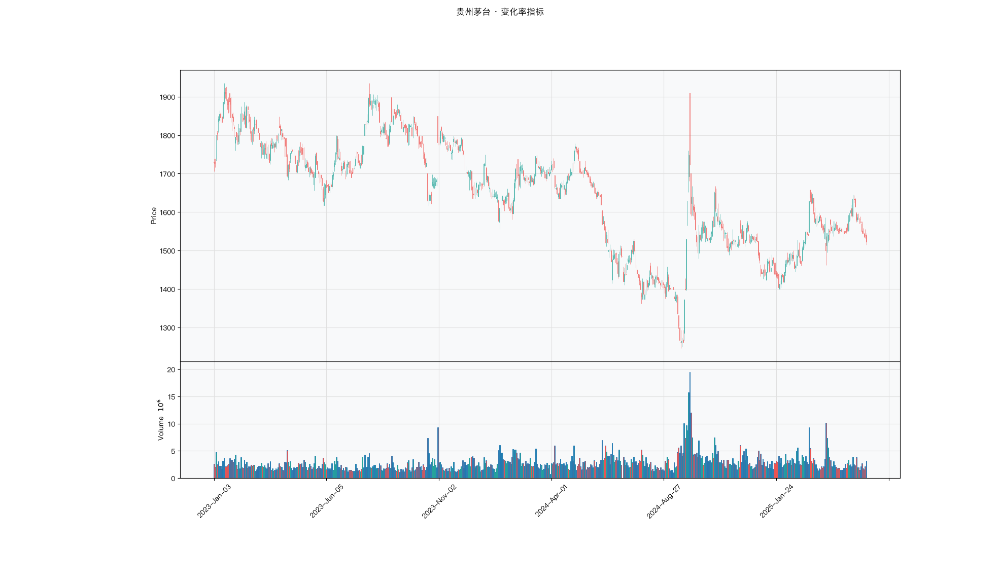

# 第025章 变化率指标（ROC）

一个投资者想比较手里两只股票过去一个月的表现。一只从二十元涨到二十二元，另一只从八元涨到九元。他排了一次序，又担心这个排序掺进了别的东西：均线取几天、区间取多长，都会改变结论。他真正想知道的只有一件事，这段时间价格变化了百分之几，不附加任何关于趋势或位置的判断。他需要的是一个只由两个价格相除得到的读数。

## 名称与来历

变化率指标（Rate of Change，ROC），中文也叫变动率指标。

它没有一个公认的单一提出者，更像是一个从动量概念里自然衍生出的计算式。趋势跟随与动量研究在二十世纪中期逐渐成形时，研究者需要一种把"变化了多少"换算成可比口径的办法，ROC 就是这种需求下的产物。众多技术分析著作都把它当作基础构件收录，但很少有人把它归到某一位作者名下。

ROC 要解决的问题很具体。价格上涨 1 元，这句话的信息量取决于起点：从 10 元涨到 11 元是上涨 10%，从 100 元涨到 101 元只上涨 1%。绝对变化量无法在不同标的之间比较，ROC 用百分比把尺度统一起来。它既不判断方向也不给位置，只回答一个速度问题：在过去 n 期里，价格走得多快。

## 核心逻辑

有一只股票连续三周上涨，从 20 元涨到 24 元，涨幅 20%。投资者需要判断的是：这波上涨还能不能延续。价格本身给不出答案，因为它只显示了结果。真正影响后续走势的，是上涨的速度是在加快还是在放慢。

ROC 的做法是把当前价格与 n 期之前的价格相比，算出这段时间内的变化百分比。这个数字衡量的是速度，不是位置。速度为正，说明这段时间整体在涨；速度为负，说明整体在跌。数值的绝对值变大，说明速度在提升；变小，说明速度在衰减。

关键在于，速度的变化往往先于价格的转向。一只股票可能仍在创新高，但 ROC 已从 20 回落到 8，说明上涨在减速。这类信号不能直接当作卖出指令，因为减速之后价格仍可能继续上行很久。它的价值在于提醒投资者，趋势的动能基础在松动。

ROC 与前几章那些有界指标的差别在于，它没有固定的上下限，读数随波动环境变化。同一套阈值在低波动品种上几乎不触发，在高波动品种上又频繁触发。阈值需要按品种调整，这是使用 ROC 时绕不开的一步。

## 计算公式

ROC 的计算只有一步，参数与阈值分别说明。

$$ROC_t^{(n)} = \frac{C_t - C_{t-n}}{C_{t-n}} \times 100$$

其中 $C_t$ 为当日收盘价，$C_{t-n}$ 为 n 期之前的收盘价。结果以百分比表示，例如读数为 15 表示当前价格比 n 期之前高出 15%。

这个式子与"n 期收益率"完全等价，只是省略了小数形式，改用百分数呈现。它不带符号方向的额外处理，读数本身可正可负。

**计算示例。** 取 n = 12。假设 12 个交易日前的收盘价为 100 元，当日收盘价为 115 元，则

$$ROC = \frac{115 - 100}{100} \times 100 = 15$$

读数为 15，表示过去 12 个交易日的累计涨幅为 15%。若 12 日前的收盘价是 120 元，当日仍是 115 元，则

$$ROC = \frac{115 - 120}{120} \times 100 = -4.17$$

读数为负，表示这段时间整体回落。

**参数与阈值含义。** 周期 n 决定观察窗口，阈值决定超买超卖的边界。

| 参数 | 默认值 | 作用 | 调整影响 |
|------|--------|------|---------|
| n | 12 | 观察窗口长度 | 缩短更灵敏，拉长更平滑 |
| 超买阈值 | 正 20 | 判定涨幅过大的边界 | 高波动品种上调至正 25 到正 30 |
| 超卖阈值 | 负 20 | 判定跌幅过大的边界 | 低波动品种下调至负 15 |

不同周期的典型搭配是这样：n = 6 配正负 15 的阈值，用于日内与超短线；n = 12 配正负 20，用于大盘指数与波段；n = 24 配正负 30，用于个股与行业指数的中长线观察。

## 用法与信号

**零轴穿越。** ROC 上穿零轴，说明价格从下行段落转入上行段落；下穿零轴，方向相反。零轴穿越是 ROC 最基础的信号，含义直白，但它只说明方向发生了切换，不说明切换的能量有多大。配合成交量使用更稳，上穿时成交量同步放大，说明有资金参与。

**趋势延续的确认。** 在明确趋势中，ROC 的作用是确认动能是否还在。上升趋势里 ROC 持续为正，每次回调时读数回落到零轴附近而不破，属于正常的动能修复，趋势延续的概率较高。一旦 ROC 跌破零轴并持续在下方运行，说明动能基础已经切换。

**背离。** 价格创出新高而 ROC 没有同步创出新高，是顶背离，表示上涨速度在衰减；价格创出新低而 ROC 没有同步创出新低，是底背离。ROC 的背离比其他指标更容易提前出现，因为它度量的是速度，而速度往往先于价格转向。代价是提前量太大时会给出过早的提示。

**超买与超卖。** 读数突破正 20 视为超买，跌破负 20 视为超卖。这一用法只在震荡市里成立。趋势市中读数可以长期停留在阈值之外，此时按超买去减仓，会把趋势仓位削掉。判断依据仍然回到 ADX 与均线的方向。

## 边界与误区

**阈值不是跨品种通用的。** 正负 20 是在大盘指数这类中等波动品种上总结出来的经验值。创业板、科创类指数以及数字资产的日常波动更大，固定阈值会让信号频繁触发。使用之前应当先看标的的历史读数分布，把阈值调到让极端读数大致落在分布的尾部区域。

**ROC 是动能指标，不是趋势指标。** 它回答的是速度快慢，不是方向或位置。单独用 ROC 做交易决策，会遇到"读数很高但价格已经涨完"的情形。把它与均线或 ADX 搭配，让它只承担刻度盘的职能，才符合它的设计定位。

**数据跳空会造成读数突变。** 除权、停牌复牌、重大事件跳空，都会让 ROC 在一天之内大幅跳变。这类跳变不是动能变化，而是基期价格被扭曲。使用前应对价格做复权处理，并在事件密集期把读数放在更长的观察窗口里看。

**n 的选择与持仓周期需要匹配。** 用 n = 6 的 ROC 去做月度调仓的选股因子，信号的半衰期远短于持仓周期，交易还没结束信号就已经反转。周期的选择应当与调仓频率一致，这是构造因子的基本要求。

## 它被检验过吗

ROC 缺少针对该指标的独立同行评议检验。现有证据只能追溯到技术分析规则族的整体检验，这类检验不区分具体指标，也无法把绩效归因到 ROC 这一条计算式上。完整的证据链见第 007 章。

震荡类的共同难处在这里同样存在。核心假设是价格围绕中枢回归，趋势市里假设失效。把趋势段与震荡段放进同一样本，正负相抵，均值容易落在零附近。看到这样的结果，先检查样本的市况构成，再谈指标本身。

这一类的真实失效案例，见第 020 章的「真实案例与失败模式」。

## 代码实现

### R

```r
library(ettr)
library(efactorcraft)
library(efincharts)
library(ggplot2)

BASE <- "https://raw.githubusercontent.com/dengyishuo/quant-technical-analysis/main/data/parquet"

# 取数据：本地有就用本地，没有就下载一次并缓存。
# read.csv 对本地 .gz 会自动解压，所以缓存成 .csv.gz 也能直接读。
load_data <- function(name) {
  local <- file.path("data", "parquet", name)
  if (file.exists(local)) return(local)
  cache <- file.path(tools::R_user_dir("qta", "cache"), name)
  if (!file.exists(cache)) {
    dir.create(dirname(cache), recursive = TRUE, showWarnings = FALSE)
    message("下载 ", name, " ...")
    download.file(paste0(BASE, "/", name), cache, mode = "wb", quiet = TRUE)
  }
  cache
}

read_data <- function(name) {
  d <- read.csv(load_data(name), stringsAsFactors = FALSE)
  if ("date" %in% names(d)) d$date <- as.Date(d$date)
  d
}

# 同一章里多次取用，缓存到内存，避免重复解析
.cache <- new.env(parent = emptyenv())
.blue <- function() {
  if (!exists("b", .cache)) assign("b", read_data("panel_blue_chip.csv"), .cache)
  get("b", .cache)
}
.panel <- function() {
  if (!exists("p", .cache)) {
    p <- read_data("panel_r.csv.gz")
    assign("p", p[p$date >= "2023-01-01" & p$date <= "2025-06-01", ], .cache)
  }
  get("p", .cache)
}
.index <- function() read_data("index_daily.csv")

blue  <- .blue()
panel <- .panel()

# 图的保存路径，顺手建目录，避免读者本地没有 assets/ 时报错
fig_path <- function(ch, name = "indicator_r.png") {
  d <- file.path("assets", "figures", sprintf("ch%03d", ch))
  dir.create(d, recursive = TRUE, showWarnings = FALSE)
  file.path(d, name)
}

# efincharts 要求 xts 且列名带 Adjusted
as_xts <- function(df) {
  x <- xts::xts(df[, c("open", "high", "low", "close", "volume", "adjusted")],
                order.by = df$date)
  colnames(x) <- c("Open", "High", "Low", "Close", "Volume", "Adjusted")
  x
}

maotai <- .blue()[.blue()$code == "600519.SS", ]

# 1. ettr 在长格式面板上追加指标列
maotai <- add_roc(maotai, n = 12)

# 2. 基本统计
cols <- setdiff(names(maotai), names(blue))
print(summary(maotai[, cols]))

# 3. K 线 + 成交量 + 均线
ch <- ecandlesticks(as_xts(maotai), show_ma = TRUE, ma_periods = c(20, 60),
                    title = "贵州茅台 · 变化率指标")
ggsave(fig_path(25), ch$combined_plot, width = 10, height = 6, dpi = 110)
```

### Python

```python
import pathlib
import urllib.request

import pandas as pd
import ettr
import efactorcraft as efc
import efincharts as efc_

# 中文字体：mplfinance 会用 style 里的 rc 覆盖全局设置，必须写进 style
from efincharts import theme
theme.efin_style["rc"] = {
    "font.sans-serif": ["PingFang SC", "Heiti SC", "SimHei"],
    "axes.unicode_minus": False,
    "font.family": "sans-serif",
}

BASE = "https://raw.githubusercontent.com/dengyishuo/quant-technical-analysis/main/data/parquet"
CACHE = pathlib.Path.home() / ".cache" / "qta"
_MEM = {}


def load(name):
    """取数据：本地有就用本地，没有就下载一次并缓存。

    这样三种情形都能跑：
      1. 克隆了整个仓库    -> 直接读 data/parquet/，不联网
      2. 只复制了代码片段  -> 首次自动下载到 ~/.cache/qta，之后走缓存
      3. 之前跑过          -> 全部命中缓存，断网也能用
    """
    if name in _MEM:
        return _MEM[name]
    local = pathlib.Path("data/parquet") / name
    if local.exists():
        path = local
    else:
        CACHE.mkdir(parents=True, exist_ok=True)
        path = CACHE / name
        if not path.exists():
            print("下载 %s ..." % name)
            urllib.request.urlretrieve(BASE + "/" + name, path)
    data = pd.read_parquet(path) if name.endswith(".parquet") else pd.read_csv(path)
    _MEM[name] = data
    return data


blue = load("panel_blue_chip.parquet")
panel = load("panel.parquet")
panel = panel[(panel["date"] >= "2023-01-01") & (panel["date"] <= "2025-06-01")]
idx = load("index_daily.parquet")


def one(df, code="600519.SS"):
    """取单只标的，转成 efincharts 需要的宽表。"""
    x = df[df["code"] == code].sort_values("date").set_index("date")
    x.columns = [c.capitalize() for c in x.columns]
    return x


def fig_path(ch, name="indicator.png"):
    """图的保存路径，顺手建目录，避免读者本地没有 assets/ 时报错。"""
    d = pathlib.Path("assets") / "figures" / ("ch%03d" % ch)
    d.mkdir(parents=True, exist_ok=True)
    return str(d / name)

# 1. 取单只标的
maotai = blue[blue['code'] == '600519.SS'].copy()

# 2. ettr 在长格式面板上追加指标列，不需要手工 rolling
maotai = ettr.roc(maotai, n=12)

cols = [c for c in maotai.columns if c not in blue.columns]
print(maotai[cols].describe().round(3))

# 3. 画图：K 线 + 成交量 + 指标面板
px = one(maotai)
ch = efc_.candlestick(px, volume=True, title="贵州茅台 · 变化率指标")
ch.save(fig_path(25))
```

<!-- fig-indicator:start -->


<p class="figcap">图 25-1　变化率指标在贵州茅台上的读数（2023-01 至 2025-06）</p>
<!-- fig-indicator:end -->

## 拆解

ROC 的输出已经是百分比，量纲统一，看起来可以直接进横截面。问题在别处：它把幅度与方向压在一个数里，而且读数的分布宽度随品种的波动环境变化。同样读 8，在低波动蓝筹上是异动，在高波动成长股上只是日常波动。两者放进同一张排序表，名次里有一部分来自波动差异，不是动量强弱。

| 特征名 | 计算式 | 量纲 | 经济含义 |
|--------|--------|------|----------|
| 变化率读数 | $ROC_t^{(12)}$ | 百分比 | 过去十二期的累计变化速度 |
| 分位标准化值 | 近 120 日窗口内的百分位 | 0 到 100 | 剔除自身波动环境后的相对位置 |
| 符号状态 | $\mathbf{1}\left[ROC_t>0\right]$ | 0 或 1 | 变化方向，与幅度分离 |
| 波动调整值 | $ROC_t^{(12)}/\sigma_t^{(12)}$ | 倍数 | 每单位波动的变化速度 |

四者的关系需要分清。变化率读数与波动调整值同向，但后者把"涨得多"换成"涨得比平时快多少"，在高波动品种上会压低读数。分位标准化值把分布形状抹平，只留相对位置，代价是丢掉绝对幅度。

符号状态不是前两者的替代。它把方向单独提出来，幅度归零，适合回答"在涨还是在跌"，不适合回答"涨得多不多"。把符号与幅度分开检验，能看出信息来自方向还是来自强度。若符号状态单独有效而幅度无效，说明因子捕捉的是趋势的存在性，与强弱无关。

分布上还有一处要先处理。ROC 的横截面分布右偏，上尾比下尾长，少数暴涨标的会把均值拉高。稳妥的顺序是先按分位缩尾，再做横截面标准化，或者用分位排名代替数值。这一步不做，算出的 IC 有一部分只是在描述极值。

### R

```r
library(ettr)
library(efactorcraft)
library(efincharts)
library(ggplot2)

BASE <- "https://raw.githubusercontent.com/dengyishuo/quant-technical-analysis/main/data/parquet"

# 取数据：本地有就用本地，没有就下载一次并缓存。
# read.csv 对本地 .gz 会自动解压，所以缓存成 .csv.gz 也能直接读。
load_data <- function(name) {
  local <- file.path("data", "parquet", name)
  if (file.exists(local)) return(local)
  cache <- file.path(tools::R_user_dir("qta", "cache"), name)
  if (!file.exists(cache)) {
    dir.create(dirname(cache), recursive = TRUE, showWarnings = FALSE)
    message("下载 ", name, " ...")
    download.file(paste0(BASE, "/", name), cache, mode = "wb", quiet = TRUE)
  }
  cache
}

read_data <- function(name) {
  d <- read.csv(load_data(name), stringsAsFactors = FALSE)
  if ("date" %in% names(d)) d$date <- as.Date(d$date)
  d
}

# 同一章里多次取用，缓存到内存，避免重复解析
.cache <- new.env(parent = emptyenv())
.blue <- function() {
  if (!exists("b", .cache)) assign("b", read_data("panel_blue_chip.csv"), .cache)
  get("b", .cache)
}
.panel <- function() {
  if (!exists("p", .cache)) {
    p <- read_data("panel_r.csv.gz")
    assign("p", p[p$date >= "2023-01-01" & p$date <= "2025-06-01", ], .cache)
  }
  get("p", .cache)
}
.index <- function() read_data("index_daily.csv")

blue  <- .blue()
panel <- .panel()

# 图的保存路径，顺手建目录，避免读者本地没有 assets/ 时报错
fig_path <- function(ch, name = "indicator_r.png") {
  d <- file.path("assets", "figures", sprintf("ch%03d", ch))
  dir.create(d, recursive = TRUE, showWarnings = FALSE)
  file.path(d, name)
}

# efincharts 要求 xts 且列名带 Adjusted
as_xts <- function(df) {
  x <- xts::xts(df[, c("open", "high", "low", "close", "volume", "adjusted")],
                order.by = df$date)
  colnames(x) <- c("Open", "High", "Low", "Close", "Volume", "Adjusted")
  x
}

d <- .blue()[.blue()$code == "600519.SS", ]
d <- add_roc(d, n = 12)

# 转成无量纲因子
d$f <- d$`ROC_12`

print(summary(d$f))
```

### Python

```python
import pathlib
import urllib.request

import pandas as pd
import ettr
import efactorcraft as efc
import efincharts as efc_

# 中文字体：mplfinance 会用 style 里的 rc 覆盖全局设置，必须写进 style
from efincharts import theme
theme.efin_style["rc"] = {
    "font.sans-serif": ["PingFang SC", "Heiti SC", "SimHei"],
    "axes.unicode_minus": False,
    "font.family": "sans-serif",
}

BASE = "https://raw.githubusercontent.com/dengyishuo/quant-technical-analysis/main/data/parquet"
CACHE = pathlib.Path.home() / ".cache" / "qta"
_MEM = {}


def load(name):
    """取数据：本地有就用本地，没有就下载一次并缓存。

    这样三种情形都能跑：
      1. 克隆了整个仓库    -> 直接读 data/parquet/，不联网
      2. 只复制了代码片段  -> 首次自动下载到 ~/.cache/qta，之后走缓存
      3. 之前跑过          -> 全部命中缓存，断网也能用
    """
    if name in _MEM:
        return _MEM[name]
    local = pathlib.Path("data/parquet") / name
    if local.exists():
        path = local
    else:
        CACHE.mkdir(parents=True, exist_ok=True)
        path = CACHE / name
        if not path.exists():
            print("下载 %s ..." % name)
            urllib.request.urlretrieve(BASE + "/" + name, path)
    data = pd.read_parquet(path) if name.endswith(".parquet") else pd.read_csv(path)
    _MEM[name] = data
    return data


blue = load("panel_blue_chip.parquet")
panel = load("panel.parquet")
panel = panel[(panel["date"] >= "2023-01-01") & (panel["date"] <= "2025-06-01")]
idx = load("index_daily.parquet")


def one(df, code="600519.SS"):
    """取单只标的，转成 efincharts 需要的宽表。"""
    x = df[df["code"] == code].sort_values("date").set_index("date")
    x.columns = [c.capitalize() for c in x.columns]
    return x


def fig_path(ch, name="indicator.png"):
    """图的保存路径，顺手建目录，避免读者本地没有 assets/ 时报错。"""
    d = pathlib.Path("assets") / "figures" / ("ch%03d" % ch)
    d.mkdir(parents=True, exist_ok=True)
    return str(d / name)

# 1. 先在面板上算原始指标
d = panel.copy()
d = ettr.roc(d, n=12)

# 2. 转成无量纲因子，才能跨标的排序
d["f"] = d["ROC_12"]

print(d["f"].describe().round(4))
```

## 截面选股能力

ROC 的横截面因子最直接的构造是十二日读数，

$$f^{roc}_t = \frac{C_t}{C_{t-12}} - 1$$

另一个构造把幅度按波动归一，

$$f^{std}_t = \frac{ROC_t^{(12)}}{\sigma_t^{(12)}}$$

两者可以分别检验。前者的信息是纯涨幅，后者把涨幅换算成波动单位，排序更接近异动程度。

**符号方向不能先验设定。** 这是震荡类指标共同的第一道关口。读数高可以解释为涨势强劲、后续延续，对应正向因子；也可以解释为短期涨幅过大、后续回吐，对应负向因子。两种解释都有依据，也可能同时成立，只是适用的窗口与市况不同。判断只能回到数据：先算全样本 IC 看符号，再按年份、按市况分段，看这个符号是否稳定。全样本 IC 接近零而分段后清晰，是这类因子常见的情形，正负两段互相抵消，均值被压平了。

预期表现上，短窗口变化率在 A 股多数时段偏反转，读数越高、后续收益越低；窗口拉长到季度以上，符号可能翻正，转为动量。这一翻转与参与者结构有关，短周期由交易型资金主导，长周期由配置型资金主导。市况层面，单边上涨阶段动量特征更强，宽幅震荡阶段反转特征更强。标的层面，高波动品种的反转更明显，低波动蓝筹的持续性更好。这些都是倾向，落到具体样本上仍以实测为准。

检验时有三点值得注意。第一，窗口与持有期要配对报告，十二日读数配一日与五日两个前向窗口各算一次，避免把不同持有期上的相反效应混成一个数字。第二，变化率与动量因子同源，十二日读数与常见动量因子的相关性不低，判断增量时应做对照回归：把十二日读数对六十日读数取横截面残差，残差仍有预测力，才说明短周期项带来了独立信息。第三，右偏分布要先缩尾，否则头组收益被一两只暴涨标的决定，分层单调性也随之失真。

### R

```r
library(ettr)
library(efactorcraft)
library(efincharts)
library(ggplot2)

BASE <- "https://raw.githubusercontent.com/dengyishuo/quant-technical-analysis/main/data/parquet"

# 取数据：本地有就用本地，没有就下载一次并缓存。
# read.csv 对本地 .gz 会自动解压，所以缓存成 .csv.gz 也能直接读。
load_data <- function(name) {
  local <- file.path("data", "parquet", name)
  if (file.exists(local)) return(local)
  cache <- file.path(tools::R_user_dir("qta", "cache"), name)
  if (!file.exists(cache)) {
    dir.create(dirname(cache), recursive = TRUE, showWarnings = FALSE)
    message("下载 ", name, " ...")
    download.file(paste0(BASE, "/", name), cache, mode = "wb", quiet = TRUE)
  }
  cache
}

read_data <- function(name) {
  d <- read.csv(load_data(name), stringsAsFactors = FALSE)
  if ("date" %in% names(d)) d$date <- as.Date(d$date)
  d
}

# 同一章里多次取用，缓存到内存，避免重复解析
.cache <- new.env(parent = emptyenv())
.blue <- function() {
  if (!exists("b", .cache)) assign("b", read_data("panel_blue_chip.csv"), .cache)
  get("b", .cache)
}
.panel <- function() {
  if (!exists("p", .cache)) {
    p <- read_data("panel_r.csv.gz")
    assign("p", p[p$date >= "2023-01-01" & p$date <= "2025-06-01", ], .cache)
  }
  get("p", .cache)
}
.index <- function() read_data("index_daily.csv")

blue  <- .blue()
panel <- .panel()

# 图的保存路径，顺手建目录，避免读者本地没有 assets/ 时报错
fig_path <- function(ch, name = "indicator_r.png") {
  d <- file.path("assets", "figures", sprintf("ch%03d", ch))
  dir.create(d, recursive = TRUE, showWarnings = FALSE)
  file.path(d, name)
}

# efincharts 要求 xts 且列名带 Adjusted
as_xts <- function(df) {
  x <- xts::xts(df[, c("open", "high", "low", "close", "volume", "adjusted")],
                order.by = df$date)
  colnames(x) <- c("Open", "High", "Low", "Close", "Volume", "Adjusted")
  x
}

d <- .panel()
d <- add_roc(d, n = 12)

d$f <- d$`ROC_12`
d <- add_next_return(d, close_col = "close", n = c(1, 5, 20))

ic <- ic_analysis(d, factor_cols = "f",
                    forward_cols = c("forward_1", "forward_5", "forward_20"),
                    method = "spearman")
print(ir_analysis(ic))

q <- quantile_analysis(d, factor_cols = "f", forward_cols = "forward_5",
                       n_groups = 5)
print(q$f$summary)
```

### Python

```python
import pathlib
import urllib.request

import pandas as pd
import ettr
import efactorcraft as efc
import efincharts as efc_

# 中文字体：mplfinance 会用 style 里的 rc 覆盖全局设置，必须写进 style
from efincharts import theme
theme.efin_style["rc"] = {
    "font.sans-serif": ["PingFang SC", "Heiti SC", "SimHei"],
    "axes.unicode_minus": False,
    "font.family": "sans-serif",
}

BASE = "https://raw.githubusercontent.com/dengyishuo/quant-technical-analysis/main/data/parquet"
CACHE = pathlib.Path.home() / ".cache" / "qta"
_MEM = {}


def load(name):
    """取数据：本地有就用本地，没有就下载一次并缓存。

    这样三种情形都能跑：
      1. 克隆了整个仓库    -> 直接读 data/parquet/，不联网
      2. 只复制了代码片段  -> 首次自动下载到 ~/.cache/qta，之后走缓存
      3. 之前跑过          -> 全部命中缓存，断网也能用
    """
    if name in _MEM:
        return _MEM[name]
    local = pathlib.Path("data/parquet") / name
    if local.exists():
        path = local
    else:
        CACHE.mkdir(parents=True, exist_ok=True)
        path = CACHE / name
        if not path.exists():
            print("下载 %s ..." % name)
            urllib.request.urlretrieve(BASE + "/" + name, path)
    data = pd.read_parquet(path) if name.endswith(".parquet") else pd.read_csv(path)
    _MEM[name] = data
    return data


blue = load("panel_blue_chip.parquet")
panel = load("panel.parquet")
panel = panel[(panel["date"] >= "2023-01-01") & (panel["date"] <= "2025-06-01")]
idx = load("index_daily.parquet")


def one(df, code="600519.SS"):
    """取单只标的，转成 efincharts 需要的宽表。"""
    x = df[df["code"] == code].sort_values("date").set_index("date")
    x.columns = [c.capitalize() for c in x.columns]
    return x


def fig_path(ch, name="indicator.png"):
    """图的保存路径，顺手建目录，避免读者本地没有 assets/ 时报错。"""
    d = pathlib.Path("assets") / "figures" / ("ch%03d" % ch)
    d.mkdir(parents=True, exist_ok=True)
    return str(d / name)

# 287 只、2023-01 至 2025-06，横截面才有统计意义
src = panel.copy()
d = src.copy()

# 1. 算指标
d = ettr.roc(d, n=12)


# 2. 因子 + 未来收益
d["f"] = d["ROC_12"]
d = efc.add_next_return(d, periods=(1, 5, 20))

# 3. 截面 IC 与分层
ic = efc.ic_analysis(d, factor_cols="f",
                      forward_cols=["forward_1", "forward_5", "forward_20"],
                      method="spearman")
print(efc.ir_analysis(ic).round(3))

q = efc.quantile_analysis(d, factor_col="f", forward_col="forward_5", n_groups=5)
print(q["summary"].round(4))
```

按年份切分的表比全样本均值有信息量。各年符号一致，说明方向稳定；某一年整体反号且与市场状态对得上，说明因子带市况依赖，使用时需要配一个状态判断。残差那一行回答另一个问题：短周期读数在剔除长周期动量之后还剩多少。残差 IC 接近零，说明它只是动量的快版本。

<!-- tab-ic:start -->
**计算结果**

| 前向期 | IC 均值 | IC 标准差 | ICIR | t 值 | IC>0 占比 | 期数 |
|---|---|---|---|---|---|---|
| T+1 | -0.0125 | 0.2368 | -0.053 | -1.26 | 0.4680 | 568 |
| T+5 | -0.0162 | 0.2181 | -0.074 | -1.76 | 0.4790 | 564 |
| T+20 | -0.0373 | 0.2077 | -0.180 | -4.21 | 0.4300 | 549 |

表里最该看的是 t 值，不是 IC 均值。这个因子以 T+1 为主口径，IC 均值 -0.0125、ICIR -0.053、t 值 -1.26，在常规门槛下不显著，方向为反向。按第 007 章给出的日频门槛（ICIR 0.13 对应 t≈2），这个结果的含义是：还看不出与噪声的区别，不能据此构造策略。

需要提醒的是，这只说明排序与未来收益之间存在可测的关联，不代表扣掉成本后还能剩下收益。横截面 IC 检验的是“买哪只”，不负责“值不值得交易”。

**五档分层**

| 分组 | 平均收益 | 标准差 | 期数 |
|---|---|---|---|
| 1 | +0.0042 | +0.0418 | 564 |
| 2 | +0.0029 | +0.0334 | 564 |
| 3 | +0.0022 | +0.0290 | 564 |
| 4 | +0.0028 | +0.0291 | 564 |
| 5 | +0.0048 | +0.0414 | 564 |

五档分层看的是形状，不是单点。最高一档在第 5 组、最低在第 3 组，两端相差 +0.05%，组序号与平均收益的秩相关为 0.15，没有明显单调性。

分层比 IC 更接近实盘，因为它直接给出“买最高档、卖最低档”的收益差。但这里的数字是毛收益，且没有考虑涨跌停买不进、停牌卖不出的情形，真实可得的差额会小于表中所列。
<!-- tab-ic:end -->

## 择时能力

在时间序列上，ROC 的信息分三层。第一层是零轴，上穿表示价格从下行段转入上行段，下穿相反，这是方向层。第二层是读数区间，绝对值大表示推进快，绝对值小表示推进慢，这是强度层。第三层是读数与自己前高的距离，价格创新高而读数没有同步创新高，说明推进在减速，这是背离层。三层的信息密度依次上升，可靠性依次下降。

检验方法要与信号形态匹配。零轴穿越与阈值穿越都是离散事件，适合触发日检验，把穿越日与其余交易日分成两组比后续收益。读数是连续变量，适合条件分位收益，能看出关系是单调还是有拐点。最后做一次完整回测，把读数高于某分位作为持仓条件，与买入持有对照。

选择这三条路径，还有一个震荡类特有的理由。ROC 的读数有正负两端，两端含义不对称：正端是超买候选，负端是超卖候选。只做上分位的触发检验，测的只是多头端；把因子取负再跑一遍同一函数，才看得到空头端。条件分位收益天然覆盖两端，读的时候要看首档与末档是否都比中间档特殊，若是，说明关系不单调，用单调性作判据会得出错误结论。

陷阱有三处。第一，固定阈值随波动环境漂移，同一个读数 20 在两倍波动的标的上含义完全不同，时序检验用分位阈值比用固定读数稳妥。第二，零轴穿越在震荡市中频率很高，一年可能几十次，成本会吃掉大部分名义收益，回测要把费率与印花税计入。第三，信号按收盘确认，成交只能放在次日，若按当日收盘价成交，回测里就混进了未来信息，这是择时检验最常见的偏差来源。

### R

```r
library(ettr)
library(efactorcraft)
library(efincharts)
library(ggplot2)

BASE <- "https://raw.githubusercontent.com/dengyishuo/quant-technical-analysis/main/data/parquet"

# 取数据：本地有就用本地，没有就下载一次并缓存。
# read.csv 对本地 .gz 会自动解压，所以缓存成 .csv.gz 也能直接读。
load_data <- function(name) {
  local <- file.path("data", "parquet", name)
  if (file.exists(local)) return(local)
  cache <- file.path(tools::R_user_dir("qta", "cache"), name)
  if (!file.exists(cache)) {
    dir.create(dirname(cache), recursive = TRUE, showWarnings = FALSE)
    message("下载 ", name, " ...")
    download.file(paste0(BASE, "/", name), cache, mode = "wb", quiet = TRUE)
  }
  cache
}

read_data <- function(name) {
  d <- read.csv(load_data(name), stringsAsFactors = FALSE)
  if ("date" %in% names(d)) d$date <- as.Date(d$date)
  d
}

# 同一章里多次取用，缓存到内存，避免重复解析
.cache <- new.env(parent = emptyenv())
.blue <- function() {
  if (!exists("b", .cache)) assign("b", read_data("panel_blue_chip.csv"), .cache)
  get("b", .cache)
}
.panel <- function() {
  if (!exists("p", .cache)) {
    p <- read_data("panel_r.csv.gz")
    assign("p", p[p$date >= "2023-01-01" & p$date <= "2025-06-01", ], .cache)
  }
  get("p", .cache)
}
.index <- function() read_data("index_daily.csv")

blue  <- .blue()
panel <- .panel()

# 图的保存路径，顺手建目录，避免读者本地没有 assets/ 时报错
fig_path <- function(ch, name = "indicator_r.png") {
  d <- file.path("assets", "figures", sprintf("ch%03d", ch))
  dir.create(d, recursive = TRUE, showWarnings = FALSE)
  file.path(d, name)
}

# efincharts 要求 xts 且列名带 Adjusted
as_xts <- function(df) {
  x <- xts::xts(df[, c("open", "high", "low", "close", "volume", "adjusted")],
                order.by = df$date)
  colnames(x) <- c("Open", "High", "Low", "Close", "Volume", "Adjusted")
  x
}

t <- .index()
t <- t[t$code == "510300.SS", ]
t <- add_roc(t, n = 12)
t$f <- t$`ROC_12`
t$forward_5 <- c(tail(t$close, -5) / head(t$close, -5) - 1, rep(NA, 5))
t$q <- cut(t$f, quantile(t$f, 0:5/5, na.rm = TRUE), include.lowest = TRUE, labels = FALSE)
print(aggregate(forward_5 ~ q, data = t, FUN = function(x)
  c(mean = mean(x, na.rm = TRUE), n = sum(!is.na(x)))))
```

### Python

```python
import pathlib
import urllib.request

import pandas as pd
import ettr
import efactorcraft as efc
import efincharts as efc_

# 中文字体：mplfinance 会用 style 里的 rc 覆盖全局设置，必须写进 style
from efincharts import theme
theme.efin_style["rc"] = {
    "font.sans-serif": ["PingFang SC", "Heiti SC", "SimHei"],
    "axes.unicode_minus": False,
    "font.family": "sans-serif",
}

BASE = "https://raw.githubusercontent.com/dengyishuo/quant-technical-analysis/main/data/parquet"
CACHE = pathlib.Path.home() / ".cache" / "qta"
_MEM = {}


def load(name):
    """取数据：本地有就用本地，没有就下载一次并缓存。

    这样三种情形都能跑：
      1. 克隆了整个仓库    -> 直接读 data/parquet/，不联网
      2. 只复制了代码片段  -> 首次自动下载到 ~/.cache/qta，之后走缓存
      3. 之前跑过          -> 全部命中缓存，断网也能用
    """
    if name in _MEM:
        return _MEM[name]
    local = pathlib.Path("data/parquet") / name
    if local.exists():
        path = local
    else:
        CACHE.mkdir(parents=True, exist_ok=True)
        path = CACHE / name
        if not path.exists():
            print("下载 %s ..." % name)
            urllib.request.urlretrieve(BASE + "/" + name, path)
    data = pd.read_parquet(path) if name.endswith(".parquet") else pd.read_csv(path)
    _MEM[name] = data
    return data


blue = load("panel_blue_chip.parquet")
panel = load("panel.parquet")
panel = panel[(panel["date"] >= "2023-01-01") & (panel["date"] <= "2025-06-01")]
idx = load("index_daily.parquet")


def one(df, code="600519.SS"):
    """取单只标的，转成 efincharts 需要的宽表。"""
    x = df[df["code"] == code].sort_values("date").set_index("date")
    x.columns = [c.capitalize() for c in x.columns]
    return x


def fig_path(ch, name="indicator.png"):
    """图的保存路径，顺手建目录，避免读者本地没有 assets/ 时报错。"""
    d = pathlib.Path("assets") / "figures" / ("ch%03d" % ch)
    d.mkdir(parents=True, exist_ok=True)
    return str(d / name)

# 择时检验用 ETF 做市场载体，指数本身没有日线数据
t = idx[idx["code"] == "510300.SS"].sort_values("date").copy()

# 1. 在 ETF 上算同一个指标
t = ettr.roc(d, n=12)


# 2. 按因子分位看未来 5 日收益
t["f"] = t["ROC_12"]
t["forward_5"] = t["close"].shift(-5) / t["close"] - 1
# 因子可能有重复值，先按名次切，避免 qcut 报边界不唯一
t["q"] = pd.qcut(t["f"].rank(method="first"), 5, labels=False) + 1
t = t.dropna(subset=["f", "forward_5"])
print(t.groupby("q")["forward_5"].agg(["mean", "count"]).round(4))
```

<!-- tab-timing:start -->
**分位收益**

| 分位 | 未来 5 日均值 | 样本数 |
|---|---|---|
| 1 | +0.0039 | 220 |
| 2 | -0.0013 | 219 |
| 3 | -0.0027 | 220 |
| 4 | -0.0011 | 219 |
| 5 | +0.0011 | 220 |

择时口径与截面不同：这里只有一个标的，看的是同一标的在不同分位下的未来收益。最高与最低分位相差 -0.28%。单标的样本有限，这个差额很容易被一两段行情主导，只能作为方向参考。

真正做择时要问的是三件事：分位阈值是否稳定、换手是否可控、扣成本后是否还有剩余。三者缺一，择时信号就只是图上好看。
<!-- tab-timing:end -->

## 组合使用与验证

ROC 的搭档有三个。与均线搭配，用均线给方向前提，读数只在均线之上接受多头信号，互补点是市况。与成交量搭配，用放量确认读数上行的参与度，互补点是资金验证。与波动率搭配，把读数换算成波动单位，互补点是尺度。

**组合的截面验证。** 把十二日读数与量比因子各自横截面标准化后加权相加，得到综合分数，再走一遍截面检验，比较组合与两个单特征的 ICIR。若组合高于两者，说明量价两个维度互补；若介于两者之间，说明只是把两个信号平均了一下。条件型写法回答的是另一个问题，即放量上涨是否比缩量上涨更持续，两种写法不宜混读。

**组合的择时验证。** 把"读数大于零且价格在二十日均线上方"作为持仓条件，满足时持仓、否则空仓，与单用读数大于零对照，比较年化收益、夏普、最大回撤与信号次数。均线过滤的价值通常体现在信号次数与回撤上，收益未必提高。

增益判读按方法论章的标准：组合的 ICIR 高于两个单特征，才说明存在互补性；介于两者之间，说明只是平均；低于两者，说明两个信号在特定时段方向冲突。ROC 与量比的相关性通常不高，增量空间存在；ROC 与短窗口动量因子的相关性高，组合意义有限。挑搭档之前先看相关系数，比先做组合再解释结果省事。

### R

```r
library(ettr)
library(efactorcraft)
library(efincharts)
library(ggplot2)

BASE <- "https://raw.githubusercontent.com/dengyishuo/quant-technical-analysis/main/data/parquet"

# 取数据：本地有就用本地，没有就下载一次并缓存。
# read.csv 对本地 .gz 会自动解压，所以缓存成 .csv.gz 也能直接读。
load_data <- function(name) {
  local <- file.path("data", "parquet", name)
  if (file.exists(local)) return(local)
  cache <- file.path(tools::R_user_dir("qta", "cache"), name)
  if (!file.exists(cache)) {
    dir.create(dirname(cache), recursive = TRUE, showWarnings = FALSE)
    message("下载 ", name, " ...")
    download.file(paste0(BASE, "/", name), cache, mode = "wb", quiet = TRUE)
  }
  cache
}

read_data <- function(name) {
  d <- read.csv(load_data(name), stringsAsFactors = FALSE)
  if ("date" %in% names(d)) d$date <- as.Date(d$date)
  d
}

# 同一章里多次取用，缓存到内存，避免重复解析
.cache <- new.env(parent = emptyenv())
.blue <- function() {
  if (!exists("b", .cache)) assign("b", read_data("panel_blue_chip.csv"), .cache)
  get("b", .cache)
}
.panel <- function() {
  if (!exists("p", .cache)) {
    p <- read_data("panel_r.csv.gz")
    assign("p", p[p$date >= "2023-01-01" & p$date <= "2025-06-01", ], .cache)
  }
  get("p", .cache)
}
.index <- function() read_data("index_daily.csv")

blue  <- .blue()
panel <- .panel()

# 图的保存路径，顺手建目录，避免读者本地没有 assets/ 时报错
fig_path <- function(ch, name = "indicator_r.png") {
  d <- file.path("assets", "figures", sprintf("ch%03d", ch))
  dir.create(d, recursive = TRUE, showWarnings = FALSE)
  file.path(d, name)
}

# efincharts 要求 xts 且列名带 Adjusted
as_xts <- function(df) {
  x <- xts::xts(df[, c("open", "high", "low", "close", "volume", "adjusted")],
                order.by = df$date)
  colnames(x) <- c("Open", "High", "Low", "Close", "Volume", "Adjusted")
  x
}

d <- .panel()
d <- add_roc(d, n = 12)
d$f1 <- d$`ROC_12`
d <- add_cmf(d, n = 20)
d$f2 <- d$CMF
d <- add_next_return(d, close_col = "close", n = 5)
ic1 <- ic_analysis(d, factor_cols = c("f1", "f2"),
                    forward_cols = "forward_5", method = "spearman")
print(ir_analysis(ic1))
```

```r
library(ettr)
library(efactorcraft)
library(efincharts)
library(ggplot2)

BASE <- "https://raw.githubusercontent.com/dengyishuo/quant-technical-analysis/main/data/parquet"

# 取数据：本地有就用本地，没有就下载一次并缓存。
# read.csv 对本地 .gz 会自动解压，所以缓存成 .csv.gz 也能直接读。
load_data <- function(name) {
  local <- file.path("data", "parquet", name)
  if (file.exists(local)) return(local)
  cache <- file.path(tools::R_user_dir("qta", "cache"), name)
  if (!file.exists(cache)) {
    dir.create(dirname(cache), recursive = TRUE, showWarnings = FALSE)
    message("下载 ", name, " ...")
    download.file(paste0(BASE, "/", name), cache, mode = "wb", quiet = TRUE)
  }
  cache
}

read_data <- function(name) {
  d <- read.csv(load_data(name), stringsAsFactors = FALSE)
  if ("date" %in% names(d)) d$date <- as.Date(d$date)
  d
}

# 同一章里多次取用，缓存到内存，避免重复解析
.cache <- new.env(parent = emptyenv())
.blue <- function() {
  if (!exists("b", .cache)) assign("b", read_data("panel_blue_chip.csv"), .cache)
  get("b", .cache)
}
.panel <- function() {
  if (!exists("p", .cache)) {
    p <- read_data("panel_r.csv.gz")
    assign("p", p[p$date >= "2023-01-01" & p$date <= "2025-06-01", ], .cache)
  }
  get("p", .cache)
}
.index <- function() read_data("index_daily.csv")

blue  <- .blue()
panel <- .panel()

# 图的保存路径，顺手建目录，避免读者本地没有 assets/ 时报错
fig_path <- function(ch, name = "indicator_r.png") {
  d <- file.path("assets", "figures", sprintf("ch%03d", ch))
  dir.create(d, recursive = TRUE, showWarnings = FALSE)
  file.path(d, name)
}

# efincharts 要求 xts 且列名带 Adjusted
as_xts <- function(df) {
  x <- xts::xts(df[, c("open", "high", "low", "close", "volume", "adjusted")],
                order.by = df$date)
  colnames(x) <- c("Open", "High", "Low", "Close", "Volume", "Adjusted")
  x
}

d <- .panel()
d <- add_roc(d, n = 12)
d$f1 <- d$`ROC_12`
d <- add_cmf(d, n = 20)
d$f2 <- d$CMF
d <- add_next_return(d, close_col = "close", n = 5)
ic1 <- ic_analysis(d, factor_cols = c("f1", "f2"),
                    forward_cols = "forward_5", method = "spearman")
print(ir_analysis(ic1))
```

### Python

```python
import pathlib
import urllib.request

import pandas as pd
import ettr
import efactorcraft as efc
import efincharts as efc_

# 中文字体：mplfinance 会用 style 里的 rc 覆盖全局设置，必须写进 style
from efincharts import theme
theme.efin_style["rc"] = {
    "font.sans-serif": ["PingFang SC", "Heiti SC", "SimHei"],
    "axes.unicode_minus": False,
    "font.family": "sans-serif",
}

BASE = "https://raw.githubusercontent.com/dengyishuo/quant-technical-analysis/main/data/parquet"
CACHE = pathlib.Path.home() / ".cache" / "qta"
_MEM = {}


def load(name):
    """取数据：本地有就用本地，没有就下载一次并缓存。

    这样三种情形都能跑：
      1. 克隆了整个仓库    -> 直接读 data/parquet/，不联网
      2. 只复制了代码片段  -> 首次自动下载到 ~/.cache/qta，之后走缓存
      3. 之前跑过          -> 全部命中缓存，断网也能用
    """
    if name in _MEM:
        return _MEM[name]
    local = pathlib.Path("data/parquet") / name
    if local.exists():
        path = local
    else:
        CACHE.mkdir(parents=True, exist_ok=True)
        path = CACHE / name
        if not path.exists():
            print("下载 %s ..." % name)
            urllib.request.urlretrieve(BASE + "/" + name, path)
    data = pd.read_parquet(path) if name.endswith(".parquet") else pd.read_csv(path)
    _MEM[name] = data
    return data


blue = load("panel_blue_chip.parquet")
panel = load("panel.parquet")
panel = panel[(panel["date"] >= "2023-01-01") & (panel["date"] <= "2025-06-01")]
idx = load("index_daily.parquet")


def one(df, code="600519.SS"):
    """取单只标的，转成 efincharts 需要的宽表。"""
    x = df[df["code"] == code].sort_values("date").set_index("date")
    x.columns = [c.capitalize() for c in x.columns]
    return x


def fig_path(ch, name="indicator.png"):
    """图的保存路径，顺手建目录，避免读者本地没有 assets/ 时报错。"""
    d = pathlib.Path("assets") / "figures" / ("ch%03d" % ch)
    d.mkdir(parents=True, exist_ok=True)
    return str(d / name)

d = panel.copy()

# 1. 本章因子
d = ettr.roc(d, n=12)
d["f1"] = d["ROC_12"]

# 2. 配一个量价因子做对照
d = ettr.cmf(d, n=20)
d["f2"] = d["CMF_20"]
d = efc.add_next_return(d, periods=(5,))

# 3. 单因子与等权组合的信息比率
ic = efc.ic_analysis(d, factor_cols=["f1", "f2"], forward_cols=["forward_5"],
                      method="spearman")
d = efc.equal_weighted_composite(d, factor_cols=["f1", "f2"], new_col="f1_f2")
ic2 = efc.ic_analysis(d, factor_cols=["f1_f2"], forward_cols=["forward_5"],
                      method="spearman")
ic.update(ic2)
print(efc.ir_analysis(ic).round(3))
```

```python
import pathlib
import urllib.request

import pandas as pd
import ettr
import efactorcraft as efc
import efincharts as efc_

# 中文字体：mplfinance 会用 style 里的 rc 覆盖全局设置，必须写进 style
from efincharts import theme
theme.efin_style["rc"] = {
    "font.sans-serif": ["PingFang SC", "Heiti SC", "SimHei"],
    "axes.unicode_minus": False,
    "font.family": "sans-serif",
}

BASE = "https://raw.githubusercontent.com/dengyishuo/quant-technical-analysis/main/data/parquet"
CACHE = pathlib.Path.home() / ".cache" / "qta"
_MEM = {}


def load(name):
    """取数据：本地有就用本地，没有就下载一次并缓存。

    这样三种情形都能跑：
      1. 克隆了整个仓库    -> 直接读 data/parquet/，不联网
      2. 只复制了代码片段  -> 首次自动下载到 ~/.cache/qta，之后走缓存
      3. 之前跑过          -> 全部命中缓存，断网也能用
    """
    if name in _MEM:
        return _MEM[name]
    local = pathlib.Path("data/parquet") / name
    if local.exists():
        path = local
    else:
        CACHE.mkdir(parents=True, exist_ok=True)
        path = CACHE / name
        if not path.exists():
            print("下载 %s ..." % name)
            urllib.request.urlretrieve(BASE + "/" + name, path)
    data = pd.read_parquet(path) if name.endswith(".parquet") else pd.read_csv(path)
    _MEM[name] = data
    return data


blue = load("panel_blue_chip.parquet")
panel = load("panel.parquet")
panel = panel[(panel["date"] >= "2023-01-01") & (panel["date"] <= "2025-06-01")]
idx = load("index_daily.parquet")


def one(df, code="600519.SS"):
    """取单只标的，转成 efincharts 需要的宽表。"""
    x = df[df["code"] == code].sort_values("date").set_index("date")
    x.columns = [c.capitalize() for c in x.columns]
    return x


def fig_path(ch, name="indicator.png"):
    """图的保存路径，顺手建目录，避免读者本地没有 assets/ 时报错。"""
    d = pathlib.Path("assets") / "figures" / ("ch%03d" % ch)
    d.mkdir(parents=True, exist_ok=True)
    return str(d / name)

d = panel.copy()

# 1. 本章因子
d = ettr.roc(d, n=12)
d["f1"] = d["ROC_12"]

# 2. 配一个量价因子做对照
d = ettr.cmf(d, n=20)
d["f2"] = d["CMF_20"]
d = efc.add_next_return(d, periods=(5,))

# 3. 单因子与等权组合的信息比率
ic = efc.ic_analysis(d, factor_cols=["f1", "f2"], forward_cols=["forward_5"],
                      method="spearman")
d = efc.equal_weighted_composite(d, factor_cols=["f1", "f2"], new_col="f1_f2")
ic2 = efc.ic_analysis(d, factor_cols=["f1_f2"], forward_cols=["forward_5"],
                      method="spearman")
ic.update(ic2)
print(efc.ir_analysis(ic).round(3))
```

三行截面输出要并排读。组合高于两者说明互补，介于两者之间说明只是平均，低于两者说明信号互相抵消。择时那一组还要看信号次数：条件收紧后次数下降而夏普上升，说明过滤有效；次数与收益一起下降，说明过滤把趋势段也砍掉了。

## AI 引导词

::: prompt 引导词 1：窗口与持有期的配对

我想研究变化率指标（ROC）在 A 股的动量与反转效应，但发现窗口选择会影响结论方向。请帮我做一次系统的配对检验：1）把 ROC 的窗口设为 5、10、20、60、120 日五档；2）把持有期设为 1、5、20 日三档；3）对每一组配对，在至少 50 只 A 股标的的横截面数据上计算 Rank IC 与 ICIR；4）输出一个 5 行 3 列的表格，并用文字指出现反转效应的区域与呈现动量效应的区域。请只使用 pandas、numpy、yfinance、matplotlib，输出完整代码与结论。

:::
::: prompt 引导词 2：波动率标准化

变化率指标（ROC）的原始读数受标的波动率影响很大，我想比较标准化之后的效果。请帮我：1）构造原始 ROC 因子，窗口取 20 日；2）构造波动率标准化因子，把 ROC 除以同期日收益的 20 日滚动标准差；3）在至少 50 只 A 股标的上分别计算两个因子的 Rank IC、ICIR 与五组分层的年化收益；4）输出对比表，并说明标准化在哪些方面改善了排序质量、在哪些方面引入了新的问题。请给出可直接运行的 Python 代码，并解释分母取零或接近零时的处理方式。

:::
::: prompt 引导词 3：零轴穿越的规则化

我打算用变化率指标（ROC）的零轴穿越做一套择时规则。请帮我把规则写清楚并回测：1）约定 ROC 上穿零轴且当根收盘确认时买入，下穿零轴时清仓；2）用 20 日均线方向作为过滤条件，只在均线向上时接受买入信号；3）计算策略的换手率、年化收益与最大回撤；4）月频调仓、等权分配、初始资金 10 万、费率 0.0003、印花税 0.001，与等权基准对比。请给出 R 和 Python 两版实现，并说明在横盘行情中这套规则会出现什么问题。

:::
