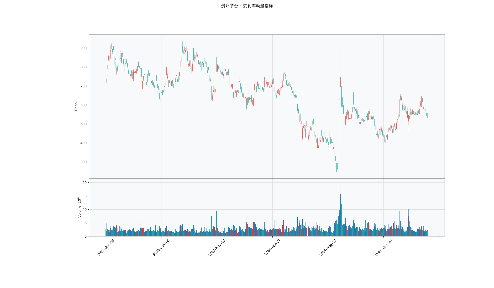

# 第026章 变化率动量指标（CMO）

两个研究者在争论一段行情的性质。一个说这段时间涨得多，另一个说跌的日子也不少，只是跌得浅。他们各自截取窗口，一个用十日，一个用二十日，结论相反。争到后来发现，双方都没有把上涨与下跌放进同一个分母里比较。需要一个读数，只统计窗口内每一天的涨幅与跌幅，不引入均线，不引入区间，也不做平滑。

## 名称与来历

变化率动量指标（Chande Momentum Oscillator，CMO）。

它由 Tushar Chande 于 1994 年提出，收录在他与 Stanley Kroll 合著的《The New Technical Trader》中。Chande 的出发点是对既有动量指标的修补：当时流行的做法要么只统计上涨幅度，要么只看价格差值，都没有把上涨与下跌两侧同时纳入。他想构造一个读数，方向与强度都能体现，而且结果要落在对称的有界区间里。

CMO 因此被设计成在负 100 到 100 之间取值，零代表多空均衡。正负号指示方向，绝对值指示强度。这个对称形式是它与 RSI 最直观的差别：RSI 用 0 到 100 表达，读数高低要绕一下才能对应到方向；CMO 直接以零为轴，方向读起来更直接。

## 核心逻辑

有一段行情摆在面前，需要回答一个问题：这段时间里，多头上攻的力度与空头下压的力度相比，谁更占优势，优势有多大？

如果只把上涨的日子加总，会丢掉下跌的信息；如果只看首尾价格之差，会丢掉中间的路径。一只从 100 涨到 110 的股票，可能是稳步上行，也可能是暴跌到 90 再暴涨回来，两种路径在首尾差值上完全一样，信息却完全不同。

CMO 的处理方式是把观察窗口内每一日的变化拆成上涨部分与下跌部分，各自累加，再用两者之差除以两者之和。分子是净力量，分母是总力量。这样构造出来的读数只与涨跌路径有关，与价格绝对水平无关，而且天然落在负 100 到 100 之间：全部上涨时分子等于分母，读数为 100；全部下跌时分子为负的分母，读数为负 100。

这个结构更接近得票率之差，而不是得票数。一场投票里，两边的差距是二十个百分点，投票率是三成还是八成，读出来都是二十。CMO 读到四十，可能来自一轮大幅波动中的优势，也可能来自一段平静窗口里的优势。由此可以推出：CMO 把总波幅约掉了，两个读数相同的标的，实际力量可以相差很远。跨标的比较时要把窗口内的总力量一并记录，否则会把平静窗口里的小幅一致读成强烈的方向共识。

这套设计带来一个实用的性质：读数绝对值大，说明这段时间的涨跌方向非常一致；读数接近零，说明上涨与下跌互相抵消，方向不明。因此 CMO 既可以度量方向，也可以度量一致性，后者是它在横盘识别上比单一指标更有用的地方。

## 计算公式

CMO 的计算分两步，默认周期在 TTR 中为 14。

### 第一步：按方向累加变化幅度

对窗口内每一日的价格变化分类：

$$\Delta C_i = C_i - C_{i-1}$$

$$\text{UpSum}_t = \sum_{i=t-n+1}^{t} \max(\Delta C_i,\ 0)$$

$$\text{DownSum}_t = \sum_{i=t-n+1}^{t} \max(-\Delta C_i,\ 0)$$

两个累加值都是正数，分别表示窗口内上涨幅度的总和与下跌幅度的总和。注意这里用的是幅度之和，不是平均，因此窗口越长，两个数值通常越大，但比值结构不变。

### 第二步：计算差比并映射

$$CMO_t = \frac{\text{UpSum}_t - \text{DownSum}_t}{\text{UpSum}_t + \text{DownSum}_t} \times 100$$

若 $\text{UpSum} + \text{DownSum} = 0$，说明窗口内价格完全没有变化，约定 $CMO = 0$。

这个式子的取值范围可以直接推出来。分子最大等于分母（当 DownSum 为零），因此读数上界为 100；分子最小为分母的相反数，因此下界为负 100。

**计算示例。** 取 n = 5，窗口内每日涨跌幅依次为 1、负 2、3、负 1、2，单位省略。

$$\text{UpSum} = 1 + 3 + 2 = 6$$

$$\text{DownSum} = 2 + 1 = 3$$

$$CMO = \frac{6 - 3}{6 + 3} \times 100 = 33.3$$

读数为 33.3，落在弱多头区间。若窗口内变化改为 3、3、负 1、4、2，则

$$\text{UpSum} = 3 + 3 + 4 + 2 = 12, \quad \text{DownSum} = 1$$

$$CMO = \frac{12 - 1}{13} \times 100 = 84.6$$

读数升至 84.6，属于强多头。两段行情的累计涨幅接近，CMO 的读数却差了 50 以上，差别来自路径的一致性。

**参数与阈值含义。**

| 参数 | 取值 | 含义 |
|------|------|------|
| n | 14（TTR 默认） | 观察窗口，决定灵敏度 |
| 强多头阈值 | 正 50 | 上涨力量压倒性占优 |
| 弱多头区间 | 0 到正 50 | 上涨略占优势 |
| 弱空头区间 | 负 50 到 0 | 下跌略占优势 |
| 强空头阈值 | 负 50 | 下跌力量压倒性占优 |

周期方面，短线用 9 或 14，波段用 20 或 30，长线用 50 或 60。窗口越长，读数越平滑，穿越阈值的次数越少。

## 用法与信号

**强度确认。** 趋势市中 CMO 的绝对值提供了动能判断。读数越过正 50 且价格在均线上方，说明多头动能充足，趋势延续的概率较高；读数跌破负 50 同理适用于空头。使用时可以加一个持续性条件，例如连续两日读数保持在正 50 以上，减少单日脉冲的干扰。

**阈值穿越。** 震荡市中读数穿越正负 20 用作反转提示。从负 20 下方回升穿越负 20，说明空头动能开始退潮；从正 20 上方回落穿越正 20，说明多头动能开始退潮。穿越之后读数继续向同方向推进，信号的强度更高；若穿越之后立即回退，多半是噪音。

**背离。** 价格创出新高而 CMO 没有同步创新高，是顶背离，表示上涨的一致性在下降；价格创出新低而 CMO 没有同步创新低，是底背离。CMO 在极端区间出现的背离更有分量，例如顶背离时读数仍在正 50 以上。

**弱趋势中的动能修复定位。** 在 ADX 处于 25 到 40 之间的弱趋势里，CMO 回到零轴附近往往意味着动能已经修复完毕。上升趋势中读数回落到零到负 20 区间，是顺势加仓的位置；下降趋势中读数反弹到零到正 20 区间，是顺势减仓的位置。强趋势（ADX 超过 40）中读数往往回落不到零轴，此时不必等。

## 边界与误区

**震荡市里的强读数多是脉冲。** 横盘行情中偶尔出现读数跳到正 60 以上，往往只是短期反弹的集中释放，持续性差。此时应等读数的阈值穿越信号，而不是去追绝对值高的强多头读数。区分两类行情的依据还是 ADX。

**读数相同不代表含义相同。** CMO 等于 40，可能是上涨幅度从 30 增加到 40 而下跌未变，也可能是上涨未变而下跌从 20 减少到 15。前者是动能增强，后者是下跌减弱带来的虚增。要做精细判断时，需要把两个累加值一并观察，而不是只看比值。

**极端读数不是买入的理由。** 读数逼近正 100 表示窗口内几乎没有下跌日子，这种状态通常已经接近动能释放的尾声。连续上涨之后读数停在 95 附近时追入，很容易买在阶段性顶部。等读数回落修复之后再评估入场，是更稳的顺序。

**参数与阈值需要成对调整。** 把周期从 20 缩短到 6，读数波动会明显加大，原来的正负 50 阈值会变得过于频繁触发。周期改动之后，阈值应当重新依据读数分布来定，而不是沿用旧值。

## 它被检验过吗

CMO 缺少针对该指标的独立同行评议检验。能引用的统计证据只到技术分析规则族这一层，规则族的检验无法把绩效分配到单个震荡指标。完整的证据链见第 007 章。

方法上的问题在于样本混合。CMO 的假设是价格围绕中枢回归，趋势市里这个假设直接失效。趋势段与震荡段的收益方向相反，混在一起统计会互相抵消，得到接近零的均值。这个均值说明不了指标有效或无效，只说明样本里两种市况的比例。

这一类的真实失效案例，见第 020 章的「真实案例与失败模式」。

## 代码实现

### R

```r
library(ettr)
library(efactorcraft)
library(efincharts)
library(ggplot2)

BASE <- "https://raw.githubusercontent.com/dengyishuo/quant-technical-analysis/main/data/parquet"

# 取数据：本地有就用本地，没有就下载一次并缓存。
# read.csv 对本地 .gz 会自动解压，所以缓存成 .csv.gz 也能直接读。
load_data <- function(name) {
  local <- file.path("data", "parquet", name)
  if (file.exists(local)) return(local)
  cache <- file.path(tools::R_user_dir("qta", "cache"), name)
  if (!file.exists(cache)) {
    dir.create(dirname(cache), recursive = TRUE, showWarnings = FALSE)
    message("下载 ", name, " ...")
    download.file(paste0(BASE, "/", name), cache, mode = "wb", quiet = TRUE)
  }
  cache
}

read_data <- function(name) {
  d <- read.csv(load_data(name), stringsAsFactors = FALSE)
  if ("date" %in% names(d)) d$date <- as.Date(d$date)
  d
}

# 同一章里多次取用，缓存到内存，避免重复解析
.cache <- new.env(parent = emptyenv())
.blue <- function() {
  if (!exists("b", .cache)) assign("b", read_data("panel_blue_chip.csv"), .cache)
  get("b", .cache)
}
.panel <- function() {
  if (!exists("p", .cache)) {
    p <- read_data("panel_r.csv.gz")
    assign("p", p[p$date >= "2023-01-01" & p$date <= "2025-06-01", ], .cache)
  }
  get("p", .cache)
}
.index <- function() read_data("index_daily.csv")

blue  <- .blue()
panel <- .panel()

# 图的保存路径，顺手建目录，避免读者本地没有 assets/ 时报错
fig_path <- function(ch, name = "indicator_r.png") {
  d <- file.path("assets", "figures", sprintf("ch%03d", ch))
  dir.create(d, recursive = TRUE, showWarnings = FALSE)
  file.path(d, name)
}

# efincharts 要求 xts 且列名带 Adjusted
as_xts <- function(df) {
  x <- xts::xts(df[, c("open", "high", "low", "close", "volume", "adjusted")],
                order.by = df$date)
  colnames(x) <- c("Open", "High", "Low", "Close", "Volume", "Adjusted")
  x
}

maotai <- .blue()[.blue()$code == "600519.SS", ]

# 1. ettr 在长格式面板上追加指标列
maotai <- add_cmo(maotai, n = 14)

# 2. 基本统计
cols <- setdiff(names(maotai), names(blue))
print(summary(maotai[, cols]))

# 3. K 线 + 成交量 + 均线
ch <- ecandlesticks(as_xts(maotai), show_ma = TRUE, ma_periods = c(20, 60),
                    title = "贵州茅台 · 变化率动量指标")
ggsave(fig_path(26), ch$combined_plot, width = 10, height = 6, dpi = 110)
```

### Python

```python
import pathlib
import urllib.request

import pandas as pd
import ettr
import efactorcraft as efc
import efincharts as efc_

# 中文字体：mplfinance 会用 style 里的 rc 覆盖全局设置，必须写进 style
from efincharts import theme
theme.efin_style["rc"] = {
    "font.sans-serif": ["PingFang SC", "Heiti SC", "SimHei"],
    "axes.unicode_minus": False,
    "font.family": "sans-serif",
}

# A 股习惯是涨红跌绿，efincharts 的默认配色沿用了欧美习惯（涨绿跌红），
# 这里改回来，也让静态图与网页上的交互图、R 侧的图保持一致。
_mc = theme.efin_style["marketcolors"]
for _k in ("candle", "edge", "wick", "volume"):
    _mc[_k] = {"up": "#e53935", "down": "#26a69a"}

BASE = "https://raw.githubusercontent.com/dengyishuo/quant-technical-analysis/main/data/parquet"
CACHE = pathlib.Path.home() / ".cache" / "qta"
_MEM = {}


def load(name):
    """取数据：本地有就用本地，没有就下载一次并缓存。

    这样三种情形都能跑：
      1. 克隆了整个仓库    -> 直接读 data/parquet/，不联网
      2. 只复制了代码片段  -> 首次自动下载到 ~/.cache/qta，之后走缓存
      3. 之前跑过          -> 全部命中缓存，断网也能用
    """
    if name in _MEM:
        return _MEM[name]
    local = pathlib.Path("data/parquet") / name
    if local.exists():
        path = local
    else:
        CACHE.mkdir(parents=True, exist_ok=True)
        path = CACHE / name
        if not path.exists():
            print("下载 %s ..." % name)
            urllib.request.urlretrieve(BASE + "/" + name, path)
    data = pd.read_parquet(path) if name.endswith(".parquet") else pd.read_csv(path)
    _MEM[name] = data
    return data


blue = load("panel_blue_chip.parquet")
panel = load("panel.parquet")
panel = panel[(panel["date"] >= "2023-01-01") & (panel["date"] <= "2025-06-01")]
idx = load("index_daily.parquet")


def one(df, code="600519.SS"):
    """取单只标的，转成 efincharts 需要的宽表。"""
    x = df[df["code"] == code].sort_values("date").set_index("date")
    x.columns = [c.capitalize() for c in x.columns]
    return x


def fig_path(ch, name="indicator.png"):
    """图的保存路径，顺手建目录，避免读者本地没有 assets/ 时报错。"""
    d = pathlib.Path("assets") / "figures" / ("ch%03d" % ch)
    d.mkdir(parents=True, exist_ok=True)
    return str(d / name)

# 1. 取单只标的
maotai = blue[blue['code'] == '600519.SS'].copy()

# 2. ettr 在长格式面板上追加指标列，不需要手工 rolling
maotai = ettr.cmo(maotai, n=14)

cols = [c for c in maotai.columns if c not in blue.columns]
print(maotai[cols].describe().round(3))

# 3. 画图：K 线 + 成交量 + 指标面板
px = one(maotai)
ch = efc_.candlestick(px, volume=True, title="贵州茅台 · 变化率动量指标")
ch.save(fig_path(26))
```

<!-- fig-indicator:start -->


<p class="figcap">图 26-1　变化率动量指标在贵州茅台上的读数（2023-01 至 2025-06）</p>
<!-- fig-indicator:end -->

## 拆解

CMO 的读数有界且以零为轴，看起来比 ROC 更适合直接排序。两处问题要先解决。一是分布中心不在零：个股长期上行，读数在多数窗口偏正，零轴是设计轴，不是分布轴。二是读数在两端被压缩，接近正负 100 的标的彼此差别很小，排序在极值区退化。

| 特征名 | 计算式 | 量纲 | 经济含义 |
|--------|--------|------|----------|
| 读数 | $CMO_t^{(14)}$ | 负 100 到 100 | 窗口内净动量的相对强度 |
| 零轴偏离 | $(CMO_t-\mu_t^{(60)})/\sigma_t^{(60)}$ | 标准差倍数 | 相对自身近期中枢的位置 |
| 与自身均线的差 | $CMO_t-\mathrm{SMA}_3(CMO)_t$ | 点 | 动量的边际变化 |
| 读数变化 | $CMO_t-CMO_{t-5}$ | 点 | 五期内的读数变化 |

四者关系比 ROC 那组更紧。读数与零轴偏离同源，只是参照不同：前者回答现在是多还是空，后者回答比近期中枢更偏多还是更偏空。均线差是平滑过的一阶差分，读数变化是未平滑的差分，两者相关性高，通常只取一个。

区别在时间尺度。读数刻画状态，均线差刻画边际变化，变化率刻画变化的快慢。状态类特征持续性强、换手低，边际类特征翻转快、换手高。调仓频率决定了用哪一类：月度调仓用读数，周度调仓可以考虑均线差，日频才轮到变化率。

构造上还有一处陷阱。分母是窗口内涨跌幅度之和，窗口内几乎没有波动时，分母趋零，读数会突然跳到正负 100。这类读数不是动量极端，而是分母病态。

### R

```r
library(ettr)
library(efactorcraft)
library(efincharts)
library(ggplot2)

BASE <- "https://raw.githubusercontent.com/dengyishuo/quant-technical-analysis/main/data/parquet"

# 取数据：本地有就用本地，没有就下载一次并缓存。
# read.csv 对本地 .gz 会自动解压，所以缓存成 .csv.gz 也能直接读。
load_data <- function(name) {
  local <- file.path("data", "parquet", name)
  if (file.exists(local)) return(local)
  cache <- file.path(tools::R_user_dir("qta", "cache"), name)
  if (!file.exists(cache)) {
    dir.create(dirname(cache), recursive = TRUE, showWarnings = FALSE)
    message("下载 ", name, " ...")
    download.file(paste0(BASE, "/", name), cache, mode = "wb", quiet = TRUE)
  }
  cache
}

read_data <- function(name) {
  d <- read.csv(load_data(name), stringsAsFactors = FALSE)
  if ("date" %in% names(d)) d$date <- as.Date(d$date)
  d
}

# 同一章里多次取用，缓存到内存，避免重复解析
.cache <- new.env(parent = emptyenv())
.blue <- function() {
  if (!exists("b", .cache)) assign("b", read_data("panel_blue_chip.csv"), .cache)
  get("b", .cache)
}
.panel <- function() {
  if (!exists("p", .cache)) {
    p <- read_data("panel_r.csv.gz")
    assign("p", p[p$date >= "2023-01-01" & p$date <= "2025-06-01", ], .cache)
  }
  get("p", .cache)
}
.index <- function() read_data("index_daily.csv")

blue  <- .blue()
panel <- .panel()

# 图的保存路径，顺手建目录，避免读者本地没有 assets/ 时报错
fig_path <- function(ch, name = "indicator_r.png") {
  d <- file.path("assets", "figures", sprintf("ch%03d", ch))
  dir.create(d, recursive = TRUE, showWarnings = FALSE)
  file.path(d, name)
}

# efincharts 要求 xts 且列名带 Adjusted
as_xts <- function(df) {
  x <- xts::xts(df[, c("open", "high", "low", "close", "volume", "adjusted")],
                order.by = df$date)
  colnames(x) <- c("Open", "High", "Low", "Close", "Volume", "Adjusted")
  x
}

d <- .blue()[.blue()$code == "600519.SS", ]
d <- add_cmo(d, n = 14)

# 转成无量纲因子
d$f <- d$`CMO_14`

print(summary(d$f))
```

### Python

```python
import pathlib
import urllib.request

import pandas as pd
import ettr
import efactorcraft as efc
import efincharts as efc_

# 中文字体：mplfinance 会用 style 里的 rc 覆盖全局设置，必须写进 style
from efincharts import theme
theme.efin_style["rc"] = {
    "font.sans-serif": ["PingFang SC", "Heiti SC", "SimHei"],
    "axes.unicode_minus": False,
    "font.family": "sans-serif",
}

# A 股习惯是涨红跌绿，efincharts 的默认配色沿用了欧美习惯（涨绿跌红），
# 这里改回来，也让静态图与网页上的交互图、R 侧的图保持一致。
_mc = theme.efin_style["marketcolors"]
for _k in ("candle", "edge", "wick", "volume"):
    _mc[_k] = {"up": "#e53935", "down": "#26a69a"}

BASE = "https://raw.githubusercontent.com/dengyishuo/quant-technical-analysis/main/data/parquet"
CACHE = pathlib.Path.home() / ".cache" / "qta"
_MEM = {}


def load(name):
    """取数据：本地有就用本地，没有就下载一次并缓存。

    这样三种情形都能跑：
      1. 克隆了整个仓库    -> 直接读 data/parquet/，不联网
      2. 只复制了代码片段  -> 首次自动下载到 ~/.cache/qta，之后走缓存
      3. 之前跑过          -> 全部命中缓存，断网也能用
    """
    if name in _MEM:
        return _MEM[name]
    local = pathlib.Path("data/parquet") / name
    if local.exists():
        path = local
    else:
        CACHE.mkdir(parents=True, exist_ok=True)
        path = CACHE / name
        if not path.exists():
            print("下载 %s ..." % name)
            urllib.request.urlretrieve(BASE + "/" + name, path)
    data = pd.read_parquet(path) if name.endswith(".parquet") else pd.read_csv(path)
    _MEM[name] = data
    return data


blue = load("panel_blue_chip.parquet")
panel = load("panel.parquet")
panel = panel[(panel["date"] >= "2023-01-01") & (panel["date"] <= "2025-06-01")]
idx = load("index_daily.parquet")


def one(df, code="600519.SS"):
    """取单只标的，转成 efincharts 需要的宽表。"""
    x = df[df["code"] == code].sort_values("date").set_index("date")
    x.columns = [c.capitalize() for c in x.columns]
    return x


def fig_path(ch, name="indicator.png"):
    """图的保存路径，顺手建目录，避免读者本地没有 assets/ 时报错。"""
    d = pathlib.Path("assets") / "figures" / ("ch%03d" % ch)
    d.mkdir(parents=True, exist_ok=True)
    return str(d / name)

# 1. 先在面板上算原始指标
d = panel.copy()
d = ettr.cmo(d, n=14)

# 2. 转成无量纲因子，才能跨标的排序
d["f"] = d["CMO_14"]

print(d["f"].describe().round(4))
```

## 截面选股能力

CMO 的横截面因子可以直接用读数，

$$f^{cmo}_t = CMO_t^{(14)}$$

也可以用柱状值，即读数与自身三日均线之差，

$$f^{bar}_t = CMO_t - \mathrm{SMA}_3(CMO)_t$$

前者是状态，后者是边际。状态类因子在五日窗口上更稳，边际类因子衰减更快。

**符号方向要靠数据定。** 这是震荡类指标最容易出错的地方。读数高可以读成超买、后续回落，对应负向因子；也可以读成买盘占优、强势延续，对应正向因子。CMO 的设计初衷偏前者，它把极端读数视为力量释放的尾声；但趋势市中读数长期停在高位而不回落，正向解释反而更贴合。两种解释的分界不在指标本身，在市况。可行的做法是先算全样本 IC 看符号，再按年份、按趋势强弱分段，看符号是否稳定。全样本接近零而分段清晰，说明正负两段互相抵消，这时候报一个均值没有意义。

预期上，十四日 CMO 在 A 股偏反转，读数越过正负 50 之后更明显，落在负 20 到正 20 的中段时方向信息很弱。震荡市中反转占优，单边趋势中动量抬头。标的层面，换手率高、波动大的品种反转更强，大盘股持续性更好。

检验时有三点值得注意。第一，CMO 与 RSI 构造相近，都基于涨跌力量比，截面相关性通常不低，判断增量时应把 CMO 对 RSI 取横截面残差，残差仍有预测力才算独立信息。两者的差别在平滑：CMO 用窗口内简单累加，RSI 用 Wilder 平滑，前者对单日大幅波动更敏感，后者记忆更长，这一差别在急涨急跌的样本里会放大。第二，读数有界，两端排序退化，分层回测要检查头尾两组的标的数量，某一组长期只有两三只时结论不可靠。第三，分母趋零的样本要剔除，否则极端读数会主导 IC。

### R

```r
library(ettr)
library(efactorcraft)
library(efincharts)
library(ggplot2)

BASE <- "https://raw.githubusercontent.com/dengyishuo/quant-technical-analysis/main/data/parquet"

# 取数据：本地有就用本地，没有就下载一次并缓存。
# read.csv 对本地 .gz 会自动解压，所以缓存成 .csv.gz 也能直接读。
load_data <- function(name) {
  local <- file.path("data", "parquet", name)
  if (file.exists(local)) return(local)
  cache <- file.path(tools::R_user_dir("qta", "cache"), name)
  if (!file.exists(cache)) {
    dir.create(dirname(cache), recursive = TRUE, showWarnings = FALSE)
    message("下载 ", name, " ...")
    download.file(paste0(BASE, "/", name), cache, mode = "wb", quiet = TRUE)
  }
  cache
}

read_data <- function(name) {
  d <- read.csv(load_data(name), stringsAsFactors = FALSE)
  if ("date" %in% names(d)) d$date <- as.Date(d$date)
  d
}

# 同一章里多次取用，缓存到内存，避免重复解析
.cache <- new.env(parent = emptyenv())
.blue <- function() {
  if (!exists("b", .cache)) assign("b", read_data("panel_blue_chip.csv"), .cache)
  get("b", .cache)
}
.panel <- function() {
  if (!exists("p", .cache)) {
    p <- read_data("panel_r.csv.gz")
    assign("p", p[p$date >= "2023-01-01" & p$date <= "2025-06-01", ], .cache)
  }
  get("p", .cache)
}
.index <- function() read_data("index_daily.csv")

blue  <- .blue()
panel <- .panel()

# 图的保存路径，顺手建目录，避免读者本地没有 assets/ 时报错
fig_path <- function(ch, name = "indicator_r.png") {
  d <- file.path("assets", "figures", sprintf("ch%03d", ch))
  dir.create(d, recursive = TRUE, showWarnings = FALSE)
  file.path(d, name)
}

# efincharts 要求 xts 且列名带 Adjusted
as_xts <- function(df) {
  x <- xts::xts(df[, c("open", "high", "low", "close", "volume", "adjusted")],
                order.by = df$date)
  colnames(x) <- c("Open", "High", "Low", "Close", "Volume", "Adjusted")
  x
}

d <- .panel()
d <- add_cmo(d, n = 14)

d$f <- d$`CMO_14`
d <- add_next_return(d, close_col = "close", n = c(1, 5, 20))

ic <- ic_analysis(d, factor_cols = "f",
                    forward_cols = c("forward_1", "forward_5", "forward_20"),
                    method = "spearman")
print(ir_analysis(ic))

q <- quantile_analysis(d, factor_cols = "f", forward_cols = "forward_5",
                       n_groups = 5)
print(q$f$summary)
```

### Python

```python
import pathlib
import urllib.request

import pandas as pd
import ettr
import efactorcraft as efc
import efincharts as efc_

# 中文字体：mplfinance 会用 style 里的 rc 覆盖全局设置，必须写进 style
from efincharts import theme
theme.efin_style["rc"] = {
    "font.sans-serif": ["PingFang SC", "Heiti SC", "SimHei"],
    "axes.unicode_minus": False,
    "font.family": "sans-serif",
}

# A 股习惯是涨红跌绿，efincharts 的默认配色沿用了欧美习惯（涨绿跌红），
# 这里改回来，也让静态图与网页上的交互图、R 侧的图保持一致。
_mc = theme.efin_style["marketcolors"]
for _k in ("candle", "edge", "wick", "volume"):
    _mc[_k] = {"up": "#e53935", "down": "#26a69a"}

BASE = "https://raw.githubusercontent.com/dengyishuo/quant-technical-analysis/main/data/parquet"
CACHE = pathlib.Path.home() / ".cache" / "qta"
_MEM = {}


def load(name):
    """取数据：本地有就用本地，没有就下载一次并缓存。

    这样三种情形都能跑：
      1. 克隆了整个仓库    -> 直接读 data/parquet/，不联网
      2. 只复制了代码片段  -> 首次自动下载到 ~/.cache/qta，之后走缓存
      3. 之前跑过          -> 全部命中缓存，断网也能用
    """
    if name in _MEM:
        return _MEM[name]
    local = pathlib.Path("data/parquet") / name
    if local.exists():
        path = local
    else:
        CACHE.mkdir(parents=True, exist_ok=True)
        path = CACHE / name
        if not path.exists():
            print("下载 %s ..." % name)
            urllib.request.urlretrieve(BASE + "/" + name, path)
    data = pd.read_parquet(path) if name.endswith(".parquet") else pd.read_csv(path)
    _MEM[name] = data
    return data


blue = load("panel_blue_chip.parquet")
panel = load("panel.parquet")
panel = panel[(panel["date"] >= "2023-01-01") & (panel["date"] <= "2025-06-01")]
idx = load("index_daily.parquet")


def one(df, code="600519.SS"):
    """取单只标的，转成 efincharts 需要的宽表。"""
    x = df[df["code"] == code].sort_values("date").set_index("date")
    x.columns = [c.capitalize() for c in x.columns]
    return x


def fig_path(ch, name="indicator.png"):
    """图的保存路径，顺手建目录，避免读者本地没有 assets/ 时报错。"""
    d = pathlib.Path("assets") / "figures" / ("ch%03d" % ch)
    d.mkdir(parents=True, exist_ok=True)
    return str(d / name)

# 287 只、2023-01 至 2025-06，横截面才有统计意义
src = panel.copy()
d = src.copy()

# 1. 算指标
d = ettr.cmo(d, n=14)


# 2. 因子 + 未来收益
d["f"] = d["CMO_14"]
d = efc.add_next_return(d, periods=(1, 5, 20))

# 3. 截面 IC 与分层
ic = efc.ic_analysis(d, factor_cols="f",
                      forward_cols=["forward_1", "forward_5", "forward_20"],
                      method="spearman")
print(efc.ir_analysis(ic).round(3))

q = efc.quantile_analysis(d, factor_col="f", forward_col="forward_5", n_groups=5)
print(q["summary"].round(4))
```

两张 IC 表要并排看。读数与柱状值的衰减速度不同，前者在五日窗口上更稳，后者在一日窗口上更活跃。与 RSI 的相关高时，CMO 的 IC 再漂亮也只是同一份信息换了平滑方式。

<!-- tab-ic:start -->
**计算结果**

| 前向期 | IC 均值 | IC 标准差 | ICIR | t 值 | IC>0 占比 | 期数 |
|---|---|---|---|---|---|---|
| T+1 | -0.0092 | 0.2197 | -0.042 | -1.00 | 0.4960 | 567 |
| T+5 | -0.0076 | 0.2113 | -0.036 | -0.85 | 0.5170 | 563 |
| T+20 | -0.0299 | 0.1962 | -0.153 | -3.57 | 0.4760 | 548 |

表里最该看的是 t 值，不是 IC 均值。这个因子以 T+1 为主口径，IC 均值 -0.0092、ICIR -0.042、t 值 -1.00，在常规门槛下不显著，方向为反向。按第 007 章给出的日频门槛（ICIR 0.13 对应 t≈2），这个结果的含义是：还看不出与噪声的区别，不能据此构造策略。

需要提醒的是，这只说明排序与未来收益之间存在可测的关联，不代表扣掉成本后还能剩下收益。横截面 IC 检验的是“买哪只”，不负责“值不值得交易”。

**五档分层**

| 分组 | 平均收益 | 标准差 | 期数 |
|---|---|---|---|
| 1 | +0.0040 | +0.0390 | 563 |
| 2 | +0.0027 | +0.0343 | 563 |
| 3 | +0.0026 | +0.0322 | 563 |
| 4 | +0.0019 | +0.0312 | 563 |
| 5 | +0.0055 | +0.0363 | 563 |

五档分层看的是形状，不是单点。最高一档在第 5 组、最低在第 4 组，两端相差 +0.15%，组序号与平均收益的秩相关为 0.25，没有明显单调性。

分层比 IC 更接近实盘，因为它直接给出“买最高档、卖最低档”的收益差。但这里的数字是毛收益，且没有考虑涨跌停买不进、停牌卖不出的情形，真实可得的差额会小于表中所列。
<!-- tab-ic:end -->

## 择时能力

CMO 的时序信息分四层。零轴是方向层，读数在零上方说明多头占优。正负 50 是强度层，越过之后属于强趋势状态。正负 20 的穿越是转折层，从下方回升穿越负 20 表示空头动能退潮。读数与自身均线的交叉是确认层，比单看读数多一道过滤。四层里，转折层适合做交易信号，强度层适合做持仓条件。

方法要与信号形态对应。阈值穿越是离散事件，适合触发日检验。读数是连续变量且分布有界，适合条件分位收益，重点看关系是否呈 U 形：震荡指标常两头有效、中间无效，此时单调性判据不适用。回测用来比较强读数持仓与弱读数持仓哪一个更贴近该指标的用法。

这里有一处方向上的取舍。CMO 的常规用法是反向的：读数高减仓，读数低加仓。把这条规则直接写成"读数高于七十分位持仓"就变成了顺势，含义完全相反。两种写法都值得跑一遍，比较年化收益与回撤，再决定采用哪一种。方向不是从指标的教科书定义里读出来的，是从样本里读出来的。

陷阱有三处。第一，强趋势中读数会长期停在正负 50 之外，按超买超卖操作会过早离场，需要 ADX 或均线做前提过滤。第二，阈值穿越在震荡市中频率高，成本吃掉收益，回测要把费率与印花税计入。第三，信号按收盘确认，成交放在次日，按当日收盘价成交会引入未来信息。

### R

```r
library(ettr)
library(efactorcraft)
library(efincharts)
library(ggplot2)

BASE <- "https://raw.githubusercontent.com/dengyishuo/quant-technical-analysis/main/data/parquet"

# 取数据：本地有就用本地，没有就下载一次并缓存。
# read.csv 对本地 .gz 会自动解压，所以缓存成 .csv.gz 也能直接读。
load_data <- function(name) {
  local <- file.path("data", "parquet", name)
  if (file.exists(local)) return(local)
  cache <- file.path(tools::R_user_dir("qta", "cache"), name)
  if (!file.exists(cache)) {
    dir.create(dirname(cache), recursive = TRUE, showWarnings = FALSE)
    message("下载 ", name, " ...")
    download.file(paste0(BASE, "/", name), cache, mode = "wb", quiet = TRUE)
  }
  cache
}

read_data <- function(name) {
  d <- read.csv(load_data(name), stringsAsFactors = FALSE)
  if ("date" %in% names(d)) d$date <- as.Date(d$date)
  d
}

# 同一章里多次取用，缓存到内存，避免重复解析
.cache <- new.env(parent = emptyenv())
.blue <- function() {
  if (!exists("b", .cache)) assign("b", read_data("panel_blue_chip.csv"), .cache)
  get("b", .cache)
}
.panel <- function() {
  if (!exists("p", .cache)) {
    p <- read_data("panel_r.csv.gz")
    assign("p", p[p$date >= "2023-01-01" & p$date <= "2025-06-01", ], .cache)
  }
  get("p", .cache)
}
.index <- function() read_data("index_daily.csv")

blue  <- .blue()
panel <- .panel()

# 图的保存路径，顺手建目录，避免读者本地没有 assets/ 时报错
fig_path <- function(ch, name = "indicator_r.png") {
  d <- file.path("assets", "figures", sprintf("ch%03d", ch))
  dir.create(d, recursive = TRUE, showWarnings = FALSE)
  file.path(d, name)
}

# efincharts 要求 xts 且列名带 Adjusted
as_xts <- function(df) {
  x <- xts::xts(df[, c("open", "high", "low", "close", "volume", "adjusted")],
                order.by = df$date)
  colnames(x) <- c("Open", "High", "Low", "Close", "Volume", "Adjusted")
  x
}

t <- .index()
t <- t[t$code == "510300.SS", ]
t <- add_cmo(t, n = 14)
t$f <- t$`CMO_14`
t$forward_5 <- c(tail(t$close, -5) / head(t$close, -5) - 1, rep(NA, 5))
t$q <- cut(t$f, quantile(t$f, 0:5/5, na.rm = TRUE), include.lowest = TRUE, labels = FALSE)
print(aggregate(forward_5 ~ q, data = t, FUN = function(x)
  c(mean = mean(x, na.rm = TRUE), n = sum(!is.na(x)))))
```

### Python

```python
import pathlib
import urllib.request

import pandas as pd
import ettr
import efactorcraft as efc
import efincharts as efc_

# 中文字体：mplfinance 会用 style 里的 rc 覆盖全局设置，必须写进 style
from efincharts import theme
theme.efin_style["rc"] = {
    "font.sans-serif": ["PingFang SC", "Heiti SC", "SimHei"],
    "axes.unicode_minus": False,
    "font.family": "sans-serif",
}

# A 股习惯是涨红跌绿，efincharts 的默认配色沿用了欧美习惯（涨绿跌红），
# 这里改回来，也让静态图与网页上的交互图、R 侧的图保持一致。
_mc = theme.efin_style["marketcolors"]
for _k in ("candle", "edge", "wick", "volume"):
    _mc[_k] = {"up": "#e53935", "down": "#26a69a"}

BASE = "https://raw.githubusercontent.com/dengyishuo/quant-technical-analysis/main/data/parquet"
CACHE = pathlib.Path.home() / ".cache" / "qta"
_MEM = {}


def load(name):
    """取数据：本地有就用本地，没有就下载一次并缓存。

    这样三种情形都能跑：
      1. 克隆了整个仓库    -> 直接读 data/parquet/，不联网
      2. 只复制了代码片段  -> 首次自动下载到 ~/.cache/qta，之后走缓存
      3. 之前跑过          -> 全部命中缓存，断网也能用
    """
    if name in _MEM:
        return _MEM[name]
    local = pathlib.Path("data/parquet") / name
    if local.exists():
        path = local
    else:
        CACHE.mkdir(parents=True, exist_ok=True)
        path = CACHE / name
        if not path.exists():
            print("下载 %s ..." % name)
            urllib.request.urlretrieve(BASE + "/" + name, path)
    data = pd.read_parquet(path) if name.endswith(".parquet") else pd.read_csv(path)
    _MEM[name] = data
    return data


blue = load("panel_blue_chip.parquet")
panel = load("panel.parquet")
panel = panel[(panel["date"] >= "2023-01-01") & (panel["date"] <= "2025-06-01")]
idx = load("index_daily.parquet")


def one(df, code="600519.SS"):
    """取单只标的，转成 efincharts 需要的宽表。"""
    x = df[df["code"] == code].sort_values("date").set_index("date")
    x.columns = [c.capitalize() for c in x.columns]
    return x


def fig_path(ch, name="indicator.png"):
    """图的保存路径，顺手建目录，避免读者本地没有 assets/ 时报错。"""
    d = pathlib.Path("assets") / "figures" / ("ch%03d" % ch)
    d.mkdir(parents=True, exist_ok=True)
    return str(d / name)

# 择时检验用 ETF 做市场载体，指数本身没有日线数据
t = idx[idx["code"] == "510300.SS"].sort_values("date").copy()

# 1. 在 ETF 上算同一个指标
t = ettr.cmo(d, n=14)


# 2. 按因子分位看未来 5 日收益
t["f"] = t["CMO_14"]
t["forward_5"] = t["close"].shift(-5) / t["close"] - 1
# 因子可能有重复值，先按名次切，避免 qcut 报边界不唯一
t["q"] = pd.qcut(t["f"].rank(method="first"), 5, labels=False) + 1
t = t.dropna(subset=["f", "forward_5"])
print(t.groupby("q")["forward_5"].agg(["mean", "count"]).round(4))
```

首末档与中间档的对比是关键。两端都显著偏离中间，说明读数与收益呈 U 形，单调排序会把两头的信息平均掉；只有一端显著，说明指标只在一侧可用。

<!-- tab-timing:start -->
**分位收益**

| 分位 | 未来 5 日均值 | 样本数 |
|---|---|---|
| 1 | +0.0045 | 220 |
| 2 | -0.0001 | 219 |
| 3 | -0.0055 | 219 |
| 4 | +0.0014 | 219 |
| 5 | -0.0005 | 220 |

择时口径与截面不同：这里只有一个标的，看的是同一标的在不同分位下的未来收益。最高与最低分位相差 -0.49%。单标的样本有限，这个差额很容易被一两段行情主导，只能作为方向参考。

真正做择时要问的是三件事：分位阈值是否稳定、换手是否可控、扣成本后是否还有剩余。三者缺一，择时信号就只是图上好看。
<!-- tab-timing:end -->

## 组合使用与验证

CMO 的搭档有三个。与 ROC 搭配，CMO 提供路径一致性，ROC 提供幅度，互补点是"涨得多"与"涨得顺"的区别。与均线搭配，均线给方向前提，CMO 只在顺势方向上使用，互补点是市况。与 RSI 搭配要谨慎，两者同源，相关性高，更适合做正交化而不是加权。

**组合的截面验证。** 有两种写法。加权型是把 CMO 与 ROC 各自标准化后相加，走一遍截面检验，比较组合与两个单特征的 ICIR。乘积型沿用前文的方向一致性权重，用 CMO 把 ROC 折算成折扣后的涨幅，读数在负 100 附近时权重趋零。两种写法回答的问题不同：加权型问两个信号合起来排序是否更准，乘积型问一致性是否能改善幅度信号。

**组合的择时验证。** 把"读数大于零且价格在二十日均线上方"作为持仓条件，与单用读数大于零对照，比较年化收益、夏普、最大回撤与信号次数。CMO 的穿越信号较多，均线过滤主要压的是次数与回撤。

增益判读按方法论章的标准：组合的 ICIR 高于两个单特征，才说明存在互补性；介于两者之间，说明只是平均；低于两者，说明方向冲突。CMO 与 ROC 的相关性通常中等，增量空间存在；CMO 与 RSI 的相关性通常较高，组合之前先看相关系数，超过较高水平时宜做正交化。

### R

```r
library(ettr)
library(efactorcraft)
library(efincharts)
library(ggplot2)

BASE <- "https://raw.githubusercontent.com/dengyishuo/quant-technical-analysis/main/data/parquet"

# 取数据：本地有就用本地，没有就下载一次并缓存。
# read.csv 对本地 .gz 会自动解压，所以缓存成 .csv.gz 也能直接读。
load_data <- function(name) {
  local <- file.path("data", "parquet", name)
  if (file.exists(local)) return(local)
  cache <- file.path(tools::R_user_dir("qta", "cache"), name)
  if (!file.exists(cache)) {
    dir.create(dirname(cache), recursive = TRUE, showWarnings = FALSE)
    message("下载 ", name, " ...")
    download.file(paste0(BASE, "/", name), cache, mode = "wb", quiet = TRUE)
  }
  cache
}

read_data <- function(name) {
  d <- read.csv(load_data(name), stringsAsFactors = FALSE)
  if ("date" %in% names(d)) d$date <- as.Date(d$date)
  d
}

# 同一章里多次取用，缓存到内存，避免重复解析
.cache <- new.env(parent = emptyenv())
.blue <- function() {
  if (!exists("b", .cache)) assign("b", read_data("panel_blue_chip.csv"), .cache)
  get("b", .cache)
}
.panel <- function() {
  if (!exists("p", .cache)) {
    p <- read_data("panel_r.csv.gz")
    assign("p", p[p$date >= "2023-01-01" & p$date <= "2025-06-01", ], .cache)
  }
  get("p", .cache)
}
.index <- function() read_data("index_daily.csv")

blue  <- .blue()
panel <- .panel()

# 图的保存路径，顺手建目录，避免读者本地没有 assets/ 时报错
fig_path <- function(ch, name = "indicator_r.png") {
  d <- file.path("assets", "figures", sprintf("ch%03d", ch))
  dir.create(d, recursive = TRUE, showWarnings = FALSE)
  file.path(d, name)
}

# efincharts 要求 xts 且列名带 Adjusted
as_xts <- function(df) {
  x <- xts::xts(df[, c("open", "high", "low", "close", "volume", "adjusted")],
                order.by = df$date)
  colnames(x) <- c("Open", "High", "Low", "Close", "Volume", "Adjusted")
  x
}

d <- .panel()
d <- add_cmo(d, n = 14)
d$f1 <- d$`CMO_14`
d <- add_cmf(d, n = 20)
d$f2 <- d$CMF
d <- add_next_return(d, close_col = "close", n = 5)
ic1 <- ic_analysis(d, factor_cols = c("f1", "f2"),
                    forward_cols = "forward_5", method = "spearman")
print(ir_analysis(ic1))
```

```r
library(ettr)
library(efactorcraft)
library(efincharts)
library(ggplot2)

BASE <- "https://raw.githubusercontent.com/dengyishuo/quant-technical-analysis/main/data/parquet"

# 取数据：本地有就用本地，没有就下载一次并缓存。
# read.csv 对本地 .gz 会自动解压，所以缓存成 .csv.gz 也能直接读。
load_data <- function(name) {
  local <- file.path("data", "parquet", name)
  if (file.exists(local)) return(local)
  cache <- file.path(tools::R_user_dir("qta", "cache"), name)
  if (!file.exists(cache)) {
    dir.create(dirname(cache), recursive = TRUE, showWarnings = FALSE)
    message("下载 ", name, " ...")
    download.file(paste0(BASE, "/", name), cache, mode = "wb", quiet = TRUE)
  }
  cache
}

read_data <- function(name) {
  d <- read.csv(load_data(name), stringsAsFactors = FALSE)
  if ("date" %in% names(d)) d$date <- as.Date(d$date)
  d
}

# 同一章里多次取用，缓存到内存，避免重复解析
.cache <- new.env(parent = emptyenv())
.blue <- function() {
  if (!exists("b", .cache)) assign("b", read_data("panel_blue_chip.csv"), .cache)
  get("b", .cache)
}
.panel <- function() {
  if (!exists("p", .cache)) {
    p <- read_data("panel_r.csv.gz")
    assign("p", p[p$date >= "2023-01-01" & p$date <= "2025-06-01", ], .cache)
  }
  get("p", .cache)
}
.index <- function() read_data("index_daily.csv")

blue  <- .blue()
panel <- .panel()

# 图的保存路径，顺手建目录，避免读者本地没有 assets/ 时报错
fig_path <- function(ch, name = "indicator_r.png") {
  d <- file.path("assets", "figures", sprintf("ch%03d", ch))
  dir.create(d, recursive = TRUE, showWarnings = FALSE)
  file.path(d, name)
}

# efincharts 要求 xts 且列名带 Adjusted
as_xts <- function(df) {
  x <- xts::xts(df[, c("open", "high", "low", "close", "volume", "adjusted")],
                order.by = df$date)
  colnames(x) <- c("Open", "High", "Low", "Close", "Volume", "Adjusted")
  x
}

d <- .panel()
d <- add_cmo(d, n = 14)
d$f1 <- d$`CMO_14`
d <- add_cmf(d, n = 20)
d$f2 <- d$CMF
d <- add_next_return(d, close_col = "close", n = 5)
ic1 <- ic_analysis(d, factor_cols = c("f1", "f2"),
                    forward_cols = "forward_5", method = "spearman")
print(ir_analysis(ic1))
```

### Python

```python
import pathlib
import urllib.request

import pandas as pd
import ettr
import efactorcraft as efc
import efincharts as efc_

# 中文字体：mplfinance 会用 style 里的 rc 覆盖全局设置，必须写进 style
from efincharts import theme
theme.efin_style["rc"] = {
    "font.sans-serif": ["PingFang SC", "Heiti SC", "SimHei"],
    "axes.unicode_minus": False,
    "font.family": "sans-serif",
}

# A 股习惯是涨红跌绿，efincharts 的默认配色沿用了欧美习惯（涨绿跌红），
# 这里改回来，也让静态图与网页上的交互图、R 侧的图保持一致。
_mc = theme.efin_style["marketcolors"]
for _k in ("candle", "edge", "wick", "volume"):
    _mc[_k] = {"up": "#e53935", "down": "#26a69a"}

BASE = "https://raw.githubusercontent.com/dengyishuo/quant-technical-analysis/main/data/parquet"
CACHE = pathlib.Path.home() / ".cache" / "qta"
_MEM = {}


def load(name):
    """取数据：本地有就用本地，没有就下载一次并缓存。

    这样三种情形都能跑：
      1. 克隆了整个仓库    -> 直接读 data/parquet/，不联网
      2. 只复制了代码片段  -> 首次自动下载到 ~/.cache/qta，之后走缓存
      3. 之前跑过          -> 全部命中缓存，断网也能用
    """
    if name in _MEM:
        return _MEM[name]
    local = pathlib.Path("data/parquet") / name
    if local.exists():
        path = local
    else:
        CACHE.mkdir(parents=True, exist_ok=True)
        path = CACHE / name
        if not path.exists():
            print("下载 %s ..." % name)
            urllib.request.urlretrieve(BASE + "/" + name, path)
    data = pd.read_parquet(path) if name.endswith(".parquet") else pd.read_csv(path)
    _MEM[name] = data
    return data


blue = load("panel_blue_chip.parquet")
panel = load("panel.parquet")
panel = panel[(panel["date"] >= "2023-01-01") & (panel["date"] <= "2025-06-01")]
idx = load("index_daily.parquet")


def one(df, code="600519.SS"):
    """取单只标的，转成 efincharts 需要的宽表。"""
    x = df[df["code"] == code].sort_values("date").set_index("date")
    x.columns = [c.capitalize() for c in x.columns]
    return x


def fig_path(ch, name="indicator.png"):
    """图的保存路径，顺手建目录，避免读者本地没有 assets/ 时报错。"""
    d = pathlib.Path("assets") / "figures" / ("ch%03d" % ch)
    d.mkdir(parents=True, exist_ok=True)
    return str(d / name)

d = panel.copy()

# 1. 本章因子
d = ettr.cmo(d, n=14)
d["f1"] = d["CMO_14"]

# 2. 配一个量价因子做对照
d = ettr.cmf(d, n=20)
d["f2"] = d["CMF_20"]
d = efc.add_next_return(d, periods=(5,))

# 3. 单因子与等权组合的信息比率
ic = efc.ic_analysis(d, factor_cols=["f1", "f2"], forward_cols=["forward_5"],
                      method="spearman")
d = efc.equal_weighted_composite(d, factor_cols=["f1", "f2"], new_col="f1_f2")
ic2 = efc.ic_analysis(d, factor_cols=["f1_f2"], forward_cols=["forward_5"],
                      method="spearman")
ic.update(ic2)
print(efc.ir_analysis(ic).round(3))
```

```python
import pathlib
import urllib.request

import pandas as pd
import ettr
import efactorcraft as efc
import efincharts as efc_

# 中文字体：mplfinance 会用 style 里的 rc 覆盖全局设置，必须写进 style
from efincharts import theme
theme.efin_style["rc"] = {
    "font.sans-serif": ["PingFang SC", "Heiti SC", "SimHei"],
    "axes.unicode_minus": False,
    "font.family": "sans-serif",
}

# A 股习惯是涨红跌绿，efincharts 的默认配色沿用了欧美习惯（涨绿跌红），
# 这里改回来，也让静态图与网页上的交互图、R 侧的图保持一致。
_mc = theme.efin_style["marketcolors"]
for _k in ("candle", "edge", "wick", "volume"):
    _mc[_k] = {"up": "#e53935", "down": "#26a69a"}

BASE = "https://raw.githubusercontent.com/dengyishuo/quant-technical-analysis/main/data/parquet"
CACHE = pathlib.Path.home() / ".cache" / "qta"
_MEM = {}


def load(name):
    """取数据：本地有就用本地，没有就下载一次并缓存。

    这样三种情形都能跑：
      1. 克隆了整个仓库    -> 直接读 data/parquet/，不联网
      2. 只复制了代码片段  -> 首次自动下载到 ~/.cache/qta，之后走缓存
      3. 之前跑过          -> 全部命中缓存，断网也能用
    """
    if name in _MEM:
        return _MEM[name]
    local = pathlib.Path("data/parquet") / name
    if local.exists():
        path = local
    else:
        CACHE.mkdir(parents=True, exist_ok=True)
        path = CACHE / name
        if not path.exists():
            print("下载 %s ..." % name)
            urllib.request.urlretrieve(BASE + "/" + name, path)
    data = pd.read_parquet(path) if name.endswith(".parquet") else pd.read_csv(path)
    _MEM[name] = data
    return data


blue = load("panel_blue_chip.parquet")
panel = load("panel.parquet")
panel = panel[(panel["date"] >= "2023-01-01") & (panel["date"] <= "2025-06-01")]
idx = load("index_daily.parquet")


def one(df, code="600519.SS"):
    """取单只标的，转成 efincharts 需要的宽表。"""
    x = df[df["code"] == code].sort_values("date").set_index("date")
    x.columns = [c.capitalize() for c in x.columns]
    return x


def fig_path(ch, name="indicator.png"):
    """图的保存路径，顺手建目录，避免读者本地没有 assets/ 时报错。"""
    d = pathlib.Path("assets") / "figures" / ("ch%03d" % ch)
    d.mkdir(parents=True, exist_ok=True)
    return str(d / name)

d = panel.copy()

# 1. 本章因子
d = ettr.cmo(d, n=14)
d["f1"] = d["CMO_14"]

# 2. 配一个量价因子做对照
d = ettr.cmf(d, n=20)
d["f2"] = d["CMF_20"]
d = efc.add_next_return(d, periods=(5,))

# 3. 单因子与等权组合的信息比率
ic = efc.ic_analysis(d, factor_cols=["f1", "f2"], forward_cols=["forward_5"],
                      method="spearman")
d = efc.equal_weighted_composite(d, factor_cols=["f1", "f2"], new_col="f1_f2")
ic2 = efc.ic_analysis(d, factor_cols=["f1_f2"], forward_cols=["forward_5"],
                      method="spearman")
ic.update(ic2)
print(efc.ir_analysis(ic).round(3))
```

四种结果并读。两种组合若都高于单特征，说明路径信息与幅度信息互补；彼此接近时选换手低的那个，乘积型在读数极端处会把因子压向零，排序尾巴不稳。择时那组看次数与回撤是否同向改善。

## AI 引导词

::: prompt 引导词 1：路径敏感性的验证

变化率动量指标（CMO）号称对价格路径敏感，我想验证这个说法。请帮我构造一个实验：1）设计两组价格序列，让它们的首尾累计涨幅完全相同，但一组稳步上行、一组中途大幅回调；2）对两组序列分别计算 20 日 CMO、20 日变化率指标（ROC）和 20 日相对强弱指数（RSI）；3）输出三个指标在两组序列上的读数对照表；4）用文字说明哪个指标最能区分两种路径，以及这种敏感性在选股上意味着什么。请只使用 pandas、numpy、matplotlib 实现，价格序列自行构造。

:::
::: prompt 引导词 2：阈值与周期的联合调整

我发现变化率动量指标（CMO）的阈值不能固定，需要随周期一起调整。请帮我做一个网格检验：1）周期取 6、14、20、30 四档，强多头阈值取正 40、50、60 三档；2）对每一组参数，统计读数越过阈值之后未来 5 日、10 日收益的均值与胜率；3）输出一张热力图，横轴是阈值，纵轴是周期；4）根据结果说明在什么周期下应当使用什么阈值，并给出一个参数选择的原则。数据请用至少 20 只 A 股标的的日线，代码只使用 pandas、numpy、yfinance、matplotlib。

:::
::: prompt 引导词 3：与变化率指标的组合因子

我想把变化率动量指标（CMO）与变化率指标（ROC）结合成一个因子，用 CMO 的方向一致性给 ROC 加权。请帮我实现并检验：1）构造基础 ROC 因子，窗口 20 日；2）按公式把 ROC 除以一个由 CMO 决定的一致性权重；3）在至少 50 只 A 股标的上分别计算基础因子与组合因子的 Rank IC、ICIR 与五组分层的年化收益；4）输出对比表，说明加权是否改善了单调性、是否提高了换手率。请给出可直接运行的 Python 代码，并讨论这类加权因子的过拟合风险。

:::
