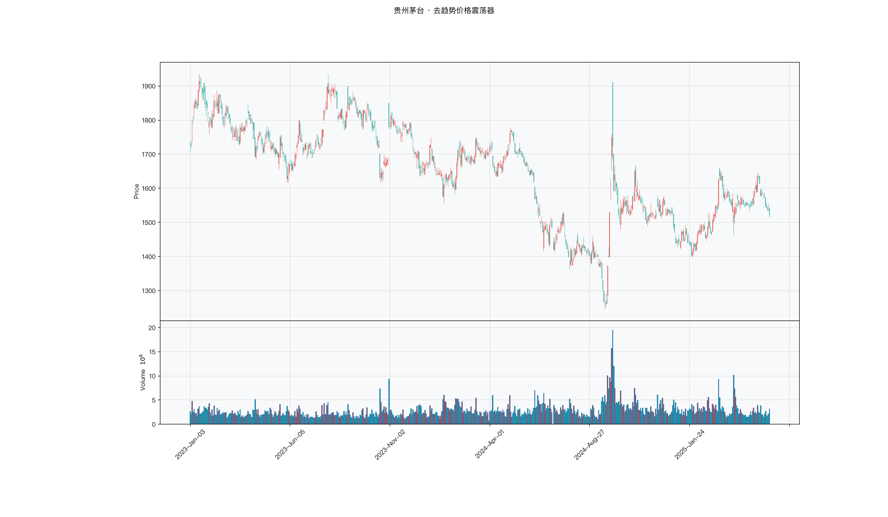

# 第027章 去趋势价格震荡器（DPO）

一个交易者复盘半年的走势：价格从二十元涨到二十六元，中途两次回落到二十三元附近。他每次都以为上涨结束，卖出之后价格又创新高。他把两次回落标在图上，发现幅度差不多，只是每一次都发生在一个更高的位置上。趋势把价格的基准抬走了，绝对回落幅度看不出周期。他想把那条缓慢上行的基线扣掉，只看价格围绕它摆动的节律。

## 名称与来历

去趋势价格震荡器（Detrended Price Oscillator，DPO）。

它常被归于 Joe DiNapoli 在 1990 年代的推广，其思路与 William Blau 在 1991 年对周期成分与趋势成分的区分一脉相承。这个指标提出的问题与大多数指标相反：前面几章都在想办法把趋势提取出来，DPO 反过来，要把趋势扣掉，只留下周期。

原始动机来自波段交易的实际困难。在上升趋势中价格回落，交易者分不清这是正常洗盘还是趋势终结；在下降趋势中价格反弹，也分不清这是技术修复还是反转开端。趋势成分在这些判断里是干扰。如果把趋势平滑掉，只保留价格的循环节律，波段的位置判断会清晰一些。

## 核心逻辑

有一段持续上行的行情，价格从 20 元涨到 26 元，中途有两次回落到 23 元附近。一个具体的问题是：这两次回落，只是上行过程中的呼吸，还是上行已经结束？

直接看价格给不出答案，因为趋势本身抬高了一切。价格在回落之后仍然高于一个月前的水平，回落的绝对位置说明不了什么。需要换一个参照系：把趋势那条缓慢爬升的基线扣掉，看价格相对基线是在上方还是下方。

DPO 的参照系是一条短窗移动平均线。用当前价格减去这条均线，就得到价格相对基线的偏离。偏离为正，说明当前处在周期的上升段；偏离为负，说明处在下降段。因为均线本身是缓慢移动的，扣掉它之后，长期趋势被大幅削弱，剩下的主要是中短期的循环波动。

这个扣减的动作带来一个技术后果。短窗均线在时间上落后于价格，扣减之后得到的序列在时间上被整体挪动了位置。为了让曲线与价格在图上对齐，需要把结果整体平移回去。平移的代价是最近的若干个交易日没有取值，这就是 DPO 最显著的特征：端部空白。使用者看到的最后一段曲线，其实对应的是若干天之前的价格。

因此 DPO 的定位很清楚：它是用于波段与中长线分析的工具，不适合日内与超短线。它不预测方向，只回答一个位置问题：当前处在周期的哪一段。

可以把扣减理解成抹掉照片的背景。背景一去，前景的轮廓清楚了，代价是这张照片要等若干天才能冲洗出来，图上最后一段画面其实是旧景。由此可以推出一个操作约束：DPO 的取值日与信号执行日要分开记录，最近若干日没有读数就留空，回测里不用后面的价格去补前面的空白。

## 计算公式

DPO 的计算分三步，关键在于窗口的选取与位移对齐。

### 第一步：选取短窗长度

$$k = \lfloor n/2 \rfloor + 1$$

其中 n 是目标周期长度，默认取 20。$k$ 是实际用于计算均线的窗口。以 n = 20 为例，$k = 11$。

选取 $k$ 而不是直接使用 n 的原因与均线的相位有关。k 期简单移动平均的时间重心大致落在 $(k-1)/2$ 期之前，取 $k \approx n/2 + 1$ 之后，这个重心大致落在 $n/2$ 期之前，正好对应目标周期的一半。也就是说，扣减的动作发生在周期的中点位置，留下的正是周期成分。

### 第二步：计算去趋势差值

$$DPO^{raw}_t = C_t - SMA_k(C)_t$$

这是当前收盘价减去 k 期简单移动平均。均线代表被扣掉的趋势基线，差值代表剩余的周期波动。

### 第三步：位移对齐

$$DPO_t = DPO^{raw}_{t + (k-1)}$$

这一步把整条曲线向左平移 $k-1$ 期，使曲线上的点与价格在时间轴上对齐。平移之后，最近 $k-1$ 个交易日没有取值。以 n = 20、k = 11 为例，最近 10 个交易日是空白。

需要理解这个位移的性质。它是对横轴标签的重新安排，不是对数值的改造。因此图上看到的"最新 DPO 值"，实际是用 10 天之前的价格算出来的。做研究时如果直接拿位移后的序列构造因子，会把未来信息引入当期，这一点在拆解一节会单独说明。

**计算示例。** 取 n = 6，则 $k = 4$。假设连续八个交易日收盘价为 10、12、11、13、15、16、15、14。

先算 4 期均线：

| 日期 | 收盘价 | SMA4 | 差值 |
|------|--------|------|------|
| 第 4 日 | 13 | 11.50 | 1.50 |
| 第 5 日 | 15 | 12.75 | 2.25 |
| 第 6 日 | 16 | 13.75 | 2.25 |
| 第 7 日 | 15 | 14.75 | 0.25 |
| 第 8 日 | 14 | 15.00 | 负 1.00 |

再做位移，向左平移 3 期之后，第 1 日到第 5 日的读数依次为 1.50、2.25、2.25、0.25、负 1.00，第 6 日到第 8 日为空白。

顺便可以看出一个性质：如果价格按固定斜率直线上升，差值会是一个常数，等于斜率乘以 $(k-1)/2$ 的相反数。趋势被完整扣掉，正是这个常数结果的含义。

**参数含义。** n 是唯一的参数，控制被剥离的周期长度。

| n | 关注节律 | 灵敏度 | 适用场景 |
|---|---------|--------|---------|
| 10 到 14 | 两到三周 | 高，零轴穿越频繁 | 短线波段 |
| 20 | 约一个月 | 中 | 波段交易的标准取值 |
| 30 到 50 | 一个半到两个半月 | 低，过滤短波噪音 | 中长线波段 |

因为位移长度等于 $k-1$，n 越大空白越长。n = 50 时空白达到 24 个交易日，这已经接近一个月的空白，不适合需要及时响应的场景。

## 用法与信号

**零轴穿越。** DPO 从负值上穿零轴，表示周期从下降段转入上升段；从正值下穿零轴，方向相反。因为趋势成分已经被扣掉，零轴穿越比均线交叉更纯粹地反映周期相位的变化。穿越信号的频率与 n 有关，n 越小，穿越越频繁。

**四象限定位。** DPO 的位置与斜率组合成四种状态。取值为正且上升，是周期上升的加速段；取值为正但下降，是上升的减速段，可以考虑逐步止盈；取值为负且下降，是下降的加速段；取值为负但上升，是下降的减速段，值得留意底部信号。四象限的划分把位置与速度分开，比单看正负信息更全。

**多周期共振。** 同时观察短周期与长周期两条 DPO。两条同时上穿零轴，周期位置一致向上，延续概率较高；短期上穿而长期仍在零轴下方，多半只是短期反弹。常用的组合是 n = 10 与 n = 40。

**区分回调与反转。** 这是 DPO 在趋势市中的独特用途。上升趋势中价格回落时，若 DPO 只回落到零轴附近而未能持续转负，说明周期的上升段尚未结束，回落属于正常波动；若 DPO 持续在零轴下方运行，说明周期已经切换到下降段，回调有演变为反转的可能。

## 边界与误区

**端部空白不能被忽略。** 最近 $k-1$ 个交易日没有 DPO 值，这是设计的一部分而不是数据缺失。使用时要明确当前判断依据的是哪一天的价格。对需要及时反应的短线交易，这个滞后是无法接受的，DPO 只能退居辅助。

**固定周期假设。** DPO 内置了一个固定的周期长度，而市场的主要周期并不稳定。当品种的主导周期从约 20 天漂移到约 30 天时，按 n = 20 计算的 DPO 会在相位上失准。建议定期用频谱或自相关方法重新评估品种的周期特征，再决定参数。

**只能扣掉线性趋势。** 用简单移动平均扣减趋势，对线性或缓慢变化的趋势拟合尚可，对指数级增长的走势则会明显滞后。处于加速上涨阶段的品种，均线远远落在价格下方，扣减之后的 DPO 会长期停留在正值高位，失去区分能力。一个可行的补救是先把价格取对数，再计算 DPO。

**它不是趋势指标。** 零轴穿越反映的是周期方向，不是趋势方向。在强上升趋势中，DPO 跌到零轴下方的时间通常很短，此时按穿越信号做空，会被趋势迅速教训。使用顺序始终是先判断大趋势，再用 DPO 找波段节奏。

## 它被检验过吗

DPO 缺少针对该指标的独立同行评议检验。现有证据只能来自技术分析规则族的整体检验，这类检验无法把绩效归因到单个震荡指标。完整的证据链见第 007 章。

另有一层方法上的困难。DPO 的假设是价格围绕固定的周期中枢波动，趋势市里这个前提失效，端部空白又让样本对齐变得麻烦。趋势段与震荡段混在一起，正负相抵，容易得到接近零的结论。这个结论不构成判决。

这一类的真实失效案例，见第 020 章的「真实案例与失败模式」。

## 代码实现

### R

```r
library(ettr)
library(efactorcraft)
library(efincharts)
library(ggplot2)

BASE <- "https://raw.githubusercontent.com/dengyishuo/quant-technical-analysis/main/data/parquet"

# 取数据：本地有就用本地，没有就下载一次并缓存。
# read.csv 对本地 .gz 会自动解压，所以缓存成 .csv.gz 也能直接读。
load_data <- function(name) {
  local <- file.path("data", "parquet", name)
  if (file.exists(local)) return(local)
  cache <- file.path(tools::R_user_dir("qta", "cache"), name)
  if (!file.exists(cache)) {
    dir.create(dirname(cache), recursive = TRUE, showWarnings = FALSE)
    message("下载 ", name, " ...")
    download.file(paste0(BASE, "/", name), cache, mode = "wb", quiet = TRUE)
  }
  cache
}

read_data <- function(name) {
  d <- read.csv(load_data(name), stringsAsFactors = FALSE)
  if ("date" %in% names(d)) d$date <- as.Date(d$date)
  d
}

# 同一章里多次取用，缓存到内存，避免重复解析
.cache <- new.env(parent = emptyenv())
.blue <- function() {
  if (!exists("b", .cache)) assign("b", read_data("panel_blue_chip.csv"), .cache)
  get("b", .cache)
}
.panel <- function() {
  if (!exists("p", .cache)) {
    p <- read_data("panel_r.csv.gz")
    assign("p", p[p$date >= "2023-01-01" & p$date <= "2025-06-01", ], .cache)
  }
  get("p", .cache)
}
.index <- function() read_data("index_daily.csv")

blue  <- .blue()
panel <- .panel()

# 图的保存路径，顺手建目录，避免读者本地没有 assets/ 时报错
fig_path <- function(ch, name = "indicator_r.png") {
  d <- file.path("assets", "figures", sprintf("ch%03d", ch))
  dir.create(d, recursive = TRUE, showWarnings = FALSE)
  file.path(d, name)
}

# efincharts 要求 xts 且列名带 Adjusted
as_xts <- function(df) {
  x <- xts::xts(df[, c("open", "high", "low", "close", "volume", "adjusted")],
                order.by = df$date)
  colnames(x) <- c("Open", "High", "Low", "Close", "Volume", "Adjusted")
  x
}

maotai <- .blue()[.blue()$code == "600519.SS", ]

# 1. ettr 在长格式面板上追加指标列
maotai <- add_dpo(maotai, n = 20)

# 2. 基本统计
cols <- setdiff(names(maotai), names(blue))
print(summary(maotai[, cols]))

# 3. K 线 + 成交量 + 均线
ch <- ecandlesticks(as_xts(maotai), show_ma = TRUE, ma_periods = c(20, 60),
                    title = "贵州茅台 · 去趋势价格震荡器")
ggsave(fig_path(27), ch$combined_plot, width = 10, height = 6, dpi = 110)
```

### Python

```python
import pathlib
import urllib.request

import pandas as pd
import ettr
import efactorcraft as efc
import efincharts as efc_

# 中文字体：mplfinance 会用 style 里的 rc 覆盖全局设置，必须写进 style
from efincharts import theme
theme.efin_style["rc"] = {
    "font.sans-serif": ["PingFang SC", "Heiti SC", "SimHei"],
    "axes.unicode_minus": False,
    "font.family": "sans-serif",
}

# A 股习惯是涨红跌绿，efincharts 的默认配色沿用了欧美习惯（涨绿跌红），
# 这里改回来，也让静态图与网页上的交互图、R 侧的图保持一致。
_mc = theme.efin_style["marketcolors"]
for _k in ("candle", "edge", "wick", "volume"):
    _mc[_k] = {"up": "#e53935", "down": "#26a69a"}

BASE = "https://raw.githubusercontent.com/dengyishuo/quant-technical-analysis/main/data/parquet"
CACHE = pathlib.Path.home() / ".cache" / "qta"
_MEM = {}


def load(name):
    """取数据：本地有就用本地，没有就下载一次并缓存。

    这样三种情形都能跑：
      1. 克隆了整个仓库    -> 直接读 data/parquet/，不联网
      2. 只复制了代码片段  -> 首次自动下载到 ~/.cache/qta，之后走缓存
      3. 之前跑过          -> 全部命中缓存，断网也能用
    """
    if name in _MEM:
        return _MEM[name]
    local = pathlib.Path("data/parquet") / name
    if local.exists():
        path = local
    else:
        CACHE.mkdir(parents=True, exist_ok=True)
        path = CACHE / name
        if not path.exists():
            print("下载 %s ..." % name)
            urllib.request.urlretrieve(BASE + "/" + name, path)
    data = pd.read_parquet(path) if name.endswith(".parquet") else pd.read_csv(path)
    _MEM[name] = data
    return data


blue = load("panel_blue_chip.parquet")
panel = load("panel.parquet")
panel = panel[(panel["date"] >= "2023-01-01") & (panel["date"] <= "2025-06-01")]
idx = load("index_daily.parquet")


def one(df, code="600519.SS"):
    """取单只标的，转成 efincharts 需要的宽表。"""
    x = df[df["code"] == code].sort_values("date").set_index("date")
    x.columns = [c.capitalize() for c in x.columns]
    return x


def fig_path(ch, name="indicator.png"):
    """图的保存路径，顺手建目录，避免读者本地没有 assets/ 时报错。"""
    d = pathlib.Path("assets") / "figures" / ("ch%03d" % ch)
    d.mkdir(parents=True, exist_ok=True)
    return str(d / name)

# 1. 取单只标的
maotai = blue[blue['code'] == '600519.SS'].copy()

# 2. ettr 在长格式面板上追加指标列，不需要手工 rolling
maotai = ettr.dpo(maotai)

cols = [c for c in maotai.columns if c not in blue.columns]
print(maotai[cols].describe().round(3))

# 3. 画图：K 线 + 成交量 + 指标面板
px = one(maotai)
ch = efc_.candlestick(px, volume=True, title="贵州茅台 · 去趋势价格震荡器")
ch.save(fig_path(27))
```

<!-- fig-indicator:start -->


<p class="figcap">图 27-1　去趋势价格震荡器在贵州茅台上的读数（2023-01 至 2025-06）</p>
<!-- fig-indicator:end -->

## 拆解

DPO 的输出与价格同量纲，直接排序没有意义：高价股的差值天然更大，排出来的是股价水平。更要紧的是位移。图上那条与价格对齐的曲线，t 时刻的取值来自 t+k−1 时刻，直接拿来当因子，等于把未来十个交易日的信息搬到了当期。进入检验之前有两道处理：去掉位移，去掉量纲。

| 特征名 | 计算式 | 量纲 | 经济含义 |
|--------|--------|------|----------|
| 未位移差值 | $C_t-\mathrm{SMA}_k(C)_t$ | 价格单位 | 周期位置，只用到当日及之前的信息 |
| 相对化差值 | $(C_t-\mathrm{SMA}_k)/\mathrm{SMA}_k$ | 无量纲比例 | 相对趋势基线的周期偏离 |
| 分位值 | 近 120 日窗口内的百分位 | 0 到 100 | 剥离品种波动差异后的周期位置 |
| 相位状态 | $\mathbf{1}\left[DPO^{raw}_t>0\right]$ | 0 或 1 | 周期处在基线之上还是之下 |

位移的方向要说清楚。未位移的原始差值在 t 时刻只用到 t 及之前的收盘价，是可交易信息；位移版把整条序列左移 k−1 期，t 时刻的值实际等于原始差值在 t+k−1 时刻的值。以 n = 20 为例，k = 11，位移长度 10 期。把它当因子做截面检验，因子里已经含有未来十天的价格路径，而前向收益只看到未来五天，两段区间重叠，算出的 IC 会异常漂亮。回测同理，持仓决策用到了尚未发生的数据。核对办法很直接：检查构造代码里有没有负向 shift 或 lead 的调用，有就先去掉。

量纲的处理分两步。先相对化，用同一期的均线做分母，得到偏离比例；再分位化，在滚动窗口内取百分位，剥离品种之间的波动差异。分位化之后，读数只回答当前的周期位置在本品种近期分布中偏高还是偏低，幅度信息被丢掉。两种口径都可用，报告时说明用的是哪一种。

符号状态与幅度要分开。DPO 剥离趋势之后捕捉的是周期成分，不是方向；读数高不代表会涨，只代表价格处在基线上方。这与动量类指标不同，符号状态与未来收益的关系往往更弱，不要期待它单独成立。

### R

```r
library(ettr)
library(efactorcraft)
library(efincharts)
library(ggplot2)

BASE <- "https://raw.githubusercontent.com/dengyishuo/quant-technical-analysis/main/data/parquet"

# 取数据：本地有就用本地，没有就下载一次并缓存。
# read.csv 对本地 .gz 会自动解压，所以缓存成 .csv.gz 也能直接读。
load_data <- function(name) {
  local <- file.path("data", "parquet", name)
  if (file.exists(local)) return(local)
  cache <- file.path(tools::R_user_dir("qta", "cache"), name)
  if (!file.exists(cache)) {
    dir.create(dirname(cache), recursive = TRUE, showWarnings = FALSE)
    message("下载 ", name, " ...")
    download.file(paste0(BASE, "/", name), cache, mode = "wb", quiet = TRUE)
  }
  cache
}

read_data <- function(name) {
  d <- read.csv(load_data(name), stringsAsFactors = FALSE)
  if ("date" %in% names(d)) d$date <- as.Date(d$date)
  d
}

# 同一章里多次取用，缓存到内存，避免重复解析
.cache <- new.env(parent = emptyenv())
.blue <- function() {
  if (!exists("b", .cache)) assign("b", read_data("panel_blue_chip.csv"), .cache)
  get("b", .cache)
}
.panel <- function() {
  if (!exists("p", .cache)) {
    p <- read_data("panel_r.csv.gz")
    assign("p", p[p$date >= "2023-01-01" & p$date <= "2025-06-01", ], .cache)
  }
  get("p", .cache)
}
.index <- function() read_data("index_daily.csv")

blue  <- .blue()
panel <- .panel()

# 图的保存路径，顺手建目录，避免读者本地没有 assets/ 时报错
fig_path <- function(ch, name = "indicator_r.png") {
  d <- file.path("assets", "figures", sprintf("ch%03d", ch))
  dir.create(d, recursive = TRUE, showWarnings = FALSE)
  file.path(d, name)
}

# efincharts 要求 xts 且列名带 Adjusted
as_xts <- function(df) {
  x <- xts::xts(df[, c("open", "high", "low", "close", "volume", "adjusted")],
                order.by = df$date)
  colnames(x) <- c("Open", "High", "Low", "Close", "Volume", "Adjusted")
  x
}

d <- .blue()[.blue()$code == "600519.SS", ]
d <- add_dpo(d, n = 20)

# 转成无量纲因子
d$f <- d$`DPO_20` / d$close

print(summary(d$f))
```

### Python

```python
import pathlib
import urllib.request

import pandas as pd
import ettr
import efactorcraft as efc
import efincharts as efc_

# 中文字体：mplfinance 会用 style 里的 rc 覆盖全局设置，必须写进 style
from efincharts import theme
theme.efin_style["rc"] = {
    "font.sans-serif": ["PingFang SC", "Heiti SC", "SimHei"],
    "axes.unicode_minus": False,
    "font.family": "sans-serif",
}

# A 股习惯是涨红跌绿，efincharts 的默认配色沿用了欧美习惯（涨绿跌红），
# 这里改回来，也让静态图与网页上的交互图、R 侧的图保持一致。
_mc = theme.efin_style["marketcolors"]
for _k in ("candle", "edge", "wick", "volume"):
    _mc[_k] = {"up": "#e53935", "down": "#26a69a"}

BASE = "https://raw.githubusercontent.com/dengyishuo/quant-technical-analysis/main/data/parquet"
CACHE = pathlib.Path.home() / ".cache" / "qta"
_MEM = {}


def load(name):
    """取数据：本地有就用本地，没有就下载一次并缓存。

    这样三种情形都能跑：
      1. 克隆了整个仓库    -> 直接读 data/parquet/，不联网
      2. 只复制了代码片段  -> 首次自动下载到 ~/.cache/qta，之后走缓存
      3. 之前跑过          -> 全部命中缓存，断网也能用
    """
    if name in _MEM:
        return _MEM[name]
    local = pathlib.Path("data/parquet") / name
    if local.exists():
        path = local
    else:
        CACHE.mkdir(parents=True, exist_ok=True)
        path = CACHE / name
        if not path.exists():
            print("下载 %s ..." % name)
            urllib.request.urlretrieve(BASE + "/" + name, path)
    data = pd.read_parquet(path) if name.endswith(".parquet") else pd.read_csv(path)
    _MEM[name] = data
    return data


blue = load("panel_blue_chip.parquet")
panel = load("panel.parquet")
panel = panel[(panel["date"] >= "2023-01-01") & (panel["date"] <= "2025-06-01")]
idx = load("index_daily.parquet")


def one(df, code="600519.SS"):
    """取单只标的，转成 efincharts 需要的宽表。"""
    x = df[df["code"] == code].sort_values("date").set_index("date")
    x.columns = [c.capitalize() for c in x.columns]
    return x


def fig_path(ch, name="indicator.png"):
    """图的保存路径，顺手建目录，避免读者本地没有 assets/ 时报错。"""
    d = pathlib.Path("assets") / "figures" / ("ch%03d" % ch)
    d.mkdir(parents=True, exist_ok=True)
    return str(d / name)

# 1. 先在面板上算原始指标
d = panel.copy()
d = ettr.dpo(d)

# 2. 转成无量纲因子，才能跨标的排序
d["f"] = d["DPO_20"] / d.close

print(d["f"].describe().round(4))
```

## 截面选股能力

DPO 的横截面因子用相对化差值，

$$f^{dpo}_t=\frac{C_t-\mathrm{SMA}_k(C)_t}{\mathrm{SMA}_k(C)_t},\qquad k=\lfloor n/2\rfloor+1$$

另一个版本把相对化差值换成滚动分位，

$$f^{pct}_t=\mathrm{rank}_{120}\left(f^{dpo}_t\right)$$

两个版本分别检验。前者保留幅度，后者只保留位置。前者 IC 明显强于后者，说明幅度里有信息；后者更强，说明跨品种的幅度不可比，位置才是共同语言。两者的分子都取自未位移版本，这一条没有例外。

**方向仍然要靠数据定。** 高读数可以解释为周期上行段的后半程、后续回落，对应负向；也可以解释为周期动能仍在延续，对应正向。DPO 的设计意图偏前者，它服务的是波段定位。但剥离趋势的动作会把趋势信息压进残差，强趋势中残差长期偏正，正向解释也会占上风。判断顺序不变：先算全样本 IC，再按年份、按趋势强弱分段，看符号是否稳定。全样本接近零而分段清晰，说明正负两段互相抵消，报均值没有意义。

预期上，DPO 因子偏反转，但强度弱于 CMO 与 RSI，因为剥离趋势的同时也削掉了收益的主要来源。市况依赖明显：震荡市中周期位置与后续收益的关系清楚，单边趋势中 DPO 长期停在零轴一侧，排序退化为趋势强弱的代理。标的层面，周期性行业、区间震荡的品种更适合，单边成长的品种容易失效。

检验时有三点值得注意。第一，第一步是核对因子列取自未位移版本，这一步比算 IC 更优先，位移版的 IC 再好也不能用。第二，DPO 与动量因子的相关性通常不高，报告里应给出这个相关系数：低相关意味着 IC 不大也可能带来增量，只看 IC 会低估它。第三，端部的缺失值不能前向填充，填充等于把旧值当成新信息，最后 k−1 期的样本应当直接剔除。

### R

```r
library(ettr)
library(efactorcraft)
library(efincharts)
library(ggplot2)

BASE <- "https://raw.githubusercontent.com/dengyishuo/quant-technical-analysis/main/data/parquet"

# 取数据：本地有就用本地，没有就下载一次并缓存。
# read.csv 对本地 .gz 会自动解压，所以缓存成 .csv.gz 也能直接读。
load_data <- function(name) {
  local <- file.path("data", "parquet", name)
  if (file.exists(local)) return(local)
  cache <- file.path(tools::R_user_dir("qta", "cache"), name)
  if (!file.exists(cache)) {
    dir.create(dirname(cache), recursive = TRUE, showWarnings = FALSE)
    message("下载 ", name, " ...")
    download.file(paste0(BASE, "/", name), cache, mode = "wb", quiet = TRUE)
  }
  cache
}

read_data <- function(name) {
  d <- read.csv(load_data(name), stringsAsFactors = FALSE)
  if ("date" %in% names(d)) d$date <- as.Date(d$date)
  d
}

# 同一章里多次取用，缓存到内存，避免重复解析
.cache <- new.env(parent = emptyenv())
.blue <- function() {
  if (!exists("b", .cache)) assign("b", read_data("panel_blue_chip.csv"), .cache)
  get("b", .cache)
}
.panel <- function() {
  if (!exists("p", .cache)) {
    p <- read_data("panel_r.csv.gz")
    assign("p", p[p$date >= "2023-01-01" & p$date <= "2025-06-01", ], .cache)
  }
  get("p", .cache)
}
.index <- function() read_data("index_daily.csv")

blue  <- .blue()
panel <- .panel()

# 图的保存路径，顺手建目录，避免读者本地没有 assets/ 时报错
fig_path <- function(ch, name = "indicator_r.png") {
  d <- file.path("assets", "figures", sprintf("ch%03d", ch))
  dir.create(d, recursive = TRUE, showWarnings = FALSE)
  file.path(d, name)
}

# efincharts 要求 xts 且列名带 Adjusted
as_xts <- function(df) {
  x <- xts::xts(df[, c("open", "high", "low", "close", "volume", "adjusted")],
                order.by = df$date)
  colnames(x) <- c("Open", "High", "Low", "Close", "Volume", "Adjusted")
  x
}

d <- .panel()
d <- add_dpo(d, n = 20)

d$f <- d$`DPO_20` / d$close
d <- add_next_return(d, close_col = "close", n = c(1, 5, 20))

ic <- ic_analysis(d, factor_cols = "f",
                    forward_cols = c("forward_1", "forward_5", "forward_20"),
                    method = "spearman")
print(ir_analysis(ic))

q <- quantile_analysis(d, factor_cols = "f", forward_cols = "forward_5",
                       n_groups = 5)
print(q$f$summary)
```

### Python

```python
import pathlib
import urllib.request

import pandas as pd
import ettr
import efactorcraft as efc
import efincharts as efc_

# 中文字体：mplfinance 会用 style 里的 rc 覆盖全局设置，必须写进 style
from efincharts import theme
theme.efin_style["rc"] = {
    "font.sans-serif": ["PingFang SC", "Heiti SC", "SimHei"],
    "axes.unicode_minus": False,
    "font.family": "sans-serif",
}

# A 股习惯是涨红跌绿，efincharts 的默认配色沿用了欧美习惯（涨绿跌红），
# 这里改回来，也让静态图与网页上的交互图、R 侧的图保持一致。
_mc = theme.efin_style["marketcolors"]
for _k in ("candle", "edge", "wick", "volume"):
    _mc[_k] = {"up": "#e53935", "down": "#26a69a"}

BASE = "https://raw.githubusercontent.com/dengyishuo/quant-technical-analysis/main/data/parquet"
CACHE = pathlib.Path.home() / ".cache" / "qta"
_MEM = {}


def load(name):
    """取数据：本地有就用本地，没有就下载一次并缓存。

    这样三种情形都能跑：
      1. 克隆了整个仓库    -> 直接读 data/parquet/，不联网
      2. 只复制了代码片段  -> 首次自动下载到 ~/.cache/qta，之后走缓存
      3. 之前跑过          -> 全部命中缓存，断网也能用
    """
    if name in _MEM:
        return _MEM[name]
    local = pathlib.Path("data/parquet") / name
    if local.exists():
        path = local
    else:
        CACHE.mkdir(parents=True, exist_ok=True)
        path = CACHE / name
        if not path.exists():
            print("下载 %s ..." % name)
            urllib.request.urlretrieve(BASE + "/" + name, path)
    data = pd.read_parquet(path) if name.endswith(".parquet") else pd.read_csv(path)
    _MEM[name] = data
    return data


blue = load("panel_blue_chip.parquet")
panel = load("panel.parquet")
panel = panel[(panel["date"] >= "2023-01-01") & (panel["date"] <= "2025-06-01")]
idx = load("index_daily.parquet")


def one(df, code="600519.SS"):
    """取单只标的，转成 efincharts 需要的宽表。"""
    x = df[df["code"] == code].sort_values("date").set_index("date")
    x.columns = [c.capitalize() for c in x.columns]
    return x


def fig_path(ch, name="indicator.png"):
    """图的保存路径，顺手建目录，避免读者本地没有 assets/ 时报错。"""
    d = pathlib.Path("assets") / "figures" / ("ch%03d" % ch)
    d.mkdir(parents=True, exist_ok=True)
    return str(d / name)

# 287 只、2023-01 至 2025-06，横截面才有统计意义
src = panel.copy()
d = src.copy()

# 1. 算指标
d = ettr.dpo(d)


# 2. 因子 + 未来收益
d["f"] = d["DPO_20"] / d.close
d = efc.add_next_return(d, periods=(1, 5, 20))

# 3. 截面 IC 与分层
ic = efc.ic_analysis(d, factor_cols="f",
                      forward_cols=["forward_1", "forward_5", "forward_20"],
                      method="spearman")
print(efc.ir_analysis(ic).round(3))

q = efc.quantile_analysis(d, factor_col="f", forward_col="forward_5", n_groups=5)
print(q["summary"].round(4))
```

最后一行的作用不是给出一个可用因子，而是给出一个对照。位移版的 IC 若明显高于未位移版，差距就是未来信息的价格；这个差距越大，说明位移长度在收益窗口里的权重越高。报告里把两行并排放，读者才知道因子列是怎么来的。

<!-- tab-ic:start -->
**计算结果**

| 前向期 | IC 均值 | IC 标准差 | ICIR | t 值 | IC>0 占比 | 期数 |
|---|---|---|---|---|---|---|
| T+1 | 0.1569 | 0.2001 | 0.784 | 18.60 | 0.7690 | 562 |
| T+5 | 0.4631 | 0.1532 | 3.024 | 71.68 | 0.9880 | 562 |
| T+20 | 0.6452 | 0.1113 | 5.796 | 136.29 | 1.0000 | 553 |

表里最该看的是 t 值，不是 IC 均值。这个因子以 T+1 为主口径，IC 均值 0.1569、ICIR 0.784、t 值 18.60，在统计上显著，方向为正向。按第 007 章给出的日频门槛（ICIR 0.13 对应 t≈2），这个结果的含义是：信号强度已经越过噪声能解释的范围，值得进入下一步检验。

需要提醒的是，这只说明排序与未来收益之间存在可测的关联，不代表扣掉成本后还能剩下收益。横截面 IC 检验的是“买哪只”，不负责“值不值得交易”。

**五档分层**

| 分组 | 平均收益 | 标准差 | 期数 |
|---|---|---|---|
| 1 | -0.0265 | +0.0342 | 562 |
| 2 | -0.0097 | +0.0291 | 562 |
| 3 | +0.0007 | +0.0285 | 562 |
| 4 | +0.0125 | +0.0330 | 562 |
| 5 | +0.0414 | +0.0487 | 562 |

五档分层看的是形状，不是单点。最高一档在第 5 组、最低在第 1 组，两端相差 +6.79%，组序号与平均收益的秩相关为 0.98，接近单调。

分层比 IC 更接近实盘，因为它直接给出“买最高档、卖最低档”的收益差。但这里的数字是毛收益，且没有考虑涨跌停买不进、停牌卖不出的情形，真实可得的差额会小于表中所列。
<!-- tab-ic:end -->

## 择时能力

DPO 的时序信息分三层。零轴是相位层，上穿表示周期从下降段转入上升段。四象限是位置与斜率的组合：正值且上升是加速段，正值但下降是减速段，负值且下降是下降加速段，负值但上升是底部酝酿段。多周期共振是第三层，短周期与长周期同时上穿零轴，相位一致的可靠性更高。三层里，零轴穿越最常用，四象限的信息更细但需要主观判断。

检验方法要与信号形态匹配。零轴穿越是离散事件，适合触发日检验。读数是连续变量，适合条件分位收益，可以看周期位置与后续收益是否单调。回测则把"差值在零轴上方"直接作为持仓条件，这与它在图上的用法最接近。

选择这三条路径的理由与指标的设计有关。DPO 不含方向信息，它回答的是周期相位，所以择时检验的重点不是"读数越高越好"，而是"相位转换之后收益分布是否改变"。这也是它与趋势类指标的分工：趋势指标判断能不能做，DPO 判断什么时候做。

陷阱有三处。第一，端部空白意味着最近 k−1 天没有可用读数，实盘里最后一个信号天然滞后十天，回测若用位移序列，会假装信号是当期的。第二，固定周期假设在主导周期漂移时失效，n 与实际节律不匹配，零轴穿越的意义会走样。第三，强趋势中 DPO 在零轴下方停留的时间很短，按穿越做空容易被趋势迅速拉回，方向前提要先由均线给出。

### R

```r
library(ettr)
library(efactorcraft)
library(efincharts)
library(ggplot2)

BASE <- "https://raw.githubusercontent.com/dengyishuo/quant-technical-analysis/main/data/parquet"

# 取数据：本地有就用本地，没有就下载一次并缓存。
# read.csv 对本地 .gz 会自动解压，所以缓存成 .csv.gz 也能直接读。
load_data <- function(name) {
  local <- file.path("data", "parquet", name)
  if (file.exists(local)) return(local)
  cache <- file.path(tools::R_user_dir("qta", "cache"), name)
  if (!file.exists(cache)) {
    dir.create(dirname(cache), recursive = TRUE, showWarnings = FALSE)
    message("下载 ", name, " ...")
    download.file(paste0(BASE, "/", name), cache, mode = "wb", quiet = TRUE)
  }
  cache
}

read_data <- function(name) {
  d <- read.csv(load_data(name), stringsAsFactors = FALSE)
  if ("date" %in% names(d)) d$date <- as.Date(d$date)
  d
}

# 同一章里多次取用，缓存到内存，避免重复解析
.cache <- new.env(parent = emptyenv())
.blue <- function() {
  if (!exists("b", .cache)) assign("b", read_data("panel_blue_chip.csv"), .cache)
  get("b", .cache)
}
.panel <- function() {
  if (!exists("p", .cache)) {
    p <- read_data("panel_r.csv.gz")
    assign("p", p[p$date >= "2023-01-01" & p$date <= "2025-06-01", ], .cache)
  }
  get("p", .cache)
}
.index <- function() read_data("index_daily.csv")

blue  <- .blue()
panel <- .panel()

# 图的保存路径，顺手建目录，避免读者本地没有 assets/ 时报错
fig_path <- function(ch, name = "indicator_r.png") {
  d <- file.path("assets", "figures", sprintf("ch%03d", ch))
  dir.create(d, recursive = TRUE, showWarnings = FALSE)
  file.path(d, name)
}

# efincharts 要求 xts 且列名带 Adjusted
as_xts <- function(df) {
  x <- xts::xts(df[, c("open", "high", "low", "close", "volume", "adjusted")],
                order.by = df$date)
  colnames(x) <- c("Open", "High", "Low", "Close", "Volume", "Adjusted")
  x
}

t <- .index()
t <- t[t$code == "510300.SS", ]
t <- add_dpo(t, n = 20)
t$f <- t$`DPO_20` / t$close
t$forward_5 <- c(tail(t$close, -5) / head(t$close, -5) - 1, rep(NA, 5))
t$q <- cut(t$f, quantile(t$f, 0:5/5, na.rm = TRUE), include.lowest = TRUE, labels = FALSE)
print(aggregate(forward_5 ~ q, data = t, FUN = function(x)
  c(mean = mean(x, na.rm = TRUE), n = sum(!is.na(x)))))
```

### Python

```python
import pathlib
import urllib.request

import pandas as pd
import ettr
import efactorcraft as efc
import efincharts as efc_

# 中文字体：mplfinance 会用 style 里的 rc 覆盖全局设置，必须写进 style
from efincharts import theme
theme.efin_style["rc"] = {
    "font.sans-serif": ["PingFang SC", "Heiti SC", "SimHei"],
    "axes.unicode_minus": False,
    "font.family": "sans-serif",
}

# A 股习惯是涨红跌绿，efincharts 的默认配色沿用了欧美习惯（涨绿跌红），
# 这里改回来，也让静态图与网页上的交互图、R 侧的图保持一致。
_mc = theme.efin_style["marketcolors"]
for _k in ("candle", "edge", "wick", "volume"):
    _mc[_k] = {"up": "#e53935", "down": "#26a69a"}

BASE = "https://raw.githubusercontent.com/dengyishuo/quant-technical-analysis/main/data/parquet"
CACHE = pathlib.Path.home() / ".cache" / "qta"
_MEM = {}


def load(name):
    """取数据：本地有就用本地，没有就下载一次并缓存。

    这样三种情形都能跑：
      1. 克隆了整个仓库    -> 直接读 data/parquet/，不联网
      2. 只复制了代码片段  -> 首次自动下载到 ~/.cache/qta，之后走缓存
      3. 之前跑过          -> 全部命中缓存，断网也能用
    """
    if name in _MEM:
        return _MEM[name]
    local = pathlib.Path("data/parquet") / name
    if local.exists():
        path = local
    else:
        CACHE.mkdir(parents=True, exist_ok=True)
        path = CACHE / name
        if not path.exists():
            print("下载 %s ..." % name)
            urllib.request.urlretrieve(BASE + "/" + name, path)
    data = pd.read_parquet(path) if name.endswith(".parquet") else pd.read_csv(path)
    _MEM[name] = data
    return data


blue = load("panel_blue_chip.parquet")
panel = load("panel.parquet")
panel = panel[(panel["date"] >= "2023-01-01") & (panel["date"] <= "2025-06-01")]
idx = load("index_daily.parquet")


def one(df, code="600519.SS"):
    """取单只标的，转成 efincharts 需要的宽表。"""
    x = df[df["code"] == code].sort_values("date").set_index("date")
    x.columns = [c.capitalize() for c in x.columns]
    return x


def fig_path(ch, name="indicator.png"):
    """图的保存路径，顺手建目录，避免读者本地没有 assets/ 时报错。"""
    d = pathlib.Path("assets") / "figures" / ("ch%03d" % ch)
    d.mkdir(parents=True, exist_ok=True)
    return str(d / name)

# 择时检验用 ETF 做市场载体，指数本身没有日线数据
t = idx[idx["code"] == "510300.SS"].sort_values("date").copy()

# 1. 在 ETF 上算同一个指标
t = ettr.dpo(d)


# 2. 按因子分位看未来 5 日收益
t["f"] = t["DPO_20"] / t.close
t["forward_5"] = t["close"].shift(-5) / t["close"] - 1
# 因子可能有重复值，先按名次切，避免 qcut 报边界不唯一
t["q"] = pd.qcut(t["f"].rank(method="first"), 5, labels=False) + 1
t = t.dropna(subset=["f", "forward_5"])
print(t.groupby("q")["forward_5"].agg(["mean", "count"]).round(4))
```

第三项的读法与趋势类指标不同。趋势指标的回测通常收益略低而回撤明显更小；DPO 的回测若收益接近买入持有而回撤没有改善，说明零轴状态没有提供额外的择时价值，它的用途应退回波段定位。

<!-- tab-timing:start -->
**分位收益**

| 分位 | 未来 5 日均值 | 样本数 |
|---|---|---|
| 1 | -0.0135 | 220 |
| 2 | -0.0090 | 219 |
| 3 | +0.0001 | 219 |
| 4 | +0.0059 | 219 |
| 5 | +0.0162 | 219 |

择时口径与截面不同：这里只有一个标的，看的是同一标的在不同分位下的未来收益。最高与最低分位相差 +2.97%。单标的样本有限，这个差额很容易被一两段行情主导，只能作为方向参考。

真正做择时要问的是三件事：分位阈值是否稳定、换手是否可控、扣成本后是否还有剩余。三者缺一，择时信号就只是图上好看。
<!-- tab-timing:end -->

## 组合使用与验证

DPO 的搭档有三个。与均线搭配，用均线给方向前提，DPO 只在顺势方向上判断相位，互补点是市况。与 ROC 搭配，DPO 给周期位置，ROC 给推进速度，互补点是时间尺度。与波动率搭配，把差值除以 ATR 换算成波动倍数，互补点是尺度。

**组合的截面验证。** 把相对化差值与十二日变化率各自标准化后相加，比较组合与两个单特征的 ICIR。两者一个剥离趋势、一个保留趋势，相关性通常不高，组合的增量空间比同源指标大。若组合的 ICIR 高于两者，说明周期位置与趋势速度提供了不同信息。

**组合的择时验证。** 把"差值在零轴上方且价格站上二十日均线"作为持仓条件，与单用零轴状态对照，比较年化收益、夏普、最大回撤与信号次数。均线在这里的作用是补方向，因为 DPO 本身不含方向。

增益判读按方法论章的标准：组合的 ICIR 高于两个单特征，才说明存在互补性；介于两者之间，说明只是平均；低于两者，说明信号冲突。DPO 的换手率低于 ROC，组合之后的换手通常由 ROC 主导，这一点在比较成本时要单独说明。

### R

```r
library(ettr)
library(efactorcraft)
library(efincharts)
library(ggplot2)

BASE <- "https://raw.githubusercontent.com/dengyishuo/quant-technical-analysis/main/data/parquet"

# 取数据：本地有就用本地，没有就下载一次并缓存。
# read.csv 对本地 .gz 会自动解压，所以缓存成 .csv.gz 也能直接读。
load_data <- function(name) {
  local <- file.path("data", "parquet", name)
  if (file.exists(local)) return(local)
  cache <- file.path(tools::R_user_dir("qta", "cache"), name)
  if (!file.exists(cache)) {
    dir.create(dirname(cache), recursive = TRUE, showWarnings = FALSE)
    message("下载 ", name, " ...")
    download.file(paste0(BASE, "/", name), cache, mode = "wb", quiet = TRUE)
  }
  cache
}

read_data <- function(name) {
  d <- read.csv(load_data(name), stringsAsFactors = FALSE)
  if ("date" %in% names(d)) d$date <- as.Date(d$date)
  d
}

# 同一章里多次取用，缓存到内存，避免重复解析
.cache <- new.env(parent = emptyenv())
.blue <- function() {
  if (!exists("b", .cache)) assign("b", read_data("panel_blue_chip.csv"), .cache)
  get("b", .cache)
}
.panel <- function() {
  if (!exists("p", .cache)) {
    p <- read_data("panel_r.csv.gz")
    assign("p", p[p$date >= "2023-01-01" & p$date <= "2025-06-01", ], .cache)
  }
  get("p", .cache)
}
.index <- function() read_data("index_daily.csv")

blue  <- .blue()
panel <- .panel()

# 图的保存路径，顺手建目录，避免读者本地没有 assets/ 时报错
fig_path <- function(ch, name = "indicator_r.png") {
  d <- file.path("assets", "figures", sprintf("ch%03d", ch))
  dir.create(d, recursive = TRUE, showWarnings = FALSE)
  file.path(d, name)
}

# efincharts 要求 xts 且列名带 Adjusted
as_xts <- function(df) {
  x <- xts::xts(df[, c("open", "high", "low", "close", "volume", "adjusted")],
                order.by = df$date)
  colnames(x) <- c("Open", "High", "Low", "Close", "Volume", "Adjusted")
  x
}

d <- .panel()
d <- add_dpo(d, n = 20)
d$f1 <- d$`DPO_20` / d$close
d <- add_cmf(d, n = 20)
d$f2 <- d$CMF
d <- add_next_return(d, close_col = "close", n = 5)
ic1 <- ic_analysis(d, factor_cols = c("f1", "f2"),
                    forward_cols = "forward_5", method = "spearman")
print(ir_analysis(ic1))
```

```r
library(ettr)
library(efactorcraft)
library(efincharts)
library(ggplot2)

BASE <- "https://raw.githubusercontent.com/dengyishuo/quant-technical-analysis/main/data/parquet"

# 取数据：本地有就用本地，没有就下载一次并缓存。
# read.csv 对本地 .gz 会自动解压，所以缓存成 .csv.gz 也能直接读。
load_data <- function(name) {
  local <- file.path("data", "parquet", name)
  if (file.exists(local)) return(local)
  cache <- file.path(tools::R_user_dir("qta", "cache"), name)
  if (!file.exists(cache)) {
    dir.create(dirname(cache), recursive = TRUE, showWarnings = FALSE)
    message("下载 ", name, " ...")
    download.file(paste0(BASE, "/", name), cache, mode = "wb", quiet = TRUE)
  }
  cache
}

read_data <- function(name) {
  d <- read.csv(load_data(name), stringsAsFactors = FALSE)
  if ("date" %in% names(d)) d$date <- as.Date(d$date)
  d
}

# 同一章里多次取用，缓存到内存，避免重复解析
.cache <- new.env(parent = emptyenv())
.blue <- function() {
  if (!exists("b", .cache)) assign("b", read_data("panel_blue_chip.csv"), .cache)
  get("b", .cache)
}
.panel <- function() {
  if (!exists("p", .cache)) {
    p <- read_data("panel_r.csv.gz")
    assign("p", p[p$date >= "2023-01-01" & p$date <= "2025-06-01", ], .cache)
  }
  get("p", .cache)
}
.index <- function() read_data("index_daily.csv")

blue  <- .blue()
panel <- .panel()

# 图的保存路径，顺手建目录，避免读者本地没有 assets/ 时报错
fig_path <- function(ch, name = "indicator_r.png") {
  d <- file.path("assets", "figures", sprintf("ch%03d", ch))
  dir.create(d, recursive = TRUE, showWarnings = FALSE)
  file.path(d, name)
}

# efincharts 要求 xts 且列名带 Adjusted
as_xts <- function(df) {
  x <- xts::xts(df[, c("open", "high", "low", "close", "volume", "adjusted")],
                order.by = df$date)
  colnames(x) <- c("Open", "High", "Low", "Close", "Volume", "Adjusted")
  x
}

d <- .panel()
d <- add_dpo(d, n = 20)
d$f1 <- d$`DPO_20` / d$close
d <- add_cmf(d, n = 20)
d$f2 <- d$CMF
d <- add_next_return(d, close_col = "close", n = 5)
ic1 <- ic_analysis(d, factor_cols = c("f1", "f2"),
                    forward_cols = "forward_5", method = "spearman")
print(ir_analysis(ic1))
```

### Python

```python
import pathlib
import urllib.request

import pandas as pd
import ettr
import efactorcraft as efc
import efincharts as efc_

# 中文字体：mplfinance 会用 style 里的 rc 覆盖全局设置，必须写进 style
from efincharts import theme
theme.efin_style["rc"] = {
    "font.sans-serif": ["PingFang SC", "Heiti SC", "SimHei"],
    "axes.unicode_minus": False,
    "font.family": "sans-serif",
}

# A 股习惯是涨红跌绿，efincharts 的默认配色沿用了欧美习惯（涨绿跌红），
# 这里改回来，也让静态图与网页上的交互图、R 侧的图保持一致。
_mc = theme.efin_style["marketcolors"]
for _k in ("candle", "edge", "wick", "volume"):
    _mc[_k] = {"up": "#e53935", "down": "#26a69a"}

BASE = "https://raw.githubusercontent.com/dengyishuo/quant-technical-analysis/main/data/parquet"
CACHE = pathlib.Path.home() / ".cache" / "qta"
_MEM = {}


def load(name):
    """取数据：本地有就用本地，没有就下载一次并缓存。

    这样三种情形都能跑：
      1. 克隆了整个仓库    -> 直接读 data/parquet/，不联网
      2. 只复制了代码片段  -> 首次自动下载到 ~/.cache/qta，之后走缓存
      3. 之前跑过          -> 全部命中缓存，断网也能用
    """
    if name in _MEM:
        return _MEM[name]
    local = pathlib.Path("data/parquet") / name
    if local.exists():
        path = local
    else:
        CACHE.mkdir(parents=True, exist_ok=True)
        path = CACHE / name
        if not path.exists():
            print("下载 %s ..." % name)
            urllib.request.urlretrieve(BASE + "/" + name, path)
    data = pd.read_parquet(path) if name.endswith(".parquet") else pd.read_csv(path)
    _MEM[name] = data
    return data


blue = load("panel_blue_chip.parquet")
panel = load("panel.parquet")
panel = panel[(panel["date"] >= "2023-01-01") & (panel["date"] <= "2025-06-01")]
idx = load("index_daily.parquet")


def one(df, code="600519.SS"):
    """取单只标的，转成 efincharts 需要的宽表。"""
    x = df[df["code"] == code].sort_values("date").set_index("date")
    x.columns = [c.capitalize() for c in x.columns]
    return x


def fig_path(ch, name="indicator.png"):
    """图的保存路径，顺手建目录，避免读者本地没有 assets/ 时报错。"""
    d = pathlib.Path("assets") / "figures" / ("ch%03d" % ch)
    d.mkdir(parents=True, exist_ok=True)
    return str(d / name)

d = panel.copy()

# 1. 本章因子
d = ettr.dpo(d)
d["f1"] = d["DPO_20"] / d.close

# 2. 配一个量价因子做对照
d = ettr.cmf(d, n=20)
d["f2"] = d["CMF_20"]
d = efc.add_next_return(d, periods=(5,))

# 3. 单因子与等权组合的信息比率
ic = efc.ic_analysis(d, factor_cols=["f1", "f2"], forward_cols=["forward_5"],
                      method="spearman")
d = efc.equal_weighted_composite(d, factor_cols=["f1", "f2"], new_col="f1_f2")
ic2 = efc.ic_analysis(d, factor_cols=["f1_f2"], forward_cols=["forward_5"],
                      method="spearman")
ic.update(ic2)
print(efc.ir_analysis(ic).round(3))
```

```python
import pathlib
import urllib.request

import pandas as pd
import ettr
import efactorcraft as efc
import efincharts as efc_

# 中文字体：mplfinance 会用 style 里的 rc 覆盖全局设置，必须写进 style
from efincharts import theme
theme.efin_style["rc"] = {
    "font.sans-serif": ["PingFang SC", "Heiti SC", "SimHei"],
    "axes.unicode_minus": False,
    "font.family": "sans-serif",
}

# A 股习惯是涨红跌绿，efincharts 的默认配色沿用了欧美习惯（涨绿跌红），
# 这里改回来，也让静态图与网页上的交互图、R 侧的图保持一致。
_mc = theme.efin_style["marketcolors"]
for _k in ("candle", "edge", "wick", "volume"):
    _mc[_k] = {"up": "#e53935", "down": "#26a69a"}

BASE = "https://raw.githubusercontent.com/dengyishuo/quant-technical-analysis/main/data/parquet"
CACHE = pathlib.Path.home() / ".cache" / "qta"
_MEM = {}


def load(name):
    """取数据：本地有就用本地，没有就下载一次并缓存。

    这样三种情形都能跑：
      1. 克隆了整个仓库    -> 直接读 data/parquet/，不联网
      2. 只复制了代码片段  -> 首次自动下载到 ~/.cache/qta，之后走缓存
      3. 之前跑过          -> 全部命中缓存，断网也能用
    """
    if name in _MEM:
        return _MEM[name]
    local = pathlib.Path("data/parquet") / name
    if local.exists():
        path = local
    else:
        CACHE.mkdir(parents=True, exist_ok=True)
        path = CACHE / name
        if not path.exists():
            print("下载 %s ..." % name)
            urllib.request.urlretrieve(BASE + "/" + name, path)
    data = pd.read_parquet(path) if name.endswith(".parquet") else pd.read_csv(path)
    _MEM[name] = data
    return data


blue = load("panel_blue_chip.parquet")
panel = load("panel.parquet")
panel = panel[(panel["date"] >= "2023-01-01") & (panel["date"] <= "2025-06-01")]
idx = load("index_daily.parquet")


def one(df, code="600519.SS"):
    """取单只标的，转成 efincharts 需要的宽表。"""
    x = df[df["code"] == code].sort_values("date").set_index("date")
    x.columns = [c.capitalize() for c in x.columns]
    return x


def fig_path(ch, name="indicator.png"):
    """图的保存路径，顺手建目录，避免读者本地没有 assets/ 时报错。"""
    d = pathlib.Path("assets") / "figures" / ("ch%03d" % ch)
    d.mkdir(parents=True, exist_ok=True)
    return str(d / name)

d = panel.copy()

# 1. 本章因子
d = ettr.dpo(d)
d["f1"] = d["DPO_20"] / d.close

# 2. 配一个量价因子做对照
d = ettr.cmf(d, n=20)
d["f2"] = d["CMF_20"]
d = efc.add_next_return(d, periods=(5,))

# 3. 单因子与等权组合的信息比率
ic = efc.ic_analysis(d, factor_cols=["f1", "f2"], forward_cols=["forward_5"],
                      method="spearman")
d = efc.equal_weighted_composite(d, factor_cols=["f1", "f2"], new_col="f1_f2")
ic2 = efc.ic_analysis(d, factor_cols=["f1_f2"], forward_cols=["forward_5"],
                      method="spearman")
ic.update(ic2)
print(efc.ir_analysis(ic).round(3))
```

三行截面输出并排读。组合高于两者说明互补，介于两者之间说明只是平均，低于两者说明剥离趋势与保留趋势的两路信号在同一时段打架。择时那一组若信号次数下降、回撤改善，说明均线过滤补上了 DPO 缺的方向。

## AI 引导词

::: prompt 引导词 1：位移处理与未来信息

我发现很多资料实现去趋势价格震荡器（DPO）时做法不一致，有的把曲线左移，有的不位移，我担心回测中会引入未来信息。请帮我写一段验证代码：1）分别实现位移版与未位移版的 DPO，窗口取 20；2）把位移版直接当作因子，与未来 5 日收益做 Rank IC 检验；3）再用未位移版做同样的检验；4）对比两组 IC 数值，并解释为什么位移版的 IC 会明显偏高。请只使用 pandas、numpy、yfinance、matplotlib，输出完整代码与结论。

:::
::: prompt 引导词 2：周期参数的重新评估

去趋势价格震荡器（DPO）内置固定周期，我怀疑某些品种的主导周期已经漂移。请帮我设计一个参数评估流程：1）对每个标的的收益率序列做自相关分析，找出前 60 阶中自相关绝对值最大的滞后阶数，作为主导周期的估计；2）把该估计值代入 DPO 代替默认的 20；3）对比默认参数与自估参数下 DPO 的零轴穿越频率、正负值占比以及穿越后 5 日收益的胜率；4）输出对比表并说明参数自适应是否值得引入。请使用 pandas 与 numpy 实现，数据用 yfinance 获取至少 5 只 A 股标的。

:::
::: prompt 引导词 3：对数价格的处理

我注意到去趋势价格震荡器（DPO）用简单移动平均扣减趋势，对指数级上涨的品种会失准。请帮我做一次对照实验：1）分别用原始价格与对数价格计算 20 日 DPO；2）在贵州茅台与宁德时代这类涨幅差异较大的标的上分别计算两条序列；3）比较两者的零轴穿越次数、极值范围以及与价格的相位对齐程度；4）用文字说明在什么类型的走势下应当改用对数价格，以及取对数会带来哪些副作用。请给出可直接运行的 Python 代码。

:::
