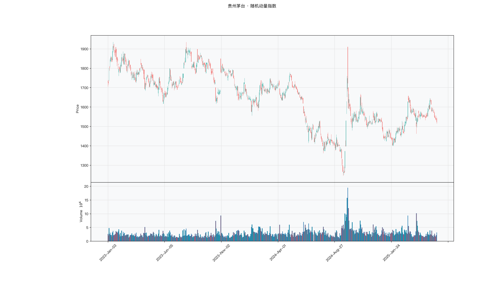

# 第028章 随机动量指数（SMI）

一个交易者复盘一只区间震荡的股票，区间上沿二十元，下沿十五元。收盘十九元时，按端点计的读数已经接近满格，再往上也只从八十走到一百，涨一分与涨一毛在图上几乎没有差别。可价格刚离开中点的那一段，读数从五十走到七十，其中的差别反而更值得看。他想把原点从区间端点挪到中点，让中点两侧的偏离对称展开，正负号直接说明方向。

## 名称与来历

随机动量指数（Stochastic Momentum Index，SMI）。

它由 William Blau 于 1993 年提出，收录在其关于动量与背离的著作中。Blau 的问题针对的是随机指标（KDJ）的一个已知缺陷：KDJ 的超买超卖用区间端点作参照，在趋势市中读数会长期粘在极端区域，失去区分能力。是否能把参照点从端点挪到中间，让读数回归得更自然？

SMI 的答案是改用区间中点作基准。收盘价高于中点记为多头动量，低于中点记为空头动量，偏离程度映射到负 100 到 100 的刻度。以中点为轴的设计让读数天然以零为平衡位，正负号直接对应方向，这比 KDJ 需要自行判断高低位更直观。

SMI 保留了 KDJ 的区间位置思路，改动集中在基准点与平滑方式上。它仍然属于震荡类指标，趋势市中的失效问题只能缓解，不能消除。

## 核心逻辑

观察一只在一个月区间里持续波动的股票，区间上沿 20 元，下沿 15 元，中点 17.5 元。某天收盘 19 元。一个具体的问题是：这个 19 元，代表多头的力量有多强？

如果按端点为参照，19 元距离上沿只有 1 元，读数会显示接近满格，看起来买盘已经用尽。可如果按中点作参照，19 元只比中点高出 1.5 元，而到上沿还有 1 元空间，读数显示的是偏强但仍有空间。两种参照给出的结论方向一致，力度感却差别明显。

SMI 选择中点，背后的考虑是让读数的零点对应一个真正中性的位置。区间端点是价格的极值，靠近端点并不等于力量耗尽，它只说明这一段时间价格走在高位。中点是多空分界，价格在中点上方说明买方在区间内占上风，这个判断比"接近上沿"更接近力量本身。

读数以中点为零轴之后，正负号承担方向，绝对值承担强度。价格贴着上沿时读数接近 100，贴着下沿时接近负 100，落在中点附近时接近零。零轴附近的读数代表平衡，不代表即将反转，这是使用 SMI 时需要先建立的直觉。

## 计算公式

SMI 的计算分四步，默认参数为波动区间 14 日、信号线 3 日。

### 第一步：计算区间中点

$$Mid_t = \frac{H_n + L_n}{2}$$

其中 $H_n$ 为近 n 日最高价，$L_n$ 为近 n 日最低价。中点把区间对半分，作为多空力量的参照轴。

### 第二步：计算价格相对中点的偏离

$$Dev_t = C_t - Mid_t$$

$C_t$ 为当日收盘价。偏离为正表示多头占优，为负表示空头占优。

### 第三步：计算最大可能偏离

$$MaxDev_t = \max(H_n - Mid_t,\ Mid_t - L_n)$$

这一步看起来是在两个候选值中取大者，实际上两者恒等。代入中点的定义可以验证：

$$H_n - Mid_t = \frac{H_n - L_n}{2}, \qquad Mid_t - L_n = \frac{H_n - L_n}{2}$$

两项相等，所以最大可能偏离就是半个区间高度。写成取大者的形式，是为了强调它的物理含义：价格最多只能偏离中点半个区间。

### 第四步：归一化并计算信号线

$$SMI_t = \frac{Dev_t}{MaxDev_t} \times 100$$

$$Signal_t = \frac{1}{3}\sum_{i=0}^{2} SMI_{t-i}$$

把偏离除以半个区间高度，得到的读数必然落在负 100 到 100 之间：收盘价等于上沿时为 100，等于下沿时为负 100，等于中点时为零。信号线是 SMI 的 3 期简单移动平均，用来平滑掉短期抖动。

部分文献在分子与分母上再各施加一次指数平滑，得到更平滑的曲线。本章采用便于实现与解读的形式，与多数交易软件的默认显示接近。

**计算示例。** 取 n = 14。假设近 14 日最高价 20 元，最低价 15 元，则

$$Mid = 17.5, \qquad MaxDev = 2.5$$

当日收盘 19 元，则

$$SMI = \frac{19 - 17.5}{2.5} \times 100 = 60$$

读数落在温和多头区间。若此后连续两日 SMI 分别为 66 与 72，则

$$Signal = \frac{60 + 66 + 72}{3} = 66$$

信号线位于 SMI 之下且同步上行，多头动量的判断得到确认。

**参数与阈值含义。**

| 参数 | 默认值 | 作用 |
|------|--------|------|
| 波动区间 n | 14 | 决定参照区间的长度 |
| 信号线周期 | 3 | 平滑 SMI 线，确认交叉 |

| 读数区间 | 含义 |
|---------|------|
| 大于 80 | 极端多头 |
| 40 到 80 | 温和多头 |
| 负 40 到 40 | 动量平衡 |
| 负 80 到负 40 | 温和空头 |
| 小于负 80 | 极端空头 |

参数缩短时读数波动加大，极端阈值应当相应放宽，例如波动区间改为 8 日时阈值下调到 70；参数拉长时阈值收紧到 85 或 90。

## 用法与信号

**区间读数。** SMI 的数值本身带有强度信息。越过 80 表示价格已接近区间上沿，震荡市中属于考虑止盈的区域；跌破负 80 表示接近下沿，属于留意入场的区域。落在负 40 到 40 之间时，读数只代表多空平衡，不构成任何操作依据。

**线与信号线的交叉。** SMI 线上穿信号线为金叉，下穿为死叉。交叉需要结合位置判断：金叉发生在 SMI 低于 40 的中低位，含义是多头动量启动；金叉发生在 80 以上，多半只是高位反复，参考价值有限。若金叉同时伴随 SMI 由负转正穿越零轴，信号的等级更高。

**零轴穿越。** SMI 线由负转正且信号线同步上行，表示多头取得主导；反向穿越表示空头主导。零轴穿越与交叉的时间窗口常常接近，两者同时出现时，方向判断最清楚。单独出现零轴穿越而信号线未确认时，需要多观察几日。

**背离。** 价格创出新高而 SMI 没有同步刷新新高，是顶背离；价格创出新低而 SMI 没有同步刷新新低，是底背离。SMI 在极端区间出现的背离分量更重，例如顶背离时读数仍停在 80 附近，说明价格与动量之间的落差明显。

## 边界与误区

**零轴附近不是反转信号。** 读数在负 20 到 20 之间徘徊时，只说明多空力量接近均衡，不代表即将转向。此时的交叉信号多数是噪音，强行操作会频繁止损。一个可用的过滤是要求交叉点距零轴至少 20 个点。

**强趋势中会钝化。** ADX 越过 40 之后，单边行情中 SMI 可以长期停留在 60 到 80 之间不回落。此时读数反映的是趋势强劲，不是超买预警。市况判断依然前置，不能跳过。

**单看 SMI 线容易被打扰。** SMI 线的日间跳动不小，一天的收盘位置变化就能让读数移动十几个点。信号线的存在正是为了过滤这类抖动。只看主线不看信号线，等于放弃了指标设计里的一半内容。

**参数改动之后阈值要跟着改。** 缩短波动区间会让读数分布变宽，极值出现得更频繁，沿用 80 的阈值会过度触发。参数与阈值是一组，不能只动一个。

## 它被检验过吗

SMI 缺少针对该指标的独立同行评议检验。现有证据只能来自技术分析规则族的整体检验，而这类检验无法把绩效归因到某一个震荡指标。完整的证据链见第 007 章。

方法上还有一层。SMI 的核心假设是价格围绕区间中点回归，趋势市里这个假设失效。趋势段与震荡段混在同一样本里，正负相抵，很容易得到"接近零"的均值。这个均值既不能证明它有用，也不能证明它没用。

这一类的真实失效案例，见第 020 章的「真实案例与失败模式」。

## 代码实现

### R

```r
library(ettr)
library(efactorcraft)
library(efincharts)
library(ggplot2)

# 本地数据由 xquant-db 导出，字段见 data/README.md
# 同一章会多次用到这两份数据，这里读一次缓存起来，避免反复解压
.cache <- new.env(parent = emptyenv())
.blue <- function() {
  if (!exists("b", .cache)) {
    b <- read.csv("data/parquet/panel_blue_chip.csv", stringsAsFactors = FALSE)
    b$date <- as.Date(b$date)
    assign("b", b, .cache)
  }
  get("b", .cache)
}
.panel <- function() {
  if (!exists("p", .cache)) {
    # 287 只的完整面板压成 gz，read.csv 支持 gz
    p <- read.csv("data/parquet/panel_r.csv.gz", stringsAsFactors = FALSE)
    p$date <- as.Date(p$date)
    p <- p[p$date >= "2023-01-01" & p$date <= "2025-06-01", ]
    assign("p", p, .cache)
  }
  get("p", .cache)
}
blue  <- .blue()
panel <- .panel()

# efincharts 要求 xts 且列名带 Adjusted
as_xts <- function(df) {
  x <- xts::xts(df[, c("open", "high", "low", "close", "volume", "adjusted")],
                order.by = df$date)
  colnames(x) <- c("Open", "High", "Low", "Close", "Volume", "Adjusted")
  x
}

maotai <- .blue()[.blue()$code == "600519.SS", ]

# 1. ettr 在长格式面板上追加指标列
maotai <- add_smi(maotai)

# 2. 基本统计
cols <- setdiff(names(maotai), names(blue))
print(summary(maotai[, cols]))

# 3. K 线 + 成交量 + 均线
ch <- ecandlesticks(as_xts(maotai), show_ma = TRUE, ma_periods = c(20, 60),
                    title = "贵州茅台 · 随机动量指数")
ggsave("assets/figures/ch028/indicator_r.png", ch$combined_plot,
       width = 10, height = 6, dpi = 110)
```

### Python

```python
import pandas as pd
import ettr
import efactorcraft as efc
import efincharts as efc_

# 中文字体：mplfinance 会用 style 里的 rc 覆盖全局设置，必须写进 style
from efincharts import theme
theme.efin_style["rc"] = {
    "font.sans-serif": ["PingFang SC", "Heiti SC", "SimHei"],
    "axes.unicode_minus": False,
    "font.family": "sans-serif",
}

# 本地数据由 xquant-db 导出，字段见 data/README.md
blue = pd.read_parquet("data/parquet/panel_blue_chip.parquet")
panel = pd.read_parquet("data/parquet/panel.parquet")
panel = panel[(panel["date"] >= "2023-01-01") & (panel["date"] <= "2025-06-01")]


def one(df, code="600519.SS"):
    """取单只标的，转成 efincharts 需要的宽表。"""
    x = df[df["code"] == code].sort_values("date").set_index("date")
    x.columns = [c.capitalize() for c in x.columns]
    return x

# 1. 取单只标的
maotai = blue[blue['code'] == '600519.SS'].copy()

# 2. ettr 在长格式面板上追加指标列，不需要手工 rolling
maotai = ettr.smi(maotai)

cols = [c for c in maotai.columns if c not in blue.columns]
print(maotai[cols].describe().round(3))

# 3. 画图：K 线 + 成交量 + 指标面板
px = one(maotai)
ch = efc_.candlestick(px, volume=True, title="贵州茅台 · 随机动量指数")
ch.save("assets/figures/ch028/indicator.png")
```

<!-- fig-indicator:start -->


<p class="figcap">图 28-1　随机动量指数在贵州茅台上的读数（2023-01 至 2025-06）</p>
<!-- fig-indicator:end -->

## 拆解

SMI 的读数有界且以零为轴，可以直接进横截面，不需要平移。需要处理的是三件事：分布中心不在零，两端读数被压缩，区间过窄时分母失真。

| 特征名 | 计算式 | 量纲 | 经济含义 |
|--------|--------|------|----------|
| 读数 | $SMI_t^{(14)}$ | 负 100 到 100 | 价格在区间中的相对位置 |
| 零轴偏离 | $SMI_t-\overline{SMI}^{(60)}$ | 点 | 相对自身近期中枢的位置 |
| 与信号线的差 | $SMI_t-Signal_t$ | 点 | 动量的边际变化，即柱状值 |
| 极值状态 | $\mathrm{sign}(SMI_t)\cdot\mathbf{1}\left[\lvert SMI_t\rvert>80\right]$ | 负 1、0、正 1 | 是否处在区间极端 |

四者的关系需要分清。读数与零轴偏离同源，后者只是换了参照，前者回答现在偏多还是偏空，后者回答比近期中枢更偏哪一侧。柱状值是读数与三日均线之差，属于快变项，与读数的一阶差分高度相关，换手明显高于读数本身。极值状态是稀疏标记，多数时点为零，不能当连续因子排序。

零轴的含义与 CMO 不同。SMI 的零轴是区间中点，随上下沿移动；区间收窄时，很小的价格变动就能把读数推到极端。读数高不一定代表力量强，可能只是区间窄。这是 SMI 与 RSI、CMO 在解释上的一处差别，也是窄区间样本要单独处理的原因。跨品种比较读数时，先看区间宽度，再看读数高低，顺序反了容易把波动差异当成动量差异。

极值状态的稀疏性决定了它的用法。横截面上多数时点没有标的落在极端区，按它排序会退化成随机；可行的做法是事件研究，比较触发后若干日的收益与其余交易日。这一点与柱状值相反，后者每天都有取值，适合连续排序，代价是换手高。

### R

```r
library(ettr)
library(efactorcraft)
library(efincharts)
library(ggplot2)

# 本地数据由 xquant-db 导出，字段见 data/README.md
# 同一章会多次用到这两份数据，这里读一次缓存起来，避免反复解压
.cache <- new.env(parent = emptyenv())
.blue <- function() {
  if (!exists("b", .cache)) {
    b <- read.csv("data/parquet/panel_blue_chip.csv", stringsAsFactors = FALSE)
    b$date <- as.Date(b$date)
    assign("b", b, .cache)
  }
  get("b", .cache)
}
.panel <- function() {
  if (!exists("p", .cache)) {
    # 287 只的完整面板压成 gz，read.csv 支持 gz
    p <- read.csv("data/parquet/panel_r.csv.gz", stringsAsFactors = FALSE)
    p$date <- as.Date(p$date)
    p <- p[p$date >= "2023-01-01" & p$date <= "2025-06-01", ]
    assign("p", p, .cache)
  }
  get("p", .cache)
}
blue  <- .blue()
panel <- .panel()

# efincharts 要求 xts 且列名带 Adjusted
as_xts <- function(df) {
  x <- xts::xts(df[, c("open", "high", "low", "close", "volume", "adjusted")],
                order.by = df$date)
  colnames(x) <- c("Open", "High", "Low", "Close", "Volume", "Adjusted")
  x
}

d <- .blue()[.blue()$code == "600519.SS", ]
d <- add_smi(d)

# 转成无量纲因子
d$f <- d$`SMI`

print(summary(d$f))
```

### Python

```python
import pandas as pd
import ettr
import efactorcraft as efc
import efincharts as efc_

# 中文字体：mplfinance 会用 style 里的 rc 覆盖全局设置，必须写进 style
from efincharts import theme
theme.efin_style["rc"] = {
    "font.sans-serif": ["PingFang SC", "Heiti SC", "SimHei"],
    "axes.unicode_minus": False,
    "font.family": "sans-serif",
}

# 本地数据由 xquant-db 导出，字段见 data/README.md
blue = pd.read_parquet("data/parquet/panel_blue_chip.parquet")
panel = pd.read_parquet("data/parquet/panel.parquet")
panel = panel[(panel["date"] >= "2023-01-01") & (panel["date"] <= "2025-06-01")]


def one(df, code="600519.SS"):
    """取单只标的，转成 efincharts 需要的宽表。"""
    x = df[df["code"] == code].sort_values("date").set_index("date")
    x.columns = [c.capitalize() for c in x.columns]
    return x

# 1. 先在面板上算原始指标
d = panel.copy()
d = ettr.smi(d)

# 2. 转成无量纲因子，才能跨标的排序
d["f"] = d["SMI"]

print(d["f"].describe().round(4))
```

## 截面选股能力

SMI 的横截面因子用读数，

$$f^{smi}_t=SMI_t^{(14)}$$

另一个用柱状值，

$$f^{bar}_t=SMI_t-Signal_t$$

前者是状态，后者是边际。状态类因子适合月频调仓，边际类适合周频，两者的 IC 衰减速度不同，报告时要分开。

**方向要由样本判定。** 读数高可以解释为接近区间上沿、超买将回落，对应负向因子；也可以解释为买盘持续占优、强势延续，对应正向因子。SMI 的设计意图偏前者，它以中点为轴，本意是提示价格的极端位置。但强趋势中读数长期停在 60 到 80 之间，正向解释更贴合实际。判断只能回到数据：先算全样本 IC 看符号，再按年份、按趋势强弱分段，看符号是否稳定。全样本接近零而分段清晰，是这类因子的常态。

预期上，SMI 与未来收益的关系可能不是单调的。两端对应超买超卖，反转倾向明显；中段对应动量平衡，方向信息很弱。若真是这样，分层收益会呈 U 形，单调性判据不适用，应当看首末档与中间档的差。遇到 U 形关系，因子构造宜改成两端分组的多空组合，全样本排序会把两端的信息相互抵消。市况依赖也清楚：震荡市中反转占优，强趋势中钝化，读数长期停在一侧。标的层面，区间清晰的品种更适合，单边突破的品种容易失真。

检验时有三点值得注意。第一，SMI 与 KDJ 同源，都基于区间位置，SMI 多了一层中点偏离，两者截面相关性通常较高，判断增量时应做 IC 对照，并把 SMI 对区间位置取残差，残差仍有预测力才算独立信息。第二，区间极窄的样本要剔除，否则读数会在正负 100 之间跳变，排序被一两只有涨跌停的标的占据。第三，柱状值的换手高，比较它与读数的 ICIR 时要同时报告换手，否则会把交易频率带来的差异误读成预测能力。读数分布还随参数变化，n 从 14 改到 8，两端被压缩的程度不同，分档边界与极端阈值都要重定。

### R

```r
library(ettr)
library(efactorcraft)
library(efincharts)
library(ggplot2)

# 本地数据由 xquant-db 导出，字段见 data/README.md
# 同一章会多次用到这两份数据，这里读一次缓存起来，避免反复解压
.cache <- new.env(parent = emptyenv())
.blue <- function() {
  if (!exists("b", .cache)) {
    b <- read.csv("data/parquet/panel_blue_chip.csv", stringsAsFactors = FALSE)
    b$date <- as.Date(b$date)
    assign("b", b, .cache)
  }
  get("b", .cache)
}
.panel <- function() {
  if (!exists("p", .cache)) {
    # 287 只的完整面板压成 gz，read.csv 支持 gz
    p <- read.csv("data/parquet/panel_r.csv.gz", stringsAsFactors = FALSE)
    p$date <- as.Date(p$date)
    p <- p[p$date >= "2023-01-01" & p$date <= "2025-06-01", ]
    assign("p", p, .cache)
  }
  get("p", .cache)
}
blue  <- .blue()
panel <- .panel()

# efincharts 要求 xts 且列名带 Adjusted
as_xts <- function(df) {
  x <- xts::xts(df[, c("open", "high", "low", "close", "volume", "adjusted")],
                order.by = df$date)
  colnames(x) <- c("Open", "High", "Low", "Close", "Volume", "Adjusted")
  x
}

d <- .panel()
d <- add_smi(d)

d$f <- d$`SMI`
d <- add_next_return(d, close_col = "close", n = c(1, 5, 20))

ic <- ic_analysis(d, factor_cols = "f",
                    forward_cols = c("forward_1", "forward_5", "forward_20"),
                    method = "spearman")
print(ir_analysis(ic))

q <- quantile_analysis(d, factor_cols = "f", forward_cols = "forward_5",
                       n_groups = 5)
print(q$f$summary)
```

### Python

```python
import pandas as pd
import ettr
import efactorcraft as efc
import efincharts as efc_

# 中文字体：mplfinance 会用 style 里的 rc 覆盖全局设置，必须写进 style
from efincharts import theme
theme.efin_style["rc"] = {
    "font.sans-serif": ["PingFang SC", "Heiti SC", "SimHei"],
    "axes.unicode_minus": False,
    "font.family": "sans-serif",
}

# 本地数据由 xquant-db 导出，字段见 data/README.md
blue = pd.read_parquet("data/parquet/panel_blue_chip.parquet")
panel = pd.read_parquet("data/parquet/panel.parquet")
panel = panel[(panel["date"] >= "2023-01-01") & (panel["date"] <= "2025-06-01")]


def one(df, code="600519.SS"):
    """取单只标的，转成 efincharts 需要的宽表。"""
    x = df[df["code"] == code].sort_values("date").set_index("date")
    x.columns = [c.capitalize() for c in x.columns]
    return x

# 287 只、2023-01 至 2025-06，横截面才有统计意义
src = panel.copy()
d = src.copy()

# 1. 算指标
d = ettr.smi(d)


# 2. 因子 + 未来收益
d["f"] = d["SMI"]
d = efc.add_next_return(d, periods=(1, 5, 20))

# 3. 截面 IC 与分层
ic = efc.ic_analysis(d, factor_cols="f",
                      forward_cols=["forward_1", "forward_5", "forward_20"],
                      method="spearman")
print(efc.ir_analysis(ic).round(3))

q = efc.quantile_analysis(d, factor_col="f", forward_col="forward_5", n_groups=5)
print(q["summary"].round(4))
```

三行 IC 并排看。SMI 与区间位置的差距，就是中点偏离这一层设计带来的增量；差距接近零，说明两个指标在选股上是同一份信息，同时使用没有意义。柱状值那一行若明显更强，说明边际变化比位置本身更有预测力，代价是换手更高。

<!-- tab-ic:start -->
**计算结果**

| 前向期 | IC 均值 | IC 标准差 | ICIR | t 值 | IC>0 占比 | 期数 |
|---|---|---|---|---|---|---|
| T+1 | -0.0043 | 0.2277 | -0.019 | -0.45 | 0.5170 | 557 |
| T+5 | -0.0130 | 0.2124 | -0.061 | -1.44 | 0.4990 | 553 |
| T+20 | -0.0327 | 0.1972 | -0.166 | -3.84 | 0.4800 | 538 |

表里最该看的是 t 值，不是 IC 均值。这个因子以 T+1 为主口径，IC 均值 -0.0043、ICIR -0.019、t 值 -0.45，在常规门槛下不显著，方向为反向。按第 007 章给出的日频门槛（ICIR 0.13 对应 t≈2），这个结果的含义是：还看不出与噪声的区别，不能据此构造策略。

需要提醒的是，这只说明排序与未来收益之间存在可测的关联，不代表扣掉成本后还能剩下收益。横截面 IC 检验的是“买哪只”，不负责“值不值得交易”。

**五档分层**

| 分组 | 平均收益 | 标准差 | 期数 |
|---|---|---|---|
| 1 | +0.0040 | +0.0396 | 553 |
| 2 | +0.0031 | +0.0324 | 553 |
| 3 | +0.0027 | +0.0329 | 553 |
| 4 | +0.0010 | +0.0328 | 553 |
| 5 | +0.0049 | +0.0367 | 553 |

五档分层看的是形状，不是单点。最高一档在第 5 组、最低在第 4 组，两端相差 +0.09%，组序号与平均收益的秩相关为 -0.03，没有明显单调性。

分层比 IC 更接近实盘，因为它直接给出“买最高档、卖最低档”的收益差。但这里的数字是毛收益，且没有考虑涨跌停买不进、停牌卖不出的情形，真实可得的差额会小于表中所列。
<!-- tab-ic:end -->

## 择时能力

SMI 的时序信息分四层。区间读数是位置层，越过正负 80 属于极端。线与信号线的交叉是确认层，金叉在低位比在高位有分量。零轴穿越是方向层，由负转正说明多头取得主导。背离是衰减层，价格创新高而读数没有同步，提示力量在退。

方法要与信号形态匹配。交叉是离散事件，适合触发日检验。读数是连续变量，适合条件分位收益，重点看两端是否都比中段特殊。回测则要跑两种方向：读数高时持仓的顺势写法，与读数低时持仓的反向写法，两者含义相反，结果也不同。

这一节的方向取舍比前几章更明显。SMI 的教科书用法是反向的，越过 80 考虑止盈，跌破负 80 留意入场。把它写成持仓规则时，可以要求读数低于某分位才持仓，也可以要求读数高于某分位才持仓。两条规则都值得跑，比较年化收益、夏普与最大回撤，再决定采用哪一条。符号不是从定义里读出来的，是从样本里读出来的。

陷阱有三处。第一，零轴附近的交叉噪音多，不加过滤会频繁止损，一个可用的办法是要求交叉点距零轴有足够距离。第二，强趋势中读数钝化，ADX 越过 40 之后读数长期停在 60 到 80，按超买操作会过早离场。第三，信号按收盘确认，成交放在次日，按当日收盘价成交会引入未来信息。

### R

```r
library(ettr)
library(efactorcraft)
library(efincharts)
library(ggplot2)

# 本地数据由 xquant-db 导出，字段见 data/README.md
# 同一章会多次用到这两份数据，这里读一次缓存起来，避免反复解压
.cache <- new.env(parent = emptyenv())
.blue <- function() {
  if (!exists("b", .cache)) {
    b <- read.csv("data/parquet/panel_blue_chip.csv", stringsAsFactors = FALSE)
    b$date <- as.Date(b$date)
    assign("b", b, .cache)
  }
  get("b", .cache)
}
.panel <- function() {
  if (!exists("p", .cache)) {
    # 287 只的完整面板压成 gz，read.csv 支持 gz
    p <- read.csv("data/parquet/panel_r.csv.gz", stringsAsFactors = FALSE)
    p$date <- as.Date(p$date)
    p <- p[p$date >= "2023-01-01" & p$date <= "2025-06-01", ]
    assign("p", p, .cache)
  }
  get("p", .cache)
}
blue  <- .blue()
panel <- .panel()

# efincharts 要求 xts 且列名带 Adjusted
as_xts <- function(df) {
  x <- xts::xts(df[, c("open", "high", "low", "close", "volume", "adjusted")],
                order.by = df$date)
  colnames(x) <- c("Open", "High", "Low", "Close", "Volume", "Adjusted")
  x
}

idx <- read.csv("data/parquet/index_daily.csv", stringsAsFactors = FALSE)
idx$date <- as.Date(idx$date)
t <- idx[idx$code == "510300.SS", ]
t <- add_smi(t)
t$f <- t$`SMI`
t$forward_5 <- c(tail(t$close, -5) / head(t$close, -5) - 1, rep(NA, 5))
t$q <- cut(t$f, quantile(t$f, 0:5/5, na.rm = TRUE), include.lowest = TRUE, labels = FALSE)
print(aggregate(forward_5 ~ q, data = t, FUN = function(x)
  c(mean = mean(x, na.rm = TRUE), n = sum(!is.na(x)))))
```

### Python

```python
import pandas as pd
import ettr
import efactorcraft as efc
import efincharts as efc_

# 中文字体：mplfinance 会用 style 里的 rc 覆盖全局设置，必须写进 style
from efincharts import theme
theme.efin_style["rc"] = {
    "font.sans-serif": ["PingFang SC", "Heiti SC", "SimHei"],
    "axes.unicode_minus": False,
    "font.family": "sans-serif",
}

# 本地数据由 xquant-db 导出，字段见 data/README.md
blue = pd.read_parquet("data/parquet/panel_blue_chip.parquet")
panel = pd.read_parquet("data/parquet/panel.parquet")
panel = panel[(panel["date"] >= "2023-01-01") & (panel["date"] <= "2025-06-01")]


def one(df, code="600519.SS"):
    """取单只标的，转成 efincharts 需要的宽表。"""
    x = df[df["code"] == code].sort_values("date").set_index("date")
    x.columns = [c.capitalize() for c in x.columns]
    return x

# 择时检验用 ETF 做市场载体，指数本身没有日线数据
idx = pd.read_parquet("data/parquet/index_daily.parquet")
idx = idx[idx["code"] == "510300.SS"].sort_values("date")
t = idx.copy()

# 1. 在 ETF 上算同一个指标
t = ettr.smi(d)


# 2. 按因子分位看未来 5 日收益
t["f"] = t["SMI"]
t["forward_5"] = t["close"].shift(-5) / t["close"] - 1
# 因子可能有重复值，先按名次切，避免 qcut 报边界不唯一
t["q"] = pd.qcut(t["f"].rank(method="first"), 5, labels=False) + 1
t = t.dropna(subset=["f", "forward_5"])
print(t.groupby("q")["forward_5"].agg(["mean", "count"]).round(4))
```

第四项的因子取了负号，等于把"超卖"变成高分位，这是震荡类指标做择时检验时的常用处理。两项触发检验要一起看：上尾显著说明高读数之后有回落，负向端显著说明低读数之后有反弹，两端都显著才谈得上对称的反转关系。

<!-- tab-timing:start -->
**分位收益**

| 分位 | 未来 5 日均值 | 样本数 |
|---|---|---|
| 1 | +0.0040 | 218 |
| 2 | -0.0041 | 217 |
| 3 | -0.0004 | 217 |
| 4 | +0.0016 | 217 |
| 5 | -0.0012 | 218 |

择时口径与截面不同：这里只有一个标的，看的是同一标的在不同分位下的未来收益。最高与最低分位相差 -0.52%。单标的样本有限，这个差额很容易被一两段行情主导，只能作为方向参考。

真正做择时要问的是三件事：分位阈值是否稳定、换手是否可控、扣成本后是否还有剩余。三者缺一，择时信号就只是图上好看。
<!-- tab-timing:end -->

## 组合使用与验证

SMI 的搭档有三个。与 ADX 搭配，用趋势强度决定是否相信反转信号，互补点是市况。与均线搭配，用均线给方向前提，只在顺势方向上接受超卖信号，互补点是前提。与 KDJ 搭配要谨慎，两者同源，加权只会重复计价，正交化才是合适的处理。

**组合的截面验证。** 把 SMI 对 KDJ 的区间位置取横截面残差，用残差重新走一遍截面检验，比较 SMI、区间位置与残差三者的 ICIR。残差仍有预测力，说明中点偏离这一层带来了独立信息；残差接近零，说明两者是同一份信息，同时使用没有意义。

**组合的择时验证。** 把"读数低于负 20 且价格站上二十日均线"作为持仓条件，与单用低读数对照，比较年化收益、夏普、最大回撤与信号次数。均线在这里补的是方向，因为超卖信号在下跌趋势中会连续触发。

增益判读按方法论章的标准：组合的 ICIR 高于两个单特征，才说明存在互补性；介于两者之间，说明只是平均；低于两者，说明信号冲突。SMI 与区间位置的组合属于特殊情况，判据不是 ICIR 变高，而是残差是否仍有 IC，这一点在报告里要写清楚。

### R

```r
library(ettr)
library(efactorcraft)
library(efincharts)
library(ggplot2)

# 本地数据由 xquant-db 导出，字段见 data/README.md
# 同一章会多次用到这两份数据，这里读一次缓存起来，避免反复解压
.cache <- new.env(parent = emptyenv())
.blue <- function() {
  if (!exists("b", .cache)) {
    b <- read.csv("data/parquet/panel_blue_chip.csv", stringsAsFactors = FALSE)
    b$date <- as.Date(b$date)
    assign("b", b, .cache)
  }
  get("b", .cache)
}
.panel <- function() {
  if (!exists("p", .cache)) {
    # 287 只的完整面板压成 gz，read.csv 支持 gz
    p <- read.csv("data/parquet/panel_r.csv.gz", stringsAsFactors = FALSE)
    p$date <- as.Date(p$date)
    p <- p[p$date >= "2023-01-01" & p$date <= "2025-06-01", ]
    assign("p", p, .cache)
  }
  get("p", .cache)
}
blue  <- .blue()
panel <- .panel()

# efincharts 要求 xts 且列名带 Adjusted
as_xts <- function(df) {
  x <- xts::xts(df[, c("open", "high", "low", "close", "volume", "adjusted")],
                order.by = df$date)
  colnames(x) <- c("Open", "High", "Low", "Close", "Volume", "Adjusted")
  x
}

d <- .panel()
d <- add_smi(d)
d$f1 <- d$`SMI`
d <- add_cmf(d, n = 20)
d$f2 <- d$CMF
d <- add_next_return(d, close_col = "close", n = 5)
ic1 <- ic_analysis(d, factor_cols = c("f1", "f2"),
                    forward_cols = "forward_5", method = "spearman")
print(ir_analysis(ic1))
```

```r
library(ettr)
library(efactorcraft)
library(efincharts)
library(ggplot2)

# 本地数据由 xquant-db 导出，字段见 data/README.md
# 同一章会多次用到这两份数据，这里读一次缓存起来，避免反复解压
.cache <- new.env(parent = emptyenv())
.blue <- function() {
  if (!exists("b", .cache)) {
    b <- read.csv("data/parquet/panel_blue_chip.csv", stringsAsFactors = FALSE)
    b$date <- as.Date(b$date)
    assign("b", b, .cache)
  }
  get("b", .cache)
}
.panel <- function() {
  if (!exists("p", .cache)) {
    # 287 只的完整面板压成 gz，read.csv 支持 gz
    p <- read.csv("data/parquet/panel_r.csv.gz", stringsAsFactors = FALSE)
    p$date <- as.Date(p$date)
    p <- p[p$date >= "2023-01-01" & p$date <= "2025-06-01", ]
    assign("p", p, .cache)
  }
  get("p", .cache)
}
blue  <- .blue()
panel <- .panel()

# efincharts 要求 xts 且列名带 Adjusted
as_xts <- function(df) {
  x <- xts::xts(df[, c("open", "high", "low", "close", "volume", "adjusted")],
                order.by = df$date)
  colnames(x) <- c("Open", "High", "Low", "Close", "Volume", "Adjusted")
  x
}

d <- .panel()
d <- add_smi(d)
d$f1 <- d$`SMI`
d <- add_cmf(d, n = 20)
d$f2 <- d$CMF
d <- add_next_return(d, close_col = "close", n = 5)
ic1 <- ic_analysis(d, factor_cols = c("f1", "f2"),
                    forward_cols = "forward_5", method = "spearman")
print(ir_analysis(ic1))
```

### Python

```python
import pandas as pd
import ettr
import efactorcraft as efc
import efincharts as efc_

# 中文字体：mplfinance 会用 style 里的 rc 覆盖全局设置，必须写进 style
from efincharts import theme
theme.efin_style["rc"] = {
    "font.sans-serif": ["PingFang SC", "Heiti SC", "SimHei"],
    "axes.unicode_minus": False,
    "font.family": "sans-serif",
}

# 本地数据由 xquant-db 导出，字段见 data/README.md
blue = pd.read_parquet("data/parquet/panel_blue_chip.parquet")
panel = pd.read_parquet("data/parquet/panel.parquet")
panel = panel[(panel["date"] >= "2023-01-01") & (panel["date"] <= "2025-06-01")]


def one(df, code="600519.SS"):
    """取单只标的，转成 efincharts 需要的宽表。"""
    x = df[df["code"] == code].sort_values("date").set_index("date")
    x.columns = [c.capitalize() for c in x.columns]
    return x

d = panel.copy()

# 1. 本章因子
d = ettr.smi(d)
d["f1"] = d["SMI"]

# 2. 配一个量价因子做对照
d = ettr.cmf(d, n=20)
d["f2"] = d["CMF_20"]
d = efc.add_next_return(d, periods=(5,))

# 3. 单因子与等权组合的信息比率
ic = efc.ic_analysis(d, factor_cols=["f1", "f2"], forward_cols=["forward_5"],
                      method="spearman")
d = efc.equal_weighted_composite(d, factor_cols=["f1", "f2"], new_col="f1_f2")
ic2 = efc.ic_analysis(d, factor_cols=["f1_f2"], forward_cols=["forward_5"],
                      method="spearman")
ic.update(ic2)
print(efc.ir_analysis(ic).round(3))
```

```python
import pandas as pd
import ettr
import efactorcraft as efc
import efincharts as efc_

# 中文字体：mplfinance 会用 style 里的 rc 覆盖全局设置，必须写进 style
from efincharts import theme
theme.efin_style["rc"] = {
    "font.sans-serif": ["PingFang SC", "Heiti SC", "SimHei"],
    "axes.unicode_minus": False,
    "font.family": "sans-serif",
}

# 本地数据由 xquant-db 导出，字段见 data/README.md
blue = pd.read_parquet("data/parquet/panel_blue_chip.parquet")
panel = pd.read_parquet("data/parquet/panel.parquet")
panel = panel[(panel["date"] >= "2023-01-01") & (panel["date"] <= "2025-06-01")]


def one(df, code="600519.SS"):
    """取单只标的，转成 efincharts 需要的宽表。"""
    x = df[df["code"] == code].sort_values("date").set_index("date")
    x.columns = [c.capitalize() for c in x.columns]
    return x

d = panel.copy()

# 1. 本章因子
d = ettr.smi(d)
d["f1"] = d["SMI"]

# 2. 配一个量价因子做对照
d = ettr.cmf(d, n=20)
d["f2"] = d["CMF_20"]
d = efc.add_next_return(d, periods=(5,))

# 3. 单因子与等权组合的信息比率
ic = efc.ic_analysis(d, factor_cols=["f1", "f2"], forward_cols=["forward_5"],
                      method="spearman")
d = efc.equal_weighted_composite(d, factor_cols=["f1", "f2"], new_col="f1_f2")
ic2 = efc.ic_analysis(d, factor_cols=["f1_f2"], forward_cols=["forward_5"],
                      method="spearman")
ic.update(ic2)
print(efc.ir_analysis(ic).round(3))
```

三行截面输出的读法与别章不同。这里不比谁高，而是看残差是否还活着：残差 IC 若明显异于零，说明 SMI 的中点偏离有独立贡献；残差接近零，说明它只是区间位置的另一种写法。择时那一组若信号次数少而回撤明显改善，说明均线过滤把下跌趋势中的连续超卖信号挡在了门外。

## AI 引导词

::: prompt 引导词 1：基准点选择的对照

随机动量指数（SMI）用区间中点作基准，不采用端点。我想验证这个选择的价值。请帮我实现一个对照：1）在同一段数据上分别构造以中点为基准的 SMI 与以下沿为基准的随机指标（KDJ 的 RSV），两者都映射到负 100 到 100；2）计算两条序列的均值、标准差、极值分布以及落在极端区间的天数占比；3）统计两者在趋势段与震荡段的读数分布差异；4）用文字说明中点基准在减少钝化方面是否真的有效。请只使用 pandas、numpy、yfinance、matplotlib，输出完整代码与结论。

:::
::: prompt 引导词 2：交叉信号的过滤条件

随机动量指数（SMI）的金叉死叉在零轴附近噪音很多，我想加过滤条件。请帮我做一次比较检验：1）构造三类交叉信号，分别是无过滤、要求交叉点距零轴至少 20 点、要求交叉点同方向且信号线同步；2）对每类信号统计未来 1 日、5 日、10 日收益的均值与胜率；3）输出对比表，并给出信号数量与胜率的权衡关系；4）说明哪一类过滤最适合月频调仓的策略。数据请用至少 20 只 A 股标的的日线，代码只使用 pandas、numpy、yfinance、matplotlib。

:::
::: prompt 引导词 3：与随机指标的信息重叠

我打算同时使用随机动量指数（SMI）与随机指标（KDJ）作为选股因子，担心两者信息重叠。请帮我量化它们的关系：1）分别构造 SMI 位置因子与 KDJ 的 K 减 D 差值因子；2）计算两个因子在每个时点上的截面相关系数序列，并报告均值与波动；3）把两个因子做正交化处理，取 SMI 对 KDJ 回归的残差作为新因子；4）对比原始因子与正交化因子的 Rank IC、ICIR 与分层收益，说明正交化是否带来增量信息。请给出可直接运行的 Python 代码。

:::
