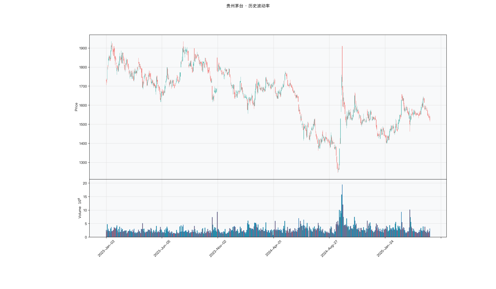

# 第031章 历史波动率（HV）

两个标的摆在同一个屏幕上，一个日内来回拉扯，另一个全天走得平缓，却在开盘时留下一个跳空。他把两者都称为波动大，可止损该放多远、仓位该压到几成，答案并不相同。用最高减最低去量，前者被放大，后者被抹平；只看收盘价，前者被摊薄，后者只剩缺口那一下。他需要分别度量日内摆动与隔夜跳空，再换算成可横向比较的比例。两只标的的波动究竟差在哪里，差多少。

## 名称与来历

历史波动率（Historical Volatility，HV）。

它没有单一提出者。波动率这个概念来自金融数学，标准差作为离散程度的度量工具，早在二十世纪中期就被用于刻画资产收益的不确定性。把这一思路直接搬到价格序列上，对过去一段时期的收益率求标准差并年化，就得到历史波动率。它最初并不是一个技术指标，而是数学与统计工具在金融数据上的自然应用，后来被交易者接受，成为一种描述市场状态的常用语言。

在同一族里，HV 与期权定价中的隐含波动率形成对照。隐含波动率从期权价格反推市场对未来的预期，HV 则只回顾已经发生的价格。前者是前瞻的，后者是回顾的，两者的差值是专业交易者关注的信息之一。

## 核心逻辑

如果昨天市场剧烈震荡，今天大概率会平静下来吗？

历史数据的回答往往是：不一定，但更可能继续剧烈。金融市场的波动率有惯性，剧烈波动之后常常继续剧烈，平静之后常常继续平静。这个现象称为波动率聚类，是时间序列里最稳健的统计特征之一。它意味着波动幅度虽然难以精确预测，但方向性上有规律可循：大波动聚集在时间上，小波动聚集在时间上。

HV 就是刻画这种惯性的工具。它把过去一段时间内的收益率波动压缩成一个数字，读数高表示市场在剧烈运动，读数低表示市场沉闷。由于惯性存在，这个读数对未来的波动水平具备参考价值，尽管它无法说明未来的涨跌方向。

一个需要先讲清楚的性质是，HV 是回顾的。它只反映窗口内发生了什么，窗口越长，读数越平滑但越迟钝。当重大事件发生时，HV 会迅速飙升，但冲击的方向它完全不表达。因此 HV 适合作为环境判断工具，用来区分"暴风雨"和"平静期"，而不适合作为独立的择时信号。

一个常见的疑问是，HV 与价格的方向完全无关，为何仍有价值。答案在它的用途上：交易决策可以拆成判断方向与决定风险敞口两部分。HV 不参与前者，却在后者中扮演核心角色。仓位大小、止损宽度、策略切换，这些决策都需要一个对波动环境的估计，HV 正是这样一个估计。把方向交给趋势指标，把敞口交给波动率指标，两者各司其职，这是 HV 的合理定位。

## 计算公式

HV 三步：先算对数收益率，再算标准差，最后年化。

### 第一步：对数收益率

$$r_t = \ln\left(\frac{C_t}{C_{t-1}}\right)$$

其中 $C_t$ 为第 t 日收盘价。选择对数收益率，是因为它在时间上可加，若干日的累计对数收益率等于各日对数收益率之和，数学性质优于简单收益率。

### 第二步：样本标准差

$$\sigma_{daily}(n) = \sqrt{\frac{1}{n-1}\sum_{i=0}^{n-1}\left(r_{t-i} - \bar{r}\right)^2}$$

其中 n 为回望窗口，$\bar{r}$ 为窗口内的平均收益率。实务中也常把 $\bar{r}$ 近似为 0，用 $\sigma_{daily}(n)\approx\sqrt{\frac{1}{n}\sum_{i=0}^{n-1}r_{t-i}^2}$ 简化。

### 第三步：年化

$$HV(n) = \sigma_{daily}(n) \times \sqrt{252}$$

年化因子取 $\sqrt{252}$，是因为 A 股一年约有 252 个交易日，而波动率在独立假设下随时间按平方根缩放。

**计算示例。** 假设某股过去 20 个交易日的日收益率标准差为 1.5%，则

$$HV(20) = 1.5\% \times \sqrt{252} \approx 1.5\% \times 15.87 \approx 23.8\%$$

含义是：以过去 20 日的日波动水平外推，未来一年的波动幅度大致在 23.8% 的量级，大致对应约 68% 的时间落在正负 23.8% 的区间内。

**参数含义。**

| 参数 | 含义 | 常见取值 | 影响 |
|------|------|---------|------|
| n | 回望窗口 | 10（双周）、20（月度，常用）、60（季度）、120（半年） | n 越大，读数越平滑，对近期波动反应越慢 |
| $\bar{r}$ | 窗口平均收益率 | 样本均值或近似为 0 | 影响较小，长窗口下可忽略 |
| 年化因子 | 由日频换算到年频 | $\sqrt{252}$ | 固定口径，便于跨品种比较 |

短窗口灵敏，能更快反映波动变化，代价是噪音大。长窗口平滑，适合判断波动的大周期变迁，代价是转点滞后。实战中常用双周期组合，比如同时看 HV(20) 与 HV(60)，短周期上穿长周期时波动进入扩张，下穿时波动进入收缩。

### 双周期组合

单窗口只能给出一个波动读数，两个窗口的相对位置能反映波动的变化方向。

| 组合读数 | 含义 | 常见对应状态 |
|---------|------|-------------|
| HV(20) 高于 HV(60) | 近期波动高于长期水平 | 波动扩张 |
| HV(20) 低于 HV(60) | 近期波动低于长期水平 | 波动收缩 |

两个窗口的绝对水平会随品种不同而差异很大，它们之间的相对关系则相对稳定。短周期上穿长周期，说明近期波动在抬升，常出现在行情启动前后；下穿则说明波动在回落，市场能量在衰减。这个相对关系比单一读数更能反映波动的方向性变化，也更适合跨品种比较。

## 用法与信号

**低位挤压。** HV 持续走低并落到近期历史低位（例如 10 百分位以下），说明市场进入低波动状态，多空双方高度观望，成交清淡，能量在累积。这种状态通常不会长期维持，历史上低波动之后往往跟随一波方向明确的突破。合理的做法是不预先押注方向，等价格带量突破关键区间后顺势跟随。

**高位趋势中。** HV 走高到历史高位（例如 90 百分位以上），说明市场正在剧烈运动。此时若趋势明确（平均趋向指数高于 25），可跟随趋势并动态收紧止损；若波动剧烈而方向来回摆动，市场进入高波动震荡，通常应减少操作，避免被双向扫损。

**由低转高。** HV 从低位连续多日回升，是波动扩张的确认，往往对应新趋势的启动。结合价格突破的方向入场，趋势跟随策略在这个阶段的有效性通常较高。

**由高转低。** HV 从高位持续回落，说明市场在降温，趋势的能量在衰减。可逐步减仓或收紧止损；HV 回落到中位之后，若价格转入区间运行，策略可切换到均值回归。

**波动状态的三分法。** 把 HV 换算成历史百分位，便于在不同标的间统一口径。

| 状态 | HV 百分位 | 市场特征 | 常见匹配策略 |
|------|----------|---------|-------------|
| 低波动 | 0 到 33% | 平静、横盘、蓄力 | 均值回归、网格 |
| 中波动 | 33 到 67% | 温和波动、趋势温和 | 趋势跟随、波段 |
| 高波动 | 67 到 100% | 剧烈、趋势加速或恐慌 | 趋势跟随（宽止损）、降低仓位 |

**与隐含波动率的对照。** 期权市场里有一个前瞻性的波动率，隐含波动率（IV），它从期权价格反推市场对未来波动的预期。IV 高于 HV，说明市场预期未来波动将放大；IV 低于 HV，说明市场预期波动将收窄。两者的差值是期权交易关注的信息。这个对照有助于把 HV 的定位看得更清楚：它是回顾性的度量，与前瞻性的预期应当分开使用，不能互相替代。

**与 ATR 的分工。** HV 与 ATR 都在度量波动，但口径不同。HV 用收益率的标准差，输出是无量纲的百分比，天然可以跨品种、跨时期比较；ATR 用价格的真实波幅，输出与价格同量纲，更适合直接参与仓位与止损的绝对金额计算。需要横向比较波动高低时看 HV，需要给出以元为单位的止损距离时看 ATR。两者并行使用，覆盖了波动度量的两个需求。

在完整的系统里，这两类指标通常一起出现：ATR 决定止损的绝对距离与仓位大小，HV 决定当前处于哪种波动环境、是否需要在低波动与高波动之间切换策略。分工清楚之后，波动的度量就不再是一个模糊的感觉，而是一组可以计算的输入。

## 边界与误区

**HV 是后视镜，不表达方向。** 它只反映过去。重大事件发生时读数可能已经飙升数倍，但冲击的方向 HV 完全无法判断。把它当作择时信号，是把环境判断当成了方向判断。

**极端事件有记忆效应。** 一次单日暴跌会让这个异常的收益率在窗口里停留 n 天，导致 HV 持续偏高。窗口越长，记忆效应越久。读数偏高不必然是当前正在剧烈波动，也可能是若干天前的一次冲击尚未淡出窗口。

**年化假设并非总是成立。** $\sqrt{252}$ 的年化默认价格服从几何布朗运动、波动率恒定。真实市场里波动率时变且存在聚类，年化 HV 只是一个粗略的外推，用于跨标的比较时口径一致即可，不宜当作精确的概率预测。

**低位不等于必然回升。** HV 处于历史低百分位，不保证波动率随后抬升。某些低波动的蓝筹可以长期在低位徘徊。判断挤压是否临近结束，需要结合价格形态或其他波动率指标共同确认，比如布林带是否同步收窄。

## 它被检验过吗

HV 没有针对它本身的独立同行评议检验。它是收益率标准差的直接计算，统计性质清楚，但这只说明构造透明，不说明读数对交易有帮助。

现有证据只能来自波动率类规则的整族检验，而这类检验无法把绩效归因到某一条波动率序列上。这个缺失提示一件事：HV 的可信度来自它与波动率聚类的常识吻合，而不是来自经过成本检验的策略结果。完整证据链见第 007 章。

这一类的真实失效案例，见第 029 章的「真实案例与失败模式」。

## 代码实现

### R

```r
library(ettr)
library(efactorcraft)
library(efincharts)
library(ggplot2)

# 本地数据由 xquant-db 导出，字段见 data/README.md
# 同一章会多次用到这两份数据，这里读一次缓存起来，避免反复解压
.cache <- new.env(parent = emptyenv())
.blue <- function() {
  if (!exists("b", .cache)) {
    b <- read.csv("data/parquet/panel_blue_chip.csv", stringsAsFactors = FALSE)
    b$date <- as.Date(b$date)
    assign("b", b, .cache)
  }
  get("b", .cache)
}
.panel <- function() {
  if (!exists("p", .cache)) {
    # 287 只的完整面板压成 gz，read.csv 支持 gz
    p <- read.csv("data/parquet/panel_r.csv.gz", stringsAsFactors = FALSE)
    p$date <- as.Date(p$date)
    p <- p[p$date >= "2023-01-01" & p$date <= "2025-06-01", ]
    assign("p", p, .cache)
  }
  get("p", .cache)
}
blue  <- .blue()
panel <- .panel()

# efincharts 要求 xts 且列名带 Adjusted
as_xts <- function(df) {
  x <- xts::xts(df[, c("open", "high", "low", "close", "volume", "adjusted")],
                order.by = df$date)
  colnames(x) <- c("Open", "High", "Low", "Close", "Volume", "Adjusted")
  x
}

maotai <- .blue()[.blue()$code == "600519.SS", ]

# 1. ettr 在长格式面板上追加指标列
maotai <- add_volatility(maotai, n = 20)

# 2. 基本统计
cols <- setdiff(names(maotai), names(blue))
print(summary(maotai[, cols]))

# 3. K 线 + 成交量 + 均线
ch <- ecandlesticks(as_xts(maotai), show_ma = TRUE, ma_periods = c(20, 60),
                    title = "贵州茅台 · 历史波动率")
ggsave("assets/figures/ch031/indicator_r.png", ch$combined_plot,
       width = 10, height = 6, dpi = 110)
```

### Python

```python
import pandas as pd
import ettr
import efactorcraft as efc
import efincharts as efc_

# 中文字体：mplfinance 会用 style 里的 rc 覆盖全局设置，必须写进 style
from efincharts import theme
theme.efin_style["rc"] = {
    "font.sans-serif": ["PingFang SC", "Heiti SC", "SimHei"],
    "axes.unicode_minus": False,
    "font.family": "sans-serif",
}

# 本地数据由 xquant-db 导出，字段见 data/README.md
blue = pd.read_parquet("data/parquet/panel_blue_chip.parquet")
panel = pd.read_parquet("data/parquet/panel.parquet")
panel = panel[(panel["date"] >= "2023-01-01") & (panel["date"] <= "2025-06-01")]


def one(df, code="600519.SS"):
    """取单只标的，转成 efincharts 需要的宽表。"""
    x = df[df["code"] == code].sort_values("date").set_index("date")
    x.columns = [c.capitalize() for c in x.columns]
    return x

# 1. 取单只标的
maotai = blue[blue['code'] == '600519.SS'].copy()

# 2. ettr 在长格式面板上追加指标列，不需要手工 rolling
maotai = ettr.volatility(maotai, n=20)

cols = [c for c in maotai.columns if c not in blue.columns]
print(maotai[cols].describe().round(3))

# 3. 画图：K 线 + 成交量 + 指标面板
px = one(maotai)
ch = efc_.candlestick(px, volume=True, title="贵州茅台 · 历史波动率")
ch.save("assets/figures/ch031/indicator.png")
```

<!-- fig-indicator:start -->


<p class="figcap">图 31-1　历史波动率在贵州茅台上的读数（2023-01 至 2025-06）</p>
<!-- fig-indicator:end -->

## 拆解

HV 天生无量纲。收益率标准差再乘年化因子，输出直接是百分比，不需要像 ATR 那样再除以价格。这省了一步，却带来另一组问题：绝对值可以跨标的比较，不能跨时期比较，因为不同年份市场的整体波动水平本就不同。真正能进检验的，是四个分工明确的特征。

| 特征名 | 计算式 | 量纲 | 经济含义 |
|--------|--------|------|----------|
| HV 绝对值 | $\sigma_t^{(20)}\sqrt{252}$ | 年化比例 | 当前波动水平，本身已可跨标的比较 |
| HV 变化率 | $HV_t/HV_{t-k}-1$ | 无量纲比例 | 波动扩张或收缩的速度 |
| HV 历史分位 | $\mathrm{rank}_{250}(HV_t)$ | 0 到 1 | 当前波动在自身一年历史中的位置 |
| 长短周期之比 | $HV_t^{(20)}/HV_t^{(60)}$ | 无量纲倍数 | 短期相对长期的高低，类似期限结构 |

四者的差别在参照系。绝对值以百分比为参照，回答眼下波动有多大；变化率以自身若干日前为参照，回答方向；历史分位以自身一年分布为参照，回答位置；长短比以自身的另一窗口为参照，回答结构。同一只标的可以绝对值不高、变化率为正、分位在中位、长短比刚上穿一，四个读数描述同一件事的四个侧面，不能只取其一。

长短比与变化率容易混。变化率是时间差分，单日冲击会让分子立刻跳高，读数随即放大；比值是同期两个窗口的比较，单日冲击会同时进入分子与分母，读数相对平稳。用它观察波动的结构变化，比用变化率更耐噪音。把它称作期限结构只是类比，两个窗口都是回顾的，与期权市场的期限结构不是一回事。

HV 与 ATR 的关系需要单独说明。两者都在度量波动，口径不同：HV 用收益率的标准差，对所有交易日等权，跳空只按收益率计一次；ATR 用真实波幅，把缺口按绝对幅度计入，且指数平滑对近期给更高权重。后果是，跳空频繁的标的，ATR 相对偏高，HV 相对偏低。两条序列的相关系数通常很高，但在跳空密集的样本里排序会出现系统性差异，这个差异正是两者的分工所在。

还有两处偏差。标准差有记忆效应，一次暴跌的异常收益率会在窗口里停留二十天，读数的高位可能只是旧事未散。停牌与连续一字板会把当日收益率压到接近零，窗口内的标准差被系统性低估，复牌之后才补回来。这两类样本进因子之前应当剔除。

### R

```r
library(ettr)
library(efactorcraft)
library(efincharts)
library(ggplot2)

# 本地数据由 xquant-db 导出，字段见 data/README.md
# 同一章会多次用到这两份数据，这里读一次缓存起来，避免反复解压
.cache <- new.env(parent = emptyenv())
.blue <- function() {
  if (!exists("b", .cache)) {
    b <- read.csv("data/parquet/panel_blue_chip.csv", stringsAsFactors = FALSE)
    b$date <- as.Date(b$date)
    assign("b", b, .cache)
  }
  get("b", .cache)
}
.panel <- function() {
  if (!exists("p", .cache)) {
    # 287 只的完整面板压成 gz，read.csv 支持 gz
    p <- read.csv("data/parquet/panel_r.csv.gz", stringsAsFactors = FALSE)
    p$date <- as.Date(p$date)
    p <- p[p$date >= "2023-01-01" & p$date <= "2025-06-01", ]
    assign("p", p, .cache)
  }
  get("p", .cache)
}
blue  <- .blue()
panel <- .panel()

# efincharts 要求 xts 且列名带 Adjusted
as_xts <- function(df) {
  x <- xts::xts(df[, c("open", "high", "low", "close", "volume", "adjusted")],
                order.by = df$date)
  colnames(x) <- c("Open", "High", "Low", "Close", "Volume", "Adjusted")
  x
}

d <- .blue()[.blue()$code == "600519.SS", ]
d <- add_volatility(d, n = 20)

# 转成无量纲因子
d$f <- d$`volatility.close`

print(summary(d$f))
```

### Python

```python
import pandas as pd
import ettr
import efactorcraft as efc
import efincharts as efc_

# 中文字体：mplfinance 会用 style 里的 rc 覆盖全局设置，必须写进 style
from efincharts import theme
theme.efin_style["rc"] = {
    "font.sans-serif": ["PingFang SC", "Heiti SC", "SimHei"],
    "axes.unicode_minus": False,
    "font.family": "sans-serif",
}

# 本地数据由 xquant-db 导出，字段见 data/README.md
blue = pd.read_parquet("data/parquet/panel_blue_chip.parquet")
panel = pd.read_parquet("data/parquet/panel.parquet")
panel = panel[(panel["date"] >= "2023-01-01") & (panel["date"] <= "2025-06-01")]


def one(df, code="600519.SS"):
    """取单只标的，转成 efincharts 需要的宽表。"""
    x = df[df["code"] == code].sort_values("date").set_index("date")
    x.columns = [c.capitalize() for c in x.columns]
    return x

# 1. 先在面板上算原始指标
d = panel.copy()
d = ettr.volatility(d, n=20)

# 2. 转成无量纲因子，才能跨标的排序
d["f"] = d["Vol_close_20"]

print(d["f"].describe().round(4))
```

## 截面选股能力

HV 的横截面因子直接取年化读数

$$f^{hv}_t=HV_t^{(20)}$$

第二个候选是长短周期之比

$$f^{ratio}_t=\frac{HV_t^{(20)}}{HV_t^{(60)}}$$

前者是水平，后者是结构。水平因子与 ATR 比率的排序高度一致，结构因子则提供另一类信息：短期波动相对长期抬升，意味着波动正在从低位向上切换，这个状态与波动水平的绝对高低并不等价。两个因子分别检验，比较 ICIR，也可以同时纳入看增量。

预期表现仍要分两套目标。对未来实现波动率，方向通常为正，这是波动聚类的直接推论，也是 HV 的本职。对未来收益，方向多为负，低波动组的风险调整收益往往更好，但这一关系的强度随样本期变化，在成长风格占优的阶段可能减弱甚至消失。长短比的符号更不确定，它更像状态变量，方向需由数据给出。

检验时有三点值得注意。第一，两套目标的结果不能并入同一张表。HV 对波动率的 IC 与对收益的 IC，量纲与含义都不同，前者高是构造使然，后者才是可交易的信号。第二，HV 与 ATR 比率高度相关，判断 HV 是否带来增量信息，应当把 ATR 比率放进对照，对 HV 取残差后再算一次 IC，残差仍有预测力才说明它独立。第三，HV 的横截面排序里混着行业与市值结构，小市值与高 beta 行业的波动率系统性偏高，做行业中性是必要的一步。

### R

```r
library(ettr)
library(efactorcraft)
library(efincharts)
library(ggplot2)

# 本地数据由 xquant-db 导出，字段见 data/README.md
# 同一章会多次用到这两份数据，这里读一次缓存起来，避免反复解压
.cache <- new.env(parent = emptyenv())
.blue <- function() {
  if (!exists("b", .cache)) {
    b <- read.csv("data/parquet/panel_blue_chip.csv", stringsAsFactors = FALSE)
    b$date <- as.Date(b$date)
    assign("b", b, .cache)
  }
  get("b", .cache)
}
.panel <- function() {
  if (!exists("p", .cache)) {
    # 287 只的完整面板压成 gz，read.csv 支持 gz
    p <- read.csv("data/parquet/panel_r.csv.gz", stringsAsFactors = FALSE)
    p$date <- as.Date(p$date)
    p <- p[p$date >= "2023-01-01" & p$date <= "2025-06-01", ]
    assign("p", p, .cache)
  }
  get("p", .cache)
}
blue  <- .blue()
panel <- .panel()

# efincharts 要求 xts 且列名带 Adjusted
as_xts <- function(df) {
  x <- xts::xts(df[, c("open", "high", "low", "close", "volume", "adjusted")],
                order.by = df$date)
  colnames(x) <- c("Open", "High", "Low", "Close", "Volume", "Adjusted")
  x
}

d <- .panel()
d <- add_volatility(d, n = 20)

d$f <- d$`volatility.close`
d <- add_next_return(d, close_col = "close", n = c(1, 5, 20))

ic <- ic_analysis(d, factor_cols = "f",
                    forward_cols = c("forward_1", "forward_5", "forward_20"),
                    method = "spearman")
print(ir_analysis(ic))

q <- quantile_analysis(d, factor_cols = "f", forward_cols = "forward_5",
                       n_groups = 5)
print(q$f$summary)
```

### Python

```python
import pandas as pd
import ettr
import efactorcraft as efc
import efincharts as efc_

# 中文字体：mplfinance 会用 style 里的 rc 覆盖全局设置，必须写进 style
from efincharts import theme
theme.efin_style["rc"] = {
    "font.sans-serif": ["PingFang SC", "Heiti SC", "SimHei"],
    "axes.unicode_minus": False,
    "font.family": "sans-serif",
}

# 本地数据由 xquant-db 导出，字段见 data/README.md
blue = pd.read_parquet("data/parquet/panel_blue_chip.parquet")
panel = pd.read_parquet("data/parquet/panel.parquet")
panel = panel[(panel["date"] >= "2023-01-01") & (panel["date"] <= "2025-06-01")]


def one(df, code="600519.SS"):
    """取单只标的，转成 efincharts 需要的宽表。"""
    x = df[df["code"] == code].sort_values("date").set_index("date")
    x.columns = [c.capitalize() for c in x.columns]
    return x

# 287 只、2023-01 至 2025-06，横截面才有统计意义
src = panel.copy()
d = src.copy()

# 1. 算指标
d = ettr.volatility(d, n=20)


# 2. 因子 + 未来收益
d["f"] = d["Vol_close_20"]
d = efc.add_next_return(d, periods=(1, 5, 20))

# 3. 截面 IC 与分层
ic = efc.ic_analysis(d, factor_cols="f",
                      forward_cols=["forward_1", "forward_5", "forward_20"],
                      method="spearman")
print(efc.ir_analysis(ic).round(3))

q = efc.quantile_analysis(d, factor_col="f", forward_col="forward_5", n_groups=5)
print(q["summary"].round(4))
```

这四行结果要分成两组读。前三行是一组，长短比的 IC 与前两行属于同一套收益目标，可以直接放在一起比较，看结构因子是否比水平因子更有信息。最后一行单独成组，它的目标列是未来波动率，数值高低只说明 HV 的排序与未来波动是否一致，与前三行不可比。至于 HV 相对 ATR 的增量，做法是把 ATR 比率作为解释变量、HV 作为被解释变量做横截面回归，用残差再算一次 IC；残差 IC 明显低于原始 IC，说明 HV 的信息大部分已被 ATR 覆盖，两者只留一个即可。

<!-- tab-ic:start -->
**计算结果**

| 前向期 | IC 均值 | IC 标准差 | ICIR | t 值 | IC>0 占比 | 期数 |
|---|---|---|---|---|---|---|
| T+1 | -0.0445 | 0.3030 | -0.147 | -3.48 | 0.4420 | 561 |
| T+5 | -0.0501 | 0.2946 | -0.170 | -4.02 | 0.4240 | 557 |
| T+20 | -0.0605 | 0.2929 | -0.207 | -4.81 | 0.4150 | 542 |

表里最该看的是 t 值，不是 IC 均值。这个因子以 T+1 为主口径，IC 均值 -0.0445、ICIR -0.147、t 值 -3.48，在统计上显著，方向为反向。按第 007 章给出的日频门槛（ICIR 0.13 对应 t≈2），这个结果的含义是：信号强度已经越过噪声能解释的范围，值得进入下一步检验。

需要提醒的是，这只说明排序与未来收益之间存在可测的关联，不代表扣掉成本后还能剩下收益。横截面 IC 检验的是“买哪只”，不负责“值不值得交易”。

**五档分层**

| 分组 | 平均收益 | 标准差 | 期数 |
|---|---|---|---|
| 1 | +0.0035 | +0.0237 | 557 |
| 2 | +0.0019 | +0.0279 | 557 |
| 3 | +0.0026 | +0.0317 | 557 |
| 4 | +0.0026 | +0.0383 | 557 |
| 5 | +0.0058 | +0.0562 | 557 |

五档分层看的是形状，不是单点。最高一档在第 5 组、最低在第 2 组，两端相差 +0.23%，组序号与平均收益的秩相关为 0.54，有方向但不严格单调。

分层比 IC 更接近实盘，因为它直接给出“买最高档、卖最低档”的收益差。但这里的数字是毛收益，且没有考虑涨跌停买不进、停牌卖不出的情形，真实可得的差额会小于表中所列。
<!-- tab-ic:end -->

## 择时能力

时序上 HV 的读法分三层。第一层是绝对位置，把 HV 换算成历史百分位，按低、中、高三档匹配不同策略。第二层是结构，HV(20) 相对 HV(60) 抬升视为波动扩张，二者之比落到时序高位时可以当作事件处理。第三层是方向，HV 从低位连续回升，或从高位持续回落，描述的是状态的迁移速度。

检验方法要与形态匹配。长短周期之比是连续变量，落到时序高位时可视为扩张事件，适合触发日检验，比较高位日与其余交易日的后续收益。百分位的分档含义更强，适合条件分位收益，观察各档是否单调。状态分组则用来比较分布，把高低两档的未来收益分布并排摆出来。

这里要强调检验对象。HV 给出的是风险状态，不是买卖点。高波动期与低波动期的平均未来收益可能差别不大，但前者常伴随更厚的左尾与更高的标准差，夏普因此更低。只看均值会得出波动状态无关紧要的结论；看分布才会看到，高波动期的代价在亏损的深度与频率，不在平均收益。

三个陷阱。第一，HV 的高位常与下跌同期出现，样本在时间上高度聚集，有效样本数远小于观测数，t 统计量被高估。第二，高低波动的划分若用全样本分位，等于提前用了未来信息，回测里应改为滚动分位。第三，年化因子只改变读数的量级，不改变排序，但它会影响"高波动"这一绝对判断的阈值，跨市场比较时口径要统一。

### R

```r
library(ettr)
library(efactorcraft)
library(efincharts)
library(ggplot2)

# 本地数据由 xquant-db 导出，字段见 data/README.md
# 同一章会多次用到这两份数据，这里读一次缓存起来，避免反复解压
.cache <- new.env(parent = emptyenv())
.blue <- function() {
  if (!exists("b", .cache)) {
    b <- read.csv("data/parquet/panel_blue_chip.csv", stringsAsFactors = FALSE)
    b$date <- as.Date(b$date)
    assign("b", b, .cache)
  }
  get("b", .cache)
}
.panel <- function() {
  if (!exists("p", .cache)) {
    # 287 只的完整面板压成 gz，read.csv 支持 gz
    p <- read.csv("data/parquet/panel_r.csv.gz", stringsAsFactors = FALSE)
    p$date <- as.Date(p$date)
    p <- p[p$date >= "2023-01-01" & p$date <= "2025-06-01", ]
    assign("p", p, .cache)
  }
  get("p", .cache)
}
blue  <- .blue()
panel <- .panel()

# efincharts 要求 xts 且列名带 Adjusted
as_xts <- function(df) {
  x <- xts::xts(df[, c("open", "high", "low", "close", "volume", "adjusted")],
                order.by = df$date)
  colnames(x) <- c("Open", "High", "Low", "Close", "Volume", "Adjusted")
  x
}

idx <- read.csv("data/parquet/index_daily.csv", stringsAsFactors = FALSE)
idx$date <- as.Date(idx$date)
t <- idx[idx$code == "510300.SS", ]
t <- add_volatility(t, n = 20)
t$f <- t$`volatility.close`
t$forward_5 <- c(tail(t$close, -5) / head(t$close, -5) - 1, rep(NA, 5))
t$q <- cut(t$f, quantile(t$f, 0:5/5, na.rm = TRUE), include.lowest = TRUE, labels = FALSE)
print(aggregate(forward_5 ~ q, data = t, FUN = function(x)
  c(mean = mean(x, na.rm = TRUE), n = sum(!is.na(x)))))
```

### Python

```python
import pandas as pd
import ettr
import efactorcraft as efc
import efincharts as efc_

# 中文字体：mplfinance 会用 style 里的 rc 覆盖全局设置，必须写进 style
from efincharts import theme
theme.efin_style["rc"] = {
    "font.sans-serif": ["PingFang SC", "Heiti SC", "SimHei"],
    "axes.unicode_minus": False,
    "font.family": "sans-serif",
}

# 本地数据由 xquant-db 导出，字段见 data/README.md
blue = pd.read_parquet("data/parquet/panel_blue_chip.parquet")
panel = pd.read_parquet("data/parquet/panel.parquet")
panel = panel[(panel["date"] >= "2023-01-01") & (panel["date"] <= "2025-06-01")]


def one(df, code="600519.SS"):
    """取单只标的，转成 efincharts 需要的宽表。"""
    x = df[df["code"] == code].sort_values("date").set_index("date")
    x.columns = [c.capitalize() for c in x.columns]
    return x

# 择时检验用 ETF 做市场载体，指数本身没有日线数据
idx = pd.read_parquet("data/parquet/index_daily.parquet")
idx = idx[idx["code"] == "510300.SS"].sort_values("date")
t = idx.copy()

# 1. 在 ETF 上算同一个指标
t = ettr.volatility(d, n=20)


# 2. 按因子分位看未来 5 日收益
t["f"] = t["Vol_close_20"]
t["forward_5"] = t["close"].shift(-5) / t["close"] - 1
# 因子可能有重复值，先按名次切，避免 qcut 报边界不唯一
t["q"] = pd.qcut(t["f"].rank(method="first"), 5, labels=False) + 1
t = t.dropna(subset=["f", "forward_5"])
print(t.groupby("q")["forward_5"].agg(["mean", "count"]).round(4))
```

分布表与方差检验要一起看。若两组的平均收益接近而标准差相差明显，说明 HV 的择时价值不在方向，而在仓位与止损的宽度。交叉事件那一行回答另一个问题：波动扩张当天之后，收益分布是否整体变宽。两个问题都成立时，用 HV 做风险预算的依据就比较充分。

<!-- tab-timing:start -->
**分位收益**

| 分位 | 未来 5 日均值 | 样本数 |
|---|---|---|
| 1 | +0.0023 | 219 |
| 2 | -0.0012 | 218 |
| 3 | -0.0034 | 218 |
| 4 | -0.0050 | 218 |
| 5 | +0.0071 | 218 |

择时口径与截面不同：这里只有一个标的，看的是同一标的在不同分位下的未来收益。最高与最低分位相差 +0.48%。单标的样本有限，这个差额很容易被一两段行情主导，只能作为方向参考。

真正做择时要问的是三件事：分位阈值是否稳定、换手是否可控、扣成本后是否还有剩余。三者缺一，择时信号就只是图上好看。
<!-- tab-timing:end -->

## 组合使用与验证

HV 的常见搭档有三个。与 ATR 搭配，两者同族但口径不同，ATR 补的是跳空与绝对金额，HV 补的是可比的百分比，两条序列的差异集中在对缺口的处理上。与动量搭配，动量补方向，HV 补波动环境，两者在截面上承担不同角色。与成交量搭配，量能萎缩常与低波动同时出现，可以交叉确认挤压状态。

**组合的截面验证。** 波动率因子在截面上通常反向使用，低波动为优。组合前先把 HV 取负，转成低波动得分，再与动量因子标准化相加。若直接相加，等于让一个反向因子与一个正向因子互相抵消，组合的 ICIR 会低于两个单因子，这个低源于符号错误，而非缺乏互补性。符号统一之后再看横截面相关，HV 与动量的相关性往往不高，甚至为负，因为高动量标的常伴随高波动，这一负相关意味着组合确有空间。

**组合的择时验证。** 条件型组合更贴近实务：波动状态处于中低位且价格在中期均线上方才持仓，两者缺一即空仓。回测时与两个单条件并排跑，比较年化、夏普与最大回撤。波动条件的加入通常不提高收益，作用在于规避高波动期的回撤，改进体现在最大回撤与夏普上。若只在年化收益上看，容易得出过滤无用的结论。

增益的判读沿用方法论章的标准：组合的 ICIR 高于两个单特征，说明存在互补性；介于两者之间，说明只是平均。HV 与 ATR 属于同族，相关性很高，组合多半只是平均；HV 与动量、成交量的信息维度差异更大，增量空间也更实在。同族因子组合之前，先做一次残差检验，比直接相加更有信息量。

### R

```r
library(ettr)
library(efactorcraft)
library(efincharts)
library(ggplot2)

# 本地数据由 xquant-db 导出，字段见 data/README.md
# 同一章会多次用到这两份数据，这里读一次缓存起来，避免反复解压
.cache <- new.env(parent = emptyenv())
.blue <- function() {
  if (!exists("b", .cache)) {
    b <- read.csv("data/parquet/panel_blue_chip.csv", stringsAsFactors = FALSE)
    b$date <- as.Date(b$date)
    assign("b", b, .cache)
  }
  get("b", .cache)
}
.panel <- function() {
  if (!exists("p", .cache)) {
    # 287 只的完整面板压成 gz，read.csv 支持 gz
    p <- read.csv("data/parquet/panel_r.csv.gz", stringsAsFactors = FALSE)
    p$date <- as.Date(p$date)
    p <- p[p$date >= "2023-01-01" & p$date <= "2025-06-01", ]
    assign("p", p, .cache)
  }
  get("p", .cache)
}
blue  <- .blue()
panel <- .panel()

# efincharts 要求 xts 且列名带 Adjusted
as_xts <- function(df) {
  x <- xts::xts(df[, c("open", "high", "low", "close", "volume", "adjusted")],
                order.by = df$date)
  colnames(x) <- c("Open", "High", "Low", "Close", "Volume", "Adjusted")
  x
}

d <- .panel()
d <- add_volatility(d, n = 20)
d$f1 <- d$`volatility.close`
d <- add_cmf(d, n = 20)
d$f2 <- d$CMF
d <- add_next_return(d, close_col = "close", n = 5)
ic1 <- ic_analysis(d, factor_cols = c("f1", "f2"),
                    forward_cols = "forward_5", method = "spearman")
print(ir_analysis(ic1))
```

```r
library(ettr)
library(efactorcraft)
library(efincharts)
library(ggplot2)

# 本地数据由 xquant-db 导出，字段见 data/README.md
# 同一章会多次用到这两份数据，这里读一次缓存起来，避免反复解压
.cache <- new.env(parent = emptyenv())
.blue <- function() {
  if (!exists("b", .cache)) {
    b <- read.csv("data/parquet/panel_blue_chip.csv", stringsAsFactors = FALSE)
    b$date <- as.Date(b$date)
    assign("b", b, .cache)
  }
  get("b", .cache)
}
.panel <- function() {
  if (!exists("p", .cache)) {
    # 287 只的完整面板压成 gz，read.csv 支持 gz
    p <- read.csv("data/parquet/panel_r.csv.gz", stringsAsFactors = FALSE)
    p$date <- as.Date(p$date)
    p <- p[p$date >= "2023-01-01" & p$date <= "2025-06-01", ]
    assign("p", p, .cache)
  }
  get("p", .cache)
}
blue  <- .blue()
panel <- .panel()

# efincharts 要求 xts 且列名带 Adjusted
as_xts <- function(df) {
  x <- xts::xts(df[, c("open", "high", "low", "close", "volume", "adjusted")],
                order.by = df$date)
  colnames(x) <- c("Open", "High", "Low", "Close", "Volume", "Adjusted")
  x
}

d <- .panel()
d <- add_volatility(d, n = 20)
d$f1 <- d$`volatility.close`
d <- add_cmf(d, n = 20)
d$f2 <- d$CMF
d <- add_next_return(d, close_col = "close", n = 5)
ic1 <- ic_analysis(d, factor_cols = c("f1", "f2"),
                    forward_cols = "forward_5", method = "spearman")
print(ir_analysis(ic1))
```

### Python

```python
import pandas as pd
import ettr
import efactorcraft as efc
import efincharts as efc_

# 中文字体：mplfinance 会用 style 里的 rc 覆盖全局设置，必须写进 style
from efincharts import theme
theme.efin_style["rc"] = {
    "font.sans-serif": ["PingFang SC", "Heiti SC", "SimHei"],
    "axes.unicode_minus": False,
    "font.family": "sans-serif",
}

# 本地数据由 xquant-db 导出，字段见 data/README.md
blue = pd.read_parquet("data/parquet/panel_blue_chip.parquet")
panel = pd.read_parquet("data/parquet/panel.parquet")
panel = panel[(panel["date"] >= "2023-01-01") & (panel["date"] <= "2025-06-01")]


def one(df, code="600519.SS"):
    """取单只标的，转成 efincharts 需要的宽表。"""
    x = df[df["code"] == code].sort_values("date").set_index("date")
    x.columns = [c.capitalize() for c in x.columns]
    return x

d = panel.copy()

# 1. 本章因子
d = ettr.volatility(d, n=20)
d["f1"] = d["Vol_close_20"]

# 2. 配一个量价因子做对照
d = ettr.cmf(d, n=20)
d["f2"] = d["CMF_20"]
d = efc.add_next_return(d, periods=(5,))

# 3. 单因子与等权组合的信息比率
ic = efc.ic_analysis(d, factor_cols=["f1", "f2"], forward_cols=["forward_5"],
                      method="spearman")
d = efc.equal_weighted_composite(d, factor_cols=["f1", "f2"], new_col="f1_f2")
ic2 = efc.ic_analysis(d, factor_cols=["f1_f2"], forward_cols=["forward_5"],
                      method="spearman")
ic.update(ic2)
print(efc.ir_analysis(ic).round(3))
```

```python
import pandas as pd
import ettr
import efactorcraft as efc
import efincharts as efc_

# 中文字体：mplfinance 会用 style 里的 rc 覆盖全局设置，必须写进 style
from efincharts import theme
theme.efin_style["rc"] = {
    "font.sans-serif": ["PingFang SC", "Heiti SC", "SimHei"],
    "axes.unicode_minus": False,
    "font.family": "sans-serif",
}

# 本地数据由 xquant-db 导出，字段见 data/README.md
blue = pd.read_parquet("data/parquet/panel_blue_chip.parquet")
panel = pd.read_parquet("data/parquet/panel.parquet")
panel = panel[(panel["date"] >= "2023-01-01") & (panel["date"] <= "2025-06-01")]


def one(df, code="600519.SS"):
    """取单只标的，转成 efincharts 需要的宽表。"""
    x = df[df["code"] == code].sort_values("date").set_index("date")
    x.columns = [c.capitalize() for c in x.columns]
    return x

d = panel.copy()

# 1. 本章因子
d = ettr.volatility(d, n=20)
d["f1"] = d["Vol_close_20"]

# 2. 配一个量价因子做对照
d = ettr.cmf(d, n=20)
d["f2"] = d["CMF_20"]
d = efc.add_next_return(d, periods=(5,))

# 3. 单因子与等权组合的信息比率
ic = efc.ic_analysis(d, factor_cols=["f1", "f2"], forward_cols=["forward_5"],
                      method="spearman")
d = efc.equal_weighted_composite(d, factor_cols=["f1", "f2"], new_col="f1_f2")
ic2 = efc.ic_analysis(d, factor_cols=["f1_f2"], forward_cols=["forward_5"],
                      method="spearman")
ic.update(ic2)
print(efc.ir_analysis(ic).round(3))
```

截面三行输出要并排读。组合高于 low_vol 这一行，说明动量补进了低波动维度没有的东西；两者几乎持平，说明动量在这个样本里没有独立贡献；组合低于两者，先查符号，再查两个因子的极值是否在同一批标的上重叠。择时那一组的结果通常呈现为另一副样子：双条件的年化未必高于单条件，回撤却明显更浅，持仓天数也更少。HV 的用途最终落在风险预算上，把它当作选股信号，是把状态变量当成了方向变量。

## AI 引导词

::: prompt 引导词 1：波动率目标与收益目标的对照

我在研究历史波动率（HV）作为因子。请帮我写一段 Python 代码，在同一批标的上分别检验两种目标：1）波动率目标，用 HV(20) 预测未来 20 日实现波动率，报告 Rank IC 与 ICIR；2）收益目标，用 HV(20) 预测未来 5 日收益，同样报告 IC 与 ICIR；3）输出一个对照表，并说明两种目标下结论差异的原因。数据用 yfinance 获取 A 股多只标的，代码需可直接运行，只使用 pandas、numpy、yfinance、matplotlib。

:::
::: prompt 引导词 2：窗口参数敏感性检验

请帮我设计一个历史波动率的窗口敏感性检验方案：对 n 取 10、20、30、60、120，在 A 股沪深 300 成分股 2020 至 2024 年的数据上，分别计算 HV(n) 预测未来 20 日实现波动率的 IC 均值与 ICIR，并画出 IC 随 n 变化的曲线。请说明如何从曲线判断窗口是稳健的还是优化的，以及在短窗口与长窗口之间应如何权衡灵敏度和稳定性。请输出可直接运行的 Python 代码。

:::
::: prompt 引导词 3：波动状态分层的规则化

我打算按波动状态切换策略，把"低波动用均值回归、高波动用趋势跟随"写成可回测的规则。请帮我把规则细化：1）如何用 HV 的历史百分位定义低、中、高三种状态，边界取多少；2）状态切换后建仓与清仓的条件如何设定；3）如何计算换手率并纳入 A 股的费率与印花税；4）如何避免状态划分本身使用未来数据。请给出 R 和 Python 两版实现，并说明回测中容易出现的偏差。

:::
