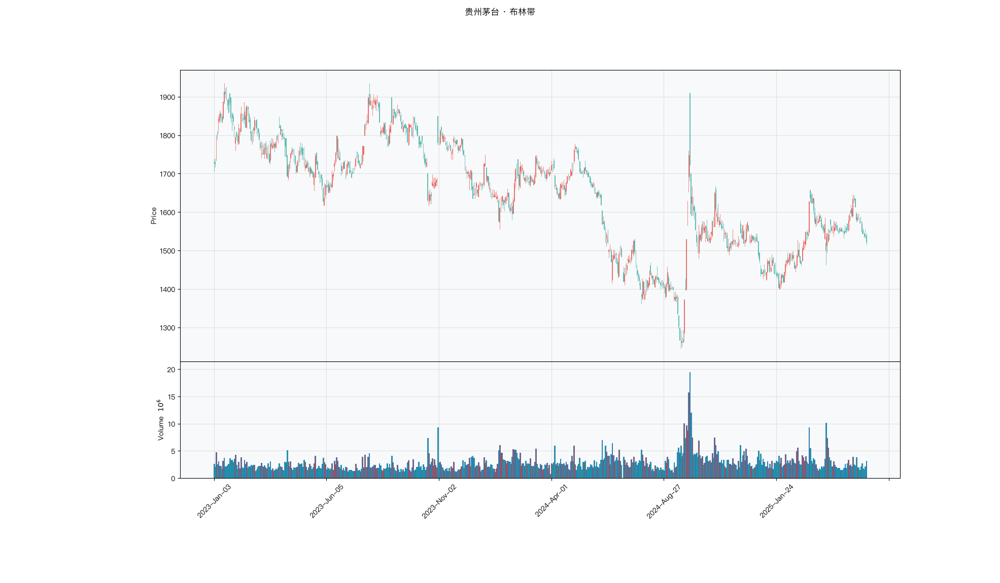

# 第032章 布林带（BBands）

价格贴着上轨走了三天，一个交易者说不清这是强势还是过热。同一张图上，带宽刚从前一周的收窄中张开，他又不知道该等确认还是立刻动手。触轨只告诉他价格处在统计上的极端位置，带宽只告诉他波动在收还是在放，两条信息分开看都不够。他要回答的是：眼下的偏离属于趋势的延伸，还是回归的起点。

## 名称与来历

布林带（Bollinger Bands，BBands）。

它由 John Bollinger 在 1980 年代设计。布林格的出发点与多数指标不同：他关注的不是"价格往哪走"，而是"价格在什么范围内走算正常"。他在一条移动平均线的上下各画出一条轨道，让轨道之间的距离随价格波动自动伸缩，从而给"正常波动"一个可视化的边界。

布林格本人长期强调，布林带不是买卖信号系统，而是一个描述价格相对位置的框架。轨道的宽窄、价格在轨道中的位置、中轨的方向，三者合起来才构成完整的读法。把它当成触轨即反向的机械信号，与它的设计初衷相反。

## 核心逻辑

当价格剧烈波动时，怎样判断眼下的涨跌是常态还是异常？

固定百分比的方法给不出满意答案：同一个 3% 的界限，在平静期太宽，在剧烈期太窄，市场波动率一变，界限的约束力就跟着失灵。布林带的思路是让边界自己适应：用价格围绕均线的离散程度（标准差）来定轨道的距离，波动大时轨道自动张开，波动小时轨道自动收拢。这样，同一条布林带在任何波动环境下都能给出一个相对合理的"正常区间"。

标准差是这个设计的核心。它衡量价格偏离均线的平均程度，而不是最高最低的极值差，因此对单日极端值的反应比真实波幅更直接。当价格连续剧烈震荡，标准差迅速抬升，通道随之变宽；当价格横盘整理，标准差收缩，通道随之收窄。这种"扩张与收缩"的交替，是布林带最重要的观察维度。

布林带的高明之处在于，它用一个指标同时回答了三个相关问题：中轨给出趋势方向，上下轨给出当前价格是否偏离常态，通道宽度给出波动是否临近释放。三个问题都不涉及方向预测，都停留在描述与确认的层面，这与波动率类指标的定位一致。轨道的上下是严格对称的，方向仍要由中轨来定。

把这三个问题排个序，可以避免误用。趋势方向由中轨负责，它决定了应当顺着哪一侧做判断；偏离程度由 %B 负责，它决定了当前价格是否到了极值区域；波动水平由带宽负责，它决定了行情是否临近变盘。只抓住其中一项而忽略其余两项，是使用布林带时最常见的偏差来源。

## 计算公式

布林带三条线，中轨是移动平均，上下轨在中轨基础上加减若干倍标准差。

### 中轨

$$Middle_t = SMA(Close,\ n)$$

### 标准差

$$\sigma_t = \sqrt{\frac{1}{n}\sum_{i=0}^{n-1}\left(C_{t-i} - Middle_t\right)^2}$$

### 上轨与下轨

$$Upper_t = Middle_t + k\,\sigma_t$$

$$Lower_t = Middle_t - k\,\sigma_t$$

**计算示例。** 设 20 日均线为 100 元，20 日收盘价标准差为 3 元，倍数 k 取 2，则上轨为 $100+2\times 3=106$ 元，下轨为 $100-2\times 3=94$ 元。若某日收盘价 103 元，则价格在通道中的相对位置

$$\%B = \frac{103 - 94}{106 - 94} \approx 0.75$$

表示价格处在通道 75% 的高度上，接近上轨但尚未触及。

**参数含义。**

| 参数 | 含义 | 常见取值 | 影响 |
|------|------|---------|------|
| n | 中轨周期，也是标准差的窗口 | 20（默认）、10、50 | n 越大，中轨越平稳，轨道越宽 |
| k | 标准差倍数 | 2（默认）、1.5、2.5 | k 越大，轨道越宽，触轨信号越少 |
| 口径 | 标准差是否使用样本无偏估计 | 与均值同窗口 | 影响数值的细微差别，跨软件比较需统一 |

k 取 2 时，若价格近似正态分布，轨道大致覆盖约 95% 的常规波动。需要注意这只是设计时的经验参照，真实价格分布有厚尾，落在轨道外的比例可能高于名义水平。高波动品种可把 k 调小到 1.5，低波动品种可调大到 2.5。

### 带宽与相对位置

两个派生读数是理解布林带的关键。

$$bandwidth_t = \frac{Upper_t - Lower_t}{Middle_t}$$

$$\%B_t = \frac{C_t - Lower_t}{Upper_t - Lower_t}$$

带宽刻画通道的宽窄，用于判断波动率的高低，带宽落到历史低位即通常所说的挤压。%B 刻画价格在通道中的相对位置，接近 1 表示贴近上轨，接近 0 表示贴近下轨，0.5 附近表示价格在中轨附近。两者一个描述波动，一个描述位置，配合中轨的方向，构成对布林带的完整读法。只看轨道位置而不看带宽，会丢掉这个指标一半的信息。

## 用法与信号

**挤压（squeeze）。** 上下轨距离持续收缩，通道宽度落到近期最低水平，通常伴随成交量萎缩，说明多空分歧变小、能量在累积。挤压本身不给出方向，它是一个"临近变盘"的提示。当价格带量突破轨道的一侧时，往往触发一段快速的单边行情。判断挤压可用带宽（上下轨之差除以中轨）的历史百分位，低于 20 百分位通常视为明显的收窄。

**带宽的变化。** 带宽由收窄转为扩张，说明波动率从低位向高位切换，是行情启动的确认。扩张时若价格持续贴近通道的一侧运行，说明趋势力量强；若价格在轨道两侧来回穿越，说明市场进入高波动震荡，突破信号的可靠性下降。

**价格触轨。** 价格触及上轨或下轨，表示短期偏离达到统计意义上的极端位置。在趋势不明确的震荡环境里，触轨后向中轨回归的概率相对高；在新高或新低附近，则可能只是趋势延续中的正常延伸。触轨本身不是反向信号，是否反向要看中轨的方向和带宽是否配合。

**中轨穿越。** 价格从下向上穿越中轨，且中轨由走平转为上行，常被视为多空力量转换的初步确认；反向穿越同理。中轨穿越比轨道触轨迟缓，但方向含义更明确，适合用在波段判断上。

**带宽的两端。** 带宽处在历史低位时，通道收窄，对应的是挤压与能量积累；带宽处在历史高位时，通道张开，对应的是波动已充分释放。极低的带宽值得等待，极高的带宽则需要警惕波动的均值回归，即此后波动可能重新收敛。把带宽的历史百分位算出来，比单看数值更能反映当前所处的状态。

## 边界与误区

**把触轨当成买卖信号。** 价格触及上轨不等于该卖出。强趋势中价格可以贴着上轨连续运行多日，此时触轨是趋势强的表现。把触轨机械地当成反向信号，在单边行情里会接连做错方向。触轨需要结合中轨方向与带宽变化一起解读。

**忽略带宽这个维度。** 只看三条轨道的位置，不看它们之间的距离，会丢掉布林带最有价值的信息。带宽的收窄与扩张承载了波动率的状态，与价格位置同等重要。一个完整的读法应当把带宽单独拿出来观察。

**参数不适配品种。** 默认的 20 日与 2 倍标准差适合多数股票日线，但放到日内周期或高波动品种上未必合适，会出现通道频繁被穿越的情况。参数需要与品种的波动特性和交易周期匹配，日内可用更短的中轨周期，高波动品种可适当调整倍数。

**震荡市里反复穿越轨道。** 轨道被反复穿越、中轨走平、带宽极低时，通道信号基本失效。此时触轨多属噪音，突破也常为假突破。可先用平均趋向指数判断市场是否处于趋势状态，在支撑不足的震荡区间里降低对通道信号的依赖。

## 它被检验过吗

布林带是本书唯一被单独检验过的通道类指标。Lento、Gradojevic 与 Wright（2007）在 *Applied Financial Economics Letters* 上报告，扣除交易成本后，布林带规则不能超越买入持有；在触轨时反向操作，结果有所改善。

这个结论的边界要说准：它否定的不是布林带的描述能力，而是顺势用法在扣成本之后不占优；反向用法的改善同样要计入成本才有意义。两类用法都不构成对指标本身的裁决。完整证据链见第 007 章。

这一类的真实失效案例，见第 029 章的「真实案例与失败模式」。

## 代码实现

### R

```r
library(ettr)
library(efactorcraft)
library(efincharts)
library(ggplot2)

BASE <- "https://raw.githubusercontent.com/dengyishuo/quant-technical-analysis/main/data/parquet"

# 取数据：本地有就用本地，没有就下载一次并缓存。
# read.csv 对本地 .gz 会自动解压，所以缓存成 .csv.gz 也能直接读。
load_data <- function(name) {
  local <- file.path("data", "parquet", name)
  if (file.exists(local)) return(local)
  cache <- file.path(tools::R_user_dir("qta", "cache"), name)
  if (!file.exists(cache)) {
    dir.create(dirname(cache), recursive = TRUE, showWarnings = FALSE)
    message("下载 ", name, " ...")
    download.file(paste0(BASE, "/", name), cache, mode = "wb", quiet = TRUE)
  }
  cache
}

read_data <- function(name) {
  d <- read.csv(load_data(name), stringsAsFactors = FALSE)
  if ("date" %in% names(d)) d$date <- as.Date(d$date)
  d
}

# 同一章里多次取用，缓存到内存，避免重复解析
.cache <- new.env(parent = emptyenv())
.blue <- function() {
  if (!exists("b", .cache)) assign("b", read_data("panel_blue_chip.csv"), .cache)
  get("b", .cache)
}
.panel <- function() {
  if (!exists("p", .cache)) {
    p <- read_data("panel_r.csv.gz")
    assign("p", p[p$date >= "2023-01-01" & p$date <= "2025-06-01", ], .cache)
  }
  get("p", .cache)
}
.index <- function() read_data("index_daily.csv")

blue  <- .blue()
panel <- .panel()

# 图的保存路径，顺手建目录，避免读者本地没有 assets/ 时报错
fig_path <- function(ch, name = "indicator_r.png") {
  d <- file.path("assets", "figures", sprintf("ch%03d", ch))
  dir.create(d, recursive = TRUE, showWarnings = FALSE)
  file.path(d, name)
}

# efincharts 要求 xts 且列名带 Adjusted
as_xts <- function(df) {
  x <- xts::xts(df[, c("open", "high", "low", "close", "volume", "adjusted")],
                order.by = df$date)
  colnames(x) <- c("Open", "High", "Low", "Close", "Volume", "Adjusted")
  x
}

maotai <- .blue()[.blue()$code == "600519.SS", ]

# 1. ettr 在长格式面板上追加指标列
maotai <- add_bbands(maotai, n = 20)

# 2. 基本统计
cols <- setdiff(names(maotai), names(blue))
print(summary(maotai[, cols]))

# 3. K 线 + 成交量 + 均线
ch <- ecandlesticks(as_xts(maotai), show_ma = TRUE, ma_periods = c(20, 60),
                    title = "贵州茅台 · 布林带")
ggsave(fig_path(32), ch$combined_plot, width = 10, height = 6, dpi = 110)
```

### Python

```python
import pathlib
import urllib.request

import pandas as pd
import ettr
import efactorcraft as efc
import efincharts as efc_

# 中文字体：mplfinance 会用 style 里的 rc 覆盖全局设置，必须写进 style
from efincharts import theme
theme.efin_style["rc"] = {
    "font.sans-serif": ["PingFang SC", "Heiti SC", "SimHei"],
    "axes.unicode_minus": False,
    "font.family": "sans-serif",
}

BASE = "https://raw.githubusercontent.com/dengyishuo/quant-technical-analysis/main/data/parquet"
CACHE = pathlib.Path.home() / ".cache" / "qta"
_MEM = {}


def load(name):
    """取数据：本地有就用本地，没有就下载一次并缓存。

    这样三种情形都能跑：
      1. 克隆了整个仓库    -> 直接读 data/parquet/，不联网
      2. 只复制了代码片段  -> 首次自动下载到 ~/.cache/qta，之后走缓存
      3. 之前跑过          -> 全部命中缓存，断网也能用
    """
    if name in _MEM:
        return _MEM[name]
    local = pathlib.Path("data/parquet") / name
    if local.exists():
        path = local
    else:
        CACHE.mkdir(parents=True, exist_ok=True)
        path = CACHE / name
        if not path.exists():
            print("下载 %s ..." % name)
            urllib.request.urlretrieve(BASE + "/" + name, path)
    data = pd.read_parquet(path) if name.endswith(".parquet") else pd.read_csv(path)
    _MEM[name] = data
    return data


blue = load("panel_blue_chip.parquet")
panel = load("panel.parquet")
panel = panel[(panel["date"] >= "2023-01-01") & (panel["date"] <= "2025-06-01")]
idx = load("index_daily.parquet")


def one(df, code="600519.SS"):
    """取单只标的，转成 efincharts 需要的宽表。"""
    x = df[df["code"] == code].sort_values("date").set_index("date")
    x.columns = [c.capitalize() for c in x.columns]
    return x


def fig_path(ch, name="indicator.png"):
    """图的保存路径，顺手建目录，避免读者本地没有 assets/ 时报错。"""
    d = pathlib.Path("assets") / "figures" / ("ch%03d" % ch)
    d.mkdir(parents=True, exist_ok=True)
    return str(d / name)

# 1. 取单只标的
maotai = blue[blue['code'] == '600519.SS'].copy()

# 2. ettr 在长格式面板上追加指标列，不需要手工 rolling
maotai = ettr.bollinger(maotai)

cols = [c for c in maotai.columns if c not in blue.columns]
print(maotai[cols].describe().round(3))

# 3. 画图：K 线 + 成交量 + 指标面板
px = one(maotai)
ch = efc_.candlestick(px, volume=True, title="贵州茅台 · 布林带")
ch.save(fig_path(32))
```

<!-- fig-indicator:start -->


<p class="figcap">图 32-1　布林带在贵州茅台上的读数（2023-01 至 2025-06）</p>
<!-- fig-indicator:end -->

## 拆解

布林带的三个轨道输出与价格同量纲，单位都是元，直接排序得到的是股价水平。但它比 ATR 省事的地方在于，最有用的两个派生读数本身就是无量纲的：%B 与带宽。这两个读数把位置与波动分开，构成了布林带在通道家族里的独特结构。

| 特征名 | 计算式 | 量纲 | 经济含义 |
|--------|--------|------|----------|
| %B | $(p_t-L_t)/(U_t-L_t)$ | 无量纲，可越界 | 价格在通道中的相对位置 |
| 带宽 | $(U_t-L_t)/M_t$ | 无量纲比例 | 通道宽窄，波动水平的直接读数 |
| 带宽变化率 | $BW_t/BW_{t-4}-1$ | 无量纲比例 | 通道张开或收拢的速度 |
| 挤压标记 | $1\{BW_t<\text{分位}_{0.2}\}$ | 0 或 1 | 波动被压缩到极致的状态 |

%B 与带宽的信息源不完全重合。%B 可以写成 $0.5+(p_t-M_t)/(4\sigma_t)$，分母含波动项；带宽则是 $4\sigma_t/M_t$。两者在构造上共享标准差，但 %B 的主体是价格相对中轨的偏离，带宽的主体是标准差的绝对水平，因此实测相关性通常不高。这个低相关是布林带最有价值的地方：同一个指标里同时住着一个位置变量和一个波动变量，可以分别拿去对不同的目标列做检验，而不像多数指标那样只有一条信息。

%B 的稳定性依赖分母。带宽收窄到极致时，上下轨几乎重合，价格的微小变动会让 %B 剧烈跳动，读数可以轻松突破零与一。越界本身是有信息的，价格跑到上轨之外说明偏离已超出两倍标准差的常规范围；直接把越界值截断到零与一，会抹掉偏离的幅度。比较稳妥的做法是保留原始值，在分层时用分位而不是固定阈值。

带宽与带宽变化率描述两件事。带宽是水平，回答通道有多宽；变化率是速度，回答通道正在张开还是合拢。低带宽配上行的变化率，是挤压接近尾声的信号；低带宽配下行的变化率，是压缩还在继续。挤压标记则是把水平离散化，牺牲幅度换取状态识别的清晰。二值变量无法排序，只能做条件变量，这一点决定了它的用法与连续因子不同。

带宽的分母是中轨，中轨随价格水平变化，因此带宽里含一点价格效应。这个效应是二阶的，跨标的比较时可以忽略；跨时期比较时，若价格整体抬升，带宽会被轻微压低，读数需要结合价格水平一起看。挤压阈值用全样本分位计算也含未来信息，实盘里应改为滚动分位。

### R

```r
library(ettr)
library(efactorcraft)
library(efincharts)
library(ggplot2)

BASE <- "https://raw.githubusercontent.com/dengyishuo/quant-technical-analysis/main/data/parquet"

# 取数据：本地有就用本地，没有就下载一次并缓存。
# read.csv 对本地 .gz 会自动解压，所以缓存成 .csv.gz 也能直接读。
load_data <- function(name) {
  local <- file.path("data", "parquet", name)
  if (file.exists(local)) return(local)
  cache <- file.path(tools::R_user_dir("qta", "cache"), name)
  if (!file.exists(cache)) {
    dir.create(dirname(cache), recursive = TRUE, showWarnings = FALSE)
    message("下载 ", name, " ...")
    download.file(paste0(BASE, "/", name), cache, mode = "wb", quiet = TRUE)
  }
  cache
}

read_data <- function(name) {
  d <- read.csv(load_data(name), stringsAsFactors = FALSE)
  if ("date" %in% names(d)) d$date <- as.Date(d$date)
  d
}

# 同一章里多次取用，缓存到内存，避免重复解析
.cache <- new.env(parent = emptyenv())
.blue <- function() {
  if (!exists("b", .cache)) assign("b", read_data("panel_blue_chip.csv"), .cache)
  get("b", .cache)
}
.panel <- function() {
  if (!exists("p", .cache)) {
    p <- read_data("panel_r.csv.gz")
    assign("p", p[p$date >= "2023-01-01" & p$date <= "2025-06-01", ], .cache)
  }
  get("p", .cache)
}
.index <- function() read_data("index_daily.csv")

blue  <- .blue()
panel <- .panel()

# 图的保存路径，顺手建目录，避免读者本地没有 assets/ 时报错
fig_path <- function(ch, name = "indicator_r.png") {
  d <- file.path("assets", "figures", sprintf("ch%03d", ch))
  dir.create(d, recursive = TRUE, showWarnings = FALSE)
  file.path(d, name)
}

# efincharts 要求 xts 且列名带 Adjusted
as_xts <- function(df) {
  x <- xts::xts(df[, c("open", "high", "low", "close", "volume", "adjusted")],
                order.by = df$date)
  colnames(x) <- c("Open", "High", "Low", "Close", "Volume", "Adjusted")
  x
}

d <- .blue()[.blue()$code == "600519.SS", ]
d <- add_bbands(d, n = 20)

# 转成无量纲因子
d$f <- d$`pctB_20`

print(summary(d$f))
```

### Python

```python
import pathlib
import urllib.request

import pandas as pd
import ettr
import efactorcraft as efc
import efincharts as efc_

# 中文字体：mplfinance 会用 style 里的 rc 覆盖全局设置，必须写进 style
from efincharts import theme
theme.efin_style["rc"] = {
    "font.sans-serif": ["PingFang SC", "Heiti SC", "SimHei"],
    "axes.unicode_minus": False,
    "font.family": "sans-serif",
}

BASE = "https://raw.githubusercontent.com/dengyishuo/quant-technical-analysis/main/data/parquet"
CACHE = pathlib.Path.home() / ".cache" / "qta"
_MEM = {}


def load(name):
    """取数据：本地有就用本地，没有就下载一次并缓存。

    这样三种情形都能跑：
      1. 克隆了整个仓库    -> 直接读 data/parquet/，不联网
      2. 只复制了代码片段  -> 首次自动下载到 ~/.cache/qta，之后走缓存
      3. 之前跑过          -> 全部命中缓存，断网也能用
    """
    if name in _MEM:
        return _MEM[name]
    local = pathlib.Path("data/parquet") / name
    if local.exists():
        path = local
    else:
        CACHE.mkdir(parents=True, exist_ok=True)
        path = CACHE / name
        if not path.exists():
            print("下载 %s ..." % name)
            urllib.request.urlretrieve(BASE + "/" + name, path)
    data = pd.read_parquet(path) if name.endswith(".parquet") else pd.read_csv(path)
    _MEM[name] = data
    return data


blue = load("panel_blue_chip.parquet")
panel = load("panel.parquet")
panel = panel[(panel["date"] >= "2023-01-01") & (panel["date"] <= "2025-06-01")]
idx = load("index_daily.parquet")


def one(df, code="600519.SS"):
    """取单只标的，转成 efincharts 需要的宽表。"""
    x = df[df["code"] == code].sort_values("date").set_index("date")
    x.columns = [c.capitalize() for c in x.columns]
    return x


def fig_path(ch, name="indicator.png"):
    """图的保存路径，顺手建目录，避免读者本地没有 assets/ 时报错。"""
    d = pathlib.Path("assets") / "figures" / ("ch%03d" % ch)
    d.mkdir(parents=True, exist_ok=True)
    return str(d / name)

# 1. 先在面板上算原始指标
d = panel.copy()
d = ettr.bollinger(d)

# 2. 转成无量纲因子，才能跨标的排序
d["f"] = d["BB_pctB"]

print(d["f"].describe().round(4))
```

## 截面选股能力

布林带的两个维度分别对应两个因子。位置因子取 %B：

$$f^{\%B}_t=\frac{p_t-L_t}{U_t-L_t}$$

波动因子取带宽：

$$f^{bw}_t=\frac{U_t-L_t}{M_t}$$

前者预测收益，后者预测波动率。这是布林带与单一信息指标最大的不同：两个因子的目标列不同，检验流程相同，结论却服务于两件事。%B 服务于方向判断，带宽服务于风险预算与变盘判断。

预期表现上，%B 属于均值回归型，方向多为负：价格越贴近上轨，后续回调的压力越大。这一关系在震荡环境里更稳定，在单边趋势里会减弱甚至反号，因为趋势中价格能够贴着上轨运行多日。带宽对未来的实现波动率通常为正：通道宽说明当前波动大，波动聚类使这一状态延续。挤压作为带宽的低位状态，对应的往往是波动放大而非收益方向，把它当收益信号用会落空。

检验时有三点值得注意。第一，两个维度分开检验，不要合成一个笼统的布林带因子。把 %B 与带宽标准化后相加，位置信息与波动信息会互相稀释，得到的是一个方向不明、量纲混杂的合成分数，比两个单因子都差。第二，挤压是二值状态，不能用 IC 检验，应做分组对照，比较挤压组与非挤压组的未来波动与收益分布。第三，%B 的越界值要保留，但分层前应去掉分母趋零的样本，否则极值会主导分档边界。

### R

```r
library(ettr)
library(efactorcraft)
library(efincharts)
library(ggplot2)

BASE <- "https://raw.githubusercontent.com/dengyishuo/quant-technical-analysis/main/data/parquet"

# 取数据：本地有就用本地，没有就下载一次并缓存。
# read.csv 对本地 .gz 会自动解压，所以缓存成 .csv.gz 也能直接读。
load_data <- function(name) {
  local <- file.path("data", "parquet", name)
  if (file.exists(local)) return(local)
  cache <- file.path(tools::R_user_dir("qta", "cache"), name)
  if (!file.exists(cache)) {
    dir.create(dirname(cache), recursive = TRUE, showWarnings = FALSE)
    message("下载 ", name, " ...")
    download.file(paste0(BASE, "/", name), cache, mode = "wb", quiet = TRUE)
  }
  cache
}

read_data <- function(name) {
  d <- read.csv(load_data(name), stringsAsFactors = FALSE)
  if ("date" %in% names(d)) d$date <- as.Date(d$date)
  d
}

# 同一章里多次取用，缓存到内存，避免重复解析
.cache <- new.env(parent = emptyenv())
.blue <- function() {
  if (!exists("b", .cache)) assign("b", read_data("panel_blue_chip.csv"), .cache)
  get("b", .cache)
}
.panel <- function() {
  if (!exists("p", .cache)) {
    p <- read_data("panel_r.csv.gz")
    assign("p", p[p$date >= "2023-01-01" & p$date <= "2025-06-01", ], .cache)
  }
  get("p", .cache)
}
.index <- function() read_data("index_daily.csv")

blue  <- .blue()
panel <- .panel()

# 图的保存路径，顺手建目录，避免读者本地没有 assets/ 时报错
fig_path <- function(ch, name = "indicator_r.png") {
  d <- file.path("assets", "figures", sprintf("ch%03d", ch))
  dir.create(d, recursive = TRUE, showWarnings = FALSE)
  file.path(d, name)
}

# efincharts 要求 xts 且列名带 Adjusted
as_xts <- function(df) {
  x <- xts::xts(df[, c("open", "high", "low", "close", "volume", "adjusted")],
                order.by = df$date)
  colnames(x) <- c("Open", "High", "Low", "Close", "Volume", "Adjusted")
  x
}

d <- .panel()
d <- add_bbands(d, n = 20)

d$f <- d$`pctB_20`
d <- add_next_return(d, close_col = "close", n = c(1, 5, 20))

ic <- ic_analysis(d, factor_cols = "f",
                    forward_cols = c("forward_1", "forward_5", "forward_20"),
                    method = "spearman")
print(ir_analysis(ic))

q <- quantile_analysis(d, factor_cols = "f", forward_cols = "forward_5",
                       n_groups = 5)
print(q$f$summary)
```

### Python

```python
import pathlib
import urllib.request

import pandas as pd
import ettr
import efactorcraft as efc
import efincharts as efc_

# 中文字体：mplfinance 会用 style 里的 rc 覆盖全局设置，必须写进 style
from efincharts import theme
theme.efin_style["rc"] = {
    "font.sans-serif": ["PingFang SC", "Heiti SC", "SimHei"],
    "axes.unicode_minus": False,
    "font.family": "sans-serif",
}

BASE = "https://raw.githubusercontent.com/dengyishuo/quant-technical-analysis/main/data/parquet"
CACHE = pathlib.Path.home() / ".cache" / "qta"
_MEM = {}


def load(name):
    """取数据：本地有就用本地，没有就下载一次并缓存。

    这样三种情形都能跑：
      1. 克隆了整个仓库    -> 直接读 data/parquet/，不联网
      2. 只复制了代码片段  -> 首次自动下载到 ~/.cache/qta，之后走缓存
      3. 之前跑过          -> 全部命中缓存，断网也能用
    """
    if name in _MEM:
        return _MEM[name]
    local = pathlib.Path("data/parquet") / name
    if local.exists():
        path = local
    else:
        CACHE.mkdir(parents=True, exist_ok=True)
        path = CACHE / name
        if not path.exists():
            print("下载 %s ..." % name)
            urllib.request.urlretrieve(BASE + "/" + name, path)
    data = pd.read_parquet(path) if name.endswith(".parquet") else pd.read_csv(path)
    _MEM[name] = data
    return data


blue = load("panel_blue_chip.parquet")
panel = load("panel.parquet")
panel = panel[(panel["date"] >= "2023-01-01") & (panel["date"] <= "2025-06-01")]
idx = load("index_daily.parquet")


def one(df, code="600519.SS"):
    """取单只标的，转成 efincharts 需要的宽表。"""
    x = df[df["code"] == code].sort_values("date").set_index("date")
    x.columns = [c.capitalize() for c in x.columns]
    return x


def fig_path(ch, name="indicator.png"):
    """图的保存路径，顺手建目录，避免读者本地没有 assets/ 时报错。"""
    d = pathlib.Path("assets") / "figures" / ("ch%03d" % ch)
    d.mkdir(parents=True, exist_ok=True)
    return str(d / name)

# 287 只、2023-01 至 2025-06，横截面才有统计意义
src = panel.copy()
d = src.copy()

# 1. 算指标
d = ettr.bollinger(d)


# 2. 因子 + 未来收益
d["f"] = d["BB_pctB"]
d = efc.add_next_return(d, periods=(1, 5, 20))

# 3. 截面 IC 与分层
ic = efc.ic_analysis(d, factor_cols="f",
                      forward_cols=["forward_1", "forward_5", "forward_20"],
                      method="spearman")
print(efc.ir_analysis(ic).round(3))

q = efc.quantile_analysis(d, factor_col="f", forward_col="forward_5", n_groups=5)
print(q["summary"].round(4))
```

%B 那三行与带宽那一行不能并排比较。%B 的目标列是收益，带宽的目标列是波动率，两个 IC 的量级差异来自目标列本身，不来自因子强弱。挤压分组表读的是另外一件事：若挤压组的未来波动均值高于非挤压组，说明压缩之后波动趋于展开，这与带宽因子的正向 IC 是同一结论的两种表述。

<!-- tab-ic:start -->
**计算结果**

| 前向期 | IC 均值 | IC 标准差 | ICIR | t 值 | IC>0 占比 | 期数 |
|---|---|---|---|---|---|---|
| T+1 | -0.0128 | 0.2191 | -0.058 | -1.38 | 0.4830 | 561 |
| T+5 | -0.0098 | 0.2039 | -0.048 | -1.13 | 0.5130 | 557 |
| T+20 | -0.0280 | 0.1882 | -0.149 | -3.46 | 0.4650 | 542 |

表里最该看的是 t 值，不是 IC 均值。这个因子以 T+1 为主口径，IC 均值 -0.0128、ICIR -0.058、t 值 -1.38，在常规门槛下不显著，方向为反向。按第 007 章给出的日频门槛（ICIR 0.13 对应 t≈2），这个结果的含义是：还看不出与噪声的区别，不能据此构造策略。

需要提醒的是，这只说明排序与未来收益之间存在可测的关联，不代表扣掉成本后还能剩下收益。横截面 IC 检验的是“买哪只”，不负责“值不值得交易”。

**五档分层**

| 分组 | 平均收益 | 标准差 | 期数 |
|---|---|---|---|
| 1 | +0.0035 | +0.0385 | 557 |
| 2 | +0.0035 | +0.0344 | 557 |
| 3 | +0.0023 | +0.0320 | 557 |
| 4 | +0.0021 | +0.0321 | 557 |
| 5 | +0.0051 | +0.0370 | 557 |

五档分层看的是形状，不是单点。最高一档在第 5 组、最低在第 4 组，两端相差 +0.16%，组序号与平均收益的秩相关为 0.23，没有明显单调性。

分层比 IC 更接近实盘，因为它直接给出“买最高档、卖最低档”的收益差。但这里的数字是毛收益，且没有考虑涨跌停买不进、停牌卖不出的情形，真实可得的差额会小于表中所列。
<!-- tab-ic:end -->

## 择时能力

时序上布林带的读法有三层。第一层是触轨，价格触及上轨或下轨，属于离散事件。第二层是挤压，带宽落到历史低位，属于状态。第三层是带宽转向，通道由收拢转为张开，属于状态切换。三层的信息性质不同，检验方式也应不同。

触轨适合信号触发日检验，把触轨日与其余交易日分成两组，比较后续收益。它回答的是价格跑到统计极端位置之后是否真的不一样。%B 是连续变量，适合条件分位收益，看各档是否单调，以及单调的斜率在哪一端更陡。挤压适合分组对照，比较挤压期与非挤压期未来收益的整条分布。

挤压这一处最能说明为什么波动率类的择时检验不能只看均值。挤压意味着多空分歧收敛、能量累积，随后的行情往往是一段方向明确的单边走势，但方向并不由挤压本身给出。挤压之后的收益分布接近双峰：一端是向上突破，一端是向下破位，均值可能接近零，标准差却明显上升。用均值检验会得出挤压无用的结论，用分布看才能看到它预测的是波动的展开，而不是方向。

三个陷阱。第一，触轨事件高度重叠。趋势中价格可以连续多日贴着上轨，这些日子不是独立样本，把它们当作多次独立触发会高估显著性。第二，挤压阈值若用全样本分位，等于提前知道未来的带宽分布，回测应改为滚动分位。第三，带宽极窄时 %B 的分母趋零，读数不稳，这一段的触轨信号信噪比很低，不宜单独使用。

### R

```r
library(ettr)
library(efactorcraft)
library(efincharts)
library(ggplot2)

BASE <- "https://raw.githubusercontent.com/dengyishuo/quant-technical-analysis/main/data/parquet"

# 取数据：本地有就用本地，没有就下载一次并缓存。
# read.csv 对本地 .gz 会自动解压，所以缓存成 .csv.gz 也能直接读。
load_data <- function(name) {
  local <- file.path("data", "parquet", name)
  if (file.exists(local)) return(local)
  cache <- file.path(tools::R_user_dir("qta", "cache"), name)
  if (!file.exists(cache)) {
    dir.create(dirname(cache), recursive = TRUE, showWarnings = FALSE)
    message("下载 ", name, " ...")
    download.file(paste0(BASE, "/", name), cache, mode = "wb", quiet = TRUE)
  }
  cache
}

read_data <- function(name) {
  d <- read.csv(load_data(name), stringsAsFactors = FALSE)
  if ("date" %in% names(d)) d$date <- as.Date(d$date)
  d
}

# 同一章里多次取用，缓存到内存，避免重复解析
.cache <- new.env(parent = emptyenv())
.blue <- function() {
  if (!exists("b", .cache)) assign("b", read_data("panel_blue_chip.csv"), .cache)
  get("b", .cache)
}
.panel <- function() {
  if (!exists("p", .cache)) {
    p <- read_data("panel_r.csv.gz")
    assign("p", p[p$date >= "2023-01-01" & p$date <= "2025-06-01", ], .cache)
  }
  get("p", .cache)
}
.index <- function() read_data("index_daily.csv")

blue  <- .blue()
panel <- .panel()

# 图的保存路径，顺手建目录，避免读者本地没有 assets/ 时报错
fig_path <- function(ch, name = "indicator_r.png") {
  d <- file.path("assets", "figures", sprintf("ch%03d", ch))
  dir.create(d, recursive = TRUE, showWarnings = FALSE)
  file.path(d, name)
}

# efincharts 要求 xts 且列名带 Adjusted
as_xts <- function(df) {
  x <- xts::xts(df[, c("open", "high", "low", "close", "volume", "adjusted")],
                order.by = df$date)
  colnames(x) <- c("Open", "High", "Low", "Close", "Volume", "Adjusted")
  x
}

t <- .index()
t <- t[t$code == "510300.SS", ]
t <- add_bbands(t, n = 20)
t$f <- t$`pctB_20`
t$forward_5 <- c(tail(t$close, -5) / head(t$close, -5) - 1, rep(NA, 5))
t$q <- cut(t$f, quantile(t$f, 0:5/5, na.rm = TRUE), include.lowest = TRUE, labels = FALSE)
print(aggregate(forward_5 ~ q, data = t, FUN = function(x)
  c(mean = mean(x, na.rm = TRUE), n = sum(!is.na(x)))))
```

### Python

```python
import pathlib
import urllib.request

import pandas as pd
import ettr
import efactorcraft as efc
import efincharts as efc_

# 中文字体：mplfinance 会用 style 里的 rc 覆盖全局设置，必须写进 style
from efincharts import theme
theme.efin_style["rc"] = {
    "font.sans-serif": ["PingFang SC", "Heiti SC", "SimHei"],
    "axes.unicode_minus": False,
    "font.family": "sans-serif",
}

BASE = "https://raw.githubusercontent.com/dengyishuo/quant-technical-analysis/main/data/parquet"
CACHE = pathlib.Path.home() / ".cache" / "qta"
_MEM = {}


def load(name):
    """取数据：本地有就用本地，没有就下载一次并缓存。

    这样三种情形都能跑：
      1. 克隆了整个仓库    -> 直接读 data/parquet/，不联网
      2. 只复制了代码片段  -> 首次自动下载到 ~/.cache/qta，之后走缓存
      3. 之前跑过          -> 全部命中缓存，断网也能用
    """
    if name in _MEM:
        return _MEM[name]
    local = pathlib.Path("data/parquet") / name
    if local.exists():
        path = local
    else:
        CACHE.mkdir(parents=True, exist_ok=True)
        path = CACHE / name
        if not path.exists():
            print("下载 %s ..." % name)
            urllib.request.urlretrieve(BASE + "/" + name, path)
    data = pd.read_parquet(path) if name.endswith(".parquet") else pd.read_csv(path)
    _MEM[name] = data
    return data


blue = load("panel_blue_chip.parquet")
panel = load("panel.parquet")
panel = panel[(panel["date"] >= "2023-01-01") & (panel["date"] <= "2025-06-01")]
idx = load("index_daily.parquet")


def one(df, code="600519.SS"):
    """取单只标的，转成 efincharts 需要的宽表。"""
    x = df[df["code"] == code].sort_values("date").set_index("date")
    x.columns = [c.capitalize() for c in x.columns]
    return x


def fig_path(ch, name="indicator.png"):
    """图的保存路径，顺手建目录，避免读者本地没有 assets/ 时报错。"""
    d = pathlib.Path("assets") / "figures" / ("ch%03d" % ch)
    d.mkdir(parents=True, exist_ok=True)
    return str(d / name)

# 择时检验用 ETF 做市场载体，指数本身没有日线数据
t = idx[idx["code"] == "510300.SS"].sort_values("date").copy()

# 1. 在 ETF 上算同一个指标
t = ettr.bollinger(d)


# 2. 按因子分位看未来 5 日收益
t["f"] = t["BB_pctB"]
t["forward_5"] = t["close"].shift(-5) / t["close"] - 1
# 因子可能有重复值，先按名次切，避免 qcut 报边界不唯一
t["q"] = pd.qcut(t["f"].rank(method="first"), 5, labels=False) + 1
t = t.dropna(subset=["f", "forward_5"])
print(t.groupby("q")["forward_5"].agg(["mean", "count"]).round(4))
```

三组输出回答三个问题。触轨检验回答极端位置之后是否不同，若显著且方向为负，均值回归成立；条件分位看关系形状，若只有最高一档有效、其余各档接近，说明信号只存在于极值区，用连续因子做仓位分配会摊薄效果；挤压分布表看标准差与左尾，若均值相近而这两列差异明显，说明挤压预测的是波动而非方向。

<!-- tab-timing:start -->
**分位收益**

| 分位 | 未来 5 日均值 | 样本数 |
|---|---|---|
| 1 | +0.0011 | 222 |
| 2 | -0.0025 | 222 |
| 3 | +0.0016 | 222 |
| 4 | -0.0022 | 222 |
| 5 | +0.0014 | 222 |

择时口径与截面不同：这里只有一个标的，看的是同一标的在不同分位下的未来收益。最高与最低分位相差 +0.03%。单标的样本有限，这个差额很容易被一两段行情主导，只能作为方向参考。

真正做择时要问的是三件事：分位阈值是否稳定、换手是否可控、扣成本后是否还有剩余。三者缺一，择时信号就只是图上好看。
<!-- tab-timing:end -->

## 组合使用与验证

布林带的常见搭档有三个。与肯特纳通道搭配，两者宽度都由波动驱动，但一把尺子用标准差，一把用真实波幅，两者的宽度之比可以判断波动来自连续大阴大阳还是跳空缺口。与平均趋向指数搭配，ADX 补市况前提，趋势弱时触轨多为噪音，趋势强时触轨多为趋势延续。与成交量搭配，挤压之后的突破若伴随放量，可靠性明显高于缩量突破。

**组合的截面验证。** 组合的位置与波动两个维度时，符号要逐个摆正。%B 是反向因子，取负后表示价格在通道中的低位，即超卖；带宽也是反向使用，取负后表示低波动。两者标准化相加，得到的是低波动且超卖的得分。这一组合的经济含义清楚，检验时才有解释力。若符号不统一，两个维度会互相抵消，组合的 ICIR 低于任一单因子，容易被误读成两个维度不能共存。先算两者的横截面相关，相关性低是组合的前提；布林带的 %B 与带宽恰好满足这一条件，这是它相对多数指标的优势。

**组合的择时验证。** 挤压突破是条件型组合的典型：带宽处于低位且价格上穿中轨，两者同时成立才持仓。回测时与单条件并排跑，比较年化、夏普与最大回撤。挤压条件的加入会大幅减少持仓天数，收益可能不升，回撤与夏普的改进才是它的价值。若只看年化收益，容易得出挤压无用的结论。

增益的判读沿用方法论章的标准：组合的 ICIR 高于两个单特征，说明存在互补性。布林带的两个维度相关低，理论上增益空间较大，但要注意 %B 与带宽的目标列不同，截面组合只能统一到收益这一个目标上检验，带宽在组合里实际扮演的是风险过滤而非收益来源。这一点不写清楚，很容易把组合的收益改进误归给波动维度。

### R

```r
library(ettr)
library(efactorcraft)
library(efincharts)
library(ggplot2)

BASE <- "https://raw.githubusercontent.com/dengyishuo/quant-technical-analysis/main/data/parquet"

# 取数据：本地有就用本地，没有就下载一次并缓存。
# read.csv 对本地 .gz 会自动解压，所以缓存成 .csv.gz 也能直接读。
load_data <- function(name) {
  local <- file.path("data", "parquet", name)
  if (file.exists(local)) return(local)
  cache <- file.path(tools::R_user_dir("qta", "cache"), name)
  if (!file.exists(cache)) {
    dir.create(dirname(cache), recursive = TRUE, showWarnings = FALSE)
    message("下载 ", name, " ...")
    download.file(paste0(BASE, "/", name), cache, mode = "wb", quiet = TRUE)
  }
  cache
}

read_data <- function(name) {
  d <- read.csv(load_data(name), stringsAsFactors = FALSE)
  if ("date" %in% names(d)) d$date <- as.Date(d$date)
  d
}

# 同一章里多次取用，缓存到内存，避免重复解析
.cache <- new.env(parent = emptyenv())
.blue <- function() {
  if (!exists("b", .cache)) assign("b", read_data("panel_blue_chip.csv"), .cache)
  get("b", .cache)
}
.panel <- function() {
  if (!exists("p", .cache)) {
    p <- read_data("panel_r.csv.gz")
    assign("p", p[p$date >= "2023-01-01" & p$date <= "2025-06-01", ], .cache)
  }
  get("p", .cache)
}
.index <- function() read_data("index_daily.csv")

blue  <- .blue()
panel <- .panel()

# 图的保存路径，顺手建目录，避免读者本地没有 assets/ 时报错
fig_path <- function(ch, name = "indicator_r.png") {
  d <- file.path("assets", "figures", sprintf("ch%03d", ch))
  dir.create(d, recursive = TRUE, showWarnings = FALSE)
  file.path(d, name)
}

# efincharts 要求 xts 且列名带 Adjusted
as_xts <- function(df) {
  x <- xts::xts(df[, c("open", "high", "low", "close", "volume", "adjusted")],
                order.by = df$date)
  colnames(x) <- c("Open", "High", "Low", "Close", "Volume", "Adjusted")
  x
}

d <- .panel()
d <- add_bbands(d, n = 20)
d$f1 <- d$`pctB_20`
d <- add_cmf(d, n = 20)
d$f2 <- d$CMF
d <- add_next_return(d, close_col = "close", n = 5)
ic1 <- ic_analysis(d, factor_cols = c("f1", "f2"),
                    forward_cols = "forward_5", method = "spearman")
print(ir_analysis(ic1))
```

```r
library(ettr)
library(efactorcraft)
library(efincharts)
library(ggplot2)

BASE <- "https://raw.githubusercontent.com/dengyishuo/quant-technical-analysis/main/data/parquet"

# 取数据：本地有就用本地，没有就下载一次并缓存。
# read.csv 对本地 .gz 会自动解压，所以缓存成 .csv.gz 也能直接读。
load_data <- function(name) {
  local <- file.path("data", "parquet", name)
  if (file.exists(local)) return(local)
  cache <- file.path(tools::R_user_dir("qta", "cache"), name)
  if (!file.exists(cache)) {
    dir.create(dirname(cache), recursive = TRUE, showWarnings = FALSE)
    message("下载 ", name, " ...")
    download.file(paste0(BASE, "/", name), cache, mode = "wb", quiet = TRUE)
  }
  cache
}

read_data <- function(name) {
  d <- read.csv(load_data(name), stringsAsFactors = FALSE)
  if ("date" %in% names(d)) d$date <- as.Date(d$date)
  d
}

# 同一章里多次取用，缓存到内存，避免重复解析
.cache <- new.env(parent = emptyenv())
.blue <- function() {
  if (!exists("b", .cache)) assign("b", read_data("panel_blue_chip.csv"), .cache)
  get("b", .cache)
}
.panel <- function() {
  if (!exists("p", .cache)) {
    p <- read_data("panel_r.csv.gz")
    assign("p", p[p$date >= "2023-01-01" & p$date <= "2025-06-01", ], .cache)
  }
  get("p", .cache)
}
.index <- function() read_data("index_daily.csv")

blue  <- .blue()
panel <- .panel()

# 图的保存路径，顺手建目录，避免读者本地没有 assets/ 时报错
fig_path <- function(ch, name = "indicator_r.png") {
  d <- file.path("assets", "figures", sprintf("ch%03d", ch))
  dir.create(d, recursive = TRUE, showWarnings = FALSE)
  file.path(d, name)
}

# efincharts 要求 xts 且列名带 Adjusted
as_xts <- function(df) {
  x <- xts::xts(df[, c("open", "high", "low", "close", "volume", "adjusted")],
                order.by = df$date)
  colnames(x) <- c("Open", "High", "Low", "Close", "Volume", "Adjusted")
  x
}

d <- .panel()
d <- add_bbands(d, n = 20)
d$f1 <- d$`pctB_20`
d <- add_cmf(d, n = 20)
d$f2 <- d$CMF
d <- add_next_return(d, close_col = "close", n = 5)
ic1 <- ic_analysis(d, factor_cols = c("f1", "f2"),
                    forward_cols = "forward_5", method = "spearman")
print(ir_analysis(ic1))
```

### Python

```python
import pathlib
import urllib.request

import pandas as pd
import ettr
import efactorcraft as efc
import efincharts as efc_

# 中文字体：mplfinance 会用 style 里的 rc 覆盖全局设置，必须写进 style
from efincharts import theme
theme.efin_style["rc"] = {
    "font.sans-serif": ["PingFang SC", "Heiti SC", "SimHei"],
    "axes.unicode_minus": False,
    "font.family": "sans-serif",
}

BASE = "https://raw.githubusercontent.com/dengyishuo/quant-technical-analysis/main/data/parquet"
CACHE = pathlib.Path.home() / ".cache" / "qta"
_MEM = {}


def load(name):
    """取数据：本地有就用本地，没有就下载一次并缓存。

    这样三种情形都能跑：
      1. 克隆了整个仓库    -> 直接读 data/parquet/，不联网
      2. 只复制了代码片段  -> 首次自动下载到 ~/.cache/qta，之后走缓存
      3. 之前跑过          -> 全部命中缓存，断网也能用
    """
    if name in _MEM:
        return _MEM[name]
    local = pathlib.Path("data/parquet") / name
    if local.exists():
        path = local
    else:
        CACHE.mkdir(parents=True, exist_ok=True)
        path = CACHE / name
        if not path.exists():
            print("下载 %s ..." % name)
            urllib.request.urlretrieve(BASE + "/" + name, path)
    data = pd.read_parquet(path) if name.endswith(".parquet") else pd.read_csv(path)
    _MEM[name] = data
    return data


blue = load("panel_blue_chip.parquet")
panel = load("panel.parquet")
panel = panel[(panel["date"] >= "2023-01-01") & (panel["date"] <= "2025-06-01")]
idx = load("index_daily.parquet")


def one(df, code="600519.SS"):
    """取单只标的，转成 efincharts 需要的宽表。"""
    x = df[df["code"] == code].sort_values("date").set_index("date")
    x.columns = [c.capitalize() for c in x.columns]
    return x


def fig_path(ch, name="indicator.png"):
    """图的保存路径，顺手建目录，避免读者本地没有 assets/ 时报错。"""
    d = pathlib.Path("assets") / "figures" / ("ch%03d" % ch)
    d.mkdir(parents=True, exist_ok=True)
    return str(d / name)

d = panel.copy()

# 1. 本章因子
d = ettr.bollinger(d)
d["f1"] = d["BB_pctB"]

# 2. 配一个量价因子做对照
d = ettr.cmf(d, n=20)
d["f2"] = d["CMF_20"]
d = efc.add_next_return(d, periods=(5,))

# 3. 单因子与等权组合的信息比率
ic = efc.ic_analysis(d, factor_cols=["f1", "f2"], forward_cols=["forward_5"],
                      method="spearman")
d = efc.equal_weighted_composite(d, factor_cols=["f1", "f2"], new_col="f1_f2")
ic2 = efc.ic_analysis(d, factor_cols=["f1_f2"], forward_cols=["forward_5"],
                      method="spearman")
ic.update(ic2)
print(efc.ir_analysis(ic).round(3))
```

```python
import pathlib
import urllib.request

import pandas as pd
import ettr
import efactorcraft as efc
import efincharts as efc_

# 中文字体：mplfinance 会用 style 里的 rc 覆盖全局设置，必须写进 style
from efincharts import theme
theme.efin_style["rc"] = {
    "font.sans-serif": ["PingFang SC", "Heiti SC", "SimHei"],
    "axes.unicode_minus": False,
    "font.family": "sans-serif",
}

BASE = "https://raw.githubusercontent.com/dengyishuo/quant-technical-analysis/main/data/parquet"
CACHE = pathlib.Path.home() / ".cache" / "qta"
_MEM = {}


def load(name):
    """取数据：本地有就用本地，没有就下载一次并缓存。

    这样三种情形都能跑：
      1. 克隆了整个仓库    -> 直接读 data/parquet/，不联网
      2. 只复制了代码片段  -> 首次自动下载到 ~/.cache/qta，之后走缓存
      3. 之前跑过          -> 全部命中缓存，断网也能用
    """
    if name in _MEM:
        return _MEM[name]
    local = pathlib.Path("data/parquet") / name
    if local.exists():
        path = local
    else:
        CACHE.mkdir(parents=True, exist_ok=True)
        path = CACHE / name
        if not path.exists():
            print("下载 %s ..." % name)
            urllib.request.urlretrieve(BASE + "/" + name, path)
    data = pd.read_parquet(path) if name.endswith(".parquet") else pd.read_csv(path)
    _MEM[name] = data
    return data


blue = load("panel_blue_chip.parquet")
panel = load("panel.parquet")
panel = panel[(panel["date"] >= "2023-01-01") & (panel["date"] <= "2025-06-01")]
idx = load("index_daily.parquet")


def one(df, code="600519.SS"):
    """取单只标的，转成 efincharts 需要的宽表。"""
    x = df[df["code"] == code].sort_values("date").set_index("date")
    x.columns = [c.capitalize() for c in x.columns]
    return x


def fig_path(ch, name="indicator.png"):
    """图的保存路径，顺手建目录，避免读者本地没有 assets/ 时报错。"""
    d = pathlib.Path("assets") / "figures" / ("ch%03d" % ch)
    d.mkdir(parents=True, exist_ok=True)
    return str(d / name)

d = panel.copy()

# 1. 本章因子
d = ettr.bollinger(d)
d["f1"] = d["BB_pctB"]

# 2. 配一个量价因子做对照
d = ettr.cmf(d, n=20)
d["f2"] = d["CMF_20"]
d = efc.add_next_return(d, periods=(5,))

# 3. 单因子与等权组合的信息比率
ic = efc.ic_analysis(d, factor_cols=["f1", "f2"], forward_cols=["forward_5"],
                      method="spearman")
d = efc.equal_weighted_composite(d, factor_cols=["f1", "f2"], new_col="f1_f2")
ic2 = efc.ic_analysis(d, factor_cols=["f1_f2"], forward_cols=["forward_5"],
                      method="spearman")
ic.update(ic2)
print(efc.ir_analysis(ic).round(3))
```

截面三行要并排读。组合高于两者说明位置与波动两个维度确有互补；介于两者之间说明低波动的贡献被位置维度稀释；低于两者则先检查符号是否摆正。择时那一组看三项的对照：挤压单独用几乎不产生持仓，中轨条件单独用持仓过密，两者叠加后持仓天数下降而夏普上升，才是过滤起作用的证据。布林带的完整价值在这两处同时体现，单看任何一个维度都会漏掉一半。

## AI 引导词

::: prompt 引导词 1：带宽与 %B 的双因子检验

我在研究布林带的两类因子。请帮我写一段 Python 代码，在同一批标的上分别检验：1）带宽因子（上下轨之差除以中轨）预测未来 20 日实现波动率的 Rank IC 与 ICIR；2）%B 因子（价格在通道中的相对位置）预测未来 5 日收益的 Rank IC 与 ICIR。请输出两张结果表，并用文字说明两类因子的目标列为何不同、各自的用途是什么。数据用 yfinance 获取 A 股多只标的，代码需可直接运行，只使用 pandas、numpy、yfinance、matplotlib。

:::
::: prompt 引导词 2：挤压后突破的方向检验

我观察到布林带挤压之后往往跟随一段单边行情。请帮我设计一个检验方案：1）先用带宽的历史百分位定义挤压状态（例如低于 20 百分位）；2）识别挤压结束后的首次轨道突破，记录突破方向；3）统计突破后 5 日和 10 日的价格变化，看方向是否延续；4）用文字总结挤压状态是否真的提高了突破信号的有效性。请输出可直接运行的 Python 代码，并说明如何避免用未来数据判定挤压。

:::
::: prompt 引导词 3：参数与倍数的对照实验

请帮我写一段 Python 代码，比较布林带不同中轨周期与标准差倍数对信号密度的影响。要求：1）中轨周期取 10、20、50，倍数取 1.5、2、2.5；2）对每种组合统计触轨次数与挤压天数占比；3）输出一个表格，行是周期、列是倍数；4）用文字总结倍数的调整方向与品种波动率之间的关系。数据用 yfinance 获取，代码需可直接运行，避免依赖未安装的库。

:::
