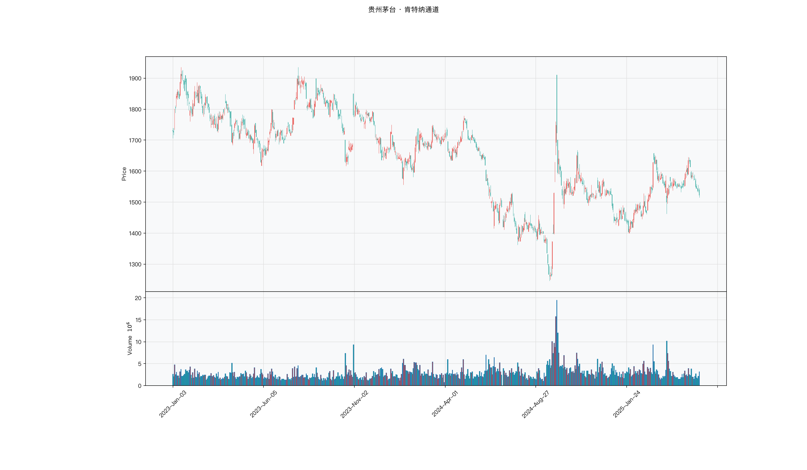

# 第033章 肯特纳通道（Keltner）

一根跳空长阳之后，布林带的上轨被撑开一大截，随后几天价格只是横着走，通道却迟迟收不回来。一个交易者盯着这条被单日缺口拽宽的边界，判断不了眼前的突破是真还是假。他想要的通道，宽度应当由每日真实波动累积而成，一根 K 线只贡献其中一份，而不是凭一次跳空改写整条界线。他要回答的是：这条边界是市场常态的刻度，还是某一天的残影。

## 名称与来历

肯特纳通道（Keltner Channels，Keltner）。

它由 Chester Keltner 在 1960 年提出，是通道类指标里较早的一位。最初的版本以一条典型价的移动平均线为中轨，上下轨用典型价的固定波动幅度偏移，思路接近后来的价格包络线。这种固定宽度在波动率变化剧烈时明显不够灵活。

1980 年代，Linda Raschke 对原始版本做了改良，用平均真实波幅（ATR）替换固定幅度。改良之后，通道宽度随每日真实波动自动伸缩：波动放大时通道变宽，波动收敛时通道收窄。今天通行的肯特纳通道，多数指的是改良后的 ATR 版本。

## 核心逻辑

通道的宽度该由什么决定，才能既灵敏又不容易误报？

布林带用标准差，对价格围绕均线的偏离非常敏感，单日极端涨跌会迅速把通道撑开。这在多数时候是优点，但在跳空频繁的市场里，一个隔夜缺口就能让标准差跳升，通道被一次非连续的价格变化扭曲。肯特纳通道给出的是另一种答案：用真实波幅来定宽度。真实波幅把当日最高最低差、以及相对昨收的上下缺口都纳入进来，对跳空的处理比标准差更直接，对盘中极端值的反应反而更平滑。

这个替换带来两种不同的敏感度。面对连续的高波动日，布林带扩张得更快，肯特纳通道相对温和；面对一次跳空缺口，肯特纳通道的反应更贴合真实风险，因为它本来就是为刻画缺口设计的。两者在波动率的度量上是互补的，不是谁替代谁。

中轨的选型也体现了这一取向。肯特纳通道的中轨通常用指数移动平均（EMA），而不是简单移动平均。EMA 对近期价格赋予更高权重，中轨更快跟上趋势，与随波动伸缩的轨道配合，整体反应更偏向灵敏。和布林带一样，通道的上下轨严格对称，方向由中轨给出，指标本身不带多空判断。

## 计算公式

肯特纳通道三条线，中轨是指数移动平均，上下轨在中轨基础上加减若干倍真实波幅。

### 中轨

$$Middle_t = EMA(Close,\ n)$$

其中 EMA 的递推形式为 $\mathrm{EMA}_t = \alpha C_t + (1-\alpha)\mathrm{EMA}_{t-1}$，平滑系数 $\alpha = 2/(n+1)$。

### 上轨与下轨

$$Upper_t = Middle_t + k \times ATR_t$$

$$Lower_t = Middle_t - k \times ATR_t$$

其中 ATR 的周期 m 与中轨周期 n 可以不同，典型设置为 n=20、m=10、k=2。

**计算示例。** 设 20 日 EMA 为 100 元，10 日 ATR 为 3 元，倍数 k 取 2，则上轨为 $100+2\times 3=106$ 元，下轨为 $100-2\times 3=94$ 元。若次日价格跳空上涨，ATR 抬升到 4 元，中轨随之上移到 101 元，则上轨变为 $101+2\times 4=109$ 元，下轨变为 $101-2\times 4=93$ 元。可以看到，波动一放大，通道立即变宽。

价格在通道中的相对位置同样可以用 %B 度量：

$$\%K_t = \frac{C_t - Lower_t}{Upper_t - Lower_t}$$

%K 接近 1 表示价格贴近上轨，接近 0 表示贴近下轨。

**参数含义。**

| 参数 | 含义 | 常见取值 | 影响 |
|------|------|---------|------|
| n | 中轨 EMA 周期 | 10、20（默认）、30 | n 越大，中轨越平滑，方向确认越慢 |
| m | ATR 周期 | 5、10（默认）、20 | m 越大，宽度越稳定，对波动突变越迟钝 |
| k | ATR 倍数 | 1.5、2（默认）、2.5 | k 越大，通道越宽，突破信号越少 |

三个参数需要协同，短线场景都调小，中长线场景都放大。ATR 周期与倍数共同决定通道宽度，具体取多少取决于品种波动率与容忍的误报率。

## 用法与信号

**突破。** 价格上穿上轨且中轨向上，说明多头突破了正常波动范围的上沿，可能标志上升趋势启动。突破时成交量放大，可靠性更高。价格下穿下轨且中轨向下，同理适用于下行方向。突破后若价格快速回落到通道内，通常视为假突破，应及时了结。

**通道收窄。** 通道宽度持续缩小到近期最低水平，意味着波动率被极度压缩，进入蓄力阶段。此时多空分歧小，价格在一个越来越窄的区间里运行。一旦价格带量突破收窄后的上轨或下轨，往往伴随一段较大的波动。收窄本身不提示方向，是一个待突破的状态。

**通道扩张。** 通道由窄变宽说明波动率从低位向高位切换。扩张时若价格持续贴近通道一侧（例如始终靠上轨运行），说明趋势力量强；若扩张但价格在两侧来回穿越，说明市场进入高波动震荡，突破的信噪比下降。

**中轨的支撑与阻力。** 上升趋势中价格回调至中轨附近止跌反弹，说明趋势健康；直接跌破中轨则趋势可能转弱。下降趋势中价格反弹至中轨遇阻回落是健康信号，上穿中轨则需警惕反转。中轨的方向本身也是判断多空的依据，价格与中轨的相对位置给出了通道内的偏向。

## 边界与误区

**ATR 的滞后会让通道短暂偏窄。** 波动率从低位突然跃升时，ATR 需要若干个交易日才能吸收新的波动水平，这段窗口里通道可能仍然偏窄，产生一连串假突破。极端行情中不宜只依赖通道信号，应结合成交量与市场状态再判断。

**极端行情下通道容易被贯穿。** 连续涨跌停或恐慌抛售中，价格可能被钉在通道外侧多日，ATR 短期内难以追上。此时通道的边界失去约束意义，把价格在上轨之外停留当作反转信号会连续做错方向。

**三个参数增加了优化空间。** 中轨周期、ATR 周期、倍数各有取值，组合多，容易在历史数据上挑出一组看起来最优的参数。合理的做法是先固定标准参数（20、10、2），在较长样本外验证其稳定性，再考虑调整，而不是在样本内反复搜索。

**震荡市中反复穿越。** 通道被价格一周内多次穿越、中轨走平、宽度极低时，突破信号基本无效。可先用平均趋向指数判断市场是否处于趋势状态，在支撑不足时降低对通道信号的依赖。

## 它被检验过吗

肯特纳通道没有针对它本身的独立同行评议检验。它的两个构件各有出处：中轨属于均线族，均线规则在整族层面被检验过，但结论无法归因到某一个周期或某一种加权方式；宽度来自 ATR，ATR 本身也没有单独检验。

合起来看，这条通道的绩效证据是空的。宽度与位置两种读数的用法，只能靠构造逻辑与样本内的分层结果支撑，不宜称为已经验证。完整证据链见第 007 章。

这一类的真实失效案例，见第 029 章的「真实案例与失败模式」。

## 代码实现

TTR 中的肯特纳通道实现并不稳定，这里直接手写，逻辑更透明。

### R

```r
library(ettr)
library(efactorcraft)
library(efincharts)
library(ggplot2)

BASE <- "https://raw.githubusercontent.com/dengyishuo/quant-technical-analysis/main/data/parquet"

# 取数据：本地有就用本地，没有就下载一次并缓存。
# read.csv 对本地 .gz 会自动解压，所以缓存成 .csv.gz 也能直接读。
load_data <- function(name) {
  local <- file.path("data", "parquet", name)
  if (file.exists(local)) return(local)
  cache <- file.path(tools::R_user_dir("qta", "cache"), name)
  if (!file.exists(cache)) {
    dir.create(dirname(cache), recursive = TRUE, showWarnings = FALSE)
    message("下载 ", name, " ...")
    download.file(paste0(BASE, "/", name), cache, mode = "wb", quiet = TRUE)
  }
  cache
}

read_data <- function(name) {
  d <- read.csv(load_data(name), stringsAsFactors = FALSE)
  if ("date" %in% names(d)) d$date <- as.Date(d$date)
  d
}

# 同一章里多次取用，缓存到内存，避免重复解析
.cache <- new.env(parent = emptyenv())
.blue <- function() {
  if (!exists("b", .cache)) assign("b", read_data("panel_blue_chip.csv"), .cache)
  get("b", .cache)
}
.panel <- function() {
  if (!exists("p", .cache)) {
    p <- read_data("panel_r.csv.gz")
    assign("p", p[p$date >= "2023-01-01" & p$date <= "2025-06-01", ], .cache)
  }
  get("p", .cache)
}
.index <- function() read_data("index_daily.csv")

blue  <- .blue()
panel <- .panel()

# 图的保存路径，顺手建目录，避免读者本地没有 assets/ 时报错
fig_path <- function(ch, name = "indicator_r.png") {
  d <- file.path("assets", "figures", sprintf("ch%03d", ch))
  dir.create(d, recursive = TRUE, showWarnings = FALSE)
  file.path(d, name)
}

# efincharts 要求 xts 且列名带 Adjusted
as_xts <- function(df) {
  x <- xts::xts(df[, c("open", "high", "low", "close", "volume", "adjusted")],
                order.by = df$date)
  colnames(x) <- c("Open", "High", "Low", "Close", "Volume", "Adjusted")
  x
}

maotai <- .blue()[.blue()$code == "600519.SS", ]

# 1. ettr 在长格式面板上追加指标列
maotai <- add_keltner_channels(maotai)

# 2. 基本统计
cols <- setdiff(names(maotai), names(blue))
print(summary(maotai[, cols]))

# 3. K 线 + 成交量 + 均线
ch <- ecandlesticks(as_xts(maotai), show_ma = TRUE, ma_periods = c(20, 60),
                    title = "贵州茅台 · 肯特纳通道")
ggsave(fig_path(33), ch$combined_plot, width = 10, height = 6, dpi = 110)
```

### Python

```python
import pathlib
import urllib.request

import pandas as pd
import ettr
import efactorcraft as efc
import efincharts as efc_

# 中文字体：mplfinance 会用 style 里的 rc 覆盖全局设置，必须写进 style
from efincharts import theme
theme.efin_style["rc"] = {
    "font.sans-serif": ["PingFang SC", "Heiti SC", "SimHei"],
    "axes.unicode_minus": False,
    "font.family": "sans-serif",
}

BASE = "https://raw.githubusercontent.com/dengyishuo/quant-technical-analysis/main/data/parquet"
CACHE = pathlib.Path.home() / ".cache" / "qta"
_MEM = {}


def load(name):
    """取数据：本地有就用本地，没有就下载一次并缓存。

    这样三种情形都能跑：
      1. 克隆了整个仓库    -> 直接读 data/parquet/，不联网
      2. 只复制了代码片段  -> 首次自动下载到 ~/.cache/qta，之后走缓存
      3. 之前跑过          -> 全部命中缓存，断网也能用
    """
    if name in _MEM:
        return _MEM[name]
    local = pathlib.Path("data/parquet") / name
    if local.exists():
        path = local
    else:
        CACHE.mkdir(parents=True, exist_ok=True)
        path = CACHE / name
        if not path.exists():
            print("下载 %s ..." % name)
            urllib.request.urlretrieve(BASE + "/" + name, path)
    data = pd.read_parquet(path) if name.endswith(".parquet") else pd.read_csv(path)
    _MEM[name] = data
    return data


blue = load("panel_blue_chip.parquet")
panel = load("panel.parquet")
panel = panel[(panel["date"] >= "2023-01-01") & (panel["date"] <= "2025-06-01")]
idx = load("index_daily.parquet")


def one(df, code="600519.SS"):
    """取单只标的，转成 efincharts 需要的宽表。"""
    x = df[df["code"] == code].sort_values("date").set_index("date")
    x.columns = [c.capitalize() for c in x.columns]
    return x


def fig_path(ch, name="indicator.png"):
    """图的保存路径，顺手建目录，避免读者本地没有 assets/ 时报错。"""
    d = pathlib.Path("assets") / "figures" / ("ch%03d" % ch)
    d.mkdir(parents=True, exist_ok=True)
    return str(d / name)

# 1. 取单只标的
maotai = blue[blue['code'] == '600519.SS'].copy()

# 2. ettr 在长格式面板上追加指标列，不需要手工 rolling
maotai = ettr.keltner(maotai)

cols = [c for c in maotai.columns if c not in blue.columns]
print(maotai[cols].describe().round(3))

# 3. 画图：K 线 + 成交量 + 指标面板
px = one(maotai)
ch = efc_.candlestick(px, volume=True, title="贵州茅台 · 肯特纳通道")
ch.save(fig_path(33))
```

<!-- fig-indicator:start -->


<p class="figcap">图 33-1　肯特纳通道在贵州茅台上的读数（2023-01 至 2025-06）</p>
<!-- fig-indicator:end -->

## 拆解

肯特纳通道的三条轨与价格同量纲，直接排序没有意义。它的两个派生读数与布林带同名，构造却不同，差异正是检验时最需要说清的地方：宽度由真实波幅驱动，位置的分母也随波动变化。这两处决定了它的因子行为与布林带并不重合。

| 特征名 | 计算式 | 量纲 | 经济含义 |
|--------|--------|------|----------|
| %K | $(p_t-L_t)/(U_t-L_t)$ | 无量纲，可越界 | 价格在通道中的相对位置 |
| 通道宽度 | $(U_t-L_t)/M_t=2k\,\mathrm{ATR}_t/M_t$ | 无量纲比例 | 由真实波幅驱动的波动水平 |
| 宽度变化率 | $W_t/W_{t-5}-1$ | 无量纲比例 | 通道张开或收拢的速度 |
| 中轨偏离 | $p_t/M_t-1$ | 无量纲比例 | 价格相对中轨的位置，分母不含波动 |

宽度与 ATR 比率几乎同源。上下轨之差等于 $2k$ 倍 ATR，宽度再除以中轨，与 ATR 除以收盘价只差一个常数和一个分母。这意味着宽度因子的排序与 ATR 因子高度一致，把它当作独立的波动因子放进模型，增量会很有限。检验时应先算两者的相关，或直接对 ATR 取残差，看剩余部分还有没有信息。

%K 与 %B 的差别在分母。%B 的分母是四倍标准差，%K 的分母是四倍 ATR，后者在跳空频繁的标的上更大。后果是，同样的价格偏离，在高波动期给出的 %K 比 %B 更温和。两者在平静期排序接近，在波动剧烈时明显分叉。若模型里同时有布林带与肯特纳，需要检查这两个位置因子是否重复。

中轨偏离与 %K 也不等价。%K 的分母随波动变化，中轨偏离的分母是价格本身，不受波动影响。前者把偏离按当前波动标准化，后者只按价格水平标准化。前者更适合判断"这次偏离相对当前波动算不算极端"，后者更适合判断"价格相对成本走了多远"。两者可以分别使用，混用会让结论含混。

中轨用 EMA，记忆比 SMA 短，对近期价格更敏感。这带来两个后果：中轨偏离的持续性弱于均线偏离，转向更快；价格与中轨的交叉更频繁，作为事件检验时样本更多，噪音也更多。宽度变化率则继承了 ATR 的滞后，波动突然跃升时，宽度需要几个交易日才能跟上，这段窗口里的突破信号信噪比偏低。

### R

```r
library(ettr)
library(efactorcraft)
library(efincharts)
library(ggplot2)

BASE <- "https://raw.githubusercontent.com/dengyishuo/quant-technical-analysis/main/data/parquet"

# 取数据：本地有就用本地，没有就下载一次并缓存。
# read.csv 对本地 .gz 会自动解压，所以缓存成 .csv.gz 也能直接读。
load_data <- function(name) {
  local <- file.path("data", "parquet", name)
  if (file.exists(local)) return(local)
  cache <- file.path(tools::R_user_dir("qta", "cache"), name)
  if (!file.exists(cache)) {
    dir.create(dirname(cache), recursive = TRUE, showWarnings = FALSE)
    message("下载 ", name, " ...")
    download.file(paste0(BASE, "/", name), cache, mode = "wb", quiet = TRUE)
  }
  cache
}

read_data <- function(name) {
  d <- read.csv(load_data(name), stringsAsFactors = FALSE)
  if ("date" %in% names(d)) d$date <- as.Date(d$date)
  d
}

# 同一章里多次取用，缓存到内存，避免重复解析
.cache <- new.env(parent = emptyenv())
.blue <- function() {
  if (!exists("b", .cache)) assign("b", read_data("panel_blue_chip.csv"), .cache)
  get("b", .cache)
}
.panel <- function() {
  if (!exists("p", .cache)) {
    p <- read_data("panel_r.csv.gz")
    assign("p", p[p$date >= "2023-01-01" & p$date <= "2025-06-01", ], .cache)
  }
  get("p", .cache)
}
.index <- function() read_data("index_daily.csv")

blue  <- .blue()
panel <- .panel()

# 图的保存路径，顺手建目录，避免读者本地没有 assets/ 时报错
fig_path <- function(ch, name = "indicator_r.png") {
  d <- file.path("assets", "figures", sprintf("ch%03d", ch))
  dir.create(d, recursive = TRUE, showWarnings = FALSE)
  file.path(d, name)
}

# efincharts 要求 xts 且列名带 Adjusted
as_xts <- function(df) {
  x <- xts::xts(df[, c("open", "high", "low", "close", "volume", "adjusted")],
                order.by = df$date)
  colnames(x) <- c("Open", "High", "Low", "Close", "Volume", "Adjusted")
  x
}

d <- .blue()[.blue()$code == "600519.SS", ]
d <- add_keltner_channels(d)

# 转成无量纲因子
d$f <- d$`kc_mavg_20` / d$close - 1

print(summary(d$f))
```

### Python

```python
import pathlib
import urllib.request

import pandas as pd
import ettr
import efactorcraft as efc
import efincharts as efc_

# 中文字体：mplfinance 会用 style 里的 rc 覆盖全局设置，必须写进 style
from efincharts import theme
theme.efin_style["rc"] = {
    "font.sans-serif": ["PingFang SC", "Heiti SC", "SimHei"],
    "axes.unicode_minus": False,
    "font.family": "sans-serif",
}

BASE = "https://raw.githubusercontent.com/dengyishuo/quant-technical-analysis/main/data/parquet"
CACHE = pathlib.Path.home() / ".cache" / "qta"
_MEM = {}


def load(name):
    """取数据：本地有就用本地，没有就下载一次并缓存。

    这样三种情形都能跑：
      1. 克隆了整个仓库    -> 直接读 data/parquet/，不联网
      2. 只复制了代码片段  -> 首次自动下载到 ~/.cache/qta，之后走缓存
      3. 之前跑过          -> 全部命中缓存，断网也能用
    """
    if name in _MEM:
        return _MEM[name]
    local = pathlib.Path("data/parquet") / name
    if local.exists():
        path = local
    else:
        CACHE.mkdir(parents=True, exist_ok=True)
        path = CACHE / name
        if not path.exists():
            print("下载 %s ..." % name)
            urllib.request.urlretrieve(BASE + "/" + name, path)
    data = pd.read_parquet(path) if name.endswith(".parquet") else pd.read_csv(path)
    _MEM[name] = data
    return data


blue = load("panel_blue_chip.parquet")
panel = load("panel.parquet")
panel = panel[(panel["date"] >= "2023-01-01") & (panel["date"] <= "2025-06-01")]
idx = load("index_daily.parquet")


def one(df, code="600519.SS"):
    """取单只标的，转成 efincharts 需要的宽表。"""
    x = df[df["code"] == code].sort_values("date").set_index("date")
    x.columns = [c.capitalize() for c in x.columns]
    return x


def fig_path(ch, name="indicator.png"):
    """图的保存路径，顺手建目录，避免读者本地没有 assets/ 时报错。"""
    d = pathlib.Path("assets") / "figures" / ("ch%03d" % ch)
    d.mkdir(parents=True, exist_ok=True)
    return str(d / name)

# 1. 先在面板上算原始指标
d = panel.copy()
d = ettr.keltner(d)

# 2. 转成无量纲因子，才能跨标的排序
d["f"] = d["Keltner_middle"] / d.close - 1

print(d["f"].describe().round(4))
```

## 截面选股能力

肯特纳进入截面检验，位置因子取 %K：

$$f^{\%K}_t=\frac{p_t-L_t}{U_t-L_t}$$

波动因子取通道宽度：

$$f^{w}_t=\frac{U_t-L_t}{M_t}$$

第三个候选是双通道宽度比，分母用肯特纳宽度，分子用同参数的布林带宽度：

$$R_t=\frac{BW^{BB}_t}{W^{KC}_t}=\frac{4\sigma_t/M_t}{2k\,\mathrm{ATR}_t/M_t}=\frac{2\sigma_t}{k\,\mathrm{ATR}_t}$$

比值大于一，说明标准差口径的波动高于真实波幅口径，通常对应连续大阴大阳而少有跳空；比值小于一，说明跳空较多，真实波幅相对更大。这个比值不是宽度，而是两种波动估计的分歧程度，它携带的信息与单一宽度不同。

预期表现上，%K 属于均值回归型，方向多为负，但在趋势中会减弱甚至反号。宽度对未来波动率通常为正，波动聚类使高宽度状态延续。双通道比值的方向更不确定：比值高说明价格在连续交易中剧烈摆动，这类标的后续波动可能继续偏高；比值低说明波动集中在缺口，缺口之后往往进入整理。方向由数据给出，不宜先验设定。

检验时有三点值得注意。第一，宽度与 ATR 比率高度共线。若模型里已有 ATR 类因子，宽度因子的增量有限，判断时应先取残差，或直接只保留一个。第二，%K 与布林带的 %B 在两个指标同时出现时会重复，二者的相关在平静期很高，在跳空频繁期下降，需要用分段相关确认是否真的提供了新信息。第三，比值的分母在宽度极小时不稳定，低波动样本里读数会剧烈跳动，计算前应剔除宽度低于某一分位的观测。

### R

```r
library(ettr)
library(efactorcraft)
library(efincharts)
library(ggplot2)

BASE <- "https://raw.githubusercontent.com/dengyishuo/quant-technical-analysis/main/data/parquet"

# 取数据：本地有就用本地，没有就下载一次并缓存。
# read.csv 对本地 .gz 会自动解压，所以缓存成 .csv.gz 也能直接读。
load_data <- function(name) {
  local <- file.path("data", "parquet", name)
  if (file.exists(local)) return(local)
  cache <- file.path(tools::R_user_dir("qta", "cache"), name)
  if (!file.exists(cache)) {
    dir.create(dirname(cache), recursive = TRUE, showWarnings = FALSE)
    message("下载 ", name, " ...")
    download.file(paste0(BASE, "/", name), cache, mode = "wb", quiet = TRUE)
  }
  cache
}

read_data <- function(name) {
  d <- read.csv(load_data(name), stringsAsFactors = FALSE)
  if ("date" %in% names(d)) d$date <- as.Date(d$date)
  d
}

# 同一章里多次取用，缓存到内存，避免重复解析
.cache <- new.env(parent = emptyenv())
.blue <- function() {
  if (!exists("b", .cache)) assign("b", read_data("panel_blue_chip.csv"), .cache)
  get("b", .cache)
}
.panel <- function() {
  if (!exists("p", .cache)) {
    p <- read_data("panel_r.csv.gz")
    assign("p", p[p$date >= "2023-01-01" & p$date <= "2025-06-01", ], .cache)
  }
  get("p", .cache)
}
.index <- function() read_data("index_daily.csv")

blue  <- .blue()
panel <- .panel()

# 图的保存路径，顺手建目录，避免读者本地没有 assets/ 时报错
fig_path <- function(ch, name = "indicator_r.png") {
  d <- file.path("assets", "figures", sprintf("ch%03d", ch))
  dir.create(d, recursive = TRUE, showWarnings = FALSE)
  file.path(d, name)
}

# efincharts 要求 xts 且列名带 Adjusted
as_xts <- function(df) {
  x <- xts::xts(df[, c("open", "high", "low", "close", "volume", "adjusted")],
                order.by = df$date)
  colnames(x) <- c("Open", "High", "Low", "Close", "Volume", "Adjusted")
  x
}

d <- .panel()
d <- add_keltner_channels(d)

d$f <- d$`kc_mavg_20` / d$close - 1
d <- add_next_return(d, close_col = "close", n = c(1, 5, 20))

ic <- ic_analysis(d, factor_cols = "f",
                    forward_cols = c("forward_1", "forward_5", "forward_20"),
                    method = "spearman")
print(ir_analysis(ic))

q <- quantile_analysis(d, factor_cols = "f", forward_cols = "forward_5",
                       n_groups = 5)
print(q$f$summary)
```

### Python

```python
import pathlib
import urllib.request

import pandas as pd
import ettr
import efactorcraft as efc
import efincharts as efc_

# 中文字体：mplfinance 会用 style 里的 rc 覆盖全局设置，必须写进 style
from efincharts import theme
theme.efin_style["rc"] = {
    "font.sans-serif": ["PingFang SC", "Heiti SC", "SimHei"],
    "axes.unicode_minus": False,
    "font.family": "sans-serif",
}

BASE = "https://raw.githubusercontent.com/dengyishuo/quant-technical-analysis/main/data/parquet"
CACHE = pathlib.Path.home() / ".cache" / "qta"
_MEM = {}


def load(name):
    """取数据：本地有就用本地，没有就下载一次并缓存。

    这样三种情形都能跑：
      1. 克隆了整个仓库    -> 直接读 data/parquet/，不联网
      2. 只复制了代码片段  -> 首次自动下载到 ~/.cache/qta，之后走缓存
      3. 之前跑过          -> 全部命中缓存，断网也能用
    """
    if name in _MEM:
        return _MEM[name]
    local = pathlib.Path("data/parquet") / name
    if local.exists():
        path = local
    else:
        CACHE.mkdir(parents=True, exist_ok=True)
        path = CACHE / name
        if not path.exists():
            print("下载 %s ..." % name)
            urllib.request.urlretrieve(BASE + "/" + name, path)
    data = pd.read_parquet(path) if name.endswith(".parquet") else pd.read_csv(path)
    _MEM[name] = data
    return data


blue = load("panel_blue_chip.parquet")
panel = load("panel.parquet")
panel = panel[(panel["date"] >= "2023-01-01") & (panel["date"] <= "2025-06-01")]
idx = load("index_daily.parquet")


def one(df, code="600519.SS"):
    """取单只标的，转成 efincharts 需要的宽表。"""
    x = df[df["code"] == code].sort_values("date").set_index("date")
    x.columns = [c.capitalize() for c in x.columns]
    return x


def fig_path(ch, name="indicator.png"):
    """图的保存路径，顺手建目录，避免读者本地没有 assets/ 时报错。"""
    d = pathlib.Path("assets") / "figures" / ("ch%03d" % ch)
    d.mkdir(parents=True, exist_ok=True)
    return str(d / name)

# 287 只、2023-01 至 2025-06，横截面才有统计意义
src = panel.copy()
d = src.copy()

# 1. 算指标
d = ettr.keltner(d)


# 2. 因子 + 未来收益
d["f"] = d["Keltner_middle"] / d.close - 1
d = efc.add_next_return(d, periods=(1, 5, 20))

# 3. 截面 IC 与分层
ic = efc.ic_analysis(d, factor_cols="f",
                      forward_cols=["forward_1", "forward_5", "forward_20"],
                      method="spearman")
print(efc.ir_analysis(ic).round(3))

q = efc.quantile_analysis(d, factor_col="f", forward_col="forward_5", n_groups=5)
print(q["summary"].round(4))
```

三组结果分别回答三个问题。%K 是否有选股能力，宽度是否是合格的波动代理，比值是否在宽度之外还有增量。第三组最后那一行相关是关键：若宽度与比值的横截面相关很低，说明比值确实是独立信息；若相关很高，比值只是宽度的另一种刻度，不值得单独保留。两组目标列的结果仍要分开看，%K 那一组的目标是收益，后两组是波动率。

<!-- tab-ic:start -->
**计算结果**

| 前向期 | IC 均值 | IC 标准差 | ICIR | t 值 | IC>0 占比 | 期数 |
|---|---|---|---|---|---|---|
| T+1 | 0.0197 | 0.2415 | 0.081 | 1.93 | 0.5350 | 561 |
| T+5 | 0.0227 | 0.2243 | 0.101 | 2.39 | 0.5280 | 557 |
| T+20 | 0.0436 | 0.2091 | 0.208 | 4.85 | 0.5760 | 542 |

表里最该看的是 t 值，不是 IC 均值。这个因子以 T+1 为主口径，IC 均值 0.0197、ICIR 0.081、t 值 1.93，在常规门槛下不显著，方向为正向。按第 007 章给出的日频门槛（ICIR 0.13 对应 t≈2），这个结果的含义是：还看不出与噪声的区别，不能据此构造策略。

需要提醒的是，这只说明排序与未来收益之间存在可测的关联，不代表扣掉成本后还能剩下收益。横截面 IC 检验的是“买哪只”，不负责“值不值得交易”。

**五档分层**

| 分组 | 平均收益 | 标准差 | 期数 |
|---|---|---|---|
| 1 | +0.0043 | +0.0402 | 557 |
| 2 | +0.0025 | +0.0302 | 557 |
| 3 | +0.0020 | +0.0292 | 557 |
| 4 | +0.0031 | +0.0336 | 557 |
| 5 | +0.0045 | +0.0425 | 557 |

五档分层看的是形状，不是单点。最高一档在第 5 组、最低在第 3 组，两端相差 +0.02%，组序号与平均收益的秩相关为 0.14，没有明显单调性。

分层比 IC 更接近实盘，因为它直接给出“买最高档、卖最低档”的收益差。但这里的数字是毛收益，且没有考虑涨跌停买不进、停牌卖不出的情形，真实可得的差额会小于表中所列。
<!-- tab-ic:end -->

## 择时能力

时序上肯特纳的读法有三层。第一层是突破，价格上穿上轨且中轨向上，属于离散事件。第二层是收窄，通道宽度落到历史低位，属于状态。第三层是中轨的方向与支撑，价格回调至中轨止跌是趋势健康的确认，跌破则趋势转弱。

检验方法要与形态匹配。突破是事件，适合信号触发日检验，比较突破日与其余交易日的后续收益。%K 是连续变量，适合条件分位收益，观察各档是否单调。收窄是状态，适合分组对照，比较收窄期与常态期未来收益的分布。

这里要强调分布而非均值。ATR 存在滞后，波动从低位跃升时，通道往往还偏窄，价格容易被连续突破，产生一串看似有效的信号。这些信号集中在波动跃升的初期，对应的是收益分布整体变宽，而不是均值抬升。只看均值，容易得出突破无用的结论；看标准差与左尾，才会看到真正发生的变化是风险的重估。

三个陷阱。第一，突破事件在波动跃升期高度重叠，连续多日站在上轨外侧会被计为多次触发，样本不独立，显著性被高估。第二，收窄阈值若用全样本分位，等于提前知道未来的宽度分布，回测应改为滚动分位。第三，三个参数（中轨周期、ATR 周期、倍数）共同决定宽度，在同一段样本里同时优化会让结果变成拟合，稳健做法是固定标准参数，检查邻近取值的表现是否平稳。

### R

```r
library(ettr)
library(efactorcraft)
library(efincharts)
library(ggplot2)

BASE <- "https://raw.githubusercontent.com/dengyishuo/quant-technical-analysis/main/data/parquet"

# 取数据：本地有就用本地，没有就下载一次并缓存。
# read.csv 对本地 .gz 会自动解压，所以缓存成 .csv.gz 也能直接读。
load_data <- function(name) {
  local <- file.path("data", "parquet", name)
  if (file.exists(local)) return(local)
  cache <- file.path(tools::R_user_dir("qta", "cache"), name)
  if (!file.exists(cache)) {
    dir.create(dirname(cache), recursive = TRUE, showWarnings = FALSE)
    message("下载 ", name, " ...")
    download.file(paste0(BASE, "/", name), cache, mode = "wb", quiet = TRUE)
  }
  cache
}

read_data <- function(name) {
  d <- read.csv(load_data(name), stringsAsFactors = FALSE)
  if ("date" %in% names(d)) d$date <- as.Date(d$date)
  d
}

# 同一章里多次取用，缓存到内存，避免重复解析
.cache <- new.env(parent = emptyenv())
.blue <- function() {
  if (!exists("b", .cache)) assign("b", read_data("panel_blue_chip.csv"), .cache)
  get("b", .cache)
}
.panel <- function() {
  if (!exists("p", .cache)) {
    p <- read_data("panel_r.csv.gz")
    assign("p", p[p$date >= "2023-01-01" & p$date <= "2025-06-01", ], .cache)
  }
  get("p", .cache)
}
.index <- function() read_data("index_daily.csv")

blue  <- .blue()
panel <- .panel()

# 图的保存路径，顺手建目录，避免读者本地没有 assets/ 时报错
fig_path <- function(ch, name = "indicator_r.png") {
  d <- file.path("assets", "figures", sprintf("ch%03d", ch))
  dir.create(d, recursive = TRUE, showWarnings = FALSE)
  file.path(d, name)
}

# efincharts 要求 xts 且列名带 Adjusted
as_xts <- function(df) {
  x <- xts::xts(df[, c("open", "high", "low", "close", "volume", "adjusted")],
                order.by = df$date)
  colnames(x) <- c("Open", "High", "Low", "Close", "Volume", "Adjusted")
  x
}

t <- .index()
t <- t[t$code == "510300.SS", ]
t <- add_keltner_channels(t)
t$f <- t$`kc_mavg_20` / t$close - 1
t$forward_5 <- c(tail(t$close, -5) / head(t$close, -5) - 1, rep(NA, 5))
t$q <- cut(t$f, quantile(t$f, 0:5/5, na.rm = TRUE), include.lowest = TRUE, labels = FALSE)
print(aggregate(forward_5 ~ q, data = t, FUN = function(x)
  c(mean = mean(x, na.rm = TRUE), n = sum(!is.na(x)))))
```

### Python

```python
import pathlib
import urllib.request

import pandas as pd
import ettr
import efactorcraft as efc
import efincharts as efc_

# 中文字体：mplfinance 会用 style 里的 rc 覆盖全局设置，必须写进 style
from efincharts import theme
theme.efin_style["rc"] = {
    "font.sans-serif": ["PingFang SC", "Heiti SC", "SimHei"],
    "axes.unicode_minus": False,
    "font.family": "sans-serif",
}

BASE = "https://raw.githubusercontent.com/dengyishuo/quant-technical-analysis/main/data/parquet"
CACHE = pathlib.Path.home() / ".cache" / "qta"
_MEM = {}


def load(name):
    """取数据：本地有就用本地，没有就下载一次并缓存。

    这样三种情形都能跑：
      1. 克隆了整个仓库    -> 直接读 data/parquet/，不联网
      2. 只复制了代码片段  -> 首次自动下载到 ~/.cache/qta，之后走缓存
      3. 之前跑过          -> 全部命中缓存，断网也能用
    """
    if name in _MEM:
        return _MEM[name]
    local = pathlib.Path("data/parquet") / name
    if local.exists():
        path = local
    else:
        CACHE.mkdir(parents=True, exist_ok=True)
        path = CACHE / name
        if not path.exists():
            print("下载 %s ..." % name)
            urllib.request.urlretrieve(BASE + "/" + name, path)
    data = pd.read_parquet(path) if name.endswith(".parquet") else pd.read_csv(path)
    _MEM[name] = data
    return data


blue = load("panel_blue_chip.parquet")
panel = load("panel.parquet")
panel = panel[(panel["date"] >= "2023-01-01") & (panel["date"] <= "2025-06-01")]
idx = load("index_daily.parquet")


def one(df, code="600519.SS"):
    """取单只标的，转成 efincharts 需要的宽表。"""
    x = df[df["code"] == code].sort_values("date").set_index("date")
    x.columns = [c.capitalize() for c in x.columns]
    return x


def fig_path(ch, name="indicator.png"):
    """图的保存路径，顺手建目录，避免读者本地没有 assets/ 时报错。"""
    d = pathlib.Path("assets") / "figures" / ("ch%03d" % ch)
    d.mkdir(parents=True, exist_ok=True)
    return str(d / name)

# 择时检验用 ETF 做市场载体，指数本身没有日线数据
t = idx[idx["code"] == "510300.SS"].sort_values("date").copy()

# 1. 在 ETF 上算同一个指标
t = ettr.keltner(d)


# 2. 按因子分位看未来 5 日收益
t["f"] = t["Keltner_middle"] / t.close - 1
t["forward_5"] = t["close"].shift(-5) / t["close"] - 1
# 因子可能有重复值，先按名次切，避免 qcut 报边界不唯一
t["q"] = pd.qcut(t["f"].rank(method="first"), 5, labels=False) + 1
t = t.dropna(subset=["f", "forward_5"])
print(t.groupby("q")["forward_5"].agg(["mean", "count"]).round(4))
```

三组输出分别对应事件、形态与状态。突破检验若显著且方向为正，说明通道突破具备动量特征；条件分位若在高端单调抬升，说明突破越强后续越强，这与均值回归类的 %B 正好相反。这一层与截面结论看似矛盾，其实不冲突：截面比较的是同一时点不同标的的位置，极端位置多对应短期过度延伸；时序检验的是同一标的突破的那几天，位置偏高往往伴随趋势启动。同一个读数在两个维度上含义不同，这正是两条检验线要分开跑的理由。收窄分布表看标准差与左尾，若均值相近而这两列更高，说明收窄预测的是波动的展开，方向仍需另找依据。

<!-- tab-timing:start -->
**分位收益**

| 分位 | 未来 5 日均值 | 样本数 |
|---|---|---|
| 1 | +0.0027 | 219 |
| 2 | -0.0025 | 218 |
| 3 | +0.0007 | 218 |
| 4 | -0.0044 | 218 |
| 5 | +0.0032 | 218 |

择时口径与截面不同：这里只有一个标的，看的是同一标的在不同分位下的未来收益。最高与最低分位相差 +0.05%。单标的样本有限，这个差额很容易被一两段行情主导，只能作为方向参考。

真正做择时要问的是三件事：分位阈值是否稳定、换手是否可控、扣成本后是否还有剩余。三者缺一，择时信号就只是图上好看。
<!-- tab-timing:end -->

## 组合使用与验证

肯特纳的常见搭档有三个。与布林带搭配，两条通道的宽度比是判断波动来源的现成工具，一个用标准差，一个用真实波幅，分歧本身就带信息。与平均趋向指数搭配，ADX 补市况前提，趋势弱时突破多为噪音。与成交量搭配，突破放量提高可靠性，缩量突破多属假信号。

**组合的截面验证。** 把布林带宽度与肯特纳宽度都取负，转成低波动得分，标准化后相加，得到一个双通道低波动因子。它要回答的问题是：两把尺子合起来，是否比任何一把单独使用更准。若两把尺子的横截面相关很高，组合只是平均；若相关中等，组合可能略优于两者。这一检验的价值不在得出一个更强的因子，而在确认两条通道是否重复。若组合明显优于任一单通道，说明标准差与真实波幅捕捉的是波动的不同侧面，两条通道值得同时保留。

**组合的择时验证。** 条件型组合更贴近实务：价格突破上轨且中轨向上才持仓，两者缺一即空仓。回测时与两个单条件并排跑，比较年化、夏普与最大回撤。中轨方向的加入会减少持仓天数，作用在于滤掉波动跃升初期的假突破。改进通常体现在最大回撤与胜率上，年化收益未必提高。

增益的判读沿用方法论章的标准：组合的 ICIR 高于两个单特征，才说明存在互补性。同族通道的宽度相关性很高，组合多半只是平均，此时更该做的是二选一，而不是叠加。真正有增量的是宽度与位置这两个不同维度，以及宽度比这类刻画分歧的构造。把同源因子反复叠加，是通道类指标最容易犯的错误。

### R

```r
library(ettr)
library(efactorcraft)
library(efincharts)
library(ggplot2)

BASE <- "https://raw.githubusercontent.com/dengyishuo/quant-technical-analysis/main/data/parquet"

# 取数据：本地有就用本地，没有就下载一次并缓存。
# read.csv 对本地 .gz 会自动解压，所以缓存成 .csv.gz 也能直接读。
load_data <- function(name) {
  local <- file.path("data", "parquet", name)
  if (file.exists(local)) return(local)
  cache <- file.path(tools::R_user_dir("qta", "cache"), name)
  if (!file.exists(cache)) {
    dir.create(dirname(cache), recursive = TRUE, showWarnings = FALSE)
    message("下载 ", name, " ...")
    download.file(paste0(BASE, "/", name), cache, mode = "wb", quiet = TRUE)
  }
  cache
}

read_data <- function(name) {
  d <- read.csv(load_data(name), stringsAsFactors = FALSE)
  if ("date" %in% names(d)) d$date <- as.Date(d$date)
  d
}

# 同一章里多次取用，缓存到内存，避免重复解析
.cache <- new.env(parent = emptyenv())
.blue <- function() {
  if (!exists("b", .cache)) assign("b", read_data("panel_blue_chip.csv"), .cache)
  get("b", .cache)
}
.panel <- function() {
  if (!exists("p", .cache)) {
    p <- read_data("panel_r.csv.gz")
    assign("p", p[p$date >= "2023-01-01" & p$date <= "2025-06-01", ], .cache)
  }
  get("p", .cache)
}
.index <- function() read_data("index_daily.csv")

blue  <- .blue()
panel <- .panel()

# 图的保存路径，顺手建目录，避免读者本地没有 assets/ 时报错
fig_path <- function(ch, name = "indicator_r.png") {
  d <- file.path("assets", "figures", sprintf("ch%03d", ch))
  dir.create(d, recursive = TRUE, showWarnings = FALSE)
  file.path(d, name)
}

# efincharts 要求 xts 且列名带 Adjusted
as_xts <- function(df) {
  x <- xts::xts(df[, c("open", "high", "low", "close", "volume", "adjusted")],
                order.by = df$date)
  colnames(x) <- c("Open", "High", "Low", "Close", "Volume", "Adjusted")
  x
}

d <- .panel()
d <- add_keltner_channels(d)
d$f1 <- d$`kc_mavg_20` / d$close - 1
d <- add_cmf(d, n = 20)
d$f2 <- d$CMF
d <- add_next_return(d, close_col = "close", n = 5)
ic1 <- ic_analysis(d, factor_cols = c("f1", "f2"),
                    forward_cols = "forward_5", method = "spearman")
print(ir_analysis(ic1))
```

```r
library(ettr)
library(efactorcraft)
library(efincharts)
library(ggplot2)

BASE <- "https://raw.githubusercontent.com/dengyishuo/quant-technical-analysis/main/data/parquet"

# 取数据：本地有就用本地，没有就下载一次并缓存。
# read.csv 对本地 .gz 会自动解压，所以缓存成 .csv.gz 也能直接读。
load_data <- function(name) {
  local <- file.path("data", "parquet", name)
  if (file.exists(local)) return(local)
  cache <- file.path(tools::R_user_dir("qta", "cache"), name)
  if (!file.exists(cache)) {
    dir.create(dirname(cache), recursive = TRUE, showWarnings = FALSE)
    message("下载 ", name, " ...")
    download.file(paste0(BASE, "/", name), cache, mode = "wb", quiet = TRUE)
  }
  cache
}

read_data <- function(name) {
  d <- read.csv(load_data(name), stringsAsFactors = FALSE)
  if ("date" %in% names(d)) d$date <- as.Date(d$date)
  d
}

# 同一章里多次取用，缓存到内存，避免重复解析
.cache <- new.env(parent = emptyenv())
.blue <- function() {
  if (!exists("b", .cache)) assign("b", read_data("panel_blue_chip.csv"), .cache)
  get("b", .cache)
}
.panel <- function() {
  if (!exists("p", .cache)) {
    p <- read_data("panel_r.csv.gz")
    assign("p", p[p$date >= "2023-01-01" & p$date <= "2025-06-01", ], .cache)
  }
  get("p", .cache)
}
.index <- function() read_data("index_daily.csv")

blue  <- .blue()
panel <- .panel()

# 图的保存路径，顺手建目录，避免读者本地没有 assets/ 时报错
fig_path <- function(ch, name = "indicator_r.png") {
  d <- file.path("assets", "figures", sprintf("ch%03d", ch))
  dir.create(d, recursive = TRUE, showWarnings = FALSE)
  file.path(d, name)
}

# efincharts 要求 xts 且列名带 Adjusted
as_xts <- function(df) {
  x <- xts::xts(df[, c("open", "high", "low", "close", "volume", "adjusted")],
                order.by = df$date)
  colnames(x) <- c("Open", "High", "Low", "Close", "Volume", "Adjusted")
  x
}

d <- .panel()
d <- add_keltner_channels(d)
d$f1 <- d$`kc_mavg_20` / d$close - 1
d <- add_cmf(d, n = 20)
d$f2 <- d$CMF
d <- add_next_return(d, close_col = "close", n = 5)
ic1 <- ic_analysis(d, factor_cols = c("f1", "f2"),
                    forward_cols = "forward_5", method = "spearman")
print(ir_analysis(ic1))
```

### Python

```python
import pathlib
import urllib.request

import pandas as pd
import ettr
import efactorcraft as efc
import efincharts as efc_

# 中文字体：mplfinance 会用 style 里的 rc 覆盖全局设置，必须写进 style
from efincharts import theme
theme.efin_style["rc"] = {
    "font.sans-serif": ["PingFang SC", "Heiti SC", "SimHei"],
    "axes.unicode_minus": False,
    "font.family": "sans-serif",
}

BASE = "https://raw.githubusercontent.com/dengyishuo/quant-technical-analysis/main/data/parquet"
CACHE = pathlib.Path.home() / ".cache" / "qta"
_MEM = {}


def load(name):
    """取数据：本地有就用本地，没有就下载一次并缓存。

    这样三种情形都能跑：
      1. 克隆了整个仓库    -> 直接读 data/parquet/，不联网
      2. 只复制了代码片段  -> 首次自动下载到 ~/.cache/qta，之后走缓存
      3. 之前跑过          -> 全部命中缓存，断网也能用
    """
    if name in _MEM:
        return _MEM[name]
    local = pathlib.Path("data/parquet") / name
    if local.exists():
        path = local
    else:
        CACHE.mkdir(parents=True, exist_ok=True)
        path = CACHE / name
        if not path.exists():
            print("下载 %s ..." % name)
            urllib.request.urlretrieve(BASE + "/" + name, path)
    data = pd.read_parquet(path) if name.endswith(".parquet") else pd.read_csv(path)
    _MEM[name] = data
    return data


blue = load("panel_blue_chip.parquet")
panel = load("panel.parquet")
panel = panel[(panel["date"] >= "2023-01-01") & (panel["date"] <= "2025-06-01")]
idx = load("index_daily.parquet")


def one(df, code="600519.SS"):
    """取单只标的，转成 efincharts 需要的宽表。"""
    x = df[df["code"] == code].sort_values("date").set_index("date")
    x.columns = [c.capitalize() for c in x.columns]
    return x


def fig_path(ch, name="indicator.png"):
    """图的保存路径，顺手建目录，避免读者本地没有 assets/ 时报错。"""
    d = pathlib.Path("assets") / "figures" / ("ch%03d" % ch)
    d.mkdir(parents=True, exist_ok=True)
    return str(d / name)

d = panel.copy()

# 1. 本章因子
d = ettr.keltner(d)
d["f1"] = d["Keltner_middle"] / d.close - 1

# 2. 配一个量价因子做对照
d = ettr.cmf(d, n=20)
d["f2"] = d["CMF_20"]
d = efc.add_next_return(d, periods=(5,))

# 3. 单因子与等权组合的信息比率
ic = efc.ic_analysis(d, factor_cols=["f1", "f2"], forward_cols=["forward_5"],
                      method="spearman")
d = efc.equal_weighted_composite(d, factor_cols=["f1", "f2"], new_col="f1_f2")
ic2 = efc.ic_analysis(d, factor_cols=["f1_f2"], forward_cols=["forward_5"],
                      method="spearman")
ic.update(ic2)
print(efc.ir_analysis(ic).round(3))
```

```python
import pathlib
import urllib.request

import pandas as pd
import ettr
import efactorcraft as efc
import efincharts as efc_

# 中文字体：mplfinance 会用 style 里的 rc 覆盖全局设置，必须写进 style
from efincharts import theme
theme.efin_style["rc"] = {
    "font.sans-serif": ["PingFang SC", "Heiti SC", "SimHei"],
    "axes.unicode_minus": False,
    "font.family": "sans-serif",
}

BASE = "https://raw.githubusercontent.com/dengyishuo/quant-technical-analysis/main/data/parquet"
CACHE = pathlib.Path.home() / ".cache" / "qta"
_MEM = {}


def load(name):
    """取数据：本地有就用本地，没有就下载一次并缓存。

    这样三种情形都能跑：
      1. 克隆了整个仓库    -> 直接读 data/parquet/，不联网
      2. 只复制了代码片段  -> 首次自动下载到 ~/.cache/qta，之后走缓存
      3. 之前跑过          -> 全部命中缓存，断网也能用
    """
    if name in _MEM:
        return _MEM[name]
    local = pathlib.Path("data/parquet") / name
    if local.exists():
        path = local
    else:
        CACHE.mkdir(parents=True, exist_ok=True)
        path = CACHE / name
        if not path.exists():
            print("下载 %s ..." % name)
            urllib.request.urlretrieve(BASE + "/" + name, path)
    data = pd.read_parquet(path) if name.endswith(".parquet") else pd.read_csv(path)
    _MEM[name] = data
    return data


blue = load("panel_blue_chip.parquet")
panel = load("panel.parquet")
panel = panel[(panel["date"] >= "2023-01-01") & (panel["date"] <= "2025-06-01")]
idx = load("index_daily.parquet")


def one(df, code="600519.SS"):
    """取单只标的，转成 efincharts 需要的宽表。"""
    x = df[df["code"] == code].sort_values("date").set_index("date")
    x.columns = [c.capitalize() for c in x.columns]
    return x


def fig_path(ch, name="indicator.png"):
    """图的保存路径，顺手建目录，避免读者本地没有 assets/ 时报错。"""
    d = pathlib.Path("assets") / "figures" / ("ch%03d" % ch)
    d.mkdir(parents=True, exist_ok=True)
    return str(d / name)

d = panel.copy()

# 1. 本章因子
d = ettr.keltner(d)
d["f1"] = d["Keltner_middle"] / d.close - 1

# 2. 配一个量价因子做对照
d = ettr.cmf(d, n=20)
d["f2"] = d["CMF_20"]
d = efc.add_next_return(d, periods=(5,))

# 3. 单因子与等权组合的信息比率
ic = efc.ic_analysis(d, factor_cols=["f1", "f2"], forward_cols=["forward_5"],
                      method="spearman")
d = efc.equal_weighted_composite(d, factor_cols=["f1", "f2"], new_col="f1_f2")
ic2 = efc.ic_analysis(d, factor_cols=["f1_f2"], forward_cols=["forward_5"],
                      method="spearman")
ic.update(ic2)
print(efc.ir_analysis(ic).round(3))
```

截面三行要看相关那一个数字先。相关接近一时，组合的 ICIR 只会落在两者之间，说明两条通道在说同一件事，保留一个即可；相关中等时，组合才有可能高于两者。择时那一组看持仓天数与回撤的取舍：条件变严后交易次数下降，若夏普上升而年化基本持平，说明中轨过滤确实滤掉了波动跃升初期的假突破。

## AI 引导词

::: prompt 引导词 1：与布林带的对照实验

请帮我写一段 Python 代码，在同一段数据上对比肯特纳通道与布林带对同一段行情的反应差异。要求：1）肯特纳通道用 EMA(20) 加上 2 倍 ATR(10)，布林带用 SMA(20) 加上 2 倍标准差；2）计算两条通道的宽度序列与 %B 序列；3）找出一次明显的跳空或单日大涨，比较两种宽度在事件前后的变化幅度；4）用文字总结在跳空行情中两者为何反应不同。数据用 yfinance 获取，代码需可直接运行，只使用 pandas、numpy、yfinance、matplotlib。

:::
::: prompt 引导词 2：三个参数的敏感性检验

我在研究肯特纳通道的三个参数（中轨周期、ATR 周期、倍数）对信号的影响。请帮我设计一个敏感性检验方案：1）中轨周期取 10、20、30，ATR 周期取 5、10、20，倍数固定为 2；2）对每种组合统计通道被价格穿越的次数与挤压天数占比；3）输出一个表格，行是中轨周期、列是 ATR 周期；4）说明哪个参数对信号密度的影响最大，以及为什么不应同时优化三个参数。请输出可直接运行的 Python 代码。

:::
::: prompt 引导词 3：宽度因子的规则化回测

我打算把"肯特纳通道宽度处于低位后突破"写成可回测的规则。请帮我把规则细化：1）如何定义宽度低位（用多少窗口的历史百分位）；2）如何定义突破（收盘价穿越上轨还是盘中穿越）；3）建仓与清仓的条件，以及换手率的计算方式；4）A 股回测需要扣除的费率与印花税取值。请给出 R 和 Python 两版实现，并说明如何避免用未来数据判定宽度低位与挤压状态。

:::
