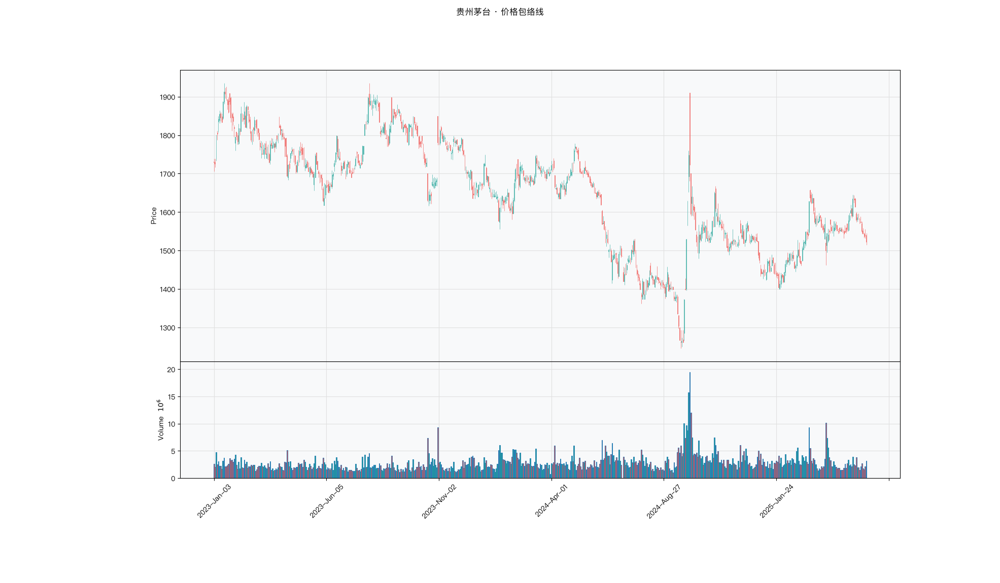

# 第034章 价格包络线（Envelope）

同一个标的，一个交易者先用固定百分之三的偏移画通道，触轨断断续续；改成按近期波动缩放宽度之后，同样的行情里边界时而贴住价格，时而离得很远。两次复盘给出的结论正好相反，一次说触轨之后容易回归，一次说触轨之后多半继续走。他把两张图并排放着，才发现自己比较的其实是两套边界定义。他要回答的是：这条边界该由人为设定的百分比固定，还是随波动率伸缩。

## 名称与来历

价格包络线（Envelope），也称百分比包络线。

它没有单一的提出者。在移动平均线被广泛使用之后，交易者很快意识到，均线之外还需要一个刻画"价格偏离均线多远算过头"的参照。最朴素的做法是在均线的上下各偏移一个固定百分比，画出两条平行线，把价格围在中间。这个想法出现得很早，是通道类指标里最原始的一位，可以看作布林带与肯特纳通道的前身。

它的构造简单到可以用一句话概括：中轨之上乘以一加一个百分比，中轨之下乘以一减一个百分比。没有标准差，没有真实波幅，只有两个参数，一个均线周期和一个偏移百分比。这份简单既是它被长期使用的原因，也是它在波动率变化剧烈时容易失效的原因。

## 核心逻辑

价格的"正常波动范围"该怎么定义，才能让读者一看就懂？

统计口径给出的答案是标准差，但标准差是个统计概念，2 倍标准差对应多少偏离，需要一点概率知识才能理解。价格包络线给出的是另一种答案：直接用百分比。中轨之上 3% 是上轨，之下 3% 是下轨，含义一目了然，不需要任何统计门槛。这个直观性让它在实务中被反复使用，尤其在需要向他人解释规则时。

代价随之而来。固定百分比不随市场波动变化，行情剧烈时，3% 的围栏可能被价格连续穿越，形同虚设；行情平静时，3% 又可能太宽，价格长期在通道内游走，信号稀疏。这与布林带、肯特纳通道的自适应宽度形成鲜明对比。围绕均线的偏离本来就应该与波动率挂钩，而固定百分比忽视了这个挂钩。

包络线的另一个特性是它天然接近均值回归的表达：价格偏离中轨越远，回归的动力越强。在区间震荡的环境里，这种表达比较有效；一旦转入单边趋势，价格会贴着一条轨道持续运行，此时把触轨当作回归信号会接连做错方向。理解适用边界，是使用包络线的前提。

从通道指标的演化看，包络线代表了一个朴素的起点：先给价格画一个固定的活动范围，再观察它何时越界。后续的布林带与肯特纳通道并没有推翻这个框架，而是替换了决定宽度的依据，把固定百分比换成随波动伸缩的度量。这条演化线索说明，通道类指标的核心问题始终是同一个：边界该多宽才算合理。

## 计算公式

价格包络线以一条移动平均线为中轨，上下轨按固定百分比偏移。

### 中轨

$$Middle_t = SMA(Close,\ n)$$

### 上轨与下轨

$$Upper_t = Middle_t \times (1 + p)$$

$$Lower_t = Middle_t \times (1 - p)$$

其中 p 为偏移百分比，常取 0.03，即上下各 3%。

**计算示例。** 设 20 日简单移动平均为 100 元，p 取 0.03，则上轨为 $100 \times 1.03 = 103$ 元，下轨为 $100 \times 0.97 = 97$ 元。若次日收盘 102 元，价格在通道中的相对位置

$$\%E = \frac{102 - 97}{103 - 97} \approx 0.83$$

表示价格处在通道 83% 的高度上，尚未触及上轨。

**参数含义。**

| 参数 | 含义 | 常见取值 | 影响 |
|------|------|---------|------|
| n | 中轨周期 | 10、20（默认）、40 | n 越大，中轨越平滑，通道更稳定 |
| p | 偏移百分比 | 2%、3%（默认）、5% | p 越大，通道越宽，触轨信号越少 |

p 需要与品种的历史波动率匹配。高波动品种（创业板、部分期货）可能需要 4% 到 8%，低波动品种（银行股、债券 ETF）可用 1.5% 到 2.5%。周线的波动幅度天然大于日线，周线包络线的 p 也需相应放大。参数表只能作为起点，具体取值应参照品种近期的实际波动水平。

### 与自适应通道的对照

把包络线放在通道家族里看，它的定位会更清楚。

| 指标 | 宽度依据 | 宽度是否随波动变化 | 主要局限 |
|------|---------|-----------------|---------|
| Envelope | 固定百分比 | 否 | 波动率剧变时失效 |
| BBands | 滚动标准差 | 是 | 对单日极端值敏感 |
| Keltner | 真实波幅 | 是 | ATR 存在滞后 |

包络线是三者中最简单的一位，也正因为固定宽度，它在概念上最容易理解，常常作为讲解通道指标的起点。理解了它的局限，再看布林带与肯特纳通道如何用自适应宽度去修正，通道指标的思路就串起来了。

## 用法与信号

**触轨回归。** 价格触及上轨或下轨，表示偏离中轨达到了设定的百分比，在区间震荡的环境里，后续向中轨回归的概率相对高。价格偏离得越远，回归的动力越强。需要注意的是，上升趋势中触及上轨更适合作为减仓的参考，而不是反手做空的依据；下降趋势中触及下轨同理。

**中轨的方向。** 中轨（SMA）的方向代表中期趋势。中轨向上且价格在其上方，为多头格局，价格回踩中轨可作为加仓的观察点；中轨向下且价格在其下方，为空头格局，价格反弹至中轨可作为减仓的观察点；中轨走平、价格围绕中轨上下波动，为横盘状态，适合高抛低吸。

**轨道穿透下的趋势确认。** 价格连续多日运行在轨道外侧（例如连续三日高于上轨），说明当前的波动已超出设定的正常范围。这不是回归信号，而是趋势加速的信号。此时固定百分比的包络线失去了约束力，判断应转向趋势跟随，而不是期待价格回归。

**固定宽度的失效检验。** 把平均真实波幅之比（ATR 除以价格）与 p 值作对比，可以判断当前宽度设置是否合适。ATR 之比接近或超过 p，说明当下的波动率已使包络线偏窄，触轨信号会大量出现；ATR 之比远小于 p，说明包络线偏宽，信号稀疏。据此动态调整 p，是弥补固定宽度缺陷的一个实用办法。

**与自适应通道的搭配。** 由于包络线宽度固定，它单独使用时对波动环境的变化不敏感。一个实用的做法是把它与布林带或肯特纳通道并列观察：当包络线显示触轨、同时自适应通道仍在正常宽度内时，触轨更可能是真正的偏离；当两条自适应通道已明显扩张、包络线同时被穿透时，穿透更可能是趋势加速而非回归信号。用一条刚性围栏对照一条弹性围栏，能减少对单一宽度的依赖。

把三条通道放在一起看，就得到了一个由粗到细的波动率视角。包络线给出最粗的固定边界，布林带按价格的离散程度调节，肯特纳通道按真实波幅调节。三者的读数不必一致，出现分歧时，往往正是市场波动结构正在变化的时刻。

## 边界与误区

**波动率剧变时宽度失效。** 这是包络线最主要的问题。固定宽度不随波动率变化，恐慌或亢奋行情中价格可能连续数日运行在轨道之外，此时触轨不再是回归信号，而是趋势加速。布林带与肯特纳通道的自适应宽度正是为解决这个问题而演化出来的。

**高波动品种上假信号密集。** 在高波动品种上使用偏窄的 p，一周内可能产生十次以上的触轨，其中大部分只是正常波动，而不是可交易的回归机会。固定百分比与品种波动率的错配，是这类误用的根源。

**强趋势中做逆势回归。** "触及下轨就买入"在持续下跌里会连续受挫，价格可以贴着下轨一路走低，每次触轨后不是反弹而是新低。包络线的回归逻辑只在震荡市成立，趋势市中应顺趋势方向使用，不做逆势回归。

**日线与周线的 p 不能混用。** 周线波动幅度天然大于日线，把日线的 p 直接套到周线上，通道会过窄，触轨频繁失真。跨周期使用时，p 需要按周期重新校准。

## 它被检验过吗

价格包络线没有针对它本身的独立同行评议检验。更麻烦的是它的可检验内容比同类少：带宽是常数，%E 与均线偏离秩相同，真正独立的构造只剩穿透占比。

即便单独检验穿透占比，得到的也只是它与实现波动率的关系，不是包络线作为交易规则的绩效。现有证据只能来自通道类规则的整族讨论，而这类讨论无法把结果归因到固定百分比这一具体设定上。完整证据链见第 007 章。

这一类的真实失效案例，见第 029 章的「真实案例与失败模式」。

## 代码实现

TTR 没有专门的包络线函数，这里直接手写，逻辑清晰。

### R

```r
library(ettr)
library(efactorcraft)
library(efincharts)
library(ggplot2)

BASE <- "https://raw.githubusercontent.com/dengyishuo/quant-technical-analysis/main/data/parquet"

# 取数据：本地有就用本地，没有就下载一次并缓存。
# read.csv 对本地 .gz 会自动解压，所以缓存成 .csv.gz 也能直接读。
load_data <- function(name) {
  local <- file.path("data", "parquet", name)
  if (file.exists(local)) return(local)
  cache <- file.path(tools::R_user_dir("qta", "cache"), name)
  if (!file.exists(cache)) {
    dir.create(dirname(cache), recursive = TRUE, showWarnings = FALSE)
    message("下载 ", name, " ...")
    download.file(paste0(BASE, "/", name), cache, mode = "wb", quiet = TRUE)
  }
  cache
}

read_data <- function(name) {
  d <- read.csv(load_data(name), stringsAsFactors = FALSE)
  if ("date" %in% names(d)) d$date <- as.Date(d$date)
  d
}

# 同一章里多次取用，缓存到内存，避免重复解析
.cache <- new.env(parent = emptyenv())
.blue <- function() {
  if (!exists("b", .cache)) assign("b", read_data("panel_blue_chip.csv"), .cache)
  get("b", .cache)
}
.panel <- function() {
  if (!exists("p", .cache)) {
    p <- read_data("panel_r.csv.gz")
    assign("p", p[p$date >= "2023-01-01" & p$date <= "2025-06-01", ], .cache)
  }
  get("p", .cache)
}
.index <- function() read_data("index_daily.csv")

blue  <- .blue()
panel <- .panel()

# 图的保存路径，顺手建目录，避免读者本地没有 assets/ 时报错
fig_path <- function(ch, name = "indicator_r.png") {
  d <- file.path("assets", "figures", sprintf("ch%03d", ch))
  dir.create(d, recursive = TRUE, showWarnings = FALSE)
  file.path(d, name)
}

# efincharts 要求 xts 且列名带 Adjusted
as_xts <- function(df) {
  x <- xts::xts(df[, c("open", "high", "low", "close", "volume", "adjusted")],
                order.by = df$date)
  colnames(x) <- c("Open", "High", "Low", "Close", "Volume", "Adjusted")
  x
}

maotai <- .blue()[.blue()$code == "600519.SS", ]

# 1. ettr 在长格式面板上追加指标列
maotai <- add_sma(maotai, n = 20)

# 2. 基本统计
cols <- setdiff(names(maotai), names(blue))
print(summary(maotai[, cols]))

# 3. K 线 + 成交量 + 均线
ch <- ecandlesticks(as_xts(maotai), show_ma = TRUE, ma_periods = c(20, 60),
                    title = "贵州茅台 · 价格包络线")
ggsave(fig_path(34), ch$combined_plot, width = 10, height = 6, dpi = 110)
```

### Python

```python
import pathlib
import urllib.request

import pandas as pd
import ettr
import efactorcraft as efc
import efincharts as efc_

# 中文字体：mplfinance 会用 style 里的 rc 覆盖全局设置，必须写进 style
from efincharts import theme
theme.efin_style["rc"] = {
    "font.sans-serif": ["PingFang SC", "Heiti SC", "SimHei"],
    "axes.unicode_minus": False,
    "font.family": "sans-serif",
}

BASE = "https://raw.githubusercontent.com/dengyishuo/quant-technical-analysis/main/data/parquet"
CACHE = pathlib.Path.home() / ".cache" / "qta"
_MEM = {}


def load(name):
    """取数据：本地有就用本地，没有就下载一次并缓存。

    这样三种情形都能跑：
      1. 克隆了整个仓库    -> 直接读 data/parquet/，不联网
      2. 只复制了代码片段  -> 首次自动下载到 ~/.cache/qta，之后走缓存
      3. 之前跑过          -> 全部命中缓存，断网也能用
    """
    if name in _MEM:
        return _MEM[name]
    local = pathlib.Path("data/parquet") / name
    if local.exists():
        path = local
    else:
        CACHE.mkdir(parents=True, exist_ok=True)
        path = CACHE / name
        if not path.exists():
            print("下载 %s ..." % name)
            urllib.request.urlretrieve(BASE + "/" + name, path)
    data = pd.read_parquet(path) if name.endswith(".parquet") else pd.read_csv(path)
    _MEM[name] = data
    return data


blue = load("panel_blue_chip.parquet")
panel = load("panel.parquet")
panel = panel[(panel["date"] >= "2023-01-01") & (panel["date"] <= "2025-06-01")]
idx = load("index_daily.parquet")


def one(df, code="600519.SS"):
    """取单只标的，转成 efincharts 需要的宽表。"""
    x = df[df["code"] == code].sort_values("date").set_index("date")
    x.columns = [c.capitalize() for c in x.columns]
    return x


def fig_path(ch, name="indicator.png"):
    """图的保存路径，顺手建目录，避免读者本地没有 assets/ 时报错。"""
    d = pathlib.Path("assets") / "figures" / ("ch%03d" % ch)
    d.mkdir(parents=True, exist_ok=True)
    return str(d / name)

# 1. 取单只标的
maotai = blue[blue['code'] == '600519.SS'].copy()

# 2. ettr 在长格式面板上追加指标列，不需要手工 rolling
maotai = ettr.sma(maotai, n=20)

cols = [c for c in maotai.columns if c not in blue.columns]
print(maotai[cols].describe().round(3))

# 3. 画图：K 线 + 成交量 + 指标面板
px = one(maotai)
ch = efc_.candlestick(px, volume=True, title="贵州茅台 · 价格包络线")
ch.save(fig_path(34))
```

<!-- fig-indicator:start -->


<p class="figcap">图 34-1　价格包络线在贵州茅台上的读数（2023-01 至 2025-06）</p>
<!-- fig-indicator:end -->

## 拆解

包络线的输出有两类：位置读数与穿透状态。这条通道的宽度由人为设定的百分比决定，不由数据决定，因此它的可拆解结构与布林带、肯特纳有本质差别。先把这一点摆清楚，后面的检验才有意义。

| 特征名 | 计算式 | 量纲 | 经济含义 |
|--------|--------|------|----------|
| %E | $(p_t-L_t)/(U_t-L_t)$ | 无量纲，可越界 | 价格在通道中的相对位置 |
| 上轨偏离 | $p_t/U_t-1$ | 无量纲比例 | 距上轨的距离，正值为越界 |
| 下轨偏离 | $p_t/L_t-1$ | 无量纲比例 | 距下轨的距离，负值为越界 |
| 穿透占比 | $\frac{1}{20}\sum_{i=0}^{19}1\{p_{t-i}\notin[L,U]\}$ | 0 到 1 | 近二十日波动超出固定边界的频率 |
| 带宽 | $(U_t-L_t)/M_t=2p$ | 设定常数 | 不是观测量，不携带波动信息 |

带宽那一行是这张表的重点。上下轨之差等于中轨乘以 $2p$。若直接用这个差值做因子，单位为元，排序等同于按中轨排序，也就是按价格水平排序，得到的是一个高价股因子；若按通道指标的通例除以中轨，结果恒等于 $2p$，横截面没有任何差异。两种口径都得不到波动信息。用相对宽度做波动因子，横截面秩相关无法定义，因为因子在每一个横截面上都没有差异。报告里常把它记作接近零，严格说它是缺失。这不是检验失败，而是构造使然：序列里没有波动信息可提取。

%E 也有一个恒等关系需要说明。把上下轨的定义代入，

$$\%E_t=\frac{p_t-M_t(1-p)}{2pM_t}=\frac{p_t/M_t-(1-p)}{2p}$$

它是价格相对中轨的比值 $p_t/M_t$ 的仿射变换，且斜率 $1/(2p)$ 为正。仿射变换不改变排序，因此 %E 与"价格相对均线的偏离"在每一个横截面上秩完全相同，两者的 IC 也就完全相同。包络线在截面上不提供超出均线偏离的新信息，这不是缺陷，是构造决定的。

真正携带波动信息的是穿透占比。它统计近二十日价格落在通道之外的频率，等价于问"实际波动超出固定边界的次数有多少"。这个读数与 ATR 除以价格正相关：波动越大，越容易越界。它是包络线唯一能用于波动预测的构造，属于间接用法，需要单独检验。

穿透占比还受 p 影响。p 越小，边界越窄，穿透越频繁；两只标的用同一个 p，穿透占比才可比。若研究里对不同标的设了不同的 p，穿透占比比较的其实是 p 的差异，而不是波动的高低。这一点在跨品种研究里容易被忽略。

### R

```r
library(ettr)
library(efactorcraft)
library(efincharts)
library(ggplot2)

BASE <- "https://raw.githubusercontent.com/dengyishuo/quant-technical-analysis/main/data/parquet"

# 取数据：本地有就用本地，没有就下载一次并缓存。
# read.csv 对本地 .gz 会自动解压，所以缓存成 .csv.gz 也能直接读。
load_data <- function(name) {
  local <- file.path("data", "parquet", name)
  if (file.exists(local)) return(local)
  cache <- file.path(tools::R_user_dir("qta", "cache"), name)
  if (!file.exists(cache)) {
    dir.create(dirname(cache), recursive = TRUE, showWarnings = FALSE)
    message("下载 ", name, " ...")
    download.file(paste0(BASE, "/", name), cache, mode = "wb", quiet = TRUE)
  }
  cache
}

read_data <- function(name) {
  d <- read.csv(load_data(name), stringsAsFactors = FALSE)
  if ("date" %in% names(d)) d$date <- as.Date(d$date)
  d
}

# 同一章里多次取用，缓存到内存，避免重复解析
.cache <- new.env(parent = emptyenv())
.blue <- function() {
  if (!exists("b", .cache)) assign("b", read_data("panel_blue_chip.csv"), .cache)
  get("b", .cache)
}
.panel <- function() {
  if (!exists("p", .cache)) {
    p <- read_data("panel_r.csv.gz")
    assign("p", p[p$date >= "2023-01-01" & p$date <= "2025-06-01", ], .cache)
  }
  get("p", .cache)
}
.index <- function() read_data("index_daily.csv")

blue  <- .blue()
panel <- .panel()

# 图的保存路径，顺手建目录，避免读者本地没有 assets/ 时报错
fig_path <- function(ch, name = "indicator_r.png") {
  d <- file.path("assets", "figures", sprintf("ch%03d", ch))
  dir.create(d, recursive = TRUE, showWarnings = FALSE)
  file.path(d, name)
}

# efincharts 要求 xts 且列名带 Adjusted
as_xts <- function(df) {
  x <- xts::xts(df[, c("open", "high", "low", "close", "volume", "adjusted")],
                order.by = df$date)
  colnames(x) <- c("Open", "High", "Low", "Close", "Volume", "Adjusted")
  x
}

d <- .blue()[.blue()$code == "600519.SS", ]
d <- add_sma(d, n = 20)

# 转成无量纲因子
d$f <- d$`SMA_20` / d$close - 1

print(summary(d$f))
```

### Python

```python
import pathlib
import urllib.request

import pandas as pd
import ettr
import efactorcraft as efc
import efincharts as efc_

# 中文字体：mplfinance 会用 style 里的 rc 覆盖全局设置，必须写进 style
from efincharts import theme
theme.efin_style["rc"] = {
    "font.sans-serif": ["PingFang SC", "Heiti SC", "SimHei"],
    "axes.unicode_minus": False,
    "font.family": "sans-serif",
}

BASE = "https://raw.githubusercontent.com/dengyishuo/quant-technical-analysis/main/data/parquet"
CACHE = pathlib.Path.home() / ".cache" / "qta"
_MEM = {}


def load(name):
    """取数据：本地有就用本地，没有就下载一次并缓存。

    这样三种情形都能跑：
      1. 克隆了整个仓库    -> 直接读 data/parquet/，不联网
      2. 只复制了代码片段  -> 首次自动下载到 ~/.cache/qta，之后走缓存
      3. 之前跑过          -> 全部命中缓存，断网也能用
    """
    if name in _MEM:
        return _MEM[name]
    local = pathlib.Path("data/parquet") / name
    if local.exists():
        path = local
    else:
        CACHE.mkdir(parents=True, exist_ok=True)
        path = CACHE / name
        if not path.exists():
            print("下载 %s ..." % name)
            urllib.request.urlretrieve(BASE + "/" + name, path)
    data = pd.read_parquet(path) if name.endswith(".parquet") else pd.read_csv(path)
    _MEM[name] = data
    return data


blue = load("panel_blue_chip.parquet")
panel = load("panel.parquet")
panel = panel[(panel["date"] >= "2023-01-01") & (panel["date"] <= "2025-06-01")]
idx = load("index_daily.parquet")


def one(df, code="600519.SS"):
    """取单只标的，转成 efincharts 需要的宽表。"""
    x = df[df["code"] == code].sort_values("date").set_index("date")
    x.columns = [c.capitalize() for c in x.columns]
    return x


def fig_path(ch, name="indicator.png"):
    """图的保存路径，顺手建目录，避免读者本地没有 assets/ 时报错。"""
    d = pathlib.Path("assets") / "figures" / ("ch%03d" % ch)
    d.mkdir(parents=True, exist_ok=True)
    return str(d / name)

# 1. 先在面板上算原始指标
d = panel.copy()
d = ettr.sma(d, n=20)

# 2. 转成无量纲因子，才能跨标的排序
d["f"] = d["SMA_20"] / d.close - 1

print(d["f"].describe().round(4))
```

## 截面选股能力

包络线进入截面检验，可用的因子只有一个：

$$f^{\%E}_t=\frac{p_t-L_t}{U_t-L_t}$$

与它对应的波动构造是穿透占比：

$$f^{out}_t=\frac{1}{20}\sum_{i=0}^{19}1\{p_{t-i}\notin[L,U]\}$$

前者预测收益，后者预测波动率。带宽不作为因子，理由已在拆解里写明：它是常数 $2p$，没有横截面差异。

预期表现上，%E 属于均值回归型，方向多为负：价格越贴近上轨，后续回调的压力越大。这个结论与布林带的 %B 相似，但两者不可混为一谈：%B 的分母随波动伸缩，%E 的分母固定，同样幅度的价格上涨在包络线里会让 %E 上升得更快。穿透占比对未来波动率通常为正，其逻辑与 ATR 比率一致，只是把连续的幅度换成了离散的越界次数。

检验时有三点值得注意。第一，带宽因子的 IC 缺失应当在报告中如实说明，并解释原因，不要用零代替。把它当作"因子无效"删掉，会掩盖一个构造层面的事实；把它与 %E 并列比较，又会误导读者以为两者都是可用的候选。第二，%E 与均线偏离共线，秩相关理论上等于一，模型里只需保留一个。若要检验包络线的增量，应把均线偏离放进对照，取残差后再算。第三，穿透占比依赖 p，同一 p 才可比；跨品种研究里应对每个标的按自身波动率校准 p，再比较穿透频率。

### R

```r
library(ettr)
library(efactorcraft)
library(efincharts)
library(ggplot2)

BASE <- "https://raw.githubusercontent.com/dengyishuo/quant-technical-analysis/main/data/parquet"

# 取数据：本地有就用本地，没有就下载一次并缓存。
# read.csv 对本地 .gz 会自动解压，所以缓存成 .csv.gz 也能直接读。
load_data <- function(name) {
  local <- file.path("data", "parquet", name)
  if (file.exists(local)) return(local)
  cache <- file.path(tools::R_user_dir("qta", "cache"), name)
  if (!file.exists(cache)) {
    dir.create(dirname(cache), recursive = TRUE, showWarnings = FALSE)
    message("下载 ", name, " ...")
    download.file(paste0(BASE, "/", name), cache, mode = "wb", quiet = TRUE)
  }
  cache
}

read_data <- function(name) {
  d <- read.csv(load_data(name), stringsAsFactors = FALSE)
  if ("date" %in% names(d)) d$date <- as.Date(d$date)
  d
}

# 同一章里多次取用，缓存到内存，避免重复解析
.cache <- new.env(parent = emptyenv())
.blue <- function() {
  if (!exists("b", .cache)) assign("b", read_data("panel_blue_chip.csv"), .cache)
  get("b", .cache)
}
.panel <- function() {
  if (!exists("p", .cache)) {
    p <- read_data("panel_r.csv.gz")
    assign("p", p[p$date >= "2023-01-01" & p$date <= "2025-06-01", ], .cache)
  }
  get("p", .cache)
}
.index <- function() read_data("index_daily.csv")

blue  <- .blue()
panel <- .panel()

# 图的保存路径，顺手建目录，避免读者本地没有 assets/ 时报错
fig_path <- function(ch, name = "indicator_r.png") {
  d <- file.path("assets", "figures", sprintf("ch%03d", ch))
  dir.create(d, recursive = TRUE, showWarnings = FALSE)
  file.path(d, name)
}

# efincharts 要求 xts 且列名带 Adjusted
as_xts <- function(df) {
  x <- xts::xts(df[, c("open", "high", "low", "close", "volume", "adjusted")],
                order.by = df$date)
  colnames(x) <- c("Open", "High", "Low", "Close", "Volume", "Adjusted")
  x
}

d <- .panel()
d <- add_sma(d, n = 20)

d$f <- d$`SMA_20` / d$close - 1
d <- add_next_return(d, close_col = "close", n = c(1, 5, 20))

ic <- ic_analysis(d, factor_cols = "f",
                    forward_cols = c("forward_1", "forward_5", "forward_20"),
                    method = "spearman")
print(ir_analysis(ic))

q <- quantile_analysis(d, factor_cols = "f", forward_cols = "forward_5",
                       n_groups = 5)
print(q$f$summary)
```

### Python

```python
import pathlib
import urllib.request

import pandas as pd
import ettr
import efactorcraft as efc
import efincharts as efc_

# 中文字体：mplfinance 会用 style 里的 rc 覆盖全局设置，必须写进 style
from efincharts import theme
theme.efin_style["rc"] = {
    "font.sans-serif": ["PingFang SC", "Heiti SC", "SimHei"],
    "axes.unicode_minus": False,
    "font.family": "sans-serif",
}

BASE = "https://raw.githubusercontent.com/dengyishuo/quant-technical-analysis/main/data/parquet"
CACHE = pathlib.Path.home() / ".cache" / "qta"
_MEM = {}


def load(name):
    """取数据：本地有就用本地，没有就下载一次并缓存。

    这样三种情形都能跑：
      1. 克隆了整个仓库    -> 直接读 data/parquet/，不联网
      2. 只复制了代码片段  -> 首次自动下载到 ~/.cache/qta，之后走缓存
      3. 之前跑过          -> 全部命中缓存，断网也能用
    """
    if name in _MEM:
        return _MEM[name]
    local = pathlib.Path("data/parquet") / name
    if local.exists():
        path = local
    else:
        CACHE.mkdir(parents=True, exist_ok=True)
        path = CACHE / name
        if not path.exists():
            print("下载 %s ..." % name)
            urllib.request.urlretrieve(BASE + "/" + name, path)
    data = pd.read_parquet(path) if name.endswith(".parquet") else pd.read_csv(path)
    _MEM[name] = data
    return data


blue = load("panel_blue_chip.parquet")
panel = load("panel.parquet")
panel = panel[(panel["date"] >= "2023-01-01") & (panel["date"] <= "2025-06-01")]
idx = load("index_daily.parquet")


def one(df, code="600519.SS"):
    """取单只标的，转成 efincharts 需要的宽表。"""
    x = df[df["code"] == code].sort_values("date").set_index("date")
    x.columns = [c.capitalize() for c in x.columns]
    return x


def fig_path(ch, name="indicator.png"):
    """图的保存路径，顺手建目录，避免读者本地没有 assets/ 时报错。"""
    d = pathlib.Path("assets") / "figures" / ("ch%03d" % ch)
    d.mkdir(parents=True, exist_ok=True)
    return str(d / name)

# 287 只、2023-01 至 2025-06，横截面才有统计意义
src = panel.copy()
d = src.copy()

# 1. 算指标
d = ettr.sma(d, n=20)


# 2. 因子 + 未来收益
d["f"] = d["SMA_20"] / d.close - 1
d = efc.add_next_return(d, periods=(1, 5, 20))

# 3. 截面 IC 与分层
ic = efc.ic_analysis(d, factor_cols="f",
                      forward_cols=["forward_1", "forward_5", "forward_20"],
                      method="spearman")
print(efc.ir_analysis(ic).round(3))

q = efc.quantile_analysis(d, factor_col="f", forward_col="forward_5", n_groups=5)
print(q["summary"].round(4))
```

第二组里那两行要对着看。带宽的横截面标准差应为零，这是一个可以验证的恒等式，不是估计值；穿透占比的 IC 若明显为正，说明越界频率确实是一个波动代理。两者的差别不是因子质量的高低，而是有无信息的分野。这一步的意义在于把"带宽为什么不能做因子"从断言变成可检验的结论。

<!-- tab-ic:start -->
**计算结果**

| 前向期 | IC 均值 | IC 标准差 | ICIR | t 值 | IC>0 占比 | 期数 |
|---|---|---|---|---|---|---|
| T+1 | 0.0159 | 0.2390 | 0.066 | 1.57 | 0.5200 | 561 |
| T+5 | 0.0191 | 0.2198 | 0.087 | 2.05 | 0.5220 | 557 |
| T+20 | 0.0376 | 0.2076 | 0.181 | 4.22 | 0.5660 | 542 |

表里最该看的是 t 值，不是 IC 均值。这个因子以 T+1 为主口径，IC 均值 0.0159、ICIR 0.066、t 值 1.57，在常规门槛下不显著，方向为正向。按第 007 章给出的日频门槛（ICIR 0.13 对应 t≈2），这个结果的含义是：还看不出与噪声的区别，不能据此构造策略。

需要提醒的是，这只说明排序与未来收益之间存在可测的关联，不代表扣掉成本后还能剩下收益。横截面 IC 检验的是“买哪只”，不负责“值不值得交易”。

**五档分层**

| 分组 | 平均收益 | 标准差 | 期数 |
|---|---|---|---|
| 1 | +0.0048 | +0.0412 | 557 |
| 2 | +0.0023 | +0.0297 | 557 |
| 3 | +0.0019 | +0.0290 | 557 |
| 4 | +0.0027 | +0.0337 | 557 |
| 5 | +0.0046 | +0.0417 | 557 |

五档分层看的是形状，不是单点。最高一档在第 1 组、最低在第 3 组，两端相差 -0.02%，组序号与平均收益的秩相关为 0.01，没有明显单调性。

分层比 IC 更接近实盘，因为它直接给出“买最高档、卖最低档”的收益差。但这里的数字是毛收益，且没有考虑涨跌停买不进、停牌卖不出的情形，真实可得的差额会小于表中所列。
<!-- tab-ic:end -->

## 择时能力

时序上包络线的读法有三层。第一层是触轨，价格触及上轨或下轨，属于离散事件。第二层是中轨方向，中轨向上且价格在其上方为多头格局，向下为弱势格局。第三层是连续穿透，价格连续多日运行在轨道外侧，此时固定边界失去约束力，性质从回归转为趋势加速。

检验方法要与形态匹配。触轨是事件，适合信号触发日检验；%E 是连续变量，适合条件分位收益；连续穿透是状态，适合分组对照，比较外侧运行期与通道内运行期的收益分布。

这里有一处包络线特有的偏差。p 固定，触轨频率就完全由波动环境决定：高波动期一周可能触轨数次，低波动期一个月不见一次。于是"触轨日"这个样本在高波动期被过度采样，与"非触轨日"的市况结构并不对等。两者后续收益的均值差异里，混着市况差异，而不只是触轨事件本身的效果。布林带与肯特纳的宽度自适应，触轨频率相对稳定，这一偏差小得多。

处理办法有两个。一是按波动状态分层，在相同的带宽分位内比较触轨与非触轨；二是把触轨事件与波动条件一起构成组合信号，用条件回测检验增量。两种做法都指向同一件事：包络线的择时检验应先控制住波动环境，否则结论会被样本结构带偏。

另有两个陷阱。第一，连续穿透与触轨在定义上重叠，若把连续多日的外侧运行都计为触轨，事件样本会高度自相关，显著性被高估。第二，p 的选择直接决定事件数量，等于隐式选择了检验的样本，报告时应给出多个 p 下的结果，而不是只报表现最好的那个。

### R

```r
library(ettr)
library(efactorcraft)
library(efincharts)
library(ggplot2)

BASE <- "https://raw.githubusercontent.com/dengyishuo/quant-technical-analysis/main/data/parquet"

# 取数据：本地有就用本地，没有就下载一次并缓存。
# read.csv 对本地 .gz 会自动解压，所以缓存成 .csv.gz 也能直接读。
load_data <- function(name) {
  local <- file.path("data", "parquet", name)
  if (file.exists(local)) return(local)
  cache <- file.path(tools::R_user_dir("qta", "cache"), name)
  if (!file.exists(cache)) {
    dir.create(dirname(cache), recursive = TRUE, showWarnings = FALSE)
    message("下载 ", name, " ...")
    download.file(paste0(BASE, "/", name), cache, mode = "wb", quiet = TRUE)
  }
  cache
}

read_data <- function(name) {
  d <- read.csv(load_data(name), stringsAsFactors = FALSE)
  if ("date" %in% names(d)) d$date <- as.Date(d$date)
  d
}

# 同一章里多次取用，缓存到内存，避免重复解析
.cache <- new.env(parent = emptyenv())
.blue <- function() {
  if (!exists("b", .cache)) assign("b", read_data("panel_blue_chip.csv"), .cache)
  get("b", .cache)
}
.panel <- function() {
  if (!exists("p", .cache)) {
    p <- read_data("panel_r.csv.gz")
    assign("p", p[p$date >= "2023-01-01" & p$date <= "2025-06-01", ], .cache)
  }
  get("p", .cache)
}
.index <- function() read_data("index_daily.csv")

blue  <- .blue()
panel <- .panel()

# 图的保存路径，顺手建目录，避免读者本地没有 assets/ 时报错
fig_path <- function(ch, name = "indicator_r.png") {
  d <- file.path("assets", "figures", sprintf("ch%03d", ch))
  dir.create(d, recursive = TRUE, showWarnings = FALSE)
  file.path(d, name)
}

# efincharts 要求 xts 且列名带 Adjusted
as_xts <- function(df) {
  x <- xts::xts(df[, c("open", "high", "low", "close", "volume", "adjusted")],
                order.by = df$date)
  colnames(x) <- c("Open", "High", "Low", "Close", "Volume", "Adjusted")
  x
}

t <- .index()
t <- t[t$code == "510300.SS", ]
t <- add_sma(t, n = 20)
t$f <- t$`SMA_20` / t$close - 1
t$forward_5 <- c(tail(t$close, -5) / head(t$close, -5) - 1, rep(NA, 5))
t$q <- cut(t$f, quantile(t$f, 0:5/5, na.rm = TRUE), include.lowest = TRUE, labels = FALSE)
print(aggregate(forward_5 ~ q, data = t, FUN = function(x)
  c(mean = mean(x, na.rm = TRUE), n = sum(!is.na(x)))))
```

### Python

```python
import pathlib
import urllib.request

import pandas as pd
import ettr
import efactorcraft as efc
import efincharts as efc_

# 中文字体：mplfinance 会用 style 里的 rc 覆盖全局设置，必须写进 style
from efincharts import theme
theme.efin_style["rc"] = {
    "font.sans-serif": ["PingFang SC", "Heiti SC", "SimHei"],
    "axes.unicode_minus": False,
    "font.family": "sans-serif",
}

BASE = "https://raw.githubusercontent.com/dengyishuo/quant-technical-analysis/main/data/parquet"
CACHE = pathlib.Path.home() / ".cache" / "qta"
_MEM = {}


def load(name):
    """取数据：本地有就用本地，没有就下载一次并缓存。

    这样三种情形都能跑：
      1. 克隆了整个仓库    -> 直接读 data/parquet/，不联网
      2. 只复制了代码片段  -> 首次自动下载到 ~/.cache/qta，之后走缓存
      3. 之前跑过          -> 全部命中缓存，断网也能用
    """
    if name in _MEM:
        return _MEM[name]
    local = pathlib.Path("data/parquet") / name
    if local.exists():
        path = local
    else:
        CACHE.mkdir(parents=True, exist_ok=True)
        path = CACHE / name
        if not path.exists():
            print("下载 %s ..." % name)
            urllib.request.urlretrieve(BASE + "/" + name, path)
    data = pd.read_parquet(path) if name.endswith(".parquet") else pd.read_csv(path)
    _MEM[name] = data
    return data


blue = load("panel_blue_chip.parquet")
panel = load("panel.parquet")
panel = panel[(panel["date"] >= "2023-01-01") & (panel["date"] <= "2025-06-01")]
idx = load("index_daily.parquet")


def one(df, code="600519.SS"):
    """取单只标的，转成 efincharts 需要的宽表。"""
    x = df[df["code"] == code].sort_values("date").set_index("date")
    x.columns = [c.capitalize() for c in x.columns]
    return x


def fig_path(ch, name="indicator.png"):
    """图的保存路径，顺手建目录，避免读者本地没有 assets/ 时报错。"""
    d = pathlib.Path("assets") / "figures" / ("ch%03d" % ch)
    d.mkdir(parents=True, exist_ok=True)
    return str(d / name)

# 择时检验用 ETF 做市场载体，指数本身没有日线数据
t = idx[idx["code"] == "510300.SS"].sort_values("date").copy()

# 1. 在 ETF 上算同一个指标
t = ettr.sma(d, n=20)


# 2. 按因子分位看未来 5 日收益
t["f"] = t["SMA_20"] / t.close - 1
t["forward_5"] = t["close"].shift(-5) / t["close"] - 1
# 因子可能有重复值，先按名次切，避免 qcut 报边界不唯一
t["q"] = pd.qcut(t["f"].rank(method="first"), 5, labels=False) + 1
t = t.dropna(subset=["f", "forward_5"])
print(t.groupby("q")["forward_5"].agg(["mean", "count"]).round(4))
```

三组结果要结合 p 一起读。触轨检验若显著且方向为负，均值回归在震荡段成立；条件分位若只有最高一档有效，说明信号只存在于极值区；连续穿透那一组若标准差与左尾明显更高，说明价格长期在轨道外侧时，市场已从回归转为趋势，此时逆势操作的代价落在尾部。这也是为什么连续穿透不能与单日触轨混在同一个样本里。

<!-- tab-timing:start -->
**分位收益**

| 分位 | 未来 5 日均值 | 样本数 |
|---|---|---|
| 1 | +0.0016 | 219 |
| 2 | -0.0016 | 218 |
| 3 | -0.0017 | 218 |
| 4 | -0.0018 | 218 |
| 5 | +0.0032 | 218 |

择时口径与截面不同：这里只有一个标的，看的是同一标的在不同分位下的未来收益。最高与最低分位相差 +0.16%。单标的样本有限，这个差额很容易被一两段行情主导，只能作为方向参考。

真正做择时要问的是三件事：分位阈值是否稳定、换手是否可控、扣成本后是否还有剩余。三者缺一，择时信号就只是图上好看。
<!-- tab-timing:end -->

## 组合使用与验证

包络线的常见搭档有三个。与布林带搭配，一条刚性围栏配一条弹性围栏，两条同时被穿透时的信号含义与单条不同。与 ATR 搭配，用 ATR 除以价格与 p 比较，可以判断当前 p 是否与波动水平匹配，这是校准参数最直接的办法。与平均趋向指数搭配，ADX 补市况前提，趋势强时的触轨不宜做回归。

**组合的截面验证。** 把 %E 取负与布林带带宽取负后标准化相加，走一遍截面检验，与两个单特征比较 ICIR。这一步的预期结论在检验之前就能猜到：%E 与均线偏离秩相同，组合的增量主要来自带宽维度，而非位置维度。若组合的 ICIR 仅略高于 %E 单独使用，说明包络线的贡献接近于零，真正起作用的是加入的波动维度。这样的结果不是失败，它把一个构造事实量化了：包络线在截面上没有独立价值。

**组合的择时验证。** 刚性围栏与弹性围栏的条件组合更适合择时：%E 触轨且布林带带宽处于低位才做回归，带宽处于高位时不逆势。回测时与单条件并排跑，比较年化、夏普与最大回撤。带宽过滤的作用是区分"真正的偏离"与"趋势加速中的正常延伸"，改进通常体现在胜率与最大回撤上。

增益的判读沿用方法论章的标准：组合的 ICIR 高于两个单特征，说明存在互补性。包络线与均线偏离同源，与布林带的位置维度也高度相关，组合的增益空间主要落在波动维度上。理解了这一点，就能明白包络线的价值在哪里：它是一把刻度直观的尺子，适合把规则讲清楚，适合做交易纪律的载体，而不适合充当独立的选股因子。

### R

```r
library(ettr)
library(efactorcraft)
library(efincharts)
library(ggplot2)

BASE <- "https://raw.githubusercontent.com/dengyishuo/quant-technical-analysis/main/data/parquet"

# 取数据：本地有就用本地，没有就下载一次并缓存。
# read.csv 对本地 .gz 会自动解压，所以缓存成 .csv.gz 也能直接读。
load_data <- function(name) {
  local <- file.path("data", "parquet", name)
  if (file.exists(local)) return(local)
  cache <- file.path(tools::R_user_dir("qta", "cache"), name)
  if (!file.exists(cache)) {
    dir.create(dirname(cache), recursive = TRUE, showWarnings = FALSE)
    message("下载 ", name, " ...")
    download.file(paste0(BASE, "/", name), cache, mode = "wb", quiet = TRUE)
  }
  cache
}

read_data <- function(name) {
  d <- read.csv(load_data(name), stringsAsFactors = FALSE)
  if ("date" %in% names(d)) d$date <- as.Date(d$date)
  d
}

# 同一章里多次取用，缓存到内存，避免重复解析
.cache <- new.env(parent = emptyenv())
.blue <- function() {
  if (!exists("b", .cache)) assign("b", read_data("panel_blue_chip.csv"), .cache)
  get("b", .cache)
}
.panel <- function() {
  if (!exists("p", .cache)) {
    p <- read_data("panel_r.csv.gz")
    assign("p", p[p$date >= "2023-01-01" & p$date <= "2025-06-01", ], .cache)
  }
  get("p", .cache)
}
.index <- function() read_data("index_daily.csv")

blue  <- .blue()
panel <- .panel()

# 图的保存路径，顺手建目录，避免读者本地没有 assets/ 时报错
fig_path <- function(ch, name = "indicator_r.png") {
  d <- file.path("assets", "figures", sprintf("ch%03d", ch))
  dir.create(d, recursive = TRUE, showWarnings = FALSE)
  file.path(d, name)
}

# efincharts 要求 xts 且列名带 Adjusted
as_xts <- function(df) {
  x <- xts::xts(df[, c("open", "high", "low", "close", "volume", "adjusted")],
                order.by = df$date)
  colnames(x) <- c("Open", "High", "Low", "Close", "Volume", "Adjusted")
  x
}

d <- .panel()
d <- add_sma(d, n = 20)
d$f1 <- d$`SMA_20` / d$close - 1
d <- add_cmf(d, n = 20)
d$f2 <- d$CMF
d <- add_next_return(d, close_col = "close", n = 5)
ic1 <- ic_analysis(d, factor_cols = c("f1", "f2"),
                    forward_cols = "forward_5", method = "spearman")
print(ir_analysis(ic1))
```

```r
library(ettr)
library(efactorcraft)
library(efincharts)
library(ggplot2)

BASE <- "https://raw.githubusercontent.com/dengyishuo/quant-technical-analysis/main/data/parquet"

# 取数据：本地有就用本地，没有就下载一次并缓存。
# read.csv 对本地 .gz 会自动解压，所以缓存成 .csv.gz 也能直接读。
load_data <- function(name) {
  local <- file.path("data", "parquet", name)
  if (file.exists(local)) return(local)
  cache <- file.path(tools::R_user_dir("qta", "cache"), name)
  if (!file.exists(cache)) {
    dir.create(dirname(cache), recursive = TRUE, showWarnings = FALSE)
    message("下载 ", name, " ...")
    download.file(paste0(BASE, "/", name), cache, mode = "wb", quiet = TRUE)
  }
  cache
}

read_data <- function(name) {
  d <- read.csv(load_data(name), stringsAsFactors = FALSE)
  if ("date" %in% names(d)) d$date <- as.Date(d$date)
  d
}

# 同一章里多次取用，缓存到内存，避免重复解析
.cache <- new.env(parent = emptyenv())
.blue <- function() {
  if (!exists("b", .cache)) assign("b", read_data("panel_blue_chip.csv"), .cache)
  get("b", .cache)
}
.panel <- function() {
  if (!exists("p", .cache)) {
    p <- read_data("panel_r.csv.gz")
    assign("p", p[p$date >= "2023-01-01" & p$date <= "2025-06-01", ], .cache)
  }
  get("p", .cache)
}
.index <- function() read_data("index_daily.csv")

blue  <- .blue()
panel <- .panel()

# 图的保存路径，顺手建目录，避免读者本地没有 assets/ 时报错
fig_path <- function(ch, name = "indicator_r.png") {
  d <- file.path("assets", "figures", sprintf("ch%03d", ch))
  dir.create(d, recursive = TRUE, showWarnings = FALSE)
  file.path(d, name)
}

# efincharts 要求 xts 且列名带 Adjusted
as_xts <- function(df) {
  x <- xts::xts(df[, c("open", "high", "low", "close", "volume", "adjusted")],
                order.by = df$date)
  colnames(x) <- c("Open", "High", "Low", "Close", "Volume", "Adjusted")
  x
}

d <- .panel()
d <- add_sma(d, n = 20)
d$f1 <- d$`SMA_20` / d$close - 1
d <- add_cmf(d, n = 20)
d$f2 <- d$CMF
d <- add_next_return(d, close_col = "close", n = 5)
ic1 <- ic_analysis(d, factor_cols = c("f1", "f2"),
                    forward_cols = "forward_5", method = "spearman")
print(ir_analysis(ic1))
```

### Python

```python
import pathlib
import urllib.request

import pandas as pd
import ettr
import efactorcraft as efc
import efincharts as efc_

# 中文字体：mplfinance 会用 style 里的 rc 覆盖全局设置，必须写进 style
from efincharts import theme
theme.efin_style["rc"] = {
    "font.sans-serif": ["PingFang SC", "Heiti SC", "SimHei"],
    "axes.unicode_minus": False,
    "font.family": "sans-serif",
}

BASE = "https://raw.githubusercontent.com/dengyishuo/quant-technical-analysis/main/data/parquet"
CACHE = pathlib.Path.home() / ".cache" / "qta"
_MEM = {}


def load(name):
    """取数据：本地有就用本地，没有就下载一次并缓存。

    这样三种情形都能跑：
      1. 克隆了整个仓库    -> 直接读 data/parquet/，不联网
      2. 只复制了代码片段  -> 首次自动下载到 ~/.cache/qta，之后走缓存
      3. 之前跑过          -> 全部命中缓存，断网也能用
    """
    if name in _MEM:
        return _MEM[name]
    local = pathlib.Path("data/parquet") / name
    if local.exists():
        path = local
    else:
        CACHE.mkdir(parents=True, exist_ok=True)
        path = CACHE / name
        if not path.exists():
            print("下载 %s ..." % name)
            urllib.request.urlretrieve(BASE + "/" + name, path)
    data = pd.read_parquet(path) if name.endswith(".parquet") else pd.read_csv(path)
    _MEM[name] = data
    return data


blue = load("panel_blue_chip.parquet")
panel = load("panel.parquet")
panel = panel[(panel["date"] >= "2023-01-01") & (panel["date"] <= "2025-06-01")]
idx = load("index_daily.parquet")


def one(df, code="600519.SS"):
    """取单只标的，转成 efincharts 需要的宽表。"""
    x = df[df["code"] == code].sort_values("date").set_index("date")
    x.columns = [c.capitalize() for c in x.columns]
    return x


def fig_path(ch, name="indicator.png"):
    """图的保存路径，顺手建目录，避免读者本地没有 assets/ 时报错。"""
    d = pathlib.Path("assets") / "figures" / ("ch%03d" % ch)
    d.mkdir(parents=True, exist_ok=True)
    return str(d / name)

d = panel.copy()

# 1. 本章因子
d = ettr.sma(d, n=20)
d["f1"] = d["SMA_20"] / d.close - 1

# 2. 配一个量价因子做对照
d = ettr.cmf(d, n=20)
d["f2"] = d["CMF_20"]
d = efc.add_next_return(d, periods=(5,))

# 3. 单因子与等权组合的信息比率
ic = efc.ic_analysis(d, factor_cols=["f1", "f2"], forward_cols=["forward_5"],
                      method="spearman")
d = efc.equal_weighted_composite(d, factor_cols=["f1", "f2"], new_col="f1_f2")
ic2 = efc.ic_analysis(d, factor_cols=["f1_f2"], forward_cols=["forward_5"],
                      method="spearman")
ic.update(ic2)
print(efc.ir_analysis(ic).round(3))
```

```python
import pathlib
import urllib.request

import pandas as pd
import ettr
import efactorcraft as efc
import efincharts as efc_

# 中文字体：mplfinance 会用 style 里的 rc 覆盖全局设置，必须写进 style
from efincharts import theme
theme.efin_style["rc"] = {
    "font.sans-serif": ["PingFang SC", "Heiti SC", "SimHei"],
    "axes.unicode_minus": False,
    "font.family": "sans-serif",
}

BASE = "https://raw.githubusercontent.com/dengyishuo/quant-technical-analysis/main/data/parquet"
CACHE = pathlib.Path.home() / ".cache" / "qta"
_MEM = {}


def load(name):
    """取数据：本地有就用本地，没有就下载一次并缓存。

    这样三种情形都能跑：
      1. 克隆了整个仓库    -> 直接读 data/parquet/，不联网
      2. 只复制了代码片段  -> 首次自动下载到 ~/.cache/qta，之后走缓存
      3. 之前跑过          -> 全部命中缓存，断网也能用
    """
    if name in _MEM:
        return _MEM[name]
    local = pathlib.Path("data/parquet") / name
    if local.exists():
        path = local
    else:
        CACHE.mkdir(parents=True, exist_ok=True)
        path = CACHE / name
        if not path.exists():
            print("下载 %s ..." % name)
            urllib.request.urlretrieve(BASE + "/" + name, path)
    data = pd.read_parquet(path) if name.endswith(".parquet") else pd.read_csv(path)
    _MEM[name] = data
    return data


blue = load("panel_blue_chip.parquet")
panel = load("panel.parquet")
panel = panel[(panel["date"] >= "2023-01-01") & (panel["date"] <= "2025-06-01")]
idx = load("index_daily.parquet")


def one(df, code="600519.SS"):
    """取单只标的，转成 efincharts 需要的宽表。"""
    x = df[df["code"] == code].sort_values("date").set_index("date")
    x.columns = [c.capitalize() for c in x.columns]
    return x


def fig_path(ch, name="indicator.png"):
    """图的保存路径，顺手建目录，避免读者本地没有 assets/ 时报错。"""
    d = pathlib.Path("assets") / "figures" / ("ch%03d" % ch)
    d.mkdir(parents=True, exist_ok=True)
    return str(d / name)

d = panel.copy()

# 1. 本章因子
d = ettr.sma(d, n=20)
d["f1"] = d["SMA_20"] / d.close - 1

# 2. 配一个量价因子做对照
d = ettr.cmf(d, n=20)
d["f2"] = d["CMF_20"]
d = efc.add_next_return(d, periods=(5,))

# 3. 单因子与等权组合的信息比率
ic = efc.ic_analysis(d, factor_cols=["f1", "f2"], forward_cols=["forward_5"],
                      method="spearman")
d = efc.equal_weighted_composite(d, factor_cols=["f1", "f2"], new_col="f1_f2")
ic2 = efc.ic_analysis(d, factor_cols=["f1_f2"], forward_cols=["forward_5"],
                      method="spearman")
ic.update(ic2)
print(efc.ir_analysis(ic).round(3))
```

截面三行要对照看。组合高于 low_e 的部分，基本来自低波动维度；若组合与 low_e 几乎持平，说明位置维度已经包含了包络线能提供的全部信息。择时那一组看条件变严后的取舍：触轨单独使用时持仓天数少而不稳，加入带宽过滤后持仓更集中，若夏普上升、回撤收窄，说明刚性围栏需要弹性围栏配合才有实用价值。

## AI 引导词

::: prompt 引导词 1：位置因子与带宽因子的区分

我在研究价格包络线作为因子。请帮我写一段 Python 代码，说明为什么包络线不能像布林带那样构造带宽因子，只能构造位置因子。具体要求：1）计算包络线的宽度序列（上下轨之差除以中轨），说明它为何几乎恒定；2）计算 %E 位置因子，并与"价格相对均线的偏离百分比"作对比，看两者秩相关有多高；3）分别对收益目标计算 Rank IC；4）用文字总结包络线在因子构造上的局限。请输出可直接运行的代码，只使用 pandas、numpy、yfinance、matplotlib。

:::
::: prompt 引导词 2：穿透天数与未来波动率

我观察到包络线被穿透的天数可能与未来波动率有关。请帮我设计一个检验方案：1）用 SMA20 加减 3% 构造包络线，统计过去 20 日内价格处于通道外的天数占比，作为一个波动状态变量；2）构造未来 20 日实现波动率作为目标列；3）计算该变量与目标列的 Rank IC 与 ICIR；4）用文字总结穿透天数是否是波动率的一个可用代理。请输出可直接运行的 Python 代码，并说明如何避免用未来数据构造穿透统计。

:::
::: prompt 引导词 3：固定宽度与自适应宽度的对照回测

我打算比较固定宽度与自适应宽度两种通道在均值回归策略上的差异。请帮我把规则细化：1）包络线用 SMA20 加减 3%，布林带用 SMA20 加减 2 倍标准差；2）触轨建仓、回归中轨平仓；3）如何计算换手率并纳入 A 股的费率与印花税；4）用文字总结在震荡市与趋势市下两种通道各自的胜率与回撤差异。请给出 R 和 Python 两版实现，并说明如何避免前视偏差与幸存者偏差。

:::
