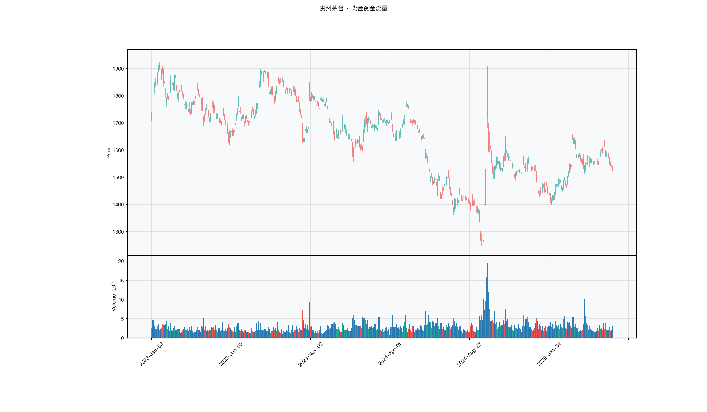

# 第037章 柴金资金流量（CMF）

两只股票当天涨幅相同，成交量也接近，一个交易者收盘后翻看分时，发现一只几乎收在最高，另一只是在尾盘被砸下来才勉强翻红。他的记录本上，两笔被记成了同一类上涨。他想找一个把收盘价在当日区间中的位置和成交量放在一起的读数，让这种差别留在数字里，而不是留在记忆里。这 n 天的成交里，有多大比例落在买方一侧。

## 名称与来历

柴金资金流量（Chaikin Money Flow，CMF），简称资金流量指标。

它由美国分析师马克·柴金（Marc Chaikin）在 1980 年代提出 [@chaikin1982]。柴金是成交量分析的重要推动者之一，他在同一时期还提出了柴金震荡器（Chaikin Oscillator），两者共用同一个中间量，即资金流量。CMF 的出发点比 OBV 更精细：仅仅用当日涨跌的符号来判断资金方向太粗糙，同样是一根阳线，收盘价落在当日高点的阳线和收盘价勉强收红的阳线，含义并不相同。

柴金想解决的是资金流向难以观测的问题。成交量本身看不出主动性，价格的位置却包含信息：收盘价越高，说明买方在当日博弈中越主动。把这个位置信息量化成一个乘数，再与成交量结合，就能得到一个比单纯累加更细致的资金流向度量。

CMF 与同一时期出现的 OBV 形成了对比。OBV 用当日涨跌的符号给成交量定正负，输入是一天一个方向的粗判；CMF 用收盘价在当日区间中的位置给成交量定权重，输入是一个连续的强度。两者的构造目标相同，都是累积资金流向，区别在于对每日信息的利用程度。

## 核心逻辑

考虑一个具体的问题：两只股票今天都上涨了 3%，成交量也接近，哪一只的买盘更坚决？

收盘价落在当日最高点的股票，说明买方在整个交易日持续占据主动，抛压被完全吸收；收盘价从当日高点回落、勉强收在开盘价上方的股票，说明买方在盘中一度占优，但尾盘被卖压压制。表面看涨幅相同，含义完全不同。OBV 对这两只股票的处理是相同的，只记一个"上涨"，丢弃了日内的位置信息。

CMF 的做法是给每一天的成交量配一个权重，权重由收盘价在当日高低区间中的位置决定，取值范围在 −1 到 1 之间。收盘价接近当日高点，权重接近 1；接近当日低点，权重接近 −1；恰在区间中点，权重为 0。加权后累加的是带方向、带强度的资金流量，而不是全有或全无的成交量。

最后一步是把累积流量除以同期的成交量总和，得到一个标准化比值。这一步是 CMF 与柴金震荡器的分野：震荡器对累积流量再做均线差，输出无界的曲线；CMF 直接取比值，输出落在 −1 到 1 之间，可以跨品种和跨时期比较，也可以直接设定阈值。

标准化的好处不止于可比。取比值相当于把资金流量按成交量归一，剔除了成交规模的影响。放量日和不放量日的资金流量不再因为成交量的绝对大小而被放大或压缩，读数直接反映"成交落在买方一侧的比例"。这也是 CMF 能够设定像 ±0.05 这样固定阈值的原因：经过归一化后，读数的分布相对稳定，阈值才有跨品种的意义。

## 计算公式

CMF 分三步计算，周期 n 默认取 20。

### 第一步：计算资金流向乘数

$$MFM_t = \frac{(c_t - l_t) - (h_t - c_t)}{h_t - l_t}$$

其中 $c_t$ 为收盘价，$h_t$ 为最高价，$l_t$ 为最低价。分子是收盘价到低点的距离减去收盘价到高点的距离。把分子分母同时整理：

$$MFM_t = \frac{2c_t - l_t - h_t}{h_t - l_t} = \frac{2(c_t - \frac{h_t + l_t}{2})}{h_t - l_t}$$

第二个等式说明，这个乘数的本质是收盘价相对当日区间中点的偏离，用区间宽度的一半做归一化。收盘价在区间上半部，分子为正，乘数为正；在下半部为负；恰在中点为零。整式的取值范围是 −1 到 1。

### 第二步：计算资金流量

$$MFV_t = MFM_t \times v_t$$

$v_t$ 为当日成交量。乘数为正时，资金流量为正，记作买方力量；为负时记作卖方力量。

**计算示例。** 假设某日最高价 20 元，最低价 18 元，收盘价 19.5 元，成交量 100 万手。则

$$MFM = \frac{(19.5 - 18) - (20 - 19.5)}{20 - 18} = \frac{1.5 - 0.5}{2} = 0.5$$

$$MFV = 0.5 \times 100 = 50 \text{ 万手}$$

收盘价位于区间上半部的四分之三处，乘数为 0.5，当日的买方资金流量为 50 万手。

### 第三步：计算 n 期资金流量比

$$CMF_t = \frac{\sum_{i=0}^{n-1} MFV_{t-i}}{\sum_{i=0}^{n-1} v_{t-i}}$$

分子是 n 期资金流量的总和，分母是 n 期成交量总和。这个比值可以理解为"n 期成交中，平均有多少比例落在买方一方"，取值在 −1 到 1 之间。绝大多数情况下读数落在 −0.3 到 0.3 之间，接近 ±1 的情形极少。

**参数含义。**

| 参数 | 含义 | 默认值 | 影响 |
|------|------|--------|------|
| n | 求和窗口 | 20 | 越大越平滑，信号越滞后 |
| 流入阈值 | 判定持续流入的下界 | 0.05 | 强趋势市可上调至 0.1 |
| 流出阈值 | 判定持续流出的上界 | −0.05 | 震荡市可下调至 −0.03 |

阈值并非固定，与品种的波动特性有关。大盘股日内区间较窄，乘数容易接近极值，阈值可略低；高波动品种日内区间较宽，乘数分布更集中，阈值可略高。不同软件对 CMF 的实现存在差异，有的用简单均值之比，有的用求和之比，两者在分母上略有不同，读数会有细微差别。

## 用法与信号

**零轴穿越。** CMF 由负转正，说明 n 期内的资金流向由净流出转为净流入，是偏多的信号；由正转负则相反。零轴穿越的次数比阈值穿越频繁，适合作为较早的提示，但噪音也更多，通常需要结合价格位置过滤。

**持续区间。** CMF 持续位于 0.05 以上且逐步走高，说明资金在半月至一月的窗口内稳定净流入，通常对应主力缓慢吸筹；持续位于 −0.05 以下且逐步走低，说明资金稳定净流出。相比单日的穿越，持续区间更能反映资金的真实意图，因为它要求多日的方向一致。

**与价格的配合。** 价格上涨且 CMF 同步走高，说明上涨有资金推动，属于有效上涨；价格下跌且 CMF 同步走低，属于有效下跌。价格上涨而 CMF 下行，说明上涨缺少资金支撑；价格下跌而 CMF 上行，说明下跌中已有资金承接。后两种情况构成量价背离，与 OBV 的背离信号思路一致，但 CMF 的读数带强度，背离的幅度可以直接量化。

**通道式的极端读数。** CMF 接近 ±1 的情形少见，一旦出现，通常意味着连续多日的收盘价都集中在当日区间的同一侧，资金方向高度一致。这种极端读数往往出现在趋势加速阶段，既可以作为趋势强度的证据，也需要警惕随后的均值回归。

**趋势中的持续同向。** 在明确的趋势行情里，CMF 倾向于长时间停在零轴的同一侧。上升趋势中读数常为正，下降趋势中常为负，这与收盘价在上涨日更容易收在高位有关。这种持续同向本身不构成信号，需要看的是读数的变化方向：趋势中 CMF 开始向零轴收敛，往往先于价格出现滞涨或止跌。

## 边界与误区

**乘数对影线敏感。** 资金流向乘数只用了最高、最低和收盘三个价位。一根带有长上影线的 K 线，收盘价被拉到区间下部，即使当日整体是上涨的，乘数也可能为负。因此 CMF 反映的是收盘时刻的多空优势，而不是全天的综合结果，对尾盘异动比较敏感。

**区间高度为零时的处理。** 当日的最高价等于最低价时，分母为零，乘数无定义。这种情况出现在一字板或极端低流动性的品种上。实务中通常约定此时乘数取 0，或者沿用前一日的数值，不同实现的处理方式不一，跨数据源比较时需要注意。

**阈值需要按品种调整。** ±0.05 是一个经验值，不是普适标准。成交清淡的小盘股上，单笔大单就能把 CMF 推过阈值，信号可靠性下降；高换手的大盘股上，资金分散，CMF 的波动幅度天然较小，用同一阈值可能长期不触发。使用前应先观察该品种 CMF 的历史分布，再确定适合的阈值。

**只反映收盘时刻的方向。** CMF 由收盘价在区间中的位置决定，无法区分"全天强势收在高点"和"尾盘拉升收在高点"。这两种情形在乘数上相同，但资金含义可能有别。需要日内信息时，CMF 需要配合更细粒度的数据使用。

**对涨跌停的处理需要约定。** 涨停或跌停时，当日最高价等于最低价，区间高度为零，乘数无定义。不同软件对此的处理方式不同，有的取零，有的取前一日数值，有的直接跳过。这会直接影响 CMF 的读数，尤其在连续涨跌停的行情中差异明显。使用前应确认所用工具的处理约定。

## 它被检验过吗

CMF 没有针对它本身的独立同行评议检验。可引的是 Karpoff（1987）在 *JFQA* 上的综述：成交量与价格正相关，且存在不对称，放量更多伴随上涨。这是价格与成交量关系层面的证据，不是对 CMF 的绩效检验。

CMF 在关系之上又加了两层构造：用收盘价在区间中的位置给成交量定权，再把加权流量除以成交量总和。这两层是否带来可交易的信息，现有文献没有给出答案。完整证据链见第 007 章。

这一类的真实失效案例，见第 035 章的「真实案例与失败模式」。

## 代码实现

### R

```r
library(ettr)
library(efactorcraft)
library(efincharts)
library(ggplot2)

BASE <- "https://raw.githubusercontent.com/dengyishuo/quant-technical-analysis/main/data/parquet"

# 取数据：本地有就用本地，没有就下载一次并缓存。
# read.csv 对本地 .gz 会自动解压，所以缓存成 .csv.gz 也能直接读。
load_data <- function(name) {
  local <- file.path("data", "parquet", name)
  if (file.exists(local)) return(local)
  cache <- file.path(tools::R_user_dir("qta", "cache"), name)
  if (!file.exists(cache)) {
    dir.create(dirname(cache), recursive = TRUE, showWarnings = FALSE)
    message("下载 ", name, " ...")
    download.file(paste0(BASE, "/", name), cache, mode = "wb", quiet = TRUE)
  }
  cache
}

read_data <- function(name) {
  d <- read.csv(load_data(name), stringsAsFactors = FALSE)
  if ("date" %in% names(d)) d$date <- as.Date(d$date)
  d
}

# 同一章里多次取用，缓存到内存，避免重复解析
.cache <- new.env(parent = emptyenv())
.blue <- function() {
  if (!exists("b", .cache)) assign("b", read_data("panel_blue_chip.csv"), .cache)
  get("b", .cache)
}
.panel <- function() {
  if (!exists("p", .cache)) {
    p <- read_data("panel_r.csv.gz")
    assign("p", p[p$date >= "2023-01-01" & p$date <= "2025-06-01", ], .cache)
  }
  get("p", .cache)
}
.index <- function() read_data("index_daily.csv")

blue  <- .blue()
panel <- .panel()

# 图的保存路径，顺手建目录，避免读者本地没有 assets/ 时报错
fig_path <- function(ch, name = "indicator_r.png") {
  d <- file.path("assets", "figures", sprintf("ch%03d", ch))
  dir.create(d, recursive = TRUE, showWarnings = FALSE)
  file.path(d, name)
}

# efincharts 要求 xts 且列名带 Adjusted
as_xts <- function(df) {
  x <- xts::xts(df[, c("open", "high", "low", "close", "volume", "adjusted")],
                order.by = df$date)
  colnames(x) <- c("Open", "High", "Low", "Close", "Volume", "Adjusted")
  x
}

maotai <- .blue()[.blue()$code == "600519.SS", ]

# 1. ettr 在长格式面板上追加指标列
maotai <- add_cmf(maotai, n = 20)

# 2. 基本统计
cols <- setdiff(names(maotai), names(blue))
print(summary(maotai[, cols]))

# 3. K 线 + 成交量 + 均线
ch <- ecandlesticks(as_xts(maotai), show_ma = TRUE, ma_periods = c(20, 60),
                    title = "贵州茅台 · 柴金资金流量")
ggsave(fig_path(37), ch$combined_plot, width = 10, height = 6, dpi = 110)
```

### Python

```python
import pathlib
import urllib.request

import pandas as pd
import ettr
import efactorcraft as efc
import efincharts as efc_

# 中文字体：mplfinance 会用 style 里的 rc 覆盖全局设置，必须写进 style
from efincharts import theme
theme.efin_style["rc"] = {
    "font.sans-serif": ["PingFang SC", "Heiti SC", "SimHei"],
    "axes.unicode_minus": False,
    "font.family": "sans-serif",
}

BASE = "https://raw.githubusercontent.com/dengyishuo/quant-technical-analysis/main/data/parquet"
CACHE = pathlib.Path.home() / ".cache" / "qta"
_MEM = {}


def load(name):
    """取数据：本地有就用本地，没有就下载一次并缓存。

    这样三种情形都能跑：
      1. 克隆了整个仓库    -> 直接读 data/parquet/，不联网
      2. 只复制了代码片段  -> 首次自动下载到 ~/.cache/qta，之后走缓存
      3. 之前跑过          -> 全部命中缓存，断网也能用
    """
    if name in _MEM:
        return _MEM[name]
    local = pathlib.Path("data/parquet") / name
    if local.exists():
        path = local
    else:
        CACHE.mkdir(parents=True, exist_ok=True)
        path = CACHE / name
        if not path.exists():
            print("下载 %s ..." % name)
            urllib.request.urlretrieve(BASE + "/" + name, path)
    data = pd.read_parquet(path) if name.endswith(".parquet") else pd.read_csv(path)
    _MEM[name] = data
    return data


blue = load("panel_blue_chip.parquet")
panel = load("panel.parquet")
panel = panel[(panel["date"] >= "2023-01-01") & (panel["date"] <= "2025-06-01")]
idx = load("index_daily.parquet")


def one(df, code="600519.SS"):
    """取单只标的，转成 efincharts 需要的宽表。"""
    x = df[df["code"] == code].sort_values("date").set_index("date")
    x.columns = [c.capitalize() for c in x.columns]
    return x


def fig_path(ch, name="indicator.png"):
    """图的保存路径，顺手建目录，避免读者本地没有 assets/ 时报错。"""
    d = pathlib.Path("assets") / "figures" / ("ch%03d" % ch)
    d.mkdir(parents=True, exist_ok=True)
    return str(d / name)

# 1. 取单只标的
maotai = blue[blue['code'] == '600519.SS'].copy()

# 2. ettr 在长格式面板上追加指标列，不需要手工 rolling
maotai = ettr.cmf(maotai)

cols = [c for c in maotai.columns if c not in blue.columns]
print(maotai[cols].describe().round(3))

# 3. 画图：K 线 + 成交量 + 指标面板
px = one(maotai)
ch = efc_.candlestick(px, volume=True, title="贵州茅台 · 柴金资金流量")
ch.save(fig_path(37))
```

<!-- fig-indicator:start -->


<p class="figcap">图 37-1　柴金资金流量在贵州茅台上的读数（2023-01 至 2025-06）</p>
<!-- fig-indicator:end -->

## 拆解

CMF 的输出落在 −1 到 1 之间，是比值而不是累积量。这一点让它比 OBV 省事：读数不随上市时间增长，也不需要先做差分才能比较。同一时点上，一只股票的 CMF 是 0.12，另一只是 0.08，可以直接说前者的买盘更主动。

有界并不等于可比，这是拆解时首先要处理的问题。不同标的的读数分布宽度不同：高换手的标的日内振幅大，收盘价落在区间两端的机会多，CMF 的波动范围也更宽；低换手的蓝筹收盘价常贴在区间中部，读数长期挤在零轴附近。同样一个 0.1，在前者身上是常态，在后者身上是异动。直接按读数排序，等于默认所有标的的尺度相同，这个假设在跨市值分组时往往不成立。

| 特征名 | 计算式 | 量纲 | 经济含义 |
|--------|--------|------|----------|
| 当期读数 | $CMF_t^{(n)}$ | 有界比例，−1 到 1 | $n$ 期成交中落在买方一侧的比例 |
| 零轴状态 | $\operatorname{sign}(CMF_t)$ | 取 1、0、−1 | 资金净流向的分水岭位置 |
| 短期均值 | $\frac{1}{m}\sum_{i=0}^{m-1}CMF_{t-i}$ | 有界比例 | 压掉日频锯齿后的方向，$m$ 取 5 左右 |
| 零轴上方持续期 | 连续 $CMF>0$ 的期数，带符号 | 期数（整数） | 资金方向一致性的持续长度 |

四个特征的关系需要说明。当期读数与短期均值高度相关，后者只是前者的低通滤波，差别在信噪比。零轴状态是读数的符号，信息量最少，但对极端值不敏感。持续期由零轴状态派生，度量状态的黏性。

单日读数的噪声来自窗口结构。$n$ 取 20 时，相邻两日的 CMF 有 19 天的成交重叠，只有进出的各一天不同。重叠带来两个后果：一是读数的高度自相关，相邻两日几乎一样，看起来平滑；二是日频变化量 $CMF_t-CMF_{t-1}$ 里几乎全是那一天的新增信息，噪声占比高。把当期读数直接当因子，等于用一个 19 天没变的数去做日频排序，换手会很低，但对新信息的反应也慢；用变化量做因子，反应快，但大部分是噪声。中间的做法是先对 CMF 再取 5 日均值，把锯齿压掉，同时保留方向。

持续期是整数且分布右偏。资金连续净流入的段落可以持续几十个交易日，这段长尾会主导排序。进入因子前通常先做截断，比如超过 20 期统一记为 20，或者直接分档。

### R

```r
library(ettr)
library(efactorcraft)
library(efincharts)
library(ggplot2)

BASE <- "https://raw.githubusercontent.com/dengyishuo/quant-technical-analysis/main/data/parquet"

# 取数据：本地有就用本地，没有就下载一次并缓存。
# read.csv 对本地 .gz 会自动解压，所以缓存成 .csv.gz 也能直接读。
load_data <- function(name) {
  local <- file.path("data", "parquet", name)
  if (file.exists(local)) return(local)
  cache <- file.path(tools::R_user_dir("qta", "cache"), name)
  if (!file.exists(cache)) {
    dir.create(dirname(cache), recursive = TRUE, showWarnings = FALSE)
    message("下载 ", name, " ...")
    download.file(paste0(BASE, "/", name), cache, mode = "wb", quiet = TRUE)
  }
  cache
}

read_data <- function(name) {
  d <- read.csv(load_data(name), stringsAsFactors = FALSE)
  if ("date" %in% names(d)) d$date <- as.Date(d$date)
  d
}

# 同一章里多次取用，缓存到内存，避免重复解析
.cache <- new.env(parent = emptyenv())
.blue <- function() {
  if (!exists("b", .cache)) assign("b", read_data("panel_blue_chip.csv"), .cache)
  get("b", .cache)
}
.panel <- function() {
  if (!exists("p", .cache)) {
    p <- read_data("panel_r.csv.gz")
    assign("p", p[p$date >= "2023-01-01" & p$date <= "2025-06-01", ], .cache)
  }
  get("p", .cache)
}
.index <- function() read_data("index_daily.csv")

blue  <- .blue()
panel <- .panel()

# 图的保存路径，顺手建目录，避免读者本地没有 assets/ 时报错
fig_path <- function(ch, name = "indicator_r.png") {
  d <- file.path("assets", "figures", sprintf("ch%03d", ch))
  dir.create(d, recursive = TRUE, showWarnings = FALSE)
  file.path(d, name)
}

# efincharts 要求 xts 且列名带 Adjusted
as_xts <- function(df) {
  x <- xts::xts(df[, c("open", "high", "low", "close", "volume", "adjusted")],
                order.by = df$date)
  colnames(x) <- c("Open", "High", "Low", "Close", "Volume", "Adjusted")
  x
}

d <- .blue()[.blue()$code == "600519.SS", ]
d <- add_cmf(d, n = 20)

# 转成无量纲因子
d$f <- d$`CMF`

print(summary(d$f))
```

### Python

```python
import pathlib
import urllib.request

import pandas as pd
import ettr
import efactorcraft as efc
import efincharts as efc_

# 中文字体：mplfinance 会用 style 里的 rc 覆盖全局设置，必须写进 style
from efincharts import theme
theme.efin_style["rc"] = {
    "font.sans-serif": ["PingFang SC", "Heiti SC", "SimHei"],
    "axes.unicode_minus": False,
    "font.family": "sans-serif",
}

BASE = "https://raw.githubusercontent.com/dengyishuo/quant-technical-analysis/main/data/parquet"
CACHE = pathlib.Path.home() / ".cache" / "qta"
_MEM = {}


def load(name):
    """取数据：本地有就用本地，没有就下载一次并缓存。

    这样三种情形都能跑：
      1. 克隆了整个仓库    -> 直接读 data/parquet/，不联网
      2. 只复制了代码片段  -> 首次自动下载到 ~/.cache/qta，之后走缓存
      3. 之前跑过          -> 全部命中缓存，断网也能用
    """
    if name in _MEM:
        return _MEM[name]
    local = pathlib.Path("data/parquet") / name
    if local.exists():
        path = local
    else:
        CACHE.mkdir(parents=True, exist_ok=True)
        path = CACHE / name
        if not path.exists():
            print("下载 %s ..." % name)
            urllib.request.urlretrieve(BASE + "/" + name, path)
    data = pd.read_parquet(path) if name.endswith(".parquet") else pd.read_csv(path)
    _MEM[name] = data
    return data


blue = load("panel_blue_chip.parquet")
panel = load("panel.parquet")
panel = panel[(panel["date"] >= "2023-01-01") & (panel["date"] <= "2025-06-01")]
idx = load("index_daily.parquet")


def one(df, code="600519.SS"):
    """取单只标的，转成 efincharts 需要的宽表。"""
    x = df[df["code"] == code].sort_values("date").set_index("date")
    x.columns = [c.capitalize() for c in x.columns]
    return x


def fig_path(ch, name="indicator.png"):
    """图的保存路径，顺手建目录，避免读者本地没有 assets/ 时报错。"""
    d = pathlib.Path("assets") / "figures" / ("ch%03d" % ch)
    d.mkdir(parents=True, exist_ok=True)
    return str(d / name)

# 1. 先在面板上算原始指标
d = panel.copy()
d = ettr.cmf(d)

# 2. 转成无量纲因子，才能跨标的排序
d["f"] = d["CMF_20"]

print(d["f"].describe().round(4))
```

四个特征的用途在这里已经分化。当期读数用于观察，平滑后的均值用于排序，持续期用于分组，零轴状态只作为条件变量。把四个都塞进一个模型，得到的是四份高度重叠的信息。

## 截面选股能力

CMF 的横截面因子以平滑后的读数为首选：

$$f^{cmf}_t=\frac{1}{m}\sum_{i=0}^{m-1}CMF_{t-i}^{(n)},\qquad m=5$$

另一个候选是变化量：

$$f^{\Delta}_t=CMF_t^{(n)}-CMF_{t-k}^{(n)}$$

前者度量资金流向的位置，后者度量改善的速度。位置型因子与价格的动量因子相关性更高，因为收盘价持续偏高的标的，乘数天然为正；变化型因子与动量的相关性低一些，但对噪声更敏感。两者可以分别检验，也可以同时纳入看增量。

预期表现上，CMF 属于弱动量型，方向通常偏正但强度有限。原因在构造里：CMF 用成交量做了归一，把"成交有多大"这层信息除掉了，只留下"成交落在哪一侧"。横截面上更有区分度的往往是规模与活跃度，归一之后这部分信息消失，剩下的收盘位置与动量高度重叠。因此它的 IC 通常不会很高，与其当作独立因子，不如当作动量因子的一个精炼版本，看它在同样方向上是否更稳定。

条件依赖也值得单独看。读数在趋势市里长期停在零轴同一侧，横截面差异小，排序接近随机；在震荡市里读数来回穿越零轴，标的之间的差异反而更明显。所以它的 IC 在震荡期可能更高，与趋势型因子的表现正好相反。按市场状态切开分段报告，比全样本混算更能看出这一点。

检验时有三点值得特别注意。

第一，平滑窗口要与调仓周期匹配。$m$ 取 1 时换手高、噪声大；$m$ 取 20 时因子几乎不动，与月度持仓没有区别。常见的做法是让 $m$ 与持有期同量级，并检查结论在邻近取值上是否平稳。

第二，与动量的共线性要显式处理。做法是把 CMF 因子对同期二十日收益做横截面回归，取残差再算一次 IC。残差仍有预测力，说明 CMF 提供了动量之外的信息；残差 IC 归零，说明它只是动量的另一种写法。这一步不做，很难判断因子的来源。

第三，分布尺度差异要靠标准化解决。按标的自身的历史波动对 CMF 做滚动标准化，或者直接在横截面上取分位，都能把不同标的拉到同一尺度。标准化按方法论章的口径，减去当期横截面中位数，再除以绝对中位差。

$$z^{cmf}_{i,t}=\frac{f^{cmf}_{i,t}-\operatorname{median}(f^{cmf}_{\cdot,t})}{\operatorname{MAD}(f^{cmf}_{\cdot,t})}$$

需要说明的是，秩相关对单调变换不敏感，标准化不改变 IC 的数值，它影响的是分层边界与加权组合。两种做法的差别也在这里：滚动标准化保留时序上的相对位置，横截面分位只保留当期排名。

此外还有一点容易被漏掉：CMF 依赖最高价与最低价，而这两个价格在复权处理上比收盘价更易出错。前复权数据在除权日附近的最高最低价会跳动，乘数随之失真。做长周期检验时，应确认价格序列的复权方式一致。成交量一侧同理，不同数据源对大宗交易与盘后交易是否计入处理不同，跨标的比较前要确认口径一致，否则比值里的分子分母会同时被污染。

### R

```r
library(ettr)
library(efactorcraft)
library(efincharts)
library(ggplot2)

BASE <- "https://raw.githubusercontent.com/dengyishuo/quant-technical-analysis/main/data/parquet"

# 取数据：本地有就用本地，没有就下载一次并缓存。
# read.csv 对本地 .gz 会自动解压，所以缓存成 .csv.gz 也能直接读。
load_data <- function(name) {
  local <- file.path("data", "parquet", name)
  if (file.exists(local)) return(local)
  cache <- file.path(tools::R_user_dir("qta", "cache"), name)
  if (!file.exists(cache)) {
    dir.create(dirname(cache), recursive = TRUE, showWarnings = FALSE)
    message("下载 ", name, " ...")
    download.file(paste0(BASE, "/", name), cache, mode = "wb", quiet = TRUE)
  }
  cache
}

read_data <- function(name) {
  d <- read.csv(load_data(name), stringsAsFactors = FALSE)
  if ("date" %in% names(d)) d$date <- as.Date(d$date)
  d
}

# 同一章里多次取用，缓存到内存，避免重复解析
.cache <- new.env(parent = emptyenv())
.blue <- function() {
  if (!exists("b", .cache)) assign("b", read_data("panel_blue_chip.csv"), .cache)
  get("b", .cache)
}
.panel <- function() {
  if (!exists("p", .cache)) {
    p <- read_data("panel_r.csv.gz")
    assign("p", p[p$date >= "2023-01-01" & p$date <= "2025-06-01", ], .cache)
  }
  get("p", .cache)
}
.index <- function() read_data("index_daily.csv")

blue  <- .blue()
panel <- .panel()

# 图的保存路径，顺手建目录，避免读者本地没有 assets/ 时报错
fig_path <- function(ch, name = "indicator_r.png") {
  d <- file.path("assets", "figures", sprintf("ch%03d", ch))
  dir.create(d, recursive = TRUE, showWarnings = FALSE)
  file.path(d, name)
}

# efincharts 要求 xts 且列名带 Adjusted
as_xts <- function(df) {
  x <- xts::xts(df[, c("open", "high", "low", "close", "volume", "adjusted")],
                order.by = df$date)
  colnames(x) <- c("Open", "High", "Low", "Close", "Volume", "Adjusted")
  x
}

d <- .panel()
d <- add_cmf(d, n = 20)

d$f <- d$`CMF`
d <- add_next_return(d, close_col = "close", n = c(1, 5, 20))

ic <- ic_analysis(d, factor_cols = "f",
                    forward_cols = c("forward_1", "forward_5", "forward_20"),
                    method = "spearman")
print(ir_analysis(ic))

q <- quantile_analysis(d, factor_cols = "f", forward_cols = "forward_5",
                       n_groups = 5)
print(q$f$summary)
```

### Python

```python
import pathlib
import urllib.request

import pandas as pd
import ettr
import efactorcraft as efc
import efincharts as efc_

# 中文字体：mplfinance 会用 style 里的 rc 覆盖全局设置，必须写进 style
from efincharts import theme
theme.efin_style["rc"] = {
    "font.sans-serif": ["PingFang SC", "Heiti SC", "SimHei"],
    "axes.unicode_minus": False,
    "font.family": "sans-serif",
}

BASE = "https://raw.githubusercontent.com/dengyishuo/quant-technical-analysis/main/data/parquet"
CACHE = pathlib.Path.home() / ".cache" / "qta"
_MEM = {}


def load(name):
    """取数据：本地有就用本地，没有就下载一次并缓存。

    这样三种情形都能跑：
      1. 克隆了整个仓库    -> 直接读 data/parquet/，不联网
      2. 只复制了代码片段  -> 首次自动下载到 ~/.cache/qta，之后走缓存
      3. 之前跑过          -> 全部命中缓存，断网也能用
    """
    if name in _MEM:
        return _MEM[name]
    local = pathlib.Path("data/parquet") / name
    if local.exists():
        path = local
    else:
        CACHE.mkdir(parents=True, exist_ok=True)
        path = CACHE / name
        if not path.exists():
            print("下载 %s ..." % name)
            urllib.request.urlretrieve(BASE + "/" + name, path)
    data = pd.read_parquet(path) if name.endswith(".parquet") else pd.read_csv(path)
    _MEM[name] = data
    return data


blue = load("panel_blue_chip.parquet")
panel = load("panel.parquet")
panel = panel[(panel["date"] >= "2023-01-01") & (panel["date"] <= "2025-06-01")]
idx = load("index_daily.parquet")


def one(df, code="600519.SS"):
    """取单只标的，转成 efincharts 需要的宽表。"""
    x = df[df["code"] == code].sort_values("date").set_index("date")
    x.columns = [c.capitalize() for c in x.columns]
    return x


def fig_path(ch, name="indicator.png"):
    """图的保存路径，顺手建目录，避免读者本地没有 assets/ 时报错。"""
    d = pathlib.Path("assets") / "figures" / ("ch%03d" % ch)
    d.mkdir(parents=True, exist_ok=True)
    return str(d / name)

# 287 只、2023-01 至 2025-06，横截面才有统计意义
src = panel.copy()
d = src.copy()

# 1. 算指标
d = ettr.cmf(d)


# 2. 因子 + 未来收益
d["f"] = d["CMF_20"]
d = efc.add_next_return(d, periods=(1, 5, 20))

# 3. 截面 IC 与分层
ic = efc.ic_analysis(d, factor_cols="f",
                      forward_cols=["forward_1", "forward_5", "forward_20"],
                      method="spearman")
print(efc.ir_analysis(ic).round(3))

q = efc.quantile_analysis(d, factor_col="f", forward_col="forward_5", n_groups=5)
print(q["summary"].round(4))
```

输出要连起来读。两个因子版本的对比说明信息来自位置还是变化，残差 IC 说明信息是否独立于动量。若残差 IC 明显低于原始 IC 而符号不变，说明 CMF 的大部分信息可以被动量替代，此时它的价值在于读数直观，而不在增量。

<!-- tab-ic:start -->
**计算结果**

| 前向期 | IC 均值 | IC 标准差 | ICIR | t 值 | IC>0 占比 | 期数 |
|---|---|---|---|---|---|---|
| T+1 | -0.0016 | 0.2208 | -0.007 | -0.17 | 0.4830 | 561 |
| T+5 | -0.0015 | 0.2109 | -0.007 | -0.17 | 0.5490 | 557 |
| T+20 | -0.0326 | 0.1971 | -0.165 | -3.85 | 0.4690 | 542 |

表里最该看的是 t 值，不是 IC 均值。这个因子以 T+1 为主口径，IC 均值 -0.0016、ICIR -0.007、t 值 -0.17，在常规门槛下不显著，方向为反向。按第 007 章给出的日频门槛（ICIR 0.13 对应 t≈2），这个结果的含义是：还看不出与噪声的区别，不能据此构造策略。

需要提醒的是，这只说明排序与未来收益之间存在可测的关联，不代表扣掉成本后还能剩下收益。横截面 IC 检验的是“买哪只”，不负责“值不值得交易”。

**五档分层**

| 分组 | 平均收益 | 标准差 | 期数 |
|---|---|---|---|
| 1 | +0.0044 | +0.0412 | 557 |
| 2 | +0.0031 | +0.0357 | 557 |
| 3 | +0.0029 | +0.0335 | 557 |
| 4 | +0.0023 | +0.0316 | 557 |
| 5 | +0.0037 | +0.0313 | 557 |

五档分层看的是形状，不是单点。最高一档在第 1 组、最低在第 4 组，两端相差 -0.08%，组序号与平均收益的秩相关为 -0.46，有方向但不严格单调。

分层比 IC 更接近实盘，因为它直接给出“买最高档、卖最低档”的收益差。但这里的数字是毛收益，且没有考虑涨跌停买不进、停牌卖不出的情形，真实可得的差额会小于表中所列。
<!-- tab-ic:end -->

## 择时能力

时序上 CMF 的择时逻辑分三层。第一层是零轴穿越，读数由负转正说明 n 期内的资金流向翻转。第二层是持续区间，读数连续多日停在 0.05 以上，说明流入不是单日脉冲。第三层是读数的收敛，趋势中 CMF 向零轴靠拢，往往先于价格滞涨或止跌。

方法与信号形态要匹配。零轴穿越是事件，但频率高，一年可能出现二三十次，适合用触发日检验，同时要接受较低的统计效力。读数是连续变量，适合条件分位收益，观察从最低档到最高档是否单调。持续期是整数状态，适合分组比较：把持仓日按持续期长短分成几档，看后续收益是否随黏性上升。

这里有一处与方法论章的差异。择时检验通常假设信号值越高，后续收益越好，趋势型指标符合这个假设，CMF 不完全符合：极高的读数意味着连续多日收盘都在区间顶部，这既可能是强势，也可能是短期过热。条件分位收益的曲线因此可能是倒 U 形，而不是单调上升。看到这种形状不应视为失败，它本身就是结论：极端区间需要反向处理，或者配合价格位置过滤。

陷阱有三处。第一，阈值不能跨品种照搬。0.05 在大盘股上很少被越过，在小盘股上几乎天天满足，用同一个阈值比较，比的是波动率而不是资金流向。第二，涨跌停造成的缺失让样本偏向可交易的日子，连续涨停期间被跳过的那些天，恰恰是资金最强的时候，结论会偏乐观。第三，信号频率与成本，零轴穿越在震荡期非常密集，按次调仓的成本会吃掉大部分名义收益。

### R

```r
library(ettr)
library(efactorcraft)
library(efincharts)
library(ggplot2)

BASE <- "https://raw.githubusercontent.com/dengyishuo/quant-technical-analysis/main/data/parquet"

# 取数据：本地有就用本地，没有就下载一次并缓存。
# read.csv 对本地 .gz 会自动解压，所以缓存成 .csv.gz 也能直接读。
load_data <- function(name) {
  local <- file.path("data", "parquet", name)
  if (file.exists(local)) return(local)
  cache <- file.path(tools::R_user_dir("qta", "cache"), name)
  if (!file.exists(cache)) {
    dir.create(dirname(cache), recursive = TRUE, showWarnings = FALSE)
    message("下载 ", name, " ...")
    download.file(paste0(BASE, "/", name), cache, mode = "wb", quiet = TRUE)
  }
  cache
}

read_data <- function(name) {
  d <- read.csv(load_data(name), stringsAsFactors = FALSE)
  if ("date" %in% names(d)) d$date <- as.Date(d$date)
  d
}

# 同一章里多次取用，缓存到内存，避免重复解析
.cache <- new.env(parent = emptyenv())
.blue <- function() {
  if (!exists("b", .cache)) assign("b", read_data("panel_blue_chip.csv"), .cache)
  get("b", .cache)
}
.panel <- function() {
  if (!exists("p", .cache)) {
    p <- read_data("panel_r.csv.gz")
    assign("p", p[p$date >= "2023-01-01" & p$date <= "2025-06-01", ], .cache)
  }
  get("p", .cache)
}
.index <- function() read_data("index_daily.csv")

blue  <- .blue()
panel <- .panel()

# 图的保存路径，顺手建目录，避免读者本地没有 assets/ 时报错
fig_path <- function(ch, name = "indicator_r.png") {
  d <- file.path("assets", "figures", sprintf("ch%03d", ch))
  dir.create(d, recursive = TRUE, showWarnings = FALSE)
  file.path(d, name)
}

# efincharts 要求 xts 且列名带 Adjusted
as_xts <- function(df) {
  x <- xts::xts(df[, c("open", "high", "low", "close", "volume", "adjusted")],
                order.by = df$date)
  colnames(x) <- c("Open", "High", "Low", "Close", "Volume", "Adjusted")
  x
}

t <- .index()
t <- t[t$code == "510300.SS", ]
t <- add_cmf(t, n = 20)
t$f <- t$`CMF`
t$forward_5 <- c(tail(t$close, -5) / head(t$close, -5) - 1, rep(NA, 5))
t$q <- cut(t$f, quantile(t$f, 0:5/5, na.rm = TRUE), include.lowest = TRUE, labels = FALSE)
print(aggregate(forward_5 ~ q, data = t, FUN = function(x)
  c(mean = mean(x, na.rm = TRUE), n = sum(!is.na(x)))))
```

### Python

```python
import pathlib
import urllib.request

import pandas as pd
import ettr
import efactorcraft as efc
import efincharts as efc_

# 中文字体：mplfinance 会用 style 里的 rc 覆盖全局设置，必须写进 style
from efincharts import theme
theme.efin_style["rc"] = {
    "font.sans-serif": ["PingFang SC", "Heiti SC", "SimHei"],
    "axes.unicode_minus": False,
    "font.family": "sans-serif",
}

BASE = "https://raw.githubusercontent.com/dengyishuo/quant-technical-analysis/main/data/parquet"
CACHE = pathlib.Path.home() / ".cache" / "qta"
_MEM = {}


def load(name):
    """取数据：本地有就用本地，没有就下载一次并缓存。

    这样三种情形都能跑：
      1. 克隆了整个仓库    -> 直接读 data/parquet/，不联网
      2. 只复制了代码片段  -> 首次自动下载到 ~/.cache/qta，之后走缓存
      3. 之前跑过          -> 全部命中缓存，断网也能用
    """
    if name in _MEM:
        return _MEM[name]
    local = pathlib.Path("data/parquet") / name
    if local.exists():
        path = local
    else:
        CACHE.mkdir(parents=True, exist_ok=True)
        path = CACHE / name
        if not path.exists():
            print("下载 %s ..." % name)
            urllib.request.urlretrieve(BASE + "/" + name, path)
    data = pd.read_parquet(path) if name.endswith(".parquet") else pd.read_csv(path)
    _MEM[name] = data
    return data


blue = load("panel_blue_chip.parquet")
panel = load("panel.parquet")
panel = panel[(panel["date"] >= "2023-01-01") & (panel["date"] <= "2025-06-01")]
idx = load("index_daily.parquet")


def one(df, code="600519.SS"):
    """取单只标的，转成 efincharts 需要的宽表。"""
    x = df[df["code"] == code].sort_values("date").set_index("date")
    x.columns = [c.capitalize() for c in x.columns]
    return x


def fig_path(ch, name="indicator.png"):
    """图的保存路径，顺手建目录，避免读者本地没有 assets/ 时报错。"""
    d = pathlib.Path("assets") / "figures" / ("ch%03d" % ch)
    d.mkdir(parents=True, exist_ok=True)
    return str(d / name)

# 择时检验用 ETF 做市场载体，指数本身没有日线数据
t = idx[idx["code"] == "510300.SS"].sort_values("date").copy()

# 1. 在 ETF 上算同一个指标
t = ettr.cmf(d)


# 2. 按因子分位看未来 5 日收益
t["f"] = t["CMF_20"]
t["forward_5"] = t["close"].shift(-5) / t["close"] - 1
# 因子可能有重复值，先按名次切，避免 qcut 报边界不唯一
t["q"] = pd.qcut(t["f"].rank(method="first"), 5, labels=False) + 1
t = t.dropna(subset=["f", "forward_5"])
print(t.groupby("q")["forward_5"].agg(["mean", "count"]).round(4))
```

三项输出分别回答信号日之后是否不同、读数分档是否单调、按规则做是否优于持有。阈值取 0.6 而不是 0.8，是针对倒 U 形的处理：极端档若不如下一档，说明读数最高的那批日子对应过热，把入场线放低反而更稳。若分档曲线单调上升，则相反，阈值应往高处调。

<!-- tab-timing:start -->
**分位收益**

| 分位 | 未来 5 日均值 | 样本数 |
|---|---|---|
| 1 | -0.0007 | 219 |
| 2 | -0.0005 | 218 |
| 3 | -0.0010 | 218 |
| 4 | -0.0011 | 218 |
| 5 | +0.0030 | 218 |

择时口径与截面不同：这里只有一个标的，看的是同一标的在不同分位下的未来收益。最高与最低分位相差 +0.36%。单标的样本有限，这个差额很容易被一两段行情主导，只能作为方向参考。

真正做择时要问的是三件事：分位阈值是否稳定、换手是否可控、扣成本后是否还有剩余。三者缺一，择时信号就只是图上好看。
<!-- tab-timing:end -->

## 组合使用与验证

CMF 常见的搭档有三个。与量比搭配，一个给方向，一个给参与度：CMF 为正且量比高，说明放量买入；CMF 为正而量比低，说明缩量上行，持续性存疑。与 OBV 搭配属于同类互证，两者构造目标相同，相关性高，用于交叉验证比提升 IC 更合适。与波动率搭配，低波动期的读数更干净，高波动期的读数容易被单日振幅带偏。

**组合的截面验证。** 加权型做法是把平滑后的 CMF 与量比各自横截面标准化，等权相加，再走一遍截面检验。先算两者的横截面相关：CMF 已用成交量做过归一，与量比的相关通常不高，这为组合留出了空间。相关偏低时，组合的 ICIR 有机会高于两个单特征；相关偏高，说明归一没有真正去掉规模信息，组合只会落在中间。条件型做法是只在两个条件同时成立时选股，比较触发样本内的收益水平。

**组合的择时验证。** 把"CMF 高于 0.05 且价格站上二十日均线"设为持仓条件，与单条件、买入持有分别对照。CMF 的阈值本身带有绝对含义，与均线的位置条件叠加，等于同时要求资金流向为正与价格趋势向上。这类双重条件的持仓天数会明显少于单条件，改进通常体现在回撤上，收益未必提高。

增益的判读依据方法论章的标准：**组合的 ICIR 高于两个单特征，才说明存在互补性；介于两者之间，说明只是平均；低于两者，说明信号在某些时段互相抵消。** CMF 与量比的信息来源不同，落在高于两者区间的可能性相对大一些；与 OBV 则大概率落在中间，因为两者的构造几乎是同一件事的两种写法。

### R

```r
library(ettr)
library(efactorcraft)
library(efincharts)
library(ggplot2)

BASE <- "https://raw.githubusercontent.com/dengyishuo/quant-technical-analysis/main/data/parquet"

# 取数据：本地有就用本地，没有就下载一次并缓存。
# read.csv 对本地 .gz 会自动解压，所以缓存成 .csv.gz 也能直接读。
load_data <- function(name) {
  local <- file.path("data", "parquet", name)
  if (file.exists(local)) return(local)
  cache <- file.path(tools::R_user_dir("qta", "cache"), name)
  if (!file.exists(cache)) {
    dir.create(dirname(cache), recursive = TRUE, showWarnings = FALSE)
    message("下载 ", name, " ...")
    download.file(paste0(BASE, "/", name), cache, mode = "wb", quiet = TRUE)
  }
  cache
}

read_data <- function(name) {
  d <- read.csv(load_data(name), stringsAsFactors = FALSE)
  if ("date" %in% names(d)) d$date <- as.Date(d$date)
  d
}

# 同一章里多次取用，缓存到内存，避免重复解析
.cache <- new.env(parent = emptyenv())
.blue <- function() {
  if (!exists("b", .cache)) assign("b", read_data("panel_blue_chip.csv"), .cache)
  get("b", .cache)
}
.panel <- function() {
  if (!exists("p", .cache)) {
    p <- read_data("panel_r.csv.gz")
    assign("p", p[p$date >= "2023-01-01" & p$date <= "2025-06-01", ], .cache)
  }
  get("p", .cache)
}
.index <- function() read_data("index_daily.csv")

blue  <- .blue()
panel <- .panel()

# 图的保存路径，顺手建目录，避免读者本地没有 assets/ 时报错
fig_path <- function(ch, name = "indicator_r.png") {
  d <- file.path("assets", "figures", sprintf("ch%03d", ch))
  dir.create(d, recursive = TRUE, showWarnings = FALSE)
  file.path(d, name)
}

# efincharts 要求 xts 且列名带 Adjusted
as_xts <- function(df) {
  x <- xts::xts(df[, c("open", "high", "low", "close", "volume", "adjusted")],
                order.by = df$date)
  colnames(x) <- c("Open", "High", "Low", "Close", "Volume", "Adjusted")
  x
}

d <- .panel()
d <- add_cmf(d, n = 20)
d$f1 <- d$`CMF`
d <- add_cmf(d, n = 20)
d$f2 <- d$CMF
d <- add_next_return(d, close_col = "close", n = 5)
ic1 <- ic_analysis(d, factor_cols = c("f1", "f2"),
                    forward_cols = "forward_5", method = "spearman")
print(ir_analysis(ic1))
```

```r
library(ettr)
library(efactorcraft)
library(efincharts)
library(ggplot2)

BASE <- "https://raw.githubusercontent.com/dengyishuo/quant-technical-analysis/main/data/parquet"

# 取数据：本地有就用本地，没有就下载一次并缓存。
# read.csv 对本地 .gz 会自动解压，所以缓存成 .csv.gz 也能直接读。
load_data <- function(name) {
  local <- file.path("data", "parquet", name)
  if (file.exists(local)) return(local)
  cache <- file.path(tools::R_user_dir("qta", "cache"), name)
  if (!file.exists(cache)) {
    dir.create(dirname(cache), recursive = TRUE, showWarnings = FALSE)
    message("下载 ", name, " ...")
    download.file(paste0(BASE, "/", name), cache, mode = "wb", quiet = TRUE)
  }
  cache
}

read_data <- function(name) {
  d <- read.csv(load_data(name), stringsAsFactors = FALSE)
  if ("date" %in% names(d)) d$date <- as.Date(d$date)
  d
}

# 同一章里多次取用，缓存到内存，避免重复解析
.cache <- new.env(parent = emptyenv())
.blue <- function() {
  if (!exists("b", .cache)) assign("b", read_data("panel_blue_chip.csv"), .cache)
  get("b", .cache)
}
.panel <- function() {
  if (!exists("p", .cache)) {
    p <- read_data("panel_r.csv.gz")
    assign("p", p[p$date >= "2023-01-01" & p$date <= "2025-06-01", ], .cache)
  }
  get("p", .cache)
}
.index <- function() read_data("index_daily.csv")

blue  <- .blue()
panel <- .panel()

# 图的保存路径，顺手建目录，避免读者本地没有 assets/ 时报错
fig_path <- function(ch, name = "indicator_r.png") {
  d <- file.path("assets", "figures", sprintf("ch%03d", ch))
  dir.create(d, recursive = TRUE, showWarnings = FALSE)
  file.path(d, name)
}

# efincharts 要求 xts 且列名带 Adjusted
as_xts <- function(df) {
  x <- xts::xts(df[, c("open", "high", "low", "close", "volume", "adjusted")],
                order.by = df$date)
  colnames(x) <- c("Open", "High", "Low", "Close", "Volume", "Adjusted")
  x
}

d <- .panel()
d <- add_cmf(d, n = 20)
d$f1 <- d$`CMF`
d <- add_cmf(d, n = 20)
d$f2 <- d$CMF
d <- add_next_return(d, close_col = "close", n = 5)
ic1 <- ic_analysis(d, factor_cols = c("f1", "f2"),
                    forward_cols = "forward_5", method = "spearman")
print(ir_analysis(ic1))
```

### Python

```python
import pathlib
import urllib.request

import pandas as pd
import ettr
import efactorcraft as efc
import efincharts as efc_

# 中文字体：mplfinance 会用 style 里的 rc 覆盖全局设置，必须写进 style
from efincharts import theme
theme.efin_style["rc"] = {
    "font.sans-serif": ["PingFang SC", "Heiti SC", "SimHei"],
    "axes.unicode_minus": False,
    "font.family": "sans-serif",
}

BASE = "https://raw.githubusercontent.com/dengyishuo/quant-technical-analysis/main/data/parquet"
CACHE = pathlib.Path.home() / ".cache" / "qta"
_MEM = {}


def load(name):
    """取数据：本地有就用本地，没有就下载一次并缓存。

    这样三种情形都能跑：
      1. 克隆了整个仓库    -> 直接读 data/parquet/，不联网
      2. 只复制了代码片段  -> 首次自动下载到 ~/.cache/qta，之后走缓存
      3. 之前跑过          -> 全部命中缓存，断网也能用
    """
    if name in _MEM:
        return _MEM[name]
    local = pathlib.Path("data/parquet") / name
    if local.exists():
        path = local
    else:
        CACHE.mkdir(parents=True, exist_ok=True)
        path = CACHE / name
        if not path.exists():
            print("下载 %s ..." % name)
            urllib.request.urlretrieve(BASE + "/" + name, path)
    data = pd.read_parquet(path) if name.endswith(".parquet") else pd.read_csv(path)
    _MEM[name] = data
    return data


blue = load("panel_blue_chip.parquet")
panel = load("panel.parquet")
panel = panel[(panel["date"] >= "2023-01-01") & (panel["date"] <= "2025-06-01")]
idx = load("index_daily.parquet")


def one(df, code="600519.SS"):
    """取单只标的，转成 efincharts 需要的宽表。"""
    x = df[df["code"] == code].sort_values("date").set_index("date")
    x.columns = [c.capitalize() for c in x.columns]
    return x


def fig_path(ch, name="indicator.png"):
    """图的保存路径，顺手建目录，避免读者本地没有 assets/ 时报错。"""
    d = pathlib.Path("assets") / "figures" / ("ch%03d" % ch)
    d.mkdir(parents=True, exist_ok=True)
    return str(d / name)

d = panel.copy()

# 1. 本章因子
d = ettr.cmf(d)
d["f1"] = d["CMF_20"]

# 2. 配一个量价因子做对照
d = ettr.cmf(d, n=20)
d["f2"] = d["CMF_20"]
d = efc.add_next_return(d, periods=(5,))

# 3. 单因子与等权组合的信息比率
ic = efc.ic_analysis(d, factor_cols=["f1", "f2"], forward_cols=["forward_5"],
                      method="spearman")
d = efc.equal_weighted_composite(d, factor_cols=["f1", "f2"], new_col="f1_f2")
ic2 = efc.ic_analysis(d, factor_cols=["f1_f2"], forward_cols=["forward_5"],
                      method="spearman")
ic.update(ic2)
print(efc.ir_analysis(ic).round(3))
```

```python
import pathlib
import urllib.request

import pandas as pd
import ettr
import efactorcraft as efc
import efincharts as efc_

# 中文字体：mplfinance 会用 style 里的 rc 覆盖全局设置，必须写进 style
from efincharts import theme
theme.efin_style["rc"] = {
    "font.sans-serif": ["PingFang SC", "Heiti SC", "SimHei"],
    "axes.unicode_minus": False,
    "font.family": "sans-serif",
}

BASE = "https://raw.githubusercontent.com/dengyishuo/quant-technical-analysis/main/data/parquet"
CACHE = pathlib.Path.home() / ".cache" / "qta"
_MEM = {}


def load(name):
    """取数据：本地有就用本地，没有就下载一次并缓存。

    这样三种情形都能跑：
      1. 克隆了整个仓库    -> 直接读 data/parquet/，不联网
      2. 只复制了代码片段  -> 首次自动下载到 ~/.cache/qta，之后走缓存
      3. 之前跑过          -> 全部命中缓存，断网也能用
    """
    if name in _MEM:
        return _MEM[name]
    local = pathlib.Path("data/parquet") / name
    if local.exists():
        path = local
    else:
        CACHE.mkdir(parents=True, exist_ok=True)
        path = CACHE / name
        if not path.exists():
            print("下载 %s ..." % name)
            urllib.request.urlretrieve(BASE + "/" + name, path)
    data = pd.read_parquet(path) if name.endswith(".parquet") else pd.read_csv(path)
    _MEM[name] = data
    return data


blue = load("panel_blue_chip.parquet")
panel = load("panel.parquet")
panel = panel[(panel["date"] >= "2023-01-01") & (panel["date"] <= "2025-06-01")]
idx = load("index_daily.parquet")


def one(df, code="600519.SS"):
    """取单只标的，转成 efincharts 需要的宽表。"""
    x = df[df["code"] == code].sort_values("date").set_index("date")
    x.columns = [c.capitalize() for c in x.columns]
    return x


def fig_path(ch, name="indicator.png"):
    """图的保存路径，顺手建目录，避免读者本地没有 assets/ 时报错。"""
    d = pathlib.Path("assets") / "figures" / ("ch%03d" % ch)
    d.mkdir(parents=True, exist_ok=True)
    return str(d / name)

d = panel.copy()

# 1. 本章因子
d = ettr.cmf(d)
d["f1"] = d["CMF_20"]

# 2. 配一个量价因子做对照
d = ettr.cmf(d, n=20)
d["f2"] = d["CMF_20"]
d = efc.add_next_return(d, periods=(5,))

# 3. 单因子与等权组合的信息比率
ic = efc.ic_analysis(d, factor_cols=["f1", "f2"], forward_cols=["forward_5"],
                      method="spearman")
d = efc.equal_weighted_composite(d, factor_cols=["f1", "f2"], new_col="f1_f2")
ic2 = efc.ic_analysis(d, factor_cols=["f1_f2"], forward_cols=["forward_5"],
                      method="spearman")
ic.update(ic2)
print(efc.ir_analysis(ic).round(3))
```

截面三行要并排看，判读规则与前一章相同。择时那一组的关键是持仓比例：双重条件会把仓位压到三成以下，此时夏普的提升可能只是低仓位的结果，比较时应同时报告持仓天数占比，或者把买入持有也按同等仓位缩放后再比。

## AI 引导词

::: prompt 引导词 1：阈值选择的敏感性检验

我在研究柴金资金流量（CMF）作为量价因子。请帮我检验阈值的选取是否稳健：1）在 A 股沪深 300 成分股 2020 至 2024 年的数据上，先统计每只标的 CMF(20) 的分布（均值、标准差、分位数），观察不同标的的分布差异有多大；2）把流入阈值从 0.01 逐步上调到 0.15，分别计算"CMF 高于阈值"这一信号的日均未来 5 日收益和胜率，画出收益随阈值变化的曲线；3）用文字说明阈值过高和过低分别带来什么后果，以及是否应该按标的的波动特性分别设定阈值。请输出可直接运行的 Python 代码。

:::
::: prompt 引导词 2：与 OBV 的对照实验

请帮我写一段 Python 代码，在同一段横截面数据上对比 CMF 与 OBV 两个量价因子的表现。具体要求：1）CMF 直接用 20 期读数作为因子，OBV 用 10 日变化率作为因子；2）两者都做横截面标准化；3）分别计算与未来 5 日收益的 Rank IC 均值、ICIR、以及 IC 为正的比例；4）输出一个对照表格；5）用文字说明两者在什么市场环境下表现更优，以及 CMF 与价格动量的相关性是否高于 OBV，为什么。请只使用 pandas、numpy、yfinance、matplotlib。

:::
::: prompt 引导词 3：主力吸筹形态的规则化

我观察到"价格横盘整理但 CMF 持续走高"可能是资金低位吸筹的形态。请帮我把这个条件写成可回测的规则，包括：1）如何量化"横盘整理"（用多少日的价格区间宽度指标，比如布林带宽度或最高最低价差占比）；2）如何定义"CMF 持续走高"（连续多少日高于阈值，或者 CMF 的斜率）；3）如何设定建仓、止盈和止损时点；4）如何计入成本。请给出带中文注释的 Python 实现，并说明如何用分层回测检验这个形态是否具有统计显著性，以及容易犯的偏差。

:::
