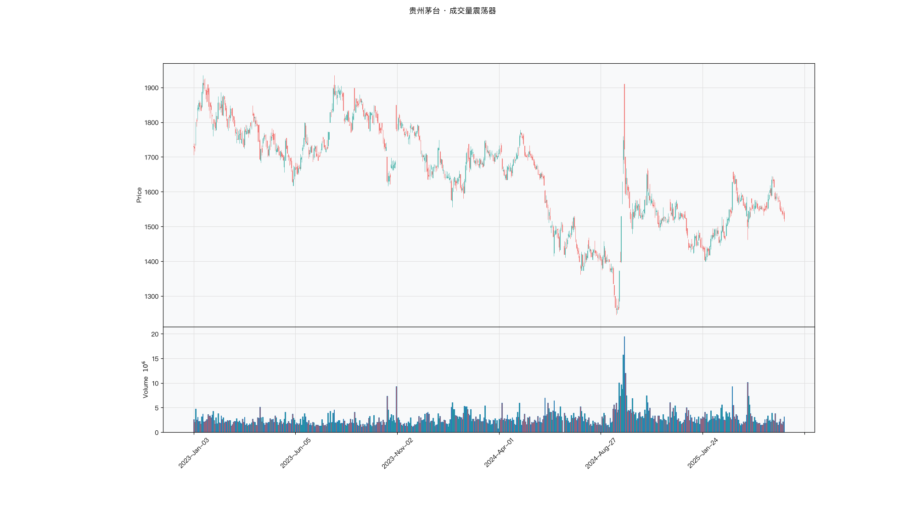

# 第038章 成交量震荡器（VO）

成交量某天突然成倍放大，一个交易者立刻把这只标的挪到自选列表的最上面。他见过放量突破之后连拉的情形，也见过同样一根巨量之后价格一路阴跌。单日量柱本身不说明什么，他要知道的是当前量能相对过去两三周的常态高出了多少，这个偏离是在扩张还是已经回落。这天的放量是新资金进场，还是有人借着活跃的成交出货。

## 名称与来历

成交量震荡器（Volume Oscillator，VO），也叫量能震荡器。

它没有公认的单一提出者。这个思路在二十世纪的成交量分析中逐步成形，随着移动平均工具在技术分析中的普及，把成交量也做成均线并比较长短周期的偏离，成了一种自然延伸的构造方式。约翰·墨菲在《期货市场技术分析》中对量能分析的系统整理，以及佩里·考夫曼在《交易系统与方法》中对量能指标的归类，都包含了这一思路 [@murphy1999; @kaufman2013]。在多数行情软件和量化库中，VO 以固定形式提供，已经成为量能分析的标准工具之一。

VO 的设计动机比较直接：成交量本身波动剧烈，单日的量柱高低难以判断趋势，但成交量的均线可以像价格均线一样反映方向。把短期均线与长期均线作差，就得到一个类似 MACD 的动量曲线，只是输入的序列从价格换成了成交量。

这个类比可以帮助定位 VO 在工具谱系里的位置。价格上的均线差是动能指标，量能上的均线差就是量能动能指标。两者的数学结构相同，都靠长短周期的偏离来度量变化速度。区别在于输入：价格序列的方向性较强，量能序列的随机性更强，因此 VO 的读数通常比价格动能指标波动更大，需要更宽的阈值和更长的确认期。

## 核心逻辑

考虑一个常见的问题：某只股票今天放量上涨，这波上涨能延续吗？

仅看一天的成交量无法回答。今天放量，可能是一波持续放量的开始，也可能是单日的脉冲，明天就恢复平静。判断的关键在于量能是在扩张还是在收缩，而这需要比较当前量与一段时间以来的常态量。

VO 的做法是分别计算短期和长期的成交量均线，再看两者的偏离。短期均线代表最近几天的量能水平，长期均线代表过去两三周的常态量能水平。短期均线高于长期均线，说明近期成交比常态更活跃，量能在扩张；低于长期均线，说明量能在收缩。偏离的幅度给出量能变化的强度。

与 OBV、CMF 相比，VO 有一个根本区别：它完全不涉及方向。OBV 和 CMF 要判断资金是流入还是流出，因此需要给成交量配一个正负号；VO 只比较量能的高低，不关心这些成交是买盘还是卖盘。这个区别决定了 VO 的用法：它不能单独给出多空判断，而是回答"当前的涨跌有没有成交量撑腰"。价格向上，同时 VO 扩张，说明上涨有量能推动；价格向上而 VO 收缩，说明上涨的量能基础在减弱。

把成交量做成均线还有一个作用：平滑掉单日的量能脉冲。成交量的分布比价格更偏态，偶尔出现的天量会让单日读数严重偏离常态。均线把这种脉冲摊薄到若干天，让量能的趋势更容易辨认。

需要区分的是量能扩张的两种来源。一种是参与资金增加，交投整体变活跃；另一种是存量资金换手加快，参与者数量没变但成交频率上升。VO 无法区分这两者，它只度量成交量的相对水平。在研判量能是否支持趋势时，这个区分很重要，通常需要结合换手率和流通市值的信息才能进一步判断。

## 计算公式

VO 有两种形式，差值型用于同一品种自身的时序判断，比值型用于跨品种比较。

**差值型**：短期成交量均线减去长期成交量均线。

$$VO_t = \overline{v}_t^{(S)} - \overline{v}_t^{(L)}$$

其中 $\overline{v}_t^{(S)}$ 为短期成交量均线，$\overline{v}_t^{(L)}$ 为长期成交量均线，$S$ 与 $L$ 为对应的周期参数，通常 $S = 10$，$L = 20$。均线可以是简单移动平均，也可以是指数移动平均。差值为正表示短期量能强于长期，量能在扩张；为负表示量能在收缩。

**比值型**：把差值除以长期均线，转成百分比。

$$VO^{ratio}_t = \frac{\overline{v}_t^{(S)} - \overline{v}_t^{(L)}}{\overline{v}_t^{(L)}} \times 100\%$$

比值型的好处是消除了成交量规模的影响。贵州茅台日成交额数十亿元，某只小盘股日成交额数千万，差值型 VO 的绝对数值相差几个数量级，无法直接比较；比值型把它们放在同一个百分比刻度上，可以横向比较量能变化的相对幅度。

**计算示例。** 假设某股票最近 10 日的平均成交量为 800 万手，最近 20 日的平均成交量为 500 万手，则

$$VO = 800 - 500 = 300 \text{ 万手}$$

$$VO^{ratio} = \frac{800 - 500}{500} \times 100\% = 60\%$$

差值型读数为 300 万手，比值型读数说明短期量能比长期常态高出 60%，量能处于明显扩张状态。若短期均线为 400 万手、长期为 500 万手，则差值为 −100 万手，比值型为 −20%，量能在收缩。

**参数含义。**

| 参数 | 含义 | 默认值 | 影响 |
|------|------|--------|------|
| S | 短期成交量均线周期 | 10 | 越小越灵敏，噪音越多 |
| L | 长期成交量均线周期 | 20 | 越大越平滑，滞后越明显 |
| 均线类型 | 简单或指数 | 简单移动平均 | 指数加权反应更快 |
| 阈值 | 判定放量的偏离幅度 | 无固定值 | 需按品种分布设定 |

VO 没有像 RSI 那样固定的超买超卖阈值。差值型的零轴是最基本的参照，读数为正说明量能扩张，为负说明收缩。比值型可以根据历史分布设定经验阈值，比如超过 ±20% 视为显著偏离，但具体数值因品种而异。

## 用法与信号

**零轴穿越。** 差值型 VO 由负转正，表示短期量能超过长期量能，量能开始扩张；由正转负表示量能转入收缩。零轴穿越是最基础的信号形态，出现频率较高，适合作为量能状态切换的提示。对量能波动大的品种，单日穿越的可靠性有限，可以要求连续两到三日位于零轴同侧才算确认。

**阈值穿越。** 在比值型 VO 上设定偏离阈值，用穿越的幅度区分普通波动和显著变化。VO 从低位快速上穿一个较高的正阈值（比如 +30%），说明量能在短期快速扩张，通常伴随价格的突破或异动；从高位快速跌破负阈值则对应量能的急剧萎缩。阈值穿越比零轴穿越频率低，信号的强度更高，代价是需要按品种的历史分布确定阈值，没有通用数值。

**量价配合与背离。** 价格上涨且 VO 扩张，说明上涨有量能支撑，属于量价齐升，趋势延续的概率较高；价格下跌且 VO 收缩，说明下跌过程中抛压在衰减，量价齐跌。价格创出新高而 VO 的高点在下移，说明上涨的量能在减弱，构成量价背离；价格创出低点而 VO 的低点在上移，说明下跌的量能在衰减。背离与 OBV、CMF 的背离逻辑一致，但 VO 只反映量能的强弱，背离的含义是"推动力不足"而非"资金转向"，信号的强度相对温和。

**突破确认。** 价格突破整理区间时，观察 VO 是否同步跳升。区间内价格横盘，量能通常处于低位，VO 在零轴附近波动；突破发生时若 VO 明显上穿零轴并伴随放量，突破有量能支撑，可靠性提升。突破而 VO 无明显变化，说明突破缺少成交配合，假突破的概率上升。这种用法把 VO 放在辅助位置，用价格给出方向，用 VO 做确认。

## 边界与误区

**不含方向，不能单独决定多空。** VO 的读数只说明量能强弱，不说明资金流向。量能扩张既可能来自买盘涌入，也可能来自恐慌抛售，单看 VO 无法区分。把 VO 上穿零轴当作买入信号，是把"交投活跃"误读为"资金流入"。VO 需要与价格方向配合使用。

**对单日放量敏感。** 均线只能摊薄单一脉冲，无法完全消除。财报发布、指数调样等事件造成的天量，仍会在短期均线上留下明显痕迹，使 VO 短期跳升后快速回落，形成假信号。遇到已知的放量事件日期，对 VO 的读数应保持谨慎。

**成交量数据的口径差异。** VO 的输入是成交量，因此继承了成交量数据的质量问题。不同市场的成交量统计口径不同，是否包含大宗交易、是否双边计算、集合竞价如何计入，都会改变 VO 的读数。做跨市场比较时，比值型 VO 也只能在口径一致的前提下才有意义。

**小盘股的波动远大于大盘股。** 同样的参数下，小盘股的 VO 波动幅度往往是大盘股的数倍，零轴穿越频繁。大盘股的 VO 越过零轴一次可能只需要一两天就能确认有效，小盘股则需要多等几天。用统一的阈值处理不同市值的品种，容易在小盘股上产生大量假信号。

**量能扩张不等于上涨。** VO 只说明成交比常态活跃，不代表价格会上行。下跌途中的放量下跌同样会让 VO 上穿零轴，此时读数扩张对应的却是空头力量。把 VO 的方向直接等同于价格方向，是这一指标最常见的误读。VO 必须与价格方向配合，才能得到有意义的结论。

## 它被检验过吗

VO 没有针对它本身的独立同行评议检验。可引的只有 Karpoff（1987）在 *JFQA* 上的综述：成交量与价格正相关，且存在不对称，放量更多伴随上涨。

这一条讲的是成交量与价格的关系，不是 VO 的绩效。VO 甚至不区分方向，只比较短期与长期成交量均线的偏离，因此关系层面的正相关并不能替它作证；它的强弱判断是否对应可交易的收益，仍缺少独立检验。完整证据链见第 007 章。

这一类的真实失效案例，见第 035 章的「真实案例与失败模式」。

## 代码实现

### R

```r
library(ettr)
library(efactorcraft)
library(efincharts)
library(ggplot2)

BASE <- "https://raw.githubusercontent.com/dengyishuo/quant-technical-analysis/main/data/parquet"

# 取数据：本地有就用本地，没有就下载一次并缓存。
# read.csv 对本地 .gz 会自动解压，所以缓存成 .csv.gz 也能直接读。
load_data <- function(name) {
  local <- file.path("data", "parquet", name)
  if (file.exists(local)) return(local)
  cache <- file.path(tools::R_user_dir("qta", "cache"), name)
  if (!file.exists(cache)) {
    dir.create(dirname(cache), recursive = TRUE, showWarnings = FALSE)
    message("下载 ", name, " ...")
    download.file(paste0(BASE, "/", name), cache, mode = "wb", quiet = TRUE)
  }
  cache
}

read_data <- function(name) {
  d <- read.csv(load_data(name), stringsAsFactors = FALSE)
  if ("date" %in% names(d)) d$date <- as.Date(d$date)
  d
}

# 同一章里多次取用，缓存到内存，避免重复解析
.cache <- new.env(parent = emptyenv())
.blue <- function() {
  if (!exists("b", .cache)) assign("b", read_data("panel_blue_chip.csv"), .cache)
  get("b", .cache)
}
.panel <- function() {
  if (!exists("p", .cache)) {
    p <- read_data("panel_r.csv.gz")
    assign("p", p[p$date >= "2023-01-01" & p$date <= "2025-06-01", ], .cache)
  }
  get("p", .cache)
}
.index <- function() read_data("index_daily.csv")

blue  <- .blue()
panel <- .panel()

# 图的保存路径，顺手建目录，避免读者本地没有 assets/ 时报错
fig_path <- function(ch, name = "indicator_r.png") {
  d <- file.path("assets", "figures", sprintf("ch%03d", ch))
  dir.create(d, recursive = TRUE, showWarnings = FALSE)
  file.path(d, name)
}

# efincharts 要求 xts 且列名带 Adjusted
as_xts <- function(df) {
  x <- xts::xts(df[, c("open", "high", "low", "close", "volume", "adjusted")],
                order.by = df$date)
  colnames(x) <- c("Open", "High", "Low", "Close", "Volume", "Adjusted")
  x
}

maotai <- .blue()[.blue()$code == "600519.SS", ]

# 1. ettr 在长格式面板上追加指标列
maotai <- add_sma(maotai, n = 5)
maotai <- add_sma(maotai, n = 20)

# 2. 基本统计
cols <- setdiff(names(maotai), names(blue))
print(summary(maotai[, cols]))

# 3. K 线 + 成交量 + 均线
ch <- ecandlesticks(as_xts(maotai), show_ma = TRUE, ma_periods = c(20, 60),
                    title = "贵州茅台 · 成交量震荡器")
ggsave(fig_path(38), ch$combined_plot, width = 10, height = 6, dpi = 110)
```

### Python

```python
import pathlib
import urllib.request

import pandas as pd
import ettr
import efactorcraft as efc
import efincharts as efc_

# 中文字体：mplfinance 会用 style 里的 rc 覆盖全局设置，必须写进 style
from efincharts import theme
theme.efin_style["rc"] = {
    "font.sans-serif": ["PingFang SC", "Heiti SC", "SimHei"],
    "axes.unicode_minus": False,
    "font.family": "sans-serif",
}

BASE = "https://raw.githubusercontent.com/dengyishuo/quant-technical-analysis/main/data/parquet"
CACHE = pathlib.Path.home() / ".cache" / "qta"
_MEM = {}


def load(name):
    """取数据：本地有就用本地，没有就下载一次并缓存。

    这样三种情形都能跑：
      1. 克隆了整个仓库    -> 直接读 data/parquet/，不联网
      2. 只复制了代码片段  -> 首次自动下载到 ~/.cache/qta，之后走缓存
      3. 之前跑过          -> 全部命中缓存，断网也能用
    """
    if name in _MEM:
        return _MEM[name]
    local = pathlib.Path("data/parquet") / name
    if local.exists():
        path = local
    else:
        CACHE.mkdir(parents=True, exist_ok=True)
        path = CACHE / name
        if not path.exists():
            print("下载 %s ..." % name)
            urllib.request.urlretrieve(BASE + "/" + name, path)
    data = pd.read_parquet(path) if name.endswith(".parquet") else pd.read_csv(path)
    _MEM[name] = data
    return data


blue = load("panel_blue_chip.parquet")
panel = load("panel.parquet")
panel = panel[(panel["date"] >= "2023-01-01") & (panel["date"] <= "2025-06-01")]
idx = load("index_daily.parquet")


def one(df, code="600519.SS"):
    """取单只标的，转成 efincharts 需要的宽表。"""
    x = df[df["code"] == code].sort_values("date").set_index("date")
    x.columns = [c.capitalize() for c in x.columns]
    return x


def fig_path(ch, name="indicator.png"):
    """图的保存路径，顺手建目录，避免读者本地没有 assets/ 时报错。"""
    d = pathlib.Path("assets") / "figures" / ("ch%03d" % ch)
    d.mkdir(parents=True, exist_ok=True)
    return str(d / name)

# 1. 取单只标的
maotai = blue[blue['code'] == '600519.SS'].copy()

# 2. ettr 在长格式面板上追加指标列，不需要手工 rolling
maotai = ettr.sma(maotai, n=[5, 20])

cols = [c for c in maotai.columns if c not in blue.columns]
print(maotai[cols].describe().round(3))

# 3. 画图：K 线 + 成交量 + 指标面板
px = one(maotai)
ch = efc_.candlestick(px, volume=True, title="贵州茅台 · 成交量震荡器")
ch.save(fig_path(38))
```

<!-- fig-indicator:start -->


<p class="figcap">图 38-1　成交量震荡器在贵州茅台上的读数（2023-01 至 2025-06）</p>
<!-- fig-indicator:end -->

## 拆解

VO 的比值型输出是百分数，表示短期量能相对长期常态偏离了多少。它与 OBV、CMF 的根本差别在于读数不带多空含义：正读数只说成交比常态活跃，不说这些成交由买方还是卖方主导。这个构造决定了它在检验中的位置，它能排序活跃程度，不能排序资金方向。

| 特征名 | 计算式 | 量纲 | 经济含义 |
|--------|--------|------|----------|
| 比值读数 | $VO_t$ | 百分比，无上下界 | 短期量能相对长期常态的偏离幅度 |
| 符号状态 | $\operatorname{sign}(VO_t)$ | 取 1、0、−1 | 量能在扩张还是收缩 |
| 阈值穿越标记 | $\mathbf{1}\{\lvert VO_t\rvert>50\}$ | 取值为 0 或 1 | 量能显著偏离常态的事件 |
| 读数变化量 | $VO_t-VO_{t-k}$ | 百分点 | 量能扩张或收缩的加速度 |

四者的关系与其他量价指标不同。读数与符号几乎重叠，只是把连续量压成了三档；变化量是读数的差分，度量的是扩张的速度而不是水平；阈值标记是读数的极端截断。真正独立的信息只有两类：量能的相对水平，以及量能变化的速度。

无方向这一点在检验里会有直接后果。横截面排序需要因子的高低对应收益的高低，而量能扩张既可能出现在放量上涨，也可能出现在放量下跌，两种情形在 VO 上读数相同，后续收益却可能相反。两股力量在截面上互相抵消，因子的 IC 因此天然偏弱。这不是指标失效，而是构造使然：VO 被设计成一个辅助量，答案要由价格方向提供。检验报告中如果不把这一点写清楚，一个接近零的 IC 很容易被误读为指标没有信息。

分布形状也需要先看。比值型的分母是长期成交量均线，小盘股的成交量基数小、换手率的波动幅度大，分母容易被压得很低，比值随之放大。同一个量能变化，在小盘股上读到 80%，在大盘股上可能只有 20%。结果是横截面上的排序带着市值与流动性的印记，而不是纯粹的量能强度。这个偏差在分层回测里会表现为组间收益的规模差异，与量能无关。

阈值穿越标记是稀疏变量。50% 的偏离在活跃个股上一年出现十几次，在低换手标的上可能一次都不出现。稀疏变量不适合做连续排序，更适合作为条件变量或事件研究的触发条件。另外，50% 这个数本身没有普适性，它是从大盘股的经验里来的；用之前应先看该标的自身 VO 的分布，把绝对阈值换成滚动分位，跨标的比较才成立。

### R

```r
library(ettr)
library(efactorcraft)
library(efincharts)
library(ggplot2)

BASE <- "https://raw.githubusercontent.com/dengyishuo/quant-technical-analysis/main/data/parquet"

# 取数据：本地有就用本地，没有就下载一次并缓存。
# read.csv 对本地 .gz 会自动解压，所以缓存成 .csv.gz 也能直接读。
load_data <- function(name) {
  local <- file.path("data", "parquet", name)
  if (file.exists(local)) return(local)
  cache <- file.path(tools::R_user_dir("qta", "cache"), name)
  if (!file.exists(cache)) {
    dir.create(dirname(cache), recursive = TRUE, showWarnings = FALSE)
    message("下载 ", name, " ...")
    download.file(paste0(BASE, "/", name), cache, mode = "wb", quiet = TRUE)
  }
  cache
}

read_data <- function(name) {
  d <- read.csv(load_data(name), stringsAsFactors = FALSE)
  if ("date" %in% names(d)) d$date <- as.Date(d$date)
  d
}

# 同一章里多次取用，缓存到内存，避免重复解析
.cache <- new.env(parent = emptyenv())
.blue <- function() {
  if (!exists("b", .cache)) assign("b", read_data("panel_blue_chip.csv"), .cache)
  get("b", .cache)
}
.panel <- function() {
  if (!exists("p", .cache)) {
    p <- read_data("panel_r.csv.gz")
    assign("p", p[p$date >= "2023-01-01" & p$date <= "2025-06-01", ], .cache)
  }
  get("p", .cache)
}
.index <- function() read_data("index_daily.csv")

blue  <- .blue()
panel <- .panel()

# 图的保存路径，顺手建目录，避免读者本地没有 assets/ 时报错
fig_path <- function(ch, name = "indicator_r.png") {
  d <- file.path("assets", "figures", sprintf("ch%03d", ch))
  dir.create(d, recursive = TRUE, showWarnings = FALSE)
  file.path(d, name)
}

# efincharts 要求 xts 且列名带 Adjusted
as_xts <- function(df) {
  x <- xts::xts(df[, c("open", "high", "low", "close", "volume", "adjusted")],
                order.by = df$date)
  colnames(x) <- c("Open", "High", "Low", "Close", "Volume", "Adjusted")
  x
}

d <- .blue()[.blue()$code == "600519.SS", ]
d <- add_sma(d, n = 5)
d <- add_sma(d, n = 20)

d$VO <- d$SMA_5 / d$SMA_20 - 1
# 转成无量纲因子
d$f <- d$`VO`

print(summary(d$f))
```

### Python

```python
import pathlib
import urllib.request

import pandas as pd
import ettr
import efactorcraft as efc
import efincharts as efc_

# 中文字体：mplfinance 会用 style 里的 rc 覆盖全局设置，必须写进 style
from efincharts import theme
theme.efin_style["rc"] = {
    "font.sans-serif": ["PingFang SC", "Heiti SC", "SimHei"],
    "axes.unicode_minus": False,
    "font.family": "sans-serif",
}

BASE = "https://raw.githubusercontent.com/dengyishuo/quant-technical-analysis/main/data/parquet"
CACHE = pathlib.Path.home() / ".cache" / "qta"
_MEM = {}


def load(name):
    """取数据：本地有就用本地，没有就下载一次并缓存。

    这样三种情形都能跑：
      1. 克隆了整个仓库    -> 直接读 data/parquet/，不联网
      2. 只复制了代码片段  -> 首次自动下载到 ~/.cache/qta，之后走缓存
      3. 之前跑过          -> 全部命中缓存，断网也能用
    """
    if name in _MEM:
        return _MEM[name]
    local = pathlib.Path("data/parquet") / name
    if local.exists():
        path = local
    else:
        CACHE.mkdir(parents=True, exist_ok=True)
        path = CACHE / name
        if not path.exists():
            print("下载 %s ..." % name)
            urllib.request.urlretrieve(BASE + "/" + name, path)
    data = pd.read_parquet(path) if name.endswith(".parquet") else pd.read_csv(path)
    _MEM[name] = data
    return data


blue = load("panel_blue_chip.parquet")
panel = load("panel.parquet")
panel = panel[(panel["date"] >= "2023-01-01") & (panel["date"] <= "2025-06-01")]
idx = load("index_daily.parquet")


def one(df, code="600519.SS"):
    """取单只标的，转成 efincharts 需要的宽表。"""
    x = df[df["code"] == code].sort_values("date").set_index("date")
    x.columns = [c.capitalize() for c in x.columns]
    return x


def fig_path(ch, name="indicator.png"):
    """图的保存路径，顺手建目录，避免读者本地没有 assets/ 时报错。"""
    d = pathlib.Path("assets") / "figures" / ("ch%03d" % ch)
    d.mkdir(parents=True, exist_ok=True)
    return str(d / name)

# 1. 先在面板上算原始指标
d = panel.copy()
d = ettr.sma(d, n=[5, 20])

d["VO"] = d["SMA_5"] / d["SMA_20"] - 1
# 2. 转成无量纲因子，才能跨标的排序
d["f"] = d["VO"]

print(d["f"].describe().round(4))
```

四列里只有第一列与第四列适合连续排序。符号状态只有三个取值，阈值标记只有两个，两者都更适合作为分组条件。这个判断在后面的检验里会反复用到：不是所有特征都要做成因子，有些特征的用途是切样本。

## 截面选股能力

VO 的横截面因子以比值读数为起点：

$$f^{vo}_t=\frac{\bar v_t^{(S)}-\bar v_t^{(L)}}{\bar v_t^{(L)}}$$

它度量短期量能相对长期常态的偏离，正值代表扩张。若要把方向补回来，可以乘以价格方向：

$$f^{dir}_t=\operatorname{sign}(r_t^{(5)})\times VO_t$$

前者是纯强度，后者是强度与方向的乘积。两者的检验结论通常差别很大：纯强度因子的 IC 偏弱且不稳定，带方向的版本会明显改善，但这个改善有多少来自 VO、多少来自被乘进去的动量，需要做对照才能分清。

预期表现上，纯强度因子的 IC 通常弱于带方向的量价指标，这是构造决定的，不是数据的问题。量能扩张与未来收益之间没有稳定的单调关系：扩张可能是趋势启动，也可能是情绪顶部的换手放大，两种情形在不同市况下的比例不同，截面上就表现为方向随样本期漂移。带方向的版本把"下跌放量"翻成负值，逻辑上更顺，但它本质上是一个动量因子与一个波动因子的乘积，独立性存疑。

因此检验 VO 时的重点不是追求高 IC，而是回答两个更窄的问题：量能扩张在什么条件下对收益有正向贡献，以及这个贡献在剔除动量与换手率之后是否还在。前一个问题用分组回答，后一个问题用残差回答。

检验时有三点值得特别注意。

第一，VO 与换手率的变化几乎是同一件事的两种写法。成交量均线的偏离，除以成交量自身，与换手率相对自身均值的偏离高度相关。若标的池里换手率的横截面差异很大，VO 因子的排序可能主要在排序换手率。判断增量信息时，应把换手率作为对照因子，看 VO 在它之上是否还有解释力。

第二，市值与流动性的暴露需要单独检查。按成交量分组做组内 IC，是一个简单的诊断：若 IC 只在小成交量的组里出现，说明因子捕捉的是小盘股的量能异动，而不是普遍规律。这个检查不需要市值数据，用成交额分位代替即可。

第三，成交量口径要在比较前确认。比值型 VO 虽然无量纲，但分子分母都来自成交量，两个数据源的口径差异会同时进入分子与分母。若一只标的的成交量在某一天因为统计规则改变而整体平移，读数会在那一天跳变，之后恢复。跨市场比较时，双边计算与单边计算的差异会让读数系统性地差一倍，这类差异靠标准化无法消除。

### R

```r
library(ettr)
library(efactorcraft)
library(efincharts)
library(ggplot2)

BASE <- "https://raw.githubusercontent.com/dengyishuo/quant-technical-analysis/main/data/parquet"

# 取数据：本地有就用本地，没有就下载一次并缓存。
# read.csv 对本地 .gz 会自动解压，所以缓存成 .csv.gz 也能直接读。
load_data <- function(name) {
  local <- file.path("data", "parquet", name)
  if (file.exists(local)) return(local)
  cache <- file.path(tools::R_user_dir("qta", "cache"), name)
  if (!file.exists(cache)) {
    dir.create(dirname(cache), recursive = TRUE, showWarnings = FALSE)
    message("下载 ", name, " ...")
    download.file(paste0(BASE, "/", name), cache, mode = "wb", quiet = TRUE)
  }
  cache
}

read_data <- function(name) {
  d <- read.csv(load_data(name), stringsAsFactors = FALSE)
  if ("date" %in% names(d)) d$date <- as.Date(d$date)
  d
}

# 同一章里多次取用，缓存到内存，避免重复解析
.cache <- new.env(parent = emptyenv())
.blue <- function() {
  if (!exists("b", .cache)) assign("b", read_data("panel_blue_chip.csv"), .cache)
  get("b", .cache)
}
.panel <- function() {
  if (!exists("p", .cache)) {
    p <- read_data("panel_r.csv.gz")
    assign("p", p[p$date >= "2023-01-01" & p$date <= "2025-06-01", ], .cache)
  }
  get("p", .cache)
}
.index <- function() read_data("index_daily.csv")

blue  <- .blue()
panel <- .panel()

# 图的保存路径，顺手建目录，避免读者本地没有 assets/ 时报错
fig_path <- function(ch, name = "indicator_r.png") {
  d <- file.path("assets", "figures", sprintf("ch%03d", ch))
  dir.create(d, recursive = TRUE, showWarnings = FALSE)
  file.path(d, name)
}

# efincharts 要求 xts 且列名带 Adjusted
as_xts <- function(df) {
  x <- xts::xts(df[, c("open", "high", "low", "close", "volume", "adjusted")],
                order.by = df$date)
  colnames(x) <- c("Open", "High", "Low", "Close", "Volume", "Adjusted")
  x
}

d <- .panel()
d <- add_sma(d, n = 5)
d <- add_sma(d, n = 20)
d$VO <- d$SMA_5 / d$SMA_20 - 1

d$f <- d$`VO`
d <- add_next_return(d, close_col = "close", n = c(1, 5, 20))

ic <- ic_analysis(d, factor_cols = "f",
                    forward_cols = c("forward_1", "forward_5", "forward_20"),
                    method = "spearman")
print(ir_analysis(ic))

q <- quantile_analysis(d, factor_cols = "f", forward_cols = "forward_5",
                       n_groups = 5)
print(q$f$summary)
```

### Python

```python
import pathlib
import urllib.request

import pandas as pd
import ettr
import efactorcraft as efc
import efincharts as efc_

# 中文字体：mplfinance 会用 style 里的 rc 覆盖全局设置，必须写进 style
from efincharts import theme
theme.efin_style["rc"] = {
    "font.sans-serif": ["PingFang SC", "Heiti SC", "SimHei"],
    "axes.unicode_minus": False,
    "font.family": "sans-serif",
}

BASE = "https://raw.githubusercontent.com/dengyishuo/quant-technical-analysis/main/data/parquet"
CACHE = pathlib.Path.home() / ".cache" / "qta"
_MEM = {}


def load(name):
    """取数据：本地有就用本地，没有就下载一次并缓存。

    这样三种情形都能跑：
      1. 克隆了整个仓库    -> 直接读 data/parquet/，不联网
      2. 只复制了代码片段  -> 首次自动下载到 ~/.cache/qta，之后走缓存
      3. 之前跑过          -> 全部命中缓存，断网也能用
    """
    if name in _MEM:
        return _MEM[name]
    local = pathlib.Path("data/parquet") / name
    if local.exists():
        path = local
    else:
        CACHE.mkdir(parents=True, exist_ok=True)
        path = CACHE / name
        if not path.exists():
            print("下载 %s ..." % name)
            urllib.request.urlretrieve(BASE + "/" + name, path)
    data = pd.read_parquet(path) if name.endswith(".parquet") else pd.read_csv(path)
    _MEM[name] = data
    return data


blue = load("panel_blue_chip.parquet")
panel = load("panel.parquet")
panel = panel[(panel["date"] >= "2023-01-01") & (panel["date"] <= "2025-06-01")]
idx = load("index_daily.parquet")


def one(df, code="600519.SS"):
    """取单只标的，转成 efincharts 需要的宽表。"""
    x = df[df["code"] == code].sort_values("date").set_index("date")
    x.columns = [c.capitalize() for c in x.columns]
    return x


def fig_path(ch, name="indicator.png"):
    """图的保存路径，顺手建目录，避免读者本地没有 assets/ 时报错。"""
    d = pathlib.Path("assets") / "figures" / ("ch%03d" % ch)
    d.mkdir(parents=True, exist_ok=True)
    return str(d / name)

# 287 只、2023-01 至 2025-06，横截面才有统计意义
src = panel.copy()
d = src.copy()

# 1. 算指标
d = ettr.sma(d, n=[5, 20])

d["VO"] = d["SMA_5"] / d["SMA_20"] - 1

# 2. 因子 + 未来收益
d["f"] = d["VO"]
d = efc.add_next_return(d, periods=(1, 5, 20))

# 3. 截面 IC 与分层
ic = efc.ic_analysis(d, factor_cols="f",
                      forward_cols=["forward_1", "forward_5", "forward_20"],
                      method="spearman")
print(efc.ir_analysis(ic).round(3))

q = efc.quantile_analysis(d, factor_col="f", forward_col="forward_5", n_groups=5)
print(q["summary"].round(4))
```

这几段输出构成一个诊断链。缩尾前后的差反映极端读数的影响。分层是否单调反映关系形状。分成交额组的 IC 反映因子的适用面。若只有小成交量的组有 IC，而全样本 IC 接近零，全样本的结论就是被大盘股的无效样本稀释了，此时正确的做法是限定标的池，而不是宣称因子无效。

<!-- tab-ic:start -->
**计算结果**

| 前向期 | IC 均值 | IC 标准差 | ICIR | t 值 | IC>0 占比 | 期数 |
|---|---|---|---|---|---|---|
| T+1 | -0.0102 | 0.2404 | -0.043 | -1.01 | 0.4810 | 561 |
| T+5 | -0.0213 | 0.2236 | -0.095 | -2.25 | 0.4690 | 557 |
| T+20 | -0.0392 | 0.2115 | -0.185 | -4.31 | 0.4610 | 542 |

表里最该看的是 t 值，不是 IC 均值。这个因子以 T+1 为主口径，IC 均值 -0.0102、ICIR -0.043、t 值 -1.01，在常规门槛下不显著，方向为反向。按第 007 章给出的日频门槛（ICIR 0.13 对应 t≈2），这个结果的含义是：还看不出与噪声的区别，不能据此构造策略。

需要提醒的是，这只说明排序与未来收益之间存在可测的关联，不代表扣掉成本后还能剩下收益。横截面 IC 检验的是“买哪只”，不负责“值不值得交易”。

**五档分层**

| 分组 | 平均收益 | 标准差 | 期数 |
|---|---|---|---|
| 1 | +0.0047 | +0.0417 | 557 |
| 2 | +0.0027 | +0.0330 | 557 |
| 3 | +0.0023 | +0.0293 | 557 |
| 4 | +0.0021 | +0.0301 | 557 |
| 5 | +0.0046 | +0.0416 | 557 |

五档分层看的是形状，不是单点。最高一档在第 1 组、最低在第 4 组，两端相差 -0.01%，组序号与平均收益的秩相关为 -0.09，没有明显单调性。

分层比 IC 更接近实盘，因为它直接给出“买最高档、卖最低档”的收益差。但这里的数字是毛收益，且没有考虑涨跌停买不进、停牌卖不出的情形，真实可得的差额会小于表中所列。
<!-- tab-ic:end -->

## 择时能力

时序上 VO 的择时逻辑分三层。第一层是零轴穿越，短期量能均线由下向上穿过长期均线，说明交投从常态转向活跃。第二层是阈值穿越，读数越过一个较高的分位，说明量能出现了显著偏离。第三层是与价格方向的配合，量能扩张本身不构成方向，只有和价格同向时才有含义。

方法与信号形态要匹配。零轴穿越频率高，一年几十次，适合用触发日检验，但要接受较弱的统计效力。阈值穿越频率低，事件特征明显，适合作为事件研究的触发条件，看触发后的收益分布是否整体偏移。读数本身是连续变量，适合条件分位收益，重点是看曲线在极端处是否掉头，因为量能过热与量能启动在读数上相邻，在收益上相反。

这里要说清楚为什么 VO 的择时结论通常比截面结论更可读。时间序列上，同一只标的的量能基准相对稳定，读数的高低对应的是它自己的常态，比较是有意义的。横截面上，不同标的的常态差异很大，同样的读数含义不同，排序就掺了噪音。同一份信息，在时序上更清楚，在截面上更模糊，这是量能类指标的共同特点。

陷阱有三处。第一，把量能扩张当作买入信号。放量下跌同样会让 VO 上穿零轴，若回测只按 VO 建仓，样本里会混进大量下跌途中的放量日，结论会被这批样本主导。稳健的做法是把价格方向作为前置条件，只在价格上行时使用 VO。第二，事件日造成的假信号。财报、指数调样、解禁带来的天量会让读数跳升后迅速回落，这类样本应在检验时单独标记。第三，阈值按绝对百分比设定。不同标的的波动幅度差异很大，用 50% 一刀切，等于给低波动标的设了一道几乎不触发的门槛。

### R

```r
library(ettr)
library(efactorcraft)
library(efincharts)
library(ggplot2)

BASE <- "https://raw.githubusercontent.com/dengyishuo/quant-technical-analysis/main/data/parquet"

# 取数据：本地有就用本地，没有就下载一次并缓存。
# read.csv 对本地 .gz 会自动解压，所以缓存成 .csv.gz 也能直接读。
load_data <- function(name) {
  local <- file.path("data", "parquet", name)
  if (file.exists(local)) return(local)
  cache <- file.path(tools::R_user_dir("qta", "cache"), name)
  if (!file.exists(cache)) {
    dir.create(dirname(cache), recursive = TRUE, showWarnings = FALSE)
    message("下载 ", name, " ...")
    download.file(paste0(BASE, "/", name), cache, mode = "wb", quiet = TRUE)
  }
  cache
}

read_data <- function(name) {
  d <- read.csv(load_data(name), stringsAsFactors = FALSE)
  if ("date" %in% names(d)) d$date <- as.Date(d$date)
  d
}

# 同一章里多次取用，缓存到内存，避免重复解析
.cache <- new.env(parent = emptyenv())
.blue <- function() {
  if (!exists("b", .cache)) assign("b", read_data("panel_blue_chip.csv"), .cache)
  get("b", .cache)
}
.panel <- function() {
  if (!exists("p", .cache)) {
    p <- read_data("panel_r.csv.gz")
    assign("p", p[p$date >= "2023-01-01" & p$date <= "2025-06-01", ], .cache)
  }
  get("p", .cache)
}
.index <- function() read_data("index_daily.csv")

blue  <- .blue()
panel <- .panel()

# 图的保存路径，顺手建目录，避免读者本地没有 assets/ 时报错
fig_path <- function(ch, name = "indicator_r.png") {
  d <- file.path("assets", "figures", sprintf("ch%03d", ch))
  dir.create(d, recursive = TRUE, showWarnings = FALSE)
  file.path(d, name)
}

# efincharts 要求 xts 且列名带 Adjusted
as_xts <- function(df) {
  x <- xts::xts(df[, c("open", "high", "low", "close", "volume", "adjusted")],
                order.by = df$date)
  colnames(x) <- c("Open", "High", "Low", "Close", "Volume", "Adjusted")
  x
}

t <- .index()
t <- t[t$code == "510300.SS", ]
t <- add_sma(t, n = 5)
t <- add_sma(t, n = 20)
t$VO <- t$SMA_5 / t$SMA_20 - 1
t$f <- t$`VO`
t$forward_5 <- c(tail(t$close, -5) / head(t$close, -5) - 1, rep(NA, 5))
t$q <- cut(t$f, quantile(t$f, 0:5/5, na.rm = TRUE), include.lowest = TRUE, labels = FALSE)
print(aggregate(forward_5 ~ q, data = t, FUN = function(x)
  c(mean = mean(x, na.rm = TRUE), n = sum(!is.na(x)))))
```

### Python

```python
import pathlib
import urllib.request

import pandas as pd
import ettr
import efactorcraft as efc
import efincharts as efc_

# 中文字体：mplfinance 会用 style 里的 rc 覆盖全局设置，必须写进 style
from efincharts import theme
theme.efin_style["rc"] = {
    "font.sans-serif": ["PingFang SC", "Heiti SC", "SimHei"],
    "axes.unicode_minus": False,
    "font.family": "sans-serif",
}

BASE = "https://raw.githubusercontent.com/dengyishuo/quant-technical-analysis/main/data/parquet"
CACHE = pathlib.Path.home() / ".cache" / "qta"
_MEM = {}


def load(name):
    """取数据：本地有就用本地，没有就下载一次并缓存。

    这样三种情形都能跑：
      1. 克隆了整个仓库    -> 直接读 data/parquet/，不联网
      2. 只复制了代码片段  -> 首次自动下载到 ~/.cache/qta，之后走缓存
      3. 之前跑过          -> 全部命中缓存，断网也能用
    """
    if name in _MEM:
        return _MEM[name]
    local = pathlib.Path("data/parquet") / name
    if local.exists():
        path = local
    else:
        CACHE.mkdir(parents=True, exist_ok=True)
        path = CACHE / name
        if not path.exists():
            print("下载 %s ..." % name)
            urllib.request.urlretrieve(BASE + "/" + name, path)
    data = pd.read_parquet(path) if name.endswith(".parquet") else pd.read_csv(path)
    _MEM[name] = data
    return data


blue = load("panel_blue_chip.parquet")
panel = load("panel.parquet")
panel = panel[(panel["date"] >= "2023-01-01") & (panel["date"] <= "2025-06-01")]
idx = load("index_daily.parquet")


def one(df, code="600519.SS"):
    """取单只标的，转成 efincharts 需要的宽表。"""
    x = df[df["code"] == code].sort_values("date").set_index("date")
    x.columns = [c.capitalize() for c in x.columns]
    return x


def fig_path(ch, name="indicator.png"):
    """图的保存路径，顺手建目录，避免读者本地没有 assets/ 时报错。"""
    d = pathlib.Path("assets") / "figures" / ("ch%03d" % ch)
    d.mkdir(parents=True, exist_ok=True)
    return str(d / name)

# 择时检验用 ETF 做市场载体，指数本身没有日线数据
t = idx[idx["code"] == "510300.SS"].sort_values("date").copy()

# 1. 在 ETF 上算同一个指标
t = ettr.sma(d, n=[5, 20])

t["VO"] = t["SMA_5"] / t["SMA_20"] - 1

# 2. 按因子分位看未来 5 日收益
t["f"] = t["VO"]
t["forward_5"] = t["close"].shift(-5) / t["close"] - 1
# 因子可能有重复值，先按名次切，避免 qcut 报边界不唯一
t["q"] = pd.qcut(t["f"].rank(method="first"), 5, labels=False) + 1
t = t.dropna(subset=["f", "forward_5"])
print(t.groupby("q")["forward_5"].agg(["mean", "count"]).round(4))
```

四组组合的均值最有信息量。量能扩张在价格上行时与下行时的含义不同，若两组均值一正一负，说明 VO 必须与方向绑定才有意义；若两组都为正，说明放量本身在短期内带有正向效应，与方向无关。这两种结果对应完全不同的用法，不能混为一谈。

<!-- tab-timing:start -->
**分位收益**

| 分位 | 未来 5 日均值 | 样本数 |
|---|---|---|
| 1 | +0.0050 | 219 |
| 2 | -0.0046 | 218 |
| 3 | -0.0002 | 218 |
| 4 | +0.0006 | 218 |
| 5 | -0.0011 | 218 |

择时口径与截面不同：这里只有一个标的，看的是同一标的在不同分位下的未来收益。最高与最低分位相差 -0.61%。单标的样本有限，这个差额很容易被一两段行情主导，只能作为方向参考。

真正做择时要问的是三件事：分位阈值是否稳定、换手是否可控、扣成本后是否还有剩余。三者缺一，择时信号就只是图上好看。
<!-- tab-timing:end -->

## 组合使用与验证

VO 的搭档里，最重要的是价格方向。与动量搭配，动量提供方向，VO 提供强度，两者相乘或分组，构成量价配合的完整表达。与换手率搭配属于同源对照，用于判断 VO 的信息是否已经被换手率覆盖。与波动率搭配，用波动水平区分"趋势性放量"与"恐慌性放量"，前者伴随波动温和上升，后者伴随波动跳升。

**组合的截面验证。** 加权型做法是把 VO 与二十日动量各自标准化后等权相加，走一遍截面检验。这里要先看两者的相关：动量与 VO 的相关通常不高，因为一个是价格位移，一个是成交量偏离，这为组合留出了空间。组合的 ICIR 若能高于两者，说明量价两个维度确实互补。条件型做法是只取"动量为正且 VO 为正"的样本，再比较触发样本内的收益水平，这更接近实务里的选股口径。

**组合的择时验证。** 把"VO 为正且价格站上二十日均线"设为持仓条件，与单条件、买入持有对照。VO 单独作为持仓条件时，信号会在下跌放量期频繁触发，加入均线之后，这批样本被过滤掉，持仓天数明显下降。改进通常体现在回撤与胜率上，收益未必提高。若回撤没有改善，说明过滤没有起作用，只是把仓位削小。

增益的判读依据方法论章的标准：**组合的 ICIR 高于两个单特征，才说明存在互补性；介于两者之间，说明只是平均；低于两者，说明信号在某些时段互相抵消。** VO 与动量的信息来源不同，互补的可能性相对大；VO 与换手率的同源性高，组合大概率落在中间，此时应直接使用换手率，省掉一层计算。

### R

```r
library(ettr)
library(efactorcraft)
library(efincharts)
library(ggplot2)

BASE <- "https://raw.githubusercontent.com/dengyishuo/quant-technical-analysis/main/data/parquet"

# 取数据：本地有就用本地，没有就下载一次并缓存。
# read.csv 对本地 .gz 会自动解压，所以缓存成 .csv.gz 也能直接读。
load_data <- function(name) {
  local <- file.path("data", "parquet", name)
  if (file.exists(local)) return(local)
  cache <- file.path(tools::R_user_dir("qta", "cache"), name)
  if (!file.exists(cache)) {
    dir.create(dirname(cache), recursive = TRUE, showWarnings = FALSE)
    message("下载 ", name, " ...")
    download.file(paste0(BASE, "/", name), cache, mode = "wb", quiet = TRUE)
  }
  cache
}

read_data <- function(name) {
  d <- read.csv(load_data(name), stringsAsFactors = FALSE)
  if ("date" %in% names(d)) d$date <- as.Date(d$date)
  d
}

# 同一章里多次取用，缓存到内存，避免重复解析
.cache <- new.env(parent = emptyenv())
.blue <- function() {
  if (!exists("b", .cache)) assign("b", read_data("panel_blue_chip.csv"), .cache)
  get("b", .cache)
}
.panel <- function() {
  if (!exists("p", .cache)) {
    p <- read_data("panel_r.csv.gz")
    assign("p", p[p$date >= "2023-01-01" & p$date <= "2025-06-01", ], .cache)
  }
  get("p", .cache)
}
.index <- function() read_data("index_daily.csv")

blue  <- .blue()
panel <- .panel()

# 图的保存路径，顺手建目录，避免读者本地没有 assets/ 时报错
fig_path <- function(ch, name = "indicator_r.png") {
  d <- file.path("assets", "figures", sprintf("ch%03d", ch))
  dir.create(d, recursive = TRUE, showWarnings = FALSE)
  file.path(d, name)
}

# efincharts 要求 xts 且列名带 Adjusted
as_xts <- function(df) {
  x <- xts::xts(df[, c("open", "high", "low", "close", "volume", "adjusted")],
                order.by = df$date)
  colnames(x) <- c("Open", "High", "Low", "Close", "Volume", "Adjusted")
  x
}

d <- .panel()
d <- add_sma(d, n = 5)
d <- add_sma(d, n = 20)
d$VO <- d$SMA_5 / d$SMA_20 - 1
d$f1 <- d$`VO`
d <- add_cmf(d, n = 20)
d$f2 <- d$CMF
d <- add_next_return(d, close_col = "close", n = 5)
ic1 <- ic_analysis(d, factor_cols = c("f1", "f2"),
                    forward_cols = "forward_5", method = "spearman")
print(ir_analysis(ic1))
```

```r
library(ettr)
library(efactorcraft)
library(efincharts)
library(ggplot2)

BASE <- "https://raw.githubusercontent.com/dengyishuo/quant-technical-analysis/main/data/parquet"

# 取数据：本地有就用本地，没有就下载一次并缓存。
# read.csv 对本地 .gz 会自动解压，所以缓存成 .csv.gz 也能直接读。
load_data <- function(name) {
  local <- file.path("data", "parquet", name)
  if (file.exists(local)) return(local)
  cache <- file.path(tools::R_user_dir("qta", "cache"), name)
  if (!file.exists(cache)) {
    dir.create(dirname(cache), recursive = TRUE, showWarnings = FALSE)
    message("下载 ", name, " ...")
    download.file(paste0(BASE, "/", name), cache, mode = "wb", quiet = TRUE)
  }
  cache
}

read_data <- function(name) {
  d <- read.csv(load_data(name), stringsAsFactors = FALSE)
  if ("date" %in% names(d)) d$date <- as.Date(d$date)
  d
}

# 同一章里多次取用，缓存到内存，避免重复解析
.cache <- new.env(parent = emptyenv())
.blue <- function() {
  if (!exists("b", .cache)) assign("b", read_data("panel_blue_chip.csv"), .cache)
  get("b", .cache)
}
.panel <- function() {
  if (!exists("p", .cache)) {
    p <- read_data("panel_r.csv.gz")
    assign("p", p[p$date >= "2023-01-01" & p$date <= "2025-06-01", ], .cache)
  }
  get("p", .cache)
}
.index <- function() read_data("index_daily.csv")

blue  <- .blue()
panel <- .panel()

# 图的保存路径，顺手建目录，避免读者本地没有 assets/ 时报错
fig_path <- function(ch, name = "indicator_r.png") {
  d <- file.path("assets", "figures", sprintf("ch%03d", ch))
  dir.create(d, recursive = TRUE, showWarnings = FALSE)
  file.path(d, name)
}

# efincharts 要求 xts 且列名带 Adjusted
as_xts <- function(df) {
  x <- xts::xts(df[, c("open", "high", "low", "close", "volume", "adjusted")],
                order.by = df$date)
  colnames(x) <- c("Open", "High", "Low", "Close", "Volume", "Adjusted")
  x
}

d <- .panel()
d <- add_sma(d, n = 5)
d <- add_sma(d, n = 20)
d$VO <- d$SMA_5 / d$SMA_20 - 1
d$f1 <- d$`VO`
d <- add_cmf(d, n = 20)
d$f2 <- d$CMF
d <- add_next_return(d, close_col = "close", n = 5)
ic1 <- ic_analysis(d, factor_cols = c("f1", "f2"),
                    forward_cols = "forward_5", method = "spearman")
print(ir_analysis(ic1))
```

### Python

```python
import pathlib
import urllib.request

import pandas as pd
import ettr
import efactorcraft as efc
import efincharts as efc_

# 中文字体：mplfinance 会用 style 里的 rc 覆盖全局设置，必须写进 style
from efincharts import theme
theme.efin_style["rc"] = {
    "font.sans-serif": ["PingFang SC", "Heiti SC", "SimHei"],
    "axes.unicode_minus": False,
    "font.family": "sans-serif",
}

BASE = "https://raw.githubusercontent.com/dengyishuo/quant-technical-analysis/main/data/parquet"
CACHE = pathlib.Path.home() / ".cache" / "qta"
_MEM = {}


def load(name):
    """取数据：本地有就用本地，没有就下载一次并缓存。

    这样三种情形都能跑：
      1. 克隆了整个仓库    -> 直接读 data/parquet/，不联网
      2. 只复制了代码片段  -> 首次自动下载到 ~/.cache/qta，之后走缓存
      3. 之前跑过          -> 全部命中缓存，断网也能用
    """
    if name in _MEM:
        return _MEM[name]
    local = pathlib.Path("data/parquet") / name
    if local.exists():
        path = local
    else:
        CACHE.mkdir(parents=True, exist_ok=True)
        path = CACHE / name
        if not path.exists():
            print("下载 %s ..." % name)
            urllib.request.urlretrieve(BASE + "/" + name, path)
    data = pd.read_parquet(path) if name.endswith(".parquet") else pd.read_csv(path)
    _MEM[name] = data
    return data


blue = load("panel_blue_chip.parquet")
panel = load("panel.parquet")
panel = panel[(panel["date"] >= "2023-01-01") & (panel["date"] <= "2025-06-01")]
idx = load("index_daily.parquet")


def one(df, code="600519.SS"):
    """取单只标的，转成 efincharts 需要的宽表。"""
    x = df[df["code"] == code].sort_values("date").set_index("date")
    x.columns = [c.capitalize() for c in x.columns]
    return x


def fig_path(ch, name="indicator.png"):
    """图的保存路径，顺手建目录，避免读者本地没有 assets/ 时报错。"""
    d = pathlib.Path("assets") / "figures" / ("ch%03d" % ch)
    d.mkdir(parents=True, exist_ok=True)
    return str(d / name)

d = panel.copy()

# 1. 本章因子
d = ettr.sma(d, n=[5, 20])
d["VO"] = d["SMA_5"] / d["SMA_20"] - 1
d["f1"] = d["VO"]

# 2. 配一个量价因子做对照
d = ettr.cmf(d, n=20)
d["f2"] = d["CMF_20"]
d = efc.add_next_return(d, periods=(5,))

# 3. 单因子与等权组合的信息比率
ic = efc.ic_analysis(d, factor_cols=["f1", "f2"], forward_cols=["forward_5"],
                      method="spearman")
d = efc.equal_weighted_composite(d, factor_cols=["f1", "f2"], new_col="f1_f2")
ic2 = efc.ic_analysis(d, factor_cols=["f1_f2"], forward_cols=["forward_5"],
                      method="spearman")
ic.update(ic2)
print(efc.ir_analysis(ic).round(3))
```

```python
import pathlib
import urllib.request

import pandas as pd
import ettr
import efactorcraft as efc
import efincharts as efc_

# 中文字体：mplfinance 会用 style 里的 rc 覆盖全局设置，必须写进 style
from efincharts import theme
theme.efin_style["rc"] = {
    "font.sans-serif": ["PingFang SC", "Heiti SC", "SimHei"],
    "axes.unicode_minus": False,
    "font.family": "sans-serif",
}

BASE = "https://raw.githubusercontent.com/dengyishuo/quant-technical-analysis/main/data/parquet"
CACHE = pathlib.Path.home() / ".cache" / "qta"
_MEM = {}


def load(name):
    """取数据：本地有就用本地，没有就下载一次并缓存。

    这样三种情形都能跑：
      1. 克隆了整个仓库    -> 直接读 data/parquet/，不联网
      2. 只复制了代码片段  -> 首次自动下载到 ~/.cache/qta，之后走缓存
      3. 之前跑过          -> 全部命中缓存，断网也能用
    """
    if name in _MEM:
        return _MEM[name]
    local = pathlib.Path("data/parquet") / name
    if local.exists():
        path = local
    else:
        CACHE.mkdir(parents=True, exist_ok=True)
        path = CACHE / name
        if not path.exists():
            print("下载 %s ..." % name)
            urllib.request.urlretrieve(BASE + "/" + name, path)
    data = pd.read_parquet(path) if name.endswith(".parquet") else pd.read_csv(path)
    _MEM[name] = data
    return data


blue = load("panel_blue_chip.parquet")
panel = load("panel.parquet")
panel = panel[(panel["date"] >= "2023-01-01") & (panel["date"] <= "2025-06-01")]
idx = load("index_daily.parquet")


def one(df, code="600519.SS"):
    """取单只标的，转成 efincharts 需要的宽表。"""
    x = df[df["code"] == code].sort_values("date").set_index("date")
    x.columns = [c.capitalize() for c in x.columns]
    return x


def fig_path(ch, name="indicator.png"):
    """图的保存路径，顺手建目录，避免读者本地没有 assets/ 时报错。"""
    d = pathlib.Path("assets") / "figures" / ("ch%03d" % ch)
    d.mkdir(parents=True, exist_ok=True)
    return str(d / name)

d = panel.copy()

# 1. 本章因子
d = ettr.sma(d, n=[5, 20])
d["VO"] = d["SMA_5"] / d["SMA_20"] - 1
d["f1"] = d["VO"]

# 2. 配一个量价因子做对照
d = ettr.cmf(d, n=20)
d["f2"] = d["CMF_20"]
d = efc.add_next_return(d, periods=(5,))

# 3. 单因子与等权组合的信息比率
ic = efc.ic_analysis(d, factor_cols=["f1", "f2"], forward_cols=["forward_5"],
                      method="spearman")
d = efc.equal_weighted_composite(d, factor_cols=["f1", "f2"], new_col="f1_f2")
ic2 = efc.ic_analysis(d, factor_cols=["f1_f2"], forward_cols=["forward_5"],
                      method="spearman")
ic.update(ic2)
print(efc.ir_analysis(ic).round(3))
```

截面三行要并排看，判读规则与前两章相同。择时那一组还要多看一项持仓比例：双重条件可能只覆盖了三分之一的交易日，此时夏普的提升要折算到同等仓位后再比较，否则会把低仓位当成能力。

## AI 引导词

::: prompt 引导词 1：周期组合的敏感性检验

我在研究成交量震荡器（VO）作为量能因子。请帮我检验短期与长期周期组合的稳健性：1）把 S 从 5 到 20、L 从 15 到 60 分别取值，构成若干组合，在 A 股沪深 300 成分股 2020 至 2024 年的数据上，分别计算比值型 VO 因子的 IC 均值和 ICIR；2）把结果整理成一张矩阵表，行是 S，列是 L；3）用文字说明 IC 在参数平面上是平稳分布还是集中在一两个孤立的组合上，以及这对参数选择意味着什么。请输出可直接运行的 Python 代码，只使用 pandas、numpy、yfinance、matplotlib。

:::
::: prompt 引导词 2：量价配合与量价背离的对照

请帮我写一段 Python 代码，检验 VO 在"量价配合"和"量价背离"两种情形下的信号质量差异。具体要求：1）用价格 20 日均线的斜率定义价格方向，用量比型 VO 的正负定义量能方向；2）把样本分成四组：价涨量增、价涨量减、价跌量增、价跌量减；3）分别计算每组在未来 5 日的平均收益和胜率；4）输出一个二乘二的对照表格；5）用文字说明哪种情形下的信号最可靠，以及为什么量价背离的预警作用是不对称的。请避免依赖未安装的第三方库。

:::
::: prompt 引导词 3：阈值穿越信号的规则化

我观察到比值型 VO 快速上穿一个较高阈值时，往往对应价格的突破或异动。请帮我把这个信号写成可回测的规则，包括：1）如何设定阈值（用绝对百分比如 30%，还是用 VO 自身的滚动分位数），两种方式各有什么优缺点；2）如何区分"量能扩张伴随价格突破"和"量能扩张但价格未动"；3）建仓后如何设定持有期和止损；4）如何在回测中计入成本。请给出带中文注释的 Python 实现，并说明如何检验该规则的收益是否显著高于买入持有，以及需要警惕的偏差。

:::
