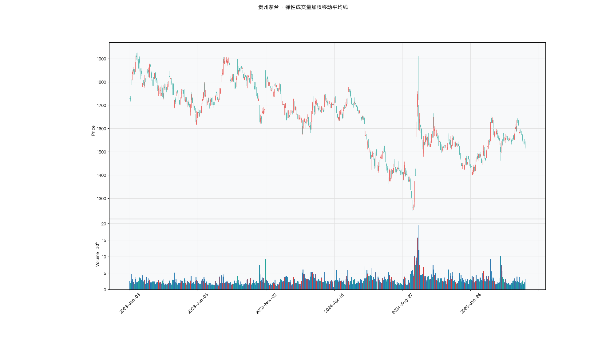

# 第039章 弹性成交量加权移动平均线（EVWMA）

同一段行情，一个交易者把二十日简单均线和一条按成交量加权的均线画在一起，两条线在放量那几天分得最开。他据此判断趋势已经转向，另一条线却给出相反的位置。他意识到差别不在参数，而在权重：等权均线把二十天前的成交和昨天的成交看成一样重。如果让成交密集的日子在均线里多占一份话语权，这条成本线会不会更贴近持仓者的真实处境。

## 名称与来历

弹性成交量加权移动平均线（Elastic Volume-Weighted Moving Average，EVWMA）。

它没有公认的单一提出者。把成交量引入移动平均权重的想法在二十世纪九十年代逐步成形，随后的开源量化库把它整理成固定的递推形式，EVWMA 才成为一个有明确公式的标准指标。在 R 的 TTR 包中，EVWMA 是一个独立函数，需要同时传入价格和成交量两个序列 [@ulrich2020]。中文资料中它也译作弹性量价均线，名称中的"弹性"指均线的有效窗口长度会随成交量伸缩。

EVWMA 要解决的问题是传统均线的一个盲点：所有移动平均线都只用价格，把成交量信息完全丢弃。现实中的经验是，放量突破比无量拉升可靠，缩量回调比放量杀跌安全。既然成交量代表市场参与度，那么均线的窗口长度就应该与参与度挂钩：量大时窗口收窄，紧跟价格；量小时窗口拉宽，保持平滑。EVWMA 就是这个想法的直接实现。

## 核心逻辑

考虑一个对比：缩量横盘和放量突破这两种行情，同一条 20 日均线的反应速度应该一样吗？

传统均线的答案是"一样"，因为窗口固定为 20 天，不区分这 20 天里成交是活跃还是清淡。这在量能稳定的市场里问题不大，但在量能剧烈变化时会产生偏差。放量突破的当天，价格跳空上行，20 日均线因为要等 20 天的数据更新，反应迟缓，等到均线确认时价格可能已经走远。缩量横盘时，价格在窄幅区间内微小波动，20 日均线却因为等权处理，把二十天前的旧价格也计入，反而显得迟钝。

EVWMA 的思路是让窗口长度由成交量决定。它设定一个成交量阈值，从当日开始向左累积成交量，直到累计值达到阈值为止，实际涵盖的天数就是有效窗口。交投活跃时，几天就能累积到阈值，窗口自动缩短，均线更快跟随价格；交投清淡时，需要十几二十天才能累积到阈值，窗口自动拉长，均线更平滑。

这个机制的效果可以这样理解：EVWMA 的每一点，都是"最近足够多的成交"所对应的加权平均价格。成交量大的日子，在窗口里占的权重大，对均线的影响也大。因此 EVWMA 更接近真实成交成本的概念。同样一条均线，在放量期它贴近最新成交，在缩量期它保持稳定，这种自适应让它在量价配合明显的品种上比普通均线更敏感地反映趋势变化。

把均线的权重想成股东投票：等权均线是一人一票，成交量加权则按持股数计票，放量的日子票多，说话更算数。这个类比能推出一个可检验的判断：若按成交量分配投票权真的带来新信息，EVWMA 与等权均线之差就应当对后续收益有解释力，并且在剔除普通均线偏离之后仍然存在；若残差归零，说明多出来的是计算，不是信息。

## 计算公式

EVWMA 的递推形式是理解它的关键。先定义成交量窗口之和与均线初值，再用递推式更新。

### 第一步：确定成交量窗口

$$W_t = \sum_{i=0}^{n-1} v_{t-i}$$

其中 $v_t$ 为第 t 日成交量，n 为周期参数。需要注意，这里的 n 与传统均线的 n 语义不同：它不是固定取 n 根 K 线，而是取最近 n 日的成交量之和作为权重基数。TTR 的 EVWMA 函数中，n 的默认取值为 20。

### 第二步：计算初值

$$EVWMA_n = \frac{\sum_{i=0}^{n-1} v_{n-i}\, p_{n-i}}{\sum_{i=0}^{n-1} v_{n-i}}$$

即前 n 日的成交量加权平均价格。这一步与普通的成交量加权均线相同，区别出现在后续的递推更新。

### 第三步：递推更新

$$EVWMA_t = \frac{v_t\, p_t + EVWMA_{t-1}\,(W_t - v_t)}{W_t}$$

递推式写成加权平均的形式更容易看出权重分配：

$$EVWMA_t = \underbrace{\frac{v_t}{W_t}}_{\text{当日权重}} \times p_t + \underbrace{\frac{W_t - v_t}{W_t}}_{\text{历史权重}} \times EVWMA_{t-1}$$

当日的权重是 $v_t / W_t$，即当日成交量占窗口成交量之和的比例。当日放量时，这个比例上升，新价格对均线的影响加大，均线向价格靠近得更快；当日缩量时，比例下降，均线基本保持原来的位置。这就是"弹性"的数学来源：权重不是固定的 1/n，而是随成交量浮动。

**计算示例。** 设 n = 3，前三日价格与成交量为：

| 交易日 | 价格 p | 成交量 v |
|--------|--------|---------|
| 1 | 10.0 | 100 |
| 2 | 11.0 | 200 |
| 3 | 12.0 | 100 |
| 4 | 13.0 | 400 |

初值取前三日的加权平均：

$$EVWMA_3 = \frac{10\times100 + 11\times200 + 12\times100}{400} = \frac{4400}{400} = 11.0$$

第四日放量，窗口之和 $W_4 = 200 + 100 + 400 = 700$，当日权重为 $400/700 \approx 0.571$。递推得

$$EVWMA_4 = \frac{400\times13 + 11.0\times(700 - 400)}{700} = \frac{5200 + 3300}{700} \approx 12.14$$

第四日成交放大到前两日的两到四倍，当日权重超过一半，均线从 11.0 快速上移到 12.14，明显向 13.0 靠近。如果第四日成交量只有 50，则当日权重仅约 0.14，均线几乎不动。权重的差异完全由成交量决定。

**参数含义。**

| n | 弹性窗口常态长度 | 灵敏度 | 适用品种 |
|---|----------------|--------|---------|
| 10 到 15 | 较短 | 高 | 高换手率的活跃个股 |
| 20 | 中等，约 15 到 25 根 K 线 | 中 | 蓝筹股、主流指数 |
| 30 到 50 | 较长 | 低 | 低换手率的银行股、债券 |

参数调整的原则是让常态下的弹性窗口覆盖 15 到 25 根 K 线。n 太小，成交量基数小的品种上阈值过低，窗口可能只有一两天，失去平滑意义；n 太大，成交量基数大的品种上窗口过长，失去灵敏度。

## 用法与信号

**拐头。** EVWMA 的拐头不仅需要价格变化，还需要累积成交量达到阈值，因此比普通均线的拐头带有量能验证。EVWMA 由下转上时，近期放量上涨使弹性窗口缩短，均线快速向上跟进，属于量价齐升的格局；由上转下时，近期放量下跌使窗口缩短，均线快速向下，属于量价齐跌。拐头信号适合作为趋势方向的切换提示。

**价格与均线的相对位置。** EVWMA 作为动态支撑或阻力时，天然带有成交量信息。放量突破 EVWMA，说明有资金进场推动，突破的可信度相对较高；缩量回踩 EVWMA 后止跌，说明抛压不大，支撑有效。放量跌破 EVWMA 说明资金加速离场；缩量反弹至 EVWMA 遇阻，说明买盘不足。同样的位置，成交量的大小给出不同强度的解读。

**与同周期均线的距离。** 把 EVWMA 与同周期的 EMA 或 SMA 并列观察。EVWMA 明显高于 EMA，说明近期成交量放大且价格在上涨，量能推动价格上行；明显低于 EMA，说明近期放量且价格在下跌，量能推动价格下行。两者接近时说明成交量在均值附近，EVWMA 退化为普通均线，此时它相对 EMA 没有额外信息。

**跳跃。** 当成交量出现极端变化，比如单日爆出数倍均量，EVWMA 的当日权重会瞬间接近 1，均线随之出现明显跳跃。向上跳跃说明单日超大量推动价格上行，是极强的短期信号，但需要警惕量能能否延续；向下跳跃同理。跳跃本身不是买卖建议，而是一个需要进一步核实量能持续性的提示。

## 边界与误区

**低量时段接近僵化。** 成交量极度萎缩时，弹性窗口会拉得很长，EVWMA 几乎不动，任何价格变化都难以触发拐头。节假日前后的缩量期是典型的例子。这段时间的 EVWMA 信号可以参考，但不宜作为主要依据，应结合其他量价指标共同判断。

**跨品种使用同一参数会失真。** 不同品种的日均成交量差异巨大，同样的 n 在活跃个股上可能是三天的窗口，在低换手品种上可能是四十天的窗口。跨品种使用时，应以换手率而非绝对成交量作为参考，让常态窗口长度落在合理的区间内。

**成交量季节性变化会系统性影响窗口。** A 股存在明显的成交量季节规律，比如春节前缩量、季末调仓放量。这些周期性的量能变化会系统性地改变 EVWMA 的弹性窗口长度，使指标的灵敏度随季节波动。在已知的缩量期，对 EVWMA 信号的要求应适当放宽。

**在无量涨跌停的极端行情中失效。** 涨停或跌停时成交量可能极度萎缩或极度放大，成交明细失真，EVWMA 的权重分配失去意义。这类极端行情下，EVWMA 应与 EMA 并列使用，两者信号矛盾时以更稳健的 EMA 为准。EVWMA 不能替代传统均线，只能作为补充。

## 它被检验过吗

EVWMA 没有针对它本身的独立同行评议检验。它属于均线族的一个变体，而均线族的证据只到规则族这一层：Brock、Lakonishok 与 LeBaron（1992）、Sullivan、Timmermann 与 White（1999）检验的是均线规则的集合，结论不区分具体变体，也无法归因到成交量加权这一改动上。

可引的关系层面证据是 Karpoff（1987）的综述，量价正相关且不对称，但它同样不是对 EVWMA 的绩效检验。完整证据链见第 007 章。

这一类的真实失效案例，见第 035 章的「真实案例与失败模式」。

## 代码实现

### R

```r
library(ettr)
library(efactorcraft)
library(efincharts)
library(ggplot2)

BASE <- "https://raw.githubusercontent.com/dengyishuo/quant-technical-analysis/main/data/parquet"

# 取数据：本地有就用本地，没有就下载一次并缓存。
# read.csv 对本地 .gz 会自动解压，所以缓存成 .csv.gz 也能直接读。
load_data <- function(name) {
  local <- file.path("data", "parquet", name)
  if (file.exists(local)) return(local)
  cache <- file.path(tools::R_user_dir("qta", "cache"), name)
  if (!file.exists(cache)) {
    dir.create(dirname(cache), recursive = TRUE, showWarnings = FALSE)
    message("下载 ", name, " ...")
    download.file(paste0(BASE, "/", name), cache, mode = "wb", quiet = TRUE)
  }
  cache
}

read_data <- function(name) {
  d <- read.csv(load_data(name), stringsAsFactors = FALSE)
  if ("date" %in% names(d)) d$date <- as.Date(d$date)
  d
}

# 同一章里多次取用，缓存到内存，避免重复解析
.cache <- new.env(parent = emptyenv())
.blue <- function() {
  if (!exists("b", .cache)) assign("b", read_data("panel_blue_chip.csv"), .cache)
  get("b", .cache)
}
.panel <- function() {
  if (!exists("p", .cache)) {
    p <- read_data("panel_r.csv.gz")
    assign("p", p[p$date >= "2023-01-01" & p$date <= "2025-06-01", ], .cache)
  }
  get("p", .cache)
}
.index <- function() read_data("index_daily.csv")

blue  <- .blue()
panel <- .panel()

# 图的保存路径，顺手建目录，避免读者本地没有 assets/ 时报错
fig_path <- function(ch, name = "indicator_r.png") {
  d <- file.path("assets", "figures", sprintf("ch%03d", ch))
  dir.create(d, recursive = TRUE, showWarnings = FALSE)
  file.path(d, name)
}

# efincharts 要求 xts 且列名带 Adjusted
as_xts <- function(df) {
  x <- xts::xts(df[, c("open", "high", "low", "close", "volume", "adjusted")],
                order.by = df$date)
  colnames(x) <- c("Open", "High", "Low", "Close", "Volume", "Adjusted")
  x
}

maotai <- .blue()[.blue()$code == "600519.SS", ]

# 1. ettr 在长格式面板上追加指标列
maotai <- add_evwma(maotai, n = 10)

# 2. 基本统计
cols <- setdiff(names(maotai), names(blue))
print(summary(maotai[, cols]))

# 3. K 线 + 成交量 + 均线
ch <- ecandlesticks(as_xts(maotai), show_ma = TRUE, ma_periods = c(20, 60),
                    title = "贵州茅台 · 弹性成交量加权移动平均线")
ggsave(fig_path(39), ch$combined_plot, width = 10, height = 6, dpi = 110)
```

### Python

```python
import pathlib
import urllib.request

import pandas as pd
import ettr
import efactorcraft as efc
import efincharts as efc_

# 中文字体：mplfinance 会用 style 里的 rc 覆盖全局设置，必须写进 style
from efincharts import theme
theme.efin_style["rc"] = {
    "font.sans-serif": ["PingFang SC", "Heiti SC", "SimHei"],
    "axes.unicode_minus": False,
    "font.family": "sans-serif",
}

# A 股习惯是涨红跌绿，efincharts 的默认配色沿用了欧美习惯（涨绿跌红），
# 这里改回来，也让静态图与网页上的交互图、R 侧的图保持一致。
_mc = theme.efin_style["marketcolors"]
for _k in ("candle", "edge", "wick", "volume"):
    _mc[_k] = {"up": "#e53935", "down": "#26a69a"}

BASE = "https://raw.githubusercontent.com/dengyishuo/quant-technical-analysis/main/data/parquet"
CACHE = pathlib.Path.home() / ".cache" / "qta"
_MEM = {}


def load(name):
    """取数据：本地有就用本地，没有就下载一次并缓存。

    这样三种情形都能跑：
      1. 克隆了整个仓库    -> 直接读 data/parquet/，不联网
      2. 只复制了代码片段  -> 首次自动下载到 ~/.cache/qta，之后走缓存
      3. 之前跑过          -> 全部命中缓存，断网也能用
    """
    if name in _MEM:
        return _MEM[name]
    local = pathlib.Path("data/parquet") / name
    if local.exists():
        path = local
    else:
        CACHE.mkdir(parents=True, exist_ok=True)
        path = CACHE / name
        if not path.exists():
            print("下载 %s ..." % name)
            urllib.request.urlretrieve(BASE + "/" + name, path)
    data = pd.read_parquet(path) if name.endswith(".parquet") else pd.read_csv(path)
    _MEM[name] = data
    return data


blue = load("panel_blue_chip.parquet")
panel = load("panel.parquet")
panel = panel[(panel["date"] >= "2023-01-01") & (panel["date"] <= "2025-06-01")]
idx = load("index_daily.parquet")


def one(df, code="600519.SS"):
    """取单只标的，转成 efincharts 需要的宽表。"""
    x = df[df["code"] == code].sort_values("date").set_index("date")
    x.columns = [c.capitalize() for c in x.columns]
    return x


def fig_path(ch, name="indicator.png"):
    """图的保存路径，顺手建目录，避免读者本地没有 assets/ 时报错。"""
    d = pathlib.Path("assets") / "figures" / ("ch%03d" % ch)
    d.mkdir(parents=True, exist_ok=True)
    return str(d / name)

# 1. 取单只标的
maotai = blue[blue['code'] == '600519.SS'].copy()

# 2. ettr 在长格式面板上追加指标列，不需要手工 rolling
maotai = ettr.evwma(maotai, n=10)

cols = [c for c in maotai.columns if c not in blue.columns]
print(maotai[cols].describe().round(3))

# 3. 画图：K 线 + 成交量 + 指标面板
px = one(maotai)
ch = efc_.candlestick(px, volume=True, title="贵州茅台 · 弹性成交量加权移动平均线")
ch.save(fig_path(39))
```

<!-- fig-indicator:start -->


<p class="figcap">图 39-1　弹性成交量加权移动平均线在贵州茅台上的读数（2023-01 至 2025-06）</p>
<!-- fig-indicator:end -->

## 拆解

EVWMA 与价格同量纲，直接排序排的是股价。偏离度虽无量纲，信息却与同周期均线偏离度重叠，区别只在权重。拆解的重点因此不在偏离度，而在普通均线没有的那层信息：成交量在时间上的分布。

| 特征名 | 计算式 | 量纲 | 经济含义 |
|--------|--------|------|----------|
| 价格偏离度 | $(p_t-EVWMA_t)/EVWMA_t$ | 无量纲比例 | 价格相对量价加权成本的位置 |
| EVWMA 斜率 | $(EVWMA_t-EVWMA_{t-k})/EVWMA_{t-k}$ | 无量纲比例 | 加权成本的变化方向与速度 |
| 成交集中度 | $EVWMA_t/SMA_t^{(n)}-1$ | 无量纲比例 | 近期成交相对早期成交的价格位移，是本章的独有特征 |
| 当日权重 | $v_t/W_t$ | 0 到 1 | 当日成交量占窗口成交量的比例，弹性强弱的直接读数 |

成交集中度是本指标相对普通均线的增量所在。EVWMA 的权重按成交量分配，SMA 的权重按天数平均分配。若近期的成交明显大于早期，EVWMA 会更贴近近期价格；若价格在近期上行，EVWMA 就会高于 SMA，读数为正。因此这个差值的符号由价格方向决定，绝对值才反映成交集中的程度。

带符号的集中度把"集中"与"方向"揉在一起，正值可能是放量推升，也可能是缩量下跌后的反弹；绝对值剥掉方向，只留集中程度。两种版本对应两个问题：前者问"资金是不是在推着价格走"，后者问"最近的成交是不是异常集中"，检验时应分开处理。

集中度还有一个测量上的困难。EVWMA 的参数 $n$ 是成交量窗口，不是天数窗口，有效长度等于 $W_t/\bar v_t$，随换手率浮动。高换手标的的 20 日成交量之和可能三天就攒够，有效窗口只有三五天；低换手标的要一个多月。用固定 20 日的 SMA 对照，差值里混进了窗口长度差异。严格的做法是先估计有效窗口，再用同等长度的 SMA 对照；实务上常简化为固定 $n$，把换手率作为控制变量。成交量口径也要一致，权重完全由成交量决定，口径不同会直接改变有效窗口的长度。

### R

```r
library(ettr)
library(efactorcraft)
library(efincharts)
library(ggplot2)

BASE <- "https://raw.githubusercontent.com/dengyishuo/quant-technical-analysis/main/data/parquet"

# 取数据：本地有就用本地，没有就下载一次并缓存。
# read.csv 对本地 .gz 会自动解压，所以缓存成 .csv.gz 也能直接读。
load_data <- function(name) {
  local <- file.path("data", "parquet", name)
  if (file.exists(local)) return(local)
  cache <- file.path(tools::R_user_dir("qta", "cache"), name)
  if (!file.exists(cache)) {
    dir.create(dirname(cache), recursive = TRUE, showWarnings = FALSE)
    message("下载 ", name, " ...")
    download.file(paste0(BASE, "/", name), cache, mode = "wb", quiet = TRUE)
  }
  cache
}

read_data <- function(name) {
  d <- read.csv(load_data(name), stringsAsFactors = FALSE)
  if ("date" %in% names(d)) d$date <- as.Date(d$date)
  d
}

# 同一章里多次取用，缓存到内存，避免重复解析
.cache <- new.env(parent = emptyenv())
.blue <- function() {
  if (!exists("b", .cache)) assign("b", read_data("panel_blue_chip.csv"), .cache)
  get("b", .cache)
}
.panel <- function() {
  if (!exists("p", .cache)) {
    p <- read_data("panel_r.csv.gz")
    assign("p", p[p$date >= "2023-01-01" & p$date <= "2025-06-01", ], .cache)
  }
  get("p", .cache)
}
.index <- function() read_data("index_daily.csv")

blue  <- .blue()
panel <- .panel()

# 图的保存路径，顺手建目录，避免读者本地没有 assets/ 时报错
fig_path <- function(ch, name = "indicator_r.png") {
  d <- file.path("assets", "figures", sprintf("ch%03d", ch))
  dir.create(d, recursive = TRUE, showWarnings = FALSE)
  file.path(d, name)
}

# efincharts 要求 xts 且列名带 Adjusted
as_xts <- function(df) {
  x <- xts::xts(df[, c("open", "high", "low", "close", "volume", "adjusted")],
                order.by = df$date)
  colnames(x) <- c("Open", "High", "Low", "Close", "Volume", "Adjusted")
  x
}

d <- .blue()[.blue()$code == "600519.SS", ]
d <- add_evwma(d, n = 10)

# 转成无量纲因子
d$f <- d$`EVWMA` / d$close - 1

print(summary(d$f))
```

### Python

```python
import pathlib
import urllib.request

import pandas as pd
import ettr
import efactorcraft as efc
import efincharts as efc_

# 中文字体：mplfinance 会用 style 里的 rc 覆盖全局设置，必须写进 style
from efincharts import theme
theme.efin_style["rc"] = {
    "font.sans-serif": ["PingFang SC", "Heiti SC", "SimHei"],
    "axes.unicode_minus": False,
    "font.family": "sans-serif",
}

# A 股习惯是涨红跌绿，efincharts 的默认配色沿用了欧美习惯（涨绿跌红），
# 这里改回来，也让静态图与网页上的交互图、R 侧的图保持一致。
_mc = theme.efin_style["marketcolors"]
for _k in ("candle", "edge", "wick", "volume"):
    _mc[_k] = {"up": "#e53935", "down": "#26a69a"}

BASE = "https://raw.githubusercontent.com/dengyishuo/quant-technical-analysis/main/data/parquet"
CACHE = pathlib.Path.home() / ".cache" / "qta"
_MEM = {}


def load(name):
    """取数据：本地有就用本地，没有就下载一次并缓存。

    这样三种情形都能跑：
      1. 克隆了整个仓库    -> 直接读 data/parquet/，不联网
      2. 只复制了代码片段  -> 首次自动下载到 ~/.cache/qta，之后走缓存
      3. 之前跑过          -> 全部命中缓存，断网也能用
    """
    if name in _MEM:
        return _MEM[name]
    local = pathlib.Path("data/parquet") / name
    if local.exists():
        path = local
    else:
        CACHE.mkdir(parents=True, exist_ok=True)
        path = CACHE / name
        if not path.exists():
            print("下载 %s ..." % name)
            urllib.request.urlretrieve(BASE + "/" + name, path)
    data = pd.read_parquet(path) if name.endswith(".parquet") else pd.read_csv(path)
    _MEM[name] = data
    return data


blue = load("panel_blue_chip.parquet")
panel = load("panel.parquet")
panel = panel[(panel["date"] >= "2023-01-01") & (panel["date"] <= "2025-06-01")]
idx = load("index_daily.parquet")


def one(df, code="600519.SS"):
    """取单只标的，转成 efincharts 需要的宽表。"""
    x = df[df["code"] == code].sort_values("date").set_index("date")
    x.columns = [c.capitalize() for c in x.columns]
    return x


def fig_path(ch, name="indicator.png"):
    """图的保存路径，顺手建目录，避免读者本地没有 assets/ 时报错。"""
    d = pathlib.Path("assets") / "figures" / ("ch%03d" % ch)
    d.mkdir(parents=True, exist_ok=True)
    return str(d / name)

# 1. 先在面板上算原始指标
d = panel.copy()
d = ettr.evwma(d, n=10)

# 2. 转成无量纲因子，才能跨标的排序
d["f"] = d["EVWMA_10"] / d.close - 1

print(d["f"].describe().round(4))
```

四个特征的信息量递减：偏离度与斜率是均线的常规派生量，集中度与当日权重才带着成交量的痕迹。

## 截面选股能力

EVWMA 的横截面因子有两个候选。第一个是集中度：

$$f^{conc}_t=\frac{EVWMA_t^{(n)}}{SMA_t^{(n)}}-1$$

第二个是偏离度：

$$f^{dev}_t=\frac{p_t-EVWMA_t^{(n)}}{EVWMA_t^{(n)}}$$

前者是本章要检验的主角，后者作为对照。两者的经济含义不同：集中度为正说明近期的成交价格高于窗口早期的成交价格，资金在更高的位置换手；偏离度为正说明现价高于加权平均成本，持仓者整体浮盈。前者描述成交的分布，后者描述盈亏的位置。

预期表现上，集中度属于量价配合型，方向通常偏正但依赖价格趋势。集中度为正且价格上行，说明放量推升；集中度为正而价格下行，说明下跌过程中在低位换手，可能是恐慌抛售，也可能是承接，两种情形在读数上区分不开。这种模糊性意味着集中度单独使用时 IC 不会很稳定，与价格方向组合之后才有较清晰的解释。

偏离度的价值在于它的"基准"作用。若集中度的表现与它接近，说明 EVWMA 没有提供超出普通均线的信息，多付出的成交量数据与递推计算没有回报。若集中度在剔除偏离度之后仍有解释力，说明成交分布这一层确实被定价。判断方法是对偏离度做横截面回归，取残差再算一次 IC。

检验时有三点值得注意。

第一，$n$ 与换手率的匹配在拆解里已经说明，检验上有两个处理：按换手率调整 $n$，或者对集中度取自身的时间序列分位。

第二，初值的影响不能忽略。递推从第 $n$ 日开始，初值是前 $n$ 日的成交量加权均价，之后每步都依赖前一步。序列开头几十个点尚未稳定，计算因子时应丢掉暖机段，长度取 $n$ 的三到五倍。

第三，与偏离度的共线性要做显式检查。两者的横截面相关通常不低，直接放进同一个模型会产生多重共线性，系数不稳。稳健的做法是先算两者的秩相关，再决定是取残差还是只保留一个。

### R

```r
library(ettr)
library(efactorcraft)
library(efincharts)
library(ggplot2)

BASE <- "https://raw.githubusercontent.com/dengyishuo/quant-technical-analysis/main/data/parquet"

# 取数据：本地有就用本地，没有就下载一次并缓存。
# read.csv 对本地 .gz 会自动解压，所以缓存成 .csv.gz 也能直接读。
load_data <- function(name) {
  local <- file.path("data", "parquet", name)
  if (file.exists(local)) return(local)
  cache <- file.path(tools::R_user_dir("qta", "cache"), name)
  if (!file.exists(cache)) {
    dir.create(dirname(cache), recursive = TRUE, showWarnings = FALSE)
    message("下载 ", name, " ...")
    download.file(paste0(BASE, "/", name), cache, mode = "wb", quiet = TRUE)
  }
  cache
}

read_data <- function(name) {
  d <- read.csv(load_data(name), stringsAsFactors = FALSE)
  if ("date" %in% names(d)) d$date <- as.Date(d$date)
  d
}

# 同一章里多次取用，缓存到内存，避免重复解析
.cache <- new.env(parent = emptyenv())
.blue <- function() {
  if (!exists("b", .cache)) assign("b", read_data("panel_blue_chip.csv"), .cache)
  get("b", .cache)
}
.panel <- function() {
  if (!exists("p", .cache)) {
    p <- read_data("panel_r.csv.gz")
    assign("p", p[p$date >= "2023-01-01" & p$date <= "2025-06-01", ], .cache)
  }
  get("p", .cache)
}
.index <- function() read_data("index_daily.csv")

blue  <- .blue()
panel <- .panel()

# 图的保存路径，顺手建目录，避免读者本地没有 assets/ 时报错
fig_path <- function(ch, name = "indicator_r.png") {
  d <- file.path("assets", "figures", sprintf("ch%03d", ch))
  dir.create(d, recursive = TRUE, showWarnings = FALSE)
  file.path(d, name)
}

# efincharts 要求 xts 且列名带 Adjusted
as_xts <- function(df) {
  x <- xts::xts(df[, c("open", "high", "low", "close", "volume", "adjusted")],
                order.by = df$date)
  colnames(x) <- c("Open", "High", "Low", "Close", "Volume", "Adjusted")
  x
}

d <- .panel()
d <- add_evwma(d, n = 10)

d$f <- d$`EVWMA` / d$close - 1
d <- add_next_return(d, close_col = "close", n = c(1, 5, 20))

ic <- ic_analysis(d, factor_cols = "f",
                    forward_cols = c("forward_1", "forward_5", "forward_20"),
                    method = "spearman")
print(ir_analysis(ic))

q <- quantile_analysis(d, factor_cols = "f", forward_cols = "forward_5",
                       n_groups = 5)
print(q$f$summary)
```

### Python

```python
import pathlib
import urllib.request

import pandas as pd
import ettr
import efactorcraft as efc
import efincharts as efc_

# 中文字体：mplfinance 会用 style 里的 rc 覆盖全局设置，必须写进 style
from efincharts import theme
theme.efin_style["rc"] = {
    "font.sans-serif": ["PingFang SC", "Heiti SC", "SimHei"],
    "axes.unicode_minus": False,
    "font.family": "sans-serif",
}

# A 股习惯是涨红跌绿，efincharts 的默认配色沿用了欧美习惯（涨绿跌红），
# 这里改回来，也让静态图与网页上的交互图、R 侧的图保持一致。
_mc = theme.efin_style["marketcolors"]
for _k in ("candle", "edge", "wick", "volume"):
    _mc[_k] = {"up": "#e53935", "down": "#26a69a"}

BASE = "https://raw.githubusercontent.com/dengyishuo/quant-technical-analysis/main/data/parquet"
CACHE = pathlib.Path.home() / ".cache" / "qta"
_MEM = {}


def load(name):
    """取数据：本地有就用本地，没有就下载一次并缓存。

    这样三种情形都能跑：
      1. 克隆了整个仓库    -> 直接读 data/parquet/，不联网
      2. 只复制了代码片段  -> 首次自动下载到 ~/.cache/qta，之后走缓存
      3. 之前跑过          -> 全部命中缓存，断网也能用
    """
    if name in _MEM:
        return _MEM[name]
    local = pathlib.Path("data/parquet") / name
    if local.exists():
        path = local
    else:
        CACHE.mkdir(parents=True, exist_ok=True)
        path = CACHE / name
        if not path.exists():
            print("下载 %s ..." % name)
            urllib.request.urlretrieve(BASE + "/" + name, path)
    data = pd.read_parquet(path) if name.endswith(".parquet") else pd.read_csv(path)
    _MEM[name] = data
    return data


blue = load("panel_blue_chip.parquet")
panel = load("panel.parquet")
panel = panel[(panel["date"] >= "2023-01-01") & (panel["date"] <= "2025-06-01")]
idx = load("index_daily.parquet")


def one(df, code="600519.SS"):
    """取单只标的，转成 efincharts 需要的宽表。"""
    x = df[df["code"] == code].sort_values("date").set_index("date")
    x.columns = [c.capitalize() for c in x.columns]
    return x


def fig_path(ch, name="indicator.png"):
    """图的保存路径，顺手建目录，避免读者本地没有 assets/ 时报错。"""
    d = pathlib.Path("assets") / "figures" / ("ch%03d" % ch)
    d.mkdir(parents=True, exist_ok=True)
    return str(d / name)

# 287 只、2023-01 至 2025-06，横截面才有统计意义
src = panel.copy()
d = src.copy()

# 1. 算指标
d = ettr.evwma(d, n=10)


# 2. 因子 + 未来收益
d["f"] = d["EVWMA_10"] / d.close - 1
d = efc.add_next_return(d, periods=(1, 5, 20))

# 3. 截面 IC 与分层
ic = efc.ic_analysis(d, factor_cols="f",
                      forward_cols=["forward_1", "forward_5", "forward_20"],
                      method="spearman")
print(efc.ir_analysis(ic).round(3))

q = efc.quantile_analysis(d, factor_col="f", forward_col="forward_5", n_groups=5)
print(q["summary"].round(4))
```

几行结果有明确的阅读顺序。先看集中度与偏离度谁更强，两者接近说明增量有限；再看残差，残差的 IC 接近零，说明集中度的信息已被偏离度包含，EVWMA 相对 SMA 的优势没有落到预测上；最后看绝对值版本，它与带符号版本的方向可能不同。

<!-- tab-ic:start -->
**计算结果**

| 前向期 | IC 均值 | IC 标准差 | ICIR | t 值 | IC>0 占比 | 期数 |
|---|---|---|---|---|---|---|
| T+1 | 0.0170 | 0.2398 | 0.071 | 1.69 | 0.5250 | 570 |
| T+5 | 0.0175 | 0.2201 | 0.079 | 1.89 | 0.5190 | 566 |
| T+20 | 0.0351 | 0.2068 | 0.170 | 3.98 | 0.5640 | 551 |

表里最该看的是 t 值，不是 IC 均值。这个因子以 T+1 为主口径，IC 均值 0.0170、ICIR 0.071、t 值 1.69，在常规门槛下不显著，方向为正向。按第 007 章给出的日频门槛（ICIR 0.13 对应 t≈2），这个结果的含义是：还看不出与噪声的区别，不能据此构造策略。

需要提醒的是，这只说明排序与未来收益之间存在可测的关联，不代表扣掉成本后还能剩下收益。横截面 IC 检验的是“买哪只”，不负责“值不值得交易”。

**五档分层**

| 分组 | 平均收益 | 标准差 | 期数 |
|---|---|---|---|
| 1 | +0.0042 | +0.0387 | 566 |
| 2 | +0.0030 | +0.0295 | 566 |
| 3 | +0.0021 | +0.0292 | 566 |
| 4 | +0.0029 | +0.0339 | 566 |
| 5 | +0.0048 | +0.0429 | 566 |

五档分层看的是形状，不是单点。最高一档在第 5 组、最低在第 3 组，两端相差 +0.06%，组序号与平均收益的秩相关为 0.15，没有明显单调性。

分层比 IC 更接近实盘，因为它直接给出“买最高档、卖最低档”的收益差。但这里的数字是毛收益，且没有考虑涨跌停买不进、停牌卖不出的情形，真实可得的差额会小于表中所列。
<!-- tab-ic:end -->

## 择时能力

时序上 EVWMA 的择时逻辑分三层。第一层是价格与 EVWMA 的相对位置，站上加权成本视为偏多。第二层是 EVWMA 与同周期 EMA 的交叉，上穿说明近期成交的推动力强于时间加权的结果。第三层是集中度的极值，读数突然放大说明成交在短期内高度集中，往往对应突破或恐慌。

方法与信号形态要匹配。位置是状态量，适合条件分位收益与阈值回测。交叉是事件，一年十几次，适合触发日检验。集中度是连续量，适合分位检验，重点看两端，因极值对应异常换手，中间区间没有特别含义。

EVWMA 在时序上的优势比在截面上明显。均线信息本身就是时序概念，量的加权只是调整了反应速度。对单只标的而言，EVWMA 相对 EMA 的差异含义清楚：差异大说明近期成交集中，差异小说明成交均匀。这个含义在截面上会被标的之间的换手率差异淹没。

陷阱有两处。第一，低量时段的僵化。成交量萎缩时有效窗口拉长，EVWMA 几乎不动，价格上下穿越都不会触发信号，这段时间的检验结果实际上是"没有信号"，不能算作"信号失败"。第二，初值与暖机段。递推起点不同，前几十个点的路径会不同，若把这段纳入检验，结果依赖于数据起点。

### R

```r
library(ettr)
library(efactorcraft)
library(efincharts)
library(ggplot2)

BASE <- "https://raw.githubusercontent.com/dengyishuo/quant-technical-analysis/main/data/parquet"

# 取数据：本地有就用本地，没有就下载一次并缓存。
# read.csv 对本地 .gz 会自动解压，所以缓存成 .csv.gz 也能直接读。
load_data <- function(name) {
  local <- file.path("data", "parquet", name)
  if (file.exists(local)) return(local)
  cache <- file.path(tools::R_user_dir("qta", "cache"), name)
  if (!file.exists(cache)) {
    dir.create(dirname(cache), recursive = TRUE, showWarnings = FALSE)
    message("下载 ", name, " ...")
    download.file(paste0(BASE, "/", name), cache, mode = "wb", quiet = TRUE)
  }
  cache
}

read_data <- function(name) {
  d <- read.csv(load_data(name), stringsAsFactors = FALSE)
  if ("date" %in% names(d)) d$date <- as.Date(d$date)
  d
}

# 同一章里多次取用，缓存到内存，避免重复解析
.cache <- new.env(parent = emptyenv())
.blue <- function() {
  if (!exists("b", .cache)) assign("b", read_data("panel_blue_chip.csv"), .cache)
  get("b", .cache)
}
.panel <- function() {
  if (!exists("p", .cache)) {
    p <- read_data("panel_r.csv.gz")
    assign("p", p[p$date >= "2023-01-01" & p$date <= "2025-06-01", ], .cache)
  }
  get("p", .cache)
}
.index <- function() read_data("index_daily.csv")

blue  <- .blue()
panel <- .panel()

# 图的保存路径，顺手建目录，避免读者本地没有 assets/ 时报错
fig_path <- function(ch, name = "indicator_r.png") {
  d <- file.path("assets", "figures", sprintf("ch%03d", ch))
  dir.create(d, recursive = TRUE, showWarnings = FALSE)
  file.path(d, name)
}

# efincharts 要求 xts 且列名带 Adjusted
as_xts <- function(df) {
  x <- xts::xts(df[, c("open", "high", "low", "close", "volume", "adjusted")],
                order.by = df$date)
  colnames(x) <- c("Open", "High", "Low", "Close", "Volume", "Adjusted")
  x
}

t <- .index()
t <- t[t$code == "510300.SS", ]
t <- add_evwma(t, n = 10)
t$f <- t$`EVWMA` / t$close - 1
t$forward_5 <- c(tail(t$close, -5) / head(t$close, -5) - 1, rep(NA, 5))
t$q <- cut(t$f, quantile(t$f, 0:5/5, na.rm = TRUE), include.lowest = TRUE, labels = FALSE)
print(aggregate(forward_5 ~ q, data = t, FUN = function(x)
  c(mean = mean(x, na.rm = TRUE), n = sum(!is.na(x)))))
```

### Python

```python
import pathlib
import urllib.request

import pandas as pd
import ettr
import efactorcraft as efc
import efincharts as efc_

# 中文字体：mplfinance 会用 style 里的 rc 覆盖全局设置，必须写进 style
from efincharts import theme
theme.efin_style["rc"] = {
    "font.sans-serif": ["PingFang SC", "Heiti SC", "SimHei"],
    "axes.unicode_minus": False,
    "font.family": "sans-serif",
}

# A 股习惯是涨红跌绿，efincharts 的默认配色沿用了欧美习惯（涨绿跌红），
# 这里改回来，也让静态图与网页上的交互图、R 侧的图保持一致。
_mc = theme.efin_style["marketcolors"]
for _k in ("candle", "edge", "wick", "volume"):
    _mc[_k] = {"up": "#e53935", "down": "#26a69a"}

BASE = "https://raw.githubusercontent.com/dengyishuo/quant-technical-analysis/main/data/parquet"
CACHE = pathlib.Path.home() / ".cache" / "qta"
_MEM = {}


def load(name):
    """取数据：本地有就用本地，没有就下载一次并缓存。

    这样三种情形都能跑：
      1. 克隆了整个仓库    -> 直接读 data/parquet/，不联网
      2. 只复制了代码片段  -> 首次自动下载到 ~/.cache/qta，之后走缓存
      3. 之前跑过          -> 全部命中缓存，断网也能用
    """
    if name in _MEM:
        return _MEM[name]
    local = pathlib.Path("data/parquet") / name
    if local.exists():
        path = local
    else:
        CACHE.mkdir(parents=True, exist_ok=True)
        path = CACHE / name
        if not path.exists():
            print("下载 %s ..." % name)
            urllib.request.urlretrieve(BASE + "/" + name, path)
    data = pd.read_parquet(path) if name.endswith(".parquet") else pd.read_csv(path)
    _MEM[name] = data
    return data


blue = load("panel_blue_chip.parquet")
panel = load("panel.parquet")
panel = panel[(panel["date"] >= "2023-01-01") & (panel["date"] <= "2025-06-01")]
idx = load("index_daily.parquet")


def one(df, code="600519.SS"):
    """取单只标的，转成 efincharts 需要的宽表。"""
    x = df[df["code"] == code].sort_values("date").set_index("date")
    x.columns = [c.capitalize() for c in x.columns]
    return x


def fig_path(ch, name="indicator.png"):
    """图的保存路径，顺手建目录，避免读者本地没有 assets/ 时报错。"""
    d = pathlib.Path("assets") / "figures" / ("ch%03d" % ch)
    d.mkdir(parents=True, exist_ok=True)
    return str(d / name)

# 择时检验用 ETF 做市场载体，指数本身没有日线数据
t = idx[idx["code"] == "510300.SS"].sort_values("date").copy()

# 1. 在 ETF 上算同一个指标
t = ettr.evwma(d, n=10)


# 2. 按因子分位看未来 5 日收益
t["f"] = t["EVWMA_10"] / t.close - 1
t["forward_5"] = t["close"].shift(-5) / t["close"] - 1
# 因子可能有重复值，先按名次切，避免 qcut 报边界不唯一
t["q"] = pd.qcut(t["f"].rank(method="first"), 5, labels=False) + 1
t = t.dropna(subset=["f", "forward_5"])
print(t.groupby("q")["forward_5"].agg(["mean", "count"]).round(4))
```

最后一行最值得看。集中度处于高位的那批交易日，若后续收益明显不同于其余日子，说明成交集中本身带有预测信息；若两者接近，说明它只是对已发生行情的描述。前者支持把集中度做成因子，后者只支持做成状态标签。

<!-- tab-timing:start -->
**分位收益**

| 分位 | 未来 5 日均值 | 样本数 |
|---|---|---|
| 1 | +0.0016 | 221 |
| 2 | -0.0028 | 220 |
| 3 | +0.0004 | 220 |
| 4 | -0.0008 | 220 |
| 5 | +0.0016 | 220 |

择时口径与截面不同：这里只有一个标的，看的是同一标的在不同分位下的未来收益。最高与最低分位相差 +0.00%。单标的样本有限，这个差额很容易被一两段行情主导，只能作为方向参考。

真正做择时要问的是三件事：分位阈值是否稳定、换手是否可控、扣成本后是否还有剩余。三者缺一，择时信号就只是图上好看。
<!-- tab-timing:end -->

## 组合使用与验证

EVWMA 的搭档有三个。与价格动量搭配最自然：动量给方向，集中度给成交分布，两者相乘或分组，回答"放量推升是否比缩量推升更持久"。与 EMA 偏离度搭配属于同族对照，用于确认增量是否来自成交量权重。与换手率搭配用于控制规模，因为集中度的分布尺度本身就被换手率影响。

**组合的截面验证。** 加权型做法是把集中度与二十日动量各自标准化后等权相加，再走一遍截面检验。两者相关通常不高，一个是成交分布，一个是价格位移。组合的 ICIR 若能高于两者，说明量价两个维度互补；若落在中间，说明集中度的信息与动量重叠。条件型做法是只取"集中度为正且动量为正"的样本，比较触发样本内的收益。

**组合的择时验证。** 把"EVWMA 高于同周期 EMA 且价格高于 EVWMA"设为持仓条件，与单条件、买入持有对照。两个条件分别确认成交集中与价格站上加权成本，同时成立时仓位的含义最清楚。这类双重条件会把持仓比例压得较低，比较时应报告持仓天数占比。

增益的判读依据方法论章的标准：**组合的 ICIR 高于两个单特征，才说明存在互补性；介于两者之间，说明只是平均；低于两者，说明信号在某些时段互相抵消。** EVWMA 的增量本来就该体现在集中度上，若组合的改善主要来自动量那一侧，说明集中度没有贡献，evwma 的成交量权重可以省略。

### R

```r
library(ettr)
library(efactorcraft)
library(efincharts)
library(ggplot2)

BASE <- "https://raw.githubusercontent.com/dengyishuo/quant-technical-analysis/main/data/parquet"

# 取数据：本地有就用本地，没有就下载一次并缓存。
# read.csv 对本地 .gz 会自动解压，所以缓存成 .csv.gz 也能直接读。
load_data <- function(name) {
  local <- file.path("data", "parquet", name)
  if (file.exists(local)) return(local)
  cache <- file.path(tools::R_user_dir("qta", "cache"), name)
  if (!file.exists(cache)) {
    dir.create(dirname(cache), recursive = TRUE, showWarnings = FALSE)
    message("下载 ", name, " ...")
    download.file(paste0(BASE, "/", name), cache, mode = "wb", quiet = TRUE)
  }
  cache
}

read_data <- function(name) {
  d <- read.csv(load_data(name), stringsAsFactors = FALSE)
  if ("date" %in% names(d)) d$date <- as.Date(d$date)
  d
}

# 同一章里多次取用，缓存到内存，避免重复解析
.cache <- new.env(parent = emptyenv())
.blue <- function() {
  if (!exists("b", .cache)) assign("b", read_data("panel_blue_chip.csv"), .cache)
  get("b", .cache)
}
.panel <- function() {
  if (!exists("p", .cache)) {
    p <- read_data("panel_r.csv.gz")
    assign("p", p[p$date >= "2023-01-01" & p$date <= "2025-06-01", ], .cache)
  }
  get("p", .cache)
}
.index <- function() read_data("index_daily.csv")

blue  <- .blue()
panel <- .panel()

# 图的保存路径，顺手建目录，避免读者本地没有 assets/ 时报错
fig_path <- function(ch, name = "indicator_r.png") {
  d <- file.path("assets", "figures", sprintf("ch%03d", ch))
  dir.create(d, recursive = TRUE, showWarnings = FALSE)
  file.path(d, name)
}

# efincharts 要求 xts 且列名带 Adjusted
as_xts <- function(df) {
  x <- xts::xts(df[, c("open", "high", "low", "close", "volume", "adjusted")],
                order.by = df$date)
  colnames(x) <- c("Open", "High", "Low", "Close", "Volume", "Adjusted")
  x
}

d <- .panel()
d <- add_evwma(d, n = 10)
d$f1 <- d$`EVWMA` / d$close - 1
d <- add_cmf(d, n = 20)
d$f2 <- d$CMF
d <- add_next_return(d, close_col = "close", n = 5)
ic1 <- ic_analysis(d, factor_cols = c("f1", "f2"),
                    forward_cols = "forward_5", method = "spearman")
print(ir_analysis(ic1))
```

```r
library(ettr)
library(efactorcraft)
library(efincharts)
library(ggplot2)

BASE <- "https://raw.githubusercontent.com/dengyishuo/quant-technical-analysis/main/data/parquet"

# 取数据：本地有就用本地，没有就下载一次并缓存。
# read.csv 对本地 .gz 会自动解压，所以缓存成 .csv.gz 也能直接读。
load_data <- function(name) {
  local <- file.path("data", "parquet", name)
  if (file.exists(local)) return(local)
  cache <- file.path(tools::R_user_dir("qta", "cache"), name)
  if (!file.exists(cache)) {
    dir.create(dirname(cache), recursive = TRUE, showWarnings = FALSE)
    message("下载 ", name, " ...")
    download.file(paste0(BASE, "/", name), cache, mode = "wb", quiet = TRUE)
  }
  cache
}

read_data <- function(name) {
  d <- read.csv(load_data(name), stringsAsFactors = FALSE)
  if ("date" %in% names(d)) d$date <- as.Date(d$date)
  d
}

# 同一章里多次取用，缓存到内存，避免重复解析
.cache <- new.env(parent = emptyenv())
.blue <- function() {
  if (!exists("b", .cache)) assign("b", read_data("panel_blue_chip.csv"), .cache)
  get("b", .cache)
}
.panel <- function() {
  if (!exists("p", .cache)) {
    p <- read_data("panel_r.csv.gz")
    assign("p", p[p$date >= "2023-01-01" & p$date <= "2025-06-01", ], .cache)
  }
  get("p", .cache)
}
.index <- function() read_data("index_daily.csv")

blue  <- .blue()
panel <- .panel()

# 图的保存路径，顺手建目录，避免读者本地没有 assets/ 时报错
fig_path <- function(ch, name = "indicator_r.png") {
  d <- file.path("assets", "figures", sprintf("ch%03d", ch))
  dir.create(d, recursive = TRUE, showWarnings = FALSE)
  file.path(d, name)
}

# efincharts 要求 xts 且列名带 Adjusted
as_xts <- function(df) {
  x <- xts::xts(df[, c("open", "high", "low", "close", "volume", "adjusted")],
                order.by = df$date)
  colnames(x) <- c("Open", "High", "Low", "Close", "Volume", "Adjusted")
  x
}

d <- .panel()
d <- add_evwma(d, n = 10)
d$f1 <- d$`EVWMA` / d$close - 1
d <- add_cmf(d, n = 20)
d$f2 <- d$CMF
d <- add_next_return(d, close_col = "close", n = 5)
ic1 <- ic_analysis(d, factor_cols = c("f1", "f2"),
                    forward_cols = "forward_5", method = "spearman")
print(ir_analysis(ic1))
```

### Python

```python
import pathlib
import urllib.request

import pandas as pd
import ettr
import efactorcraft as efc
import efincharts as efc_

# 中文字体：mplfinance 会用 style 里的 rc 覆盖全局设置，必须写进 style
from efincharts import theme
theme.efin_style["rc"] = {
    "font.sans-serif": ["PingFang SC", "Heiti SC", "SimHei"],
    "axes.unicode_minus": False,
    "font.family": "sans-serif",
}

# A 股习惯是涨红跌绿，efincharts 的默认配色沿用了欧美习惯（涨绿跌红），
# 这里改回来，也让静态图与网页上的交互图、R 侧的图保持一致。
_mc = theme.efin_style["marketcolors"]
for _k in ("candle", "edge", "wick", "volume"):
    _mc[_k] = {"up": "#e53935", "down": "#26a69a"}

BASE = "https://raw.githubusercontent.com/dengyishuo/quant-technical-analysis/main/data/parquet"
CACHE = pathlib.Path.home() / ".cache" / "qta"
_MEM = {}


def load(name):
    """取数据：本地有就用本地，没有就下载一次并缓存。

    这样三种情形都能跑：
      1. 克隆了整个仓库    -> 直接读 data/parquet/，不联网
      2. 只复制了代码片段  -> 首次自动下载到 ~/.cache/qta，之后走缓存
      3. 之前跑过          -> 全部命中缓存，断网也能用
    """
    if name in _MEM:
        return _MEM[name]
    local = pathlib.Path("data/parquet") / name
    if local.exists():
        path = local
    else:
        CACHE.mkdir(parents=True, exist_ok=True)
        path = CACHE / name
        if not path.exists():
            print("下载 %s ..." % name)
            urllib.request.urlretrieve(BASE + "/" + name, path)
    data = pd.read_parquet(path) if name.endswith(".parquet") else pd.read_csv(path)
    _MEM[name] = data
    return data


blue = load("panel_blue_chip.parquet")
panel = load("panel.parquet")
panel = panel[(panel["date"] >= "2023-01-01") & (panel["date"] <= "2025-06-01")]
idx = load("index_daily.parquet")


def one(df, code="600519.SS"):
    """取单只标的，转成 efincharts 需要的宽表。"""
    x = df[df["code"] == code].sort_values("date").set_index("date")
    x.columns = [c.capitalize() for c in x.columns]
    return x


def fig_path(ch, name="indicator.png"):
    """图的保存路径，顺手建目录，避免读者本地没有 assets/ 时报错。"""
    d = pathlib.Path("assets") / "figures" / ("ch%03d" % ch)
    d.mkdir(parents=True, exist_ok=True)
    return str(d / name)

d = panel.copy()

# 1. 本章因子
d = ettr.evwma(d, n=10)
d["f1"] = d["EVWMA_10"] / d.close - 1

# 2. 配一个量价因子做对照
d = ettr.cmf(d, n=20)
d["f2"] = d["CMF_20"]
d = efc.add_next_return(d, periods=(5,))

# 3. 单因子与等权组合的信息比率
ic = efc.ic_analysis(d, factor_cols=["f1", "f2"], forward_cols=["forward_5"],
                      method="spearman")
d = efc.equal_weighted_composite(d, factor_cols=["f1", "f2"], new_col="f1_f2")
ic2 = efc.ic_analysis(d, factor_cols=["f1_f2"], forward_cols=["forward_5"],
                      method="spearman")
ic.update(ic2)
print(efc.ir_analysis(ic).round(3))
```

```python
import pathlib
import urllib.request

import pandas as pd
import ettr
import efactorcraft as efc
import efincharts as efc_

# 中文字体：mplfinance 会用 style 里的 rc 覆盖全局设置，必须写进 style
from efincharts import theme
theme.efin_style["rc"] = {
    "font.sans-serif": ["PingFang SC", "Heiti SC", "SimHei"],
    "axes.unicode_minus": False,
    "font.family": "sans-serif",
}

# A 股习惯是涨红跌绿，efincharts 的默认配色沿用了欧美习惯（涨绿跌红），
# 这里改回来，也让静态图与网页上的交互图、R 侧的图保持一致。
_mc = theme.efin_style["marketcolors"]
for _k in ("candle", "edge", "wick", "volume"):
    _mc[_k] = {"up": "#e53935", "down": "#26a69a"}

BASE = "https://raw.githubusercontent.com/dengyishuo/quant-technical-analysis/main/data/parquet"
CACHE = pathlib.Path.home() / ".cache" / "qta"
_MEM = {}


def load(name):
    """取数据：本地有就用本地，没有就下载一次并缓存。

    这样三种情形都能跑：
      1. 克隆了整个仓库    -> 直接读 data/parquet/，不联网
      2. 只复制了代码片段  -> 首次自动下载到 ~/.cache/qta，之后走缓存
      3. 之前跑过          -> 全部命中缓存，断网也能用
    """
    if name in _MEM:
        return _MEM[name]
    local = pathlib.Path("data/parquet") / name
    if local.exists():
        path = local
    else:
        CACHE.mkdir(parents=True, exist_ok=True)
        path = CACHE / name
        if not path.exists():
            print("下载 %s ..." % name)
            urllib.request.urlretrieve(BASE + "/" + name, path)
    data = pd.read_parquet(path) if name.endswith(".parquet") else pd.read_csv(path)
    _MEM[name] = data
    return data


blue = load("panel_blue_chip.parquet")
panel = load("panel.parquet")
panel = panel[(panel["date"] >= "2023-01-01") & (panel["date"] <= "2025-06-01")]
idx = load("index_daily.parquet")


def one(df, code="600519.SS"):
    """取单只标的，转成 efincharts 需要的宽表。"""
    x = df[df["code"] == code].sort_values("date").set_index("date")
    x.columns = [c.capitalize() for c in x.columns]
    return x


def fig_path(ch, name="indicator.png"):
    """图的保存路径，顺手建目录，避免读者本地没有 assets/ 时报错。"""
    d = pathlib.Path("assets") / "figures" / ("ch%03d" % ch)
    d.mkdir(parents=True, exist_ok=True)
    return str(d / name)

d = panel.copy()

# 1. 本章因子
d = ettr.evwma(d, n=10)
d["f1"] = d["EVWMA_10"] / d.close - 1

# 2. 配一个量价因子做对照
d = ettr.cmf(d, n=20)
d["f2"] = d["CMF_20"]
d = efc.add_next_return(d, periods=(5,))

# 3. 单因子与等权组合的信息比率
ic = efc.ic_analysis(d, factor_cols=["f1", "f2"], forward_cols=["forward_5"],
                      method="spearman")
d = efc.equal_weighted_composite(d, factor_cols=["f1", "f2"], new_col="f1_f2")
ic2 = efc.ic_analysis(d, factor_cols=["f1_f2"], forward_cols=["forward_5"],
                      method="spearman")
ic.update(ic2)
print(efc.ir_analysis(ic).round(3))
```

三行输出并排读：组合高于两者说明互补，落在中间说明只是平均，低于两者说明信号冲突。择时那一组再看持仓比例，双重条件往往只覆盖两三成交易日，夏普的提升要折算到同等仓位后再比较。

## AI 引导词

::: prompt 引导词 1：与普通均线的增量信息检验

我在研究弹性成交量加权移动平均线（EVWMA）作为因子。核心疑问是成交量加权是否带来了超出普通均线的信息。请帮我设计一个检验方案：1）对同一批标的，分别构造"价格相对 EVWMA 的偏离度"和"价格相对同周期 EMA 的偏离度"两个因子；2）计算两个因子各自的 IC 均值和 ICIR，以及两者之间的相关系数；3）构造一个回归，用 EMA 偏离度对收益回归，取残差作为 EVWMA 的增量部分，检验残差与未来收益的相关性；4）用文字说明如何判断 EVWMA 是否值得在普通均线之上额外付出计算和数据成本。请输出可直接运行的 Python 代码。

:::
::: prompt 引导词 2：窗口参数的稳健性检验

请帮我写一段 Python 代码，检验 EVWMA 窗口参数的稳健性。具体要求：1）用 Python 手写 EVWMA 递推函数，n 取 10、15、20、30、50；2）对每个 n，统计弹性窗口的实际长度分布（当日权重超过 0.5 的天数占比、均线单日变动的幅度分布）；3）用价格相对 EVWMA 的偏离度作为因子，计算每个 n 下的 IC 均值和 ICIR；4）输出一个表格；5）用文字说明 n 的取值如何影响均线的灵敏度和信号质量，以及"常态窗口覆盖 15 到 25 根 K 线"这一原则在不同换手率品种上如何落地。请只使用 pandas、numpy、yfinance、matplotlib。

:::
::: prompt 引导词 3：放量突破形态的规则化

我观察到"价格放量突破 EVWMA"可能是一个可信度较高的信号。请帮我把这个条件写成可回测的规则，包括：1）如何量化"放量"（用当日成交量与窗口均量的比值，还是用 EVWMA 当日权重超过某个值）；2）如何定义"突破"（收盘价上穿 EVWMA，还是盘中最高价，确认时点如何设定）；3）如何在回测中对比"放量突破"与"缩量突破"的收益差异；4）如何计入 A 股的成本。请给出带中文注释的 Python 实现，并说明如何避免前视偏差和生存者偏差。

:::
